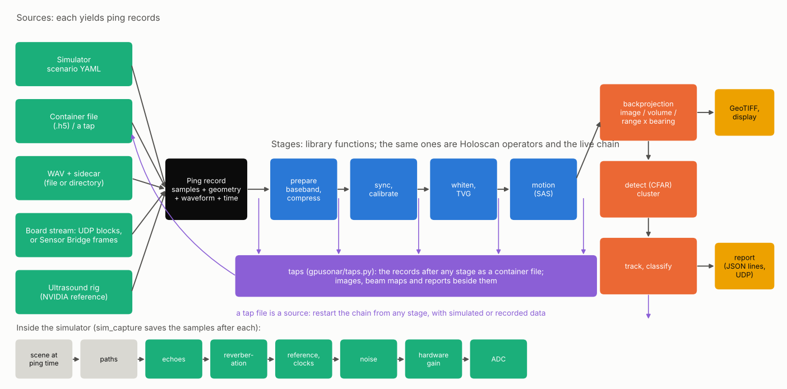

# Architecture

How the pieces fit, where each runs, and how to get at the data between them.
Diagrams are drawn by `tools/architecture_diagrams.py`.

## One record, many sources, the same stages

- **Everything between stages is a ping record** (`RECORD_FORMAT.md`): the samples of one
  transmit, with the array geometry, pose, waveform and time. Simulated and real data are
  the same thing from the first stage on.
- **Sources** yield records and are chosen by name in a config:

| `type` | What it reads | File |
| --- | --- | --- |
| `scenario` | the simulator, from a scenario YAML | `sim/` |
| `container` | a recording or a tap (`.h5`) | `sources/container.py` |
| `tap` | the records after a named stage of an earlier run | `taps.py` |
| `wav` | a WAV recording with a YAML sidecar | `sources/wav.py` |
| `wav_watch` | a directory such recordings are dropped into | `sources/wav_watch.py` |
| `flank_udp` | capture-board blocks arriving over UDP | `sources/flank_stream.py` |
| `nvus_scanner` | the NVIDIA ultrasound reference's runtime | `sources/nvus_scanner.py` |
| `picmus` | the PICMUS benchmark files | `sources/picmus.py` |

- **Stages** are library functions on records. Three things call them, and nothing else
  holds processing logic:
  - `pipeline.run(config)`: a batch chain from a YAML file (`configs/chains/`), for imaging;
  - `live.LiveChain`: one ping at a time, for the long-range arrays on a vehicle
    (`DEPLOYMENT.md`);
  - `holoscan_ops`: the same functions wrapped as Holoscan operators.
- **Configuration is data.** A sonar is `configs/sonars/<name>.yaml`; a scenario is
  `configs/scenarios/<name>.yaml`; a chain is `configs/chains/` or `configs/deploy/`.
  `CONFIGURATION.md` lists the keys and `DESIGN.md` checks the owner's designs against them.

## Looking at the data at every stage

| To get | Do |
| --- | --- |
| The records after every stage of a batch run | `output: {taps: {dir: taps/}}` in the chain's YAML |
| The same for chosen stages | `taps: {dir: taps/, stages: [prepare, whiten]}` |
| Every stage of the first pings of a live run | `output: {taps: {dir: ..., pings: 2}}` in the deploy YAML |
| The samples after each stage inside the simulator | `source: {type: scenario, name: ..., sim_taps: dir/}`, or `with taps.sim_capture(dir): run_scenario(...)` |
| What a tap directory holds | `tools/inspect_tap.py taps/` |
| Numbers per channel (RMS, peak, clipping, strongest line) | `tools/inspect_tap.py file.h5` or `taps/ --stage prepare` |
| Waveform, spectrum, all channels, spectrogram | add `--plot out.png` |
| The samples for another tool | add `--wav out.wav` (32-bit float; I and Q as separate channels for baseband) or `--npy out.npy` |
| To run later stages from a tap | `source: {type: tap, dir: taps/, stage: whiten}` and list the remaining steps |
| To put your own waveform in | write records with `gpusonar.RecordWriter` (or a WAV and a sidecar) and name the file as the source |

- A tap file is an ordinary container file, so it works as a source on any machine.
  `test_taps.py` checks that a chain restarted from a tap gives the same image.
- Simulator stages, in order: `echoes`, `reverberation`, `reference_and_clocks`, `noise`,
  `hardware_gain`, `adc`. The last equals the record the simulator returns.
- The live chain always writes the raw pings (with the pose) before processing them. That
  recording replays through the same chain and gives the same reports (`test_live.py`).

## What runs on a GPU

- The two heavy kernels, echo synthesis in the simulator and backprojection in
  processing, are written once and compiled for the host (OpenMP) and for CUDA. So are
  conditioning (cuFFT on the device) and CFAR. Select with `backend=` or
  `backend: cuda` in a config; `auto` uses the GPU when the build has it and one is present.
- **Simulation on a GPU** means synthesis on a GPU: `run_scenario(name, backend=core.Backend.Cuda)`,
  or `tools/gallery.py --backend cuda`. Path geometry, reverberation and noise are
  generated on the CPU; for scenes with many scatterers or long pulses synthesis is nearly
  all of the time (91 of about 100 s per ping in `flank_patrol` on four CPU cores).
  Measured on an L4: the 445,000-scatterer SAS scene in 96 s against 818 s on four CPU
  cores, with the same numbers out; scenes whose background is statistical reverberation
  gain little (`RESULTS.md`).
- **Beamforming for the long-range arrays** goes through the backprojection kernel
  (`flank.backprojection_map`, the live chain's default), not the NumPy far-field
  beamformer: same detections, 11 times faster on a CPU (0.55 s against 6.1 s per ping at
  32 channels and 50,000 samples), and it runs on a GPU unchanged.
- **Sparse Bayesian bearings** run as three kernels (`libs/live/include/sonar/live/sbl_kernel.hpp`)
  on CPU threads or on the device, selected by the chain's `backend`. On an L4 the whole
  chain takes 18 ms a ping with bearings from the map and 0.48 s with SBL (`RESULTS.md`).
- **Not on a GPU, and why.** Clustering, tracking and classification handle tens of
  objects per ping. MVDR, whitening, median TVG, DRC, board synchronisation and motion
  estimation are CPU code; none is the bottleneck of a chain that uses them. Reverberation generation is NumPy FFTs and is the largest CPU-only cost in the
  simulator.
- The CPU path is complete: everything runs without a GPU and gives the same results.
  `RESULTS.md` has the GPU timings and the comparison.

## What is C++ and what is Python

The long-range array's live chain exists twice, on purpose.

- **C++ (`libs/live`, program `build/bin/sonar_live`)**: board blocks over UDP to ping
  records, navigation, recording, board synchronisation, conditioning, backprojection to
  range × bearing, CFAR, clustering, sparse Bayesian bearings, tracking, classification,
  the JSON report. No Python at run time. This is what goes on a vehicle.
- **Python (`gpusonar/live.py`, `tools/sonar_live.py`)**: the same chain stage by stage in
  NumPy on top of the same C++ kernels, with taps after every stage and the simulator as a
  source. `chain: {engine: cpp}` puts the C++ chain behind the same class.
- The tests hold the two together: clustering, tracker state, classes, synchronisation
  offsets and whole reports are compared (`tests/python/test_live_cpp.py`), and
  `tests/cpp/test_live.cpp` tests the library without Python.

Everywhere else the split is: kernels and file format in C++ (CUDA where listed above);
far-field and MVDR beamforming, array calibration, the simulator's path geometry and its
reverberation sum in C++ with the NumPy versions kept as references (D-61); the
simulator's scene description, the Bellhop interface, noise, SAS motion estimation glue,
simulator calibration and all tools in Python. Holoscan operators exist in both: Python wrappers of the stages
(`holoscan_ops.py`) and C++ operators around the live library (`libs/holoscan_ops`,
program `build/bin/sonar_live_holoscan`), built and run on a GPU machine with Holoscan 4.6.

### Bearings: the map, or sparse Bayesian learning

`chain: {elevation: {...}}` with an array of stacked rows adds one stage after detection
(`gpusonar/elevation.py`, `libs/live/src/elevation.cpp`): each row is mapped on its own
and the maps added; at each detection the whole array is steered over elevation with the
backprojection kernel (host or CUDA: no kernel of its own); the report gains elevation,
depth and the corrected bearing, and tracks carry depth. Both engines do it and are
compared in `tests/python/test_elevation.py`; `tests/cpp/test_elevation.cpp` tests the
library alone. Without the key, or with one row, the stage is not there.

`chain: {doa: map}` (default) takes bearings from the beamformed map: one detection per
beam-wide blob. `doa: sbl` keeps the map and CFAR for *where in range* something is, then
solves for *which bearings* at each detected range with multi-frequency sparse Bayesian
learning (`libs/live/src/doa.cpp`). It separates arrivals closer than a beamwidth,
including coherent ones (multipath of one ping), from a single snapshot. Where a gate
holds no discrete arrival the map's detection is kept. The same solver on averaged
spectra of a recording gives passive bearing-time records (`sonar_live --passive`,
`core.doa_passive`). `RESULTS.md` has the measurements, `DECISIONS.md` D-57 the reasons.

## The long-range array's chain, stage by stage

- **Row split.** Rows are found from the hydrophone positions in each record (`elevation.find_rows`,
  `core.live_find_rows`); nothing else says how many there are. Each row is mapped on its own and
  the rows' power maps are added: detection gains, bearing and range are one row's.
- **Elevation with candidates.** At each detection the whole array is steered over elevation with
  the backprojection kernel. Rows several wavelengths apart repeat; a repeat within 1 dB is never
  trusted and the report then lists the candidates.
- **Depth.** Attitude as it was when the echo arrived (the record's attitude samples), folding of
  surface and bottom images into the water column, and a ray trace through the assumed gradient or
  a supplied profile. The sigma holds noise, roll and the unknown gradient; it does not hold the
  bias multipath adds in a shallow channel (`DESIGN.md` Sec. 3).
- **What runs on a GPU** is drawn from `LIVE_STAGES` in `tools/architecture_diagrams.py` and checked
  by `tests/python/test_architecture.py`: conditioning, the maps, CFAR, the elevation steering
  (the same backprojection kernel) and the sparse Bayesian bearings. Measured on an L4 with
  decimated pings of scenario size and the row heights before the 1.5 m change
  (`benchmarks/gpu_benchmark_all_l4.md`): the C++ chain takes 0.010, 0.021 and 0.031 s a ping for
  one, two and three rows of 32, against 0.15, 0.30 and 0.44 s on that machine's eight CPU threads.
  Raw pings at the boards' full rate have not been run on a GPU.
- **Passive** exists in the C++ library and program only.
- **The sparse Bayesian kernels take at most 64 channels in one row** (`kSblMaxChannels`,
  `libs/live/include/sonar/live/sbl_kernel.hpp`). More raise an error on the kernel path (a GPU, or
  `kernels=True`); the Eigen host path has no limit. Stacked rows of 32 are unaffected.

Hardware and timing diagrams of every build are drawn from its files by `tools/build_diagrams.py`
(`design/build_*.png`); the parts list is `design/popoto_parts.md`; a build is generated from a
spec sheet by `tools/build_from_spec.py` (`REFERENCE_DESIGN.md`).

## Calibrating the simulator to real data

`SIM_CALIBRATION.md`. Separate from array calibration (`calibrate.py`), which estimates a
real array's channel errors.

## Deployment

`DEPLOYMENT.md`: the Popoto array on a vehicle.

## Layout

| Path | What |
| --- | --- |
| `libs/core`, `libs/dsp`, `libs/recon`, `libs/sim`, `libs/detect`, `libs/io` | C++20 / CUDA: record, conditioning, backprojection, synthesis, CFAR, container file |
| `libs/live`, `apps/sonar_live.cpp` | C++20: the long-range array's live chain and the standalone program `build/bin/sonar_live` |
| `libs/holoscan_ops`, `apps/sonar_live_holoscan.cpp` | the same chain as C++ Holoscan operators and an application (`-DSONAR_BUILD_HOLOSCAN=ON`) |
| `python/gpusonar/` | bindings and everything else: `sim/`, `sources/`, `recon/`, `pipeline.py`, `live.py`, `taps.py`, `detect.py`, `classify.py`, `flank.py`, `motion.py`, `sync.py`, `calibrate.py`, `simcal.py`, `holoscan_ops.py` |
| `configs/` | `sonars/`, `scenarios/`, `chains/`, `deploy/`, `builds/` (build specs and row modules) |
| `tools/` | `test.sh`, `gallery.py`, `sonar_live.py`, `inspect_tap.py`, `calibrate_sim.py`, `design_report.py`, `scenario_diagrams.py`, `architecture_diagrams.py`, `build_diagrams.py`, `parts_list.py`, `build_from_spec.py`, `popoto_range_study.py`, `benchmark.py`, `gpu_job.sh` |
| `tests/` | GoogleTest and pytest, one command: `tools/test.sh` |
