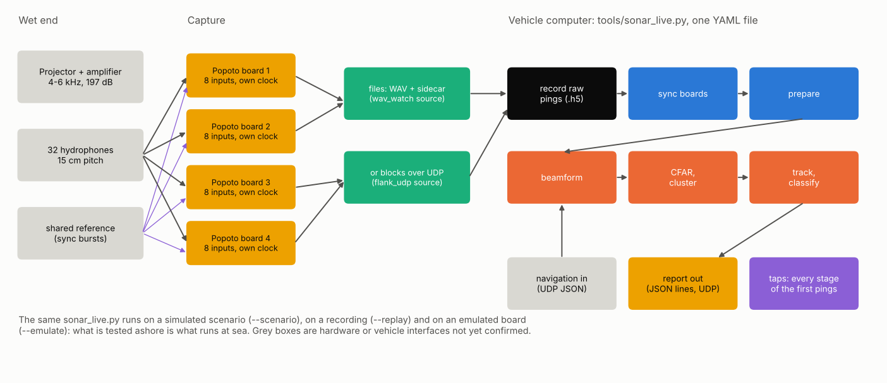

# Deploying the long-range array on a vehicle

For the Popoto-board array (`popoto_long_range`, or any `popoto_*` / `flank_*` sonar).
Nothing here has run on a vehicle or against real boards. What is tested is the software
path, end to end, on simulated data, on recordings and on an emulated board over UDP.



## What runs

One program, one YAML file:

```bash
tools/sonar_live.py configs/deploy/popoto_vehicle.yaml
```

| Part of the file | What it sets |
| --- | --- |
| `source` | where pings come from: `flank_udp` (blocks from the boards), `wav_watch` (a directory the boards write recordings into), `container` (a recording) |
| `nav` | where the vehicle's pose comes from: JSON datagrams on a UDP port, or a fixed pose |
| `chain` | the processing: board synchronisation, bearings, range cell, CFAR, tracker, classifier, CPU or GPU |
| `output` | the raw recording, the report file, the report's UDP destination, taps |

Per ping, in order (`python/gpusonar/live.py`):

1. Stamp the pose from navigation into the record.
2. **Write the raw ping to the recording.** This happens before any processing, so a
   processing fault cannot lose data.
3. Synchronise the capture boards on the shared reference and drop or blank it (`sync.py`).
4. Baseband conversion and pulse compression.
5. Beamform to range × bearing with the backprojection kernel.
6. CFAR and clustering: detections with range, bearing and SNR.
7. Track in a world-fixed frame, so ownship's motion is not put on the targets.
8. Classify each track: mover, static, multipath of another track, uncertain.
9. Emit one JSON object: detections, tracks (position, velocity, kind), sync state,
   processing time. To a file, and to the vehicle computer by UDP.

## Rehearsing it ashore with the same program

```bash
tools/sonar_live.py CONFIG --scenario popoto_12km --out run1/     # the simulator feeds the chain
tools/sonar_live.py CONFIG --replay run1/recording.h5 --out run2/ # the recording gives the same reports
tools/sonar_live.py CONFIG --emulate flank_target_1km --port 0    # simulated pings sent as board blocks over UDP
tools/inspect_tap.py run1/taps/ping0000 --stage prepare --plot p.png
```

Measured on the simulated 6 km scenario (`popoto_far_mover`, 32 hydrophones, 50,000
complex samples a ping, four CPU cores): 0.55 s of processing per ping against a 12 s ping
interval. From ping 4 on the report holds one mover (the ship, −5.8 m/s against a true
−6) and four tracks marked as its multipath.

## What the vehicle has to provide

| Interface | Form | State |
| --- | --- | --- |
| Samples from the boards | **either** WAV files with a YAML sidecar per recording, dropped into a directory (`wav_watch`), **or** blocks over UDP in the format of `sources/flank_stream.py` | The file path needs only what the boards already do. The UDP path needs a forwarder on each board that is **not written**; the block format here was designed for the flank array's capture board and is unconfirmed for Popoto boards. |
| Ping timing | the sidecar's `pings.times`, or the block headers | The transmit trigger's timing relative to the boards' clocks is unconfirmed. |
| Board synchronisation | a reference signal wired to every board (`configs/sonars/popoto_4x7.yaml`: a dedicated input per board, the plan's scheme; `popoto_4x8`: summed into a hydrophone input) | Tested in simulation with 300 µs offsets and 25 ppm drifts. The reference generator and its wiring are hardware to build. |
| Navigation | UDP JSON: `{"time_ns", "x", "y", "z", "roll", "pitch", "yaw", "vx", "vy", "vz"}`, north-east-down metres and radians, any rate; interpolated to each ping's transmit time | The adapter from the vehicle's own navigation message to this one is **not written** (the vehicle's interface is not known). Without navigation, pings are processed where the record says they are and counted in `pings_without_nav`. |
| Clock | transmit times and navigation times on one clock | Assumed. A difference shows up as tracks that move with ownship. |
| Results | UDP JSON, one datagram per ping, and a `.jsonl` file | Field names in `live.py`. Datagrams are cut at 65 kB (hundreds of tracks). |
| Compute | any Linux computer with Python 3 and the built library; a GPU is optional | Not measured on a Jetson. At the boards' full 102.4 kHz real sampling the conditioning step is heavier than in the simulated runs, which start at baseband. |

## First time on the real hardware

1. Bench, boards only: record a few pings to WAV with a known signal on every input.
   `tools/inspect_tap.py` on the result: check sample rate, channel order, clipping, the
   reference bursts on the inputs that should carry them.
2. Run `sonar_live.py` on that directory (`wav_watch`) with `nav: {static: ...}`. Check
   `sync.ok` and the offsets and drifts in the report against what the bench predicts.
3. In water, static: a known target at a known range and bearing. Check its detection's
   range and bearing; a bearing mirrored about broadside means `chain.look` is wrong.
4. Calibrate the array's channel gains, phases and positions from that target at three
   bearings (`calibrate.py`), and store the result with the sonar.
5. Under way: keep every recording. Each replays through the same chain with different
   settings (`--replay`), and its background can be used to calibrate the simulator
   (`SIM_CALIBRATION.md`) so later rehearsals match the site.

## What is not there yet

- The two adapters named above (board forwarder, navigation).
- A service wrapper. A systemd unit that runs the one command and restarts it is enough;
  none is shipped because the vehicle's operating system is not known.
- Range correction for paths that arrive by the bottom (in deep water the simulated ship
  shows 300 m long in range, `SCENARIOS.md`).
- Telling a moored object from a rock, or a ship from a whale: the classifier uses the
  track only.
- Any run at the 12 km range on real water. The design's link budget and five simulated
  oceans are in `DESIGN.md` and `SCENARIOS.md`; the ocean changes the answer by tens of dB.
