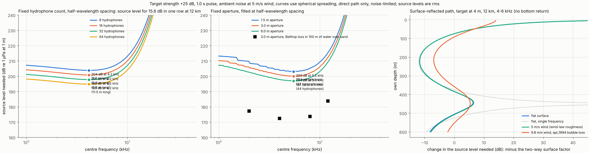
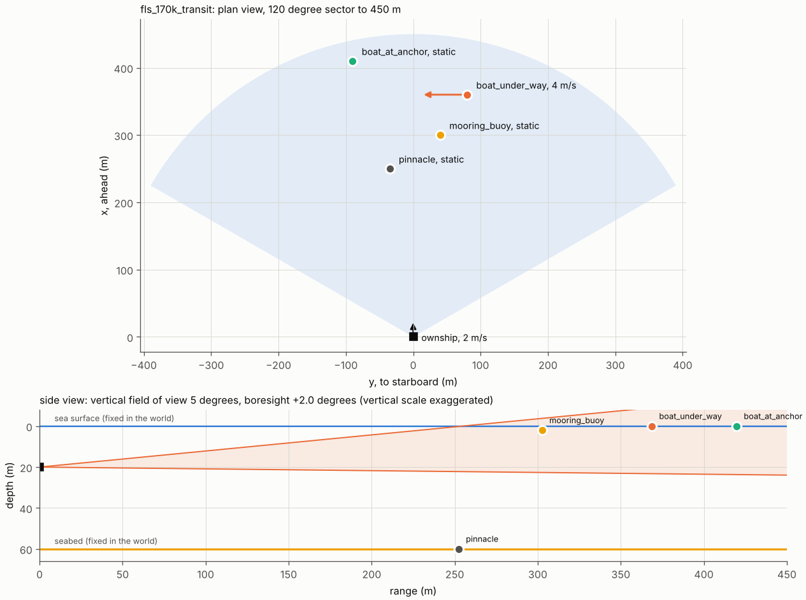
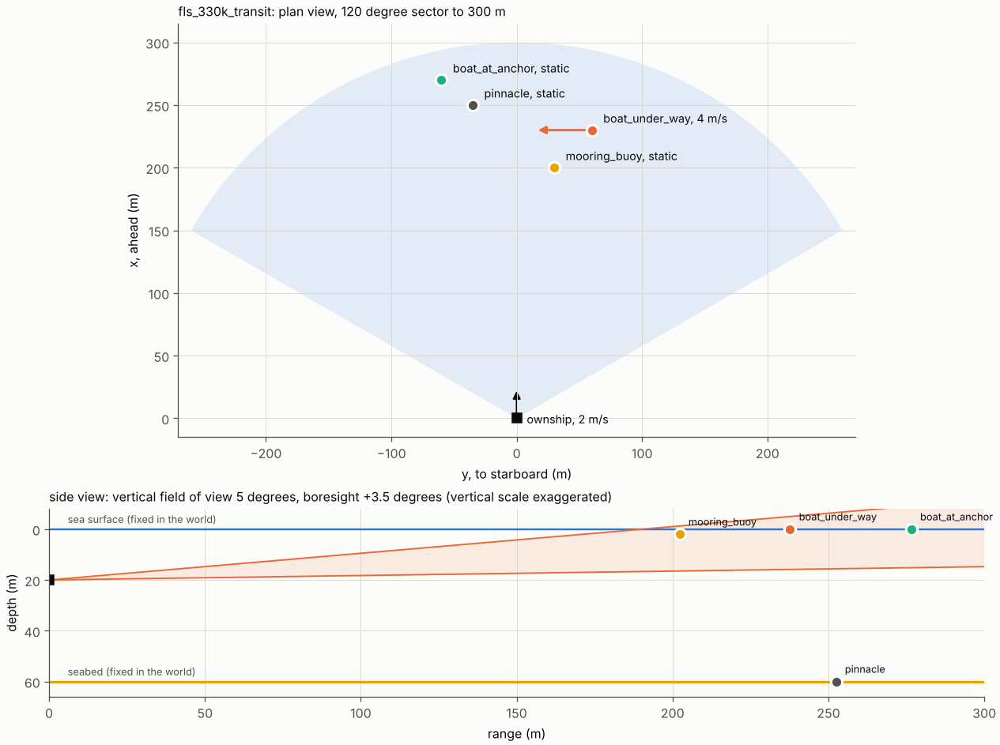
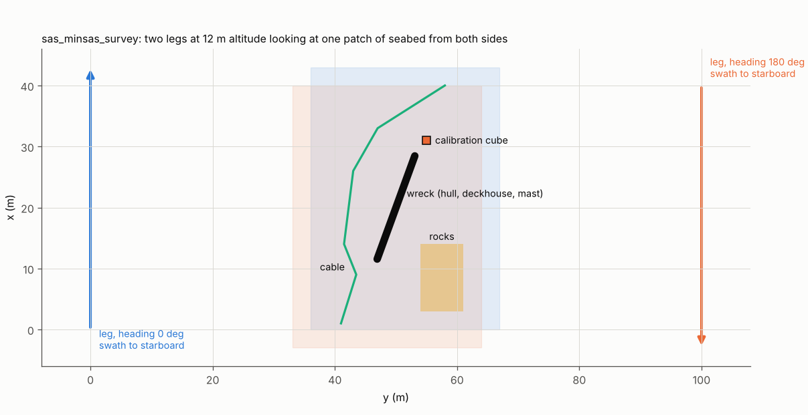
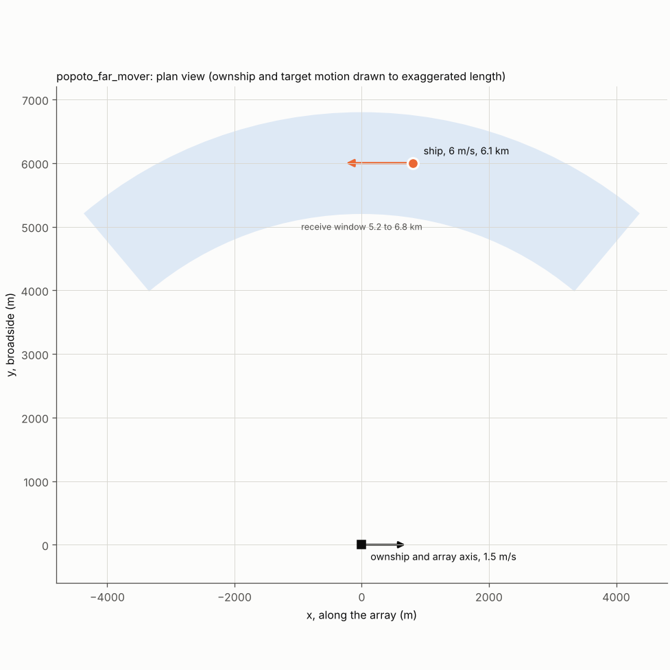

# Design

**Generated by `tools/design_report.py` from the files under `configs/`. Do not edit by hand:** change a
config (or the tool) and run it again. `tests/python/test_design.py` fails if a requirement below is
not met by the configs or if this file is out of date.

Nothing here has been built or measured. Every number is either a requirement from the owner, a value
chosen in a config file, or arithmetic on those. Published figures used for comparison are marked.

## 1. How the pieces fit

- **One record format.** Every source produces ping records; every stage takes and returns them.
- **One description per sonar.** `configs/sonars/<name>.yaml` holds the array (element count, pitch, axis,
  boresight, field of view), the transmit (band, pulse, source level) and the sampling (rate, bits, window,
  boards). The simulator, the processing and this report all read that file and nothing else.
- **One description per scenario.** `configs/scenarios/<name>.yaml` names a sonar, the platform's motion,
  the scene, the propagation model, reverberation and noise.
- **Runs on a CPU.** Every stage has a host implementation; the CUDA backend is optional and gives the same
  results. `SCENARIOS.md` lists measured CPU run times.

## 2. Requirements and where each is met

| Id | Requirement (owner) | Set in | Value found | Met |
| --- | --- | --- | --- | --- |
| FLS-120K-1 | Centre frequency 120 kHz | `configs/sonars/fls_120k.yaml: transmit.waveform.f_start, f_stop` | 120 kHz | yes |
| FLS-120K-2 | Range 300 m | `configs/sonars/fls_120k.yaml: receive.window.range` | 300 m; SNR there 63 dB (link budget) | yes |
| FLS-120K-3 | 120 degrees horizontal field of view | `configs/sonars/fls_120k.yaml: fov.horizontal_deg` | 120 degrees; no grating lobe within +/-67 degrees | yes |
| FLS-120K-4 | Vertical field of view 20 degrees, adjustable | `configs/sonars/fls_120k.yaml: fov.vertical_deg, fov.tilt_up_deg` | 20 degrees, tilted up 0.0 degrees | yes |
| FLS-120K-5 | Ownship (an AUV at about 20 m) under way against static and moving targets, one a boat hull; seabed and sea surface fixed in the world | `configs/scenarios/fls_120k_transit.yaml: platform, scene, reverberation` | depth 20 m, 2 m/s; moving: boat_under_way; static: boat_at_anchor, mooring_buoy, pinnacle; 2 boundaries with ownship Doppler | yes |
| FLS-170K-1 | Centre frequency 170 kHz | `configs/sonars/fls_170k.yaml: transmit.waveform.f_start, f_stop` | 170 kHz | yes |
| FLS-170K-2 | Range 450 m | `configs/sonars/fls_170k.yaml: receive.window.range` | 450 m; SNR there 35 dB (link budget) | yes |
| FLS-170K-3 | 120 degrees horizontal field of view | `configs/sonars/fls_170k.yaml: fov.horizontal_deg` | 120 degrees; no grating lobe within +/-80 degrees | yes |
| FLS-170K-4 | Vertical field of view 5 degrees, adjustable, steered up | `configs/sonars/fls_170k.yaml: fov.vertical_deg, fov.tilt_up_deg` | 5 degrees, tilted up 2.0 degrees | yes |
| FLS-170K-5 | Ownship (an AUV at about 20 m) under way against static and moving targets, one a boat hull; seabed and sea surface fixed in the world | `configs/scenarios/fls_170k_transit.yaml: platform, scene, reverberation` | depth 20 m, 2 m/s; moving: boat_under_way; static: boat_at_anchor, mooring_buoy, pinnacle; 2 boundaries with ownship Doppler | yes |
| FLS-330K-1 | Centre frequency 330 kHz | `configs/sonars/fls_330k.yaml: transmit.waveform.f_start, f_stop` | 330 kHz | yes |
| FLS-330K-2 | Range 300 m | `configs/sonars/fls_330k.yaml: receive.window.range` | 300 m; SNR there 31 dB (link budget) | yes |
| FLS-330K-3 | 120 degrees horizontal field of view | `configs/sonars/fls_330k.yaml: fov.horizontal_deg` | 120 degrees; no grating lobe within +/-77 degrees | yes |
| FLS-330K-4 | Vertical field of view 5 degrees, adjustable, steered up | `configs/sonars/fls_330k.yaml: fov.vertical_deg, fov.tilt_up_deg` | 5 degrees, tilted up 3.5 degrees | yes |
| FLS-330K-5 | Ownship (an AUV at about 20 m) under way against static and moving targets, one a boat hull; seabed and sea surface fixed in the world | `configs/scenarios/fls_330k_transit.yaml: platform, scene, reverberation` | depth 20 m, 2 m/s; moving: boat_under_way; static: boat_at_anchor, mooring_buoy, pinnacle; 2 boundaries with ownship Doppler | yes |
| SAS-1 | SAS like the Kraken MINSAS 120 at 330 kHz | `configs/sonars/sas_minsas120.yaml: transmit.waveform, array` | 330 kHz, 40 kHz, 1.09 m array, 2.1 x 1.9 cm (published: 40 kHz, 1.09 m, 3.3 x 3.0 cm, or 2.1 x 1.9 cm post-processed) | yes |
| SAS-2 | Survey paths | `configs/scenarios/sas_minsas_survey.yaml: platform.legs` | 2 legs, headings 0, 180 degrees; 0.54 m per ping (limit 0.544 m) | yes |
| SAS-3 | Seabed with a shipwreck, a cable, rocks and a cube for calibration | `configs/scenarios/sas_minsas_survey.yaml: scene` | seabed, wreck_hull, wreck_deckhouse, wreck_mast, cable, rocks, calibration_cube | yes |
| POP-1 | Popoto array with ownship moving and a big moving target many km away | `configs/scenarios/popoto_far_mover.yaml: platform.velocity, scene` | ownship 1.5 m/s; target at 6.1 km moving 6 m/s, +25 dB | yes |
| POP-2 | The Popoto array scales to more elements | `configs/sonars/popoto_array.yaml: array.count, receive.board_size` | 8 hydrophones on 1 boards; 16 hydrophones on 2 boards; 32 hydrophones on 4 boards; 64 hydrophones on 8 boards | yes |
| POP-3 | Frequency and source level that take the Popoto array to 12 km | `configs/sonars/popoto_long_range.yaml: transmit.waveform, array (sized by tools/popoto_range_study.py)` | 5 kHz, 197 dB, 32 hydrophones, 1 s pulse: 15 dB at 12 km with spherical spreading (study: 195 dB at 4.2 kHz for 13 dB) | yes |
| POP-4 | Popoto examples with different ocean characteristics, sound-speed profiles, bottom types and depths | `configs/scenarios/popoto_env_summer_mud_60m.yaml: propagation.environment (and the other popoto_env_* files)` | 4 environments: popoto_env_deep_silt_1000m, popoto_env_gravel_30m, popoto_env_summer_mud_60m, popoto_env_winter_sand_200m | yes |
| FLS-X | More FLS examples: a realistic boat, clutter on the seabed, waves on the sea surface | `configs/scenarios/fls_120k_cluttered_seabed.yaml: scene (also fls_120k_rough_surface, fls_170k_traffic)` | fls_120k_cluttered_seabed: boat, cable, debris, rocks, seafloor; fls_120k_rough_surface: boat, points, sea_surface, sphere; fls_170k_traffic: boat | yes |
| SAS-4 | More SAS examples with rocks | `configs/scenarios/sas_minsas_boulder_field.yaml: scene (also sas_minsas_rocky_ripples)` | sas_minsas_boulder_field: 45 rocks; sas_minsas_rocky_ripples: 47 rocks | yes |
| CFG-fls_120k | `fls_120k`: elements and array configurable | `configs/sonars/fls_120k.yaml: array.count, array.pitch, fov` | overrides checked: count 2x gives 2x aperture | yes |
| CFG-fls_170k | `fls_170k`: elements and array configurable | `configs/sonars/fls_170k.yaml: array.count, array.pitch, fov` | overrides checked: count 2x gives 2x aperture | yes |
| CFG-fls_330k | `fls_330k`: elements and array configurable | `configs/sonars/fls_330k.yaml: array.count, array.pitch, fov` | overrides checked: count 2x gives 2x aperture | yes |
| CFG-sas_minsas120 | `sas_minsas120`: elements and array configurable | `configs/sonars/sas_minsas120.yaml: array.count, array.pitch` | overrides checked: count 2x gives 2x aperture | yes |
| CFG-popoto_array | `popoto_array`: elements and array configurable | `configs/sonars/popoto_array.yaml: array.count, array.pitch` | overrides checked: count 2x gives 2x aperture | yes |
| CFG-popoto_long_range | `popoto_long_range`: elements and array configurable | `configs/sonars/popoto_long_range.yaml: array.count, array.pitch` | overrides checked: count 2x gives 2x aperture | yes |

Each row is checked by `tests/python/test_design.py`; the scenarios are run by `tests/python/test_realistic_scenes.py` (thinned) and `tools/gallery.py` (full size).

## 3. Arrays and beams

| Quantity | `fls_120k` | `fls_170k` | `fls_330k` | `sas_minsas120` | `popoto_array` | `popoto_long_range` | How it is derived |
| --- | --- | --- | --- | --- | --- | --- | --- |
| Centre frequency (kHz) | 120 | 170 | 330 | 330 | 8 | 5 | config: mean of `f_start`, `f_stop` |
| Bandwidth (kHz) | 20 | 20 | 30 | 40 | 4 | 2 | config |
| Wavelength (mm) | 12.50 | 8.82 | 4.55 | 4.55 | 187.50 | 300.00 | c / f at 1500 m/s |
| Elements | 128 | 128 | 128 | 48 | 32 | 32 | config: `array.count` |
| Pitch (mm) | 6.0 | 4.2 | 2.2 | 22.7 | 94.0 | 150.0 | config: `array.pitch` |
| Pitch at the top of the band (wavelengths) | 0.520 | 0.504 | 0.506 | 5.289 | 0.627 | 0.600 | pitch / (c / f_stop) |
| Steering with no grating lobe (deg, each side) | 67 | 80 | 77 | 0 | 37 | 42 | asin(wavelength / pitch − 1) |
| Array length (m) | 0.768 | 0.538 | 0.282 | 1.088 | 3.008 | 4.800 | elements × pitch |
| Beamwidth at broadside (deg) | 0.83 | 0.83 | 0.82 | 0.21 | 3.16 | 3.17 | 0.886 wavelength / length |
| Cross-range cell at full range (m) | 4.33 | 6.54 | 4.29 | 0.74 | 375.55 | 703.26 | range × beamwidth |
| Range resolution (cm) | 3.75 | 3.75 | 2.50 | 1.88 | 18.75 | 37.50 | c / 2B, before windowing |
| Horizontal field of view (deg) | 120 | 120 | 120 | 10 | omni | omni | config: `fov.horizontal_deg` or element width |
| Vertical field of view (deg) | 20 | 5 | 5 | 19 | omni | omni | config: `fov.vertical_deg` or element height |
| Boresight above horizontal (deg) | 0.0 | 2.0 | 3.5 | -15.0 | 0.0 | 0.0 | config: `fov.tilt_up_deg` or `array.boresight` |
| Element width along the array (mm) | 5.3 | 3.7 | 1.9 | 22.0 | omni | omni | config, or 0.886 wavelength / horizontal field of view |
| Element height (mm) | 31.7 | 89.6 | 46.1 | 12.0 | omni | omni | config, or 0.886 wavelength / vertical field of view |
| Capture boards | 1 | 1 | 1 | 1 | 4 | 4 | config: `receive.board_size` |

SAS-specific (`sas_minsas120`): along-track resolution 2.1 cm (half the 4.2 cm transmit aperture); transmit beam 5.5 degrees, so the synthetic aperture is 4.8 m long at 50 m; the platform may advance at most 0.544 m per ping (half the array), which at the full 200 m range allows 2.00 m/s. Kraken publishes 40 kHz, a 109 cm array, 3.3 cm × 3.0 cm and 2 to 6 knots for the MINSAS 120; the 330 kHz centre frequency is the owner's figure; element count, pitch and element sizes are choices made here.

The Popoto array is shown as its scenario uses it (32 hydrophones, 6–10 kHz). `array.count` sets the size; boards of eight inputs follow.

### Option: stacked rows on the long-range Popoto array (elevation and depth)

One horizontal line of hydrophones measures one angle: the angle between an arrival and the line itself (the cone
angle). It cannot tell an echo from above from one from below, it reports the bearing of anything off the
horizontal a little wrong, and it knows nothing of depth. A second line of 32 hydrophones at a different height on the
vehicle (or a third) measures the missing angle, in the active mode and in the passive one.

This is an option. One row stays the default; the software processes a one-row array exactly as before (the report
lines are identical to the last digit, checked). The numbers below are from `tools/popoto_elevation_study.py`
(analysis, with the estimator checked by Monte Carlo) and `tools/popoto_elevation_bench.py` (the software run on
simulated pings). Nothing here has been on a vehicle.

**What is offered**

| | One row (default) | Two rows | Three rows |
| --- | --- | --- | --- |
| Sonar file | `popoto_long_range` | `popoto_long_range_2row` | `popoto_long_range_3row` |
| Row heights about the hull's centreline (m) | 0 | -0.19, +0.19 | -0.19, 0, +0.19 |
| Hydrophones | 32 | 64 | 96 |
| Capture boards (8 inputs each, own clock, one synchronisation reference input summed in) | 4 | 8 | 12 |
| Cables to the boards: one per hydrophone, plus the reference to every board | 32 + 4 | 64 + 8 | 96 + 12 |
| Raw data rate while receiving, 102.4 kHz × 24 bit (Mbit/s) | 79 | 157 | 236 |
| One ping to 12.7 km as recorded now, 1,836,373 samples per channel × 4 bytes (MB) | 235 | 470 | 705 |
| The same per hour at one ping every 17.9 s (GB) | 47 | 94 | 142 |
| Processing per ping, C++ chain on 4 CPU threads of a shared machine, pings of the `popoto_12km` scenario's size (s) | 1.20 | 1.85 | 2.90 |
| The same for one full-length ping at the boards' rate (1,809,067 real samples per channel), against the 17.9 s between pings (s) | 15.5 | 23.5 | 37.7 |
| One-sigma elevation at 13 / 20 / 30 dB (deg) | none | 1.60 / 0.72 / 0.23 | 1.60 / 0.72 / 0.23 |
| Second elevation lobe inside ±30°, arrival at 0° / 10° / 20° | n/a | -8 dB / -1 dB / -1 dB | none / -12 dB / -11 dB |
| Detection against one row, same false-alarm rate (dB) | 0 | 2.4 | 3.7 |

The heights assume a round hull of 0.533 m (21 inch) with the rows 45° below and above its widest point. **The hull, its fairing and where hydrophones can be mounted are not confirmed**; the heights are in the sonar files under
`unconfirmed`, and the layout takes any heights, any number of rows, and an offset outwards for each (a curved hull).

**How accurate, and what that is in depth.** The bound on elevation for one arrival in noise is
σ(sin e) = 1 / (k √(2 ρ Σ(h − h̄)²)), with ρ the signal-to-noise ratio at one hydrophone after pulse compression, h the
heights of all hydrophones and k the band's RMS wavenumber. For two rows d apart and a row's SNR ρ_row after its own
beamforming that is λ / (π d √(2 ρ_row)): accuracy is bought with row separation and with SNR, nothing else. The
estimator in the chain reaches the bound (Monte Carlo over bound: 0.99 at 20 dB; on simulated pings within 30%).

| Rows | 13 dB | 20 dB | 30 dB | No second lobe within (at 6 kHz) | Fits the assumed hull |
| --- | --- | --- | --- | --- | --- |
| 2 rows, 0.07 m apart | 8.11° | 3.62° | 1.15° | ±90° | yes |
| 2 rows, 0.15 m apart | 4.06° | 1.81° | 0.57° | ±56° | yes |
| 2 rows, 0.25 m apart | 2.43° | 1.09° | 0.34° | ±30° | yes |
| 2 rows, 0.38 m apart | 1.60° | 0.72° | 0.23° | ±19° | yes |
| 2 rows, 0.50 m apart | 1.22° | 0.54° | 0.17° | ±14° | no |
| 2 rows, 0.75 m apart | 0.81° | 0.36° | 0.11° | ±10° | no |
| 2 rows, 1.00 m apart | 0.61° | 0.27° | 0.09° | ±7° | no |

Three or four rows inside the same 0.38 m are no more accurate than two (0.72° at 20 dB): the top-to-bottom span sets the accuracy. What the middle row buys is the removal of the second lobe.

Depth error is range × elevation error. With the link budget of Sec. 5 for one row (spherical spreading, noise only):

| Target, rows | 1 km | 6 km | 12 km |
| --- | --- | --- | --- |
| *ship, +25 dB: SNR* | 65 dB | 31 dB | 15 dB |
| ship, +25 dB; 2 rows, 0.38 m apart | 1.2 m | 22 m | 278 m |
| ship, +25 dB; 2 rows, 1.00 m apart | 0.5 m | 8.4 m | 106 m |
| *small target, +5 dB: SNR* | 45 dB | 11 dB | -5 dB |
| small target, +5 dB; 2 rows, 0.38 m apart | 1.2 m | 222 m | not detected |
| small target, +5 dB; 2 rows, 1.00 m apart | 0.5 m | 84 m | not detected |

(SNR above 40 dB is counted as 40 dB.) Read plainly: on a hull of this size the option gives **depth to a few metres at 1 km, to about 22 m at 6 km on a ship-sized target, and at 12 km only whether the echo comes from
above or below, after several pings** (278 m one-sigma per ping; a track averages its pings). Rows a metre apart would be 2.6 times better and do not fit.
At short range the limit is not noise but roll, mounting and the channel (below).

**Which lobe.** Two rows d apart cannot tell elevations λ / d apart in sin(e). Half a wavelength apart (0.125 m at 6 kHz) there is
no second lobe at all; at 0.38 m the sector without one is ±19° at 6 kHz (±30° at 4 kHz). The band smears the second lobe
only a little: with two rows it stands 1.4 dB below the true one for an arrival at 10° and 0.6 dB at 20°, and at 13 dB the
estimator picks it 6% of the time at 20°. The chain flags such detections (`elevation_ambiguous`) and keeps them out of the tracks' depth.
A third row halfway (rows 0.19 m apart, less than a wavelength) leaves no lobe above -11 dB anywhere in ±30°.
On a hull this small equal spacing is the better choice; unequal spacings pay only when the span is several wavelengths.

How steep arrivals are decides between two rows and three (straight rays; direct path / one bounce / two bounces):

| Water depth | 1 km | 3 km | 6 km | 12 km |
| --- | --- | --- | --- | --- |
| 30 m | 1.7/3.4/5.1° | 0.6/1.1/1.7° | 0.3/0.6/0.9° | 0.1/0.3/0.4° |
| 100 m | 5.7/11.3/16.7° | 1.9/3.8/5.7° | 1.0/1.9/2.9° | 0.5/1.0/1.4° |
| 1000 m | 45.0/63.4/71.6° | 18.4/33.7/45.0° | 9.5/18.4/26.6° | 4.8/9.5/14.0° |

In shallow water beyond 1 km everything arrives within about 10° of level and **two rows are enough**. In deep water, or inside
1 km, arrivals are steeper and **three rows are needed** to trust the lobe. A sand bottom reflects fully only below 25° grazing, so steeper bounce paths die out.

**Bearing.** A line reports sin(cone) = cos(elevation) × sin(bearing): the bearing of an arrival off the horizontal is too small.
With the elevation known the chain reports the horizontal bearing (`bearing_deg`; `cone_bearing_deg` keeps the old value).
Error removed, in degrees:

| Elevation | 15° off broadside | 30° | 45° | 60° | Cross-range at 45°, 1 km / 12 km |
| --- | --- | --- | --- | --- | --- |
| 2° | 0.01 | 0.02 | 0.03 | 0.06 | 1 m / 7 m |
| 5° | 0.06 | 0.13 | 0.22 | 0.38 | 4 m / 46 m |
| 10° | 0.24 | 0.51 | 0.89 | 1.57 | 16 m / 187 m |
| 20° | 0.99 | 2.15 | 3.81 | 7.16 | 66 m / 797 m |

In shallow water at long range this is small (arrivals within 2° of level: 0.03°). It matters in deep water and close in.

**In a channel.** One target sends back several echoes: straight, by the surface, by the bottom, and by mixtures. In 100 m of water with the array at 30 m and a target at 50 m depth 1 km away they arrive from -1.1°, +4.6° (3.0 m later in range) and -6.8° (7.0 m later).

- The rows' own beam in elevation is 40° wide. Arrivals are **never separated by elevation**, only by range (resolution 0.375 m); elevation is then measured on each arrival that range has separated.
- The direct echo is the first. The chain searches back to the leading edge of each detection and takes the first arrival that stands
  clear (`elevation.arrival: first`), so the depth it reports is the direct path's.
- Followed straight back, a surface echo points at the target's mirror image above the surface and a bottom echo at its image below
  the bottom. Folded back into the water column both give the target's depth again, and where the image lay says which path it
  was (`path`: direct, surface, bottom). A track whose depth stays outside the water column is marked multipath without needing its
  parent track.
- Direct and surface echoes are 2 × (array depth) × (target depth) / range apart. For a target near the surface they are one
  detection at every useful range (beyond 0.6 km for a target at 4 m; 8 km at 50 m). The merged pair reads as a source at the surface,
  which for a ship is the right answer and for a shallow diver or mine is a depth error of its own depth.
- Echoes that go out by one path and back by another arrive between these, two at a time from different elevations at the same
  range. Their elevation is a mixture; the quality figure drops and below `min_quality` none is reported.
- The unweighted pulse has range sidelobes 13 dB down. In a channel the neighbours' sidelobes pull each arrival's elevation by up to
  about a degree (17 m at 1 km): in multipath, that and not noise is the short-range accuracy.

Measured on simulated pings (C++ chain; the Python chain agrees to 0.01° and 0.2 m):

| Scenario | Truth | Reported |
| --- | --- | --- |
| `popoto_elevation_free`: free field, vehicle rolled 3°, three targets near 1 km, 5 pings | depths 10, 60, 160 m | track depth errors -0.3, -0.1, -0.4 m (reported sigma 2.2 m) |
| `popoto_elevation_shallow`: 100 m of water, bounces to second order, target at 1 km | depth 50 m, direct path -1.15° | depth 40 to 42 m over 4 pings, path direct |
| `popoto_elevation_rehearsal`: raw 102.4 kHz, 8 boards on their own clocks, rolled 4°, pitched 1°, 100 m of water | targets at 60 m and 8 m | boards synchronised to 0.42 µs; 60 to 63 m; the shallow one 0.7 to 1.4 m (its direct and surface echoes merged) |

**Passive.** Listening (`--passive`, `--listen` with `elevation=1`) gives every bearing an elevation the same way: each row is steered at
the bearing in every frequency bin and block of a frame, and the rows' beams are steered over elevation. On simulated broadband
sources 1 km away at 20 m and 250 m depth, heard from 100 m with the vehicle rolled 3°, each 0.2 s frame gives both elevations within
1.5° (`tests/python/test_elevation.py`). The second-lobe and roll remarks above apply unchanged; there is no range, so no depth,
from one position.

**Bent rays.** By default depth is range × the sine of the level elevation: a straight ray. In a sound-speed gradient g the ray curves
with radius c / g and the straight line is wrong by about range² × g / 2c: 6 m at 1 km; 51 m at 3 km; 204 m at 6 km in isothermal water (+0.017 /s),
far more through a thermocline. Given a profile (`elevation.ssp`) the chain follows the ray through it instead, with turning
points and reflections. **Beyond a few kilometres depth needs the profile**; the vehicle has to supply one (CTD cast or model).

**What the vehicle and the mounting must provide.** Elevation is measured against the vehicle; depth needs it against the horizon.

| Error source | Elevation error | Depth error at 1 km / 6 km / 12 km |
| --- | --- | --- |
| Roll known to 0.1° | 0.1° | 1.7 / 10 / 21 m |
| Roll known to 0.2° | 0.2° | 3.5 / 21 / 42 m |
| Roll known to 0.5° | 0.5° | 8.7 / 52 / 105 m |
| Roll known to 1.0° | 1.0° | 17.5 / 105 / 209 m |
| One row further out than the drawing by 1.0 mm | 0.15° | 3 / 16 / 32 m |
| One row further out than the drawing by 5.0 mm | 0.75° | 13 / 79 / 158 m |
| Phase mismatch between the rows' channels of 5.0° of phase | 0.63° | 11 / 66 / 132 m |
| Clock error between boards on different rows of 0.5 µs | 0.11° | 2 / 12 / 24 m |
| Clock error between boards on different rows of 1.0 µs | 0.23° | 4 / 24 / 47 m |
| Clock error between boards on different rows of 8.3 µs | 1.88° | 33 / 197 / 393 m |

- **Roll.** Roll error is elevation error one for one. The attitude sensor's roll accuracy is the first number to ask the vehicle
  team for; it is `elevation.roll_sigma_deg` in the deployment file (0.2° assumed, unconfirmed) and goes into every reported depth
  sigma. **Not done yet:** the chain applies the roll navigation gives for the transmit time. An echo from 12 km arrives 16 s
  later; if the vehicle rolls in between, the difference is a depth error. Until roll is applied at each echo's arrival time the
  depths hold for a vehicle that keeps its roll over a ping.
- **Mounting.** The rows' heights matter little (a 5 mm error in separation is 0.13° at 10° elevation, nothing at 0°). Their offset outwards
  matters a great deal: 1 mm is 0.15°. No drawing will be that good; the offset is calibrated in water (below).
- **Synchronisation.** The present tolerance between boards (a twentieth of a period, 8.3 µs) is fine for bearing and far too
  loose for elevation. The reference scheme reaches 0.42 µs in simulation with 300 µs offsets and 25 ppm drifts (0.1°). Wiring
  each board to four hydrophones of each row at the same stations (`array.interleave: 4`) makes the rows of a pair share a
  clock and removes the term for two rows; the price is that a dead board then takes four stations out of both rows.
- **Calibration.** The existing calibration (`calibrate.py`) fits each channel's gain, phase and position from known sources. With
  rows it must be run with sources at several elevations as well as bearings (a source lowered to three depths at three
  bearings); in simulation it recovers a row mounted 5 mm out to 0.4 mm and removes the 0.75° it caused.
- **Dead channels.** Rows are found from the hydrophone positions in the record, whatever the wiring. `chain.dead_channels` leaves
  channels out; a dead hydrophone or a dead board shortens a row and the estimate carries on (tested with one hydrophone and
  one board out: depths within 5 m at 1 km).

**Data path.** Checked at the boards' rate (102.4 kHz, 24 bit) with 64 and 96 channels: board blocks over UDP (64 and 42 samples a datagram, 1600 and 2438 datagrams a second), the C++ and Python assemblers,
Sensor Bridge frames (307,328 and 460,928 bytes for 1600 samples), the container file and the C++ chain all carry them unchanged
(samples back within half a count). The record format already stores every hydrophone's position: no format change.
The elevation stage runs on the backprojection kernel (host or CUDA), so it needs no GPU code of its own; it has not been run on a GPU.

**Compute.** Cost grows in proportion to the rows. On pings already at baseband (8 kHz complex, the scenario's size) the C++ chain takes 1.2, 1.9 and 2.9 s for one, two and three rows.
On one full-length ping as the boards deliver it (102.4 kHz real, 0.5 to 13 km) it takes 15, 24 and 38 s on 4 CPU threads of a shared machine, against 17.9 s between pings:
**on a CPU of this class the chain does not keep up with two or three rows at the boards' full rate, and barely with one.** The band is 2 kHz wide, so the
samples carry 13 times more than needed: converting to baseband and decimating before the chain (on the boards or in a first stage on the
vehicle computer), or a GPU (the one-row map was 17 times faster on an L4, `RESULTS.md`), closes the gap. Neither is done for rows; it is a
decision to take with the vehicle computer.

**What it does not improve.** Bearing resolution and range resolution (the array is no longer and the band no wider). Left/right: rows in one vertical plane cannot tell port from starboard; the hull behind the array does that, as now. Detection range, much: 2.4 dB with two rows, roughly a tenth more range under spherical spreading. Depth at 12 km in shallow water.

**Unconfirmed, and for the owner to decide** (all in config under `unconfirmed`, none in code): the hull diameter and where rows can be
mounted, which sets the separation and with it every accuracy above; whether 8 or 12 boards, their power and their cabling fit the
vehicle; row-by-row or interleaved wiring; the attitude sensor's roll accuracy and its time stamp; whether the vehicle can supply
water depth and a sound-speed profile; and, as for one row, whether Popoto boards can be batched and synchronised at all.

## 4. Timing and data

| Quantity | `fls_120k` | `fls_170k` | `fls_330k` | `sas_minsas120` | `popoto_array` | `popoto_long_range` | How it is derived |
| --- | --- | --- | --- | --- | --- | --- | --- |
| Full range (m) | 300 | 450 | 300 | 200 | 6800 | 12700 | config: `receive.window.range` (scenario window for the Popoto array) |
| Pulse length (ms) | 10.0 | 20.0 | 10.0 | 5.0 | 1000.0 | 1000.0 | config |
| Shortest ping interval (s) | 0.410 | 0.620 | 0.410 | 0.272 | 10.067 | 17.933 | 2 × range / c + pulse |
| ADC rate (kHz) | 500.0 | 750.0 | 1500.0 | 1500.0 | 102.4 | 102.4 | config: `receive.sample_rate` |
| ADC bits | 16 | 16 | 16 | 16 | 24 | 24 | config |
| Samples per ping per channel | 205000 | 465000 | 615000 | 407500 | 1030827 | 1836373 | interval × rate |
| Raw data rate while receiving (Mbit/s) | 1024.0 | 1536.0 | 3072.0 | 1152.0 | 78.6 | 78.6 | elements × rate × bits |

The simulations take the receive chain as already at complex baseband (twice the bandwidth), which is what a
front end with digital down-conversion would deliver; the ADC rates above are for sampling the carrier directly.

## 5. Link budgets

Output SNR = SL − 2 TL + TS − NL + array gain + 10 log10(T), with spherical spreading plus Francois–Garrison
absorption and the four-term ambient-noise fit at 5 m/s wind (`gpusonar.sonar_equation`).

| Quantity | `fls_120k` | `fls_170k` | `fls_330k` | `sas_minsas120` | `popoto_array` | `popoto_long_range` |
| --- | --- | --- | --- | --- | --- | --- |
| Source level (dB re 1 µPa at 1 m) | 210 | 210 | 210 | 215 | 185 | 197 |
| Absorption (dB/km) | 41.3 | 52.9 | 83.7 | 79.5 | 0.6 | 0.3 |
| Noise spectrum level (dB re 1 µPa²/Hz) | 28.9 | 30.3 | 35.4 | 35.4 | 47.9 | 51.5 |
| Target strength assumed (dB) | 5 | 5 | 5 | -73 | 25 | 25 |
| Array gain (dB) | 21.1 | 21.1 | 21.1 | 32.3 | 15.1 | 15.1 |
| Pulse-compression gain, 10 log10(BT) (dB) | 23.0 | 26.0 | 24.8 | 23.0 | 36.0 | 33.0 |
| **SNR at full range (dB)** | 63.3 | 35.0 | 31.4 | -7.8 | 15.4 | 13.4 |
| Range at which SNR falls to 13 dB (m) | 724 | 608 | 384 | 123 | 7439 | 12915 |

Target assumed: `fls_120k`: small boat hull; `fls_170k`: small boat hull; `fls_330k`: small boat hull; `sas_minsas120`: one resolution cell of seabed (2.1 cm x 1.9 cm) at -27 dB Lambert and 15 degrees grazing; array gain includes the pings of the synthetic aperture at full range; `popoto_array`: ship-sized target; `popoto_long_range`: ship-sized target.

- **SAS:** with a 215 dB source a single cell of seabed stays 13 dB above noise out to 123 m, not the 200 m of the receive window (-8 dB there). Objects are much stronger than one cell of sand. The array gain is evaluated at full range and is smaller closer in, so the curve is optimistic at short range.
- **170 kHz:** specified to 450 m after the first budget showed 14 dB at 600 m.

### Popoto array to 12 km: which frequency and how much power

From `tools/popoto_range_study.py`: target +25 dB, 1 s pulse, 13 dB at the beamformer output, ambient noise at 5 m/s wind, spherical spreading plus absorption.

- **The present band cannot do it.** At 27.5 kHz absorption alone costs about 136 dB over the 24 km round trip; 12 km would need 319 dB. With 8 hydrophones at 190 dB that band reaches about 2.8 km on this budget.
- **The frequency has to come down to 4 to 6 kHz.** Below that, ambient noise rises and a half-wavelength array of a
  given count gets long; above it, absorption takes over.

| Array (half-wavelength spacing) | Best frequency | Array length | Source level for 12 km | Acoustic power, omnidirectional projector |
| --- | --- | --- | --- | --- |
| 8 hydrophones | 4.2 kHz | 1.4 m | 201 dB | 1088 W |
| 16 hydrophones | 4.2 kHz | 2.9 m | 198 dB | 544 W |
| 32 hydrophones | 4.2 kHz | 5.8 m | 195 dB | 272 W |
| 64 hydrophones | 4.2 kHz | 11.5 m | 192 dB | 136 W |
| 1.5 m aperture (11 hydrophones) | 5.5 kHz | 1.5 m | 200 dB | 897 W |
| 3.0 m aperture (22 hydrophones) | 5.5 kHz | 3.0 m | 197 dB | 449 W |
| 6.0 m aperture (44 hydrophones) | 5.5 kHz | 6.0 m | 194 dB | 224 W |

- **Chosen (`popoto_long_range`):** 32 hydrophones at 15 cm (4.8 m), 4 to 6 kHz, 1 s, 197 dB: 15 dB at 12 km on this budget. Acoustic power is 10^((SL - 170.8 - DI) / 10) W; a projector with directivity needs less, and electrical power is
  higher by the transducer's efficiency (not known until a projector is chosen). Doubling the hydrophones saves 3 dB;
  doubling the pulse length saves 3 dB.
- **Spherical spreading is the cautious case.** In shallow water sound is trapped between surface and bottom:
  Bellhop for 100 m of isovelocity water over sand, 3 m aperture, gives

| Frequency | One-way loss, Bellhop | One-way loss, spherical | Source level for 12 km (noise only) |
| --- | --- | --- | --- |
| 2 kHz | 69.0 dB | 83.1 dB | 175 dB |
| 4 kHz | 70.4 dB | 84.6 dB | 170 dB |
| 8 kHz | 75.1 dB | 89.3 dB | 171 dB |
| 12 kHz | 82.6 dB | 96.8 dB | 181 dB |

  That is 14 dB less loss each way, but it holds only for that depth, bottom and profile, and at those levels
  reverberation, not noise, decides detection. The `popoto_env_*` scenarios (`SCENARIOS.md`) show how much the
  environment moves the answer: a downward-refracting summer profile over mud loses far more than spherical spreading.

- The boards sample at 102.4 kHz and need no change for this band; the hydrophones, the projector and its power
  amplifier do. None is chosen; the values are in `configs/sonars/popoto_long_range.yaml` under `unconfirmed`.

- These are noise-limited figures. Reverberation, which the scenarios include, usually sets the limit at short
  and medium range.
- Source levels are design values, not measured; the front-end sensitivities and gains in the configs are placeholders.
- For the Popoto array the simulation uses Bellhop multipath, which in shallow water carries more energy to long
  range than spherical spreading (see `RESULTS.md`).

## 6. Scenario geometry

Every scenario, including those not shown here, has a plan and side view drawn from its file by
`tools/scenario_diagrams.py` in `docs/scenarios/`. Simulated images, animations, detections and tracks are in
`SCENARIOS.md`.
