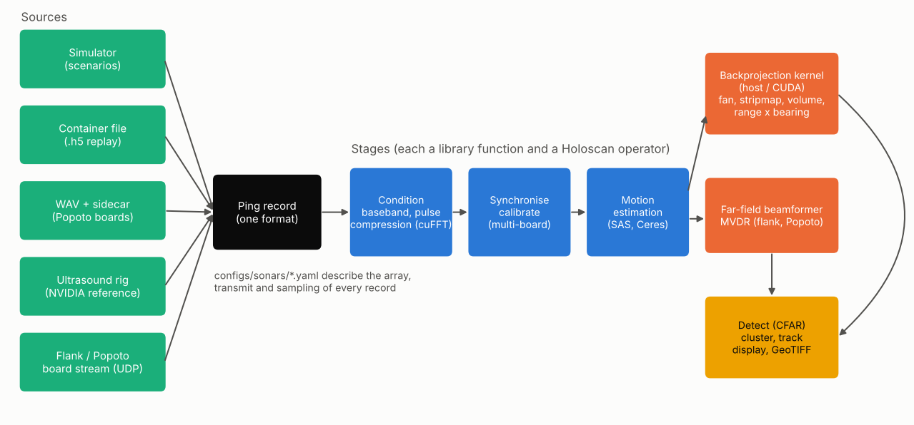
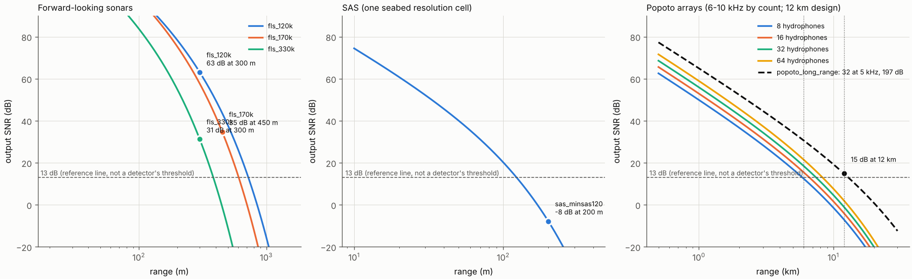

# Design

**Generated by `tools/design_report.py` from the files under `configs/`. Do not edit by hand:** change a
config (or the tool) and run it again. `tests/python/test_design.py` fails if a requirement below is
not met by the configs or if this file is out of date.

Nothing here has been built or measured. Every number is either a requirement from the owner, a value
chosen in a config file, or arithmetic on those. Published figures used for comparison are marked.

## 1. How the pieces fit

- **One record format.** Every source produces ping records; every stage takes and returns them.
- **One description per sonar.** `configs/sonars/<name>.yaml` holds the array (element count, pitch, axis,
  boresight, field of view), the transmit (band, pulse, source level) and the sampling (rate, bits, window,
  boards). The simulator, the processing and this report all read that file and nothing else.
- **One description per scenario.** `configs/scenarios/<name>.yaml` names a sonar, the platform's motion,
  the scene, the propagation model, reverberation and noise.
- **Runs on a CPU.** Every stage has a host implementation; the CUDA backend is optional and gives the same
  results. `SCENARIOS.md` lists measured CPU run times.

## 2. Requirements and where each is met

| Id | Requirement (owner) | Set in | Value found | Met |
| --- | --- | --- | --- | --- |
| FLS-120K-1 | Centre frequency 120 kHz | `configs/sonars/fls_120k.yaml: transmit.waveform.f_start, f_stop` | 120 kHz | yes |
| FLS-120K-2 | Range 300 m | `configs/sonars/fls_120k.yaml: receive.window.range` | 300 m; SNR there 63 dB (link budget) | yes |
| FLS-120K-3 | 120 degrees horizontal field of view | `configs/sonars/fls_120k.yaml: fov.horizontal_deg` | 120 degrees; no grating lobe within +/-67 degrees | yes |
| FLS-120K-4 | Vertical field of view 20 degrees, adjustable | `configs/sonars/fls_120k.yaml: fov.vertical_deg, fov.tilt_up_deg` | 20 degrees, tilted up 0.0 degrees | yes |
| FLS-120K-5 | Ownship (an AUV at about 20 m) under way against static and moving targets, one a boat hull; seabed and sea surface fixed in the world | `configs/scenarios/fls_120k_transit.yaml: platform, scene, reverberation` | depth 20 m, 2 m/s; moving: boat_under_way; static: boat_at_anchor, mooring_buoy, pinnacle; 2 boundaries with ownship Doppler | yes |
| FLS-170K-1 | Centre frequency 170 kHz | `configs/sonars/fls_170k.yaml: transmit.waveform.f_start, f_stop` | 170 kHz | yes |
| FLS-170K-2 | Range 450 m | `configs/sonars/fls_170k.yaml: receive.window.range` | 450 m; SNR there 35 dB (link budget) | yes |
| FLS-170K-3 | 120 degrees horizontal field of view | `configs/sonars/fls_170k.yaml: fov.horizontal_deg` | 120 degrees; no grating lobe within +/-80 degrees | yes |
| FLS-170K-4 | Vertical field of view 5 degrees, adjustable, steered up | `configs/sonars/fls_170k.yaml: fov.vertical_deg, fov.tilt_up_deg` | 5 degrees, tilted up 2.0 degrees | yes |
| FLS-170K-5 | Ownship (an AUV at about 20 m) under way against static and moving targets, one a boat hull; seabed and sea surface fixed in the world | `configs/scenarios/fls_170k_transit.yaml: platform, scene, reverberation` | depth 20 m, 2 m/s; moving: boat_under_way; static: boat_at_anchor, mooring_buoy, pinnacle; 2 boundaries with ownship Doppler | yes |
| FLS-330K-1 | Centre frequency 330 kHz | `configs/sonars/fls_330k.yaml: transmit.waveform.f_start, f_stop` | 330 kHz | yes |
| FLS-330K-2 | Range 300 m | `configs/sonars/fls_330k.yaml: receive.window.range` | 300 m; SNR there 31 dB (link budget) | yes |
| FLS-330K-3 | 120 degrees horizontal field of view | `configs/sonars/fls_330k.yaml: fov.horizontal_deg` | 120 degrees; no grating lobe within +/-77 degrees | yes |
| FLS-330K-4 | Vertical field of view 5 degrees, adjustable, steered up | `configs/sonars/fls_330k.yaml: fov.vertical_deg, fov.tilt_up_deg` | 5 degrees, tilted up 3.5 degrees | yes |
| FLS-330K-5 | Ownship (an AUV at about 20 m) under way against static and moving targets, one a boat hull; seabed and sea surface fixed in the world | `configs/scenarios/fls_330k_transit.yaml: platform, scene, reverberation` | depth 20 m, 2 m/s; moving: boat_under_way; static: boat_at_anchor, mooring_buoy, pinnacle; 2 boundaries with ownship Doppler | yes |
| SAS-1 | SAS like the Kraken MINSAS 120 at 330 kHz | `configs/sonars/sas_minsas120.yaml: transmit.waveform, array` | 330 kHz, 40 kHz, 1.09 m array, 2.1 x 1.9 cm (published: 40 kHz, 1.09 m, 3.3 x 3.0 cm, or 2.1 x 1.9 cm post-processed) | yes |
| SAS-2 | Survey paths | `configs/scenarios/sas_minsas_survey.yaml: platform.legs` | 2 legs, headings 0, 180 degrees; 0.54 m per ping (limit 0.544 m) | yes |
| SAS-3 | Seabed with a shipwreck, a cable, rocks and a cube for calibration | `configs/scenarios/sas_minsas_survey.yaml: scene` | seabed, wreck_hull, wreck_deckhouse, wreck_mast, cable, rocks, calibration_cube | yes |
| POP-1 | Popoto array with ownship moving and a big moving target many km away | `configs/scenarios/popoto_far_mover.yaml: platform.velocity, scene` | ownship 1.5 m/s; target at 6.1 km moving 6 m/s, +25 dB | yes |
| POP-2 | The Popoto array scales to more elements | `configs/sonars/popoto_array.yaml: array.count, receive.board_size` | 8 hydrophones on 1 boards; 16 hydrophones on 2 boards; 32 hydrophones on 4 boards; 64 hydrophones on 8 boards | yes |
| POP-3 | Frequency and source level that take the Popoto array to 12 km | `configs/sonars/popoto_long_range.yaml: transmit.waveform, array (sized by tools/popoto_range_study.py)` | 5 kHz, 197 dB, 32 hydrophones, 1 s pulse: 15 dB at 12 km with spherical spreading (study: 195 dB at 4.2 kHz for 13 dB) | yes |
| POP-4 | Popoto examples with different ocean characteristics, sound-speed profiles, bottom types and depths | `configs/scenarios/popoto_env_summer_mud_60m.yaml: propagation.environment (and the other popoto_env_* files)` | 4 environments: popoto_env_deep_silt_1000m, popoto_env_gravel_30m, popoto_env_summer_mud_60m, popoto_env_winter_sand_200m | yes |
| FLS-X | More FLS examples: a realistic boat, clutter on the seabed, waves on the sea surface | `configs/scenarios/fls_120k_cluttered_seabed.yaml: scene (also fls_120k_rough_surface, fls_170k_traffic)` | fls_120k_cluttered_seabed: boat, cable, debris, rocks, seafloor; fls_120k_rough_surface: boat, points, sea_surface, sphere; fls_170k_traffic: boat | yes |
| SAS-4 | More SAS examples with rocks | `configs/scenarios/sas_minsas_boulder_field.yaml: scene (also sas_minsas_rocky_ripples)` | sas_minsas_boulder_field: 45 rocks; sas_minsas_rocky_ripples: 47 rocks | yes |
| CFG-fls_120k | `fls_120k`: elements and array configurable | `configs/sonars/fls_120k.yaml: array.count, array.pitch, fov` | overrides checked: count 2x gives 2x aperture | yes |
| CFG-fls_170k | `fls_170k`: elements and array configurable | `configs/sonars/fls_170k.yaml: array.count, array.pitch, fov` | overrides checked: count 2x gives 2x aperture | yes |
| CFG-fls_330k | `fls_330k`: elements and array configurable | `configs/sonars/fls_330k.yaml: array.count, array.pitch, fov` | overrides checked: count 2x gives 2x aperture | yes |
| CFG-sas_minsas120 | `sas_minsas120`: elements and array configurable | `configs/sonars/sas_minsas120.yaml: array.count, array.pitch` | overrides checked: count 2x gives 2x aperture | yes |
| CFG-popoto_array | `popoto_array`: elements and array configurable | `configs/sonars/popoto_array.yaml: array.count, array.pitch` | overrides checked: count 2x gives 2x aperture | yes |
| CFG-popoto_long_range | `popoto_long_range`: elements and array configurable | `configs/sonars/popoto_long_range.yaml: array.count, array.pitch` | overrides checked: count 2x gives 2x aperture | yes |

Each row is checked by `tests/python/test_design.py`; the scenarios are run by `tests/python/test_realistic_scenes.py` (thinned) and `tools/gallery.py` (full size).

## 3. Arrays and beams

| Quantity | `fls_120k` | `fls_170k` | `fls_330k` | `sas_minsas120` | `popoto_array` | `popoto_long_range` | How it is derived |
| --- | --- | --- | --- | --- | --- | --- | --- |
| Centre frequency (kHz) | 120 | 170 | 330 | 330 | 8 | 5 | config: mean of `f_start`, `f_stop` |
| Bandwidth (kHz) | 20 | 20 | 30 | 40 | 4 | 2 | config |
| Wavelength (mm) | 12.50 | 8.82 | 4.55 | 4.55 | 187.50 | 300.00 | c / f at 1500 m/s |
| Elements | 128 | 128 | 128 | 48 | 32 | 32 | config: `array.count` |
| Pitch (mm) | 6.0 | 4.2 | 2.2 | 22.7 | 94.0 | 150.0 | config: `array.pitch` |
| Pitch at the top of the band (wavelengths) | 0.520 | 0.504 | 0.506 | 5.289 | 0.627 | 0.600 | pitch / (c / f_stop) |
| Steering with no grating lobe (deg, each side) | 67 | 80 | 77 | 0 | 37 | 42 | asin(wavelength / pitch − 1) |
| Array length (m) | 0.768 | 0.538 | 0.282 | 1.088 | 3.008 | 4.800 | elements × pitch |
| Beamwidth at broadside (deg) | 0.83 | 0.83 | 0.82 | 0.21 | 3.16 | 3.17 | 0.886 wavelength / length |
| Cross-range cell at full range (m) | 4.33 | 6.54 | 4.29 | 0.74 | 375.55 | 703.26 | range × beamwidth |
| Range resolution (cm) | 3.75 | 3.75 | 2.50 | 1.88 | 18.75 | 37.50 | c / 2B, before windowing |
| Horizontal field of view (deg) | 120 | 120 | 120 | 10 | omni | omni | config: `fov.horizontal_deg` or element width |
| Vertical field of view (deg) | 20 | 5 | 5 | 19 | omni | omni | config: `fov.vertical_deg` or element height |
| Boresight above horizontal (deg) | 0.0 | 2.0 | 3.5 | -15.0 | 0.0 | 0.0 | config: `fov.tilt_up_deg` or `array.boresight` |
| Element width along the array (mm) | 5.3 | 3.7 | 1.9 | 22.0 | omni | omni | config, or 0.886 wavelength / horizontal field of view |
| Element height (mm) | 31.7 | 89.6 | 46.1 | 12.0 | omni | omni | config, or 0.886 wavelength / vertical field of view |
| Capture boards | 1 | 1 | 1 | 1 | 4 | 4 | config: `receive.board_size` |

SAS-specific (`sas_minsas120`): along-track resolution 2.1 cm (half the 4.2 cm transmit aperture); transmit beam 5.5 degrees, so the synthetic aperture is 4.8 m long at 50 m; the platform may advance at most 0.544 m per ping (half the array), which at the full 200 m range allows 2.00 m/s. Kraken publishes 40 kHz, a 109 cm array, 3.3 cm × 3.0 cm and 2 to 6 knots for the MINSAS 120; the 330 kHz centre frequency is the owner's figure; element count, pitch and element sizes are choices made here.

The Popoto array is shown as its scenario uses it (32 hydrophones, 6–10 kHz). `array.count` sets the size; boards of eight inputs follow.

### The long-range Popoto array as a staged build: one row, then stacked rows (elevation and depth)

One horizontal line of hydrophones measures one angle, the angle between an arrival and the line (the cone angle). It cannot tell an
echo from above from one from below, reports the bearing of anything off the horizontal a little wrong, and knows nothing of depth.
More lines at other heights measure the missing angle, in the active mode (the main one) and in the passive one.

**What the owner has said, and how it is read here.**

| The owner's words | Read as | Where it is |
| --- | --- | --- |
| "I can have a vertical straight face 2m high and 9m long" | the full vehicle offers a flat vertical face of 2 m × 9 m to mount on (confirmed) | `platform` in `popoto_long_range_2row/_3row.yaml` |
| "Let's eval both two and three" | two rows and three rows are both evaluated and both shipped | stages 3 and 4 below |
| "Probably row by row" | each board serves one row (default); four of each row per board stays an alternative | `array.interleave` |
| "Sure make it configurable" (roll accuracy and its time stamp) | roll accuracy, and whether attitude is taken at the ping or at each echo's arrival, are settings | `elevation.roll_sigma_deg`, `attitude_time` |
| "We wont have a long range SVP but we can measure auv local speed of sound and we will have some idea of water depth" | local sound speed and an approximate water depth come from the vehicle; the gradient along the path is unknown and is carried as an uncertainty | `sound_speed`, `water_depth`, `water_depth_sigma_m`, `gradient_sigma_per_s` |
| "the popoto at 9m x 2 is still for active as well right" | yes: active pinging is the main mode on the face; listening is supported with the same rows | |
| "to start w probably have two rows of 32 or maybe even one for early prototyping. Test auv will only have probably like 2-3 span we can attach and it much elevation" | the first hardware is a prototype on a test AUV: one row of 32, or two rows of 32, over 2 to 3 m of hull, with not much height to spread rows over | stages 1 and 2 |
| "Does our array need to be 64? We can add just need to understand what we get" | the number of hydrophones is open; the trade space below says what each addition buys | *Trade space* |

Not answered, and still open: the compute for the boards' full sample rate, and whether Popoto boards can be batched and how tightly they
synchronise. Not given: the test AUV's usable height, its projector and source level, the trial site's depths. These are parameters in the
config files, flagged `unconfirmed`; nothing below depends on a guess in code.

**The stages.** One software path, both engines, takes every stage from its files alone; each stage has a sonar file, a deployment file
and a simulated trial that the tests run.

| | Stage 1: test AUV, 1 x 32 | Stage 2: test AUV, 2 x 32 | Stage 3: full face, 2 x 32 | Stage 4: full face, 3 x 32 |
| --- | --- | --- | --- | --- |
| Sonar file | `popoto_testauv_1row` | `popoto_testauv_2row` | `popoto_long_range_2row` | `popoto_long_range_3row` |
| Deployment file | `popoto_testauv_1row` | `popoto_testauv_2row` | `popoto_face_2row` | `popoto_vehicle_elevation` |
| Simulated trial | `popoto_testauv_trial_1row` | `popoto_testauv_trial_2row` | `popoto_face_2row_shallow` | `popoto_elevation_free`, `_shallow`, `_rehearsal` |
| Mounting | hull, 3 m × 0.4 m | hull, 3 m × 0.4 m | flat vertical face, 9 m × 2 m | flat vertical face, 9 m × 2 m |
| Hydrophones (rows × per row) | 32 (1 × 32) | 64 (2 × 32) | 64 (2 × 32) | 96 (3 × 32) |
| Capture boards of 8 inputs | 4 | 8 | 8 | 12 |
| Row length, spacing | 2.88 m, 9 cm (0.36 λ at 6 kHz) | 2.88 m, 9 cm (0.36 λ at 6 kHz) | 4.80 m, 15 cm (0.60 λ at 6 kHz) | 4.80 m, 15 cm (0.60 λ at 6 kHz) |
| Row heights about the centre (m) | 0 | -0.15, +0.15 | -0.90, +0.90 | -0.90, -0.35, +0.90 |
| Beam at broadside | 5.3° | 5.3° | 3.2° | 3.2° |
| Row's gain against sea noise / against the boards' own noise (dB) | 12.9 / 15.1 | 12.9 / 15.1 | 15.1 / 15.1 | 15.1 / 15.1 |
| Pulse, and the range it hides | 0.1 s, 75 m | 0.1 s, 75 m | 1 s, 750 m | 1 s, 750 m |
| Noise-limited reach, ship (+25 dB) / small target (+5 dB), km | 7.7 / 2.9 | 8.5 / 3.3 | 14.0 / 6.0 | 14.7 / 6.4 |
| Elevation, one sigma at 20 dB | none | 0.91° | 0.15° | 0.15° |
| Highest repeat of the elevation response in the searched sector | n/a | -1.5 dB | -0.6 dB | -4.1 dB |
| Raw data rate while receiving (Mbit/s) | 79 | 157 | 157 | 236 |
| Cables: one per hydrophone + the sync reference to each board | 32 + 4 | 64 + 8 | 64 + 8 | 96 + 12 |

Reach is where noise alone would end detection on the link budget of Sec. 5 with the source level in the file (197 dB, **not chosen for the test AUV**); reverberation and the channel decide earlier or later.

**Stage 1, one row on the test AUV: what it is for.** It proves the chain on real boards: capture, synchronisation of four boards, the stream,
recording, conditioning, beamforming, detection, tracking, classification, the report to the vehicle. Bearing and range are the full system's;
only the beam is wider. It is the 32-hydrophone array of `popoto_4x8` / `flank_32` (3 m) with the long-range band and waveform.

| Row of 32 over | Beam | Gain against sea noise | Reach, ship / small (km) |
| --- | --- | --- | --- |
| 2 m | 7.6° | 11.3 dB | 7.2 / 2.7 |
| 3 m | 5.3° | 12.9 dB | 7.7 / 2.9 |
| 4.8 m (the full row) | 3.2° | 15.1 dB | 8.5 / 3.3 |

Closer together than half a wavelength the hydrophones hear the same sea noise: 32 over 3 m gain 12.9 dB, what 20 at half a wavelength would.
The other twelve still count against the boards' own noise and against a dead channel, and they are the full system's count, boards and wiring.
A higher band would suit the short row (0.09 m is half a wavelength at 8.3 kHz) but would be another projector and another band than
the full face's, so the prototype keeps 4–6 kHz. Its pulse is 0.1 s: the array cannot listen while it transmits, a 1 s pulse hides everything
inside 750 m and 0.1 s everything inside 75 m, at 10 dB less processing gain. With a 185 dB projector instead, the 3 m row reaches 4.4 / 1.5 km.

**Stage 2, a second row on the test AUV.** It proves the elevation chain: the row split, the elevation search, attitude and depth. The usable
height is not known, so the separation is a parameter:

| Rows apart | Elevation at 13 / 20 / 30 dB | No repeat within (6 kHz) | Depth at 300 m (30 dB) | Depth at 1 km (20 dB) |
| --- | --- | --- | --- | --- |
| 0.10 m | 6.08° / 2.72° / 0.86° | ±90° | 4.5 m | 47 m |
| 0.15 m | 4.06° / 1.81° / 0.57° | ±56° | 3.0 m | 32 m |
| 0.20 m | 3.04° / 1.36° / 0.43° | ±39° | 2.2 m | 24 m |
| 0.30 m | 2.03° / 0.91° / 0.29° | ±25° | 1.5 m | 16 m |
| 0.40 m | 1.52° / 0.68° / 0.21° | ±18° | 1.1 m | 12 m |
| 0.50 m | 1.22° / 0.54° / 0.17° | ±14° | 0.9 m | 9 m |

0.30 m is shipped (a placeholder). Below about 0.15 m a second row gives the sign of the elevation and little more and is not worth its
four boards; from 0.3 m it gives depth to a few metres at trial ranges. What the prototype cannot show: the accuracy and the repeats of rows
many wavelengths apart, the full row's beam, and the range.

Simulated trials (raw 102.4 kHz, boards on their own clocks, the vehicle rolling 2°/s, 30 m of water): stage 1 synchronises to 0.44 µs and finds the target
at 500 m within 0.9 m and 0.01°; stage 2 reads a target at 22 m depth, 300 m away, as 24, 22, 22, 25 m.

**Stages 3 and 4, the full face.** Outer rows at -0.90 and +0.90 m (0.1 m kept free at the top and bottom of the 2 m: our choice, not confirmed),
1.80 m apart, which is 4.8 to 7.2 wavelengths. Accuracy is bought with separation and SNR, nothing else: for one arrival in noise
σ(sin e) = 1 / (k √(2 ρ Σ(h − h̄)²)), ρ the SNR at one hydrophone after pulse compression, h the hydrophones' heights, k the band's RMS wavenumber.
The estimator reaches it (Monte Carlo over bound 1.00; on simulated pings within 30%).

| Rows | 13 dB | 20 dB | 30 dB |
| --- | --- | --- | --- |
| 2 rows, 0.38 m apart | 1.60° | 0.72° | 0.23° |
| 2 rows, 0.50 m apart | 1.22° | 0.54° | 0.17° |
| 2 rows, 1.00 m apart | 0.61° | 0.27° | 0.09° |
| 2 rows, 1.50 m apart | 0.41° | 0.18° | 0.06° |
| 2 rows, 1.80 m apart | 0.34° | 0.15° | 0.05° |
| 2 rows, 2.00 m apart | 0.30° | 0.14° | 0.04° |
| 3 rows at -0.90, -0.35, +0.90 m | 0.33° | 0.15° | 0.05° |
| 3 rows at -0.90, +0.00, +0.90 m (equal) | 0.34° | 0.15° | 0.05° |

**Two rows repeat.** Rows 1.80 m apart cannot tell elevations λ/d apart: 12.0° at 4 kHz, 9.6° at 5 kHz, 8.0° at 6 kHz.
The band smears the repeats, but with true time delays over 4–6 kHz the m-th repeat is still at sinc²(m B / 2 f) of the true peak whatever the
separation: -0.6 dB, -2.4 dB, -5.9 dB, -12.6 dB for m = 1 to 4. How often the estimator lands on a repeat, in clean noise:

| Searching | 13 dB | 20 dB | 30 dB |
| --- | --- | --- | --- |
| two rows, searching -30 to 30 deg | 10.8% | 0.0% | 0.0% |
| two rows, searching -9.6 to 9.6 deg | 5.6% | 0.0% | 0.0% |
| two rows, searching -4.8 to 4.8 deg (half a repeat each side) | 0.0% | 0.0% | 0.0% |

So in clean noise the band does resolve two rows from 20 dB up. But the margin is 0.6 dB, and a range sidelobe of another arrival or a few degrees of
phase error between rows tips it. The chain therefore never trusts a repeat within 1 dB of the peak: with two rows on the face every detection is
flagged `elevation_ambiguous` and carries its candidates, unless something else decides:

- **Water depth and range.** Straight rays cannot arrive from steeper than atan(depth × (bounces + 1) / range). Where that is inside ±4.8° (half a
  repeat) there is one candidate; `elevation.sector_from_depth` searches only there. Two rows are unambiguous beyond (direct / one bounce / two):

  | Water depth | 30 m | 100 m | 300 m | 1000 m | 3000 m |
  | --- | --- | --- | --- | --- | --- |
  | Range | 0.4 / 0.7 / 1.1 km | 1.2 / 2.4 / 3.6 km | 3.6 / 7.1 / 10.7 km | 11.9 / 23.8 / 35.7 km | 35.7 / 71.5 / 107.2 km |

- **The track.** A track that has a depth takes the candidate that fits it (they are 167 m of depth apart per km of range); a track without one waits
  for an unambiguous detection and is not started on a guess.
- **A third row.**

**Three rows: where the middle one goes.** With the outer rows fixed, the highest repeat inside ±30° over the band (worst of arrivals at 0°, 10°, 20°)
against the middle row's height (the mirror image about the centre is the same):

| Middle row at (m) | -0.85 | -0.75 | -0.65 | -0.55 | -0.45 | -0.35 | -0.25 | -0.15 | -0.05 |
| --- | --- | --- | --- | --- | --- | --- | --- | --- | --- |
| Highest repeat (dB) | -0.6 | -0.8 | -1.2 | -1.9 | -2.9 | -4.1 | -4.1 | -2.7 | -1.7 |

Lowest at -0.35 m (0.55 m above the bottom row): -4.1 dB, against -1.6 dB with equal spacing and -0.6 dB with two rows.
(On the 0.38 m span studied first, equal spacing was best; many wavelengths apart, unequal is.) Wrong picks searching ±30°, arrival at 2° / at 15°:

| Rows | 10 dB | 13 dB | 20 dB | 30 dB |
| --- | --- | --- | --- | --- |
| 3 rows at -0.90, -0.35, +0.90 m | 0.1% / 0.0% | 0.0% / 0.0% | 0.0% / 0.0% | 0.0% / 0.0% |
| 3 rows at -0.90, +0.00, +0.90 m (equal) | 2.8% / 1.2% | 0.3% / 0.0% | 0.0% / 0.0% | 0.0% / 0.0% |
| 2 rows, 1.80 m apart | 27.0% / 26.5% | 9.9% / 9.2% | 0.0% / 0.0% | 0.0% / 0.0% |

Three rows are no more accurate than two (the outer rows set that); the third buys an answer instead of candidates, and 1.3 dB of detection.

**Two rows or three: side by side.**

| | Two rows (stage 3) | Three rows (stage 4, recommended) |
| --- | --- | --- |
| Hydrophones, boards, cables | 64, 8, 64 + 8 | 96, 12, 96 + 12 |
| Elevation at 13 / 20 / 30 dB | 0.34° / 0.15° / 0.05° | 0.33° / 0.15° / 0.05° |
| Highest repeat | -0.6 dB: never trusted alone | -4.1 dB |
| Wrong pick at 13 dB, clean noise, ±30° | 10% | 0.0% |
| One answer without help | where water depth and range bound the arrivals to ±4.8° (100 m of water: beyond 2.4 km with one bounce) | everywhere above about 10 dB a row |
| Deep water, short range | candidates only, until a track has a depth | works |
| Detection against one row | +2.4 dB | +3.7 dB |
| A dead board | the row it serves loses 8 of 32; the estimate carries on | the same |
| A dead row | no elevation | two rows left: stage 3's behaviour |
| Processing per ping, scenario size, C++ on 4 shared CPU threads (one row: 0.63 s) | 1.41 s | 2.54 s |
| Raw data rate | 157 Mbit/s | 236 Mbit/s |
| Simulated check | `popoto_face_2row_shallow`: target at 60 m, 3 km: read 53, 50, 52, 48 m with the water-depth bound; without it 6 candidates | free field, channel and rehearsal below |

**Recommended: three rows** as the default of the option, with two rows a sound first step on the face (the middle row can be added later: its boards and
cables are separate) and the right choice only where the water is shallow against the ranges of interest. Both are shipped.

**What the angle is in depth, and what limits it.** Depth error is range × elevation error. From noise alone, on the link budget of Sec. 5 for one row:

| Target, rows | 1 km | 6 km | 12 km |
| --- | --- | --- | --- |
| *ship, +25 dB: SNR* | 65 dB | 31 dB | 15 dB |
| ship, +25 dB; 3 rows at -0.90, -0.35, +0.90 m | 0.3 m | 4.6 m | 57 m |
| ship, +25 dB; 2 rows, 0.38 m apart | 1.2 m | 22 m | 278 m |
| *small target, +5 dB: SNR* | 45 dB | 11 dB | -5 dB |
| small target, +5 dB; 3 rows at -0.90, -0.35, +0.90 m | 0.3 m | 46 m | not detected |
| small target, +5 dB; 2 rows, 0.38 m apart | 1.2 m | 222 m | not detected |

(SNR above 40 dB counted as 40 dB.) Rows 1.8 m apart are five times better than the 0.38 m of a small hull. But noise is no longer what limits depth:

| What | 1 km | 6 km | 12 km |
| --- | --- | --- | --- |
| Roll known to 0.2° | 3.5 m | 20.9 m | 41.9 m |
| Mean sound-speed gradient along the path unknown by 0.017 /s (isothermal water: pressure alone) | 6 m | 204 m | 816 m |
| Mean sound-speed gradient along the path unknown by 0.05 /s | 17 m | 600 m | 2400 m |
| Mean sound-speed gradient along the path unknown by 0.1 /s | 33 m | 1200 m | 4800 m |

**No long-range sound-speed profile will exist.** The vehicle measures the sound speed where it is; that fixes the angle at the array exactly (and is
used for beamforming). It does not fix the path: a mean vertical gradient g curves the ray with radius c/g, range² × g / 2c from the straight line.
Beyond 158 m (gradient known to 0.05 /s, 20 dB) or 465 m (known to 0.017 /s) the unknown gradient, not the measurement, limits depth.
So: the chain assumes a gradient (`elevation.gradient_per_s`; 0.017 /s, isothermal water, in the vehicle's file: an assumption) and follows the ray through
it; it adds range² × `gradient_sigma_per_s` / 2c to every reported depth sigma (0.05 /s by default, from the span between isothermal water and a thermocline
averaged over the column: unconfirmed); a track's sigma keeps that term however many pings it averages. **Depth is good to metres inside a kilometre and
to tens of metres at a few kilometres; beyond that the report still gives, reliably, the angle at the array, whether the echo comes from above or below, which
arrival of a group came first, and how a track's elevation changes.** A measured profile, if one ever exists, goes in `elevation.ssp` and removes the term.

**Bearing.** A line reports sin(cone) = cos(elevation) × sin(bearing). With the elevation known the chain reports the horizontal bearing (`bearing_deg`;
`cone_bearing_deg` keeps the old value). Error removed: 0.03° at 2° elevation; 0.22° at 5° elevation; 0.89° at 10° elevation; 3.81° at 20° elevation (45° off broadside).

**In a channel.** One target sends back several echoes. Range separates them (resolution 0.375 m) and elevation is measured on each; the direct one
is first, and the chain takes the first arrival of each detection. Followed straight back, a surface echo points at the target's mirror image above the
surface and a bottom echo at its image below the bottom: folded back both give the target's depth, and where the image lay says which path it was (`path`).
The three rows' own beam in elevation is now 5.6° wide (40° on 0.38 m): direct and surface arrivals differ by more than that within 205 m for an array or target at 10 m, 614 m for an array or target at 30 m, 2046 m for an array or target at 100 m,
so inside about a kilometre two arrivals in one range cell begin to separate in elevation; beyond it only range separates them. A target near the
surface merges with its own surface echo at every useful range (beyond 0.6 km at 4 m depth) and reads as a source at the surface.
The water depth the bottom fold needs is the vehicle's approximate one (`water_depth`, `water_depth_sigma_m`): its uncertainty goes, doubled, into the depth
of bottom-bounce arrivals and into the test that marks a track below the bottom as multipath.

Measured on simulated pings (C++ chain; the Python chain agrees to 0.02° and 0.3 m):

| Scenario | Truth | Reported |
| --- | --- | --- |
| `popoto_elevation_free`: three rows, free field, rolled 3°, three targets near 1 km | depths 10, 60, 160 m | track depth errors -0.1, -0.0, -0.2 m |
| `popoto_elevation_shallow`: 100 m of water, bounces to second order, 1 km | depth 50 m, direct path -1.15° | 49, 48, 49, 49 m, -1.1, -1.0, -1.1, -1.1°, path direct |
| `popoto_elevation_rehearsal`: raw 102.4 kHz, 12 boards on their own clocks, rolled 4° and rolling 1.5°/s, local sound speed 1490 m/s | targets at 60 m and 8 m, 1 km | boards synchronised to 0.49 µs; 61, 59, 59 m (with the attitude of the ping instead of the arrival: 12, 10, 10 m); the shallow one 4.4, 2.2, 4.6 m, merged with its surface echo |

**What the vehicle and the mounting must provide.**

| Error source | Elevation error | Depth error at 1 / 6 / 12 km |
| --- | --- | --- |
| Roll known to 0.1° | 0.1° | 1.7 / 10 / 21 m |
| Roll known to 0.2° | 0.2° | 3.5 / 21 / 42 m |
| Roll known to 0.5° | 0.5° | 8.7 / 52 / 105 m |
| Roll known to 1.0° | 1.0° | 17.5 / 105 / 209 m |
| One row further out from the face than the other by 1.0 mm | 0.032° | 0.6 / 3.3 / 6.7 m |
| One row further out from the face than the other by 5.0 mm | 0.159° | 2.8 / 16.7 / 33.3 m |
| Phase mismatch between rows of 5.0° of phase | 0.133° | 2.3 / 13.9 / 27.8 m |
| Phase mismatch between rows of 10.0° of phase | 0.265° | 4.6 / 27.8 / 55.6 m |
| Clock error between boards on different rows of 0.5 µs | 0.024° | 0.4 / 2.5 / 5.0 m |
| Clock error between boards on different rows of 1.0 µs | 0.048° | 0.8 / 5.0 / 10.0 m |
| Clock error between boards on different rows of 8.3 µs | 0.396° | 6.9 / 41.5 / 83.0 m |

- **Roll is now the first limit of the angle.** Everything that scales with the rows' separation shrank 4.7 times against a small hull; roll did not.
  `elevation.roll_sigma_deg` (0.2° assumed) goes into every sigma. **Attitude is taken at each echo's arrival** (`attitude_time: arrival`): an echo from
  12 km arrives 16 s after the ping, and the chain uses the navigation samples around that time (they are written into each record). Without samples it
  falls back to the ping's attitude and adds `attitude_rate_sigma_deg_s` × the time of flight. In the rehearsal above the difference is 50 m at 1 km.
- **Synchronisation.** Row by row (the owner's choice), boards of different rows must agree to about 1 µs (0.05°); the present tolerance of 8.3 µs is 0.4°.
  The reference scheme reaches 0.49 µs in simulation. Whether real boards do is the open question. `array.interleave: 4` (four of each row per board)
  removes the term for two rows and stays available.
- **Mounting and calibration.** 1 mm of one row standing out from the face is 0.03°. The existing calibration, run with sources at several depths
  (`planar=False`), recovers a row 5 mm out to 0.4 mm in simulation.
- **Sound speed and water depth** from the vehicle: `sound_speed` and `water_depth` in the navigation datagrams, or as settings.

### Trade space: how many hydrophones, and where

The outline (9 m × 2 m face, 4–6 kHz, 197 dB, 1 s pulse; noise-limited reach on the budget of Sec. 5):

| Channels | As | Beam | Map gain | Reach ship / small (km) | Elevation at 20 dB | Boards |
| --- | --- | --- | --- | --- | --- | --- |
| 32 | 1 x 32 at 0.15 m | 3.2° | 15.1 dB | 12.8 / 5.3 | none | 4 |
| 64 | 1 x 64 at 0.14 m | 1.7° | 17.8 dB | 14.2 / 6.1 | none | 8 |
| 64 | 2 x 32 at 0.15 m | 3.2° | 17.4 dB | 14.0 / 6.0 | 0.15° (repeat -0.6 dB) | 8 |
| 96 | 1 x 96 at 0.094 m | 1.7° | 17.8 dB | 14.2 / 6.1 | none | 12 |
| 96 | 2 x 48 at 0.15 m | 2.1° | 19.2 dB | 15.0 / 6.5 | 0.15° (repeat -0.6 dB) | 12 |
| 96 | 3 x 32 at 0.15 m | 3.2° | 18.8 dB | 14.7 / 6.4 | 0.15° (repeat -4.1 dB) | 12 |

**Does it need to be 64?** For bearing, range and tracks, no: one row of 32 is the design of Sec. 5. Sixty-four buy one of two things. As one row of 64 filling
the face: 2.7 dB, a beam of 1.7° instead of 3.2°, 3 dB less reverberation in the beam, noise-limited reach 12.8 → 14.2 km (ship) and
5.3 → 6.1 km (small target), no elevation. As two rows of 32: nearly the same gain in the map (17.4 against 17.8 dB), the old beam,
and elevation, as candidates. Bearing and range against elevation is the trade for a fixed channel count; 96 as three rows make the elevation unambiguous.

| A row of | Length | Beam | Gain (sea noise) | Reach ship / small (km) | Reverberation in the beam against 32 | Boards a row |
| --- | --- | --- | --- | --- | --- | --- |
| 16 at 0.15 m | 2.40 m | 6.3° | 12.0 dB | 11.4 / 4.6 | +3.0 dB | 2 |
| 24 at 0.15 m | 3.60 m | 4.2° | 13.8 dB | 12.2 / 5.0 | +1.2 dB | 3 |
| 32 at 0.15 m (today) | 4.80 m | 3.2° | 15.1 dB | 12.8 / 5.3 | -0.0 dB | 4 |
| 48 at 0.15 m | 7.20 m | 2.1° | 16.8 dB | 13.7 / 5.8 | -1.8 dB | 6 |
| 60 at 0.15 m (fills the face) | 9.00 m | 1.7° | 17.8 dB | 14.2 / 6.1 | -2.7 dB | 8 |
| 64 at 0.14 m (fills the face) | 8.96 m | 1.7° | 17.8 dB | 14.2 / 6.1 | -2.7 dB | 8 |
| 96 at 0.094 m (fills the face) | 9.02 m | 1.7° | 17.8 dB | 14.2 / 6.1 | -2.7 dB | 12 |
| 32 at 0.28 m (sparse, fills the face) (repeats in bearing at -11 dB when steered 30°) | 8.96 m | 1.7° | 17.6 dB | 14.1 / 6.0 | -2.7 dB | 4 |

- **Along the face.** Each doubling of a filled row is 3 dB against noise, half the beam and 3 dB less reverberation; in noise-limited range about a tenth.
  The knee is the face: 60 hydrophones at half a wavelength fill 9 m, and more in the same length buy nothing against sea noise. Sparser than half a
  wavelength gives the narrow beam for fewer hydrophones but full repeats in bearing when steered.
- **Up the face.** The second row buys elevation and 2.4 dB of detection; the third makes elevation unambiguous (+1.3 dB); a fourth adds half a decibel.
  Accuracy is set by the outer rows' separation, not the count.
- **Noise or reverberation.** More source level buys noise-limited range (6 dB is worth four times the hydrophones in a row) and nothing against
  reverberation; a longer row buys both. Where reverberation limits (short and medium range in the scenarios), length is the only one that helps.
- **Band.** Another band moves every row: spacing and row length scale with the wavelength, the reach with absorption and noise
  (`tools/popoto_range_study.py`), and the rows' repeat spacing with it.
- **Cost** goes with the channel count: boards = channels / 8, one cable per hydrophone and one reference per board, 2.46 Mbit/s and 7.3 MB per ping per
  channel (to 12.7 km, as recorded now), compute in proportion (measured at 32, 64 and 96 channels).
- **Passive.** Listening gains with the row's length like the active map, and the rows give each bearing an elevation; the repeats and the roll apply unchanged.

**Data path and compute.** Checked at the boards' rate (102.4 kHz, 24 bit) with 32, 64 and 96 channels: board blocks over UDP (128, 64 and 42 samples a datagram), the C++ and Python
assemblers, Sensor Bridge frames (307,328 and 460,928 bytes for 1600 samples at 64 and 96 channels), the container file and the chain carry them
unchanged. The record format already stores every hydrophone's position and the attitude samples: no format change. On pings of the `popoto_12km`
scenario's size (baseband) the C++ chain takes 0.63, 1.41 and 2.54 s for one, two and three rows on 4 shared CPU threads, against 17.9 s between pings:
real time with room. The elevation search itself is the part that grew with the wide rows (a finer grid over ±30°): about 0.6 s of the three-row figure.
**At the boards' full rate it is not real time on such a CPU**: one full-length ping (102.4 kHz real, 0.5 to 13 km) took 15, 24 and 38 s (measured with the
earlier, closer rows; the map dominates and does not depend on the heights). The band is 2 kHz wide, so the samples carry 13 times more than needed: converting to
baseband and decimating before the chain, or a GPU (the one-row map was 17 times faster on an L4, `RESULTS.md`; rows not yet run on one), closes the gap. **Open: which.**

**What carries over from stage to stage, and what changes.** Unchanged: the boards and their count per row, the synchronisation scheme, the stream and record
formats, the software and its settings, the report. Changed: the hydrophones' spacing and cabling (0.09 m on the test AUV, 0.15 m on the face), the rows'
heights, the projector and pulse, the compute (in proportion to the channels), and from stage 3 on the handling of candidates.

**What stacked rows do not improve.** Bearing and range resolution; left/right (the face decides that); detection range, much; depth at long range without
a profile.

## 4. Timing and data

| Quantity | `fls_120k` | `fls_170k` | `fls_330k` | `sas_minsas120` | `popoto_array` | `popoto_long_range` | How it is derived |
| --- | --- | --- | --- | --- | --- | --- | --- |
| Full range (m) | 300 | 450 | 300 | 200 | 6800 | 12700 | config: `receive.window.range` (scenario window for the Popoto array) |
| Pulse length (ms) | 10.0 | 20.0 | 10.0 | 5.0 | 1000.0 | 1000.0 | config |
| Shortest ping interval (s) | 0.410 | 0.620 | 0.410 | 0.272 | 10.067 | 17.933 | 2 × range / c + pulse |
| ADC rate (kHz) | 500.0 | 750.0 | 1500.0 | 1500.0 | 102.4 | 102.4 | config: `receive.sample_rate` |
| ADC bits | 16 | 16 | 16 | 16 | 24 | 24 | config |
| Samples per ping per channel | 205000 | 465000 | 615000 | 407500 | 1030827 | 1836373 | interval × rate |
| Raw data rate while receiving (Mbit/s) | 1024.0 | 1536.0 | 3072.0 | 1152.0 | 78.6 | 78.6 | elements × rate × bits |

The simulations take the receive chain as already at complex baseband (twice the bandwidth), which is what a
front end with digital down-conversion would deliver; the ADC rates above are for sampling the carrier directly.

## 5. Link budgets

Output SNR = SL − 2 TL + TS − NL + array gain + 10 log10(T), with spherical spreading plus Francois–Garrison
absorption and the four-term ambient-noise fit at 5 m/s wind (`gpusonar.sonar_equation`).

| Quantity | `fls_120k` | `fls_170k` | `fls_330k` | `sas_minsas120` | `popoto_array` | `popoto_long_range` |
| --- | --- | --- | --- | --- | --- | --- |
| Source level (dB re 1 µPa at 1 m) | 210 | 210 | 210 | 215 | 185 | 197 |
| Absorption (dB/km) | 41.3 | 52.9 | 83.7 | 79.5 | 0.6 | 0.3 |
| Noise spectrum level (dB re 1 µPa²/Hz) | 28.9 | 30.3 | 35.4 | 35.4 | 47.9 | 51.5 |
| Target strength assumed (dB) | 5 | 5 | 5 | -73 | 25 | 25 |
| Array gain (dB) | 21.1 | 21.1 | 21.1 | 32.3 | 15.1 | 15.1 |
| Pulse-compression gain, 10 log10(BT) (dB) | 23.0 | 26.0 | 24.8 | 23.0 | 36.0 | 33.0 |
| **SNR at full range (dB)** | 63.3 | 35.0 | 31.4 | -7.8 | 15.4 | 13.4 |
| Range at which SNR falls to 13 dB (m) | 724 | 608 | 384 | 123 | 7439 | 12915 |

Target assumed: `fls_120k`: small boat hull; `fls_170k`: small boat hull; `fls_330k`: small boat hull; `sas_minsas120`: one resolution cell of seabed (2.1 cm x 1.9 cm) at -27 dB Lambert and 15 degrees grazing; array gain includes the pings of the synthetic aperture at full range; `popoto_array`: ship-sized target; `popoto_long_range`: ship-sized target.

- **SAS:** with a 215 dB source a single cell of seabed stays 13 dB above noise out to 123 m, not the 200 m of the receive window (-8 dB there). Objects are much stronger than one cell of sand. The array gain is evaluated at full range and is smaller closer in, so the curve is optimistic at short range.
- **170 kHz:** specified to 450 m after the first budget showed 14 dB at 600 m.

### Popoto array to 12 km: which frequency and how much power

From `tools/popoto_range_study.py`: target +25 dB, 1 s pulse, 13 dB at the beamformer output, ambient noise at 5 m/s wind, spherical spreading plus absorption.

- **The present band cannot do it.** At 27.5 kHz absorption alone costs about 136 dB over the 24 km round trip; 12 km would need 319 dB. With 8 hydrophones at 190 dB that band reaches about 2.8 km on this budget.
- **The frequency has to come down to 4 to 6 kHz.** Below that, ambient noise rises and a half-wavelength array of a
  given count gets long; above it, absorption takes over.

| Array (half-wavelength spacing) | Best frequency | Array length | Source level for 12 km | Acoustic power, omnidirectional projector |
| --- | --- | --- | --- | --- |
| 8 hydrophones | 4.2 kHz | 1.4 m | 201 dB | 1088 W |
| 16 hydrophones | 4.2 kHz | 2.9 m | 198 dB | 544 W |
| 32 hydrophones | 4.2 kHz | 5.8 m | 195 dB | 272 W |
| 64 hydrophones | 4.2 kHz | 11.5 m | 192 dB | 136 W |
| 1.5 m aperture (11 hydrophones) | 5.5 kHz | 1.5 m | 200 dB | 897 W |
| 3.0 m aperture (22 hydrophones) | 5.5 kHz | 3.0 m | 197 dB | 449 W |
| 6.0 m aperture (44 hydrophones) | 5.5 kHz | 6.0 m | 194 dB | 224 W |

- **Chosen (`popoto_long_range`):** 32 hydrophones at 15 cm (4.8 m), 4 to 6 kHz, 1 s, 197 dB: 15 dB at 12 km on this budget. Acoustic power is 10^((SL - 170.8 - DI) / 10) W; a projector with directivity needs less, and electrical power is
  higher by the transducer's efficiency (not known until a projector is chosen). Doubling the hydrophones saves 3 dB;
  doubling the pulse length saves 3 dB.
- **Spherical spreading is the cautious case.** In shallow water sound is trapped between surface and bottom:
  Bellhop for 100 m of isovelocity water over sand, 3 m aperture, gives

| Frequency | One-way loss, Bellhop | One-way loss, spherical | Source level for 12 km (noise only) |
| --- | --- | --- | --- |
| 2 kHz | 69.0 dB | 83.1 dB | 175 dB |
| 4 kHz | 70.4 dB | 84.6 dB | 170 dB |
| 8 kHz | 75.1 dB | 89.3 dB | 171 dB |
| 12 kHz | 82.6 dB | 96.8 dB | 181 dB |

  That is 14 dB less loss each way, but it holds only for that depth, bottom and profile, and at those levels
  reverberation, not noise, decides detection. The `popoto_env_*` scenarios (`SCENARIOS.md`) show how much the
  environment moves the answer: a downward-refracting summer profile over mud loses far more than spherical spreading.

- The boards sample at 102.4 kHz and need no change for this band; the hydrophones, the projector and its power
  amplifier do. None is chosen; the values are in `configs/sonars/popoto_long_range.yaml` under `unconfirmed`.

- These are noise-limited figures. Reverberation, which the scenarios include, usually sets the limit at short
  and medium range.
- Source levels are design values, not measured; the front-end sensitivities and gains in the configs are placeholders.
- For the Popoto array the simulation uses Bellhop multipath, which in shallow water carries more energy to long
  range than spherical spreading (see `RESULTS.md`).

## 6. Scenario geometry

Every scenario, including those not shown here, has a plan and side view drawn from its file by
`tools/scenario_diagrams.py` in `docs/scenarios/`. Simulated images, animations, detections and tracks are in
`SCENARIOS.md`.
