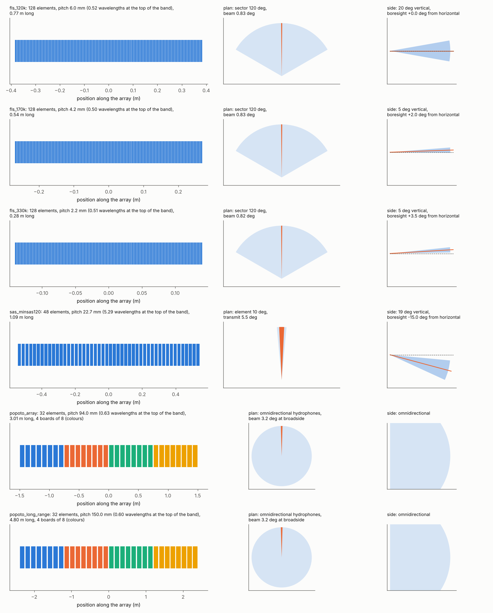
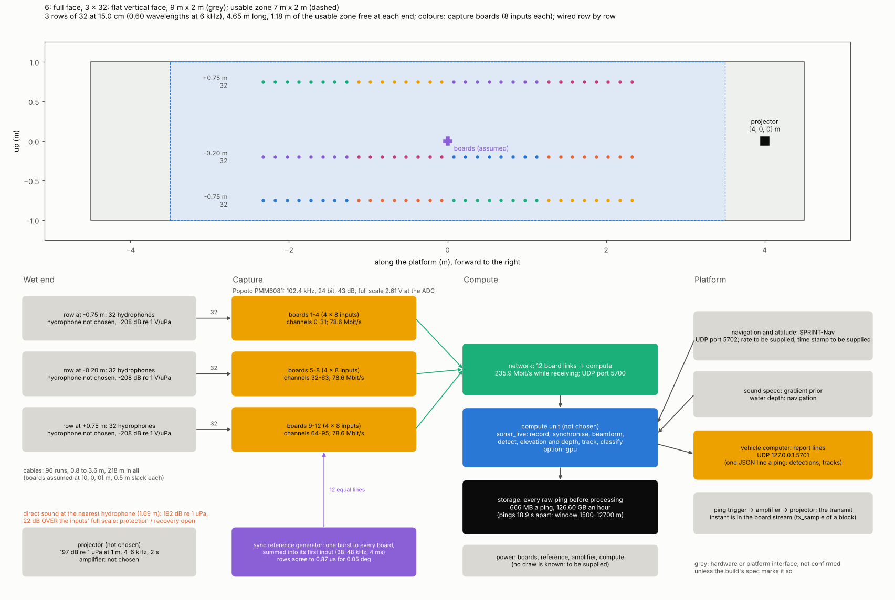
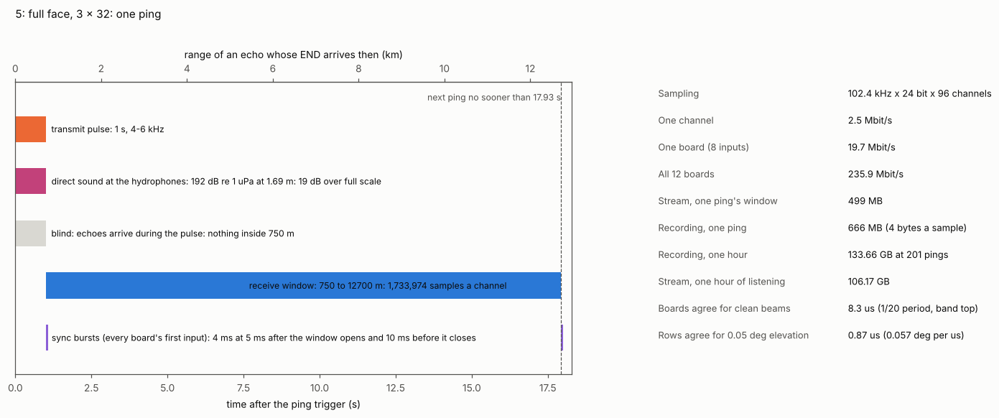
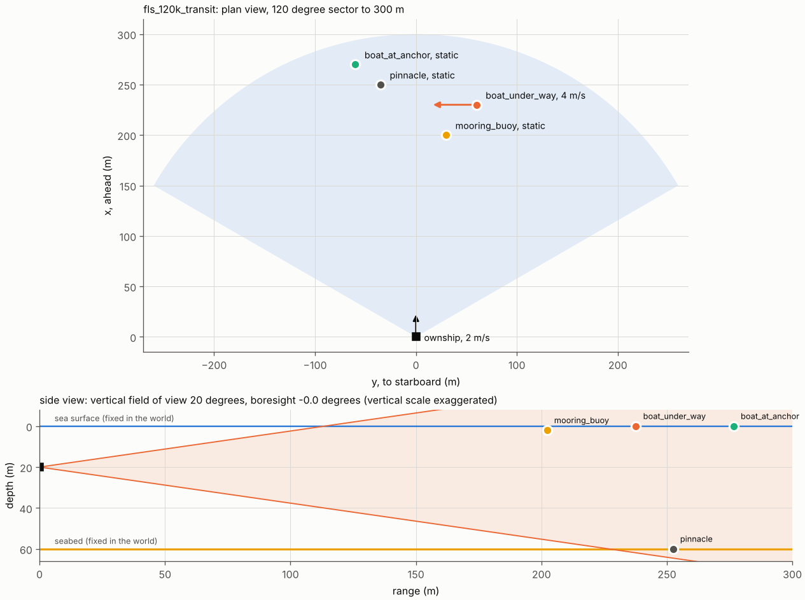

# Design

**Generated by `tools/design_report.py` from the files under `configs/`. Do not edit by hand:** change a
config (or the tool) and run it again. `tests/python/test_design.py` fails if a requirement below is
not met by the configs or if this file is out of date.

Nothing here has been built or measured. Every number is either a requirement from the owner, a value
chosen in a config file, or arithmetic on those. Published figures used for comparison are marked.

## 1. How the pieces fit

- **One record format.** Every source produces ping records; every stage takes and returns them.
- **One description per sonar.** `configs/sonars/<name>.yaml` holds the array (element count, pitch, axis,
  boresight, field of view), the transmit (band, pulse, source level) and the sampling (rate, bits, window,
  boards). The simulator, the processing and this report all read that file and nothing else.
- **One description per scenario.** `configs/scenarios/<name>.yaml` names a sonar, the platform's motion,
  the scene, the propagation model, reverberation and noise.
- **Runs on a CPU.** Every stage has a host implementation; the CUDA backend is optional and gives the same
  results. `SCENARIOS.md` lists measured CPU run times.

## 2. Requirements and where each is met

| Id | Requirement (owner) | Set in | Value found | Met |
| --- | --- | --- | --- | --- |
| FLS-120K-1 | Centre frequency 120 kHz | `configs/sonars/fls_120k.yaml: transmit.waveform.f_start, f_stop` | 120 kHz | yes |
| FLS-120K-2 | Range 300 m | `configs/sonars/fls_120k.yaml: receive.window.range` | 300 m; SNR there 63 dB (link budget) | yes |
| FLS-120K-3 | 120 degrees horizontal field of view | `configs/sonars/fls_120k.yaml: fov.horizontal_deg` | 120 degrees; no grating lobe within +/-67 degrees | yes |
| FLS-120K-4 | Vertical field of view 20 degrees, adjustable | `configs/sonars/fls_120k.yaml: fov.vertical_deg, fov.tilt_up_deg` | 20 degrees, tilted up 0.0 degrees | yes |
| FLS-120K-5 | Ownship (an AUV at about 20 m) under way against static and moving targets, one a boat hull; seabed and sea surface fixed in the world | `configs/scenarios/fls_120k_transit.yaml: platform, scene, reverberation` | depth 20 m, 2 m/s; moving: boat_under_way; static: boat_at_anchor, mooring_buoy, pinnacle; 2 boundaries with ownship Doppler | yes |
| FLS-170K-1 | Centre frequency 170 kHz | `configs/sonars/fls_170k.yaml: transmit.waveform.f_start, f_stop` | 170 kHz | yes |
| FLS-170K-2 | Range 450 m | `configs/sonars/fls_170k.yaml: receive.window.range` | 450 m; SNR there 35 dB (link budget) | yes |
| FLS-170K-3 | 120 degrees horizontal field of view | `configs/sonars/fls_170k.yaml: fov.horizontal_deg` | 120 degrees; no grating lobe within +/-80 degrees | yes |
| FLS-170K-4 | Vertical field of view 5 degrees, adjustable, steered up | `configs/sonars/fls_170k.yaml: fov.vertical_deg, fov.tilt_up_deg` | 5 degrees, tilted up 2.0 degrees | yes |
| FLS-170K-5 | Ownship (an AUV at about 20 m) under way against static and moving targets, one a boat hull; seabed and sea surface fixed in the world | `configs/scenarios/fls_170k_transit.yaml: platform, scene, reverberation` | depth 20 m, 2 m/s; moving: boat_under_way; static: boat_at_anchor, mooring_buoy, pinnacle; 2 boundaries with ownship Doppler | yes |
| FLS-330K-1 | Centre frequency 330 kHz | `configs/sonars/fls_330k.yaml: transmit.waveform.f_start, f_stop` | 330 kHz | yes |
| FLS-330K-2 | Range 300 m | `configs/sonars/fls_330k.yaml: receive.window.range` | 300 m; SNR there 31 dB (link budget) | yes |
| FLS-330K-3 | 120 degrees horizontal field of view | `configs/sonars/fls_330k.yaml: fov.horizontal_deg` | 120 degrees; no grating lobe within +/-77 degrees | yes |
| FLS-330K-4 | Vertical field of view 5 degrees, adjustable, steered up | `configs/sonars/fls_330k.yaml: fov.vertical_deg, fov.tilt_up_deg` | 5 degrees, tilted up 3.5 degrees | yes |
| FLS-330K-5 | Ownship (an AUV at about 20 m) under way against static and moving targets, one a boat hull; seabed and sea surface fixed in the world | `configs/scenarios/fls_330k_transit.yaml: platform, scene, reverberation` | depth 20 m, 2 m/s; moving: boat_under_way; static: boat_at_anchor, mooring_buoy, pinnacle; 2 boundaries with ownship Doppler | yes |
| SAS-1 | SAS like the Kraken MINSAS 120 at 330 kHz | `configs/sonars/sas_minsas120.yaml: transmit.waveform, array` | 330 kHz, 40 kHz, 1.09 m array, 2.1 x 1.9 cm (published: 40 kHz, 1.09 m, 3.3 x 3.0 cm, or 2.1 x 1.9 cm post-processed) | yes |
| SAS-2 | Survey paths | `configs/scenarios/sas_minsas_survey.yaml: platform.legs` | 2 legs, headings 0, 180 degrees; 0.54 m per ping (limit 0.544 m) | yes |
| SAS-3 | Seabed with a shipwreck, a cable, rocks and a cube for calibration | `configs/scenarios/sas_minsas_survey.yaml: scene` | seabed, wreck_hull, wreck_deckhouse, wreck_mast, cable, rocks, calibration_cube | yes |
| POP-1 | Popoto array with ownship moving and a big moving target many km away | `configs/scenarios/popoto_far_mover.yaml: platform.velocity, scene` | ownship 1.5 m/s; target at 6.1 km moving 6 m/s, +25 dB | yes |
| POP-2 | The Popoto array scales to more elements | `configs/sonars/popoto_array.yaml: array.count, receive.board_size` | 8 hydrophones on 1 boards; 16 hydrophones on 2 boards; 32 hydrophones on 4 boards; 64 hydrophones on 8 boards | yes |
| POP-3 | Frequency and source level that take the Popoto array to 12 km | `configs/sonars/popoto_long_range.yaml: transmit.waveform, array (sized by tools/popoto_range_study.py)` | 5 kHz, 197 dB, 32 hydrophones, 1 s pulse: 15 dB at 12 km with spherical spreading (study: 195 dB at 4.2 kHz for 13 dB) | yes |
| POP-4 | Popoto examples with different ocean characteristics, sound-speed profiles, bottom types and depths | `configs/scenarios/popoto_env_summer_mud_60m.yaml: propagation.environment (and the other popoto_env_* files)` | 4 environments: popoto_env_deep_silt_1000m, popoto_env_gravel_30m, popoto_env_summer_mud_60m, popoto_env_winter_sand_200m | yes |
| FLS-X | More FLS examples: a realistic boat, clutter on the seabed, waves on the sea surface | `configs/scenarios/fls_120k_cluttered_seabed.yaml: scene (also fls_120k_rough_surface, fls_170k_traffic)` | fls_120k_cluttered_seabed: boat, cable, debris, rocks, seafloor; fls_120k_rough_surface: boat, points, sea_surface, sphere; fls_170k_traffic: boat | yes |
| SAS-4 | More SAS examples with rocks | `configs/scenarios/sas_minsas_boulder_field.yaml: scene (also sas_minsas_rocky_ripples)` | sas_minsas_boulder_field: 45 rocks; sas_minsas_rocky_ripples: 47 rocks | yes |
| CFG-fls_120k | `fls_120k`: elements and array configurable | `configs/sonars/fls_120k.yaml: array.count, array.pitch, fov` | overrides checked: count 2x gives 2x aperture | yes |
| CFG-fls_170k | `fls_170k`: elements and array configurable | `configs/sonars/fls_170k.yaml: array.count, array.pitch, fov` | overrides checked: count 2x gives 2x aperture | yes |
| CFG-fls_330k | `fls_330k`: elements and array configurable | `configs/sonars/fls_330k.yaml: array.count, array.pitch, fov` | overrides checked: count 2x gives 2x aperture | yes |
| CFG-sas_minsas120 | `sas_minsas120`: elements and array configurable | `configs/sonars/sas_minsas120.yaml: array.count, array.pitch` | overrides checked: count 2x gives 2x aperture | yes |
| CFG-popoto_array | `popoto_array`: elements and array configurable | `configs/sonars/popoto_array.yaml: array.count, array.pitch` | overrides checked: count 2x gives 2x aperture | yes |
| CFG-popoto_long_range | `popoto_long_range`: elements and array configurable | `configs/sonars/popoto_long_range.yaml: array.count, array.pitch` | overrides checked: count 2x gives 2x aperture | yes |

Each row is checked by `tests/python/test_design.py`; the scenarios are run by `tests/python/test_realistic_scenes.py` (thinned) and `tools/gallery.py` (full size).

## 3. Arrays and beams

| Quantity | `fls_120k` | `fls_170k` | `fls_330k` | `sas_minsas120` | `popoto_array` | `popoto_long_range` | How it is derived |
| --- | --- | --- | --- | --- | --- | --- | --- |
| Centre frequency (kHz) | 120 | 170 | 330 | 330 | 8 | 5 | config: mean of `f_start`, `f_stop` |
| Bandwidth (kHz) | 20 | 20 | 30 | 40 | 4 | 2 | config |
| Wavelength (mm) | 12.50 | 8.82 | 4.55 | 4.55 | 187.50 | 300.00 | c / f at 1500 m/s |
| Elements | 128 | 128 | 128 | 48 | 32 | 32 | config: `array.count` |
| Pitch (mm) | 6.0 | 4.2 | 2.2 | 22.7 | 94.0 | 150.0 | config: `array.pitch` |
| Pitch at the top of the band (wavelengths) | 0.520 | 0.504 | 0.506 | 5.289 | 0.627 | 0.600 | pitch / (c / f_stop) |
| Steering with no grating lobe (deg, each side) | 67 | 80 | 77 | 0 | 37 | 42 | asin(wavelength / pitch − 1) |
| Array length (m) | 0.768 | 0.538 | 0.282 | 1.088 | 3.008 | 4.800 | elements × pitch |
| Beamwidth at broadside (deg) | 0.83 | 0.83 | 0.82 | 0.21 | 3.16 | 3.17 | 0.886 wavelength / length |
| Cross-range cell at full range (m) | 4.33 | 6.54 | 4.29 | 0.74 | 375.55 | 703.26 | range × beamwidth |
| Range resolution (cm) | 3.75 | 3.75 | 2.50 | 1.88 | 18.75 | 37.50 | c / 2B, before windowing |
| Horizontal field of view (deg) | 120 | 120 | 120 | 10 | omni | omni | config: `fov.horizontal_deg` or element width |
| Vertical field of view (deg) | 20 | 5 | 5 | 19 | omni | omni | config: `fov.vertical_deg` or element height |
| Boresight above horizontal (deg) | 0.0 | 2.0 | 3.5 | -15.0 | 0.0 | 0.0 | config: `fov.tilt_up_deg` or `array.boresight` |
| Element width along the array (mm) | 5.3 | 3.7 | 1.9 | 22.0 | omni | omni | config, or 0.886 wavelength / horizontal field of view |
| Element height (mm) | 31.7 | 89.6 | 46.1 | 12.0 | omni | omni | config, or 0.886 wavelength / vertical field of view |
| Capture boards | 1 | 1 | 1 | 1 | 4 | 4 | config: `receive.board_size` |

SAS-specific (`sas_minsas120`): along-track resolution 2.1 cm (half the 4.2 cm transmit aperture); transmit beam 5.5 degrees, so the synthetic aperture is 4.8 m long at 50 m; the platform may advance at most 0.544 m per ping (half the array), which at the full 200 m range allows 2.00 m/s. Kraken publishes 40 kHz, a 109 cm array, 3.3 cm × 3.0 cm and 2 to 6 knots for the MINSAS 120; the 330 kHz centre frequency is the owner's figure; element count, pitch and element sizes are choices made here.

The Popoto array is shown as its scenario uses it (32 hydrophones, 6–10 kHz). `array.count` sets the size; boards of eight inputs follow.

### The staged plan in one place

Six builds, one software path, one spec file each (`configs/builds/`); the sonar and deployment files of each are generated from its spec
(`tools/build_from_spec.py`; `REFERENCE_DESIGN.md` is the guide). The owner: "Keep at 32, can start with a smaller array in the 7m zone. Probably makes sense to keep the one
design for auv and static right? Except for elevation." and then: "Yes treat auv special case and have static array the longer row." So: **32 hydrophones a row is fixed; the 7 m is a zone the
rows stay inside, not a length to fill; ONE row design, the long module, serves the static array and the face; the test AUV's short row exists only because of that vehicle's span; and the face
"can start with a smaller array" by carrying fewer rows of the same module: one, then two, then three.**

| Build | Rows × module | For | Beam | Reach, ship / small (km) | Elevation at 20 dB | Boards | Direct sound over full scale |
| --- | --- | --- | --- | --- | --- | --- | --- |
| `popoto_testauv_1x32` | 1 × `testauv_short` | the chain on real boards and under way (the short row: the one exception) | 5.3° | 7.7 / 2.9 | none | 4 | +34 dB |
| `popoto_static_2x32` | 2 × `long_4p8m` | the long row and stacked rows in the water for the first time | 3.2° | 9.4 / 3.7 | 0.18° (candidates) | 8 | +35 dB |
| `popoto_static_3x32` | 3 × `long_4p8m` | the recommended row arrangement, still off the vehicle | 3.2° | 9.9 / 3.9 | 0.18° | 12 | +35 dB |
| `popoto_face_1x32` | 1 × `long_4p8m` | the face to start with: one long row | 3.2° | 12.8 / 5.3 | none | 4 | +19 dB |
| `popoto_face_2x32` | 2 × `long_4p8m` | elevation on the vehicle where water is shallow against the range | 3.2° | 14.0 / 6.0 | 0.18° (candidates) | 8 | +18 dB |
| `popoto_face_3x32` | 3 × `long_4p8m` | the recommended end state | 3.2° | 14.7 / 6.4 | 0.18° | 12 | +19 dB |

(Reach: noise-limited, the link budget of Sec. 5, 197 dB source level in every file: **no projector is chosen for any build**. The static builds use a 0.1 s pulse for short-range trials and the face 1 s: that, not the row, is the difference in their reach.)

**What each build demonstrates, and what it cannot.**

- `popoto_testauv_1x32`: capture and synchronisation of four boards, the stream, recording, bearing, range, tracks with ownship's motion taken out, the report to the vehicle.
- `popoto_static_2x32`: the row module the face will carry, its beam and reach; elevation as candidates and one elevation where water depth bounds it; row calibration; eight boards synchronised between rows.
- `popoto_static_3x32`: one elevation and a depth; a passing target tracked with its depth; listening with elevations.
- `popoto_face_1x32`: the row on the vehicle with the vehicle's navigation and the projector in its place (what the direct sound does); the 12 km detection.
- `popoto_face_2x32`: attitude at each echo's arrival; candidates and the water-depth bound under way.
- `popoto_face_3x32`: everything, at range.

**What carries over.** The boards and their count per row (4 of 8 inputs), the synchronisation scheme, the stream and record formats, the software and its
settings, the report, and from the static array on the row module itself with its harness. What changes between builds is in the spec and nowhere else: the number of rows and their heights,
the platform (pose typed in or from navigation), the pulse (0.1 s on the short-range builds, 1 s on the face), the projector's place, the receive window
(75–2000 m against 750–12700 m: each sonar file now states its own).

**Bring-up, every build** (the generator writes the list for a build, with its numbers, into `BUILD.md`): simulated self-tests → the rehearsal sent as board blocks over UDP → boards on the bench
(stream, channel map, synchronisation residual against the build's tolerance) → projector at low level in water (clipping and recovery of the nearest inputs) → a known target (range, bearing,
SNR against the budget) → with rows: each row alone, row offsets from a source at known depths, depth against truth level and tilted → every measured value back into the spec.

**What the platform must supply.**

| | Test AUV | Static frame | Face |
| --- | --- | --- | --- |
| Pose and attitude | navigation datagrams (unit not named) | a typed-in pose, assumed plumb to 1° (a placeholder), or a tilt and compass sensor | SPRINT-Nav (the owner); accuracy, rate and time stamp from its datasheet — to be supplied |
| Sound speed at the array | in the datagram or typed | measured once, typed | in the datagram (the owner: the AUV measures it) |
| Water depth | not needed for one row | typed (two rows need it to choose among candidates) | in the datagram, to about 5 m (assumed) |
| Mounting | 3 m of hull (2–3 m by the owner's words) | a frame 5.4 m × 1.6 m (the long row plus margins: parameters) | 7 m of the 9 m × 2 m face, rows 1.5 m apart |
| Power, network, storage | to be supplied: see the parts list | the same, down a cable or in a housing | the same |

**Expected accuracy, plainly.** Bearing and range are the row's: a beam of the width in the table and a range cell of 0.375 m before windowing. Elevation is bought with the rows' separation and SNR. Depth is elevation times range, and beyond a few hundred metres
it is limited by the sound-speed profile nobody will have, not by the array (table in *The 12 km design point*). In a shallow channel a bounce arriving inside the pulse's range sidelobes
pulls the elevation by tenths of a degree, and **no reported sigma contains that**.

### Row modules: one row design, and the test AUV's exception

A row module is a named row: 32 hydrophones at one spacing, their harness, four boards. A build names its module and says how many are stacked (`array.module`, `array.rows`,
`array.heights_m`). Two are shipped (`configs/builds/modules/`); the owner's decision: "treat auv special case and have static array the longer row".

| Module | Hydrophones, spacing | Length | Used by | Spacing in wavelengths at the band centre |
| --- | --- | --- | --- | --- |
| `long_4p8m` | 32 at 15 cm | 4.65 m | `popoto_face_1x32`, `popoto_face_2x32`, `popoto_face_3x32`, `popoto_static_2x32`, `popoto_static_3x32` | 0.50 |
| `testauv_short` | 32 at 9 cm | 2.79 m | `popoto_testauv_1x32` | 0.30 |

**Why the test AUV's prototype reaches less: the short row against the long one**, each as one row with the face's projector and pulse (noise-limited; 13 dB at the map for detection), and the long row stacked:

| Row | Beam | Row's gain against sea noise | Map gain with the rows | Reach, ship / small (km) | SNR at 12 km, ship | Margin at 12 km | Source level for 13 dB at 12 km | or pulse at the shipped source level |
| --- | --- | --- | --- | --- | --- | --- | --- | --- |
| 1 × short (the test AUV's row) | 5.3° | 12.9 dB | 12.9 dB | 11.7 / 4.8 | 12.5 dB | -0.5 dB | 198 dB | 1.1 s |
| 1 × long | 3.2° | 15.1 dB | 15.1 dB | 12.8 / 5.3 | 14.6 dB | +1.6 dB | 197 dB (as shipped) | 1.0 s |
| 2 × long | 3.2° | 15.1 dB | 17.4 dB | 14.0 / 6.0 | 17.0 dB | +4.0 dB | 197 dB (as shipped) | 1.0 s |
| 3 × long | 3.2° | 15.1 dB | 18.8 dB | 14.7 / 6.4 | 18.4 dB | +5.4 dB | 197 dB (as shipped) | 1.0 s |

- **Closer than half a wavelength the hydrophones share the sea's noise.** 32 at 9 cm gain 12.9 dB against sea noise, not the 15.1 dB
  that 32 give at half a wavelength; against the boards' own noise they still gain 15.1 dB. The beam is 5.3° against 3.2°, so it also takes in more reverberation.
- **The short row costs 2.2 dB and 1.7 times the beam width.** At 12 km on the ship-sized target it has -0.5 dB of margin against +1.6 dB for the long row; where the margin is negative the table says what source level or pulse would restore it.
- **Static and face builds share everything in the module**: expected beam, gain and reach per row, the four-board harness, the calibration procedure. They differ in the platform: motion, the
  attitude source, the projector's place, cabling and where the compute sits.
- On the test AUV itself the prototype also uses a 0.1 s pulse (10 dB less processing gain) for short-range trials; its own reach is in the plan's table above.

Kept as trade-space rows only, not as builds (the owner: "Keep at 32"): 1 x 64 at 0.109 m: beam 2.2°, map gain 16.7 dB, reach 13.6 / 5.8 km; 1 x 96 at 0.073 m: beam 2.2°, map gain 16.7 dB, reach 13.6 / 5.8 km; 2 x 48 at 0.146 m: beam 2.2°, map gain 19.1 dB, reach 14.9 / 6.5 km (`trade_space.fixed_channels` of the study).

### The long-range Popoto array as a staged build: one row, then stacked rows (elevation and depth)

One horizontal line of hydrophones measures one angle, the angle between an arrival and the line (the cone angle). It cannot tell an
echo from above from one from below, reports the bearing of anything off the horizontal a little wrong, and knows nothing of depth.
More lines at other heights measure the missing angle, in the active mode (the main one) and in the passive one.

**What the owner has said, and how it is read here.**

| The owner's words | Read as | Where it is |
| --- | --- | --- |
| "I can have a vertical straight face 2m high and 9m long" | the full vehicle offers a flat vertical face of 2 m × 9 m (stated) | `platform` in `popoto_long_range_2row/_3row.yaml` |
| "Need way more margin. Projector etc, I think probably try like a 7m horizontal and the vertical spacing is maybe a 1.5" | the rows keep inside 7 m of the length and the outer rows are 1.5 m apart; the rest of the face is margin and room for the projector. Working values ("probably", "maybe"): both are parameters, and the cost of each is shown below | `platform.usable_span_m`, `row_baseline_m`; `--array-length`, `--baseline` of the study |
| "Let's eval both two and three" | two rows and three rows are both evaluated and both shipped, on the static array and on the face | the stages below |
| "No space for second row on auv but static drop in array could have two or three rows. So let's consider both" | the test AUV carries ONE row. Stacked rows go first on a static drop-in array: a frame lowered and left in place, with two or with three rows. The owner gave no dimensions for it: all parameters | stages 2 and 3; `popoto_static_*` |
| "Probably row by row" | each board serves one row (default); four of each row per board stays an alternative | `array.interleave` |
| "Sure make it configurable" (roll accuracy and its time stamp); "good in general, sprintnav IMU and dvl" | the vehicle's navigation is a SPRINT-Nav (inertial navigation with a Doppler velocity log). Its roll accuracy, output rate and time stamp are NOT known here and are not guessed: they are settings, with the depth error against roll accuracy tabulated below so the datasheet figure can be dropped in | `elevation.roll_sigma_deg`, `attitude_time` |
| "We wont have a long range SVP but we can measure auv local speed of sound and we will have some idea of water depth"; of the isothermal assumption: "Won't always we need to handle it" | local sound speed and an approximate water depth come from the vehicle; the profile along the path is unknown, is not always isothermal, and is carried as an uncertainty unless something better is known | `sound_speed`, `water_depth`, `water_depth_sigma_m`, `gradient_per_s`, `gradient_sigma_per_s`, `ssp` |
| "the popoto at 9m x 2 is still for active as well right" | yes: active pinging is the main mode on the face; listening is supported with the same rows | |
| "Does our array need to be 64? We can add just need to understand what we get" | the number of hydrophones is open; the trade space says what each addition buys | *Trade space* |
| (compute at the boards' full rate) "Prepare both options" | both decimating first and a GPU are to be prepared | *Data path and compute* |
| "Keep at 32, can start with a smaller array in the 7m zone. Probably makes sense to keep the one design for auv and static right? Except for elevation." then "Yes treat auv special case and have static array the longer row." | 32 hydrophones a row, fixed. The 7 m is a zone, not a length to fill. ONE row design, the long module (32 at 0.15 m, 4.8 m), for the static array and the face; the test AUV's short row is the one exception. "A smaller array" on the face is fewer rows of that module: one, then two, then three | *Row modules*; `array.module` in `configs/builds/` |
| "What can we do about the projector? Just blank?" | an options analysis of the projector's direct sound | *The projector's direct sound* |
| "What does it look like for popoto at 12km though. Need that design" | the 12 km design point in one place | *The 12 km design point* |

**Trade space in one table** (the face, rows within 7 m, outer rows 1.50 m apart, 4–6 kHz; noise-limited reach on the budget of Sec. 5; details further down):

| Channels | As | Beam | Map gain | Reach ship / small (km) | Elevation at 20 dB | Boards |
| --- | --- | --- | --- | --- | --- | --- |
| 32 | 1 x 32 at 0.15 m | 3.2° | 15.1 dB | 12.8 / 5.3 | none | 4 |
| 64 | 1 x 64 at 0.109 m | 2.2° | 16.7 dB | 13.6 / 5.8 | none | 8 |
| 64 | 2 x 32 at 0.15 m | 3.2° | 17.4 dB | 14.0 / 6.0 | 0.18° (repeat -0.6 dB) | 8 |
| 96 | 1 x 96 at 0.073 m | 2.2° | 16.7 dB | 13.6 / 5.8 | none | 12 |
| 96 | 2 x 48 at 0.146 m | 2.2° | 19.1 dB | 14.9 / 6.5 | 0.18° (repeat -0.6 dB) | 12 |
| 96 | 3 x 32 at 0.15 m | 3.2° | 18.8 dB | 14.7 / 6.4 | 0.18° (repeat -4.2 dB) | 12 |

For a fixed number of channels the trade is bearing and range (one long row) against elevation (stacked rows).

**The stages.** One software path, both engines, takes every stage from its files alone; each stage has a sonar file, a deployment file
and simulated trials that the tests run.

| | Stage 1: test AUV, 1 x 32 | Stage 2: static array, 2 x 32 | Stage 3: static array, 3 x 32 | Stage 4: full face, 1 x 32 | Stage 5: full face, 2 x 32 | Stage 6: full face, 3 x 32 |
| --- | --- | --- | --- | --- | --- | --- |
| Sonar file | `popoto_testauv_1row` | `popoto_static_2row` | `popoto_static_3row` | `popoto_face_1row` | `popoto_long_range_2row` | `popoto_long_range_3row` |
| Deployment file | `popoto_testauv_1row` | `popoto_static_2row` | `popoto_static_3row` | `popoto_face_1row` | `popoto_face_2row` | `popoto_vehicle_elevation` |
| Simulated trials | `popoto_testauv_trial_1row` | `popoto_static_trial_2row` | `popoto_static_trial_3row`, `popoto_static_free`, `popoto_static_passing` | `popoto_12km` (the same row as `popoto_long_range`) | `popoto_face_2row_shallow`, `popoto_12km_2row` | `popoto_elevation_free`, `_shallow`, `_rehearsal`, `popoto_12km_3row` |
| Mounting | hull, 3 m × 0.4 m | frame lowered from the surface or standing on the bottom, 5.4 m × 1.6 m | frame lowered from the surface or standing on the bottom, 5.4 m × 1.6 m | flat vertical face, 9 m × 2 m | flat vertical face, 9 m × 2 m | flat vertical face, 9 m × 2 m |
| Under way | yes | no: fixed pose | no: fixed pose | yes | yes | yes |
| Hydrophones (rows × per row) | 32 (1 × 32) | 64 (2 × 32) | 96 (3 × 32) | 32 (1 × 32) | 64 (2 × 32) | 96 (3 × 32) |
| Capture boards of 8 inputs | 4 | 8 | 12 | 4 | 8 | 12 |
| Row length, spacing | 2.88 m, 9 cm (0.36 λ at 6 kHz) | 4.80 m, 15 cm (0.60 λ at 6 kHz) | 4.80 m, 15 cm (0.60 λ at 6 kHz) | 4.80 m, 15 cm (0.60 λ at 6 kHz) | 4.80 m, 15 cm (0.60 λ at 6 kHz) | 4.80 m, 15 cm (0.60 λ at 6 kHz) |
| Row heights about the centre (m) | 0 | -0.75, +0.75 | -0.75, -0.20, +0.75 | 0 | -0.75, +0.75 | -0.75, -0.20, +0.75 |
| Beam at broadside | 5.3° | 3.2° | 3.2° | 3.2° | 3.2° | 3.2° |
| Row's gain against sea noise / against the boards' own noise (dB) | 12.9 / 15.1 | 15.1 / 15.1 | 15.1 / 15.1 | 15.1 / 15.1 | 15.1 / 15.1 | 15.1 / 15.1 |
| Pulse, and the range it hides | 0.1 s, 75 m | 0.1 s, 75 m | 0.1 s, 75 m | 1 s, 750 m | 1 s, 750 m | 1 s, 750 m |
| Noise-limited reach, ship (+25 dB) / small target (+5 dB), km | 7.7 / 2.9 | 9.4 / 3.7 | 9.9 / 3.9 | 12.8 / 5.3 | 14.0 / 6.0 | 14.7 / 6.4 |
| Elevation, one sigma at 20 dB | none | 0.18° | 0.18° | none | 0.18° | 0.18° |
| Highest repeat of the elevation response in the searched sector | n/a | -0.6 dB | -4.2 dB | n/a | -0.6 dB | -4.2 dB |
| Raw data rate while receiving (Mbit/s) | 79 | 157 | 236 | 79 | 157 | 236 |
| Cables: one per hydrophone + the sync reference to each board | 32 + 4 | 64 + 8 | 96 + 12 | 32 + 4 | 64 + 8 | 96 + 12 |

Reach is where noise alone would end detection on the link budget of Sec. 5 with the source level in the file (197 dB, **not chosen for the test AUV or the static array**); reverberation and the channel decide earlier or later.

**Stage 1, one row on the test AUV: what it is for.** It proves the chain on real boards and under way: capture, synchronisation of four boards, the
stream, recording, conditioning, beamforming, detection, tracking with ownship's motion taken out, classification, the report to the vehicle. Bearing
and range are the full system's; only the beam is wider. There is no room for a second row on the test AUV, so it shows no elevation.

| Row of 32 over | Beam | Gain against sea noise | Reach, ship / small (km) |
| --- | --- | --- | --- |
| 2 m | 7.6° | 11.3 dB | 7.2 / 2.7 |
| 3 m | 5.3° | 12.9 dB | 7.7 / 2.9 |
| 4.8 m (the full row) | 3.2° | 15.1 dB | 8.5 / 3.3 |

Closer together than half a wavelength the hydrophones hear the same sea noise: 32 over 3 m gain 12.9 dB, what 20 at half a wavelength would.
The other twelve still count against the boards' own noise and against a dead channel, and they are the full system's count, boards and wiring.
A higher band would suit the short row (0.09 m is half a wavelength at 8.3 kHz) but would be another projector and another band than
the full face's, so the prototype keeps 4–6 kHz. Its pulse is 0.1 s: the array cannot listen while it transmits, a 1 s pulse hides everything
inside 750 m and 0.1 s everything inside 75 m, at 10 dB less processing gain. With a 185 dB projector instead, the 3 m row reaches 4.4 / 1.5 km.
Simulated trial (raw 102.4 kHz, four boards on their own clocks, the vehicle rolling 2°/s, 30 m of water): the boards synchronise to 0.44 µs and the
target at 500 m is found within 0.9 m and 0.01°.

**Stages 2 and 3, the static drop-in array: where stacked rows first go in the water.** A frame carrying two or three rows, lowered from the surface (or
stood on the bottom) and left in place. The owner: "have static array the longer row": its rows are the face's own row module (32 over
4.8 m), the outer rows 1.50 m apart **as on the face**, so the frame is the face's array without the vehicle: the same beam, reach, elevation
behaviour, boards and harness. The frame's size follows (5.4 m × 1.6 m with the margins in the spec, parameters); its hanging depth (10 m here), tilt sensing, projector position
and cabling are open and flagged `unconfirmed`. What is different from a vehicle, and where it is set:

| | Static array | Where |
| --- | --- | --- |
| Motion | none: no Doppler of its own, reverberation does not spread in Doppler, and everything that moves in the tracker's frame is a target | scenario `platform.velocity: [0, 0, 0]` |
| Pose | a fixed position, depth and heading typed in, or datagrams from a tilt and compass sensor on the frame | `nav.static` or `nav.port` in the deployment file |
| Tilt | a hanging frame's tilt is elevation error one for one, exactly as a vehicle's roll (table below). Without a sensor it is assumed plumb, with a stated uncertainty | `elevation.roll_sigma_deg` (1° shipped: a placeholder), `attitude_time: transmit` |
| Projector | on the frame or hung apart: its position relative to the array is in the sonar file and in every record, and the elevation search follows the true two-way path | `transmit.lever_arm` |
| Sound speed, water depth | measured once at deployment and typed in | `chain.sound_speed`, `elevation.water_depth` |
| Cable, power, where the compute sits | not decided: at the surface end of the cable, or in a housing on the frame | open; *Parts list* |

The frame's height is chosen from this curve (two rows; three rows have the accuracy of their outer pair):

| Rows apart | Elevation at 13 / 20 / 30 dB | No repeat within (at the top of the band) | Highest repeat inside ±30° | Depth at 300 m (30 dB) | Depth at 1 km (20 dB) | Per µs of clock error between rows |
| --- | --- | --- | --- | --- | --- | --- |
| 0.10 m | 6.08° / 2.72° / 0.86° | ±90° | none | 4.5 m | 47 m | 0.86° |
| 0.15 m | 4.06° / 1.81° / 0.57° | ±56° | none | 3.0 m | 32 m | 0.57° |
| 0.20 m | 3.04° / 1.36° / 0.43° | ±39° | none | 2.2 m | 24 m | 0.43° |
| 0.30 m | 2.03° / 0.91° / 0.29° | ±25° | none | 1.5 m | 16 m | 0.29° |
| 0.40 m | 1.52° / 0.68° / 0.21° | ±18° | -6.3 dB | 1.1 m | 12 m | 0.21° |
| 0.50 m | 1.22° / 0.54° / 0.17° | ±14° | -1.7 dB | 0.9 m | 9 m | 0.17° |
| 0.75 m | 0.81° / 0.36° / 0.11° | ±10° | -0.6 dB | 0.6 m | 6 m | 0.11° |
| 1.00 m | 0.61° / 0.27° / 0.09° | ±7° | -0.6 dB | 0.4 m | 5 m | 0.09° |
| 1.50 m | 0.41° / 0.18° / 0.06° | ±5° | -0.6 dB | 0.3 m | 3 m | 0.06° |
| 1.80 m | 0.34° / 0.15° / 0.05° | ±4° | -0.6 dB | 0.2 m | 3 m | 0.05° |
| 2.00 m | 0.30° / 0.14° / 0.04° | ±4° | -0.6 dB | 0.2 m | 2 m | 0.04° |

Below about 0.15 m a second row gives the sign of the elevation and little more. Up to about a wavelength there is no repeat inside the searched
sector and two rows give one answer; wider, accuracy keeps improving in proportion and the repeats come in, which is what the third row is for.

Simulated trials of the static array (C++ chain; the Python chain is held to it by the tests):

| Scenario | Truth | Reported |
| --- | --- | --- |
| `popoto_static_trial_2row`: two rows, raw 102.4 kHz, 8 boards on their own clocks, tilted 2°, 100 m of water, target 2.6 km off | depth 60 m | boards synchronised to 0.49 µs; depth 56, 52, 56, 58 m, one answer with the water-depth bound |
| `popoto_static_trial_3row`: three rows, 12 boards, tilted 2°, 30 m of water, target 150 m off | depth 18 m | 0.40 µs; depth 17.4, 17.4, 17.4, 17.4 m |
| the same with the target at 300 m | depth 22 m | 27.7, 27.7, 27.7, 27.7 m, path `bottom`: in 30 m of water the bounces arrive inside the pulse's range sidelobes and pull the estimate |
| `popoto_static_free`: three rows, free field, targets about 400 m off | depths 10, 40, 90 m | track depth errors -0.0, 0.0, 0.0 m |
| `popoto_static_passing`: a target crossing at 3 m/s, 20 m deep, 8 pings | one mover | tracks: mover; mover at 3.0 m/s, depth 22.1 m |
| listening: two noise sources (`sim/passive.py`), tilted 2° | elevations -8.4, 3.2° | both in 10 of 10 frames, elevation within 0.05° |

What the static array cannot show: ownship's motion and the vehicle's attitude sensor. With the long row it does show the full row's beam and reach.

**Stages 4 and 5, the full face.** Outer rows at -0.75 and +0.75 m, 1.50 m apart (0.25 m free at the top and bottom of the 2 m), which is
4.0 to 6.0 wavelengths. Accuracy is bought with separation and SNR, nothing else: for one arrival in noise
σ(sin e) = 1 / (k √(2 ρ Σ(h − h̄)²)), ρ the SNR at one hydrophone after pulse compression, h the hydrophones' heights, k the band's RMS wavenumber.
The estimator reaches it (Monte Carlo over bound 1.00; on simulated pings within 30%).

| Rows | 13 dB | 20 dB | 30 dB |
| --- | --- | --- | --- |
| 2 rows, 0.38 m apart | 1.60° | 0.72° | 0.23° |
| 2 rows, 0.50 m apart | 1.22° | 0.54° | 0.17° |
| 2 rows, 1.00 m apart | 0.61° | 0.27° | 0.09° |
| 2 rows, 1.50 m apart | 0.41° | 0.18° | 0.06° |
| 2 rows, 1.80 m apart | 0.34° | 0.15° | 0.05° |
| 2 rows, 2.00 m apart | 0.30° | 0.14° | 0.04° |
| 3 rows at -0.75, -0.20, +0.75 m | 0.40° | 0.18° | 0.06° |
| 3 rows at -0.75, +0.00, +0.75 m (equal) | 0.41° | 0.18° | 0.06° |

What the owner's margin costs (the earlier baseline against the working one):

| Outer rows apart | Elevation at 13 / 20 / 30 dB | Repeats every | Two rows give one answer beyond (100 m of water, one bounce) | Best middle row | Per µs between rows | Per mm a row stands out |
| --- | --- | --- | --- | --- | --- | --- |
| 1.80 m | 0.34° / 0.15° / 0.05° | 9.6° | 2.4 km | -0.35 m (-4.1 dB) | 0.048° | 0.032° |
| 1.50 m | 0.41° / 0.18° / 0.06° | 11.5° | 2.0 km | -0.20 m (-4.2 dB) | 0.057° | 0.038° |

Accuracy and every mounting and clock tolerance scale with the baseline; the repeats move apart, which helps two rows a little. The length limit
(9 → 7 m) does not touch the 32-hydrophone row (4.8 m); it lowers what a filled row could hold from 60 to
46 hydrophones at half a wavelength (17.8 → 16.6 dB, beam 1.7° → 2.2°, reach 14.2 → 13.6 km on a ship).

**The projector on the face.** No position was given ("Projector etc" needs room). The sonar files put it in the forward end margin at mid-height,
4 m from the array's centre: a placeholder, 1.69 to 6.37 m from the hydrophones. Two things follow, both from the files' own numbers:

- **Its direct sound overloads the inputs.** 192 dB re 1 µPa at the nearest hydrophone is 24 V at the ADC with the file's sensitivity and gain,
  19 dB over full scale (2.61 V), for the whole pulse (to 1.004 s after the ping). The plan clamps the preamp inputs and the software uses
  nothing inside 750 m. How quickly the inputs recover afterwards is **not known**, and the simulator models neither the direct sound nor the recovery.
- **Its offset costs no accuracy.** Every record carries the projector's lever arm, and the beamformer and the elevation search hold the true path projector →
  target → each hydrophone (tested with the projector off-centre). A row's far field begins at 154 m; the backprojection kernel is exact inside it too.

**Two rows repeat.** Rows 1.50 m apart cannot tell elevations λ/d apart: 14.5° at 4 kHz, 11.5° at 5 kHz, 9.6° at 6 kHz.
The band smears the repeats, but with true time delays over 4–6 kHz the m-th repeat is still at sinc²(m B / 2 f) of the true peak whatever the
separation: -0.6 dB, -2.4 dB, -5.9 dB, -12.6 dB for m = 1 to 4. How often the estimator lands on a repeat, in clean noise:

| Searching | 13 dB | 20 dB | 30 dB |
| --- | --- | --- | --- |
| two rows, searching -30 to 30 deg | 10.4% | 0.0% | 0.0% |
| two rows, searching -11.5 to 11.5 deg | 5.5% | 0.0% | 0.0% |
| two rows, searching -5.8 to 5.8 deg (half a repeat each side) | 0.0% | 0.0% | 0.0% |

So in clean noise the band does resolve two rows from 20 dB up. But the margin is 0.6 dB, and a range sidelobe of another arrival or a few degrees of
phase error between rows tips it. The chain therefore never trusts a repeat within 1 dB of the peak: with two rows this far apart every detection is
flagged `elevation_ambiguous` and carries its candidates, unless something else decides:

- **Water depth and range.** Straight rays cannot arrive from steeper than atan(depth × (bounces + 1) / range). Where that is inside ±5.8° (half a
  repeat) there is one candidate; `elevation.sector_from_depth` searches only there. Two rows are unambiguous beyond (direct / one bounce / two):

  | Water depth | 30 m | 100 m | 300 m | 1000 m | 3000 m |
  | --- | --- | --- | --- | --- | --- |
  | Range | 0.3 / 0.6 / 0.9 km | 1.0 / 2.0 / 3.0 km | 3.0 / 5.9 / 8.9 km | 9.9 / 19.8 / 29.7 km | 29.7 / 59.4 / 89.1 km |

- **The track.** A track that has a depth takes the candidate that fits it (they are 201 m of depth apart per km of range); a track without one waits
  for an unambiguous detection and is not started on a guess.
- **A third row.**

**Three rows: where the middle one goes.** With the outer rows fixed, the highest repeat inside ±30° over the band (worst of arrivals at 0°, 10°, 20°)
against the middle row's height (the mirror image about the centre is the same):

| Middle row at (m) | -0.70 | -0.60 | -0.50 | -0.40 | -0.30 | -0.20 | -0.10 | 0.00 |
| --- | --- | --- | --- | --- | --- | --- | --- | --- |
| Highest repeat (dB) | -0.6 | -0.9 | -1.5 | -2.6 | -4.2 | -4.2 | -2.3 | -1.6 |

Lowest at -0.20 m (0.55 m above the bottom row): -4.2 dB, against -1.6 dB with equal spacing and -0.6 dB with two rows.
Wrong picks searching ±30°, arrival at 2° / at 15°:

| Rows | 10 dB | 13 dB | 20 dB | 30 dB |
| --- | --- | --- | --- | --- |
| 3 rows at -0.75, -0.20, +0.75 m | 0.1% / 0.1% | 0.0% / 0.0% | 0.0% / 0.0% | 0.0% / 0.0% |
| 3 rows at -0.75, +0.00, +0.75 m (equal) | 2.8% / 1.3% | 0.2% / 0.2% | 0.0% / 0.0% | 0.0% / 0.0% |
| 2 rows, 1.50 m apart | 27.3% / 25.6% | 10.0% / 10.4% | 0.1% / 0.0% | 0.0% / 0.0% |

Three rows are no more accurate than two (the outer rows set that); the third buys an answer instead of candidates, and 1.3 dB of detection.

**Two rows or three: side by side** (the face; the static array's rows are at the same heights).

| | Two rows | Three rows (recommended) |
| --- | --- | --- |
| Hydrophones, boards, cables | 64, 8, 64 + 8 | 96, 12, 96 + 12 |
| Elevation at 13 / 20 / 30 dB | 0.41° / 0.18° / 0.06° | 0.40° / 0.18° / 0.06° |
| Highest repeat | -0.6 dB: never trusted alone | -4.2 dB |
| Wrong pick at 13 dB, clean noise, ±30° | 10% | 0.0% |
| One answer without help | where water depth and range bound the arrivals to ±5.8° (100 m of water: beyond 2.0 km with one bounce) | everywhere above about 10 dB a row |
| Deep water, short range | candidates only, until a track has a depth | works |
| Detection against one row | +2.4 dB | +3.7 dB |
| A dead board | the row it serves loses 8 of 32; the estimate carries on | the same |
| A dead row | no elevation | two rows left: the two-row behaviour |
| Processing per ping, scenario size, C++ on 4 shared CPU threads (one row: 0.63 s) | 1.41 s | 2.54 s |
| Raw data rate | 157 Mbit/s | 236 Mbit/s |
| Simulated check | `popoto_face_2row_shallow`: target at 60 m, 3 km: read 34, 26, 34, 34 m with the water-depth bound; without it 5 candidates | free field, channel and rehearsal below |

**Recommended: three rows** as the default of the option, with two rows a sound first step (the middle row can be added later: its boards and
cables are separate) and the right choice only where the water is shallow against the ranges of interest. Both are shipped, for the frame and for the face.

**What the angle is in depth, and what limits it.** Depth error is range × elevation error. From noise alone, on the link budget of Sec. 5 for one row:

| Target, rows | 1 km | 6 km | 12 km |
| --- | --- | --- | --- |
| *ship, +25 dB: SNR* | 65 dB | 31 dB | 15 dB |
| ship, +25 dB; 3 rows at -0.75, -0.20, +0.75 m | 0.3 m | 5.5 m | 70 m |
| ship, +25 dB; 2 rows, 0.38 m apart | 1.2 m | 22 m | 278 m |
| *small target, +5 dB: SNR* | 45 dB | 11 dB | -5 dB |
| small target, +5 dB; 3 rows at -0.75, -0.20, +0.75 m | 0.3 m | 55 m | not detected |
| small target, +5 dB; 2 rows, 0.38 m apart | 1.2 m | 222 m | not detected |

(SNR above 40 dB counted as 40 dB.) Rows 1.5 m apart are 4 times better than the 0.38 m of a small hull. But noise is no longer what limits depth.
**Roll (or a frame's tilt) is elevation error one for one**: drop the attitude sensor's datasheet figure into this table.

| Roll known to | Depth error at 1 km | 6 km | 12 km |
| --- | --- | --- | --- |
| 0.02° | 0.3 m | 2.1 m | 4 m |
| 0.05° | 0.9 m | 5.2 m | 10 m |
| 0.1° | 1.7 m | 10.5 m | 21 m |
| 0.2° | 3.5 m | 20.9 m | 42 m |
| 0.5° | 8.7 m | 52.4 m | 105 m |
| 1.0° | 17.5 m | 104.7 m | 209 m |

And the path's bending:

| Mean sound-speed gradient along the path unknown by | 1 km | 6 km | 12 km |
| --- | --- | --- | --- |
| 0.017 /s (isothermal water: pressure alone) | 6 m | 204 m | 816 m |
| 0.05 /s | 17 m | 600 m | 2400 m |
| 0.1 /s | 33 m | 1200 m | 4800 m |

**No long-range sound-speed profile will exist, and the water will not always be isothermal.** The vehicle measures the sound speed where it is; that fixes
the angle at the array exactly (and is used for beamforming). It does not fix the path: a mean vertical gradient g curves the ray with radius c/g,
range² × g / 2c from the straight line. Beyond 190 m (gradient known to 0.05 /s, 20 dB) or 558 m (known to 0.017 /s) the unknown gradient, not the
measurement, limits depth. What the chain does today: it assumes a gradient (`elevation.gradient_per_s`; 0.017 /s, isothermal water, in the vehicle's file:
an assumption) and follows the ray through it; it adds range² × `gradient_sigma_per_s` / 2c to every reported depth sigma (0.05 /s by default, from the span
between isothermal water and a thermocline averaged over the column: unconfirmed); a track's sigma keeps that term however many pings it averages; a
measured profile goes in `elevation.ssp` and replaces the assumption. **In open water depth is good to metres inside a kilometre and to tens of metres
at a few kilometres (a shallow channel adds its own error: below); beyond that the report still gives, reliably, the angle at the array, whether the echo comes from above or below, which arrival of a group came
first, and how a track's elevation changes.** Not built yet: a profile the vehicle accumulates from its own sound-speed and depth readings as it changes
depth, and named profile families (mixed layer over a thermocline); see *Open*.

**Bearing.** A line reports sin(cone) = cos(elevation) × sin(bearing). With the elevation known the chain reports the horizontal bearing (`bearing_deg`;
`cone_bearing_deg` keeps the old value). Error removed: 0.03° at 2° elevation; 0.22° at 5° elevation; 0.89° at 10° elevation; 3.81° at 20° elevation (45° off broadside).

**In a channel.** One target sends back several echoes. Range separates them (resolution 0.375 m) and elevation is measured on each; the direct one
is first, and the chain takes the first arrival of each detection. Followed straight back, a surface echo points at the target's mirror image above the
surface and a bottom echo at its image below the bottom: folded back both give the target's depth, and where the image lay says which path it was (`path`).
The three rows' own beam in elevation is 7.0° wide: direct and surface arrivals differ by more than that within 164 m for an array or target at 10 m, 491 m for an array or target at 30 m, 1637 m for an array or target at 100 m,
so only at short range do two arrivals in one range cell separate in elevation; beyond it only range separates them. A target near the
surface merges with its own surface echo at every useful range (beyond 0.6 km at 4 m depth) and reads as a source at the surface.
The water depth the bottom fold needs is the vehicle's approximate one (`water_depth`, `water_depth_sigma_m`): its uncertainty goes, doubled, into the depth
of bottom-bounce arrivals and into the test that marks a track below the bottom as multipath.

Measured on simulated pings of the face (C++ chain; the Python chain agrees to 0.02° and 0.3 m):

| Scenario | Truth | Reported |
| --- | --- | --- |
| `popoto_elevation_free`: three rows, free field, rolled 3°, three targets near 1 km | depths 10, 60, 160 m | track depth errors -0.0, 0.2, 0.2 m |
| `popoto_elevation_shallow`: 100 m of water, bounces to second order, 1 km | depth 50 m, direct path -1.15° | 44, 44, 44, 44 m, -0.8, -0.8, -0.8, -0.8°, path direct |
| `popoto_elevation_rehearsal`: raw 102.4 kHz, 12 boards on their own clocks, rolled 4° and rolling 1.5°/s, local sound speed 1490 m/s | targets at 60 m and 8 m, 1 km | boards synchronised to 0.49 µs; 61, 60, 61 m (with the attitude of the ping instead of the arrival: 12, 12, 12 m); the shallow one 2.8, 1.4, 3.2 m, merged with its surface echo |

**What a channel does to the depth, and the sigma does not say.** An echo that bounced once on one leg arrives just behind the direct echo (0.6 m in the
two-row check, against a range resolution of 0.375 m) and from another elevation; it is not cleanly separated, and it pulls the angle. In the two-row check at 3 km the target at 60 m reads
34, 26, 34, 34 m (up to 34 m off, 0.6°); in the three-row check at 1 km the one at 50 m reads 44, 44, 44, 44 m (6 m off); the static array at
300 m in 30 m of water reads 28, 28, 28, 28 m for 22 m. In free field the same chain is within a metre. The size of the pull depends on the
echoes' phases, so on the geometry to a fraction of a wavelength: with the projector 1.5 m below the array's centre instead of beside it, the two-row case read
closer to the truth (an earlier run of this bench, not kept in its file). The reported `depth_sigma_m` holds noise, roll and the gradient prior, **not this**: in shallow water at long
range treat depth as good to a few tenths of a degree of elevation, whatever the sigma says. Not modelled further here: a longer band or a window with
lower range sidelobes would separate the arrivals better.

**What the vehicle and the mounting must provide.**

| Error source | Elevation error | Depth error at 1 / 6 / 12 km |
| --- | --- | --- |
| One row further out from the face than the other by 1.0 mm | 0.038° | 0.7 / 4.0 / 8.0 m |
| One row further out from the face than the other by 5.0 mm | 0.191° | 3.3 / 20.0 / 40.0 m |
| Phase mismatch between rows of 5.0° of phase | 0.159° | 2.8 / 16.7 / 33.3 m |
| Phase mismatch between rows of 10.0° of phase | 0.318° | 5.6 / 33.3 / 66.7 m |
| Clock error between boards on different rows of 0.5 µs | 0.029° | 0.5 / 3.0 / 6.0 m |
| Clock error between boards on different rows of 1.0 µs | 0.057° | 1.0 / 6.0 / 12.0 m |
| Clock error between boards on different rows of 8.3 µs | 0.476° | 8.3 / 49.8 / 99.6 m |

- **Roll is the first limit of the angle.** Everything that scales with the rows' separation shrank 3.9 times against a small hull; roll did not.
  `elevation.roll_sigma_deg` (0.2° assumed for the vehicle: **to be replaced by the SPRINT-Nav's figure**) goes into every sigma. **Attitude is taken at each echo's
  arrival** (`attitude_time: arrival`): an echo from 12 km arrives 16 s after the ping, and the chain uses the navigation samples around that time (they are
  written into each record). Without samples it falls back to the ping's attitude and adds `attitude_rate_sigma_deg_s` × the time of flight. In the rehearsal
  above the difference is 48 m at 1 km.
- **Synchronisation: still open.** Row by row (the owner's choice), boards of different rows must agree to 0.87 µs for 0.05° and 1.75 µs for 0.1°
  (0.057° per µs with rows 1.50 m apart); the tolerance one row needs for clean beams, 8.3 µs (a twentieth of a period at the top of the band, `sync.alignment_tolerance`), would be 0.5°. The reference scheme reaches 0.49 µs in simulation.
  Whether real boards do is the open question. `array.interleave: 4` (four of each row per board) removes the term for two rows and stays available.
- **Mounting and calibration.** 1 mm of one row standing out from the face is 0.04°. The existing calibration, run with sources at several depths
  (`planar=False`), recovers a row's offset in simulation (`tests/python/test_elevation.py` holds the figures).
- **Sound speed and water depth** from the vehicle: `sound_speed` and `water_depth` in the navigation datagrams, or as settings.

### Trade space: how many hydrophones, and where

The outline again (the face, rows within 7 m, outer rows 1.50 m apart, 4–6 kHz, 197 dB, 1 s pulse; noise-limited reach on the budget of Sec. 5):

| Channels | As | Beam | Map gain | Reach ship / small (km) | Elevation at 20 dB | Boards |
| --- | --- | --- | --- | --- | --- | --- |
| 32 | 1 x 32 at 0.15 m | 3.2° | 15.1 dB | 12.8 / 5.3 | none | 4 |
| 64 | 1 x 64 at 0.109 m | 2.2° | 16.7 dB | 13.6 / 5.8 | none | 8 |
| 64 | 2 x 32 at 0.15 m | 3.2° | 17.4 dB | 14.0 / 6.0 | 0.18° (repeat -0.6 dB) | 8 |
| 96 | 1 x 96 at 0.073 m | 2.2° | 16.7 dB | 13.6 / 5.8 | none | 12 |
| 96 | 2 x 48 at 0.146 m | 2.2° | 19.1 dB | 14.9 / 6.5 | 0.18° (repeat -0.6 dB) | 12 |
| 96 | 3 x 32 at 0.15 m | 3.2° | 18.8 dB | 14.7 / 6.4 | 0.18° (repeat -4.2 dB) | 12 |

**Does it need to be 64?** For bearing, range and tracks, no: one row of 32 is the design of Sec. 5. Sixty-four buy one of two things. As one row of 64
inside the 7 m: 1.6 dB, a beam of 2.2° instead of 3.2°, 1.6 dB less reverberation in the beam, noise-limited reach 12.8 → 13.6 km (ship) and
5.3 → 5.8 km (small target), no elevation; and since 46 hydrophones at half a wavelength already fill that length, 64 gain no more than 46 would.
As two rows of 32: 17.4 dB in the map against 16.7 dB, the old beam, and elevation, as candidates. Bearing and range against elevation is the trade for a
fixed channel count; 96 as three rows make the elevation unambiguous.

| A row of | Length | Beam | Gain (sea noise) | Reach ship / small (km) | Reverberation in the beam against 32 | Boards a row |
| --- | --- | --- | --- | --- | --- | --- |
| 16 at 0.15 m | 2.40 m | 6.3° | 12.0 dB | 11.4 / 4.6 | +3.0 dB | 2 |
| 24 at 0.15 m | 3.60 m | 4.2° | 13.8 dB | 12.2 / 5.0 | +1.2 dB | 3 |
| 32 at 0.15 m (today) | 4.80 m | 3.2° | 15.1 dB | 12.8 / 5.3 | -0.0 dB | 4 |
| 46 at 0.15 m (fills the 7 m) | 6.90 m | 2.2° | 16.6 dB | 13.6 / 5.8 | -1.6 dB | 6 |
| 48 at 0.146 m (fills the 7 m) | 7.00 m | 2.2° | 16.7 dB | 13.6 / 5.8 | -1.6 dB | 6 |
| 64 at 0.109 m (fills the 7 m) | 7.00 m | 2.2° | 16.7 dB | 13.6 / 5.8 | -1.6 dB | 8 |
| 96 at 0.073 m (fills the 7 m) | 7.00 m | 2.2° | 16.7 dB | 13.6 / 5.8 | -1.6 dB | 12 |
| 32 at 0.219 m (sparse, fills the 7 m) (repeats in bearing at -11 dB when steered 30°) | 7.00 m | 2.2° | 16.7 dB | 13.6 / 5.8 | -1.6 dB | 4 |
| 60 at 0.15 m (the whole 9 m, no margin) | 9.00 m | 1.7° | 17.8 dB | 14.2 / 6.1 | -2.7 dB | 8 |

- **Along the face.** Each doubling of a filled row is 3 dB against noise, half the beam and 3 dB less reverberation; in noise-limited range a few per cent.
  The knee is the usable length: 46 hydrophones at half a wavelength fill 7 m, and more in the same length buy nothing against sea noise. Sparser
  than half a wavelength gives the narrow beam for fewer hydrophones but full repeats in bearing when steered.
- **Up the face.** The second row buys elevation and 2.4 dB of detection; the third makes elevation unambiguous (+1.3 dB); a fourth adds 0.9 dB.
  Accuracy is set by the outer rows' separation, not the count.
- **Noise or reverberation.** More source level buys noise-limited range (6 dB is worth four times the hydrophones in a row) and nothing against
  reverberation; a longer row buys both. Where reverberation limits (short and medium range in the scenarios), length is the only one that helps.
- **Band.** Another band moves every row: spacing and row length scale with the wavelength, the reach with absorption and noise
  (`tools/popoto_range_study.py`), and the rows' repeat spacing with it.
- **Cost** goes with the channel count: boards = channels / 8, one cable per hydrophone and one reference per board, 2.46 Mbit/s and 7.3 MB per ping per
  channel (to 12.7 km, as recorded now), compute in proportion (measured at 32, 64 and 96 channels).
- **Passive.** Listening gains with the row's length like the active map, and the rows give each bearing an elevation; the repeats and the roll apply unchanged.

**Data path and compute.** Checked at the boards' rate (102.4 kHz, 24 bit) with 32, 64 and 96 channels: board blocks over UDP (128, 64 and 42 samples a datagram), the C++ and Python
assemblers, Sensor Bridge frames (307,328 and 460,928 bytes for 1600 samples at 64 and 96 channels), the container file and the chain carry them
unchanged. The record format already stores every hydrophone's position and the attitude samples: no format change. On pings of the `popoto_12km`
scenario's size (baseband) the C++ chain takes 0.63, 1.41 and 2.54 s for one, two and three rows on 4 shared CPU threads, against 17.9 s between pings:
real time with room.
(Timings are from an otherwise idle machine with the earlier row heights; the work does not depend on them.) **At the boards' full rate it is not real time on such a CPU**: one full-length ping (102.4 kHz real, 0.5 to 13 km) took 15, 24 and 38 s (measured with
earlier row heights; the map dominates and does not depend on them). The band is 2 kHz wide, so the samples carry 26 times more than needed. The owner: "Prepare both options":
converting to baseband and decimating before the chain, and a GPU. Measured on an NVIDIA L4 (`benchmarks/gpu_benchmark_all_l4.md`): the C++ chain takes 0.010, 0.021 and 0.031 s a ping for one, two and three rows against 0.15, 0.30 and 0.44 s on that machine's 8 CPU threads (15 times for one row), on pings of scenario size (15,467 baseband samples a channel) and with the row heights before the 1.5 m change. Raw pings at the boards' full rate have not been run on a GPU. The decimate-first stage is being built separately: **its timing is pending** (`design/popoto_stage2.json` does not exist yet).

**What carries over from stage to stage, and what changes.** Unchanged: the boards and their count per row, the synchronisation scheme, the stream and record
formats, the software and its settings, the report. From the test AUV to the static array: the row changes from the short module (0.09 m spacing) to the long one (0.15 m),
two or three of them, no motion, a typed-in pose. From the static array to the face: the row module, its harness, the rows' heights and the boards carry over unchanged; the platform changes: motion,
the attitude source (the vehicle's navigation, at each echo's arrival), the projector's place and pulse, cabling, and where the compute sits.

**What stacked rows do not improve.** Bearing and range resolution; left/right (the face decides that); detection range, much; depth at long range without
a profile.

**Open.**

- The static array: the depth it hangs at, whether it has a tilt sensor, where its projector hangs, its cabling, the margins of its frame, the trial site's depth and ranges.
- The SPRINT-Nav: attitude accuracy, output rate, time-stamp accuracy and message format (from its datasheet and interface document). The adapter from
  its messages to the navigation datagram is not written; DVL altitude plus depth as the water-depth source is not wired in.
- The projector: which, its source level, its place on the face, and how fast the inputs recover from its direct sound (*The projector's direct sound*).
- Board synchronisation between rows: 0.87 µs for 0.05°. Not answered; whether Popoto boards can be batched at all is a question for Popoto.
- The sound-speed profile: a profile built from the vehicle's own readings, and profile families, are not built; today's chain has the gradient prior,
  the local sound speed and a supplied profile.
- Compute at the boards' full rate: both options (decimate first; GPU) are to be prepared; neither has been timed at the full rate on the hardware that would be used.
- The parts list's open questions (`design/popoto_parts.md`).

### The projector's direct sound: "Just blank?"

The owner: "What can we do about the projector? Just blank?" Blanking, meaning the chain ignores samples taken during the transmit, is necessary and is not enough. Numbers first, all from the
build files (`gpusonar.buildspec.describe`: source level − 20 log₁₀(distance to the nearest hydrophone), through the files' sensitivity and gain):

| Build | Projector to nearest hydrophone | Direct level there | At the ADC | Over full scale | Direct sound ends | First sync burst after that | Distance for full scale | Source level for full scale |
| --- | --- | --- | --- | --- | --- | --- | --- | --- |
| `popoto_testauv_1x32` | 0.30 m | 207 dB re 1 µPa | 131 V | **+34 dB** | 0.101 s | 4.0 ms | 15 m | 163 dB |
| `popoto_static_2x32` | 0.26 m | 209 dB re 1 µPa | 153 V | **+35 dB** | 0.102 s | 3.1 ms | 15 m | 162 dB |
| `popoto_static_3x32` | 0.26 m | 209 dB re 1 µPa | 153 V | **+35 dB** | 0.102 s | 3.1 ms | 15 m | 162 dB |
| `popoto_face_1x32` | 1.68 m | 193 dB re 1 µPa | 24 V | **+19 dB** | 1.004 s | 0.8 ms | 15 m | 178 dB |
| `popoto_face_2x32` | 1.84 m | 192 dB re 1 µPa | 22 V | **+18 dB** | 1.004 s | 0.8 ms | 15 m | 179 dB |
| `popoto_face_3x32` | 1.69 m | 192 dB re 1 µPa | 24 V | **+19 dB** | 1.004 s | 0.8 ms | 15 m | 178 dB |

The files' gain and full scale ARE the plan's figures for the capture board ("43 dB preamp, 37 mVpp full scale": 43 dB and 18.5 mV peak at the input, 2.61 V after the gain), so the computation with the plan's
figures is the same computation: full scale is 173 dB re 1 µPa at the hydrophone. What is NOT the plan's is the hydrophone sensitivity (-208 dB re 1 V/µPa, a placeholder): a hydrophone
10 dB less sensitive would overload 10 dB less and need 10 dB more signal everywhere else. Every projector position in the files is a placeholder.

**What blanking does and does not do.** With a 1 s pulse nothing inside 750 m is usable whatever the inputs do, because echoes from there arrive during the transmit. So the samples lost to
blanking cost nothing by themselves. What matters is (a) that the inputs are not damaged; (b) how long after the pulse ends they take to recover, because that time adds to the blind range
(7.5 m per 10 ms); (c) that the synchronisation bursts and any calibration signal do not fall inside the transmit or the recovery. On (c) the shipped timing is a finding: the first burst is
0.8 ms after the direct sound ends at the farthest hydrophone on the face. The build validator now warns of it.

**Every hydrophone is overloaded, not only the nearest.** On the face (three rows) 96 of 96 are, from +7.6 dB at the farthest (6.37 m) to +19.1 dB at the nearest; the direct sound falls to full scale only 15.3 m from the projector, so **no position on a 9 m face avoids it**: at least
19.1 dB of gain reduction during the transmit is needed, or inputs that are built to be overloaded. The first usable range is 753 m with an input that has no memory (76 m with the 0.1 s pulse), plus 0.75 m per millisecond of recovery. These are peak levels (add 3 dB if a source level is an rms figure) and the water path only: hull-borne and electrical coupling from the amplifier are not modelled and could exceed it.

The simulator now models this (`transmit.direct_path`, `receive.overload`; `tools/direct_sound_study.py`): its per-hydrophone figures for the face are +7.6 to +19.1 dB over full scale, 96 of 96 overloaded, full scale at 15.3 m (`design/direct_sound_study.json`; the same closed form as here, checked against the simulated samples). Its recovery parameter sets are illustrative: no board has been measured. Blanking alone suffices only if the front end has no memory; a gain switch of more than the overload removes the problem at its source.

| Option | What it buys | What it costs or needs | Known? |
| --- | --- | --- | --- |
| Ignore window in the chain (blanking) | discards the samples of the transmit and of the recovery; the chain today starts at the receive window (`receive.window`, from the blind range); a configurable blanking window is being added to the chain separately | nothing; it protects nothing | yes |
| Input clamp or limiter (protection) | survival at +19 dB over full scale (24 V equivalent at the ADC, 0.17 V at the input) | a recovery time after the clamp releases: **unknown** | the plan says of its own integrated design "preamp inputs are clamped"; for the PMM6081 it gives no damage threshold and no clamp: unknown |
| Switchable or time-varying input gain | 19 dB less gain during the transmit removes the overload; a ramp afterwards is a TVG (the record format carries one) | the board must offer it | unknown: the plan lists "other gain options" among its questions for Popoto |
| Move the projector | 6 dB per doubling of distance: ×2 (3.4 m): +13 dB, ×4 (6.7 m): +7 dB, ×8 (13.5 m): +1 dB; full scale at 15 m | room on the platform; beyond the face it means a pole, or below or behind the hull; the direct sound then ends later (0.67 ms per metre) | geometry: yes |
| A projector with a null towards the array, or a baffle | must deliver 19 dB towards the nearest hydrophone to reach full scale, more for margin | a directional source or a structure at 4–6 kHz (a wavelength is 30 cm); no product is assumed | unknown |
| Lower source level, longer pulse, same energy | each 3 dB less level is twice the pulse: −3 dB: 2 s, blind inside 1.5 km, −6 dB: 4 s, blind inside 3.0 km, −10 dB: 10 s, blind inside 7.5 km. The 12 km budget is unchanged (it depends on energy); full scale would need −19 dB, a 82 s pulse: not a way out by itself | blind range and ping interval grow with the pulse | yes |
| Schedule the sync bursts clear of the transmit | the bursts survive | `sync.reference.lead_s` in the spec (after the recovery time), or open the window later | yes, once the recovery time is |

**Position and the multipath depth bias.** The projector's place also moves the bias a shallow channel puts on depth: with the projector beside the rows in the end margin the two-row check at 3 km reads 26–34 m for a target at 60 m (`popoto_elevation_bench.json`); an earlier run with it 1.5 m below the array's centre read closer to the truth. Below the array was better on that count; it is one geometry, not a rule.

**Recommended combination.** (1) Protection first: a clamp or limiter at every input, or confirmation from the board's documentation that the inputs survive the level in the table. (2) The projector as far
from the nearest hydrophone as the platform allows; every doubling is 6 dB less to recover from. (3) An ignore window in the chain from the trigger to the end of the direct sound plus the measured
recovery. (4) The first sync burst after that window. (5) Lower gain during the transmit if the board offers it. Not recommended as the fix: a longer, weaker pulse.

**To measure on the bench before hardware is frozen.** Recovery time of an input against overload level (0, +10, +20, +30 dB over full scale, a burst as long as the pulse); the damage threshold from the
board's documentation or its maker; whether the reference burst summed into an input survives next to an overloaded hydrophone signal. The spec carries the results: `projector.blanking_after_s`,
`boards.overload_damage_vpp`, `boards.gain_switchable` (all unknown today). Also on the bench: coupling from the amplifier into the inputs through the hull and the wiring, with the projector out of the water. The simulator's receiver has an overload and recovery model (`receive.overload`, with `transmit.direct_path`): a measured recovery time can be tried on the short-range scenarios (`popoto_testauv_direct_overload*`) before hardware is frozen.

### The 12 km design point

The owner: "What does it look like for popoto at 12km though. Need that design". This section is self-contained: what the system that detects at 12 km is, and what it can and cannot tell you there.
The targets are the two the study uses: a **ship-sized target of +25 dB** and a **small target of +5 dB**. Everything is for the full face (4–6 kHz, a 1 s sweep, 197 dB re 1 µPa at 1 m, rows of the long module, outer rows 1.5 m apart).

**At 12 km you get** (noise-limited budget; ship-sized target; one sigma):

| Rows | Detection, ship (+25 dB) | Detection, small (+5 dB) | Bearing | Elevation | Depth with a measured profile | Depth without one |
| --- | --- | --- | --- | --- | --- | --- |
| 1 × 32 | yes: 14.6 dB, +1.6 dB of margin | no: -5.4 dB, 18 dB short | ±0.26° = ±54 m across (beam 3.2°, 665 m) | none | none | none |
| 2 × 32 | yes: 17.0 dB, +4.0 dB of margin | no: -3.0 dB, 16 dB short | ±0.20° = ±41 m across (beam 3.2°, 665 m) | ±0.34° from noise, as candidates 11.5° apart unless water depth bounds them | ±82 m (noise, roll to 0.2°, clocks to 0.49 µs) | not in metres: ±2400 m from a gradient unknown by 0.05 /s |
| 3 × 32 | yes: 18.4 dB, +5.4 dB of margin | no: -1.6 dB, 15 dB short | ±0.17° = ±35 m across (beam 3.2°, 665 m) | ±0.33° from noise, one answer | ±81 m (noise, roll to 0.2°, clocks to 0.49 µs) | not in metres: ±2400 m from a gradient unknown by 0.05 /s |

For that to hold: a projector that delivers the source level in this band (none is chosen); hydrophones and inputs whose own noise is below the sea's (parts list); the inputs recovered from the direct sound
well inside the 750 m blind range; noise, not reverberation, limiting at 12 km (below); for elevation, boards of different rows synchronised to 0.87 µs and the roll known as stated;
for depth in metres, a sound-speed profile along the path. Spreading at least as kind as spherical (in shallow water it is kinder: below).

**Link budget at 12 km.** spherical spreading, Ainslie-McColm absorption (12 C, 50 m), ambient noise at 5 m/s wind, 13 dB at the map for detection, target strengths +25 dB (ship) and +5 dB (small); noise spectrum level 51.5 dB re 1 µPa²/Hz at 5 kHz. Blind inside 750 m (the pulse); a ping every 17.9 s for the 750–12700 m window (3.3 a minute).

| Face option | Beam | Row gain (sea noise) | Map gain | SNR at 12 km, ship | margin | SNR at 12 km, small | short by | Reached at: ship / small (km) |
| --- | --- | --- | --- | --- | --- | --- | --- | --- |
| 1 × 32 long | 3.2° | 15.1 dB | 15.1 dB | 14.6 dB | +1.6 dB | -5.4 dB | 18.4 dB | 12.8 / 5.3 |
| 2 × 32 long | 3.2° | 15.1 dB | 17.4 dB | 17.0 dB | +4.0 dB | -3.0 dB | 16.0 dB | 14.0 / 6.0 |
| 3 × 32 long | 3.2° | 15.1 dB | 18.8 dB | 18.4 dB | +5.4 dB | -1.6 dB | 14.6 dB | 14.7 / 6.4 |
| 1 × 32 short (the test AUV's row, for comparison) | 5.3° | 12.9 dB | 12.9 dB | 12.5 dB | -0.5 dB | -7.5 dB | 20.5 dB | 11.7 / 4.8 |
| 1 × 46 (fills 7 m) | 2.2° | 16.6 dB | 16.6 dB | 16.2 dB | +3.2 dB | -3.8 dB | 16.8 dB | 13.6 / 5.8 |
| 1 × 64 in 7 m | 2.2° | 16.7 dB | 16.7 dB | 16.3 dB | +3.3 dB | -3.7 dB | 16.7 dB | 13.6 / 5.8 |
| 2 × 48 in 7 m | 2.2° | 16.7 dB | 19.1 dB | 18.7 dB | +5.7 dB | -1.3 dB | 14.3 dB | 14.9 / 6.5 |

**What would close the 15 dB for the small target at 12 km** (three rows; each alone):

| Lever | To close it | What one step gives |
| --- | --- | --- |
| Source level | 212 dB re 1 µPa at 1 m | dB for dB |
| Pulse length (same level) | 29 s, blind inside 22 km | 3 dB per doubling; the blind range doubles with it |
| Hydrophones in a row | 933 at half a wavelength, 140 m long | 3 dB per doubling of a filled row; the 7 m zone holds 46: +1.6 dB (and the owner keeps 32) |
| Rows | not reachable | 2 rows +2.4 dB, 3 rows +3.7 dB, 4 rows +4.6 dB over one |
| Lower noise | 37 dB re 1 µPa²/Hz | a calm sea is 40 dB: 11 dB; the platform's own noise is not in the budget at all |
| Come closer | 6.4 km | about 2.7 dB per km between 6 and 12 km |

The small target at 12 km is not a matter of one lever: it is reached at 6.4 km. **These are noise-limited figures with spherical spreading, the cautious case for loss.**
In shallow water sound is ducted: Bellhop for 100 m of isovelocity water over sand gives 14 dB less loss each way at 4 kHz (70.4 against 84.6 dB; `popoto_range_study.json`), which more than covers the small target's shortfall in that water, and at those levels reverberation, not noise, decides.

**Through the chain, with reverberation** (`tools/popoto_12km_study.py`: the ship of `popoto_12km`, five points of +18 dB crossing at 6 m/s at 12 km, six pings; C++ chain with each row count's deployment file; SNR is over the local background the detector measures):

| Water | Rows | Ship detected on | Median SNR | Track confirmed at ping | Track on the ship | Later arrivals tracked / classed multipath | Other tracks |
| --- | --- | --- | --- | --- | --- | --- | --- |
| popoto_12km: 100 m isovelocity over sand, image-source paths | 1 | 3 of 6 pings | 13.5 dB | 5 | uncertain at 3.4 m/s | 0 / 0 | 1 uncertain |
| popoto_12km: 100 m isovelocity over sand, image-source paths | 2 | 0 of 6 pings | — | — | none | 0 / 0 |  |
| the same without reverberation (noise only) | 1 | 4 of 6 pings | 12.5 dB | 4 | uncertain at 3.2 m/s | 0 / 0 | 1 uncertain |
| the same without reverberation (noise only) | 2 | 0 of 6 pings | — | — | none | 0 / 0 |  |
| popoto_12km: 100 m isovelocity over sand, Bellhop | 1 | 6 of 6 pings | 15.4 dB | 3 | mover at 5.4 m/s, mover at 5.9 m/s, mover at 6.1 m/s, static at 2.1 m/s | 6 / 5 | 3 mover, 5 multipath, 1 static, 1 uncertain |
| popoto_12km: 100 m isovelocity over sand, Bellhop | 2 | 6 of 6 pings | 16.6 dB | 3 | multipath at 6.0 m/s, multipath at 6.3 m/s, uncertain at 4.6 m/s, uncertain at 6.5 m/s | 1 / 1 | 3 multipath, 2 uncertain |
| popoto_env_deep_silt_1000m at 12 km, Bellhop | 1 | 0 of 6 pings | — | — | none | 1 / 0 | 1 mover |
| popoto_env_deep_silt_1000m at 12 km, Bellhop | 2 | 0 of 6 pings | — | — | none | 1 / 0 | 1 mover |
| popoto_env_gravel_30m at 12 km, Bellhop | 1 | 6 of 6 pings | 27.4 dB | 3 | mover at 6.0 m/s | 0 / 0 | 1 mover |
| popoto_env_gravel_30m at 12 km, Bellhop | 2 | 6 of 6 pings | 28.1 dB | 3 | mover at 6.0 m/s | 0 / 0 | 1 mover |
| popoto_env_summer_mud_60m at 12 km, Bellhop | 1 | 0 of 6 pings | — | — | none | 0 / 0 |  |
| popoto_env_summer_mud_60m at 12 km, Bellhop | 2 | 0 of 6 pings | — | — | none | 0 / 0 |  |
| popoto_env_winter_sand_200m at 12 km, Bellhop | 1 | 6 of 6 pings | 19.4 dB | 3 | mover at 6.1 m/s, multipath at 5.8 m/s, mover at 7.5 m/s | 4 / 3 | 2 mover, 4 multipath, 1 uncertain |

Where reverberation rather than noise decides: in the image-source case the ship's SNR with and without the scenario's bottom and surface reverberation is 1 row: 13.5 dB against 12.5 dB; 2 rows: not detected against not detected. The image-source paths spread spherically with two bounces and carry far less energy to 12 km than Bellhop's ducted field, so they sit near the noise-limited budget; the Bellhop rows are the shallow-water case.

**A target near the surface is the hard case for straight rays.** The scenario's ship is at 4 m and the array at 10 m: at 12 km the direct path and the surface-reflected one (reflection −1) differ by 6.7 mm, a small fraction of the 30 cm wavelength, and nearly cancel: 20 log₁₀(2 sin(2π z₁ z₂ / λR)) = -17 dB on each leg against the budget's free-field loss, before the bottom's bounces put energy back. The noise-limited budget above does not contain this (it is the cautious case for spreading, not for the surface image); the image-source rows of the table do, which is why the ship is detected on few or no pings there, and marginally enough that the projector's place on the face decides it. Bellhop's field for the same water holds the ship on every ping. Which is right for a given day is the environment's to say: **the 12 km detection of a shallow target rests on the water ducting sound, not on the array.**

The environments differ by far more than the row count does: the row count buys two to four decibels, the water tens. A downward-refracting profile over a soft bottom can leave nothing at 12 km whatever the array.

**Bearing at 12 km.** The beam is 3.2° wide: 665 m across at 12 km, so two targets closer than that in bearing and in the same range cell are one. A single target's bearing is good to
±0.17° (±35 m across) at the 18 dB available on the ship (the bound for a row of this length, at broadside; steered to 45° it is 1.4 times that). The cone-angle correction is
negligible there: an arrival within 0.5° of level (100 m of water) moves the bearing by less than 0.03° at 45° off broadside.

**Elevation and depth at 12 km** (rows 1.5 m apart; the SNR is the one the budget gives at 12 km, not a nominal 20 dB):

| | Ship (+25 dB) | Small (+5 dB) |
| --- | --- | --- |
| SNR of one row at 12 km | 14.6 dB | -5.4 dB: not detected |
| Elevation sigma from noise, 2 rows / 3 rows | 0.34° / 0.33° | — |
| Depth from noise | 70 m / 70 m | — |
| Depth from roll known to 0.02° / 0.05° / 0.1° / 0.2° / 0.5° / 1.0° | 4 / 10 / 21 / 42 / 105 / 209 m | the same |
| Depth from clock error between rows: the budget (0.87 µs) / reached in simulation (0.49 µs) / the within-row tolerance (8.3 µs) | 10 / 6 / 100 m | the same |
| Depth from the profile: mean gradient unknown by 0.017 /s (isothermal water against none) | 816 m | the same |
| Depth from the profile: mean gradient unknown by 0.05 /s | 2400 m | the same |
| Depth from the profile: mean gradient unknown by 0.1 /s | 4800 m | the same |
| Depth from the profile, by rung of the profile ladder (local sensor; self-built profile; family; measured) | **pending**: `docs/design/popoto_stage2.json` does not exist yet; the gradient-prior rows above are what there is | |

**Two rows against three at that SNR.** At 15 dB a row (the study's nearest tabulated SNR below it: 13 dB), in clean noise searching ±30°: three rows pick a wrong lobe 0.0% of the time, two rows 10%. Two rows' repeats are 11.5° apart and only 0.6 dB down, so the chain reports candidates unless water depth and range bound the arrivals: at 12 km in 100 m of water every arrival is within 1.0° of level (one bounce), well inside the ±4.8° that leaves one candidate. **So at 12 km in shallow water two rows are not ambiguous; they are in deep water.**
Multipath is the other limit: at 12 km in 100 m of water the direct, surface and bottom echoes are within a fraction of a range cell and of the rows' elevation beam of each other, they merge, and the elevation read is of the
mixture. The shallow-water checks at 1–3 km already show a pull of tenths of a degree that no sigma contains; at 12 km a tenth of a degree is 21 m.

**What is knowable at 12 km, honestly.** The angle of arrival at the array to about 0.3° from noise on the ship-sized target, plus the roll accuracy (0.2° assumed); whether the energy comes from above or below level;
which arrival of a group came first; how a track's elevation changes over pings. **Depth in metres only with a sound-speed profile along the path**: without one the gradient prior alone is worth
2400 m at 12 km, more than any water depth, and the report says so in `depth_refraction_sigma_m`.

**Tracking at 12 km.** 3.3 pings a minute on target (one every 17.9 s for the full window). The shipped tracker confirms on 3 detections (`tracker.confirm_hits`), so a track exists 54 s after the first detection at the earliest, 36 s if counted from it; a mover's class needs its speed, which at 0.17° of bearing accuracy (35 m across) takes several pings more for a crossing target. Measured: the table above gives the ping at which the track on the ship was confirmed in each water and how the later (bounced) arrivals were classed.

**Hardware for the 12 km point** (details and the plan's own words: *Parts list*).

- **Projector:** 197 dB re 1 µPa at 1 m over 4–6 kHz for 1 s every 17.9 s (duty 5.6%); 417 W acoustic from an omnidirectional source. **None is chosen**; the plan's transducer covers 20–35 kHz.
- **Direct sound:** 192 dB re 1 µPa at the nearest hydrophone, 19 dB over the inputs' full scale at the placeholder position: *The projector's direct sound* above.
- **Hydrophones, boards, synchronisation:** 96 hydrophones on 12 boards (three rows), 64 on 8 (two); rows agree to 0.87 µs for 0.05°.
- **Data:** 236 Mbit/s while receiving (three rows); 1,733,974 samples a channel and 666 MB a ping for the 750–12700 m window, 134 GB an hour as recorded now (raw, 4 bytes a sample).
- **Compute, both options, measured:** on decimated pings of the `popoto_12km` scenario's size the C++ chain takes 0.63 / 1.41 / 2.54 s a ping for 1 / 2 / 3 rows on 4 shared CPU threads, and 0.010 / 0.021 / 0.031 s on an NVIDIA L4 (15 times its own host's 8 threads for one row; the tree before the 1.5 m row heights). A full-length raw ping at the boards' rate took 15 / 24 / 38 s on the CPU: not real time against 17.9 s without decimating first. Timings with the decimate-first stage: **pending** (`popoto_stage2.json`). Raw full-rate pings have not been run on a GPU.

**What the earlier builds reach instead** (noise-limited, ship / small): `popoto_testauv_1x32`: 7.7 / 2.9 km; `popoto_static_2x32`: 9.4 / 3.7 km; `popoto_static_3x32`: 9.9 / 3.9 km. They use a 0.1 s pulse (10 dB less processing gain than 1 s) for short-range trials; the static array with the face's 1 s pulse has the face's reach. No projector is chosen for them either.

Scenarios and files for this point: `popoto_12km` (one row), `popoto_12km_2row` with `configs/deploy/popoto_face_2row.yaml`, `popoto_12km_3row` with `configs/deploy/popoto_vehicle_elevation.yaml`; `tests/python/test_buildspec.py` runs the stacked-row ones through both engines (image-source paths always; Bellhop when present).

### Parts list

Generated from the stage files (`tools/parts_list.py`; the full table with every requirement, what fixes it and the plan's own words: `design/popoto_parts.md`). Status: `chosen` = named in the owner's plan or by the owner;
`specified, not chosen` = the design says what it must do; `unconfirmed` = needed, not yet specifiable. No part number, price, weight or power draw is invented.

#### Quantities and status

| Item | Status | 1: test AUV, 1 x 32 (short row) | 2: static array, 2 x 32 | 3: static array, 3 x 32 | 4: full face, 1 x 32 | 5: full face, 2 x 32 | 6: full face, 3 x 32 |
| --- | --- | --- | --- | --- | --- | --- | --- |
| Array hydrophones | specified, not chosen | 32 | 64 | 96 | 32 | 64 | 96 |
| Reference hydrophones (calibration) | chosen | 2 | 2 | 2 | 2 | 2 | 2 |
| Capture boards (Popoto PMM6081) | chosen | 4 | 8 | 12 | 4 | 8 | 12 |
| Input protection, blanking and recovery | unconfirmed | 32 inputs | 64 inputs | 96 inputs | 32 inputs | 64 inputs | 96 inputs |
| Projector | specified, not chosen | 1 | 1 | 1 | 1 | 1 | 1 |
| Power amplifier and matching | specified, not chosen | 1 | 1 | 1 | 1 | 1 | 1 |
| Synchronisation reference generator and distribution | specified, not chosen | 1 generator, 4 lines | 1 generator, 8 lines | 1 generator, 12 lines | 1 generator, 4 lines | 1 generator, 8 lines | 1 generator, 12 lines |
| Hydrophone cables | specified, not chosen | 32 | 64 | 96 | 32 | 64 | 96 |
| Network: boards to the compute unit | specified, not chosen | 4 board ports + 1 | 8 board ports + 1 | 12 board ports + 1 | 4 board ports + 1 | 8 board ports + 1 | 12 board ports + 1 |
| Compute unit | specified, not chosen | 1 | 1 | 1 | 1 | 1 | 1 |
| Storage | specified, not chosen | 1 | 1 | 1 | 1 | 1 | 1 |
| Navigation and attitude; a static frame: tilt and compass sensor | chosen / unconfirmed | 1 | 0 or 1 | 0 or 1 | 1 | 1 | 1 |
| Sound speed at the array, and water depth | unconfirmed | from the platform | from the platform | from the platform | from the platform | from the platform | from the platform |
| Mounting: face or frame, fairing | unconfirmed | 1 | 1 | 1 | 1 | 1 | 1 |
| Power | unconfirmed | to be supplied | to be supplied | to be supplied | to be supplied | to be supplied | to be supplied |
| Spares and failure tolerance | specified, not chosen | proposed: 1 board, 8 hydrophones | proposed: 1 board, 8 hydrophones | proposed: 1 board, 8 hydrophones | proposed: 1 board, 8 hydrophones | proposed: 1 board, 8 hydrophones | proposed: 1 board, 8 hydrophones |

#### Numbers that size the parts

| | 1: test AUV, 1 x 32 (short row) | 2: static array, 2 x 32 | 3: static array, 3 x 32 | 4: full face, 1 x 32 | 5: full face, 2 x 32 | 6: full face, 3 x 32 |
| --- | --- | --- | --- | --- | --- | --- |
| Hydrophones, boards | 32, 4 | 64, 8 | 96, 12 | 32, 4 | 64, 8 | 96, 12 |
| Data rate: a board / all | 19.7 Mbit/s / 78.6 Mbit/s | 19.7 Mbit/s / 157.3 Mbit/s | 19.7 Mbit/s / 235.9 Mbit/s | 19.7 Mbit/s / 78.6 Mbit/s | 19.7 Mbit/s / 157.3 Mbit/s | 19.7 Mbit/s / 235.9 Mbit/s |
| Receive window (stated in the sonar file) | 75–2000 m | 75–3000 m | 75–3000 m | 750–12700 m | 750–12700 m | 750–12700 m |
| Shortest ping interval | 2.77 s | 4.10 s | 4.10 s | 17.93 s | 17.93 s | 17.93 s |
| Recording: a ping / an hour | 35 MB / 45.48 GB | 105 MB / 92.07 GB | 157 MB / 138.11 GB | 222 MB / 44.55 GB | 444 MB / 89.11 GB | 666 MB / 133.66 GB |
| Cables: shortest–longest, total (boards assumed at the array's centre) | 0.5–1.9 m, 39 m | 1.3–3.6 m, 157 m | 0.8–3.6 m, 218 m | 0.6–2.8 m, 54 m | 1.3–3.6 m, 157 m | 0.8–3.6 m, 218 m |
| Projector to the nearest hydrophone | 0.30 m | 0.26 m | 0.26 m | 1.68 m | 1.84 m | 1.69 m |
| Direct sound there, against the inputs' full scale | 207 dB re 1 µPa: +34 dB | 209 dB re 1 µPa: +35 dB | 209 dB re 1 µPa: +35 dB | 193 dB re 1 µPa: +19 dB | 192 dB re 1 µPa: +18 dB | 192 dB re 1 µPa: +19 dB |
| Direct sound ends | 0.101 s (blind inside 75 m) | 0.102 s (blind inside 75 m) | 0.102 s (blind inside 75 m) | 1.004 s (blind inside 750 m) | 1.004 s (blind inside 750 m) | 1.004 s (blind inside 750 m) |
| Source level that just reaches full scale | 163 dB | 162 dB | 162 dB | 178 dB | 179 dB | 178 dB |
| Hydrophones overloaded; at the farthest | 32 of 32; +21 dB | 64 of 64; +14 dB | 96 of 96; +14 dB | 32 of 32; +8 dB | 64 of 64; +8 dB | 96 of 96; +8 dB |
| Gain reduction needed during the transmit | 34 dB | 35 dB | 35 dB | 19 dB | 18 dB | 19 dB |
| First usable range, input with no memory (+ per ms of recovery) | 76 m (+0.75 m) | 76 m (+0.75 m) | 76 m (+0.75 m) | 753 m (+0.75 m) | 753 m (+0.75 m) | 753 m (+0.75 m) |
| Clock agreement between rows (0.05° of elevation) | one row: n/a | 0.87 µs | 0.87 µs | one row: n/a | 0.87 µs | 0.87 µs |
| Clock agreement within a row (clean beams) | 8.3 µs | 8.3 µs | 8.3 µs | 8.3 µs | 8.3 µs | 8.3 µs |
| Compute, option A (CPU, decimated pings of scenario size) | 0.63 s a ping on 4 shared CPU threads | 1.41 s a ping on 4 shared CPU threads | 2.54 s a ping on 4 shared CPU threads | 0.63 s a ping on 4 shared CPU threads | 1.41 s a ping on 4 shared CPU threads | 2.54 s a ping on 4 shared CPU threads |
| Compute, CPU at the boards' full rate, no decimation | 15.5 s a ping on 4 shared CPU threads | 23.5 s a ping on 4 shared CPU threads | 37.7 s a ping on 4 shared CPU threads | 15.5 s a ping on 4 shared CPU threads | 23.5 s a ping on 4 shared CPU threads | 37.7 s a ping on 4 shared CPU threads |
| Compute, option A with the decimate-first stage | pending | pending | pending | pending | pending | pending |
| Compute, option B (GPU, same decimated pings) | 0.010 s a ping on an NVIDIA L4 against 0.145 s on its host (AMD EPYC 7R13 Processor, 8 threads) | 0.021 s a ping on an NVIDIA L4 against 0.295 s on its host (AMD EPYC 7R13 Processor, 8 threads) | 0.031 s a ping on an NVIDIA L4 against 0.443 s on its host (AMD EPYC 7R13 Processor, 8 threads) | 0.010 s a ping on an NVIDIA L4 against 0.145 s on its host (AMD EPYC 7R13 Processor, 8 threads) | 0.021 s a ping on an NVIDIA L4 against 0.295 s on its host (AMD EPYC 7R13 Processor, 8 threads) | 0.031 s a ping on an NVIDIA L4 against 0.443 s on its host (AMD EPYC 7R13 Processor, 8 threads) |

CPU figures: C++ chain, pings of the popoto_12km scenario's size (baseband, decimated), 4 shared threads, measured on the face's sonar files with 1, 2 and 3 rows of 32: the other stages have the same channel counts and shorter windows, so these are upper figures for them. timing_scenario_size, timing_full_length and the stream check's chain time: measured with the earlier row heights (outer rows 1.8 m apart) on an otherwise idle machine; the *_under_load values: this run, with the machine shared with other jobs (load average about 15 on 4 threads) Full rate: C++ chain, one full-length ping at the boards' rate (raw, 0.5 to 13 km), earlier row heights. GPU figures: C++ chain, bearings from the map, backprojection; median seconds per ping after the first; NVIDIA L4 on AMD EPYC 7R13 Processor (8 threads), 2026-11-17 21:54:16 UTC, 15,467 samples a channel (scenario size, baseband), the tree before the row heights changed to 1.5 m; raw full-rate pings have not been run on a GPU. Decimate-first: pending (docs/design/popoto_stage2.json does not exist: the decimate-first stage is being built separately).

**Where the plan and the files disagree** (findings, not changes):

- **Band.** The plan: "the board is specified for 10–100 kHz" and asks Popoto only about 6–10 kHz. The files use the inputs at 4–6 kHz, below both. The files do not flag the band as unconfirmed on the receive side (only `transmit`).
- **Full scale.** The plan's "37 mVpp full scale" with the "43 dB preamp" is read in the files as 18.5 mV peak at the input, 2.61 V at the ADC (18.5 mV × 10^(43/20) = 2.613 V, written 2.61). With -208 dB re 1 V/µPa that is a full-scale pressure of 173 dB re 1 µPa at the hydrophone. Consistent, on the reading that 37 mVpp is at the connector; the plan does not say where it is referred to.
- **Sample rate and word length.** The files assume 102.4 kHz and 24 bits. The plan gives neither for the PMM6081 ("ADC sample rate" is one of its questions for Popoto). Both are flagged `unconfirmed`.
- **Synchronisation wiring.** The plan's best method gives the reference "one input on every board (leaving 7 hydrophones per board, 28 in all)". The stage files sum the reference into the first hydrophone input above the acoustic band and keep 8 hydrophones a board (32 a row on 4 boards); `popoto_4x7` is the plan's wiring. Summing needs a circuit the plan does not describe; with 7 a board a row of 32 needs 5 boards.
- **How many boards.** The plan: "When to stop: past two boards, the custom 32-channel ADC board in Phase 6 is cheaper and removes the problem with one shared clock." The stages use 4, 8 and 12 Popoto boards.
- **Synchronisation accuracy.** The plan asks "about 1.5 µs at 35 kHz, or 5 µs at 10 kHz, for clean beams"; stacked rows 1.5 m apart ask 0.87 µs between rows for 0.05° of elevation, tighter than either.
- **Hydrophones.** The plan's −208 dBV re 1 µPa is the AS-1 reference hydrophone's figure; the files use it as the sensitivity of every array hydrophone. The plan's integrated array has a preamp and band-pass filter at each element "driving differential pairs"; the PMM6081's inputs are "single-ended" with their own 43 dB preamp, and the files assume passive hydrophones straight into them.
- **Projector.** The plan's Popoto transmit chain (PMT-28, "20–35 kHz", "190 dB") cannot serve this band; the files assume 197 dB at 4–6 kHz from a projector nobody has chosen, against the plan's "underwater speaker" first and "free-flooded ring or flextensional projector with a 1–2 kW amplifier" second.
- **Streaming.** The files take the boards' samples as UDP blocks in real time. The plan documents recording to .wav files ("recordstart writes .wav files") and says the trial "doesn't prove ... live streaming". The `wav_watch` source covers the file route.

The same two diagrams for every stage: `design/build_<stage>_hardware.png`, `_timing.png` (`tools/build_diagrams.py`).

## 4. Timing and data

| Quantity | `fls_120k` | `fls_170k` | `fls_330k` | `sas_minsas120` | `popoto_array` | `popoto_long_range` | How it is derived |
| --- | --- | --- | --- | --- | --- | --- | --- |
| Full range (m) | 300 | 450 | 300 | 200 | 6800 | 12700 | config: `receive.window.range` (scenario window for the Popoto array) |
| Pulse length (ms) | 10.0 | 20.0 | 10.0 | 5.0 | 1000.0 | 1000.0 | config |
| Shortest ping interval (s) | 0.410 | 0.620 | 0.410 | 0.272 | 10.067 | 17.933 | 2 × range / c + pulse |
| ADC rate (kHz) | 500.0 | 750.0 | 1500.0 | 1500.0 | 102.4 | 102.4 | config: `receive.sample_rate` |
| ADC bits | 16 | 16 | 16 | 16 | 24 | 24 | config |
| Samples per ping per channel | 205000 | 465000 | 615000 | 407500 | 1030827 | 1836373 | interval × rate |
| Raw data rate while receiving (Mbit/s) | 1024.0 | 1536.0 | 3072.0 | 1152.0 | 78.6 | 78.6 | elements × rate × bits |

The simulations take the receive chain as already at complex baseband (twice the bandwidth), which is what a
front end with digital down-conversion would deliver; the ADC rates above are for sampling the carrier directly.

## 5. Link budgets

Output SNR = SL − 2 TL + TS − NL + array gain + 10 log10(T), with spherical spreading plus Francois–Garrison
absorption and the four-term ambient-noise fit at 5 m/s wind (`gpusonar.sonar_equation`).

| Quantity | `fls_120k` | `fls_170k` | `fls_330k` | `sas_minsas120` | `popoto_array` | `popoto_long_range` |
| --- | --- | --- | --- | --- | --- | --- |
| Source level (dB re 1 µPa at 1 m) | 210 | 210 | 210 | 215 | 185 | 197 |
| Absorption (dB/km) | 41.3 | 52.9 | 83.7 | 79.5 | 0.6 | 0.3 |
| Noise spectrum level (dB re 1 µPa²/Hz) | 28.9 | 30.3 | 35.4 | 35.4 | 47.9 | 51.5 |
| Target strength assumed (dB) | 5 | 5 | 5 | -73 | 25 | 25 |
| Array gain (dB) | 21.1 | 21.1 | 21.1 | 32.3 | 15.1 | 15.1 |
| Pulse-compression gain, 10 log10(BT) (dB) | 23.0 | 26.0 | 24.8 | 23.0 | 36.0 | 33.0 |
| **SNR at full range (dB)** | 63.3 | 35.0 | 31.4 | -7.8 | 15.4 | 13.4 |
| Range at which SNR falls to 13 dB (m) | 724 | 608 | 384 | 123 | 7439 | 12915 |

Target assumed: `fls_120k`: small boat hull; `fls_170k`: small boat hull; `fls_330k`: small boat hull; `sas_minsas120`: one resolution cell of seabed (2.1 cm x 1.9 cm) at -27 dB Lambert and 15 degrees grazing; array gain includes the pings of the synthetic aperture at full range; `popoto_array`: ship-sized target; `popoto_long_range`: ship-sized target.

- **SAS:** with a 215 dB source a single cell of seabed stays 13 dB above noise out to 123 m, not the 200 m of the receive window (-8 dB there). Objects are much stronger than one cell of sand. The array gain is evaluated at full range and is smaller closer in, so the curve is optimistic at short range.
- **170 kHz:** specified to 450 m after the first budget showed 14 dB at 600 m.

### Popoto array to 12 km: which frequency and how much power

From `tools/popoto_range_study.py`: target +25 dB, 1 s pulse, 13 dB at the beamformer output, ambient noise at 5 m/s wind, spherical spreading plus absorption.

- **The present band cannot do it.** At 27.5 kHz absorption alone costs about 136 dB over the 24 km round trip; 12 km would need 319 dB. With 8 hydrophones at 190 dB that band reaches about 2.8 km on this budget.
- **The frequency has to come down to 4 to 6 kHz.** Below that, ambient noise rises and a half-wavelength array of a
  given count gets long; above it, absorption takes over.

| Array (half-wavelength spacing) | Best frequency | Array length | Source level for 12 km | Acoustic power, omnidirectional projector |
| --- | --- | --- | --- | --- |
| 8 hydrophones | 4.2 kHz | 1.4 m | 201 dB | 1088 W |
| 16 hydrophones | 4.2 kHz | 2.9 m | 198 dB | 544 W |
| 32 hydrophones | 4.2 kHz | 5.8 m | 195 dB | 272 W |
| 64 hydrophones | 4.2 kHz | 11.5 m | 192 dB | 136 W |
| 1.5 m aperture (11 hydrophones) | 5.5 kHz | 1.5 m | 200 dB | 897 W |
| 3.0 m aperture (22 hydrophones) | 5.5 kHz | 3.0 m | 197 dB | 449 W |
| 6.0 m aperture (44 hydrophones) | 5.5 kHz | 6.0 m | 194 dB | 224 W |

- **Chosen (`popoto_long_range`):** 32 hydrophones at 15 cm (4.8 m), 4 to 6 kHz, 1 s, 197 dB: 15 dB at 12 km on this budget. Acoustic power is 10^((SL - 170.8 - DI) / 10) W; a projector with directivity needs less, and electrical power is
  higher by the transducer's efficiency (not known until a projector is chosen). Doubling the hydrophones saves 3 dB;
  doubling the pulse length saves 3 dB.
- **Spherical spreading is the cautious case.** In shallow water sound is trapped between surface and bottom:
  Bellhop for 100 m of isovelocity water over sand, 3 m aperture, gives

| Frequency | One-way loss, Bellhop | One-way loss, spherical | Source level for 12 km (noise only) |
| --- | --- | --- | --- |
| 2 kHz | 69.0 dB | 83.1 dB | 175 dB |
| 4 kHz | 70.4 dB | 84.6 dB | 170 dB |
| 8 kHz | 75.1 dB | 89.3 dB | 171 dB |
| 12 kHz | 82.6 dB | 96.8 dB | 181 dB |

  That is 14 dB less loss each way, but it holds only for that depth, bottom and profile, and at those levels
  reverberation, not noise, decides detection. The `popoto_env_*` scenarios (`SCENARIOS.md`) show how much the
  environment moves the answer: a downward-refracting summer profile over mud loses far more than spherical spreading.

- The boards sample at 102.4 kHz and need no change for this band; the hydrophones, the projector and its power
  amplifier do. None is chosen; the values are in `configs/sonars/popoto_long_range.yaml` under `unconfirmed`.

- These are noise-limited figures. Reverberation, which the scenarios include, usually sets the limit at short
  and medium range.
- Source levels are design values, not measured; the front-end sensitivities and gains in the configs are placeholders.
- For the Popoto array the simulation uses Bellhop multipath, which in shallow water carries more energy to long
  range than spherical spreading (see `RESULTS.md`).

## 6. Scenario geometry

Every scenario, including those not shown here, has a plan and side view drawn from its file by
`tools/scenario_diagrams.py` in `docs/scenarios/`. Simulated images, animations, detections and tracks are in
`SCENARIOS.md`.
