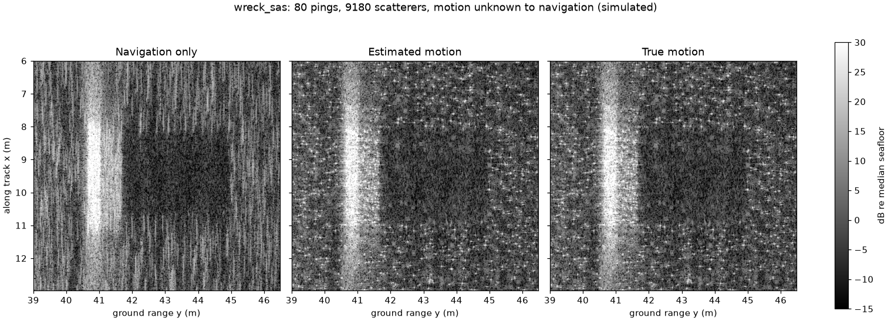
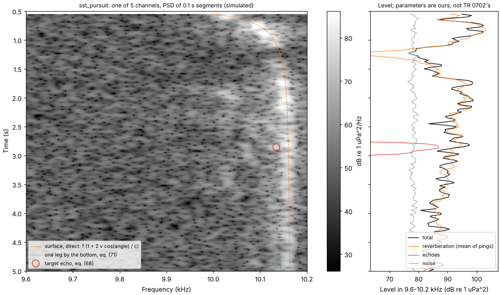
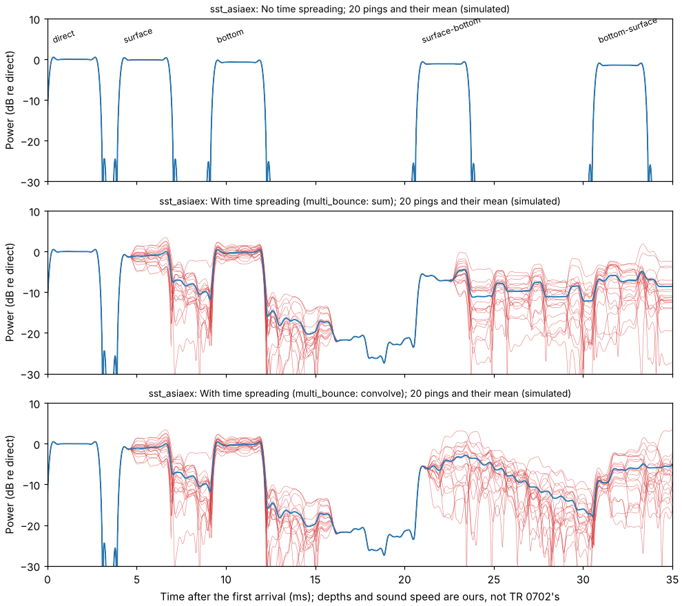

# Results

Measured by this repository's tests and tools. Accuracy numbers were produced on the
**CPU (host) backend**; the tests of the earlier sections also passed on the CUDA backend
(NVIDIA T4), and the sections from "Results since decision D-82" on say for each table
where it ran. Speed numbers
are in "Performance" and say which machine each came from.
Each row names what it is compared with. Where the brief asks for a comparison that
could not be made, that is stated.

## Performance

Source: `tools/benchmark.py`, run through `tools/gpu_job.sh` on rented x86_64 GPU machines
(Hugging Face Jobs, CUDA 12.6). Raw output: `docs/benchmarks/*.json`. Protocol as in the
paper: each dataset processed three times in a row, the last run reported. Times cover the
backprojection call only, including copying pings into the kernel's input and the
host-to-device transfer. They exclude simulation and conditioning, which run on the CPU.
**None of these is a DGX Spark or a Jetson.**

Datasets (simulated, fixed):

- **SAS:** `sas_auv`, 400 pings × 16 channels × 9,534 baseband samples; seafloor image
  2560 × 1200 pixels at 5 cm (128 m × 60 m); linear interpolation; each ping limited to
  the beam's λ/D extent. Collection time 80 s.
- **FLS:** `l12_5d`, both mux halves (2 × 64 channels); fan of 4000 ranges × 1602 bearings.
- **Flank:** `flank_32`, one ping of 32 channels × 171,072 baseband samples; map of
  16,000 ranges × 482 bearings out to 10 km. Ping cycle 14.3 s.

Two rounds were run. The first exposed that the kernel's float64 work dominated on most
GPUs; the kernel was then changed to reject out-of-beam (point, ping) pairs with a
float32 test before any float64 work and to skip float64 trigonometry for pings without
attitude rates. Images are unchanged (same tests, bit-identical culled and unculled).

Current kernel:

| GPU | SAS, no culling | SAS, culling b = 16 | SAS real-time factor (culled) | FLS fan (6.4 Mpixel) | Flank map (7.7 Mpixel) | Flank real-time factor |
| --- | --- | --- | --- | --- | --- | --- |
| Tesla T4 | 1.48 s | 1.26 s | 64× | 0.20 s | 0.27 s | 54× |
| L4 | 0.81 s | 0.68 s | 118× | 0.09 s | 0.16 s | 90× |
| A10G | 0.80 s | 0.69 s | 116× | 0.10 s | 0.17 s | 82× |
| A100 (80 GB) | 0.86 s | 0.68 s | 118× | 0.13 s | 0.15 s | 96× |

Before the change (`docs/benchmarks/before_pretest/`), for the SAS dataset:

| GPU | No culling | Culling b = 16 | Culling speedup |
| --- | --- | --- | --- |
| Tesla T4 | 13.68 s | 2.13 s | 6.4× |
| L4 | 7.46 s | 1.22 s | 6.1× |
| A10G | 6.55 s | 1.14 s | 5.7× |
| A100 (80 GB) | 1.05 s | 0.80 s | 1.3× |

- **Float64 was the bottleneck.** The T4, L4 and A10G run float64 at a small fraction of
  their float32 rate; the A100 does not, and was 6× faster than the A10G before the
  change although its nominal float32 throughput is lower. The float32 pre-test made the
  unculled kernel 9× faster on the T4 and 8× on the L4 and A10G.
- **Ray culling now adds 1.16× to 1.26×** on these GPUs, because the pre-test already
  skips most of what culling skips. The paper's "factor of two" was measured against a
  kernel without such a test; the first-round figures (5.7× to 6.4×) are the comparable
  ones here, and they depend strongly on the GPU's float64 speed. The culled image is
  bit-identical on every GPU; 11% of (ping, block) pairs are kept.
- **These one-shot SAS numbers are overhead-bound.** Three very different GPUs finish in
  0.68 s: what is left is mostly copying 0.5 GB of samples into the kernel's input and
  uploading it, which a one-shot call repeats every time. The session figures below
  remove that.
- Real-time factor is collection time over imaging time for this image size. It excludes
  conditioning (see "Conditioning on the device" below) and motion estimation.
- **FLS:** a 6.4-megapixel fan takes 0.09–0.20 s. The frame rate the rig can deliver is
  not known yet, so no real-time factor is claimed.

**Sessions: samples kept on the device** (`docs/benchmarks/session_*.json`, D-40). The
tables above are one-shot calls, which rebuild the kernel inputs and upload 0.5 GB of
samples every time. A session does both once (0.28 s on the A10G host, 0.37 s on the T4
host; 489 MB resident) and each call then moves only points and image. Third of three
runs, images bit-identical to the one-shot calls on every row:

| GPU, dataset | One-shot | Session | Session, culled | Real-time factor (session, culled) | Two GPUs (session, culled) | Scaling on two |
| --- | --- | --- | --- | --- | --- | --- |
| Tesla T4, SAS 2560 × 1200 at 5 cm | 1.53 s | 1.04 s | 0.80 s | 100× | — | — |
| L4, SAS 2560 × 1200 at 5 cm | 0.81 s | 0.49 s | 0.36 s | 225× | — | — |
| A10G, SAS 2560 × 1200 at 5 cm | 0.83 s | 0.44 s | 0.33 s | 243× | 0.19 s | 1.71× |
| A100 (80 GB), SAS 2560 × 1200 at 5 cm | 0.70 s | 0.23 s | 0.19 s | 412× | — | — |
| Tesla T4, SAS 6400 × 3000 at 2 cm | 6.61 s | 6.15 s | 4.61 s | 17× | — | — |
| L4, SAS 6400 × 3000 at 2 cm | 3.36 s | 3.03 s | 2.18 s | 37× | — | — |
| A10G, SAS 6400 × 3000 at 2 cm | 3.09 s | 2.71 s | 1.99 s | 40× | 1.15 s | 1.73× |
| A100 (80 GB), SAS 6400 × 3000 at 2 cm | 2.02 s | 1.38 s | 1.19 s | 67× | — | — |
| Tesla T4, FLS fan 4000 × 1602 | 0.20 s | 0.19 s | — | — | — | — |
| A10G, FLS fan 4000 × 1602 | 0.094 s | 0.085 s | — | — | — | — |
| Tesla T4, flank map 16000 × 482 | 0.18 s | 0.15 s | — | 94× (no culling) | — | — |
| A10G, flank map 16000 × 482 | 0.18 s | 0.073 s | — | 197× (no culling) | — | — |

- **The overhead was the per-call upload.** With it gone the 5 cm image takes 1.04 s on
  the T4, 0.49 s on the L4, 0.44 s on the A10G and 0.23 s on the A100: the GPUs separate
  again.
- **The benchmark is no longer overhead-bound at 2 cm.** The A10G images 4.5 × 10¹⁰
  pixel-records per second at both pixel sizes (4.46 and 4.53), so the 2 cm figure
  measures the kernel.
- **Multi-GPU:** two A10G give 1.71× to 1.73× over one, with an identical image (the
  one-shot figure was 1.13× to 1.20×, bounded by each device's upload). What is left of
  the gap to 2× is not broken down; point and image transfers run per call on each device.
- Two-GPU scaling was measured on one GPU type only (A10G).

**Conditioning on the device** (`docs/benchmarks/conditioning_*.json`, D-42). Raw
real-passband SAS pings (16 channels × 95,334 samples at 1 MHz) to compressed complex
baseband: conversion with decimation, then pulse compression. Per ping, third of three
runs, against the 0.2 s ping interval:

| Machine | Host (CPU threads) | Device (cuFFT) | Speed-up | Real-time factor on the device | Largest difference from the host result |
| --- | --- | --- | --- | --- | --- |
| Tesla T4 job (4 vCPU) | 217 ms (0.92× real time) | 6.2 ms | 35× | 32× | 2.5 × 10⁻⁷ of the peak |
| A10G job (4 vCPU) | 165 ms (1.2× real time) | 3.4 ms | 48× | 58× | 2.1 × 10⁻⁷ of the peak |

- **Conditioning, not backprojection, was the limit on a whole SAS chain.** On the CPU it
  barely keeps up with the sonar (and falls behind on the T4 machine), while the kernel
  images at 100× real time or more. On the device, conditioning plus the session
  backprojection (0.33 s per 400 pings, culled, A10G) comes to about 4 ms per ping, some
  50× real time. Motion estimation is still CPU and is not in that figure.
- The first device call of a run includes making the FFT plans (24 to 34 ms per ping in
  the first run above); plans are cached per size and device.
- Samples go to the device and back for each stage; they are not yet handed to the
  backprojection session without returning to host memory.
- Whitening, median TVG, calibration and DRC are still host only.

**Power-law fit** (the paper's Fig. 9 model, `y = a·x^b`, runtime against single-precision
GFLOPS), four GPUs, SAS dataset:

| Runs | Fit | R² in log space |
| --- | --- | --- |
| Sessions, 2 cm image, no culling (compute-bound) | y ≈ 783 · x^−0.57 | 0.34 |
| Sessions, 2 cm image, culled | y ≈ 779 · x^−0.59 | 0.44 |
| Sessions, 5 cm image, no culling | y ≈ 188 · x^−0.60 | 0.38 |
| One-shot calls, 5 cm, no culling (overhead-bound) | y ≈ 88 · x^−0.46 | 0.94 |
| One-shot calls, 5 cm, culled (overhead-bound) | y ≈ 74 · x^−0.46 | 0.87 |
| First round, no culling | y ≈ 644 · x^−0.49 | 0.08 |
| Paper (its own data, seven GPUs) | y ≈ 485307 · x^−0.755 | not stated |

- The GFLOPS values used (T4 8,141; L4 30,290; A10G 31,240; A100 19,490) are nominal
  float32 figures **recalled from vendor specifications and not verified here**; the paper
  took its values from Wikipedia, which the build container cannot reach.
- Only the exponent is comparable with the paper; its prefactor belongs to its dataset.
  On the compute-bound session timings ours is −0.57 to −0.60 against the paper's −0.755.
- **The fit is poor (R² 0.34 to 0.44) and should not be used to predict a new GPU.** The
  A100 is twice as fast as the T4-L4-A10G trend puts a card of its nominal float32 rate
  (without it the exponent stays at −0.58 to −0.61 but the prefactor moves by 40%). The
  kernel's float64 reference-delay solve favours cards with fast float64, which a
  single-precision GFLOPS axis cannot represent; the unverified GFLOPS figures may also
  be wrong. The high R² of the one-shot rows was three cards sitting on the same overhead
  floor, not a good model.

CPU reference point: the build container's 4 cores run the culling test set at about
1e8 pixel-records per second; the GPUs above reach 1e10 to 3e10 on the SAS dataset.

## FLS: resolution on simulated point targets

Source: `tests/python/test_fls.py`. Free-field point target, no noise, 12-bit ADC,
sound speed 1480 m/s, uniform aperture weighting, sinc interpolation, pulse compressed.
Widths are −3 dB. Definitions: `DECISIONS.md` D-26.

| Sonar | Elements | Range | Range width | Theory for the pulse | Nominal c/2B | Beam width | Theory 0.886·λ/L |
| --- | --- | --- | --- | --- | --- | --- | --- |
| `l12_5d`, two-ping full aperture | 128 | 1.5 m | 278.8 µm | 260.8 µm (+6.9%) | 296.0 µm (−5.8%) | 0.3886° | 0.3913° (−0.7%) |
| `l12_5d`, one mux half | 64 | 1.5 m | 278.8 µm | 260.8 µm (+6.9%) | 296.0 µm (−5.8%) | 0.7589° | 0.7826° (−3.0%) |
| `p4_2v` | 64 | 7.0 m | 347.1 µm | 323.9 µm (+7.2%) | 367.6 µm (−5.6%) | 1.4186° | 1.4386° (−1.4%) |

All are inside the 10% acceptance band. The range width sits about 7% above the ideal
Gaussian figure because baseband conversion keeps 1.5× the −6 dB bandwidth and tapers the
band edges.

Grating lobes of the linear probe (`l12_5d`, pitch 0.3 mm against a 0.296 mm wavelength),
target at 20° bearing:

| Quantity | Value |
| --- | --- |
| Largest steering angle with no grating lobe in visible space | 0° (none) |
| Predicted lobe bearing at centre frequency | −40.1° |
| Predicted lobe level, narrowband, element pattern only | −4.2 dB |
| Measured lobe bearing in the image | −38.7° |
| Measured lobe peak level in the image | −33.2 dB |

The measured level is far below the narrowband figure because the pulse is two cycles
long: away from the true bearing only a few elements overlap in time, so the lobe is
smeared instead of focused. A longer or narrower-band pulse would raise it towards the
narrowband value.

## FLS: PICMUS plane-wave benchmark

Source: `python/gpusonar/benchmarks.py`, `tests/python/test_picmus.py`.
Data: PICMUS simulation, resolution phantom, IQ, 128-element L11-4v at 5.208 MHz,
from the Hugging Face mirror `zeahub/picmus` (a format conversion of the original).
Metric: mean −6 dB width of the envelope over the eleven point targets, as in the
challenge. Sinc interpolation, uniform weighting, no post-processing.

| Plane waves | Receive aperture | Axial FWHM | Lateral FWHM |
| --- | --- | --- | --- |
| 1 | full | 0.395 mm | 0.324 mm |
| 11 | full | 0.395 mm | 0.297 mm |
| 75 | full | 0.393 mm | 0.300 mm |
| 1 | F-number 1.75 | 0.409 mm | 0.706 mm |
| 11 | F-number 1.75 | 0.409 mm | 0.500 mm |
| 75 | F-number 1.75 | 0.408 mm | 0.519 mm |

- **Comparison with published numbers: not done.** The brief asks for it, but the
  challenge paper and site could not be fetched from the build container (publisher and
  host blocked), so no published figure is quoted here. The F-number 1.75 rows use the
  receive aperture the challenge's reference beamformer is commonly run with, so they are
  the rows to compare once the paper is at hand.
- What was checked instead: the kernel matches an independent float64 delay-and-sum on
  this data to 2e-4 relative; all eleven targets are found on the phantom's 5 mm lattice;
  axial width is the same for 1 and 75 plane waves; compounding does not blur.
- Not yet measured: contrast and CNR on the cyst phantom, and the experimental and
  in-vivo sets.
- The targets image 0.2 mm deeper than the nominal lattice (10.2, 15.2, … mm). The
  offset is uniform; it is a property of the data's time origin and was left alone.

## SAS with known navigation

Source: `tests/python/test_sas.py`, scenarios `stripmap_points` and `rail_points`. CPU.
Widths are −3 dB. Navigation is the simulator's truth.

Stripmap: `sas_auv` (200 kHz, 40 kHz LFM, 16 receivers at 4 cm, element length D = 4 cm),
15 m altitude, 1.6 m/s, 90 pings at 0.32 m, each ping processed over the beam's λ/D extent.

| Target ground range | Along-track width | Against D/2 = 20.00 mm | Along-track position error |
| --- | --- | --- | --- |
| 38.0 m | 20.49 mm | +2.5% | −2.0 mm |
| 41.2 m | 20.74 mm | +3.7% | −2.0 mm |
| 45.0 m | 20.51 mm | +2.6% | −2.0 mm |

- Ground-range width at 41.2 m: 18.84 mm against 17.68 mm (0.886·c/2B projected onto the
  seafloor), +6.6%.
- The width does not change with range, as D/2 predicts. A real aperture of the same
  0.64 m array would resolve about 10 cm at this range.
- Processing the whole main lobe (null to null) instead gives 15.6 mm, finer than D/2.
  D/2 is the figure for a processed extent of λ/D; that extent is the default.
- The constant −2 mm along-track offset is a tenth of a resolution cell. It is consistent
  with range-Doppler coupling of the LFM pulse on a moving platform, which nothing
  compensates yet; that attribution has not been tested by removing the motion.

Rail: `sas_rail` (P4-2v probe, 2.72 MHz, 64 elements), 151 stop-and-go positions at 2 mm
(0.30 m of travel), target at 2.0 m.

| Quantity | Measured | Theory |
| --- | --- | --- |
| Along-track width | 1.579 mm | 1.558 mm = 0.886·λR/(2L), L = 0.3095 m (+1.3%) |

On a rail the element beam (about 110°) is far wider than the angle the rail subtends,
so resolution is limited by the rail length, not by D/2 (which would be 0.125 mm and
would need 5.7 m of rail at this range).

## Flank array: beamforming and the sonar equation

Source: `tests/python/test_flank.py`. CPU. Free field (`free_field` tier), one ping.

Far-field beamformer against backprojection, `flank_32`, target at 5 km, bearings 0°, 17°
and −35°: the two complex maps differ by less than 2% of the peak over a ±6° by ±1 m
patch. At 8 m (inside the 96 m Fraunhofer distance) the far-field beamformer keeps 49% of
the peak and its beam is 13.6° wide against 3.2° for backprojection.

Beam width (−3 dB) and ambiguities, uniform weighting:

| Array | Measured width | Theory | Highest lobe outside the main lobe, measured (wideband pulse) | Predicted, single frequency | Predicted, band average |
| --- | --- | --- | --- | --- | --- |
| `flank_32`, 32 × 9.4 cm, 6–10 kHz | 3.14° | 3.16° (0.886·λ/L) | −17.6 dB | −13.2 dB (a sidelobe) | −15.1 dB |
| `popoto_8` dense, 8 × 2.7 cm, 20–35 kHz | 12.83° | 12.82° | −17.4 dB | −12.8 dB (a sidelobe) | −14.9 dB |
| `popoto_8` sparse, 8 elements over 3 m | 0.70° | 0.73° (array factor at 27.5 kHz) | −10.2 dB | 0.0 dB (a full ambiguity) | −8.3 dB |

- `flank_32` and the dense Popoto layout have no grating lobes at broadside; what is
  listed is the ordinary first sidelobe.
- The sparse layout buys an 18× narrower beam with ambiguities: at any single frequency
  some other bearing responds at full height. Over the 20–35 kHz band those lobes fall at
  different bearings and average down to about −8 dB (−10 dB measured with the simulated
  pulse). `flank.ambiguity_report` produces this for any layout and band.

Sonar equation against simulation, `flank_32`, 200 dB source, 1 s LFM, 10 dB target,
white noise at 50 dB re 1 µPa²/Hz, 32 hydrophones:

| Range | Predicted output SNR | Simulated output SNR (mean of two noise draws) |
| --- | --- | --- |
| 1 km | 53.7 dB | 52.4 dB |
| 5 km | 20.5 dB | 18.7 dB |
| 10 km | 1.9 dB | 4.2 dB |

- All within the 3 dB acceptance band. Predicted detection range at a 13 dB threshold:
  6.7 km.
- At 10 km the simulated figure reads high because the peak is picked from a noisy
  envelope at low SNR.
- This is spherical spreading plus absorption in white noise. Multipath, reverberation
  and ambient noise spectra are milestone 12, and will change these numbers.

## Flank array: adaptive beamforming, detection, tracking

Source: `tests/python/test_detect.py`. CPU. `flank_32`, 0.1 s pulse, targets near 2 km.

| Check | Result |
| --- | --- |
| MVDR against conventional, white noise only (target SNR) | 17.3 dB against 19.7 dB: 2.4 dB worse |
| MVDR against conventional, with a broadband jammer 30 dB above ambient at −20° | 19.4 dB against 5.5 dB: 13.9 dB better |
| MVDR output looking straight at the jammer | within 1.5 dB of conventional (nothing to reject) |
| CA-CFAR false-alarm rate on noise with a 20 dB level ramp, design 1e-2 and 1e-3 | within 25% of design |
| Split-window normaliser on a 30 dB level ramp | background flat within 0.5 dB |
| Detection of a 10 dB target at 2040 m, 12°, in noise | range within 1 m, bearing within 1°, SNR above 20 dB |
| Tracking a target crossing at 5 m/s over 20 pings, two injected false alarms per ping | position within 10 m at 1.9 km, velocity within 1 m/s, at most one spurious confirmed track |

- MVDR's 2.4 dB loss in white noise is the price of estimating a 32 × 32 covariance per
  sub-band from one ping. It pays off only when there is something directional to reject.
- The MVDR here rejects interference that extends in range (jammers, directional noise,
  reverberation). It does not separate two point targets at the same range: the cell under
  test is kept out of the covariance so that the echo is not cancelled.
- The last pulse length of a compressed record has only a partial replica overlap. Beam
  maps mark it (`BeamMap.n_valid`); running CFAR over it produces false alarms.
- A target's own sidelobes cross a CFAR threshold at the same range and other bearings.
  The tracking test keeps the strongest detection per ping; a sidelobe-aware clustering
  step is not written.

## Flank array: calibration and multi-board synchronisation

Source: `tests/python/test_calibration_sync.py`. CPU.

Calibration, `flank_32`, five known sources at 1 km from −40° to +40°. Injected: gain
1 dB RMS, phase 20° RMS, element position 5 mm RMS in the array plane.

| Quantity | Worst error over 32 channels |
| --- | --- |
| Gain | 0.007 dB |
| Phase | 0.015° |
| Position | 0.018 mm |

Applying the estimate restores the beam peak to within 1% and removes most of the raised
far-sidelobe floor. Noise-free; errors with noise have not been characterised. The array's
mean gain, mean phase and mean position offset cannot be observed and are set to 1, 0, 0.

Synchronisation, `popoto_4x8` (four boards, 32 hydrophones, 20–35 kHz). Injected clock
offsets of 310, −170 and 52 µs and drifts of 12, −8 and 25 ppm relative to the first
board, plus 20 ns of jitter. Shared reference: two out-of-band chirp bursts per ping.

| Quantity | Result | Requirement |
| --- | --- | --- |
| Offset estimate, worst error | 0.05 µs | — |
| Drift estimate, worst error | 0.00014 ppm | — |
| Misalignment left after resampling | 0.50 µs | 1.43 µs (a twentieth of a period at 35 kHz) |
| Beam peak, unsynchronised, against a single-clock array | −8.2 dB | — |
| Beam peak, synchronised | −0.003 dB | — |
| Largest difference on any lobe above −20 dB | 0.18 dB | 1 dB |

- The 0.50 µs residual is dominated by the resampler acting on the reference bursts
  themselves, which sit at 38–48 kHz, close to the 51.2 kHz Nyquist limit. In the acoustic
  band the alignment is better than that, as the beam pattern shows.
- The stage raises `SyncError` and refuses to pass the record on when the residual exceeds
  the tolerance (tested by giving it the wrong reference description).
- The 1PPS and direct-path methods recover offsets in their tests (to 1 ns and 0.5 µs);
  they do not measure drift within a ping.

## Propagation, reverberation and noise (milestone 12, in progress)

Source: `tests/python/test_propagation.py` (needs Bellhop, an external GPL-3 program run
as a separate process), `test_reverberation.py`, `test_noise.py`. CPU.

| Check | Result | Tolerance asked |
| --- | --- | --- |
| Image-source provider against Bellhop, Pekeris waveguide (100 m, 1600 m/s bottom), 1 kHz: coherent transmission loss, 0.1–3 km | 0.06 dB median, 0.4 dB worst | "within stated tolerances": 0.3 dB median, 1 dB worst |
| Same, incoherent transmission loss, 1 and 8 kHz | 0.1 dB median, 0.7 dB worst | 1 dB |
| Same, delays of the first four arrivals | within 2 µs | 2 µs |
| Bellhop provider lookup between grid nodes against a direct Bellhop run, 8 kHz | delays within 20 µs | 20 µs |
| Echo of a target at 1 km through the `eigenray` tier against the `image_source` tier | envelope correlation above 0.9, energy within 1 dB | — |
| Bottom reverberation level against time, Lambert seabed, against the analytic prediction | within 2 dB in every range bin, mean within 1 dB | 2 dB |
| Scattering-function reverberation level against the same analytic prediction (6 pings averaged) | within 2 dB in every range bin, mean within 1 dB | 2 dB |
| Scattering-function against point-scatterer reverberation, same seabed | within 2 dB in every range block | — |
| Coherence of generated reverberation between hydrophones 1 and 2 spacings apart | J0(kd) within 0.1 | — |
| Surface reverberation level, Chapman–Harris at 8 m/s, against S(θ) × area / r⁴ (`test_surface.py`) | within 2 dB in every range bin | — |
| Chapman–Harris formula against its second published form (wind in m/s, constant 107) | within 0.3 dB | — |
| Reverberation envelope statistics | Rayleigh: mean within 3%, scintillation index 1 ± 0.25 | — |
| Clutter with patch texture (shape 1) | scintillation index 2.0–2.6 against 1.2 without | K-distributed "can be made" |
| Generated ambient noise against the requested spectrum, 0.5–30 kHz | within 1 dB | — |
| Coherence between hydrophones in isotropic noise against sin(kd)/(kd) | within 0.12 | — |

- Bellhop writes bounce phases for the opposite time convention; the reader conjugates
  them. Before that the coherent comparison was off by 4 dB median.
- The Munk-profile test checks Bellhop's own output for sound-channel behaviour. No
  provider of ours claims a refracting profile except the Bellhop one, so there is nothing
  independent to compare there.
- Range-dependent bathymetry (`OceanEnvironment(bathymetry=...)`, passed to Bellhop as a
  bathymetry file): a ridge rising from 200 m to 60 m at 4 km leaves the loss unchanged
  before it (within 0.3 dB), gives no arrivals inside it, and adds more than 1.5 dB behind
  it at 8 kHz (measured 2 to 10 dB). The model is 2-D: one depth profile on every bearing.
  Reverberation still assumes a flat boundary, so there is no ridge echo yet.
- Not done: bubble absorption and a high-frequency surface model (Chapman–Harris is a
  400–6400 Hz fit), a Jackson-type bottom model, volume scattering, time spreading, the
  RAM cross-check. TR 0702 has no fully specified worked example to
  reproduce (`PHYSICS_NOTES.md` section 9).
- The ambient-noise coefficients (four-term fit to the Wenz curves) were checked against
  two independent copies of the formulas, not against the original book.

## Rays against normal modes at 8 kHz

Source: `tests/python/test_kraken_crosscheck.py`. Bellhop and KRAKEN, both run as separate
programs. Isovelocity 100 m of water over a fluid bottom (1600 m/s, 1.8 g/cm³, 0.5 dB/λ),
source at 30 m, receiver at 50 m, 8 kHz, 1 to 10 km. Incoherent transmission loss (arrivals
summed in power against modes summed in power; the coherent field at 8 kHz changes over
centimetres and is not a useful comparison).

| Check | Result |
| --- | --- |
| Rays minus modes, 1–10 km | at most 0.21 dB |
| Rays minus modes, 2–10 km | below 0.1 dB (−0.01 dB at 10 km, where the loss is 66.2 dB) |
| Eigenray provider with 80 arrivals kept, against modes | within 0.5 dB at every range |
| Eigenray provider with 8 arrivals kept, at 10 km | 4.9 dB too much loss one way |

- **A fault this check found.** The long-range scenarios first shipped with 8 arrivals per
  leg. That keeps the strongest paths, so the peak of the compressed echo was right, but
  it dropped two thirds of the one-way energy at 10 km, and with it most of the
  reverberation. The scenarios now keep 24 to 80 arrivals (D-39) and the table below was
  re-measured.
- RAM (parabolic equation) was not run: PyRAM is the permissive candidate and is not
  installed here.

## Long-range scenarios at the eigenray tier

Source: `tests/python/test_long_range.py`, scenarios `flank_target_{1,5,10}km` and
`popoto_trial_{100,1000,2000}m`. Bellhop arrivals (16 to 80 per leg, so up to 6400 two-way
paths per target), isovelocity water over a flat fluid bottom (1600 m/s, 1.8 g/cm³,
0.5 dB/λ), flat sea surface, Ainslie–McColm absorption at 12 °C, ambient noise with
isotropic-field coherence across the array, +10 dB target, one ping, conventional
beamforming. All add bottom reverberation by the scattering-function method
(Lambert, −27 dB). Output SNR is the peak of the
compressed echo over the mean background on the same beam. "Spherical estimate" is the
sonar-equation tool with the same source, noise and target, noise only. CPU.

| Scenario | Water depth | Output SNR | Same, without reverberation | Spherical estimate | Difference |
| --- | --- | --- | --- | --- | --- |
| `flank_32`, 200 dB source, 1 s LFM, noise 45 dB: 1 km | 100 m | 28.1 dB | 57.9 dB | 58.8 dB | −30.7 dB |
| 5 km | 100 m | 24.1 dB | 29.6 dB | 25.7 dB | −1.6 dB |
| 10 km | 100 m | 18.6 dB | 18.1 dB | 7.2 dB | +11.4 dB |
| `popoto_8`, 190 dB source, 0.5 s LFM, noise 38 dB: 100 m | 30 m | 53.6 dB | 83.1 dB | 86.9 dB | −33.3 dB |
| 1 km | 30 m | 26.2 dB | 39.3 dB | 36.6 dB | −10.4 dB |
| 2 km | 30 m | 21.6 dB | 22.1 dB | 13.1 dB | +8.5 dB |

- At long range the shallow-water duct keeps more energy than spherical spreading
  assumes, so the noise-only estimate is pessimistic there by about 10 dB in this
  environment. At short range multipath interference can cost a few dB (−3.8 dB at 100 m
  without reverberation).
- The Popoto trial in 30 m of water is reverberation-limited at 100 m and 1 km (30 and
  13 dB below the figure without reverberation) and noise-limited at 2 km.
- With this seabed and source the flank array is reverberation-limited at 1 km (30 dB
  below the noise-only figure), about evenly limited at 5 km (reverberation costs 5.5 dB)
  and noise-limited at 10 km (the 0.5 dB change there is within one noise draw). The
  balance depends directly on the assumed −27 dB Lambert parameter and 45 dB noise level,
  neither measured.
- The SNR here is a peak. Multipath spreads the echo over tens of milliseconds, so the
  energy gain of the duct is larger than the peak gain shown.
- **Sensitivity to the sea surface** (flank scenarios, 5 m/s wind, not shipped as
  scenarios). Adding Chapman–Harris surface reverberation: 26.4, 22.7 and 19.4 dB at 1, 5
  and 10 km (a loss of 1.7 and 1.4 dB at 1 and 5 km; +0.8 dB at 10 km, within a noise
  draw). Adding the rough-surface reflection loss as well: 36.4, 28.3 and 18.4 dB. The
  SNR *rises* at 1 and 5 km because the coherent-loss model strips surface-bounce paths,
  and those carry most of the reverberation while the target's direct path is untouched.
  That model overstates the loss (D-38), so this is a bound on the effect, not an estimate.
- **This is not a detection-range prediction.** The shipped scenarios have bottom
  reverberation only, with a projector taken as omnidirectional, and no
  surface roughness loss, no platform self-noise, one noise draw, and an idealised flat
  bottom. The plan's own caveat applies: each of those can move the result by 10 dB.
- The SNR is the peak within 60 ms after the first arrival over the mean noise power on
  the same beam. Multipath spreads the echo, so its energy is higher than its peak shows.

## 3D near-field imaging of a buried object

Source: `tests/python/test_volume.py`. CPU. A `subbottom` sonar (20 kHz, 20 kHz
bandwidth, one projector, four receivers) rastered over a 1.8 m square at 7.5 cm steps
(625 pings), 1.5 m above the seabed. Water 1500 m/s, sediment 1700 m/s. A 0.5 m cylinder
(a line of scatterers on its axis) buried 0.30 m. Navigation is the truth. The volume is
built as horizontal layers at 5 mm depth steps.

| Quantity | Refraction on | Refraction off |
| --- | --- | --- |
| Depth of the brightest voxel | 0.300 m | 0.265 m |
| Error against the true 0.30 m | 0.000 m | −0.035 m (predicted at nadir: −0.035 m) |
| Peak level | reference | −0.75 dB |
| Level in the depth slice at the true depth | reference | −15.0 dB |

- "Defocuses with refraction off": mostly it is misplaced. The peak drops by only
  0.75 dB because this aperture subtends at most about 27° at the object, so the delay
  error is nearly the same for every ping and reads as a depth shift. A wider aperture
  or a larger sound-speed contrast would blur it more.
- The travel-time routine matches a brute-force least-time search to 1e-10 and satisfies
  Snell's law at the crossing point to 1e-7.
- Not modelled: transmission loss and attenuation in the sediment, a rough or sloping
  interface, shear waves, and the cylinder's own scattering (it is a line of points).
- Multi-layer GeoTIFF output of the volume is not written yet.

## Motion estimation

Source: `tests/python/test_motion.py`. CPU. Scenario: `sas_auv` at 200 kHz (wavelength
7.5 mm), 40 pings at 0.24 m (so 4 of 16 phase centres overlap between pings), 15 m
altitude, speckle seafloor of 25 scatterers/m² plus one bright point, short Gaussian
pulse. True trajectory: smooth random sway of 10 mm RMS (39 mm peak, five wavelengths)
and heave of 4 mm RMS. Navigation reports a straight level line; the DVL altitude has
1 mm noise. 1248 delay measurements, none rejected.

| Quantity | Result | Stated bound |
| --- | --- | --- |
| Sway error, RMS | 0.109 mm = λ/69 | λ/20 |
| Heave error, RMS | 0.328 mm = λ/23 | λ/4 |
| Sway error after the coarse pass only | 0.295 mm | — |
| Point-response peak, navigation only, against the true-motion image | −10.01 dB | — |
| Point-response peak, after motion estimation | +0.03 dB | within 1 dB |

- Both Ceres passes converged (8 and 7 iterations).
- Heave is the weaker estimate, as expected: grazing angles here span only 17° to 27°, so
  the delays say much more about sway than heave, and the DVL term carries the altitude.
- Solver checks on synthetic delays: exact delays are inverted to 10 µm; with twelve
  20 µs outliers the Huber loss keeps sway inside a wavelength (3.8 mm) where the squared
  loss gives 198 mm; correlation weighting cuts the error by more than 3× when a fifth of
  the measurements are poor.
- Not measured: image contrast loss (only the point-response peak), behaviour with
  attitude errors, and anything on real data.

## SAS on an extended scene with unknown motion (`wreck_sas`)

Source: scenario `wreck_sas`; `tests/python/test_scene_objects.py` (the end-to-end test
runs only where there is a CUDA device; the figures below are from a CPU run of the same
steps). A 3 × 1 × 1 m box on a seafloor of 7500 Lambert scatterers, 80 pings at 0.24 m,
15 m altitude, sway 10 mm RMS (27 mm peak, 3.6 wavelengths) and heave 4 mm RMS that
navigation does not report. Chain: simulate, pulse compress, displaced-phase-centre
motion estimation, backprojection at 2.5 cm.

| Quantity | Navigation only | Estimated motion | True motion |
| --- | --- | --- | --- |
| Sway error, RMS | 1.34 λ | 0.089 λ | — |
| Heave error, RMS | — | 0.098 λ | — |
| Image sharpness (Σ I² · N / (Σ I)²) | 69 | 272 | 279 |
| Seafloor over shadow behind the box | 13.7 dB | 14.7 dB | 14.8 dB |
| Box face over seafloor | 20.4 dB | 20.3 dB | 20.2 dB |

- With the estimated track the image is within 3% of the true-motion sharpness; with
  navigation alone it is four times less sharp. The shadow contrast barely depends on
  focus because the shadow is much larger than the blur.
- The bright band at 40.6 to 41 m is the box's top and near face laid over towards the
  sonar (it is 1 m above the image plane), and it smears along track for the same reason.
- The seafloor is 25 scatterers per square metre, far fewer than one per resolution cell,
  so it shows as separate points, not developed speckle. Synthesis took 245 s on four CPU
  cores; motion estimation 1 s (2528 delay measurements).

## Kernel accuracy

Source: `tests/python/test_backproject.py`.

| Check | Result | Requirement |
| --- | --- | --- |
| Carrier phase error, 32-element flank array, 10 kHz, targets 0.2–10 km, platform moving and yawing | below 0.05° | below 1° |
| Carrier phase error, 128-element probe, 5 MHz, 0.75–3 m, both mux halves | below 0.05° | below 1° |
| Kernel against independent float64 reference, nearest / linear | 2e-5 relative | — |
| Kernel against independent float64 reference, sinc | 2e-4 relative | — |
| Same with a platform moving at 3 m/s, weights on | 2e-4 relative | — |

The phase errors are the worst case over random targets, against long-double arithmetic.
The tests assert 0.05°; the requirement is 1°.

## Conditioning, pulse compression and post-processing

Source: `tests/python/test_conditioning.py`. CPU.

| Check | Measured | Against |
| --- | --- | --- |
| LFM compression gain, B = 4 kHz, T = 0.25 s | 29.99 dB | 10·log10(BT) = 30.00 dB |
| LFM compression gain, B = 4 kHz, T = 0.05 s | 23.00 dB | 23.01 dB |
| LFM compression gain, B = 15 kHz, T = 0.02 s | 24.76 dB | 24.77 dB |
| Unweighted LFM peak sidelobe | −13.3 dB ± 1 | −13.3 dB (sinc) |
| Hamming-weighted replica peak sidelobe | below −30 dB | — |
| Whitening (Eq. 9): in-band spread of a 12 dB tilt + 6 dB ripple, after | below 1 dB | flat |
| Median TVG (Eq. 10): intensity spread over a 30 dB decay, after | below 1 dB | flat |
| Median TVG with a 60 dB target on 6 of 64 channels: change in gain | below 3 dB | a mean-based gain would notch by more than 40 dB |
| DRC (Eq. 11–12): output median for targets 0.1, 0.2, 0.5 | within 0.001 | the target |
| Calibration: residual after removing injected gain, phase, delay | below 1e-4 | exact |
| Doppler bank, 1 s LFM, target closing at 6 m/s | 6 m/s ± 1 (1 m/s grid) | truth; the zero-Doppler replica loses more than half the peak |

The compression gain is the output SNR over the input SNR measured in the signal band.

## Ray culling

Source: `tests/python/test_culling.py::test_report_cpu_speedup`. **CPU backend, 4 cores.**
Stripmap geometry: `sas_auv`, 200 pings over 64 m of track, 16 receivers each, image
400 × 240 points, linear interpolation, field of view 1.5 × FWHM. Best of three runs.
Without culling: 1.78 s.

| Block size b | Speedup | (ping, block) pairs kept |
| --- | --- | --- |
| 4 | 1.60× | 19% |
| 8 | 1.68× | 21% |
| 16 | 1.62× | 25% |
| 32 | 1.61× | 33% |

- The image with culling on is bit-identical to the image without it, in every test.
- The paper reports "a factor of two" for its GPU implementation on its own data. These
  figures are CPU and a different geometry, so they are not a like-for-like comparison.
  The gain depends on how much of the image each ping can see: a 15 m collection where
  each ping covered most of the image gave only 1.1×.
- These CPU figures predate the kernel's float32 pre-test. With it, the same unculled
  run takes 1.11 s and culling adds about 1.1×. GPU figures are in "Performance".

## Simulator

Source: `tests/python/test_sim.py`.

| Check | Result |
| --- | --- |
| Echo delay, Gaussian pulse, three probes | within 0.01 carrier period |
| Echo amplitude (spreading, absorption, both directivities) | within 0.5% |
| Echo delay, LFM by matched filter, four sonars | within 0.02 / bandwidth |
| Flank echo level at 1 km against SL − 2TL + TS + sensitivity | within 0.7 dB (absorption varies across the sweep) |
| Time-domain synthesis against frequency-domain oracle | 5e-3 relative (Gaussian truncation) |
| Arrival time with a 30 m/s receiver | within 0.2 µs of the implicit solution |
| Doppler shift, 5 m/s closing target, 8 kHz | within 0.2% of 53.5 Hz |

## MINSAS-class SAS: resolution on a simulated point target

Source: `tests/python/test_minsas_resolution.py`; survey geometry (12 m altitude, 45 to 50 m
ground range, 64 pings), `sas_minsas120`.

| Quantity | Design | Measured |
| --- | --- | --- |
| Along-track width, −3 dB | 2.1 cm (half the 4.2 cm projector) | 2.0 cm |
| Ground-range width, unweighted | 1.9 cm (c / 2B, 40 kHz, on the ground at 15 degrees) | 1.9 cm |
| Ground-range width, Hamming replica | — | 2.6 cm |
| Range sidelobes beyond 10 cm, unweighted / Hamming | — | −26 dB / −41 dB |
| Along-track sidelobes beyond 5 cm, default aperture / 1.6 beamwidths weighted | — | −23 dB / −36 dB |
| Along-track ghosts at 0.4 m per ping / 0.544 m per ping (half the array) | — | −15 dB / −36 dB |
| Along-track ambiguity (grating lobe of the receive phase centres): 32 elements at 3.4 cm / the shipped 48 at 2.27 cm | — | −42 dB, 6.9 m away at 51 m / −47 to −54 dB, 10.3 m away |

Kraken's sheet for the MINSAS 120 gives 3.3 cm × 3.0 cm, or 2.1 cm × 1.9 cm post-processed;
the simulated sonar is set to the finer figure. This is a simulation of a design, not a
measurement of that product.

## Popoto array: frequency and source level for 12 km

Source: `tools/popoto_range_study.py`, `docs/design/popoto_range_study.json`, checked against
the sonar equation in `tests/python/test_design.py`. Target +25 dB (a placeholder), 1 s
pulse, wind 5 m/s, spherical spreading plus absorption, and 15.8 dB in one row at the
beamformer output: what the chain's detector needs of one row on `popoto_face_1x32` for a
detection probability of 0.5 on one ping (17.4 dB for 0.9; `DECISIONS.md` D-117, D-134).
Source levels are RMS.

| Array | Best frequency | Source level | Acoustic power, omnidirectional |
| --- | --- | --- | --- |
| 8 hydrophones | 4.2 kHz | 204 dB | 2060 W |
| 16 | 4.2 kHz | 201 dB | 1030 W |
| 32 | 4.2 kHz | 198 dB | 515 W |
| 64 | 4.2 kHz | 195 dB | 257 W |
| the present 8 at 27.5 kHz | — | 322 dB (not possible); 190 dB reaches 2.7 km | — |

Until D-117 this table was computed for a typed 13 dB and read 3 dB lower in every row
(201, 198, 195, 192 dB; 319 dB and 2.8 km for the present array). The shipped design
(32 hydrophones, 197 dB) was sized on that table plus 2 dB; against the detector's need it
is 1.1 dB short with one row ("The 12 km margins with the detector's threshold" and
"Six fixes after the first whole-suite run", below). The table was regenerated after the
detector's tests were recounted (D-134): 15.6 dB became 15.8 dB and each power rose by 3 %.

Bellhop for 100 m of isovelocity water over sand gives 14 dB less loss each way at 4 kHz
(70.4 dB against 84.6 dB including absorption): there, noise alone would ask for only
172.5 dB with 16 hydrophones, and reverberation decides. Simulated outcomes in five oceans are in
`SCENARIOS.md`.

## CPU speed after the synthesis kernel rework

Four cores of an x86_64 container, nothing else running; the same scenarios before and
after `DECISIONS.md` D-51. "Before" for the whole scenarios was measured with other jobs
sharing the machine, so only the synthesis line is a like-for-like comparison.

| What | Before | After |
| --- | --- | --- |
| Synthesis, `fls_120k_transit`, one ping (1691 scatterers, 128 channels, 10 ms pulse) | 7.95 s | 1.40 s (5.7×) |
| The same on one thread / four threads | — | 12.3 s / 3.1 s before the phasor recurrence: 4.0× from threads |
| `fls_120k_transit`, 10 pings, whole scenario | 512 s (shared) | 77 s |
| `fls_170k_transit` | 1090 s (shared) | 198 s |
| `fls_330k_transit` | 885 s (shared) | 169 s |
| `fls_120k_cluttered_seabed` | 279 s (shared) | 54 s |
| `flank_patrol`, synthesis per ping (real samples at 64 kHz, 1 s pulse, multipath) | not separated | 91 s of about 100 s |

Simulator accuracy tests (delays, amplitudes, Doppler, the frequency-domain oracle;
`test_sim.py`) pass unchanged. The kernel is shared with the CUDA build.

## Simulation and imaging on a GPU against four CPU cores

Whole gallery scenarios (simulate, image, detect, track), same code, `--backend cuda` on an
NVIDIA L4 against `--backend host` on four x86_64 cores. Numbers reported by the two runs
agree to the digits printed (speckle contrast 1.2115 on both; the same 57 tracks and
classes under the rough sea).

| Scenario | Scatterers | CPU, four cores | L4 | What limits the GPU run |
| --- | --- | --- | --- | --- |
| `sas_minsas_speckle` | 445,567 | 818 s | 96 s | synthesis is on the device; path geometry per ping is NumPy |
| `sas_minsas_boulder_field` | 27,620 | 98 s | 18 s | |
| `fls_120k_rough_surface` | 77,106 | 140 s | 33 s | |
| `fls_120k_transit` | 1,691 | 77 s | 49 s | boundary reverberation is generated on the CPU |
| `fls_120k_cluttered_seabed` | 7,882 | 54 s | 39 s | the same |

The more of a scene is explicit scatterers, the more the GPU gives. Scenes whose
background is statistical reverberation are held back by its CPU generator.

This table is from the earlier pair of runs. The gallery was run again on an L4 at commit
`4530dc4`, a later tree; `docs/figures/gallery.json` is from that run and gives 95, 18,
18, 11 and 7 s for these five scenarios, in the table's order. The CPU column was not
measured again on that tree, and the rough sea now gives 56 tracks, not 57.

## Long-range live chain

Source: `tests/python/test_live.py`, `tools/sonar_live.py --scenario popoto_far_mover`.

| Quantity | Result |
| --- | --- |
| Processing per ping, 32 channels × 50,134 complex samples, backprojection kernel, four CPU cores | 0.55 s |
| The same with the NumPy far-field beamformer | 6.1 s |
| Tracks at the last of six pings, both beamformers | 1 mover (the ship, −5.8 and −6.0 m/s against −6) with 4 multipath tracks attached |
| Replay of the chain's own recording | same track identities and classes, positions equal to 1e-6 m |
| Four boards with offsets over 100 µs, synchronised on the shared reference | residual under 1 µs; target at 600 m found within 1.5 m and 1 degree; without the stage the peak is under half as high |
| Standing target seen from an ownship making 1.5 m/s, pose from navigation datagrams | classified static, under 0.6 m/s; without navigation it carries ownship's 1.5 m/s |

## The live chain in C++ against the Python chain

Source: `tests/python/test_live_cpp.py`, `tests/cpp/test_live.cpp`; the 12 km rows are the
`popoto_12km` scenario (32 hydrophones, 22,934 complex samples a ping at 8 kHz, Bellhop
multipath, reverberation, noise) through `configs/deploy/popoto_vehicle.yaml` on four CPU
cores.

| Quantity | Result |
| --- | --- |
| Clusters, tracker state and history, classes (mover, static, line, multipath) on the same detections | equal to 1e-8 |
| Whole reports on six simulated pings | same detections within 0.05 m and 0.05°, same track identities, classes and parents |
| Board synchronisation, four boards | offsets equal to the Python stage's within 0.05 µs; the target focuses, and does not without it |
| Stream assembler on the emulated board's blocks | same pings, sample for sample; a lost block drops its ping in both |
| `popoto_12km`, six pings: detections per ping, track classes and ranges | identical in both chains (5, 7, 10, 11, 14, 7 detections; ten tracks) |
| `popoto_12km`, processing per ping | C++ 0.42–0.51 s, Python 0.51–0.55 s (the kernels are shared; the ping interval is 19.9 s) |
| The standalone program over UDP with navigation datagrams | all pings assembled, ownship position from navigation, mover and static tracks |
| `sonar_live --listen`: an untriggered stream of real samples over UDP, two noise sources | every stretch recorded; both sources within 0.6° in at least 80% of frames |
| The Holoscan application of C++ operators (`sonar_live_holoscan`, Holoscan 4.6.0, on an L4) against the standalone program on a replay | reports identical field for field (processing time aside); the recorder's copy equals the raw input |
| The Holoscan application fed by the emulated board over UDP with navigation | all pings, ownship position from navigation, mover and static tracks |
| Sensor Bridge 2.7.0 built natively against Holoscan 4.6.0 on an L4 (`tools/build_hsb.sh`) | builds (272 targets, about 7.5 minutes) and imports, receiver operator and emulator included |
| Frames-to-pings operator inside Holoscan behind a stand-in for Sensor Bridge's receiver, six pings as 502 frames of 153,728 bytes | reports equal to the direct chain's (processing time aside); no frame lost; with one frame withheld exactly one ping is dropped |
| Loopback through Sensor Bridge's emulator and `LinuxReceiverOp` | with the stock emulator: not run, its raw socket is refused in Hugging Face containers ("Failed to create socket: Operation not permitted"). With the opt-in UDP-socket patch it runs; see "Sensor Bridge loopback" below, including what has not yet passed |

## Bearings by sparse Bayesian learning

Source: `tests/python/test_doa.py`, `tests/cpp/test_live.cpp`. `popoto_long_range`: 32
hydrophones at half a wavelength, 4–6 kHz, conventional beam 3.2° wide at broadside.
Simulated echoes and simulated noise sources; no real data.

| Quantity | Result |
| --- | --- |
| Two echoes of one ping at one range, 1.8°, 2.0° and 2.5° apart (at −10°, +3° and +21°) | both found within 0.4°; the conventional spectrum of the same snapshots has one maximum between them |
| An echo 15 dB below another two beamwidths away | found within 0.5°; with the strong echo alone, nothing is reported at the sidelobe |
| Noise only | no bearing above a 12 dB threshold |
| Chain with `doa: sbl` on the two-echo ping | two detections at the echoes' bearings where `doa: map` gives one |
| Passive, two noise sources 2.8° apart (−20° and −17.2°, the second 3 dB down), 4 s of data | both within 0.6° in at least 80% of frames; the conventional bearing-time record has one lobe over the pair |
| Passive, sources at −20° and +15° through the standalone program | both within 0.6° in at least 80% of frames |
| Passive, one source 10 dB below the noise at each hydrophone | found in at least 90% of frames, median bearing within 0.3°; its power comes back within 20% and the noise level within 10%, in the samples' units |
| Time for one active range gate (two-echo ping, 0.25° grid over ±40°) | 45 ms |
| Time for one passive frame of 208 ms of data (0.5° grid) | about 170 ms |
| `popoto_12km`, `doa: sbl`: bearings of the last ping's detections on the ship (0.0° to 0.54° of bearing wide) | spread 0.32°, against 1.09° from the map |
| `popoto_12km`, `doa: sbl`: processing per ping, four CPU cores here | 0.84–1.57 s with the kernels of `sbl_kernel.hpp` (one triangular solve per bearing); 1.7–3.9 s with the Eigen reference (a full solve), same bearings to 0.001°; 3–7.7 s before the iteration cap was lowered from 60 to 20, bearings unchanged to 0.02° |
| The kernels against the Eigen reference (`test_kernel_path_gives_the_eigen_paths_answer`) | same iteration count, spectrum to 1e-5, peaks to 1e-6°, on active gates and multi-snapshot passive frames |

### On a GPU (L4, Hugging Face Job, CUDA 12.6)

Source: `tools/live_benchmark.py` on the six `popoto_12km` pings; `tests/python/test_doa.py`.
The whole suite on that machine, CUDA build with the Holoscan C++ operators: 437 passed,
46 skipped (Bellhop, KRAKEN, Ceres, PICMUS data and the ultrasound reference were not
installed in that job), C++ suites all passed.
The host rows are that machine's CPU (faster than the four cores used above).

| Chain per ping (median of pings 2–6) | Host | CUDA |
| --- | --- | --- |
| `doa: map` | 0.303 s | 0.018 s |
| `doa: sbl` | 1.21 s | 0.48 s |

Detections of the last ping agree between host and CUDA in both modes (range within 0.5 m,
bearing within 0.02°), and the CUDA solver gives the host kernels' spectrum, peaks and
iteration count on an active gate and on passive frames. One gate on the device takes
69 ms including building its frame. SBL gains 2.5 times, not the map's 17: each
iteration is three small kernel launches plus host work (the noise estimate, the choice
of bearings in play), and one frequency's 32 × 32 factorisation is serial in one thread.

### Track classes against the simulated truth (`popoto_12km`, last ping)

Source: `tools/popoto_truth_check.py`. Truth: the ship's direct echo is at 12,000 m; a
track within 15 m of that should be a mover, a track further out is a later bottom- and
surface-bounce arrival and should be multipath. The ship spans −6 to +114 m along track.

| | `doa: map` | `doa: sbl` |
| --- | --- | --- |
| Tracks | 10 | 9 |
| Class right | 8 | 7 |
| What is wrong | one direct-range track called static (a young track, −1.6 m/s); one late arrival left "uncertain" and used as the parent of four others | two tracks 9 and 14 m behind the direct echo called multipath of it (they may be the second- and third-order bounces, 7 and 15 m of excess path by geometry: the 15 m line is not sharp) |
| Multipath tracks attached to a direct-range track | 1 of 5 | 8 of 8 |
| Tracks whose along-track position is on the ship | 6 of 10 | 9 of 9 (one 1.3 m past the bow) |

So neither mode is wrong about what is moving; SBL places the arrivals on the ship in
bearing and gives one source with its echoes, where the map gives three movers and a
second group hanging off a mis-estimated track.

Limits: SBL does not separate arrivals in range, only in bearing at a range the detector
found; a line array's bearing is a cone, so a bottom-bounce arrival at a steep angle
appears at a shifted bearing.

## Time spreading of bounce paths and volume layers (SST TR 0702 Sec. 12 and 6.5)

Source: `tests/python/test_timespread.py`, `tools/timespread_study.py`,
`tests/python/test_reverberation.py`. The model and what it substitutes for the
unavailable TR 9407 are in `DECISIONS.md` D-62.

| Quantity | Result |
| --- | --- |
| Coherent part of a surface-bounce ray | the Rayleigh-parameter factor, to 1e-12 |
| Coherent plus incoherent intensity, mean of 400 realisations | the flat-boundary intensity within 6% |
| Mean excess delay of the incoherent part, bounce in mid-path | mss × half the one-way time (TR 0702's rule), within 8% over 300 realisations |
| The same, bounce near the source | mss × twice the short leg, within 10% of the rule |
| Correlation of the tap amplitudes at the lag where the model says 1/e | 0.37 ± 0.08; under 0.12 at forty times that lag; unchanged for ever when nothing moves |
| Scatterers 0.6 m apart / 360 m apart | fade together / independently |
| A ping with and without time spreading | identical up to the first bounce arrival, different after it, and different again 30 s later |
| Volume layer (−70 dB re 1/m, 20 m thick) as a sheet: level against the sonar equation | within 2 dB in every range bin, mean within 1 dB |

One target at 1 km in 100 m of water, flank array at 8 kHz, wind 6 m/s (rms height
0.19 m, mean-square slope 0.034, rms vertical speed 0.39 m/s), 40 pings 15 s apart, one
hydrophone after pulse compression, relative to a flat surface:

| | Energy of all bounce arrivals | Strongest bounce peak | Its scintillation index | Energy 5 to 12 ms after it |
| --- | --- | --- | --- | --- |
| Coherent loss only (the simulator before) | −6.7 dB | −56 dB | 0 | −61 dB |
| Time spreading | +0.8 dB | −6.4 dB | 0.71 | +5.6 dB |

These numbers were produced when `multi_bounce` defaulted to `sum`. Since D-82 the default
is `convolve`, which changes paths with two or more rough bounces (single-bounce rays are
bit-identical); the table was not re-measured.

So the earlier model removed the surface-bounce arrivals almost entirely at this
frequency and sea state; with time spreading their energy is kept, arrives spread over
milliseconds and fades from ping to ping. The direct echo is unchanged (within 0.07 dB).
Not compared with measurements: the shape of the tail is a placeholder exponential.

## Bottom scattering from a rough fluid sediment (`sim/bottom.py`)

Source: `tests/python/test_bottom.py`. Derived here (D-63), not taken from a handbook.

| Check | Result |
| --- | --- |
| Pressure-release limit, backscatter and bistatic out of plane | 4 k⁴ sin²θᵢ sin²θₛ W to 1e-6 |
| Rigid limit, backscatter | 4 k⁴ (1 + cos²θ)² W to 1e-6 |
| No contrast / swapping incident and scattered directions | no scattering / same value to 1e-10 |
| Reflection coefficient: below the critical angle without loss, at normal incidence | magnitude 1; (Z − 1)/(Z + 1) |
| Volume term against a layer-by-layer sum over depth | equal to 1e-5; a fifth or less below the critical angle |
| Roughness term against frequency at a fixed angle | f^(4 − γ₂) to 1e-9 |
| Reverberation with the model against Lambert's law, bin by bin | the ratio of the two strengths at each bin's grazing angle, within 5% |

With the placeholder sand (illustrative values, not a measured sediment), backscattering
strength in dB at 5°, 10°, 20°, 30°, 45°, 60°:

| Frequency | 5° | 10° | 20° | 30° | 45° | 60° |
| --- | --- | --- | --- | --- | --- | --- |
| 30 kHz | −47.7 | −38.1 | −30.8 | −26.5 | −25.1 | −24.0 |
| 100 kHz | −46.0 | −36.4 | −29.4 | −26.0 | −24.7 | −23.3 |
| 300 kHz | −43.7 | −34.1 | −27.4 | −25.2 | −24.0 | −22.2 |

Lambert's law at −27 dB gives −48.2, −42.2, −36.3, −33.0, −30.0, −28.2 at the same angles:
the two differ by up to 6 dB in shape across a swath, which is the point of having the model.
These numbers describe the placeholder, not any seabed.

## SST-equivalence additions: what the next eight sections are

The eight sections from here to "Validation against TR 0702" were measured by the agents who
did each piece of work, on their own branches, on the CPU. Each section gives its command.
Three things apply to all of them:

- The full CPU suite and a GPU job on the merged tree were running, with no result
  reported, when this was written. Each agent ran its own test files and the neighbouring
  ones; the counts are given per section.
- Three things changed after these sections were first measured, and each is marked where
  it applies: the reverberation Doppler defect was fixed (D-80), sampled-pulse synthesis
  and the pairing of rays with a range rate moved into the C++ engine (D-81), and
  `time_spread.multi_bounce` now defaults to `convolve` (D-82).
- Several commands are one-off measurement scripts kept in the session's scratch
  directory, not in the repository. Where that is so the row says "one-off script" and
  names the test that asserts the same thing.
- Everything measured here is opt-in. Default outputs were checked bit-identical before
  and after on both engines (six scenario hashes for the scene work, 16 arrays for the
  reverberation work).

## Targets, specular shapes and sediment scatterers (`sim/targets.py`)

Source: `tests/python/test_scene_targets.py` (19 tests), `tests/python/test_scene_sediment.py`
(5 tests); the numbers were printed by a one-off script (`measure.py`, run with
`PYTHONPATH=python:tests/python`) and the same checks are asserted in those tests.
Decisions D-64, D-65. Formulas from arXiv:1805.06945 unless marked ours.

| Check | Result |
| --- | --- |
| Sphere strength | a²/4 at 20 random aspects, to 1e-12 dB |
| Exact rigid sphere (partial-wave series, ours) against a²/4 | within 0.63 dB for ka ≥ 10; 0.23 dB for ka ≥ 20; 1.3 dB for ka ≥ 5; 2.4 dB for ka ≥ 2 |
| Bistatic sphere glint | equal angles, coplanar, and the shortest path among 200,000 surface points |
| Cylinder broadside (a = 0.1 m, L = 1 m, 100 kHz, ka = 42) | 5.2289 dB against 10 log10(aL²/2λ) = 5.2288 dB |
| Cylinder nulls at kL sinθ = mπ | below 2e-3 of the peak |
| Cylinder pattern against eq. (6) | 0.3% at 45° from broadside (the largest of the first eight angles checked), 1.7% at 60°; same for resolved and unresolved |
| Glint line against eq. (1) by quadrature | amplitude and phase within the 1/ka stationary-phase error |
| Large-plate mirror (3 m plate, 1 m away, 160,000 points) | sum / image = 0.99993 + 0.0063i |
| FLS image of a 1.2 m cylinder at 6 m | peak at range 5.900 m (expected 5.900) and bearing −3.00° / +4.00° (expected −3 / +4); middle and far end more than 15 dB down |
| FLS glint level | −9.05 dB against −8.31 dB for a line mirror |
| SAS rail image of a 10 cm rod (`rail_cylinder_glint`) | line min/max 1.00 along the rod; off-rod / on-rod 0.002; line at y = 1.8704 m (expected 1.8706) |
| Same rod turned 20° | image maximum −67 dB relative to parallel |
| Sphere in `fls_glints_on_sediment` | image level within 0.5 dB of a²/4 against a 0 dB reference point |
| Sediment field, 108,000 scatterers, 9 grazing bins 4.7°–68° | per-bin difference from `bottom.backscattering_strength_db` between −0.06 and +0.10 dB (1σ 0.03–0.09 dB per bin); whole field +0.033 dB (1σ 0.013 dB) |
| Scatterer seabed against scattering-function reverberation, 12 range blocks | −1.16 to +0.35 dB, mean −0.25 dB |
| Per-ping amplitudes on both engines (`test_both_engines_get_the_per_ping_amplitudes`) | records agree to rtol 1e-5, free-field and image-source providers |
| Default scenes | sample hashes identical before and after for six scenarios on both engines |

- The 0.7 dB shortfall of the FLS glint level is explained, not measured: an array focused
  at range d is slightly out of focus on the reflection from a line mirror, whose
  wavefront comes from 2d.
- The sediment test asserts each bin within 4 standard errors and 0.25 dB and the whole
  field within 0.06 dB; the observed whole-field value is 2.5σ on seed 0.
- The six hashed scenarios: `seafloor_objects_fls`, `rail_points`, `pool_wires_l12_5d`,
  `stripmap_points`, `fls_120k_rough_surface`, `rail_objects`. `popoto_far_mover` needs
  Bellhop and did not run. `fls_120k_rough_surface` gives different hashes on the C++ and
  NumPy engines both before and after this change; the difference is older and has not
  been looked into (`STATUS.md`, open questions).
- Tests at the time: 24 new passed; 101 existing in the files around the change passed,
  3 skipped. The SAS rail test takes about 60 s.
- Not confirmed: eq. (6)'s phase (D-65). Not carried: a target response's curvature
  across the band; bounce paths use the direct path's aspect and angles (D-64).

## Bottom and surface models from the open literature (`sim/bottom.py`, `sim/surface.py`)

Source: `tools/boundary_models_study.py`, `tests/python/test_bottom_models.py`,
`tests/python/test_surface_models.py`. Decisions D-66, D-67, D-68.

Command: `PYTHONPATH=python python3 tools/boundary_models_study.py --frequency 10e3 30e3 100e3`

Placeholder sand (illustrative, not a seabed), 100 kHz, roughness term of the
backscattering strength in dB:

| Grazing | 2° | 5° | 10° | 20° | 45° | 75° | 85° | 90° |
| --- | --- | --- | --- | --- | --- | --- | --- | --- |
| `perturbation` (default) | −63.5 | −48.6 | −39.0 | −32.8 | −33.4 | −20.8 | −5.7 | diverges |
| `kirchhoff` | −40.1 | −40.1 | −39.9 | −39.2 | −35.2 | −20.6 | −5.5 | 3.6 |
| `small_slope` | −63.5 | −48.6 | −39.0 | −32.7 | −33.3 | −20.4 | −5.5 | 3.6 |
| `combined` | −55.2 | −46.7 | −38.8 | −32.8 | −33.3 | −19.9 | −3.5 | 3.0 |

- Composite correction for this placeholder: +8.3 dB at 2°, +1.9 dB at 5°, with a
  large-scale rms slope of 1.9°.
- Hemisphere energy, ∫σ dΩ / (|V|² sin θᵢ), placeholder sand at 30/100/300 kHz and
  20/40/70° incidence: 0.88–1.00 Kirchhoff, 0.87–1.03 small-slope, 0.81–1.03 combined.
  One-off script, not in the repository; the tests bound it at 0.75–1.06.
- Kirchhoff integral against direct quadrature: within 1e-3, and within 2e-3 of the
  closed form for γ₂ = 3.
- Our perturbation factor against Jackson's form as printed in arXiv:2009.12420: 1e-10.
  This is the only check of ours against a published form; the Kirchhoff, small-slope and
  composite expressions are our own derivations (D-66).

Named sediments (arXiv:1809.08459 Table 1, attributed there to TR 9407; attenuation at
20 kHz). As printed: medium sand 1845 kg/m³, 1767 m/s, 10.0 dB/m, 1.410e-4 m^(4−γ), 3.25,
−20.0 dB/m; very fine silt 1147, 1476, 1.4, 1.638e-5, 3.25, −28.6. Converted with our
assumed water reference of 1000 kg/m³ and 1500 m/s:

| Sediment | rho | nu | delta | w2 | gamma2 | sigma2 |
| --- | --- | --- | --- | --- | --- | --- |
| `medium_sand` | 1.845 | 1.178 | 0.01619 | 1.410e-4 | 3.25 | 0.00100 |
| `very_fine_silt` | 1.147 | 0.984 | 0.001893 | 1.638e-5 | 3.25 | 0.000986 |

Command: `PYTHONPATH=python python3 tools/boundary_models_study.py --frequency 20e3 100e3 --wind 10`

Total backscattering strength in dB (roughness plus volume):

| Sediment, frequency, model | 2° | 10° | 20° | 30° | 45° | 75° | 90° |
| --- | --- | --- | --- | --- | --- | --- | --- |
| `medium_sand`, 20 kHz, default | −64.0 | −38.1 | −30.0 | −26.5 | −25.5 | −16.7 | diverges |
| `medium_sand`, 20 kHz, `combined` | −50.1 | −37.1 | −29.9 | −26.9 | −25.4 | −14.6 | −1.7 |
| `medium_sand`, 100 kHz, default | −59.2 | −33.3 | −25.3 | −22.1 | −22.5 | −11.8 | diverges |
| `medium_sand`, 100 kHz, `combined` | −35.1 | −29.5 | −25.2 | −23.2 | −21.4 | −12.7 | −10.0 |
| `very_fine_silt`, 20 kHz, default (volume-dominated) | −53.2 | −36.1 | −32.0 | −30.0 | −28.4 | −26.9 | diverges |
| `very_fine_silt`, 100 kHz, `combined` | −53.2 | −36.1 | −31.9 | −30.0 | −28.4 | −26.6 | −10.8 |

Medium sand is rough enough for the composite split to matter: at 100 kHz the large-scale
rms slope is 8.9°, and the composite correction to the roughness term is +24 dB at 2° and
+4 dB at 10°. That low-angle level depends on `small_scale_kh = 0.5`, which is our choice.

Surface bubble loss per bounce, `hall_novarini`, 10 m/s wind, 10° grazing, against
`arlpy.uwa.bubble_surface_loss` (an optional comparison in the study tool only):

| Frequency | Ours (dB) | arlpy (dB) | Ratio |
| --- | --- | --- | --- |
| 10 kHz | 4.4 | 1.9 | 2.3× |
| 30 kHz | 21.6 | 4.9 | 4.4× |
| 100 kHz | 101.7 | 13.5 | 7.5× |

At 5 m/s the ratios are 1.2×, 2.4× and 4×. **The bubble law is weak above about 10 kHz**:
it grows too fast with frequency and is an upper estimate there, not a prediction. The
code warns above 10 kHz. No better-founded law could be read (D-68); a measured table per
bounce is the recommended input.

Empirical laws as printed in arXiv:2210.06535 (no validity range is given there):

| Quantity | Result |
| --- | --- |
| Surface backscatter at 30 kHz, 10 m/s, 10° / 20°: `kraus_surface` | −30.0 / −26.9 dB |
| The same: Chapman–Harris (existing) | −28.3 / −24.5 dB |
| `searay_bottom`, 100 kHz, 20°: mud / sand / gravel / rock | −38.7 / −29.1 / −18.2 / −7.2 dB |

Tests at the time: `PYTHONPATH=python python3 -m pytest tests/python/test_bottom.py
tests/python/test_bottom_models.py tests/python/test_surface_models.py
tests/python/test_timespread.py tests/python/test_reverberation.py
tests/python/test_surface.py tests/python/test_volume.py tests/python/test_long_range.py
tests/python/test_architecture.py -q`: 74 passed, 7 skipped (first round); the five
bottom, surface, time-spread and sediment files after the sediment rows: 55 passed.

## Bistatic reverberation, K statistics and TR 0702's coherence relations

Source: `tests/python/test_reverb_bistatic.py`, `tests/python/test_reverb_statistics.py`,
`tests/cpp/test_sim_paths.cpp`; numbers printed by a one-off script (`measure.py` in the
reverberation work's scratch directory, `PYTHONPATH=python python3 measure.py`). NumPy and
C++ gave the same figures wherever both were run. Decisions D-69, D-70, D-71.

| Check | Result |
| --- | --- |
| Coincident platforms against monostatic power (10-bin blocks) | mean +0.006 dB, max 0.19 dB |
| Bistatic power against an independent Cartesian-grid integral (transmitter 155 m from receiver) | −0.07 to +0.07 dB per 1 ms bin |
| Reciprocity (swap transmitter and receiver; different grids) | 0.003 dB |
| Patch level against μ sin g₁ sin g₂ A / (R₁² R₂²); patch arrival time against (R₁+R₂)/c | within 1%; within half a bin |
| Bistatic point scatterers against the scattering function (24 channel-realisations each) | mean −0.22 dB, −0.85 to +0.68 dB |
| Component Doppler against eq. (71), three patches (measured / closed form) | −95.29 / −95.29, +2.27 / +2.15, −35.62 / −35.38 Hz |
| Series Doppler (spectral centroid, 50 ms tone) against eq. (71) | +128.1 / +130.0, +236.1 / +238.4, −22.8 / −21.5 Hz |
| `fluid_sediment` at the bistatic azimuth against the model's own ratio | within 0.1% |
| K second moment, shape 0.5 / 2 / 10 / 1e7 (closed form 6 / 3 / 2.2 / 2) | 6.014 / 3.000 / 2.194 / 2.004; mean power 1.002 / 1.000 / 0.999 |
| K third moment, shape 2 / 10 (closed form 18 / 7.92) | 17.81 / 7.85 |
| Sum of N azimuth cells | follows 2(1 + 1/(N·shape)) within the test's 5% |
| TR 0702 eq. (89), coherence bandwidth | 7.971 Hz against 7.958 Hz |
| TR 0702 eq. (96), coherence time (tone autocorrelation divided out) | 40.06 ms against 39.79 ms |
| TR 0702 eq. (103), coherence length | 0.2973 m against 0.2984 m |
| Replica-correlation gain, LFM 20 ms at 0.5 / 1 / 2 / 4 kHz (TR 0702 p. 70) | +2.73, +3.01, +3.13 dB per octave (8.87 dB over three; ideal 9.03) |
| Engine agreement in the new modes | 5 bistatic cases plus texture and taper cases pass at the 5e-6 tolerance, generator state identical |

The Doppler rows above are for single patches and a geometry without a bottom, and were
measured with one Doppler shift per (sector, elevation) component. With several eigenrays
per leg that grouping was wrong; components are now also keyed by Doppler bin: see "The
defect the validation found, and its fix" below.

Leakage along a long record (D-71). A 30 m to 3 km CW record, 100 dB of level change,
generated intensity over expected power, both engines:

| Part of the record | 50–75% | 75–90% | 90–97% | 97–99.5% | last 0.5% |
| --- | --- | --- | --- | --- | --- |
| Default | +7 dB | +15 dB | +25 dB | +37 dB | +54 dB |
| `band_taper: true` | 0.2 dB or less throughout | | | | |

Found in the default generator and left as it is: `reverberation_power` puts each ring in
its nearest time bin, giving −1.4 to +1.7 dB of ripple between neighbouring 1 ms bins (the
mean over ten bins is right, 0.006 dB); and the default Doppler is 13% too large at 30°
grazing because it has no cos(elevation).

Tests at the time: `PYTHONPATH=python python3 -m pytest tests/python/test_reverb_bistatic.py
tests/python/test_reverb_statistics.py -q`: 47 passed, 5 skipped (CUDA).
`./build/tests/cpp/test_sim_paths`: 10 passed, including
`Reverb.ComponentsHaveTheirOwnDirectionAndDoppler`. 15 reverberation-related Python files:
205 passed, 28 skipped (CUDA, Bellhop). **Not run:** any CUDA build of this;
`test_cuda_bistatic_reverberation_matches_the_host` (5 cases) and the CUDA tests of
`test_sim_cpp.py` are waiting for a GPU job. Bistatic mode was not exercised with Bellhop.

## Reverberation: moving scatterers and a seabed with relief

Source: `tests/python/test_reverb_motion.py` (15 tests), `tests/python/test_reverb_relief.py`
(20 tests); numbers from one-off scripts in the reverberation work's scratch directory
(`PYTHONPATH=python python3 measure2.py`; `explore8.py` for the 300-seed energy check;
`explore10.py` for the Bellhop comparison). The three series rows are printed by
`pytest tests/python/test_reverb_motion.py -s -k three_cases`. Decisions D-72, D-73.

| Check | Result |
| --- | --- |
| Scatterer Doppler of a patch against eq. (72), three patches (measured / closed form) | −25.16 / −25.14, −22.51 / −22.39, +16.68 / +16.70 Hz |
| Spread of a patch against the closed form (isotropic 0.2 m/s) | 5.929 / 5.930, 6.942 / 6.941, 4.342 / 4.338 Hz |
| Series, static platforms and moving scatterers | centroid +25.1 Hz (closed form +28.8), width 38.4 Hz (37.4) |
| Series, moving platforms and static scatterers | centroid +237.4 Hz (+238.4), width 11.6 Hz (11.6, the pulse's own) |
| Series, both | centroid +267.2 Hz (+267.5), width 36.7 Hz (37.4) |
| Coherence time from scatterer spread, 0.3 m/s at 10 kHz | 39.36 ms against 39.79 ms from eq. (96) |
| Mean power with motion | expected power array identical; realised energy ratio 1.03 ± 0.06 over 300 seeds |
| Sloping plane against the flat code at perpendicular heights, three slopes, bistatic | within ±0.0012 dB; first return at the specular time |
| Reciprocity over relief | 0.003 dB (plane), 0.005 dB (mound) |
| Ridge shadow, three azimuths: dark interval measured / from geometry | 0.148–0.439 / 0.147–0.442 s, 0.194–0.577 / 0.193–0.580 s, 0.179–0.532 / 0.178–0.535 s |
| Patch on a slope (level; time; direction; Doppler) | within 2%; half a bin; 0.02; 1 Hz |
| Point-scatterer seabed against the scattering function on a 0.25 / −0.15 slope | mean −0.33 dB, −0.65 to −0.10 dB |
| Bellhop N×2-D over a level bed against the flat run | within 0.02 dB per block |
| Bellhop, a bank on one bearing | +4 to +5.5 dB on the facing slope; other bearings unchanged |
| Heave over a nadir patch; horizontal speed at 30° grazing | 2fw/c within 1%; the cos(30°) factor |

The three series cases gave the same figures on both engines. They use 48 seeds of a
single speckle cell, hence the 3.7 Hz miss on the first centroid.

Cost of leaving out legs with a bottom bounce (the default over relief), measured on a
level bed: 60 m of water, sonar 40 m above the bed, bottom reflection 0.5, surface −1,
successive 40 ms blocks from 0.06 s:

| Block | 1 | 2 | 3 | 4 | 5 | 6 | 7 | 8 |
| --- | --- | --- | --- | --- | --- | --- | --- | --- |
| Shortfall | 0.0 dB | 0.17 dB | 2.5 dB | 4.5 dB | 5.2 dB | 5.5 dB | 5.6 dB | 5.6 dB |

Tests at the time, with `GPUSONAR_BELLHOP` set: the ten reverberation-related files gave
171 passed, 17 skipped (CUDA). The 30-minute suite (`test_realistic_scenes`,
`test_simcal` and others) was not rerun. The Bellhop N×2-D path was tested only on a
small 30 m case. No kernel or `.cu` file changed, but nothing here has run on a GPU.

## `band_taper` on the shipped scenarios

Source: one-off script (`PYTHONPATH=python GPUSONAR_BELLHOP=<path to bellhop.exe> python3
taper_scenarios.py`). Scene emptied, one ping, 4 seeds. Generated intensity over expected
power, relative to 25–50% of the record, over 50–75 / 75–90 / 90–97 / 97–100% of the
record. D-71.

| Scenario, item | Power max/end | Taper off (dB) | Taper on (dB) |
| --- | --- | --- | --- |
| `fls_120k_transit` bottom | 31.6 dB | +0.17 / +0.10 / +0.10 / +0.10 | +0.20 / +0.12 / +0.13 / +0.14 |
| `fls_120k_transit` surface | 41.7 dB | +0.13 / +0.02 / −0.09 / −0.13 | +0.14 / +0.02 / −0.10 / −0.14 |
| `fls_170k_transit` bottom | 57.3 dB | −1.50 / −1.62 / −1.35 / −1.07 | −1.51 / −1.65 / −1.37 / −1.10 |
| `fls_170k_transit` surface | 45.8 dB | +1.06 / +1.24 / +1.25 / +1.25 | +1.09 / +1.26 / +1.28 / +1.29 |
| `fls_330k_transit` bottom | 56.2 dB | +0.25 / −0.39 / +0.06 / +0.07 | +0.24 / −0.42 / +0.04 / +0.01 |
| `fls_330k_transit` surface | 39.3 dB | −0.15 / +0.30 / +0.34 / +0.34 | −0.16 / +0.30 / +0.34 / +0.34 |
| `popoto_trial_100m` bottom | 45.8 dB | −1.81 / −21.63 / −23.55 / −23.92 | −1.53 / −21.50 / −23.47 / −23.81 |

- The taper changes nothing here beyond 0.06 dB on the FLS scenarios and 0.3 dB on
  `popoto_trial_100m`: none of these shows leakage, and the default stays off.
- The offsets of 1 to 1.5 dB on `fls_170k_transit` are the same with and without the
  taper, so they are not leakage. **Their cause has not been investigated.**
- The `popoto_trial_100m` figures are not leakage either: its pulse is 0.5 s, longer than
  the 0.44 s record, so this short-pulse measure does not apply. Raw intensity varies by
  about 31 dB across that record.
- Other shipped scenarios were not measured. `flank_target_10km` has a narrow window
  (9600–10400 m) and is unaffected by construction; a full-window `flank_32` record
  (100 m to 10 km) would be affected.

## Sampled transmit waveforms (`sim/waveform.py`)

Source: `PYTHONPATH=python python3 -m pytest tests/python/test_sampled_waveform.py -q -s`
(36 passed). Decisions D-74, D-75. Only TR 0702 was used as a source.

Sampled LFM against the analytic LFM (`sas_auv`, Tukey 0.2, omnidirectional, no
absorption, moving sonar; relative rms of the record; the same for real and baseband
output):

| Envelope samples per cycle of bandwidth | Error |
| --- | --- |
| 1.25 | 1.3e-2 |
| 2 | 1.9e-4 |
| 4 | 1.4e-5 |
| 8 (default) | 2.4e-6 |
| 16 | 1.3e-6 (float32 floor) |

| Check | Result |
| --- | --- |
| Rectangular pulse edges (not band-limited) | 1.5e-2 at 2×, 5.6e-3 at 8×, confined to the pulse ends |
| With beam patterns and absorption | 8.5e-4 (`fls_300k`), 4.8e-4 (`flank_32` cut to 20 ms) |
| Every tier (free field, image source, image source with time spread, image source with reverberation, sediment, Bellhop eigenray), real and baseband | 1.3e-4 to 3.8e-4 |
| Phase codes through `recon.prepare` (`popoto_8`, 7.5 kchip/s in a 15 kHz band): peak position and amplitude | within 1/50 chip of the two-way delay; within 2% of the echo amplitude |
| Barker 13 peak sidelobe | −21.9 dB baseband, −21.7 dB real (ideal chips −22.3 dB) |
| 127-chip m-sequence peak sidelobe | −22.3 dB (ideal chips −23.0 dB); the gap is the band limit |
| C++ `pulse_compress` against the NumPy reference | 6e-7; 1.5e-6 with `doppler_scale` 1.004 |
| Doppler, two-burst wideband pulse, target or sonar closing at 12 m/s: echo against b(Γ(t − t0)) on a carrier ΓF, Γ from TR 0702 eq. 68 | within 7e-8 |
| The same against a carrier-shift-only model | wrong by 0.88 |
| Burst spacing | gap/Γ within 2 µs |
| `doppler_bank` on a 511-chip m-sequence | finds −6 m/s within 0.5 m/s |
| NumPy sampled synthesis against the analytic kernel, 300 scatterers × 128 channels, `fls_300k`, 4 shared cores | 18–22 s with beams, 7 s omnidirectional, against 1.0–1.4 s |

TR 0702's `VarDelay` script (parameters read from the text, p. 20–21 and eq. 29):

| Check | Result |
| --- | --- |
| Tone frequencies | at n·f1·(1 − dT/dt) within 0.02 Hz in each second |
| Output against x(t − T(t)): M = 6 Hann (SST's default order) / M = 16 Hann / M = 16 Kaiser | 5.1e-3 / 2.3e-4 / 1.5e-6 |

TR 0702 eq. 19, the design rule for the Hann-windowed sinc interpolator (worst of
passband error and image leakage). The TR gives no error figure; this is what the rule
buys:

| α | M at the rule | At the rule | At twice the rule | Well below the rule |
| --- | --- | --- | --- | --- |
| 0.5 | 6 | −39.1 dB | −54.3 dB | −11.2 dB (M = 2) |
| 0.8 | 14 | −33.6 dB | −54.6 dB | −13.1 dB (M = 6) |
| 0.9 | 26 | −29.4 dB | −54.6 dB | −13.1 dB (M = 12) |

So the rule gives roughly 1–3% amplitude error. Our default interpolator (16-tap Kaiser,
shape 12) measures −117 dB for α up to 0.5; a 16-tap Hann gives −62 dB.

- When this section was measured, sampled-pulse echoes were synthesised in NumPy only.
  They are now synthesised by the C++ kernel on the host (17.7 s to 2.4 s in the case
  timed); see "Sampled pulses and per-ray Doppler in the C++ engine" below.
- Found outside this work: the analytic kernel's arrival-time solve stops after 3 passes
  outbound and 4 on return. For a target closing at 12 m/s at 400 m the residual is
  0.14 µs, or 0.007 rad at 8 kHz; measured 6.9e-3 against the closed form with 3 passes
  and 7e-8 with 8. The kernel was left as it is.
- Tests at the time: the new file 36 passed; eight existing files the change touches or
  depends on (`test_sim`, `test_conditioning`, `test_record`, `test_sim_cpp`,
  `test_pipeline`, `test_reverberation`, `test_timespread`, `test_design`) 165 passed,
  17 skipped. The full Python suite was started and killed at a 30-minute limit on a
  shared machine; C++ GoogleTest was not run.

## Angle and frequency spreading of bounce paths (`time_spread` options)

Source: `tests/python/test_timespread.py` (28 passed: 12 old, 16 new),
`tools/timespread_study.py`. Decisions D-76, D-77. With the options off the eigenrays are
identical to the previous version (field by field on 6 random two-boundary cases against
the old file, plus a golden-sum test in the repository).

| Check | Result |
| --- | --- |
| Doppler rms width against the closed form, at Γ² ≫ 1 and at Γ² ≈ 0.5 | within 3% |
| Tone coherence against lag: exp(−t²/2σ_t²), σ_t = 1/(2πσ_ν) (TR 0702 eq. 96) | within 0.06 |
| Line powers against the incoherent energy; mean power of the frozen tail | sum to 1e-9; within 10% |
| End to end through the kernel: a 0.5 s CW ping | four lines at f0, f0+ν_out, f0+ν_back, f0+ν_out+ν_back within 0.3 Hz |
| Tap geometry: following each tap's launch direction to the surface | reproduces its excess delay and arrival direction within 3% at small slopes (11% at mss 4e-4; the error scales as turn/grazing) |
| rms angle spread against the closed forms | within 5–6% |
| Tail coherence across vertical and horizontal apertures against exp(−d²/2σ_d²), σ_d = λ/(2πσ_S) (TR 0702 eq. 103), at 0.5, 1 and 1.5 σ_d | within 0.08 |
| Two equal rough bounces, `multi_bounce: convolve`, against τ·exp(−τ/T) | within 0.004 per tap of 40 |
| Partially coherent two-bounce case: energy and mean | to 1e-9 |
| Facet decay time | agrees with a Monte Carlo of slopes (asserted in the test) |

Command: `PYTHONPATH=python python3 tools/timespread_study.py --pings 16` (wind 6 m/s,
8 kHz, target 1 km, 100 m of water; about 25 minutes on a loaded machine). Closed forms
per eigenray:

| Ray (surface, bottom bounces) | Grazing | Coherent | T rule | T facet | Doppler rms | Coh. time | In-plane | Across | L vert. | L horiz. |
| --- | --- | --- | --- | --- | --- | --- | --- | --- | --- | --- |
| 1,0 | 4.57° | 0.35 | 10.57 ms | 5.32 ms | 0.41 Hz | 0.390 s | 9.30° | 0.74° | 0.18 m | 2.31 m |
| 1,1 | 12.41° | 4.5e-4 | 8.08 ms | 4.23 ms | 0.89 Hz | 0.179 s | 3.38° | 0.73° | 0.52 m | 2.35 m |
| 1,1 | 10.20° | 5.3e-3 | 6.34 ms | 3.27 ms | 0.73 Hz | 0.217 s | 12.40° | 2.20° | 0.14 m | 0.78 m |

The Doppler widths, 0.41–0.89 Hz, are well under TR 0702's "less than 10 Hz" (p. 98),
which is used as a bound only. The facet decay time is about half the TR 0702 rule at
these grazing angles.

Two-bounce tail (surface-bottom-surface ray, 24 taps):

| `multi_bounce` | Energy in the first three mean delays | rms | Mean |
| --- | --- | --- | --- |
| `sum` (the default when this was measured) | 0.61 / 0.26 / 0.11 | 8.85 ms | 11.31 ms |
| `convolve` (the default since D-82) | 0.57 / 0.34 / 0.08 | 7.40 ms | 11.31 ms |

This table came from a separate rerun of the same function after the ray selection was
fixed; the full tool was not rerun end to end afterwards.

Pings (16 pings, 3 taps, strongest bounce arrival, 32-hydrophone horizontal line):

| Case | Peak level re flat | Coherence end to end | Neighbours | Paths per ping |
| --- | --- | --- | --- | --- |
| Time spreading | −11.65 dB | 1.00 | 1.00 | 196 |
| + `angle_spread` | −15.07 dB | 0.83 | 1.00 | 196 |
| + `doppler` (gaussian) | −9.36 dB | 1.00 | 1.00 | 1024 |
| + both | −14.10 dB | 0.74 | 1.00 | 1024 |

These pings were run when `multi_bounce` defaulted to `sum` (the scenario's bounce paths
with two rough bounces therefore used it); they were not re-measured after D-82.

The peak-level column is not a reliable comparison: 16 pings, 3 taps, one sample, and with
an LFM a Doppler line also shifts in delay. Only the coherence columns mean something, and
the end-to-end coherence was not checked against a closed form at ping level (the
provider-level test above does that). Nothing here was compared with measured angle or
Doppler spreads.

## Validation against TR 0702 (`tools/sst_validation.py`)

Source: `tests/python/test_sst_validation.py`; scenarios `sst_pursuit`, `sst_asiaex`,
`sst_echo_level`, `sst_sediment_reverb`. Decision D-78. As first run: 24 passed, 2 xfailed,
in 92 s on the C++ engine and 120 s with `GPUSONAR_SIM_ENGINE=numpy`. The two xfail markers
have since been removed with the fix of the reverberation Doppler defect (D-80), and the
file passed together with the four `test_reverb_*` files (108 passed, 5 skipped for CUDA).

**Which run the numbers come from.** The committed matrix, its JSON and the two figures
were made by the first full run, before that fix, and had not been regenerated when this
was written (`git log -1 -- docs/figures/sst_validation.md` shows whether they have been
since). The Pursuit rows on reverberation below carry the numbers after the fix, from
`PYTHONPATH=python python3 tools/sst_validation.py --only pursuit --json <file>`; all other
numbers in this section are from the first full run. The figure of the Pursuit example is
the one from before the fix.

Command (matrix, numbers and figures, about 2 minutes):
`PYTHONPATH=python python3 tools/sst_validation.py --out docs/figures/sst_validation.md --json docs/figures/sst_validation.json --figures docs/figures`

**The full matrix is [`figures/sst_validation.md`](figures/sst_validation.md)**: 61 rows,
section by section through TR 0702 (Sec. 2 to 12), each with what TR 0702 states, which
feature of ours it exercises, the test that checks it, and the measured number or the
reason it cannot be checked; then the readings chosen for the inconsistent passages
(items 17–24 of `PHYSICS_NOTES.md` Sec. 11), each pinned by a test. Rows marked "feature
report" quote a number from the sections above and were not re-measured. The numbers are
also in `figures/sst_validation.json`.

**Neither worked example is a numerical reproduction of TR 0702's figures.** The report
does not print the parameters; ours are marked `unconfirmed` in the scenario files, and
every comparison below is with a closed form for our geometry.

### Pursuit (TR 0702 Sec. 3, Fig. 2; `sst_pursuit`)

One ping as written (7 s to run); reverberation-only runs averaged over 3 pings.

| Feature TR 0702 names | Result |
| --- | --- |
| Reverberation hook (early return from overhead through sidelobes, late return from the main lobe). After the fix | settled ridge minus the closed form of exact eq. (71): median −0.75 Hz, max 12.7 Hz (resolution cell 14.4 Hz); 98% of segments inside a one-pulse-length bracket; shift 124 Hz before 0.7 s, 264 Hz after 4 s (late closed form 266 Hz). First run, against the first-order form: −1.2 / 12.5 Hz, 97% of 178 segments, 128 / 261 Hz, measured on the run without the bottom |
| Bottom-bounce streak. After the fix | onset 1.750 s against 2D/c = 1.700 s; on the eq. (71) track it is 16.7 dB above the no-bottom run. First run: 1.725 s, 14.1 dB |
| Target echo | arrival 2.7900 s (closed form 2.7889); frequency 10133.73 Hz (eq. 68: 10133.73); record against eqs. (66)+(68) for the three highlights: 0.32% rms, level +0.009 dB |
| Doppler separation of the echo | 25 Hz below the ridge; −5.6 dB re reverberation in the 9.6–10.2 kHz band (the level rises 0.6 dB); its spectrogram cell is 12.9 dB above the reverberation there |
| Reverberation dominates | ridge PSD over noise PSD: median 25.4 dB; band level over noise: median 11.2 dB, above it in 95% of segments |
| The parts add | full minus echoes minus reverberation is noise at 50.6 dB re µPa²/Hz, against 50.6 asked for |
| Reverberation Doppler against exact eq. (71) | first run: the first-order form was 3.6 Hz low at 20 m/s and 9.9 kHz. Since the fix the bistatic mode uses the exact factor (D-80) |

Time spreading does not matter in this scene: the direct echo is unchanged (0.0); the echo
with a surface-reflected leg is −5.5 dB re direct and changes by −0.7 dB. It is left out
of the scenario file.

### ASIAEX forward scatter (TR 0702 Sec. 12.2–12.6, Figs. 3–5; `sst_asiaex`)

As printed in TR 0702: 8 kHz, 3 ms, 500 m, 20 pings, wind 3 m/s, bottom rms height 0.012
and mean-square slope 0.045. Ours (`unconfirmed`): water 100 m, source 30 m, receiver
50 m, c = 1500 m/s, ping interval 5 s, a medium-sand reflection coefficient,
Pierson–Moskowitz and Cox–Munk wind laws. The one-way path is made with a −20 dB relay
0.1 m from the projector (D-78).

| Statement | Result |
| --- | --- |
| Arrival times, eqs. (36)–(37) | 0, 3.97, 9.20, 20.68, 30.57 ms; max error 0.20 µs |
| Arrival levels, eq. (38) | max error 0.002 dB |
| No time spread: identical, crisp | relative std over 20 pings 6e-16; 0.3–0.7 ms after a pulse: −39 to −43 dB re peak |
| With time spread: variability (std of level over 20 pings) | direct 0.00, surface 1.88, bottom 0.97, surface-bottom 1.42, bottom-surface 3.33 dB |
| With time spread: tails after the pulse | surface −6 dB, bottom −15 dB re peak |
| Decay against the Sec. 12.4 rule | surface 2.95 ms fitted against 2.91 (200 pings); bottom 7.69 against 7.50 (40 realisations) |
| Surface Doppler spread "less than 10 Hz" | 0.31 Hz AR(1) half-width (closed form 0.33); 0.59 Hz Gaussian rms (closed form 0.68); from 800 pings 50 ms apart |

- The "less than 10 Hz" remark does not settle the sin g against 1/sin g question (D-76):
  TR 0702's printed p. 101 rule gives 6.5 Hz for this geometry, also under 10 Hz. The
  question is settled by the derivation, not by this number.
- `multi_bounce` (this comparison is why `convolve` became the default, D-82): `sum`
  does not show SST's stated defect with these parameters; it shows
  the opposite sign. On the surface-bottom path the bottom is 93% coherent with the
  longer decay, and `sum` gives all scattered energy the summed delay (8.2 ms mean
  against 2.4 ms for `convolve`). Relative to `convolve`, `sum` is −2.8 dB right after the
  pulse and +3.0 dB later (tail centroid 3.1 against 2.1 ms). In a variant with both
  bounces fully rough and of equal decay, `sum` is +1.6 dB in the first half of the pulse
  and −0.9 dB at 2–5 ms after it (regenerated at `e10b17f`; −2.3, +3.7 and −0.8 dB in the
  run of `5956b10`), which is the defect as TR 0702 words it. TR 0702 does
  not say how SST combined bounces.

### Closed forms through `run_scenario` and the processing chain

| Check | Result |
| --- | --- |
| Echo level, free field (`sst_echo_level`) | compressed peak minus (SL − 2TL + TS): 0.004 dB |
| Echo level, image medium | six groups of eigenray pairs: max 0.005 dB, 0.13 µs |
| Moving highlight, sampled m-sequence, `doppler_bank` | range rate −6.00 m/s (true −6.0); eq. (68) scale equals the exact one to 1e-12; peak over sonar equation 1.003; synthesis ran as `numpy_sampled` |
| `medium_sand` reverberation against σ(g)·πcT/R³ (`sst_sediment_reverb`) | mean +0.27 dB, −0.17 to +0.59 dB (12 blocks, grazing 8–42°, 48 ping-channels) |
| Point scatterers, same sediment | against the integral: mean +0.04 dB; against scattering-function reverberation: mean −0.23 dB (−1.15 to +0.33) |
| Signal-to-reverberation after pulse compression, 1 / 2 / 4 kHz | 27.39 / 30.68 / 33.38 dB against 27.44 / 30.45 / 33.46 closed form; max error 0.23 dB; +3.29 and +2.70 dB per octave |
| Eqs. (36), (37), (40), (41) as printed, 7 bounce sequences of up to 3 bounces | agree with a leg-by-leg unfolding and the provider to 1e-16 |

### The defect the validation found, and its fix

As first merged, bistatic reverberation gave each component, an (azimuth sector, elevation
of the receive ray) pair, one Doppler shift: the power-weighted mean over all transmit
paths and times arriving from there. Pairs with different transmit legs that share a
receive ray therefore shared a shift, where eq. (71) gives each pair its own. The
validation pinned this with two strict xfail tests. It is fixed (D-80): components are
also keyed by a bin of total Doppler shift, and the shift is the exact factor of
eqs. (71)/(72). Both tests,
`test_reverberation_gives_each_eigenray_pair_its_own_doppler` and
`test_bottom_paths_change_nothing_before_they_can_arrive`, pass with their markers removed.

Before-numbers are from the first validation run; after-numbers from
`PYTHONPATH=python python3 tools/sst_validation.py --only pursuit --json <file>` after the
fix.

| Quantity | Before | After |
| --- | --- | --- |
| Mean Doppler from dead ahead against per-pair eq. (71), with one bottom bounce | off by up to 34 Hz | 1.5 Hz |
| The same, without a bottom | 1.7 Hz | 1.4 Hz |
| Largest change before any bottom path can arrive (1.7 s) | +12.4 dB at 1.27 s, 10045 Hz | +4.6 dB at 0.875 s, 10045 Hz (test limit 6 dB) |
| 40 Hz above the bottom streak's track, relative to no bottom | +4.5 dB | −0.4 dB |
| Bottom streak on the eq. (71) track, relative to no bottom | 14.1 dB | 16.7 dB |
| Bottom streak on the "direct both ways" track | not in the first report | +1.1 dB |
| Bottom streak onset (closed form 1.700 s) | 1.725 s | 1.750 s (inside the test's 1.65–1.85 s window) |
| Hook: settled ridge minus closed form, median / max (cell 14.4 Hz) | −1.2 / 12.5 Hz, against the first-order form | −0.75 / 12.7 Hz, against exact eq. (71) |
| Hook: segments inside the one-pulse bracket | 97% | 98% |
| Hook: shift before 0.7 s / after 4 s | 128 / 261 Hz | 124 / 264 Hz (late closed form 266 Hz) |

- In the component table before the fix, the 22.6° component sat in a beam null for the
  direct pair; its Doppler was 185.8 Hz with the bottom and 243.8 Hz without.
- The remaining +4.6 dB before onset, at 0.875 s, is read by the fix's author as the
  difference in random draws between the two runs (adding the bottom adds components, so
  the sequences differ). It was not isolated further.

Cost of the fix, on the Pursuit reverberation item (72 sectors, 90 elevation bins, 0.1 s
pulse, 20 m/s), one ping (one-off script `cost.py`, not in the repository):

| `max_doppler_bins` | Sequences | Time for the ping |
| --- | --- | --- |
| 1 (the old behaviour) | 2484 | 5.8 s |
| 128 (default) | 12770 | 28.3 s |

New tests in `test_reverb_bistatic.py`:
`test_doppler_bins_cover_the_shifts_at_the_pulse_resolution`;
`test_doppler_of_one_direction_changes_along_the_record` (with one elevation bin the mean
shift follows eq. (71) within one bin at every time; with a single Doppler bin it is off
by more than 100 Hz);
`test_eigenray_pairs_keep_their_own_doppler_and_arrive_no_earlier` (power and Doppler
unchanged before 2D/c; mean shift within 3 Hz of the four-pair integration afterwards).
Default (monostatic) outputs are bit-identical to before, and bistatic with nothing
moving is unchanged; bistatic realisations with motion changed. Tests at the time:
`test_sst_validation.py`, `test_reverb_bistatic.py`, `test_reverb_motion.py`,
`test_reverb_relief.py`, `test_reverb_statistics.py` together 108 passed, 5 skipped
(CUDA), with Bellhop available; `test_reverberation.py` and `test_sim_cpp.py` passed. The
30-minute suites were not rerun. Nothing new needs a GPU run for this fix; the CUDA tests
of `test_sim_cpp.py` and `test_cuda_bistatic_reverberation_matches_the_host` are still
outstanding.

### What could not be checked

- No one-way source: target-radiated noise in Pursuit, tonals, SST's `DirectSignal`.
- Not implemented: K-distributed noise; removal of near-specular reverberation when time
  spreading is on; a near-specular surface scattering model. This rules out Figs. 3–4
  panels 3–5.
- Needs sources that could not be opened: the McDaniel wind laws and the 3 m/s against
  4 m/s story; all Table 6 boundary classes (TR 9407).
- No data or formulas in TR 0702: the ASIAEX measurements (figures only); the CASS/GSM
  ray-identity heuristics.
- Not used by us: eqs. (32)–(33); eq. (42) Thorp (0.78 against 0.68 dB/km
  Francois–Garrison at 8 kHz, for scale); Sec. 11.3 in its Cholesky form.
- Possible but not done: the Lloyd's-mirror correlation of eigenray pairs, end to end.
- Not run: the full existing suite alongside the new file (only it and
  `test_architecture.py`), and nothing on a GPU.

## Sensor Bridge loopback (emulator to `LinuxReceiverOp` to the chain)

Source: `tests/python/test_hsb.py`, `tools/sonar_live_hsb.py`, Hugging Face Jobs with
`GPUSONAR_HSB=1`. The emulator is built with the opt-in UDP-socket patch (D-79), because
those containers refuse raw sockets; the jobs printed `raw sockets not permitted: Sensor
Bridge emulator patched to use a UDP socket`. Six simulated `flank_32` pings, 2 s apart,
1 s lead, host backend chain.

**State, plainly:** the transport and the report comparison were seen working in jobs.
The loopback test as a whole
(`test_loopback_through_sensor_bridge_gives_the_direct_chains_reports`) has **not yet
passed in a job**. Its last two assertions were wrong in the test, not in the transport;
they were corrected and the correction was checked locally without transport, but not
re-run on a GPU. They await the GPU job on the merged tree, which was running with no
result reported when this was written. The last finished job therefore still shows
`1 failed, 7 passed`.

| Job | Machine | Frame | Pace | Frames sent / used | Lost or damaged | Datagrams dropped | Pings |
| --- | --- | --- | --- | --- | --- | --- | --- |
| `6afc5bf64643bac7ac62879d` | L4 | 1600 samples, 153,728 B | 1.0 | 502 / 497 | 5 lost | 76 | 6 |
| `6afc69c94643bac7ac62961f` | L4 | 800, 76,928 B | 1.0 | 1003 / 1002 | 1 lost | 17 | 6 |
| `6afc6c054643bac7ac6298d9` | L4 | 400, 38,528 B | 1.0 | 2006 / 2005 | 1 damaged | 13 | 6 |
| `6afcb0ef4643bac7ac62d092` | T4 | 400 | 1.0 (1 run) | 2005 used | 1 lost (frame 748) | 19 | 6 |
| same | T4 | 400 | 0.5 (3 runs) | 2006 / 2006 | 0 | 0 | 6 |
| same | T4 | 400 | 0.25 (2 runs) | 2006 used | 0 | 0 | 6 |
| `6afcb4cf884144d2f44f7d51` | T4 | 400 | 0.5 (3 runs) | 2006 / 2006 | 0 | 0 | 6 |
| same | T4 | 400 | 1.0 (1 run) | 2005 used | 1 lost (frame 427) | 19 | 6 |

- Report comparison: in every clean run, `largest differences from the direct chain:
  {'track_m': 0.0, 'range_m': 0.0, 'bearing_deg': 0.0}`, with the same sequence numbers,
  times, track ids and kinds, and detection counts. The clean runs are those at pace 0.5
  or 0.25, across two T4 jobs.
- **At real-time pace every run lost one burst** of 13 to 19 datagrams (76 with the
  largest frame), which cost one frame (five with the largest). It fell between pings each
  time, so all 6 pings still came out. **The reason is not established.** What is known:
  the receiver's socket buffer is the system default (208 KB), which the container cannot
  raise. A guess that the pinned receiver thread was the cause could not be tested (the
  Python binding takes one core number and refuses a set).
- Settings now: frame 400 samples (38,528 bytes; 160 frames/s at real time, 80 in the
  test), receiver queue 256 frames, test pace 0.5 (`GPUSONAR_HSB_PACE` overrides).
- Chain time per ping: about 450 ms for the first and 85–95 ms after on the L4; 643 ms
  then about 130 ms on the T4.
- Verified in jobs: transport statistics, report equality, the tool's two roles as
  separate processes, stopping after N pings, the sender detecting the receiver's
  disconnect and exiting 0. Enumeration (BOOTP) and the control plane are ordinary UDP
  already and worked unpatched; the receiver logs `SIOCSARP operation failed: r=-1, e=1`
  (it cannot seed the ARP table without NET_ADMIN) and carries on.
- The two corrected assertions: the stream carries no navigation, so both tracks are
  `mover` (the job output shows `{"mover": 2}`; the test had expected a `static` track);
  and the recording is now compared with a copy of the records taken before the chain
  conditions them in place.
- Local: `19 passed, 4 skipped` for `test_hsb.py`, `test_flank_stream.py`, `test_live.py`.
- Untested: the RoCE receiver; the unpatched emulator on a machine with CAP_NET_RAW;
  `engine: cpp`, the CUDA chain backend, `serve --scenario`, navigation and the
  idle-timeout stop through this path; frames larger than 400 samples at reduced pace; a
  full `gpu_job.sh` run without `-k hsb`.

## Sampled pulses and per-ray Doppler in the C++ engine

Source: `tests/python/test_sampled_engine.py` (new), `tests/cpp/test_sim_synth.cpp` (new),
`tests/python/test_timespread.py`. Decision D-81. This removes the two NumPy fallbacks of
the sections "Sampled transmit waveforms" and "Angle and frequency spreading" on the host.
**The CUDA side is written and was not compiled or run when these numbers were taken**; the
tests that check it are listed at the end and skip without a device.

C++ kernel against the NumPy reference for a sampled pulse
(`PYTHONPATH=python python3 -m pytest tests/python/test_sampled_engine.py -q -s`, 46 cases,
real and baseband):

| Case group | Relative rms |
| --- | --- |
| Sampled LFM, omnidirectional, oversample 2 and 8 | 5.3e-8 to 5.4e-8 |
| Beams and absorption, 0 / 3 / 8 knots, with platform acceleration | 3.2e-8 to 6.0e-8 |
| Every tier (free field, image source, time spread, reverberation, sediment, Bellhop) | 1.2e-9 to 4.9e-7 |
| Barker, m-sequence, HFM, stepped FM | 4.8e-8 to 5.8e-8 |
| 12 m/s closing at 400 m, target or sonar moving | 2.6e-9 to 3.3e-9 |
| Board clock errors (3 µs, 40 ppm) | 5.9e-8 |

- Worst single sample: 3.4e-7 of the peak. Test tolerance: 2e-6 rms and 5e-6 per sample.
- The differences are float32 rounding: the kernel adds each path into the float32
  record, NumPy sums in double and rounds once.
- Independent of NumPy: a table of ones reproduces the analytic CW pulse exactly; a ramp
  envelope is read to 2e-12; three weighted bands give the weighted sum of the knot gains.
- Analytic scenarios against the previous build: 7 of 7 hash identically
  (`point_grid_flank_32`, `point_grid_fls_300k`, `point_grid_sas_auv`,
  `point_grid_popoto_8`, `flank_sst_shallow`, `rail_points`, `flank_sst_spread`). Two
  Bellhop scenarios were not compared (the script ran without `GPUSONAR_BELLHOP`).

Timing (one-off script `timing.py beams|omni`, not in the repository): 300 scatterers ×
128 channels, `fls_300k`, 1 ms pulse, 4 shared cores at load 8, best of 3 for the C++
rows, one run for NumPy.

| | NumPy (before) | C++ (after) | Analytic kernel |
| --- | --- | --- | --- |
| Beams and absorption | 17.7 s | 2.4 s | 0.80 s |
| Omnidirectional | 2.8 s | 0.54 s | 0.32 s |

The C++ sampled path is still 3× the analytic kernel with beams, attributed to the
nine-band sum at every sample (not profiled). A 10^5-scatterer scene was not timed, and a
`flank_32` timing case did not finish inside its 280 s limit, so it has no number.

Arrival-time pass count. The counts are now parameters; the analytic default is still
(3, 4) and sampled pulses use (8, 8). Error against the closed form for 12 m/s closing at
400 m, 8 kHz CW (relative rms, which is the phase error in rad):

| Passes (out, back) | (3, 4) default | (4, 4) | (4, 5) | (5, 5) | (8, 8) |
| --- | --- | --- | --- | --- | --- |
| Error | 6.9e-3 | 5.5e-5 | 5.5e-5 | 4.4e-7 | 3.7e-8 |

- The default's error matches the predicted 2πf (R/c)(v/c)³ = 6.9e-3. It is a constant
  phase offset of the echo; the Doppler factor itself is right.
- Cost: the solves alone take about 0.33 µs (3, 4) to 1.2 µs (8, 8) of core time per
  (path, channel) pair, against 40 µs or more for a pair with a 1 ms pulse in the window:
  about 2% at most. These figures are noisy (±50%) because the machine was loaded;
  whole-ping times did not resolve the difference.
- Whether the analytic default becomes (4, 4) is an open question for the owner
  (`STATUS.md`).

Pairing with a range rate per ray (`sim::two_way_paths_doppler`):

| Check | Result |
| --- | --- |
| C++ against NumPy pairing on random rays (5 cases: either leg, moving scatterers, Lambert weights with normals) | 1e-14 |
| `flank_sst_spread` through the C++ pairing and through the old NumPy one | bit-identical record |
| End to end on the C++ engine: a 0.5 s tone through a bounce with `doppler` | three Doppler lines within 0.3 Hz |

Tests at the time: 331 Python tests passed, 32 skipped (the CUDA tests plus existing
skips), across `test_sampled_waveform`, `test_sampled_engine`, `test_timespread`,
`test_sim`, `test_sim_cpp`, `test_propagation`, `test_scene_objects`,
`test_scene_sediment`, `test_architecture`, `test_reverberation`, `test_reverb_bistatic`,
`test_record`, `test_pipeline`, `test_conditioning`, `test_design`. All eight C++
GoogleTest binaries passed, run directly (`test_sim_synth`: 5 pass, 1 CUDA skip). The
full Python suite was not run to completion (killed after 10 minutes on a loaded machine).

To be run on a GPU build (all skip in the development container):
`test_sampled_engine.py::test_cuda_and_host_kernels_agree_on_a_sampled_pulse` (6 cases),
`::test_cuda_and_host_agree_on_a_sampled_pulse_through_a_scenario` (2 cases),
`::test_cuda_kernel_takes_the_arrival_pass_count`,
`test_timespread.py::test_per_ray_doppler_on_the_cuda_kernel_matches_the_host`,
`build/tests/cpp/test_sim_synth --gtest_filter=Synth.CudaAndHostAgreeOnASampledPulse`, and
the existing CUDA tests of `test_sim.py` and `test_sim_cpp.py`, because the analytic pair
function now takes its pass count from the parameter block.

### What in the simulator still runs in NumPy

Profiled with a one-off script (`prof.py <scenario>`, not in the repository), one ping,
C++ engine. In these profiles C++ synthesis dominates (24.1 of 30.8 s; 6.8 of 15.5 s); the
largest NumPy item is ambient noise.

| Where | Behaviour | Cost |
| --- | --- | --- |
| `reverb.py`: bistatic components when the extension lacks them (`cpp_has_components`) | explicit warning, the whole generator falls to NumPy | only on an old build; not measured |
| `reverb.py::_series_cpp`: random draws and K texture (`CellTexture`) | silent; NumPy on both engines by design (same seeds, D-61) | 0.67 s of 3.6 s reverberation (`flank_sst_spread`); 1.07 s of 5.8 s (`flank_sst_shallow`) |
| `reverb.py::reverberation_power`, `reverb_bistatic.directional_power` | NumPy on both engines | 0.03 s per ping |
| `noise.py::gaussian_noise` | NumPy only; no C++ exists | 2.0 s of a 15–31 s ping (32 × 115,200 samples) |
| `timespread.py` (taps, angle and frequency spreading) | NumPy only; wraps the inner provider | 4 ms for one scatterer; not measured for large scenes |
| `ImageSourceProvider` with a wall on axis 2, or field points not shaped [S, 3] | silent NumPy | not measured |
| `scene.py` / `targets.py` modifiers (`Scene.evaluate`) | NumPy only | about 10 ms per ping (`fls_glints_on_sediment`), after a one-off 0.77 s import of `bottom.py` |
| `simulator.py`: `beam_floor_db` filter, ADC, board clocks | NumPy only | not measured; not visible in the profiles |
| Bellhop provider | external process plus NumPy | not measured |
| Sampled pulse: table build; `table_factor: 0`; more than 32 knots | the table build is NumPy; the other two fall back with a warning | table build 0.02 s once |

## Stages ported from NumPy to C++

Source: `tests/python/test_beamform_cpp.py`, `tests/python/test_sim_cpp.py`,
`tests/cpp/test_beamform.cpp`, `tests/cpp/test_sim_paths.cpp`. Timings on four shared CPU
cores with other jobs running: indicative.

| Stage | C++ against NumPy | Time, C++ / NumPy |
| --- | --- | --- |
| Far-field beamformer (32 channels × 6000 samples, 81 bearings; rect, Hann, Hamming) | map within 2e-7 of its peak | 33 ms / 443 ms |
| MVDR, same ping (default and non-default sub-bands, block, loading) | within 9e-7 of the peak | 280 ms / 405 ms |
| MVDR against a jammer: target over the beam floor | 19.4 dB (conventional 5.5 dB), as in Python | |
| Array calibration from five pings: gain, phase, element position | 5e-7 dB, 9e-6°, 5e-9 m; recovers injected errors within 0.02 dB, 1°, 0.3 mm | 4.7 ms / 12 ms |
| Live chain per ping with `beamformer: farfield` / `mvdr` (C++ engine against Python engine) | same tracks, classes and positions | 0.17 s / 1.4 s; 0.63 s / 3.9 s |
| Paths, 20,000 points: free field, image sources (constant and Rayleigh bottom, walls), sediment refraction | delays identical to 3e-16; amplitudes to 4e-15 | 50,000 points: 1.5–19 ms / 2.6–54 ms |
| Pairing outbound and return paths (1.25 million paths) | bit-identical indices | 54 ms / 214 ms |
| Reverberation, same random numbers, ten cases (line and planar arrays, decimated, passband, moving, beam patterns) | sample for sample within 3e-7 of the largest sample (single-precision FFT) | |
| One ping of `fls_120k_transit` (128 channels, 767 sectors, two boundaries): reverberation / whole ping | whole ping within 3.5e-7 of the peak | 1.9–2.1 s / 6.4–7.6 s; 4.3–4.6 s / 8.7–9.9 s |

The reverberation sum's CUDA build was compiled and run on an L4: ten cases against the
host and against NumPy, and a whole scenario, agree within the tests' 1e-4 of the peak.
Its speed on the device has not been measured.

MVDR gains least: its cost is one matrix product per block, and the build uses no
instruction-set flags, so Eigen runs SSE2 where NumPy's BLAS uses AVX.

Found while porting: the image-source provider dropped a vertical wall's reflection
coefficient on paths that also met a Rayleigh bottom. Fixed in both implementations
(`test_wall_coefficient_applies_to_bottom_bounce_paths_too`); no shipped scenario
combines walls with that bottom, so no result in this file changes.

## Track classification

Source: `tests/python/test_classify.py` (synthetic tracks) and the gallery
(`docs/figures/gallery.json`, the full-size CUDA run on an NVIDIA L4 at commit `4530dc4`).

| Scene | Confirmed tracks | Mover | Static | Line | Multipath | Uncertain | Movers not on a moving object |
| --- | --- | --- | --- | --- | --- | --- | --- |
| `fls_120k_transit` | 7 | 1 | 5 | 0 | — | 1 | 0 |
| `fls_170k_transit` | 4 | 1 | 2 | 0 | — | 1 | 0 |
| `fls_330k_transit` | 4 | 1 | 2 | 0 | — | 1 | 0 |
| `fls_120k_cluttered_seabed` | 64 | 5 | 31 | 16 | — | 12 | 4 |
| `fls_120k_rough_surface` | 56 | 8 | 1 | 8 | — | 39 | 7 |
| `fls_170k_traffic` | 13 | 5 | 4 | 1 | — | 3 | 2 |
| `popoto_far_mover` | 2 | 1 | 0 | — | 1 | 0 | 0 |
| `popoto_12km` | 8 | 2 | 0 | — | 3 | 3 | 0 (the ship's own track is `uncertain`; the two movers count as on the ship) |
| `popoto_env_winter_sand_200m` | 5 | 1 | 0 | — | 3 | 1 | 0 |
| `popoto_env_gravel_30m` | 1 | 1 | 0 | — | 0 | 0 | 0 |
| `popoto_env_deep_silt_1000m` | 3 | 1 | 0 | — | 1 | 1 | 1 (the ship is not tracked at its true position) |

Two named objects are not in their true class. The ship in `popoto_12km` is `uncertain`
(4.3 ± 1.0 m/s, true 6.0) and the anchored boat in `fls_170k_transit` is `uncertain`
(0.18 ± 0.17 m/s). In the file before `4530dc4`, a CPU run from a much older tree, both
were right (mover, static); the cause was not examined (`STATUS.md`, open item 16). Every
other true mover that was tracked is classified mover and every other tracked static
object is static. In that older file the counts were 7, 4, 2, 65, 57 and 11 tracks for
the FLS scenes and 6 and 11 for `popoto_far_mover` and `popoto_12km`, whose multipath
tracks fell from 4 to 1 and from 8 to 3. Twenty tracks of pure position noise (1 m) give
no movers.

## Simulator calibration against a log with hidden settings

Source: `tests/python/test_simcal.py`; see `SIM_CALIBRATION.md`.

| Quantity | Hidden | Found |
| --- | --- | --- |
| Bottom strength offset, absolute log | +6.0 dB | +6.1 dB |
| Surface strength offset | −4.0 dB | −4.0 dB |
| Ambient noise level | 38.0 dB re 1 µPa²/Hz | 38.0 dB |
| Fit misfit | — | 0.17 dB RMS |
| Bottom minus surface offset, log scaled by an unknown 37 dB | 10.0 dB | within 1.5 dB |
| Seabed density from SAS image speckle, sparse / dense | 400 / 6000 per m² | 620 / 8000 per m² |
| Speckle cell area | 5.2 cm² (design) | 5.6 to 6.6 cm² |

The logs come from the same simulator, so these numbers show the method works, not how
well the simulator's models fit a real sea.

## Sea surface: frame and band depth

Source: `tools/rough_surface_bands.py`, `docs/figures/rough_surface_bands.json` (regenerated at commit `e10b17f`,
water at 1496.8 m/s: band depths 12.1 / 10.7 / 8.6 dB and correlation 0.38 at 1500 m/s).

| Quantity | Result |
| --- | --- |
| Pattern shift in the world frame over 1 s, waves frozen, sonar advancing 2 m | 0 m (correlation 0.37 after detrending, fresh speckle each ping) |
| The same, waves travelling | 10 m ahead, 2 m to port |
| Band depth against flat water: two regular trains / irregular sea / with small-scale roughness | 12.0 / 10.8 / 8.5 dB |

## Results since decision D-82: what the next sections are

Everything from here to "Not yet measured" was measured after `DECISIONS.md` D-82, on the
CPU (host) backend in the development container unless a GPU is named. Each table names
the command or the committed file that produces it. The measurements were made on the
work-package branches at the time; **the full CPU suite and a GPU job have not been rerun
on the final tree** (`STATUS.md`, "State of verification of this tree"). Where a number
was first quoted in a hand-back report and a committed generated file also holds it, the
committed file's value is the one printed here.

Illustrative inputs are named as such where they occur: no target strength, source level,
trial-site profile or seabed in these tables is a measurement.

## Every stage with a CUDA backend on an L4 (`tools/gpu_benchmark_all.py`)

Source: `docs/benchmarks/gpu_benchmark_all_l4.md` (first run, tree `15f1121`) and
`docs/benchmarks/gpu_benchmark_all_l4_batched.md` (after the batched reverberation and
beamformer kernels, tree `3383429`; its header shows an empty commit field because the
job ran from a tarball). NVIDIA L4 through Hugging Face Jobs; host is an AMD EPYC 7R13
with 8 threads; best of three after a warm-up; agreement is the relative rms difference
between host and CUDA outputs. Command:
`GPUSONAR_JOB=benchall GPUSONAR_ORACLES=1 GPUSONAR_CERES=1 tools/gpu_job.sh`.
The second job also ran 340 selected tests first, all passing, and 93 CUDA cases with no
error.

A third run, on commit `d9cb5b7` after the detector, ray, coverage and deployment-default
merges (`docs/benchmarks/gpu_benchmark_all_l4_d9cb5b7.md`), followed a full-suite job on the
same GPU (1477 passed, 24 skipped). Its 93 cases ran with no error and agree with the table
below to a few per cent, except the live chain on the device. With the backprojection map
it takes 0.0155 s a ping for one row instead of 0.0095 s (two rows 0.0275 against 0.0209,
three rows 0.0380 against 0.0307), and with the far-field beamformer 0.0199 s instead of
0.0127 s; the MVDR chain (0.201 s) and all host times are unchanged. The cause has not been
measured.

| Stage, case | Host, s | CUDA, s | Speed-up | Host-CUDA rel. rms |
| --- | --- | --- | --- | --- |
| Echo synthesis, `fls_120k_transit` (4 pings, 128 channels, 1,691 scatterers) | 5.62 | 0.559 | 10.0× | 6.6e-7 |
| Echo synthesis, `minefield_sas` (20 pings, 14,870 scatterers) | 14.30 | 0.337 | 42.4× | 8.1e-7 |
| Echo synthesis, flank array, sampled m-sequence pulse | 13.52 | 0.700 | 19.3× | 3.9e-7 |
| Echo synthesis, one ping of 20 points (`point_grid_fls_300k`) | 0.0096 | 0.0468 | 0.21× | 4.5e-8 |
| Backprojection, SAS, 200 pings, 1.5 million pixels (one call / session) | 11.91 / 11.75 | 0.346 / 0.184 | 34.5× / 64.0× | 1.8e-7 |
| Backprojection, FLS, 1.6 million pixels | 1.19 | 0.0434 | 27.4× | 3.5e-6 |
| Baseband conversion, `sas_auv` raw | 0.954 | 0.0155 | 61.5× | 3.3e-7 |
| Pulse compression, `sas_auv` | 0.0454 | 0.0071 | 6.4× | 3.1e-7 |
| CFAR, 241 bearings × 8,000 cells | 0.0620 | 0.0083 | 7.5× | 0 |
| Sparse Bayesian bearing gate, 24 gates | 2.15 | 1.10 | 2.0× | 0 |
| Live chain, one row, C++ engine, backprojection map, per ping | 0.149 | 0.0095 | 15.6× | 3.2e-7 |

Small cases are slower on the device (the 20-point ping above): the transfer costs more
than the work.

**Reverberation, before and after the batched kernels.** The first run showed the device
giving almost nothing (1.0 to 1.3 times): it had only the steering sum, under 10 % of the
kernel. "Host before" and "CUDA before" are the first file, the others the second.

| Kernel (`sim_reverb_accumulate`), case | Host before | CUDA before | Host now | CUDA now | CUDA now against host now |
| --- | --- | --- | --- | --- | --- |
| monostatic flank, 1,176 components | 1.46 s | 1.22 s | 1.45 s | 0.260 s | 5.6× |
| moving FLS, 1,536 | 1.36 | 1.01 | 1.32 | 0.189 | 7.0× |
| K-distributed flank, 392 | 0.479 | 0.396 | 0.472 | 0.083 | 5.7× |
| bistatic, moving platforms, 25,540 | 15.30 | 14.63 | 9.92 | 1.41 | 7.0× |
| bistatic with scatterer motion, 58,576 | 57.46 | 55.84 | 27.32 | 3.09 | 8.8× |
| bistatic over bathymetry, 3,528 | 4.54 | 3.84 | 4.25 | 0.659 | 6.4× |

| Whole reverberation generator, case | Host before | CUDA before | Host now | CUDA now | Speed-up now |
| --- | --- | --- | --- | --- | --- |
| monostatic flank | 4.33 s | 4.07 s | 3.59 s | 0.870 s | 4.1× |
| moving FLS | 2.62 | 2.29 | 2.27 | 1.04 | 2.2× |
| bistatic, moving platforms | 23.70 | 23.03 | 13.99 | 4.71 | 3.0× |
| bistatic with scatterer motion | 73.32 | 71.61 | 34.02 | 8.29 | 4.1× |
| bistatic over bathymetry | 10.19 | 9.45 | 7.94 | 3.65 | 2.2× |

Host outputs are bit-identical before and after (the full `sst_pursuit` reverberation
matched the earlier build exactly). The random draws stay in NumPy by design (D-61), now on
threads: 8.4 million deviates take 81 ms on one thread and 23 ms on eight.

**Beamformers per ping** (C++ chain, 241 bearings × 15,467 samples; host → CUDA):

| Rows | Far field | MVDR |
| --- | --- | --- |
| 1 | 0.192 → 0.0127 s (15.1×) | 1.67 → 0.200 s (8.4×) |
| 2 | 0.402 → 0.0281 s (14.3×) | 3.48 → 0.406 s (8.6×) |
| 3 | 0.586 → 0.0415 s (14.1×) | 5.17 → 0.608 s (8.5×) |

In the first run both beamformers had no device code (1.0 to 1.07 times). The Python
engine's far-field beamformer went from 3.03 s in NumPy to 0.197 s on the host through the
C++ code and 0.0205 s on the device.

**Whole scenarios** (host / CUDA, first run → second run):

| Scenario | Host, s | CUDA, s |
| --- | --- | --- |
| `sst_pursuit` | 12.02 → 6.99 | 11.64 → 2.44 |
| `flank_sst_shallow` | 23.90 → 22.28 | 9.76 → 3.15 |
| `flank_sst_spread` | 58.0 → 57.0 | 9.12 → 4.69 |
| `popoto_12km` (Bellhop) | 118 → 117 | 34.1 → 29.3 |
| `popoto_far_mover` (Bellhop) | 137 → 135 | 31.1 → 19.8 |

Not sped up, with the reason: the host kernel's transforms (bit-identity forbids another
length); the random draws; the reverberation's power geometry (8.3 s of the Bellhop
`popoto_12km` run, 28 % of its CUDA time); the conventional bearing gate (host).

## The long-range detector: thresholds, detection probability, false alarms

Source: `tests/python/test_detector.py`, `tests/cpp/test_detector.cpp`; the tables are from
the detector work package's runs through the C++ chain and are restated in
`DEPLOYMENT.md`, "The detector". The statistic and its closed forms are in D-93 to D-96.

**Detection probability against one row's budget SNR** (point echo; 50 pings a level for
one row, 20 for three; closed form in brackets). "Old" is the earlier cell-mean detector
(`cell_statistic: mean`).

| One row's SNR, dB | 11 | 12.5 | 14 | 15.5 | 17 | 18.5 | 20 | 21.5 |
| --- | --- | --- | --- | --- | --- | --- | --- | --- |
| 1 row, new | 0 (0.01) | 0.08 (0.05) | 0.32 (0.22) | 0.56 (0.58) | 0.98 (0.92) | 1 | 1 | 1 |
| 1 row, old | 0 | 0 | 0 | 0 | 0 (0.002) | 0.24 (0.08) | 0.58 (0.62) | 0.92 (0.95) |
| 3 rows, new | 0.45 (0.44) | 0.95 (0.83) | 0.95 (0.99) | 1 | 1 | | | |
| 3 rows, old | 0 | 0 | 0 | 0 | 0 | | | |

A point echo needs 15.1 dB of one row's SNR for a detection probability of 0.5 where the
old detector needed 19.7 dB, with one, two or three rows alike (its threshold did not move
with rows). The best this architecture can do for a point echo at the same budget is
12.5 dB; the 2.6 dB between are the Hann aperture window (1.76 dB), the echo falling
between map samples (0.5 dB), and the second test and search factor (0.3 dB). These are
from before the detector recount of D-134, which added 0.11 to 0.15 dB ("Six fixes after
the first whole-suite run").

**What each build's detector needs** (`buildspec.detection`, from
`live.budget_threshold_db`; `docs/DESIGN.md` prints the same):

| Build | Rows | One row's SNR for a detection probability of 0.5 / 0.9 |
| --- | --- | --- |
| `popoto_face_1x32` | 1 | 15.8 / 17.4 dB |
| `popoto_face_2x32` | 2 | 13.2 / 14.8 dB |
| `popoto_face_3x32` | 3 | 11.8 / 13.4 dB |
| `popoto_static_2x32` | 2 | 13.0 / 14.6 dB |
| `popoto_static_3x32` | 3 | 11.5 / 13.1 dB |
| `popoto_testauv_1x32` | 1 | 15.3 / 17.0 dB |

These are the values since D-134; before it each was 0.11 to 0.15 dB lower (both to two
decimals in "Six fixes after the first whole-suite run").

**Extended echoes** (Monte Carlo of the statistic alone; total energy needed for a
detection probability of 0.5, stated as a point's peak SNR):

| Extent | Old | Sample and cell (default) | + 8 m mean | + 8 m and 32 m means |
| --- | --- | --- | --- | --- |
| point | 18.0 dB | 13.0 | 13.1 | 13.2 |
| 5 m | 20.8 | 16.3 | 15.0 | 15.1 |
| 20 m | 25.0 | 20.2 | 17.9 | 16.9 |
| 100 m | 30.5 | 25.4 | 23.0 | 20.6 |

The longer means are an option, not the default (D-97): with them `flank_patrol` gives a
fourth, `uncertain` track against three targets.

**Scenarios through the chain, old → new** (both engines give the same lines; detections
per ping, strongest `snr_db`, tracks at the last ping). Measured before source levels
became RMS (D-102) and the noise took its spectrum (D-103); levels have risen 3 dB since.

| Scenario | True targets | Old | New (default) |
| --- | --- | --- | --- |
| `popoto_testauv_trial_1row` | 1 | 1, 48.7 dB, static | 1, 52.7 dB, static |
| `popoto_static_trial_2row` | 1 | 1, 32.7, static | 1, 37.0, static |
| `popoto_static_trial_3row` | 1 | 2 to 3, 68.7, 2 static | 1, 73.8, 1 static |
| `popoto_elevation_free` | 3 | 3, 38.5, 3 static | 3, 44.7, 3 static |
| `popoto_12km` (image-source stand-in) | 1 | 3 of 6 pings, 13.7, `uncertain` from ping 5 | every ping, 17.5, `mover` from ping 3 |
| `popoto_12km_2row` | 1 | never detected | every ping, 14.7, `mover` from ping 3 |
| `popoto_12km_3row` | 1 | 1 of 6 pings, 11.9, no track | every ping, 15.9, `mover` from ping 3 |
| `popoto_elevation_shallow` (multipath) | 1 | 1, 43.4, static | 1, 49.3, static |
| `popoto_face_2row_shallow` (multipath) | 1 | 1, 34.5, static | 1, 37.7, static |
| `flank_target_1km` (Bellhop, 1 ping) | 1 | 4 detections, 18.5 | 1 detection, 27.0 |
| `flank_patrol` (Bellhop) | 3 | 3 to 5, 30.9; mover, static, multipath, uncertain | 3 every ping, 36.5; mover, mover, static |

Two close targets: 30 m apart in range give two detections and two tracks, 6 m one; 10
degrees apart two, 1.5 degrees one. Stated resolution: two echoes are two detections
beyond 20 m in range or 7.9 degrees in bearing.

**False alarms on noise-only pings.** Two measurements, on different trees:

| Budget a ping | 3 | 1 | 0.3 | 0.1 |
| --- | --- | --- | --- | --- |
| One row, 120 pings a case (budget package, 0.8 km window) | 2.78 | 1.07 | 0.36 | 0.16 |
| Three rows, the same | 3.37 | 1.22 | 0.40 | 0.125 |
| One row (detector package, 12 km window) | 3.3 | 1.3 | 0.35 | 0.12 |
| Three rows, 90 pings (detector package) | 3.8 | 1.7 | 0.47 | 0.22 |

The later measurement puts three rows at 1.1 to 1.3 times the budget, the earlier at about
twice. The per-sample false-alarm probability is right for both row counts (exceedances
1.02 to 1.07 times the design); the excess comes from the search factor and the cell
mean's looks (`STATUS.md`, open item 14). At the default budget (one false detection in a
thousand pings) 220 one-row noise pings gave none, and 90 three-row pings gave one.
Superseded: the search factor and the looks were since replaced and measured again on 400
and 300 pings per row count ("Six fixes after the first whole-suite run", D-134).

**Timing** (C++ chain, host, 2 threads, median seconds per ping, old → new): `popoto_12km`
0.603 → 0.619; `popoto_12km_3row` 1.775 → 1.788; `popoto_static_trial_3row`
1.644 → 1.576; `flank_patrol` 1.333 → 1.306. No measurable cost.

## The 12 km margins with the detector's threshold (old → new, per build)

Source: `tools/design_report.py` → `docs/DESIGN.md` Secs. 5 and "12 km design point";
`tools/popoto_range_study.py` → `docs/design/popoto_range_study.json`;
`tests/python/test_buildspec.py`, `test_design.py`. Reference ship (+25 dB, a
placeholder), free field, 5 m/s wind, spherical spreading and absorption. "Old" is the
typed 13 dB at the summed map with a closed-form row gain of 0, 2.4 or 3.7 dB. "New" is one
row's SNR against what the build's own detector needs for a detection probability of 0.5
on one ping, rows included (D-117).

| Build | Rows | Margin at 12 km, old → new | Detection probability at 12 km | Reach, ship, old → new (at 0.9) | Reach, small target (+5 dB), old → new |
| --- | --- | --- | --- | --- | --- |
| `popoto_face_1x32` | 1 | +1.6 → -1.0 dB | 0.24 | 12.8 → 11.5 km (10.8) | 5.3 → 4.7 km |
| `popoto_face_2x32` | 2 | +4.0 → +1.5 dB | 0.89 | 14.0 → 12.8 km (12.0) | 6.0 → 5.3 km |
| `popoto_face_3x32` | 3 | +5.4 → +3.0 dB | 0.99 | 14.7 → 13.5 km (12.7) | 6.4 → 5.7 km |
| `popoto_static_2x32` | 2 | -6.0 → -8.2 dB | 0.00 | 9.4 → 8.5 km (7.9) | 3.7 → 3.3 km |
| `popoto_static_3x32` | 3 | -4.7 → -6.7 dB | 0.00 | 9.9 → 9.1 km (8.5) | 3.9 → 3.5 km |
| `popoto_testauv_1x32` | 1 | -10.6 → -12.7 dB | 0.00 | 7.7 → 7.0 km (6.4) | 2.9 → 2.6 km |

One row's SNR at 12 km is 14.6 dB on every face build. The two-row margin is +1.55 dB,
which the detector package's own table rounded to +1.6 and `DESIGN.md` prints as +1.5.
The source level is "not chosen" for the test AUV and the static array; their rows use the
face's 197 dB. Since the detector recount (D-134) the "new" margins are -1.1 / +1.4 /
+2.9 dB and the probabilities 0.22 / 0.87 / 0.99 on the face; the table as it stands now
is in "Six fixes after the first whole-suite run".

Other consequences, from the same files:

- At 194 dB with a 1 s pulse three rows have 0.0 dB of margin (detection probability
  0.50; it was +2.4 dB) and two rows -1.5 dB (0.16; it was +1.0 dB). Since D-134: -0.1 dB
  (0.46) and -1.6 dB (0.13).
- Depth plan, three rows, deep non-ducting water, ship: the best own depth is still 225 m;
  the margin there goes from +11.3 to +9.0 dB, and the band of own depths that hold it
  narrows from 110–280 m to 125–265 m (one row: from 140–260 m to 165–250 m). These are
  from before the detector recount of D-134; the planner was not regenerated
  (`STATUS.md`, open item 37).
- Through the chain (`tools/popoto_12km_study.py` → `docs/design/popoto_12km.json`): the
  ship is detected on 6 of 6 pings in the image-source, noise-only and Bellhop cases with
  one, two and three rows, with a mover track confirmed at ping 3 in each, and with one
  and two rows at 12 km in the gravel and winter-sand waters; it is not detected in
  `deep_silt_1000m` or `summer_mud_60m`. In Bellhop's field one detection spans 112 to
  118 m and its first arrival is within 4 m of the ship. The file has since been
  regenerated with the shipped deployment files and three rows in every water ("Six fixes
  after the first whole-suite run").

## The link budget against the chain: where the gap went

Source: `tools/surface_image_validation.py --only-chain` →
`docs/design/surface_image_validation.json` (`through_chain`); a point target at 12 km in
free field, one row, 12 pings.

| State of the tree | Chain's detector reads | Budget | Gap |
| --- | --- | --- | --- |
| before source levels were RMS (D-102), old detector | 32.5 dB | 44.6 dB | 12.2 dB |
| after D-102 | 35.5 dB | 44.6 dB | 9.1 dB |
| after the multiscale detector (D-93), as committed | 41.40 dB | 44.64 dB | 3.24 dB |

The convention accounted for exactly 3.01 dB. The 3.24 dB that remain:

| Term | dB | Where it belongs |
| --- | --- | --- |
| Hann aperture window | -1.76 | inside the detector's threshold |
| This echo's place between map samples | -1.06 | inside the threshold as its mean, -0.51 |
| Sweep taper with the absorption's slope across the band | -0.26 | left out by the budget |
| Noise spectrum's slope across the band | -0.13 | left out by the budget |
| Row gain across the band | -0.06 | left out by the budget |
| Sum | -3.27 | |
| Unexplained | +0.04 | |

So the budget is 0.45 dB kind; the three terms are stated and not added (D-117).

## Source levels as RMS, and baseband noise with the array's coherence

Source: `tests/python/test_source_level.py`, `test_baseband_noise.py`;
`tools/direct_sound_study.py` → `docs/design/direct_sound_study.json`.

**D-102 (RMS).** Every echo, reverberation and direct-arrival amplitude of a calibrated
sonar rose 3.01 dB against unchanged noise. Link budgets did not move: they always took
the number as RMS. Consequences for overload by the projector's direct sound, as
configured (197 dB, sensitivity -208 dB re 1 V/µPa, gain 43 dB, full scale 2.61 V: all
flagged unconfirmed):

| Quantity | Before | After |
| --- | --- | --- |
| Three-row face, nearest hydrophone (1.69 m from the projector) | 19.1 dB over full scale | 22.1 dB |
| Three-row face, farthest hydrophone (6.37 m) | 7.6 dB | 10.6 dB |
| Distance at which the direct sound falls to full scale | 15.3 m | 21.6 m |
| `popoto_testauv_direct_overload_gain_switch`, headroom with the gain held down | 5.8 dB | 2.8 dB |

All 96 hydrophones of the face are overloaded during the pulse. From the same file: the
static frame's nearest hydrophone (0.26 m) is 38.3 dB over, the test AUV's (0.30 m)
37.0 dB over.

**D-103 (noise).**

| Case | Earlier draw (white, independent) | Now |
| --- | --- | --- |
| Array gain, 32 hydrophones at 5 kHz, 0.09 m pitch (closed form N²/ΣΓ, matched by measurement) | 15.05 dB | 13.0 dB |
| The same, 0.15 m pitch | 15.05 dB | 15.0 dB |
| Chain target SNR, `popoto_testauv_trial_1row` | 53.2 dB | 50.8 dB |
| Chain target SNR, `popoto_face_2row_shallow` | 37.0 dB | 36.7 dB |

One track either way in both chain cases (measured before the detector merge). Record
noise power rose 1.2 dB on both, because the 8 kHz-wide band reaches down to 1 kHz.
`coherence: independent, spectrum: flat` reproduces the earlier draw sample for sample.

## The environment schema: identity before and after

Source: the environment work package's comparison of commit `4897a29` with baseline
`a1a3baf` (harness and hashes in the session scratch area, not in the repository).

| Check | Result |
| --- | --- |
| Explicit configuration of all 69 scenarios then present | equal |
| Bellhop's input file and provider settings, 15 eigenray scenarios | byte-identical |
| First-ping record hashes, 138 scenario-engine pairs | 129 identical, 0 different, 9 not run |
| Full-length record hashes | 8 of 138 pairs, all identical |

What the energy rule of D-105 would keep where a scenario states a bounce order is
tabulated in D-105.

## Depth from multipath timing

Source: `PYTHONPATH=python python3 tools/multipath_depth_study.py` →
`docs/design/multipath_depth_study.json`; `tests/python/test_multipath_depth.py`. One-row
face sonar at 225 m, flat surface, ambient noise at 5 m/s wind, 36 pings a case; the water
is taken as known, so the sigma is the fit's own.

| Target depth | Range | rms error, strongest arrival at about 17 dB / 26 dB | Worst at 17 dB | Median sigma | Track of 6 pings, rms |
| --- | --- | --- | --- | --- | --- |
| 150 m | 1 km | 0.02 / 0.01 m | 0.03 m | 0.10 m | 0.25 m |
| 150 m | 3 km | 0.02 / 0.02 | 0.11 | 0.29 | 0.25 |
| 150 m | 6 km | 0.08 / 0.02 | 0.27 | 0.58 | 0.25 |
| 150 m | 12 km | 2.79 / 0.13 | 8.85 | 1.81 | 1.25 |
| 40 m | 1 km | 0.02 / 0.02 | 0.03 | 0.10 | 0.25 |
| 40 m | 3 km | 0.34 / 0.04 | 2.04 | 0.29 | 0.25 |
| 40 m | 6 km | 0.69 / 0.09 | 4.05 | 0.58 | 0.25 |
| 40 m | 12 km | 0.24 / 0.23 | 0.28 | 1.18 | 0.25 |

A depth was given on every ping except 3 % at 40 m, 12 km, 17 dB. Truth was inside two
sigma in 94 to 100 % of pings. Near the threshold at 12 km a depth was given on 22 % of
pings at 11.9 dB, 82 % at 14.7 dB, all at 17.6 dB.

**What an unknown sound-speed gradient adds** (first-order rule, own depth 225 m), next to
the stacked rows:

| Range | Multipath depth, 150 m target, gradient unknown by 0.05 / 0.005 per second | Stacked-row depth, refraction, same | Stacked-row depth, angle noise alone, 13 / 20 dB |
| --- | --- | --- | --- |
| 1 km | 6.7 / 0.7 m | 17 / 1.7 m | 7 / 3 m |
| 3 km | 60 / 6 | 150 / 15 | 21 / 9 |
| 6 km | 240 / 24 | 600 / 60 | 42 / 19 |
| 12 km | 960 / 96 | 2400 / 240 | 85 / 38 |

The rule, τ_refracted/τ_flat − 1 ≈ r²g/(2c(z_own + z_target)), against the ray code in
isothermal water, 50 m and 120 m: 3.4 % at 1 km (rule 3.3 %), 32 % at 3 km (30 %), 143 % at
6 km (120 %).

Other cases: no false depth in 140 single-arrival echoes; noise-only windows exceed the
threshold in 0.5 to 2 %. In 100 m over sand, a 70 m target at 2 km reads 70.1 m with the
bottom in the pattern and 99.7 m without (flagged `bottom_unmodelled`). With two rows at
6 km the multipath depth (150.1 ± 0.6 m) selects the true elevation among five possible
ones on both engines. Where it fails is in `STATUS.md`, open items 9, 10 and 13 (item 10,
the test AUV in 30 m of water, now answers `unresolvable`). Time: 20
to 45 ms per examined detection at 6 to 12 km, 80 ms at 3 km, 0.2 s at 1 km, one core.

## Depth by rung: what the profile knowledge is worth

Source: `PYTHONPATH=python python3 tools/refraction_depth_study.py --bellhop` →
`docs/design/refraction_depth_study.json`; `PHYSICS_NOTES.md` Sec. 28. Five illustrative
waters, two targets each, measurement taken as exact, truth from an independent midpoint
ray integration. Cells are median |error| / median sigma in metres; a count in brackets is
the number of cases with a depth where it is not all of them. A "rung" is one level of
knowledge of the sound-speed profile on the chain's ladder (`elevation.profile`).

**The true water limits everything first.** Of ten cases a direct path exists in 10 at
1 km, 5 at 3 km, 3 at 6 km, 2 at 12 km; a direct and a surface path together in 10, 5, 3
and 0.

Single row, depth from multipath timing:

| Rung | 1 km | 3 km | 6 km | 12 km |
| --- | --- | --- | --- | --- |
| nothing but the sound speed at the vehicle | 3.0 / 6.5 | 18.2 / 63 | 47 / 306 (2 of 3) | none |
| isothermal water assumed | 2.9 / 6.3 | 22.1 / 33 (3 of 5 within two sigma) | 0.0 / 110 | none |
| profile sampled 10 m about own depth | 2.7 / 6.5 | 18.2 / 61 | 32 / 297 (2 of 3) | none |
| profile sampled through the whole column | 0.0 / 0.0 | 0.0 / 2.6 | 0.0 / 3.9 | none |
| the true profile supplied | 0.0 / 0.0 | 0.0 / 2.5 | 0.0 / 3.9 | none |

Stacked rows, elevation traced by arcs:

| Rung | 1 km | 3 km | 6 km | 12 km |
| --- | --- | --- | --- | --- |
| nothing but the sound speed at the vehicle | 5.7 / 17 | 51 / 150 | 156 / 442 | 802 / 1549 |
| isothermal water assumed | 0.7 / 17 | 0.0 / 150 | 0.0 / 599 | 14 / 1396 |
| profile sampled 10 m about own depth | 8.7 / 15 | 37 / 126 | 167 / 360 | 790 / 1645 |
| whole column, or the true profile | 0.0 / 1.1 | 0.0 / 12.5 | 0.0 / 18 | 0.0 / 8.9 |

Both fused: 4.2 / 11.6, 34 / 106 and 104 / 414 m at 1, 3 and 6 km with only the local
speed; 0.0 / 0.9, 0.0 / 7.8 and 0.0 / 12 m with the whole column. No fusion at 12 km.

**The estimator itself on pings simulated with Bellhop** (deep profile, vehicle at 225 m,
one row), depth ± sigma in metres:

| Target, range | Flat boundaries, no profile | Rays, local speed only | Rays, whole column | Rays, true profile |
| --- | --- | --- | --- | --- |
| 150 m, 1 km | 149.7 ± 6.7 | 149.1 ± 7.9 | 149.4 ± 0.1 | 149.4 ± 0.1 |
| 150 m, 3 km | 146.4 ± 59 | 145.9 ± 60 | 149.4 ± 0.2 | 149.4 ± 0.2 |
| 150 m, 6 km | 131.3 ± 221 | 131.0 ± 221 | 147.0 ± 3.7 | 147.1 ± 3.7 |
| 150 m, 12 km | 384 ± 1512 | 383 ± 1504 | no depth | no depth |
| 40 m, 1 km | 38.2 ± 2.5 | 38.0 ± 2.8 | 39.9 ± 0.1 | 40.0 ± 0.1 |
| 40 m, 3 km | 21.9 ± 13.3 | 21.8 ± 13.4 | 39.7 ± 0.2 | 39.8 ± 0.2 |
| 40 m, 6 km | no depth | no depth | no depth | no depth |
| 40 m, 12 km | no depth | no depth | **377 ± 18 (wrong)** | no depth |

The 377 m is wrong (truth 40 m): that profile was sampled to 500 m of 1000 m and continued
flat below. It carries the ambiguity flag and `bottom_unmodelled`.

**The ensemble at 3 km** (stage-2 study rerun; gradients -0.15, -0.05 and 0.017 per
second, extents 25, 50 and 100 m; of 8 cases):

| Rung | Within two sigma | Within the ensemble's span | Either |
| --- | --- | --- | --- |
| nothing but the local speed | 6 | 6 | 6 |
| isothermal assumed | 5 | 6 | 6 |
| sampled 10 m about own depth | 5 | 5 | 5 |

The ensemble does not raise coverage of the truth (D-115).

**The first ladder study** (`tools/popoto_stage2_study.py` →
`docs/design/popoto_stage2.json`; four illustrative profiles, 200 m water, vehicle at
50 m, targets at 20 and 120 m; median / worst depth error in metres):

| Rung | 1 km | 3 km | 6 km | 12 km |
| --- | --- | --- | --- | --- |
| straight line at the local speed | 10.4 / 25 | 50.9 / 122 | 80.4 / 156 | 71.6 / 163 |
| isothermal assumed | 8.9 / 30 | 31.4 / 115 | 43.0 / 95 | 45.7 / 145 |
| mixed layer assumed, layer 25 % too deep | 3.2 / 18 | 8.5 / 105 | 45.8 / 88 | 20.3 / 119 |
| mixed layer, right parameters | 0.0 / 0 | 0.1 / 0 | 0.1 / 0 | 0.4 / 1 |
| sampled 10 m about own depth | 12.6 / 16 | 46.7 / 115 | 51.9 / 167 | 71.0 / 167 |
| sampled through the whole column | 0.0 / 1 | 0.3 / 5 | 0.3 / 19 | 2.1 / 16 |

These rows are from the stage-2 work package's report; they were not re-read from the JSON
for this file.

## The coverage picture: validation

Source: `tests/python/test_coverage.py`, `test_refraction_rays.py`.

| Against | Agreement |
| --- | --- |
| `lloyd.py` in isovelocity water with a flat surface, two-way factor against its peak figure, targets 4 to 300 m deep, 1 to 13 km | 0.13 dB at most, 0.03 dB median; 0.44 dB with the projector 4 m below the array |
| Rough surface with `apl_1994` bubbles | between `lloyd.py`'s peak and energy figures (up to 2.3 dB above the peak), because the scattered part is added as power |
| Bottom: one-way power sum against the image series with the Rayleigh coefficient | 0.3 dB at the same bounce order |
| A 100 m shelf (duct) | factor 6 to 10 dB against `lloyd.py`'s 9 to 20 dB peak and 20 to 33 dB energy: bottom paths are added as power and limited to three bounces, a cautious choice |
| Bellhop, four stage-2 waters | passes at the test's tolerances: direct-path presence agrees on at least 90 % of points; one-way power within 3 dB at the median and 6 dB on at least 80 %. The exact figures were not recorded |
| `buildspec.budget` and `live.detection_probability` | equal to 1e-6 |
| `popoto_12km` (sonar at 10 m, 100 m over sand) | without bottom or water depth: under 0.1 probability, yet the chain detects the ship at 20 to 23 dB; with both: probability 1.0. This is why both are required (D-120) |

## Ray code and chain timings

One core of the shared development machine (noisy to about 10 %).

| What | Time |
| --- | --- |
| Fan of 1200 rays to 12 km read at two ranges | 0.15 ms |
| Arrivals at one depth | 6 µs |
| Elevation to depth by arcs (`ray_depth_arcs`) | 5 µs |
| Eigenrays from a 2401-ray fan | 3.9 ms (Python reference 0.40 s) |
| Multipath detection through rays, 6 to 12 km | 0.07 to 0.3 s (flat pattern: 0.03 to 0.06 s) |
| The same at 1 km | 0.35 to 0.8 s (flat: 0.22 s) |
| Coverage refresh, deep water, no bottom | 0.03 s |
| Coverage refresh, 200 m with bottom, 10 own depths | 0.47 s |
| Coverage refresh, 1000 m with bottom | 0.31 s; 0.83 s with a 7-member ensemble |
| Detection-probability table, once | 0.5 s |

On `popoto_12km` with the face deployment chain (C++ engine, 3 pings): 0.70 s per ping as
shipped, 0.62 to 0.72 s with multipath through rays, 0.84 to 0.88 s with coverage. Closed
forms: in isovelocity water the fan's times equal the image solution to nanoseconds and
its amplitudes 1/R to 0.2 %.

## Deployment defaults: before and after

Source: the deployment-defaults work package (`tests/python/test_deployment_defaults.py`;
measurement data in the session scratch area). "Before" is each deployment file at commit
`ad56d73`, "after" the shipped file; the same simulated records, C++ engine.

| Case | State | Detected | Track at ping | Bearing error | Elevation (true) | Depth (true) | Stated depth sigma |
| --- | --- | --- | --- | --- | --- | --- | --- |
| `ssp_thermocline_static_trial_3row`, water changes with range | before | 4/4 | none | +1.02° | -31.1° (-0.66°) | 19.3 m (60 m) | 122 m |
| | after | 4/4 | 3 | -0.08° | +1.67° | 50.8 m | 124 m |
| `ssp_front_static_trial_2row`, both waters | before and after equal | 4/4 | 3 | -0.07°, -0.08° | -4.22°, +3.65° (-0.66°) | 12.8 m, 75.1 m (60 m) | 125 m |
| fjord static 2-row and 3-row, every variant | before and after equal to the printed digits | | | | | | |
| `popoto_elevation_rehearsal`, deep / shallow target | before and after equal | 3/3 | 2 | -0.03°, -0.02° | -1.71° (-1.70°), +1.59° (+1.29°) | 60.3 m (60 m), 2.8 m (8 m) | 3.5 m |
| `popoto_12km`, 2 rows | before | 6/6 | 3 | -0.2° to -0.4° | 3 of 6 pings ambiguous | track 2.1 m (4 m) | 2531 m |
| | after | 6/6 | 3 | same | 5 of 6 ambiguous | track 34.5 m | 2611 m |
| `popoto_12km`, 3 rows | before | 6/6 | 3 | -0.2° to -0.5° | 1 of 6 ambiguous, alternatives at ±22° | track 0.9 m (4 m) | 2566 m |
| | after | 6/6 | 3 | same | 3 of 6 ambiguous, no ±22° | track 1.5 m | 2565 m |

Per-ping processing time is unchanged within the noise (for example 4.11 → 4.03 s for the
three-row static file). Coverage costs about 0.6 s on the first ping. Self-tests of the
six builds on both engines: five pass 7 of 7; `popoto_face_2x32` passes 6 of 7. In its
failing `rehearsal` test the same scenario reads, per ping (true elevation -0.57°): with
no boundaries -0.47°, -0.43°, -0.30° (depth 55, 53, 46 m for 60 m); with the surface only
+0.19° (20 m); with both boundaries and no roll rate +0.03° to +0.09° (25 to 29 m); as
generated, with a roll rate of 1.5° a second, -1.37°, -1.39°, +0.36° (98, 97, 11 m). The
reported depth sigma is 10.9 m against the last ping's 49 m of error. Superseded: with
`elevation.multipath_sigma` (D-133) the sigma on those pings is 25.0, 24.4 and 41.0 m and
all six builds pass 7 of 7; the 12 km rows of the table were also rerun ("Six fixes after
the first whole-suite run").

Multipath depth on the test AUV (`ssp_front_testauv_trial_1row`, target at 15 m in 30 m of
water): the flat pattern gives 30.3 ± 3.5 m on 4 of 4 pings with the note
`bottom_unmodelled` in the water that changes with range; through rays with flagged depths
withheld it gives no depth (reason `window`) in both waters. Superseded: `window` was a
bug; the answer is now `unresolvable` (D-136, "Six fixes after the first whole-suite
run").

## Water that changes with range

Source: `GPUSONAR_BELLHOP=... tools/ssp_range_study.py --out docs/figures/ssp_range_study.md`
(about 3 minutes); `tests/python/test_ssp_range.py`. The committed table was regenerated
with the shipped deployment files (commit `29d4505`), so its "as deployed" rows are the
"after" rows above. It was regenerated again at `4e153cb`; only the two test-AUV multipath
rows changed (`unresolvable`). The profiles are illustrative.

**Bellhop's 2-D field against closed forms:**

| Check | Result |
| --- | --- |
| The same profile given twice, 1.5 km apart, against the single profile: six strongest arrivals at nine receivers | same reflections; within 0.6 µs and 0.3 % in amplitude |
| Constant gradient in range (1480 m/s at the source, 1520 m/s at 2 km): direct delay against the closed form | 0.05 to 0.23 µs along the gradient, 2 to 10 µs off it; launch angle within 0.05°. A straight line at the local speed is 0.7 to 16 ms out |
| Front, horizontal ray (1500 to 1470 m/s between 900 and 1100 m) | within 2 µs; the local speed alone is 27 ms (41 m) out at 3 km |

**The chain, told nothing about the change** (4 pings each; median of the pings):

| Scenario | Quantity | Water changes with range | Local profile everywhere |
| --- | --- | --- | --- |
| `ssp_front_static_trial_2row`: front 1.2 to 1.4 km out, target at 2.6 km, 60 m deep | detected; SNR | 4/4; 45.7 dB | 4/4; 45.5 dB |
| | first-arrival range minus straight-line distance | +21.5 m | +10.2 m |
| | elevation; depth as deployed / with the local profile given | -4.2°; 12.8 / 83.1 m | +3.7°; 75.1 / 80.4 m |
| `ssp_thermocline_static_trial_3row`: mixed layer 15 m at the array, 45 m at 3 km | detected; SNR | 4/4; 42.6 dB | 4/4; 43.7 dB |
| | first-arrival range | +14.2 m | +10.2 m |
| | elevation; depth as deployed / with the local profile given | +1.67°; 50.8 / 55.0 m | -5.4°; 67.7 / 56.9 m |
| `ssp_front_testauv_trial_1row`: front 200 to 300 m out, target at 500 m, 15 m deep, water 30 m | detected; SNR | 4/4; 57.1 dB | 4/4; 51.5 dB |
| | first-arrival range; bearing error | +7.0 m; -0.18° | +7.8 m; -0.32° |

Detection did not change; bearing did not change where no elevation correction was
applied; range followed the sound (+11.3 m behind the front, +4.0 m under the deepening
layer). Even in the local water the first arrival reads 10 m long, because no ray reaches
the target without a bottom reflection in this water. The stated one sigma on every
stacked-row depth here is 122 to 125 m. No multipath depth was given at 2.6 km in either
water.

## A basin's late reverberation: the fit

Source: `tools/basin_reverberation_fit.py` → `docs/figures/basin_reverberation_fit.md` and
`.png`; data: SFI Smart Ocean (4 to 8 kHz, one fjord, one night; CC BY 4.0; not
committed). The curve fitted is the share of the received energy still to come against
delay, median of 80 soundings per hydrophone.

| Form (numbers fitted) | R1, 274 m: rms / largest misfit, dB | R2, 1020 m |
| --- | --- | --- |
| exponential (2) | 0.59 / 1.33 to -30 dB; 0.81 / 2.14 to -40 dB; decay 0.145 to 0.158 s | 0.55 / 1.57; 0.49 / 1.59; decay 0.160 to 0.162 s |
| power law (3) | 0.18 / 0.47; exponent 11 to 14 | equal to the exponential (exponent above 400) |
| two exponentials (4) | 0.17 / 0.44 | equal to the exponential |

Read back through the model (`sim/basin.py`) against the measurement:

| | R1, 274 m | R2, 1020 m |
| --- | --- | --- |
| `energy_db`, `onset_s`, `decay_s` | -4.2, 0.010, 0.145 | +0.2, 0.010, 0.160 |
| 90 / 99 / 99.9 % of energy within, ms: model (measured) | 156 (165) / 489 (465) / 823 (866) | 272 (275) / 642 (636) / 1011 (1012) |
| rms spread, ms: model (measured) | 102 (100) | 143 (145) |
| share of late energy repeating over five chirps 3 s apart | 0.5 to 0.7 | 0.35 to 0.65 |
| tail energy relative to the source at 1 m (183 dB) | -43.1 dB | -61.1 dB |

Bellhop over the charted section puts 98 to 99 % of its energy in the first 50 ms: without
this model the simulator has nothing like the measured tail.

## A trial in fjord-type water against the open-water rehearsal

Source: `tools/fjord_rehearsal.py --ranges 300,1000,2000` →
`docs/figures/fjord_rehearsal.md` and `.json`, **as made at commit `f2bf420`. The tool has
since been fixed and the file regenerated; the numbers below are the earlier ones, and the
regenerated ones are in "Six fixes after the first whole-suite run"** (`STATUS.md`, open
item 18). C++ synthesis, Bellhop for
the fjord's water, the C++ chain of each build's deployment file as shipped then; four
pings and one seed per variant. The fjord's profile, section and seabed are illustrative;
the own-ping level is a what-if that nothing measured. Target SNR in dB:

| Build, target | open water | profile and section | + late tail | fjord as shipped | + own ping at -43 dB (what-if) |
| --- | --- | --- | --- | --- | --- |
| test AUV, 1 row, 10 dB target at 500 m | 47.5 | 39.4 | 26.3 | 26.5 | not detected |
| the same at 300 m | 55.8 | 52.8 | 29.9 | – | not detected |
| the same at 1000 m | 32.3 | 31.0 | 22.5 | – | not detected |
| the same at 2000 m | 16.3 | 28.6 | 24.4 | – | 24.2 |
| static, 2 rows, 15 dB target at 2.6 km, 1 s pulse | 32.3 | 34.9 | 15.0 | 15.1 | 15.0 |
| static, 3 rows, 10 dB target at 150 m | 68.6 | 64.0 | 24.6 | 24.6 | 14.0 |

- A track on the target is confirmed at ping 3 in every detected case.
- With the tail (one row, 500 m) there are 20 to 47 detections per ping at other bearings
  and 16 to 32 tracks off the target; none in open water. None exceeds 15 dB.
  `chain.min_snr_db: 15` leaves 0.5 detections per ping and no false track with the
  target's SNR unchanged.
- The tail caps the reported SNR near B·T/(2E + E²), about 25 dB for the 274 m set and
  20 dB for the 1 km set, because the echo's own tail fills the detector's window.
- Range: the strongest arrival is a bottom bounce 19 to 21 m late at 500 m and 1 km; at
  2.6 km there is no direct path (a 53 m sill blocks it) and range reads 28 to 41 m long.
- Depth, three rows at 150 m: 21.3 to 21.8 m for a target at 18.0 m (stated sigma 2.6 m)
  with the deployed sound-speed assumption; 18.0 to 18.6 m with the profile given as
  `chain.elevation.ssp`. Two rows at 2.6 km: no usable depth (sigma about 120 m).
- Own depth (`tools/fjord_depth_plan.py` → `docs/figures/fjord_depth_plan.md`, flat 70 m
  seabed): worth at most 3 to 4 dB at these ranges; at 2.6 km, 5 to 29 m is best.

## The reach of the facet tail (`time_spread.tail_quantile`)

Source: `tools/channel_smartocean.py tail` → `docs/figures/facet_tail_smartocean.md`. Mean
excess delay T in milliseconds read by each fit, two seeds; the model's surface is fitted
to the measured tail with two numbers (height, vertical speed) and the slope is Cox-Munk's
for that wind, not fitted.

| | exponential fit, first 0.9 ms | facet-shape fit, 0.9 ms | exponential fit, 3 ms |
| --- | --- | --- | --- |
| measured (SFI Smart Ocean, R1 surface reflection) | 0.50 | 1.08 | 0.96 |
| facet rule, taps over three mean decay times (as shipped), 24 taps | 0.67 / 0.63 | 2.21 / 1.96 | 0.44 / 0.44 |
| facet rule, `tail_quantile: 0.99`, 24 taps | 0.37 / 0.37 | 0.56 / 0.53 | 0.56 / 0.60 |
| facet rule, `tail_quantile: 0.999`, 48 taps | 0.39 / 0.37 | 0.53 / 0.50 | 0.60 / 0.63 |
| rule of thumb, as shipped, 24 taps | 4.00 / 4.00 | 4.00 / 4.00 | 0.96 / 1.02 |

Neither window is matched. Model over measured was 1.34, 2.05 and 0.46 across the three
fits and is 0.74, 0.52 and 0.60 with the quantile: an error of one kind.

At the 12.5 kHz site (UACR "Purple", first recording, 60 m and 200 m files, 8 arrivals, 2
seeds), arrivals inside / outside the measured spread and the median ratio: decay time
3 / 5 and 1.06 as shipped, 4 / 4 and 1.06 with 0.99 and 48 taps; mean excess delay 5 / 3
and 1.13 as shipped, 7 / 1 and 1.04 with 0.99 and 48 taps. These Purple figures are from
the work package's report; no committed file holds them.

## The wander of the coherent surface arrival (`time_spread.coherent_phase`)

Source: `tools/coherent_phase_study.py` → `docs/figures/coherent_phase_study.md` and
`.json`; computed from the phase law, not through the synthesis kernel. 5 kHz, echo out
and back by the surface.

| Path | Sea | rms phase, rad | Loss of a 1 s pulse, dB: no Doppler in the replica / best shift | Four pings 5 s apart added coherently, loss, dB |
| --- | --- | --- | --- | --- |
| 12 km, grazing 0.1° | all tried, to sea state 4 | 0.024 at most | 0.00 / 0.00 | 0.00 |
| 2.6 km, 2.0° | swell 25 cm rms, 10 s, across the path | 0.71 | 0.07 / 0.00 | 1.9 |
| 2.6 km | sea state 4 (upper bound), across | 1.39 | 0.88 / 0.07 | 2.1 |
| 500 m, 2.9° | swell 25 cm, across | 1.03 | 0.15 / 0.00 | 3.0 |
| 500 m | sea state 4, across | 2.14 | 1.75 / 0.07 | 3.8 |
| 274 m, 12.9° | sea state 4 | 7.1 to 9.6 | 5.7 to 7.2 / 1.1 to 1.6 | 5.9 to 6.4 |

At 12 km the coherent arrival does not wander: the Fresnel zone is kilometres long and a
1 s pulse integrates fully. The sea-state rows take all of the wind-law height as large-scale and are
an upper bound. Kernel test: a 1 s tone by the surface both ways against a 5 s swell
reproduces the predicted phase within the pulse and from ping to ping on both engines
(`tests/python/test_coherent_phase.py`).

Against the measurement (SFI Smart Ocean, R1): phase variance 0.010 rad² with the measured
0.8 cm height against 0.0084 measured; the half-band estimator reads 1.42 on the model and
1.57 ± 0.07 on the data.

## Time spreading against measured channels

Source: `tools/channel_validation.py --data <dir> --sites all --seeds 2 --receivers 4
--figures docs/figures --out docs/figures/channel_validation_purple.md`,
`tools/channel_watermark.py`, `tools/channel_smartocean.py`; tables in
`docs/figures/channel_validation_{purple,sites,watermark,smartocean}.md`;
`PHYSICS_NOTES.md` Sec. 21. The data are fetched at test time and not committed
(`OPEN_SOURCE.md` 3.13). No data set states a sea state: every sea parameter is fitted or
assumed, and each table says which.

**UACR "Purple", 12.5 kHz** (one fitted number per recording, the wind: 3.96, 3.70 and
9.14 m/s):

| Quantity | Result |
| --- | --- |
| Doppler spectrum shape of surface arrivals, w90/w50 (a Gaussian has 2.44) | measured 2.0 to 3.1; the Gaussian option is inside the measured spread for 13 of 18 arrivals in width and 15 of 18 in shape, the Lorentzian for 4 and 7 (the basis of D-84) |
| Cross-arrival Doppler width, measured over closed form | median 0.96, scatter ×1.18, 45 arrivals |
| Decay time through the estimators at 60 m and 200 m | facet rule 8 arrivals inside and 13 outside; rule of thumb 4 and 15 |
| Measured over model decay time, grazing above 12° | facet 1.26, rule of thumb 0.76 |
| The same below 12°, with the 1 km rows (unreliable: dozens of merged paths) | facet 2.52, rule of thumb 1.20 |
| With the rms height fitted as well (two numbers per recording): coherent share of the other arrivals | 20 inside, 0 outside (19 and 4 with the wind law's height) |
| With a K shape fitted as well (three numbers): scintillation of the other arrivals at 60 m | 7 inside, 2 outside (1 and 11 without); at 200 m in the rough recording it fails (measured 0.8 to 0.9 against 2.2 to 5.7) |

**Watermark** (no geometry or sea state stated, so only tests that need none):

| Channel | Doppler shape w90/w50 | Scintillation of fully scattered arrivals, median (10 to 90 %) | Upper over lower band width ratio (frequency ratio) |
| --- | --- | --- | --- |
| NOF1, Oslofjord, 14 kHz, 750 m, 59 soundings | 2.50 | 0.74 (0.66 to 0.82), 12 arrivals | 1.112 ± 0.042 (1.240) |
| NCS1, Norwegian shelf, 14 kHz, 540 m, 60 soundings | 2.48 | 0.92 (0.72 to 1.24), 718 arrivals | 1.158 ± 0.003 (1.240) |
| BCH1, Brest harbour, 35 kHz, 800 m, one sounding on 4 hydrophones | 2.94 | 0.13 (0.04 to 0.48), 7 arrivals | 1.011 ± 0.004 (1.113) |

**SFI Smart Ocean, 4 to 8 kHz** (160 recordings; a near-calm night):

| Quantity | Result |
| --- | --- |
| Mean excess delay of the one clean surface bounce, first 0.9 ms / 3 ms window | measured 0.50 / 0.96 ms; facet rule through the same estimators 0.67 / 0.44 ms; rule of thumb over 4 / 0.96 ms. Not settled |
| Coherent share of that arrival | 0.987 at the peak (0.978 to 0.992 over the night): 0.8 cm rms height, a fitted quantity, so not a test |
| Peak's fluctuation | about 70 % phase (0.0084 rad² against 0.0037 relative amplitude variance); scintillation index 0.015 |
| R1 surface reflection after the direct arrival | isovelocity 4.14 ms; with the two casts 4.53 and 4.45 ms; measured 4.28 to 4.43 ms |
| R2 strongest-arrival loss | isovelocity 60.2 dB; casts 58.2 and 57.1 dB; measured about 71 dB (no direct path; no R2 arrival can be named with confidence) |
| Delay spread, 90 % of energy within | 165 ms at 274 m, 275 ms at 1020 m |
| Noise, 4 to 8 kHz | 62.9 dB re 1 µPa²/Hz at R1 (station machinery, lines near 3.7 and 7.3 kHz); 43.9 dB at R2, K-distributed with shape 3.5 |

**Detection with the long-range array against the decay rule**
(`tools/decay_time_sensitivity.py` → `docs/figures/decay_time_sensitivity.md`; target SNR,
one row, C++ chain, two seeds; reduced Bellhop settings of 12 arrivals and 3 taps):

| Case | No spreading | Facet | Rule of thumb | Difference | Seed spread |
| --- | --- | --- | --- | --- | --- |
| 12 km, image source, 6 pings | 13.5 dB | 13.5 | 13.5 | -0.1 dB | 0.1 dB |
| 12 km, Bellhop | 15.1 | 15.0 | 14.8 | -0.2 | 0.2 |
| 3 km, gravel, 30 m | 32.5 | 32.8 | 32.4 | -0.4 | 0.7 |
| 8 km, sand, 200 m | 22.9 | 23.3 | 23.0 | -0.3 | 0.9 |
| 4 km, mud, summer | not detected | not detected | not detected | | |

These were measured before the detector, level and noise changes.

## One-way sources, direct sound and overload, fitted noise, the surface image, tonal analysis

Short tables from the work packages between D-82 and D-105; each test file holds the
assertions.

**One-way sources** (`PYTHONPATH=python python3 -m pytest tests/python/test_oneway_sources.py -q`):

| Check | Result |
| --- | --- |
| Kernel pulse against a streamed tone, source and receiver both moving | identical samples to 5.5e-5 |
| Level against SL − 20 log r − αr | within 0.01 dB (free field) |
| Tonal Doppler against TR 0702 eq. 63 | within 0.02 Hz of a shift over 90 Hz |
| Noise spectrum level at the hydrophone | mean within 0.25 dB |
| Lloyd's mirror, 28 receiver depths | within 1 % of the two-path closed form |
| Passive chain, two noise sources on the two-row array | bearings within 0.6°, elevations within 1.5° |
| ASIAEX by a one-way source instead of the relay: arrival time / level, largest error | 0.194 µs / 0.0026 dB (relay: 0.204 µs / 0.0025 dB) |

**Noise fitted to a recording** (`tests/python/test_noise_fit.py`, synthetic ground truth,
8-hydrophone line with an interferer at 30°): fitted spectrum within 0.6 dB; coherence
0.02 rms against the closed form; regenerated noise within 0.7 dB and 0.03 rms; beam power
within 1 dB with the interferer at 30 ± 2°.

**The surface image** (`tools/surface_image_validation.py` →
`docs/design/surface_image_validation.json`; `tests/python/test_lloyd.py`). Target at 4 m,
12 km, 4 to 6 kHz, two-way factor on the free-field echo (single frequency / band energy /
peak of the compressed echo):

| Own depth | Flat surface | 9.8 m/s wind with `apl_1994` bubbles |
| --- | --- | --- |
| 10 m | -34.2 / -33.9 / -34.1 dB | -13.6 dB |
| 75 m | 0.0 / +0.2 / 0.0 | -2.4 |
| 225 m | +12.0 / +11.8 / +11.7 | +6.9 |
| 450 m (first null) | -94 / -3.8 / -6.2 | -5.4 |

Agreement: simulator image paths on both engines 0.9 dB (peak); the C++ chain with noise
0.6 dB over -15 to +12 dB (the test's tolerance for the chain was loosened from 1.0 to
1.5 dB after the level and noise changes);
Bellhop with the surface image only 0.1 dB (0.6 dB in the 10 m / 4 m null).

**Passive tonal analysis** (`tests/python/test_tonal.py`): the Goertzel sum equals the FFT
bin to 1e-9; a tone in white noise on 32 hydrophones is recovered within 2 % in amplitude,
0.5 dB in SNR, 0.1° in bearing; frequency error 1.7 to 1.8 times the Cramér-Rao bound.

## Six fixes after the first whole-suite run

Source: commits `565d69e` to `4e153cb` (decisions D-133 to D-136; `PHYSICS_NOTES.md`
Sec. 29). CPU build. Checked by the generator's self-tests (six builds, 7 of 7 each, both
engines), `ctest -E pytest` (136 of 136, one CUDA test skipped) and nineteen pytest files
run one at a time. **Not run for these commits: the whole pytest suite, any GPU job, any
Bellhop check of the new depth-sigma term in refracting water.** Where an older section
of this file states a value these supersede, a line there points here.

### The detector's thresholds, before and after (D-134)

Source: `buildspec.detection` → `docs/DESIGN.md`, `docs/design/derived.json`,
`popoto_range_study.json`, `projector_requirements.json` (regenerated);
`tests/python/test_buildspec.py`. One row's budget SNR each build's detector needs, at the
build's own window and the default false-alarm budget:

| Build | Rows | Detection probability 0.5: before, after | 0.9: before, after | A detection's `snr_db` at least: before, after |
| --- | --- | --- | --- | --- |
| `popoto_face_1x32` | 1 | 15.65, 15.77 dB | 17.25, 17.38 dB | 13.50, 13.61 dB |
| `popoto_face_2x32` | 2 | 13.09, 13.24 | 14.70, 14.84 | 11.07, 11.21 |
| `popoto_face_3x32` | 3 | 11.64, 11.78 | 13.24, 13.37 | 9.76, 9.89 |
| `popoto_static_2x32` | 2 | 12.82, 12.96 | 14.47, 14.60 | 10.82, 10.95 |
| `popoto_static_3x32` | 3 | 11.37, 11.52 | 13.02, 13.14 | 9.52, 9.65 |
| `popoto_testauv_1x32` | 1 | 15.16, 15.27 | 16.85, 16.96 | 13.02, 13.12 |

The rise is 0.11 to 0.15 dB. About 0.02 dB of it is the looks of a cell mean (5.48, from
the replica's autocorrelation, where the plan took 5.80; 5.42 measured on the map); the
rest is the count of tests. No deployment file changed (`--check-shipped` passes).

**The 12 km design point with them** (reference ship of +25 dB, free field, 5 m/s wind,
197 dB; one row's SNR at 12 km is 14.6 dB on the face, 4.6 dB on the static frame's row
and 2.5 dB on the test AUV's):

| Build | Rows | Margin at 12 km: before, after | Detection probability: before, after | Reach, ship (at 0.9) / small target, after |
| --- | --- | --- | --- | --- |
| `popoto_face_1x32` | 1 | -1.0, -1.1 dB | 0.24, 0.22 | 11.5 km (10.7) / 4.7 km |
| `popoto_face_2x32` | 2 | +1.5, +1.4 | 0.89, 0.87 | 12.7 km (11.9) / 5.3 km |
| `popoto_face_3x32` | 3 | +3.0, +2.9 | 0.99, 0.99 | 13.4 km (12.6) / 5.7 km |
| `popoto_static_2x32` | 2 | -8.2, -8.3 | 0.00, 0.00 | 8.5 km / 3.3 km |
| `popoto_static_3x32` | 3 | -6.7, -6.9 | 0.00, 0.00 | 9.0 km / 3.5 km |
| `popoto_testauv_1x32` | 1 | -12.7, -12.8 | 0.00, 0.00 | 6.9 km / 2.6 km |

Reach moved by 0.1 km at most. 32 hydrophones in one row still need 198 dB for 12 km
(197.9 dB, 515 W acoustic, omnidirectional). At 194 dB with a 1 s pulse three rows now
have -0.1 dB of margin (detection probability 0.46; it was 0.0 dB and 0.50) and two rows
-1.6 dB (0.13; it was -1.5 dB and 0.16). **Not regenerated:** the depth planner
(`docs/design/popoto_depth_planner.json`, `.png`) and `docs/figures/fjord_depth_plan.md`,
so the depth-plan margins printed in this file and in `DESIGN.md` are 0.11 to 0.15 dB
kind.

### False alarms: the old factor, the measured constants, the verification

Source: `tools/detector_search_factor.py` (measures the constants; `--verify` checks the
whole detector); `tests/python/test_detector.py`, `tests/cpp/test_detector.cpp`.
400 noise-only pings for each of one, two and three rows of 32, 0.8 km window, each test
alone, counted on the chain's own map with the detector's own code.

| Test, rows | Flat factor 2.5: found / asked at 10, 3, 1, 0.3, 0.1 a ping | Constant with the growth law, same budgets | Pooled, 3 a ping and fewer |
| --- | --- | --- | --- |
| sample, 1 | 0.83, 0.86, 0.85, 0.93, 1.05 | 0.215, 0.197, 0.179, 0.176, 0.184 | 0.191 ± 0.005 |
| sample, 2 | 1.05, 1.14, 1.19, 1.28, 1.38 | 0.215, 0.211, 0.203, 0.201, 0.201 | 0.208 ± 0.005 |
| sample, 3 | 1.08, 1.19, 1.35, 1.43, 1.60 | 0.188, 0.189, 0.198, 0.194, 0.204 | 0.192 ± 0.004 |
| cell mean, 1 | 0.63, 0.69, 0.67, 0.64, 0.70 | 0.524, 0.534, 0.488, 0.445, 0.465 | 0.515 ± 0.015 |
| cell mean, 2 | 0.67, 0.73, 0.75, 0.75, 0.82 | 0.528, 0.539, 0.524, 0.499, 0.525 | 0.532 ± 0.015 |
| cell mean, 3 | 0.71, 0.79, 0.92, 1.08, 1.18 | 0.550, 0.571, 0.627, 0.704, 0.730 | 0.598 ± 0.016 |

Counts are 28 to 4327 an entry; the cell-mean rows were measured with the looks corrected.
Pooled over budgets of 3 to 0.1 a ping the flat factor ran 0.86, 1.16 and 1.24 times the
budget for one, two and three rows. The pooled constants are in the code as
`kSearchSample` and `kSearchMean`. The three-row cell mean's constant rises as the budget
tightens (0.55 to 0.73): the growth law does not hold it, and the cause is not found.

**The whole detector with the constants in** (both tests; 300 other noise-only pings per
row count):

| Rows | Found / budget at 3, 1, 0.3 a ping | Counts |
| --- | --- | --- |
| 1 | 0.96, 0.92, 0.89 | 860, 276, 80 |
| 2 | 0.91, 0.93, 0.90 | 817, 278, 81 |
| 3 | 0.87, 0.86, 0.79 | 784, 258, 71 |

Statistical error is 0.03, 0.06 and 0.10 at the three budgets. All are within about 20 %
of the budget, and under it: a place both tests flag is one detection, and each test was
calibrated alone. **Nothing is measured at the default budget** (one false detection in a
thousand pings; about 100 000 pings would be needed). By its measured trend the three-row
cell mean could run 1.5 times over its share there. The constants belong to one map
(bearings every 0.5 degrees, 2 m cells of 8 samples, Hann window, 15 m merge).

### Two stacked rows at 3 km: what they read, and the sigma they now state (D-133)

Source: the `popoto_face_2x32` rehearsal scenario with the target moved through the
column, three pings each, C++ chain (`PHYSICS_NOTES.md` Sec. 29.1);
`tests/python/test_multipath_sigma.py`. Two rows 1.5 m apart, array 30 m deep in 100 m of
water, target at 3 km.

| Target depth | Elevation read | Depth reported |
| --- | --- | --- |
| 10 m | +0.49° to +0.57° | 0 to 4 m |
| 25 m | +0.36° to +0.42° | 8 to 11 m |
| 45 m | +0.37° to +0.53° | 2 to 11 m |
| 60 m | -1.43° to -1.38° | 95 to 98 m |
| 80 m | -1.33° to -1.21° | 93 to 100 m |
| 95 m | -1.49° to -1.41° | 92 to 96 m |

The reading is the sea surface (+0.57°) or the sea bed (-1.34°). It says in which part of
the column the target is and no more.

| Case | Depth error | Stated sigma: before, with `multipath_sigma` | Error in sigmas: before, after |
| --- | --- | --- | --- |
| Rehearsal self-test, target at 60 m, three pings (98.5, 97.0, 11.0 m read) | 38.5, 37.0, 49.0 m | 14.5, 14.5, 10.9 m; 25.0, 24.4, 41.0 m | 2.6, 2.5, 4.5; 1.54, 1.52, 1.19 |
| The 18 pings of the sweep | | 19 to 48 m | worst 1.53 |
| Two rows at 1 km, targets at 10, 30, 60, 90 m, 12 pings | 0.4 to 6.3 m | 3.9 to 38 m | at most 0.59 |
| Three rows at 1 km, target at 60 m | 1.1 to 1.6 m | 3.9 m (the term 1.8 m; not flagged) | |

Both engines give the same rehearsal figures, and the three depths are flagged
`depth_multipath_limited`. At 1 km with two rows the term is too wide by three to five
times for the targets at 10 and 30 m (22 to 38 m stated). The weak-pull limit agrees with
its closed form within 5 % in three geometries. The `shallow` self-test of the two-row
builds passes with a 118 m sigma that comes from the attitude-gap term, which was there
before.

### Multipath depth through rays on the test AUV (D-136)

Source: `docs/figures/ssp_range_study.md` (regenerated; only these two rows changed),
`tests/python/test_refraction_rays.py`. `ssp_front_testauv_trial_1row`: target 15 m deep
in 30 m of water, array and projector at 10 m, 2 kHz of band.

| State | Answer |
| --- | --- |
| before | no depth, reason `window`, on every detection (a NaN delay sized the beam window) |
| with the window fixed only | 29.8 m for the 15 m target (the 0.6 m of water left was fitted) |
| as committed | no depth, `multipath_reason: unresolvable`, `multipath_searched_m` [29.3, 29.9] m, in both waters and with or without a bottom model |

The surface echo separates only from 29.3 m down, the sea bed is at 30 m, and the depth
step the delay can resolve is 9.8 m. The flat pattern is unchanged.

### The FLS merge on six full scenes (D-135)

Source: `tools/gallery.py` with `gallery.FLS_MERGE` off (head) and on (merged); CPU, one
simulation each; `tests/python/test_realistic_scenes.py`, `test_detect.py`. The merge is
the multiscale detector's grouping rule (`detect.group_flagged`) with the chain's own
distances, 1.9 m in range and 0.73°.

| Scene | Tracks: `gallery.json` / head / merged | Named objects, in the same order |
| --- | --- | --- |
| `fls_120k_transit` | 7 / 7 / 6 | pinnacle 0.62 / 0.53 / 0.03 m/s; others unchanged |
| `fls_170k_transit` | 4 / 4 / 3 | anchored boat static / uncertain / static (0.03 / 0.14 / 0.02 m/s) |
| `fls_330k_transit` | 2 / 4 / 3 | anchored boat not tracked / 1.68 m / 2.29 m; pinnacle not tracked in all three |
| `fls_170k_traffic` | 11 / 13 / 8 | anchored boat 0.16 / 0.18 / 0.18 m/s; false movers 3 / 2 / 0 |
| `fls_120k_cluttered_seabed` | 65 / 64 / 36 | line tracks 15 / 16 / 0; false movers 4 / 4 / 7; anchored boat 0.02 / 0.03 / 0.32 m/s |
| `fls_120k_rough_surface` | 57 / 56 / 52 | boat under way 4.72 / 4.72 / 8.08 m/s (true 5.0), mover / mover / uncertain |

The `gallery.json` column is the file before its regeneration at commit `4530dc4`. The
regenerated file equals the "head" column in every cell of this table.

In the thinned `fls_170k_traffic` test the merge takes the anchored boat from 1.92 to
0.29 m/s. The thinned `fls_120k_transit` test fails with it (pinnacle 1.6 m/s against a
1.2 limit). It is left off; the slowest scene, `fls_120k_rough_surface`, took 4.7 minutes.

### The fjord rehearsal, regenerated

Source: `tools/fjord_rehearsal.py --ranges 300,1000,2000` →
`docs/figures/fjord_rehearsal.md` and `.json` (commit `506e959`; the file's header says
`b808d73`, one commit earlier, before the scoring change). The earlier table was from
`f2bf420`, before the detector rework. Target SNR in dB, earlier → regenerated:

| Build, target | open water | profile and section | + late tail | fjord as shipped | + own ping at -43 dB (what-if) |
| --- | --- | --- | --- | --- | --- |
| test AUV, 1 row, 10 dB target at 500 m | 47.5 → 55.5 | 39.4 → 49.5 | 26.3 → 33.5 | 26.5 → 33.8 | not detected, both |
| the same at 300 m | 55.8 → 62.9 | 52.8 → 61.5 | 29.9 → 46.5 | – | not detected, both |
| the same at 1000 m | 32.3 → 40.9 | 31.0 → 39.5 | 22.5 → 28.4 | – | not detected, both |
| the same at 2000 m | 16.3 → 26.2 | 28.6 → 37.6 | 24.4 → 32.4 | – | 24.2 → 32.0 |
| static, 2 rows, 15 dB target at 2.6 km, 1 s pulse | 32.3 → 39.6 | 34.9 → 43.9 | 15.0 → 43.6 | 15.1 → 50.0 | 15.0 → 43.5 |
| static, 3 rows, 10 dB target at 150 m | 68.6 → 76.6 | 64.0 → 71.6 | 24.6 → 29.1 | 24.6 → 29.1 | 14.0 → not detected (0 of 4 pings) |

- The tool ran every variant: the three that carry the open-water noise into the fjord
  scenario name it under `environment_overrides`.
- The two-row tail variants moved most because of the scoring. The detector reports the
  echo and the basin tail as one detection at their energy-weighted range, 61 to 64 m
  behind the target; the tool had scored that detection as "behind" the target. It now
  takes a detection's first arrival and extent.
- A track on the target is confirmed at ping 3 in every case where it is detected. In the
  three-row own-ping what-if the target is not detected and a track appears at ping 4 (it
  was detected on 4 of 4 pings, track at ping 3).
- Detections that are not the target: at most 7.2 a ping (they were up to 56). Tracks not
  on the target: none with the deployed settings (they were up to 54); one alternative
  setting (CFAR guard 30 m, train 100 m, fjord as shipped, one row) leaves 2.
- `chain.min_snr_db: 15` on the one-row fjord variant leaves 1.5 detections a ping, no
  track off the target and the target's SNR unchanged (33.8 dB).
- Range: the detection reads 24 to 31 m long at 500 m and 21 to 27 m at 1 km, its first
  arrival within 2 m; at 2.6 km the detection reads 42 to 64 m long and its first arrival
  6 to 8 m.
- Depth, three rows at 150 m: 21.4 to 21.6 m for a target at 18.0 m (stated sigma 2.7 m)
  as deployed, 18.1 to 18.4 m with the profile given. Two rows at 2.6 km with the tail:
  41 m for 60 m with 127 m of sigma.

### The 12 km study, rerun with the shipped deployment files

Source: `tools/popoto_12km_study.py` with Bellhop set → `docs/design/popoto_12km.json`,
regenerated at commit `e10b17f` (64 arrivals kept by energy, D-137; water at 1496.8 m/s,
D-140); the run of `1efa598` in brackets where it differs. All 21 cases, six pings each.
Cells are one / two / three rows.

| Case | Pings detected | Median SNR, dB | Track confirmed at ping | Pings with several possible elevations |
| --- | --- | --- | --- | --- |
| `popoto_12km`, image-source paths | 6 / 6 / 6 | 17.7 / 14.5 / 14.9 (17.8 / 14.9 / 14.2) | 3 / 3 / 3 | – / 5 / 5 (– / 5 / 6) |
| the same, noise only | 6 / 6 / 6 | 17.2 / 15.0 / 15.2 (16.4 / 14.9 / 14.4) | 3 / 3 / 3 | – / 5 / 4 (– / 5 / 5) |
| `popoto_12km`, Bellhop (100 m over sand) | 6 / 6 / 6 | 22.4 / 20.1 / 20.9 (24.0 / 22.4 / 23.5) | 3 / 3 / 3 | – / 5 / 4 (– / 6 / 4) |
| `popoto_env_deep_silt_1000m`, Bellhop | 0 / 0 / 0 | – | none | – |
| `popoto_env_gravel_30m`, Bellhop | 6 / 6 / 6 | 33.8 / 34.3 / 34.4 (33.9 / 35.0 / 35.1) | 3 / 3 / 3 | – / 0 / 0 |
| `popoto_env_summer_mud_60m`, Bellhop | 0 / 0 / 0 | – | none | – |
| `popoto_env_winter_sand_200m`, Bellhop | 6 / 6 / 6 | 23.6 / 31.4 / 32.6 (24.7 / 32.9 / 33.9) | 3 / 3 / 3 | – / 6 / 6 |

Against the run of `1efa598`: the same pings detected and the same track ping in every
case; the Bellhop SNRs 0.1 to 2.6 dB lower with the extra arrivals and the water's own
speed, the image-source ones within 0.8 dB either way. At `1efa598` detection, SNR and
tracks were identical to the file before it in every case that existed.
With `sector_from_rays` more detections carry the ambiguity flag than before (two rows
were 0 to 3 of 6 pings, three rows 1), except in the gravel water, where none does. The
depth sigma at 12 km is 2960 to 3010 m.

## Four default changes (D-137 to D-140)

CPU build, one run each, shipped deployment files, C++ chain. Every figure is one seed.

### Arrivals kept by energy (D-137)

Measured before the arcs and the water's sound speed were applied. The `popoto_env_*`
scenarios are at their own ranges.

| Scenario | Kept | Energy left out | Simulation, s per ping | Pings detected | SNR, dB |
| --- | --- | --- | --- | --- | --- |
| `popoto_face_2row_shallow` | 1 → 8 bounces (cap) | next order -4.2 dB | 0.2 → 1.0 | 4/4 → 4/4 | 40.4 → 39.2 |
| `popoto_testauv_trial_1row` | 1 → 8 (cap) | next order -18.8 dB | 0.4 → 0.9 | 4/4 → 4/4 | 55.5 → 58.0 |
| `popoto_static_trial_2row` | 1 → 8 (cap) | next order -4.8 dB | 0.8 → 10.2 | 4/4 → 4/4 | 39.6 → 38.7 |
| `popoto_12km` | 40 → 64 arrivals (cap) | 9.8 % → 1.5 % | 18.3 → 41.1 | 6/6 → 6/6 | 24.0 → 22.4 |
| `popoto_12km_2row` | 40 → 64 (cap) | 9.7 % → 1.5 % | 31.2 → 74.2 | 6/6 → 6/6 | 22.4 → 19.9 |
| `popoto_12km_3row` | 40 → 64 (cap) | 9.7 % → 1.5 % | 46.5 → 110.1 | 6/6 → 6/6 | 23.5 → 21.2 |
| `popoto_env_gravel_30m` | 40 → 64 (cap) | 34.1 % → 14.1 % | 15.8 → 36.7 | 6/6 → 6/6 | 33.4 → 30.2 |
| `popoto_env_winter_sand_200m` | 40 → 50 | 2.7 % → 0.2 % | 15.7 → 22.8 | 6/6 → 6/6 | 21.9 → 21.6 |
| `popoto_env_summer_mud_60m` | 40 → 13 | 0 → 2.8 % | 3.6 → 2.6 | 0/6 → 0/6 | not detected |
| `popoto_env_deep_silt_1000m` | 40 → 14 | 0 → 0.3 % | 4.4 → 3.2 | 0/6 → 0/6 | not detected |

Every detected case still confirms its track at ping 3. Detection extent went from 6 m to
58–104 m in the three trials and from 114–118 m to 128–142 m at 12 km.
`popoto_12km_2row` gives a depth on 2 pings of 6 (was 6 of 6). `popoto_face_2row_shallow`
reads 88 to 95 m for a target at 60 m (16 to 18 m before, also wrong). The budget's 12 km
margins (-1.1 / +1.4 / +2.9 dB) did not move: `tools/design_report.py` rewrites its
outputs byte-identical.

Generator self-tests after D-137, both engines: `popoto_testauv_1x32`,
`popoto_static_3x32`, `popoto_face_1x32`, `popoto_face_2x32` and `popoto_face_3x32` pass;
`popoto_static_2x32` fails `shallow` and `rehearsal` (candidates 3.7° from the truth,
sigma 46.5 m). First-arrival range errors -2.2 to +0.7 m; `range_m` errors +5.7 to
+31.5 m; extents 58 to 110 m.

### Enclosed water: `min_snr_db: 15` against the short CFAR window (D-138)

Fjord scenarios as shipped; both settings keep the target on 4 pings of 4 with one, two
and three rows.

| Setting | Other detections per ping (1 / 2 / 3 rows) | Tracks off the target |
| --- | --- | --- |
| `min_snr_db: 15` | 1.5 / 1.5 / 0.2 | 0 |
| short CFAR window (guard 30 m, training 100 m) | 6.0 / 0.5 / 1.8 | 2 (one row) |

In the own-ping what-if neither holds the target everywhere, and the short window finds a
10 dB target that `min_snr_db: 15` does not (three rows at 150 m: 4/4 at 10.6 dB; one row
at 1 km: 3/4 at 13.7 dB). With three rows `min_snr_db: 15` confirmed the track at ping 4;
since the tracker change (D-141) it confirms at ping 3, as the other settings do
(`docs/figures/fjord_rehearsal.md` regenerated at `e10b17f`).

Fjord table regenerated (`docs/figures/fjord_rehearsal.md`); the fjord rows are unchanged,
the open-water rows moved with D-137: one row 55.5 → 58.0 dB at 500 m, 40.9 → 47.4 at
1 km, 26.2 → 38.5 at 2 km; two rows 39.6 → 38.9 dB with candidates on 4 of 4 pings; three
rows 76.6 → 76.8 dB.

### Stepped ray against arcs (D-139)

Same records, `ray_method: steps` against `arcs`; the two engines' moves agree to 0.001 m.

| Where | Largest move of `depth_m` |
| --- | --- |
| generator self-tests, six builds, both engines | 0.003 m |
| `popoto_elevation_free`, 1 km | 0.08 m |
| `popoto_face_2row_shallow`, 3 km | 0.01 m |
| `ssp_thermocline_static_trial_3row`, `ssp_front_static_trial_2row`, profile given, 2.6 km | 0.33 m |
| `popoto_12km_2row`, `_3row`, 12 km | 0.46 m, 0.55 m (a track: 0.61 m) |
| fjord, two and three rows, profile given | 0.04 m, 0.02 m |

Outside the shipped cases (own depth 10 to 225 m, 150 m to 12 km, ±10°): at most 0.9 m in
+0.017 /s; up to 2.8 m at 12 km in -0.017 /s; up to 10 m at 12 km in -0.05 /s. An exactly
level ray in -0.017 /s at 3 km: the stepped ray is 51 m from the closed form, the arcs
0.02 m.

### Sound speed from the water (D-140)

Unweighted MINSAS along-track sidelobe -32.8 dB at 1489.8 m/s (-34.8 at 1500).
`fls_120k_transit` thinned: 10, 11, 10, 13 detections (12, 11, 10, 12).
`fls_120k_cluttered_seabed` thinned, 8 pings: 58 confirmed tracks (65), 6 movers (8), both
boats `uncertain` (were `static` and `line`).

### The gallery after the four changes

Source: `tools/gallery.py`, full size, CUDA on an NVIDIA L4 (Hugging Face job, tree of
commit `ebdb22a`) → `docs/figures/gallery.json`. Before → after; scenes not listed changed
by a detection or less, or not at all.

| Scene | What moved |
| --- | --- |
| `popoto_12km` | ship `uncertain` (4.3 m/s) → `multipath` (5.1 m/s, true 6.0); tracks 8 → 12 (movers 2 → 4, multipath 3 → 7, uncertain 3 → 1); detections per ping 3–13 → 7–15 |
| `popoto_far_mover` | tracks 2 → 4 (multipath 1 → 2, uncertain 0 → 1); ship still `mover` (5.9 m/s) |
| `popoto_env_gravel_30m` | tracks 1 → 2 (one multipath); detections per ping 1–2 → 1–3 |
| `popoto_env_winter_sand_200m` | movers 1 → 2, one of them not on a moving object (0 before) |
| `popoto_trial_1000m` | peak over median 30.2 → 29.8 dB |
| `fls_120k_transit` | pinnacle `static` → `uncertain`; tracks 7 → 8 |
| `fls_170k_transit` | anchored boat `uncertain` → `static` |
| `fls_170k_traffic` | crossing boat `mover` (4.5 m/s) → `line` (15.4 m/s); tracks 13 → 14; movers not on a moving object 2 → 3 |
| `fls_120k_cluttered_seabed` | movers 5 → 9, not on the boat 4 → 8; static 31 → 21, line 16 → 19, uncertain 12 → 15; boat under way 5.7 → 4.9 m/s, still `mover` |
| `fls_120k_rough_surface` | tracks 56 → 54; movers not on the boat 7 → 8 |
| `flank_patrol` | detections per ping 5–7 → 3–6 |

### The gallery's changes, seed by seed

Source: `tools/gallery.py`'s scene runners called from a script outside the repository,
full size, CPU, host backend, Bellhop for the long-range scenes. Sound speed and
`max_arrivals` set in a copy of the configuration (both the scene's and Bellhop's copy of
the speed); nothing in the repository changed. At each scene's own seed (63, 61, 51) the
runs reproduced the stored GPU galleries before and after the four changes exactly
(classes, speeds, track counts, peaks). "Old" is 1500 m/s and 40 arrivals, "new" is the
water's speed and the energy rule; the FLS scenes differ only in speed.

`fls_170k_traffic`, crossing boat (true 4.0 m/s), class and fitted speed:

| Seed | 63 | 64 | 65 | 66 | 67 | 68 | 69 |
| --- | --- | --- | --- | --- | --- | --- | --- |
| 1500 m/s | mover 4.5 | line 12.1 | uncertain 13.1 | uncertain 6.7 | line 17.9 | mover 14.5 | mover 4.3 |
| 1496.8 m/s | line 15.4 | mover 9.2 | mover 4.2 | uncertain 6.7 | mover 18.1 | uncertain 9.7 | mover 4.3 |

The boat closing head-on is a `mover` at 6.0 m/s on all 14 runs.

`fls_120k_cluttered_seabed`, movers that are not the boat:

| Seed | 61 | 62 | 63 | 64 | 65 | 66 | 67 |
| --- | --- | --- | --- | --- | --- | --- | --- |
| 1500 m/s | 4 | 2 | 5 | 4 | 6 | 2 | 2 |
| 1496.8 m/s | 8 | 3 | 6 | 7 | 2 | 1 | 3 |

The boat under way is a `mover` on 6 of 7 seeds at 1500 m/s (`line` on seed 65) and 5 of 7
at 1496.8 m/s (`line` on 62, `uncertain` on 65). Static tracks 18 to 31 at 1500 m/s.

`popoto_12km`, the ship's own track:

| Seed | 51 | 52 | 53 | 54 | 55 | 56 |
| --- | --- | --- | --- | --- | --- | --- |
| old | uncertain 4.3 | uncertain 5.2 | multipath 4.6 | multipath 4.3 | multipath 3.9 | uncertain 5.7 |
| new | multipath 5.1 | multipath 5.8 | mover 5.3 | multipath 4.7 | mover 5.3 | uncertain 3.2 |

Confirmed tracks: old 8 to 11, new 12 to 13. Movers off a moving object: none in any run.

`popoto_env_gravel_30m` (seeds 51 to 53) and `popoto_env_winter_sand_200m` (its own
profile water; only the arrivals rule differs):

| Water, setting | Peak over median, 32 hydrophones, dB | Ship position error, m | Movers off a moving object |
| --- | --- | --- | --- |
| gravel, old | 34.7, 34.5, 34.7 | 24, 23, 24 | 0, 0, 0 |
| gravel, new | 31.4, 31.4, 31.2 | 38, 39, 39 | 0, 0, 0 |
| gravel, 1500 m/s with the energy rule (seed 51) | 31.5 | 39 | 0 |
| gravel, 1496.8 m/s with 40 arrivals (seed 51) | 34.6 | 23 | 0 |
| winter sand, 40 arrivals | 30.4, 30.1, 30.1 | 31, 29, 22 | 0, 0, 0 |
| winter sand, energy rule | 30.1, 29.8, 29.7 | 31, 28, 24 | 1, 0, 0 |

The ship is a tracked `mover` in every gravel and winter-sand run.

### Why the tracker loses the crossing boat, and four association rules

Source: per-ping detections of full-size scenes saved from `tools/gallery.py`'s runners
(CPU, scenes as shipped) and replayed through `gpusonar.detect.Tracker` and variants of
its association step, scored as the gallery scores (`classify_and_score`). Replaying the
shipped tracker reproduced the stored classes of every run. Scripts outside the
repository; nothing in it changed.

**The fault.** In `fls_170k_traffic` the crossing boat's hull gives one strong detection
(SNR 29 to 33 dB) within 1.3 m of the truth on every ping. Its wake gives detections fixed
in the water 5 to 10 m apart for 60 m astern. A new track starts with a speed sigma of
6 m/s, so on its second ping its gate reaches the next wake detection forward; taking it
gives the track a forward speed that predicts it onto the next one. Several such tracks
climb the wake at 11 to 14 m/s and, because each track takes its nearest gated detection
in list order rather than the best pair first, they take the hull's detection from the
hull's own track. The track nearest the boat at the last ping is then one of the climbers
(seed 64: started 48 m astern, 12.1 m/s, classed `line`).

**Rules compared** (all keep "confirmed tracks choose first" except where stated):
in order (shipped); closest pair first (Mahalanobis d²); likelihood first (d² + ln|S|);
most hits first, then d²; optimal one-to-one assignment (Hungarian, d², no tiers).
A named object is right if a moving one is a `mover` within 20 % of its true speed and a
still one is `static`; objects no rule tracks (kayak, buoy, pinnacle) count as wrong in all.

| Scene (seeds) | In order | Closest first | Likelihood first | Most hits first | Hungarian |
| --- | --- | --- | --- | --- | --- |
| `fls_170k_traffic` (7), right / false movers | 16/21, 11 | 19/21, 11 | **21/21, 7** | 21/21, 10 | 19/21, 17 |
| `fls_120k_cluttered_seabed` (3) | 5/6, 17 | 4/6, 2 | 4/6, 2 | 4/6, 2 | 4/6, 4 |
| `fls_120k_rough_surface` (3) | 2/9, 22 | 2/9, 31 | **1/9, 34** | 1/9, 26 | 3/9, 21 |
| `fls_120k_transit` (3) | 11/12, 0 | 11/12, 0 | 11/12, 0 | 11/12, 1 | 11/12, 0 |
| `fls_170k_transit` (3) | 9/12, 0 | 8/12, 0 | 8/12, 0 | 8/12, 0 | 8/12, 0 |
| `fls_330k_transit` (3) | 9/12, 0 | 9/12, 0 | 9/12, 0 | 9/12, 0 | 9/12, 0 |
| all 22 runs | 52/72, 50 | 53/72, 44 | 54/72, 43 | 54/72, 39 | 54/72, 42 |
| `popoto_12km` (6), ship a `mover` | 2/6 | – | 2/6 | 1/6 | 3/6 |

The crossing boat is right on 7 of 7 seeds with every rule that does not go in list order
(2 of 7 in order). In the cluttered scene the boat's track is right with every rule; where
it becomes `line` it is because twice as many seabed objects now keep steady tracks and
some fall in the corridor ahead of and astern of it. In the rough-surface scene every rule
but the Hungarian gives more movers among the wave glints. At 12 km no rule helps: the
ship's own track is mostly classed as an echo of a stronger track (the classifier's
multipath rule), not lost by association.

### The gallery with most-probable-first association (D-141)

Source: `tools/gallery.py`, full size, CUDA on an NVIDIA L4 (Hugging Face job, tree of
commit `1442de5`) → `docs/figures/gallery.json`. Against the gallery before it (tree of
`ebdb22a`): no image number and no detection count moved in any scene; only tracks and
classes did. Scenes not listed are unchanged.

| Scene | Before → after |
| --- | --- |
| `fls_170k_traffic` | crossing boat `line` 15.4 m/s → **`mover` 4.5 m/s** (true 4.0); tracks 14 → 13; movers off a moving object 3 → 1 |
| `fls_120k_cluttered_seabed` | movers not the boat 8 → 0; static 21 → 47, line 19 → 10, uncertain 15 → 8; **boat under way `mover` → `line`** (4.9 m/s both) |
| `fls_120k_rough_surface` | **movers off a moving object 8 → 13**; tracks 54 → 56; boat `mover` 4.9 → 5.5 m/s (true 5.0), 0.7 → 1.4 m off |
| `fls_170k_transit` | **anchored boat `static` → `uncertain`** (0.24 ± 0.05 m/s) |
| `fls_120k_transit` | pinnacle still `uncertain`, 0.82 → 0.06 m/s |
| `popoto_12km` | ship `multipath` 5.1 → `uncertain` 3.3 m/s (true 6.0); 26 → 24 m off |
| `popoto_env_winter_sand_200m` | **ship 6.0 → 4.8 m/s** (true 6.0), still `mover`; 31 → 20 m off |
| `popoto_env_deep_silt_1000m` | ship not tracked in either; nearest track 6.1 → 3.1 m/s |
| `popoto_env_gravel_30m` | tracks 2 → 3 (one `static`) |
| `flank_patrol` | submarine 25.4 → 25.9 m off |

For the six FLS scenes these are the numbers the replay of saved detections gave for the
scene's own seed ("Why the tracker loses the crossing boat"): the same classes, false-mover
counts and speeds to 0.1 m/s. The long-range
scenes were not replayed beforehand.

### Shallow trials with the whole bounce series, and the self-test judged by depth (D-142, D-143)

One ping each, CPU, energy rule at caps 8, 12 and 16:

| Trial | Cap 8 | Cap 12 | Cap 16 |
| --- | --- | --- | --- |
| `popoto_testauv_trial_1row` (30 m) | cut, next order -18.0 dB, 1.3 s/ping | 9 bounces, 1.1 s | 9 bounces, 1.3 s |
| `popoto_face_2row_shallow` (100 m) | cut, -4.1 dB, 1.2 s | cut, -10.6 dB, 2.6 s | 14 bounces, 3.4 s |
| `popoto_static_trial_2row` (100 m) | cut, -4.7 dB, 12.8 s | 12 bounces, 25.6 s | 12 bounces, 26.5 s |
| `popoto_static_trial_3row` (30 m, no stated order) | 5 bounces | | |

Generator self-tests, six builds, both engines: at cap 8 with the angle rule 40 of 42
(`popoto_static_2x32` `shallow`, `rehearsal`); at cap 16 with the angle rule 41 of 42
(`popoto_face_2x32` `rehearsal`); at cap 16 judged by depth 42 of 42. Over the 54
ambiguous detections the judge's fold of the chosen candidate is within 1.6 m of the
chain's depth (0.005 m in free field).

| Case, cap 16 | Depth read, m (truth 60) | Stated sigma, m | Error / sigma |
| --- | --- | --- | --- |
| `popoto_face_2row_shallow`, three pings, multipath term on | 73.7, 89.8, 92.6 | 18.7, 20.0, 20.0 | 0.73, 1.49, 1.63 |
| the same, angle's sigma only | 73.7, 89.8, 92.6 | 15.1, 14.5, 14.6 | 0.91, 2.05, 2.23 |
| `popoto_static_trial_2row`, deployment file, two pings | 14.1, 13.2 (sea-bed bounce, -3.42°) | 123.3 | 0.37, 0.38 |
| `popoto_face_2x32` `rehearsal`, ambiguous ping | 35.3; candidate 64.0 | 42.0 | 0.09 (by depth); 3.3° (by angle) |

Decimated against full-rate chain, two-row static trial, bounce reading: elevation
-3.29 / -3.42°, -3.32 / -3.44° (stated sigma 1.0°); depth 20.1 / 14.1, 18.8 / 13.2,
15.8 / 17.2 m (stated 123 m); track depth 19.5 / 13.6 m.

### Generated files regenerated after D-137 to D-143

Each tool run on the tree of commit `e10b17f` (CPU, idle machine but for the tool), its
output compared number by number with the file it replaced.

- `docs/figures/rough_surface_bands.json`: band depths within 0.12 dB (table under "Sea
  surface: frame and band depth").
- `docs/design/surface_image_validation.json`: the rough-surface rows' energy with the
  scattered part 0.1 to 0.16 dB lower; nothing else moved.
- `docs/design/popoto_elevation_bench.json`, every entry re-measured on one tree (the old
  file mixed runs: its notes and under-load timings are gone with it):
  - `static_2row` reads a sea-bed bounce, 13 to 17 m for 60 m, sigma 123 m (was direct,
    52 to 58 m, sigma 122 m: D-142, open item 38).
  - `face_2row` is ambiguous on every ping at -3.87 degrees, 33 m (was about 0 degrees,
    26 to 34 m). `shallow` reads 46 m (44). `static_3row_300m_shallow` reads the direct
    path, 21.4 m (a bottom bounce, 27.7 m). `static_3row` 17.05 m (17.36).
  - `testauv_1row`: range error 10.1 to 10.2 m (0.4 to 0.9) and bearing error -0.24 to
    -0.28 degrees (under 0.01). The bench scores `range_m`, the energy-weighted centre of
    the direct echo and its nine bounces (open item 39); the bearing shift was not
    examined.
  - Free field: depth errors within 0.05 m, as before. Chain time per ping at scenario
    size 0.73 / 1.65 / 2.50 s for one, two and three rows (0.63 / 1.41 / 2.54).
- `docs/design/popoto_stage2.json`: the study part regenerated identical; the CUDA
  timing (NVIDIA L4, Hugging Face job on `e10b17f`) re-measured: one full-rate ping of 0.5
  to 13 km takes 0.48 / 1.03 / 1.50 s for one, two and three rows (0.48 / 1.02 / 1.51 in
  the run of `5d91ba6`); decimating first 0.78 / 1.31 / 1.78 s. Load average 9 to 16 on 8
  threads again (the job builds first): upper figures.
- `docs/design/popoto_range_study.json`, `popoto_elevation_study.json` and the stage-2
  study: identical.
- `docs/figures/sst_validation.*`: moved against the run of `5956b10`; deterministic, cause
  not bisected (STATUS item 42).
- `docs/figures/fjord_depth_plan.md`: margins 0.1 to 0.2 dB lower; conclusions unchanged.
- `docs/benchmarks/gpu_benchmark_all_l4.{md,json}`: every stage with a CUDA backend, NVIDIA
  L4, tree of `e10b17f`: 93 cases, 36 host-only rows, none with an error. The tables it
  replaces (first run, commit `15f1121`) are kept as `gpu_benchmark_all_l4_15f1121.*`. The
  C++ live chain on the device, one / two / three rows: 0.0155 / 0.0282 / 0.0395 s a ping
  (0.0155 / 0.0275 / 0.0380 at `d9cb5b7`; 0.0097 / 0.0212 / 0.0310 at `15f1121`); on the
  host 0.151 / 0.306 / 0.455 s, unchanged. The 6 to 9 ms slowdown on the device is stable
  across two runs; its cause is still not measured (issue `sonar-y7a`).
- `docs/figures/ssp_range_study.*`, rerun from an empty results file (the tool reuses stored
  cases): only the depths with the local profile given moved, by 0.2 to 0.6 m (arc rays,
  D-139); detections, SNRs, elevations and the as-deployed depths are unchanged.
- `docs/figures/fjord_rehearsal.*`, rerun from an empty results file with the one-row ranges
  of the earlier file (`--ranges 300,1000,2000`): the fjord rows unchanged but for track
  confirmation (three rows, `min_snr_db: 15`: ping 3, was 4; D-141) and one track off the
  target in the one-row late tail at 1 km (none before). Open water: `range_m` offsets
  larger with the whole bounce series (+4.6 to +11.2 m at 2 km for one row; first arrivals
  unchanged), the two-row trial one sea-bed elevation, 36 m for 60 m (was candidates; D-142),
  the three-row trial 16.9 m (17.2).
- `docs/design/popoto_12km.json`, `class_cases` (`--classes`, 21 minutes): every target class
  detected on the same pings, tracked from ping 3 and classed a mover, as before; SNR within
  0.4 dB except the submerged mover at 12 km in 100 m over sand with Bellhop (three rows):
  24.5 dB (31.7) with 64 arrivals kept by energy. Two rows now state a depth for the ship and
  the submerged movers (sigma 630 to 2510 m, covering the truth), where they stated none.
- `docs/design/popoto_depth_planner.json`, `.png` (18 minutes): every margin 0.11 to 0.15 dB
  lower, as the detector recount of D-134 moved the thresholds (15.65 to 15.77 dB for one
  row on the face). Recommended own depths unchanged; reaches on the planner's grid one
  step shorter where a margin crossed zero (a large AUV at 13 m from the one-row face:
  5.68 to 4.90 km); three rows in deep water hold a ship from 130 m (125).

## Not yet measured

Speed on the DGX Spark and Jetson; multi-GPU scaling on a dataset large enough to show it.
The full CPU suite and any GPU job on the final tree (`STATUS.md`). Anything on real
hardware or in real water: every number in this file is from simulation, from analysis,
or from other people's published channel soundings.
