# Realistic scenarios, mode by mode

Every mode of the suite has scenarios with extended scenes, run end to end: simulate,
condition, (estimate motion,) image, (detect and track). For each scenario there are three
pictures, all made from its YAML file:

| What | Where | Made by |
| --- | --- | --- |
| Geometry diagram: plan and side view; for Bellhop scenarios the sound-speed profile and transmission loss | `docs/scenarios/<name>.png` (55 of the 91 scenario files; the thirty-six named under "Every scenario file" have none yet) | `tools/scenario_diagrams.py` |
| Result figure: the image, detections, tracks | `docs/figures/<name>.png` | `tools/gallery.py` |
| Animation | `docs/figures/<name>.gif` | `tools/gallery.py` |

- On a CPU: `tools/gallery.py --backend host` (full size) or `--quick` (thinned: fewer
  scatterers and pings, same geometry and processing). `--only a,b` picks scenarios.
  `tests/python/test_realistic_scenes.py` runs the thinned versions and checks each object
  shows where it should.
- On a GPU: `GPUSONAR_JOB=gallery GPUSONAR_ORACLES=1 GPUSONAR_CERES=1 tools/gpu_job.sh`, or
  `tools/gallery.py --backend cuda`.
- Numbers below are from the full-size CUDA run on an NVIDIA L4 (Hugging Face job
  6b054768c97b8ed4fcd78015, tree of commit `4a80876`) in `docs/figures/gallery.json`. That
  run has every change to the default chain up to D-178, among them the detector rework
  (`DECISIONS.md` D-93), source levels as RMS (D-102), the four changes of default of
  D-137 to D-140 (the 12 km and `popoto_env_*` scenarios keep arrivals by energy; a
  scenario's sound speed follows its water, 1496.8 m/s where it was 1500, for example), the
  tracker's most-probable-pair association (D-141), detections at their reflection time
  (D-156), the classifier's measured-position fit and outline scoring (D-157), the SAS
  motion fixes and scene draws (D-164, D-171), the Popoto echo placement (D-172) and the
  leading-edge range in the flank and Popoto scenes (D-178).
- The file before it was the D-174 gallery (job 6b05051fc97b8ed4fcd725d4, tree `77f5b98`).
  Against it only `flank_patrol` and the six Popoto scenes changed, through D-178; every
  other number agrees to GPU rounding (relative 4e-4 at most) and every detection count is
  the same. Where the text below says "before D-178" it means that file. Where a result is
  worse than an earlier run, or different in kind, the text says so (`STATUS.md`, open
  items 16 and 43 to 45). "The older CPU run" is a full-size CPU run from a much older
  tree.
- Positions of tracked objects: "from its centre" is the track's distance from the
  object's centre at the time the track's state holds (its last detection's reflection
  time, D-156); "from its outline" or "from its hull" is the distance to the nearest
  point of an extended object (D-157); a point object has one number.
- The scenes above are the gallery. Every file in `configs/scenarios`, including the
  trial, fjord and range-dependent scenarios that are not in the gallery, is listed in
  "Every scenario file" near the end.
- **CPU times** are from the older CPU run and were not measured again on this tree;
  `gallery.json` now holds the CUDA run's times instead (0.3 to 92 s a scenario, 489 s
  for all 26). They are wall-clock on a 4-core x86_64 container with nothing else running. The
  host backend uses all four cores (OpenMP). An earlier version of this table was measured
  with several jobs sharing the machine and before the synthesis kernel was reworked
  (`DECISIONS.md` D-51); those times were 4 to 8 times longer and its note that the host
  backend was single-threaded was wrong.
- Tracks are classified from the track alone (`classify.py`): mover, static, line (sliding
  along a row of other tracks), multipath (another arrival of an object: within the range, bearing
  and velocity gates of a group grown from an established track, transitively; the object is the
  group's earliest established arrival, D-155), uncertain.

**Which propagation tier each family uses, and why.**

- **FLS** uses `free_field` or `image_source`. At tens to hundreds of metres straight rays are exact to a fraction
  of a beam. Its 3-D effects are reflections off walls and tilted beds, done by image sources (D-201).
- **SAS** uses `free_field`, with one multipath scene (`sas_auv_multipath`).
- **Long-range flank and Popoto scenes** use `eigenray` (Bellhop, 2-D). Every shipped one has a level bed or one
  range profile on every bearing, where N × 2-D is exact.
- **`eigenray3d`** (Bellhop3D) is used only by the six illustrative scenes with relief across the bearing. Where it
  matters and where it does not: "Flank array over 3-D relief".

All of it is simulation. The scenes in the table below are clouds of point scatterers on
object surfaces (`DECISIONS.md` D-41): they give highlights, shadows, layover and speckle,
not specular glints, diffraction or resonances. Specular shapes exist now (D-65) and are
used only in the three target scenarios listed under "Scenarios for the SST-equivalence
work".

| Mode | Scenario | Sonar | Scene | Physics in the run | CPU time |
| --- | --- | --- | --- | --- | --- |
| FLS, pool, Phase 1 | `pool_fls_l12_5d` | L12-5, 5 MHz, both mux halves | far wall, side wall, cinder block, pipe, rope, two wires | free field, shadows, 12-bit ADC, noise | 15 s |
| FLS, pool, Phase 2 | `pool_fls_p4_2v` | P4-2v, 2.7 MHz | far wall, three steps, ladder, three lane floats | same | 11 s |
| FLS, sea, Phase 3 | `harbour_fls_750k` | 64 elements, 750 kHz | sandy floor, quay wall, six pilings, mooring block, rocks | free field, shadows, absorption | 14 s |
| FLS, sea, Phase 4 | `seafloor_objects_fls` | 128 elements, 300 kHz | seafloor, sphere, box, rocks | free field, shadows | 5 s |
| FLS, owner's design | `fls_120k_transit` | `fls_120k`, 300 m, 20° vertical | boat hull under way, boat at anchor, buoy, seabed pinnacle | AUV at 20 m making 2 m/s; seabed and surface reverberation fixed in the world, ownship Doppler, noise; 10 pings, detection, tracking | 77 s |
| FLS, owner's design | `fls_170k_transit` | `fls_170k`, 450 m, 5° tilted up 2° | same objects | same | 3 min |
| FLS, owner's design | `fls_330k_transit` | `fls_330k`, 300 m, 5° tilted up 3.5° | same objects | same | 3 min |
| FLS, cluttered seabed | `fls_120k_cluttered_seabed` | `fls_120k` | boat with keel, propeller and wake; anchored boat; sand, 22 boulders, 12 pieces of debris, a pipeline | same, 8 pings | 54 s |
| FLS, rough sea | `fls_120k_rough_surface` | `fls_120k` | swell and wind sea on the surface (wave facets), boat with wake, kayak, buoy | same; the surface is the facets, bottom reverberation, noise at 10 m/s wind | 2 min |
| FLS, traffic | `fls_170k_traffic` | `fls_170k` | three boats: closing, crossing, at anchor, two with wakes | as the transits, 8 pings | 2 min |
| SAS, AUV | `wreck_sas` | 16 elements, 200 kHz | seafloor, 3 m box | free field, shadows, unknown sway and heave, motion estimation | 42 s |
| SAS, AUV | `minefield_sas` | same | rippled sand, two 2 m cylinders, sphere, rocks | same | 56 s |
| SAS, owner's design | `sas_minsas_survey` | `sas_minsas120`, 330 kHz | wreck (hull, deckhouse, mast), cable, rocks, calibration cube | two opposite legs, shadows, exact navigation; 2 cm pixels | 3 min |
| SAS, rocks | `sas_minsas_boulder_field` | same | 45 boulders, 15 to 90 cm radius, on sand | one leg, shadows; 2 cm pixels | 98 s |
| SAS, developed speckle | `sas_minsas_speckle` | same | a seabed of 5000 scatterers per square metre (2.6 per resolution cell), cube, cable, rocks, pipe | one leg, shadows; 390,000 seabed scatterers | 14 min |
| SAS, rocks | `sas_minsas_rocky_ripples` | same | rippled sand, a 12-rock outcrop, 35 stones, a cable | same | 105 s |
| SAS, rail | `rail_objects` | P4-2v on the rail | pool floor, ball, pipe, brick, pebbles | free field, shadows, stop-and-go | 3 min |
| 3D, buried | `buried_objects` | sub-bottom, 20 kHz, raster | buried cylinder and sphere, rough interface, sediment clutter | refraction at the interface | 109 s |
| Flank array | `flank_patrol` | 32 hydrophones, 6–10 kHz | moving 56 m target, small vehicle, wreck | Bellhop multipath, bottom and surface reverberation, ambient noise, six pings, detection and tracking | 11 min |
| Popoto array | `popoto_trial_1000m` (also 100 m, 2000 m) | 8 hydrophones, 27.5 kHz | one +10 dB target | Bellhop multipath, bottom reverberation, ambient noise | 11 s |
| Popoto, owner's design | `popoto_far_mover` | 32 hydrophones, 6–10 kHz, 185 dB | ship-sized mover at 6 km | ownship at 1.5 m/s, Bellhop, reverberation with ownship Doppler, noise; six pings, tracking | 4 min |
| Popoto, 12 km | `popoto_12km` | `popoto_long_range`: 32 hydrophones, 4–6 kHz, 197 dB | ship-sized mover at 12 km | same; 100 m isovelocity over sand | 2 min |
| Popoto, other oceans | `popoto_env_winter_sand_200m`, `popoto_env_summer_mud_60m`, `popoto_env_gravel_30m`, `popoto_env_deep_silt_1000m` | same | the same ship at 8, 4, 3 and 10 km | same, each with its own profile, bottom and depth | 2 min, 52 s, 2 min, 59 s |

Point-target scenarios for measuring resolution (`point_grid_*`, `stripmap_points`,
`rail_points`, `pool_wires_l12_5d`) and the long-range link-budget cases
(`flank_target_*km`) are separate; see `RESULTS.md`. They have geometry diagrams too.

## Forward-looking sonar

FLS figures use Hann aperture weighting, a 30 log r range gain and the paper's dynamic
range compression for display. "Over median" is the mean image power over an object's
scatterers against the image median, after the range gain.

### Phase 1 pool: `pool_fls_l12_5d`

| Object | Over median |
| --- | --- |
| Wire at 1 m / 2 m | 77.5 / 66.8 dB |
| Pipe (5 cm, vertical) | 48.0 dB |
| Cinder block | 42.6 dB |
| Far wall at 2.8 m | 31.0 dB |
| Side wall (grazing) | 13.1 dB |
| Rope | 3.8 dB |

- The far wall shows only from about −0.1 to +0.65 m across. Left of that it is in the
  cinder block's shadow (−0.74 to −0.08 m by geometry); towards both edges of the fan its
  return falls away.
- The mottled patch at left between 1.3 and 1.75 m has no object in it: it is the side
  wall seen through a grating lobe (the probe's pitch is one wavelength at 5 MHz).
- Only a 16 cm slab around the probe's depth is modelled (its elevation beam is about 4
  degrees), so there is no floor or surface multipath, which the plan expects to be
  strong in a real pool. Wall speckle is under-developed (150,000 scatterers per square
  metre against about 250,000 for one per resolution cell).

### Phase 2 pool: `pool_fls_p4_2v`

Steps 34 to 41 dB, ladder 52 to 56 dB, floats 46 to 49 dB, far wall 48 dB over median.
The three floats, 0.6 m apart at 7.5 m, merge into one arc: the 19 mm aperture resolves
about 0.3 m there and the display is saturated by objects 50 dB above the background.
The steps stand against the wall and hide it on the left.

### Phase 3 harbour: `harbour_fls_750k`

Quay wall 55.8 dB, pilings 56 to 59 dB, mooring block 38 dB, seafloor 35.7 dB over
median. The mooring block and the rocks cast long shadows at this 2 m altitude. The floor
is 60 scatterers per square metre, far below one per resolution cell, so it is a field of
separate points. The sonar config itself is a placeholder (`fls_750k`).

### Phase 4 seafloor: `seafloor_objects_fls`

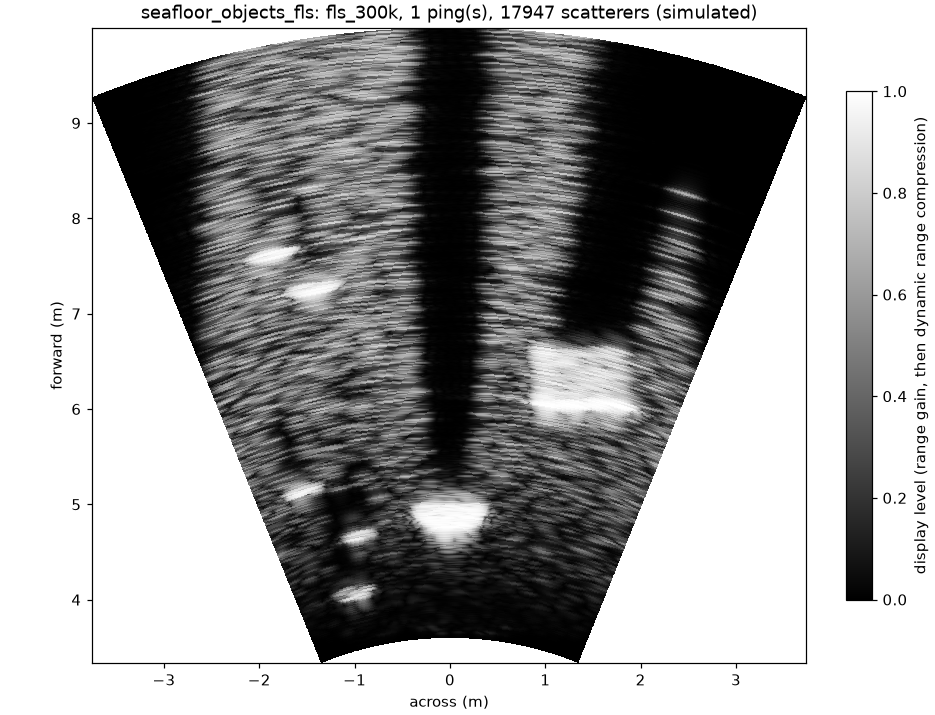

Sphere 43.5 dB, box 44.2 dB, rocks 35.4 dB, seafloor 28.2 dB over median; the floor behind
the sphere is more than 10 dB darker than beside it (`test_scene_objects.py`). One ping,
300 kHz, receive chain taken as already at baseband.

### The owner's designs under way: `fls_120k_transit`, `fls_170k_transit`, `fls_330k_transit`

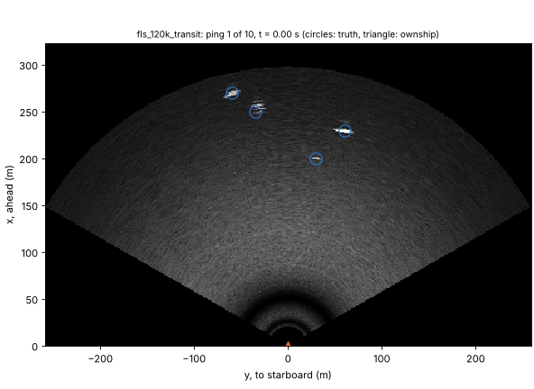

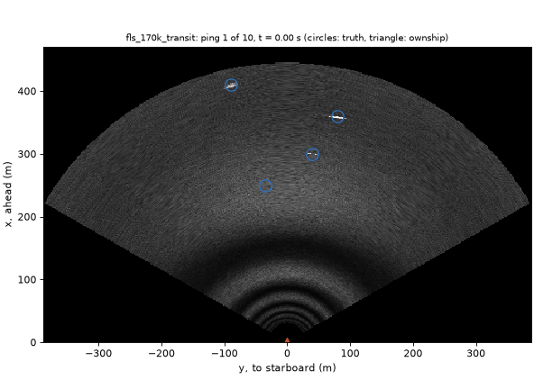

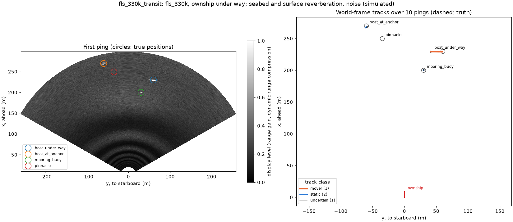

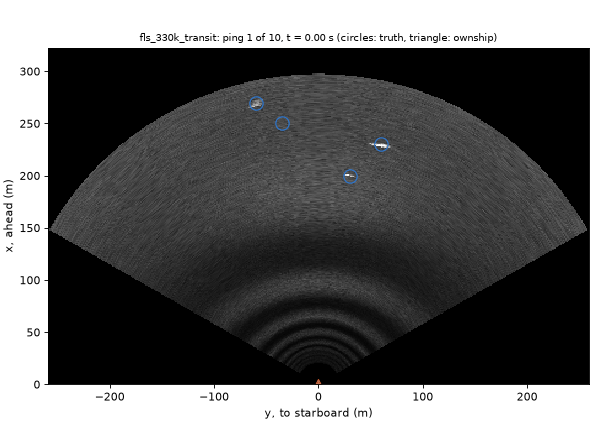

An AUV at 20 m makes 2 m/s. A boat hull crosses at 4 m/s; a second boat lies at anchor;
a buoy is moored near the surface; a pinnacle stands on the seabed. Seabed and surface
reverberation are fixed in the world, so the moving sonar sees them Doppler shifted by
bearing. Ten pings; detections go to a tracker working in world coordinates. In the
animations the picture is fixed to the world: the ownship triangle moves up it and static
objects stay put.

| Target | `fls_120k_transit` (300 m) | `fls_170k_transit` (450 m) | `fls_330k_transit` (300 m) |
| --- | --- | --- | --- |
| Boat under way, 4.0 m/s to port | tracked, 0.6 m, 3.79 m/s | tracked, 1.3 m, 4.21 m/s | tracked, 0.8 m, 4.00 m/s |
| Boat at anchor | tracked, 1.0 m, 0.04 m/s | tracked, 2.6 m, 0.12 m/s | tracked, 1.4 m, 0.20 m/s |
| Mooring buoy | tracked, 0.7 m, 0.12 m/s | tracked, 0.2 m, 0.04 m/s | tracked, 0.5 m, 0.07 m/s |
| Seabed pinnacle | tracked, 4.0 m, 0.23 m/s | not in the beam | not in the beam |
| Detections per ping / confirmed tracks | 6 to 9 / 8 | 3 to 5 / 4 | 3 to 4 / 4 |
| Track classes | 1 mover (the boat under way), 6 static, 1 uncertain | 1 mover, 2 static, 1 uncertain | 1 mover, 2 static, 1 uncertain |
| Tracks called movers that are not on a moving object | 0 | 0 | 0 |

- Position is the track's distance from the object's centre (the boats are 0.0 m from
  their outline); speed is the track's. Every named object that is tracked is in its true
  class: the boat under way a mover (3.80 ± 0.04, 4.22 ± 0.03 and 4.01 ± 0.05 m/s), the
  anchored boat, the buoy and the pinnacle static. The uncertain track in each scene is not
  on a named object.
- The 5 degree beams of the two higher-frequency sonars are tilted up and never reach the
  seabed, so the pinnacle is absent, as designed.
- The pinnacle (120 kHz) and the anchored boat (170 kHz) were `uncertain` in the gallery
  at `1442de5`; they are static since D-155 scored each object by its established track.
- At 330 kHz the anchored boat was not tracked in the older CPU run: its strongest cell
  reached 11.8 to 12.4 dB over the local background, under the 13 dB a detection must
  have, against 21.5 to 23.7 dB for the boat under way, 39 m closer. Echoes are now 3 dB up
  against the same noise (D-102). Absorption at 330 kHz is about 100 dB/km, so those 39 m
  cost 8 dB both ways, plus spreading. The smaller boat's margin over the 13 dB was not
  measured again.
- The 170 kHz sonar is specified to 450 m (was 600 m): the link budget in `DESIGN.md` gives
  35 dB on a boat hull there.

### A cluttered seabed: `fls_120k_cluttered_seabed`

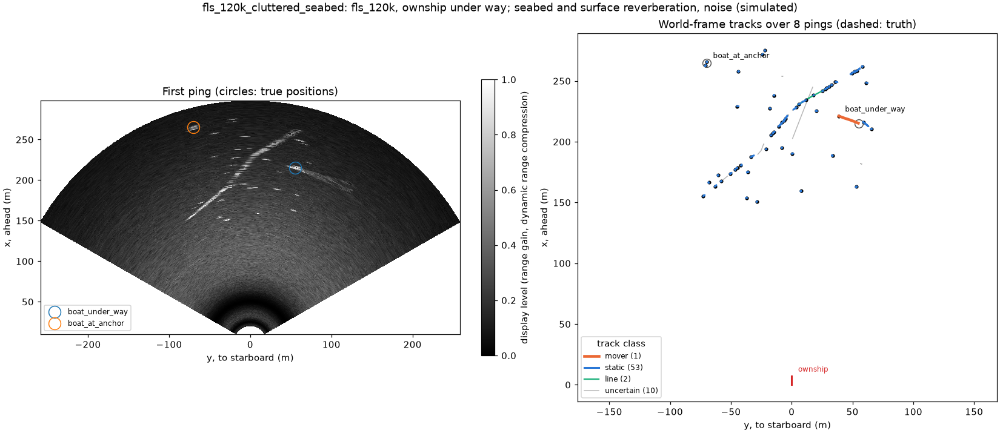

40 m of water, so the seabed lies inside the 20 degree beam from about 115 m. On it: sand
texture, 22 boulders of 0.5 to 1.6 m radius, 12 pieces of debris (boxes of 0.6 to 2 m),
and a 0.3 m pipeline 180 m long. On the surface: an 11 m boat crossing at 5 m/s, built
from a hull, a fin keel, a propeller and rudder cluster and a 70 m bubble wake, and an 8 m
boat at anchor.

| Quantity | Result |
| --- | --- |
| Boat under way (true velocity 1.71, −4.70 m/s) | tracked, 0.9 m from its centre, velocity 1.69, −4.73 m/s; classified mover (5.04 ± 0.09 m/s) |
| Boat at anchor | tracked, 0.8 m, 0.04 m/s; classified static |
| Detections per ping | 54 to 63 |
| Confirmed tracks | 65 |
| Track classes | 1 mover, 48 static, 3 line, 13 uncertain |
| Tracks called movers that are not the boat | 0 |

- Everything on the bed makes tracks. From the tracks alone, 48 are static (boulders,
  debris, the anchored boat), 3 are called line ("line": motion along a linear feature
  such as the pipeline cannot be told from the feature standing still), and 13 jump about
  too much to say. Before the line rule and the requirement that a mover be seen on most
  pings, 24 tracks were called movers.
- The boat under way is the only mover. A track counts in its row only if its SNR is
  within 6 dB of the boat's (D-154); the seabed tracks in its corridor are at most 18.7 dB
  against its 25.4. Between D-141 and D-154 it was classified line, and the gallery at
  `1442de5` had 47 static, 10 line and 8 uncertain tracks; the line tracks fell to 3 in the
  D-174 gallery (D-156, D-157).
- The pipeline shows as a line across the picture, and the wake as a streak astern of the
  moving boat. The wake is a fixed cloud laid down at the start; it does not grow.
- Direct paths only: no surface or bottom bounce to the objects.

### A rough sea: `fls_120k_rough_surface`

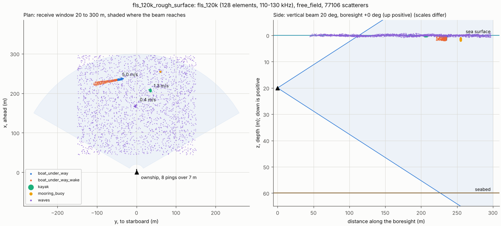

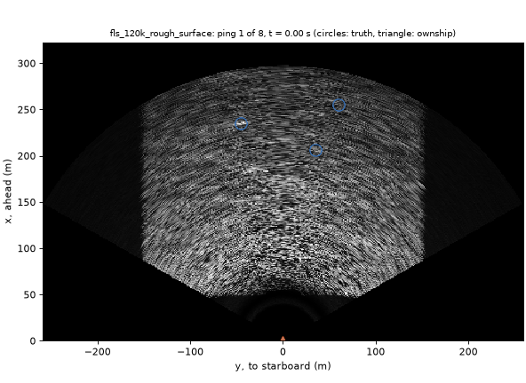

10 m/s of wind over an irregular wind sea 1.2 m in significant height: a Pierson–Moskowitz
spectrum sampled at 30 wave trains with random phases, spread 25 degrees about the wind.
Each train travels at its own deep-water speed, so crests move through the world (the
longest, 83 m, at 11 m/s) and the pattern changes shape as it goes. The 20 degree beam's
half-power edge meets the underside of the surface at about 115 m; the surface closer in
is seen further down the beam.

| Quantity | Result |
| --- | --- |
| Boat under way with wake | tracked, 1.0 m from its centre, velocity **0.46, 5.55 m/s** (true 0.87, 4.92); classified mover (5.6 ± 0.3 m/s) |
| Kayak (three −22 dB points) | **not tracked** |
| Mooring buoy | **not tracked** |
| Detections per ping / confirmed tracks | 42 to 55 / 56 |
| Track classes | 8 mover, 1 static, 5 line, 42 uncertain |
| Tracks called movers that are not on a moving object | **6** |

- The boat is tracked and called a mover, **but its velocity is off: 0.46, 5.55 m/s against
  a true 0.87, 4.92, and the classifier's speed is 5.6 ± 0.3 m/s against a true 5.0.** Of the
  other 55 tracks, 42 are uncertain (seen on too few pings, or jumping), which is what wave
  glints should be; **7 are called movers, 6 of them not on a moving object** (13 in the
  gallery at `1442de5`, before D-157): specular points sliding on moving wave faces 52 to
  118 m ahead, where the beam meets the surface (`STATUS.md`, item 45). Bright wave faces do
  move, at metres per second, so speed alone does not reject them. A kayak-sized target is
  lost.

**What the bands are, and which frame they are in** (`tools/rough_surface_bands.py`):

- Top row, the surface alone on a world-fixed grid. Flat water has no bands. Two regular
  wave trains, the first version of this scene, give evenly spaced slanted stripes that go
  black: with only tilted Lambert facets, a wave's back face returns nothing once its slope
  exceeds the grazing angle (5.4 degrees for that swell, reached beyond 215 m). The
  irregular sea gives patches instead of stripes, and tilt-independent small-scale
  roughness (−30 dB per square metre, a placeholder) makes the dark parts darker instead
  of black. Depth of the banding against flat water, 90th minus 10th percentile of 4 m
  averages: 12.1 dB for the regular trains, 10.7 dB for the irregular sea, 8.6 dB as shipped.
- Bottom row, two pings a second apart, the sonar having advanced 2 m. **With the waves
  frozen, the pattern does not move in the world frame (0 m) and so moves back 2 m in the
  sonar's frame: it is fixed to the world, not to the view.** With the waves travelling,
  it moves 10 m ahead and 2 m to port in that second, the speed of the long waves.
  (Measured by cross-correlation after dividing out the fall-off with range, which is
  fixed to the sonar and otherwise dominates the measurement.)
- In the earlier version the crests only drifted at 0.36 m/s and the speckle was the same
  on every ping, so over the 3.5 s of the animation nothing visibly moved in either frame.
  The speckle is now drawn afresh each ping, as the small scatterers on a real surface
  lose their phase in milliseconds.
- Still not there: breaking, bubble plumes, one crest shadowing another, Doppler from the
  water's orbital motion. The patch of facets is finite (45 to 297 m ahead, 150 m either
  side) and its edges show. Strengths are placeholders (see the scenario file).
- **The same scene at 330 kHz showed no surface at all.** One resolution cell of surface is
  about −31 dB there, below that sonar's noise floor at 250 m. A 330 kHz sonar would need a
  shorter range or more source level to work under a rough surface.

### Traffic: `fls_170k_traffic`

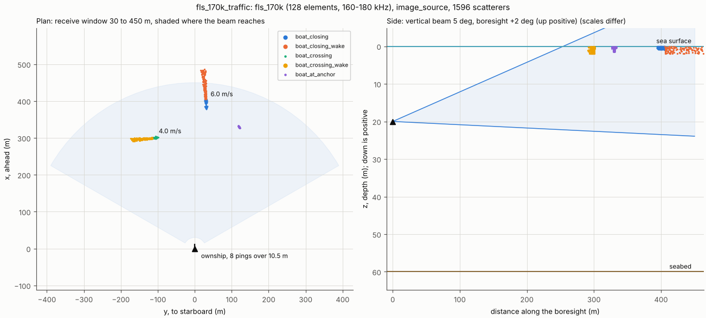

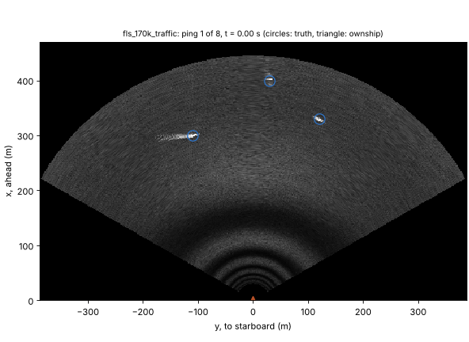

| Boat | True velocity (m/s) | Track velocity (m/s) | Position (from its centre) | Class |
| --- | --- | --- | --- | --- |
| Closing from 400 m | −5.98, 0.52 | −5.97, 0.48 | 4.5 m | mover, 6.01 ± 0.02 m/s |
| Crossing at 300 m | 0.35, 3.98 | 0.37, 4.24 | 0.2 m | mover, 4.30 ± 0.18 m/s |
| At anchor at 350 m | 0, 0 | −0.10, 0.10 | 1.5 m | static, 0.12 m/s |

6 to 15 detections per ping gave 13 confirmed tracks for three boats. Classes: 3 mover,
6 static, 1 line, 3 uncertain; no mover is off a moving object.

- Each boat is 0.0 m from its outline. The closing boat's detections are on its propeller,
  5.3 m astern of amidships (D-169), hence 4.5 m from its centre.
- The crossing boat was classified line at 15.4 m/s in the gallery at `ebdb22a`: the
  tracker joined it to its wake. The most-probable-pair association (D-141) was made for
  this boat (`DECISIONS.md`).

### Multipath off a quay and a cross-slope: `fls_120k_quay_multipath` (`sonar-0nsi`)

Not in the gallery; no figure. Measured on the CPU (host backend) on 2026-11-26, as below; the chain is the
transit scenes' (`tools/gallery.py` `run_fls_transit`, settings unchanged, window 12 to 78 m), on the scene
with half its densities and 4 pings. **What got worse with multipath: the chain tracks the ghosts as objects.**

The 120 kHz sonar 3 m deep, tilted 10 degrees down, runs at 1 m/s along a quay wall 20 m to starboard. The bed
is 12 m deep under it and deepens towards the wall at 5 degrees, a slope across the look direction. The tier is
`image_source` with the surface, the tilted bed (`bottom_slope`) and the wall as a `{point, normal}` plane, one
surface or bed bounce and one wall bounce a leg. A moored sphere stands in mid-water 45 m ahead, 8 m to
starboard, 6 m deep; a block sits on the bed. The wall's coefficient (0.7) is a placeholder.

The sphere's echoes against the image geometry (one ping; the sphere alone; peaks of the fan image; levels re the
sphere's direct echo; "mixed" is out one way and back the other; ranges are 0.55 m short of the centre's for
every path, the sphere's radius, so the table gives the offset from the direct echo):

| Path | Geometry: range beyond direct, bearing | Image peak | Level |
| --- | --- | --- | --- |
| direct | 0, 10.06 deg | 0, 10.10 deg | 0 dB |
| bed, mixed (back via the bed) | +1.27 m, 8.13 deg | +1.35 m, 8.10 deg | -3.1 dB |
| bed, mixed (out via the bed) | +1.27 m, 10.06 deg | +1.35 m, 10.20 deg | -4.2 dB |
| bed, both legs | +2.54 m, 8.13 deg | +2.58 m, 8.10 deg | -6.6 dB |
| the same over a level bed | +2.30 m, 9.57 deg | +2.31 m, 9.60 deg | -4.6 dB |
| wall, mixed (back via the wall) | +4.75 m, 35.36 deg | +4.80 m, 35.50 deg | -7.1 dB |
| wall, mixed (out via the wall) | +4.75 m, 10.06 deg | +4.80 m, 10.30 deg | -7.7 dB |
| wall, both legs | +9.50 m, 35.36 deg | +9.66 m, 35.60 deg | -11.4 dB |

- The cross-slope moves the bed ghost 1.44 degrees (1.5 beams of 0.93 degrees) off where a level bed puts it:
  the image of a point h above a bed tilted by alpha lies 2 h sin(alpha) across the bearing (`PHYSICS_NOTES.md`
  section 30). The bearing is the cone angle the line array measures, asin of the direction's component along
  the array, which differs from the azimuth for paths that arrive from below (9.57 against 10.06 degrees over the
  level bed is that alone). In free field none of these peaks is there (below -55 dB).
- The bed ghosts are strong: the sand reflects at nearly 1 below its critical angle (about 25 degrees; the path
  meets the bed at about 20 degrees).
- The wall ghost lies behind the quay wall, 24 m across from the sphere.
- The chain (CFAR, clusters, world tracker, classifier) on the full scene: 83 to 103 detections a ping and 86
  confirmed tracks as shipped, 92 to 109 and 94 in free field; the seabed's scatterers make most of both. Tracks
  within 3 m of a ghost: as shipped, one on the wall ghost behind the wall (41.6, 29.3), one on the
  out-via-the-wall copy on the sphere's bearing (52.5, 7.6), and three on the bed ghosts 1 to 3 m beyond the
  sphere; in free field only the sphere's own two tracks. The classifier calls none of them `multipath` (that
  class is 0 in every variant); the sphere is `static` in every variant. Movers not on a moving object: 2 as
  shipped, 0 with a level bed, 0 without the wall, 1 in free field (four pings; not attributed to multipath).
  Reported, not fixed: the chain has no ghost rejection for wall or bed multipath.

### Ghosts in a pool lane: `pool_fls_p4_2v_walls` (`sonar-0nsi`)

Not in the gallery; no figure. CPU, host backend, one ping, 2026-11-26. The P4-2v probe of `pool_fls_p4_2v`
in a 4 m lane: side walls at y = -2 and +2 and the far wall at 9.5 m are scatterers and mirrors (coefficient 0.8, a
placeholder; one wall bounce a leg; floor and surface left out as in the gallery pool scenes). The floats' ghosts
against the image geometry (floats alone; levels re the float at y = +0.6 m):

| Ghost | Geometry: range, bearing | Image peak | Level |
| --- | --- | --- | --- |
| float_3 via the starboard wall, mixed | 7.88 m, 24.39 deg | 7.83 m, 24.6 deg | -5.1 dB |
| float_3, both legs | 8.23 m, 24.39 deg | 8.19 m, 24.4 deg | -10.3 dB |
| float_2, both legs | 8.50 m, 28.07 deg | 8.46 m, 28.2 deg | -10.6 dB |
| float_1 via the port wall, mixed | 7.88 m, -24.39 deg | 7.83 m, -24.6 deg | -2.3 dB |
| float_1, both legs | 8.23 m, -24.39 deg | 8.18 m, -24.4 deg | -7.8 dB |

The peaks are 0.05 m short of the centres, the floats' radius. In the full scene at a tenth of its densities the
ghosts stand 58 to 64 dB over the image median and the median itself rises: the floats stand 67.4 dB over it
with walls and 83.2 dB in free field (the walls' own echoes come back through the other walls).

## Synthetic aperture sonar

**Every SAS scene in this section except `sas_auv_multipath` is free field: no surface or bed
multipath** (D-201). With bed multipath the bed-bounce copy of a target above the bed is its
brightest echo and the sharpness measure falls to about a third (178,767 -> 63,747, its section
below; issue `sonar-ya2c`), so the SAS images and numbers here are the easy case.

### `wreck_sas` and `minefield_sas`

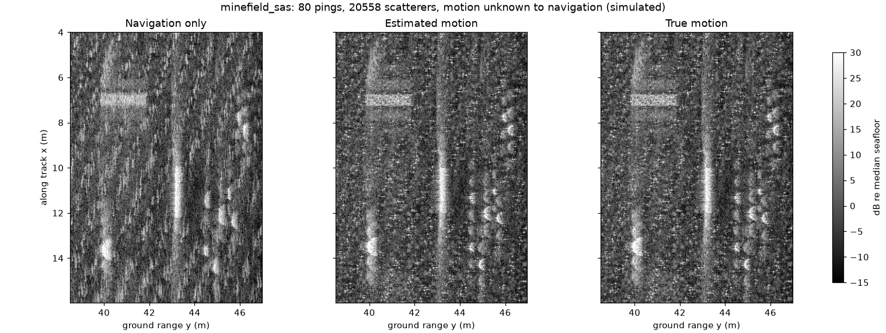

| Quantity | `wreck_sas` | `minefield_sas` |
| --- | --- | --- |
| Sway error after motion estimation, RMS | 0.053 λ | 0.022 λ |
| Heave error, RMS | 0.044 λ | 0.044 λ |
| Sharpness: navigation only / estimated / true motion | 60 / 220 / 225 | 140 / 275 / 278 |
| Scatterers (scene draw of D-171) | 13,555 | 20,558 |

- Navigation is not told about 10 mm RMS of sway (more than a wavelength) and 4 mm of
  heave; displaced-phase-centre estimation recovers both and the image matches the
  true-motion one.
- In `minefield_sas` the cylinder lying across track, the one along track, the sphere and
  the rocks each show a highlight towards the sonar and a shadow away from it; the sand
  ripples show as stripes because their slopes change the Lambert return.
- Tall objects are laid over towards the sonar and smeared along track (they are above
  the image plane). The seafloor is 25 to 30 scatterers per square metre: separate points,
  not developed speckle.

### The owner's design: `sas_minsas_survey`

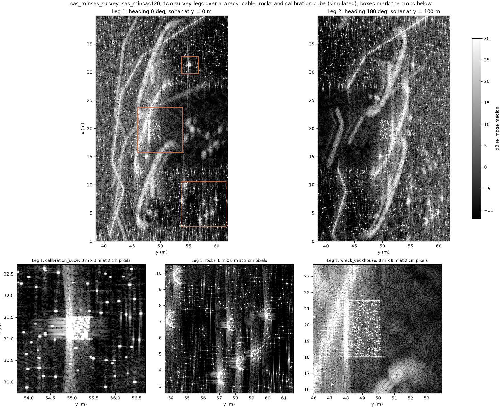

Two parallel legs in opposite directions, 100 m apart, each looking to starboard at the
same seabed from 50 m at 12 m altitude. The animation shows leg 1's image building up as
pings are added. The whole of leg 1 at one image pixel per file pixel is
`figures/sas_minsas_survey_leg1_full.png`.

| Object, dB over the image median | Leg 1 (sonar at y = 0) | Leg 2 (sonar at y = 100 m) |
| --- | --- | --- |
| `seabed` | 46.6 | 46.6 |
| `wreck_hull` | 39.5 | 37.9 |
| `wreck_deckhouse` | 30.5 | 28.6 |
| `wreck_mast` | 1.2 | 4.0 |
| `cable` | 54.2 | 48.2 |
| `rocks` | 44.7 | 49.4 |
| `calibration_cube` | 52.0 | 49.7 |

- The wreck's shadow falls away from the sonar on each leg: the strip of seabed beyond the
  wreck is 38 dB (leg 1) and 41 dB (leg 2) below the strip in front of it.
- The 0.5 m calibration cube images as a square of the right size (first crop).
- The seabed's number is high because it is measured at its scatterers, which are isolated
  bright points on an otherwise empty floor; the median is the empty floor. The mast, 4 to
  7 m above the seabed, is laid over and smeared and barely shows.
- **Ghosts.** Fainter copies of the hull and the cable appear about 10 m up and down the
  track. See "Ghosts, and the element count" below.
- Navigation is exact here; `wreck_sas` and `minefield_sas` show unknown motion.

### Resolution of the MINSAS-class sonar

The first survey images were made at 5 cm pixels with the sonar set to 3.3 cm along track
and advancing 0.4 m per ping. These things changed:

| Change | Why | Measured on a point target at 45 to 50 m (`test_minsas_resolution.py`) |
| --- | --- | --- |
| Projector 4.2 cm long (was 6.6 cm) | along-track resolution is half the projector length | 2.0 cm along track |
| 0.544 m per ping at 2.18 m/s (was 0.4 m at 1.6 m/s) | exactly half the 1.088 m array: phase centres of successive pings are evenly spaced | along-track ambiguities −36 dB (were −15 dB at 0.27 m) |
| Image pixel 2 cm (was 5 cm) | one pixel per resolution cell | — |
| 48 receive elements at 2.27 cm (were 32 at 3.4 cm) | moves the along-track grating lobe from 7.6 to 11 degrees | ghost of a point: −47 to −54 dB at 10.3 m (was −42 dB at 6.9 m) |
| Aperture 1.6 beamwidths, weighted by the beam patterns | lower sidelobes at the same width | nearest along-track sidelobes −36 dB (were −23 dB) |
| Hamming-weighted pulse compression, for the figures | bright points stop smearing in range | range sidelobes beyond 10 cm −41 dB (were −26 dB); ground-range width 2.6 cm (1.8 cm unweighted) |

So the figures resolve 2.0 cm × 2.6 cm; without the range weighting the same data gives
2.0 cm × 1.9 cm, Kraken's published post-processed figure for the MINSAS 120, with −15 dB
range sidelobes. The seabed in these scenes has far fewer scatterers than resolution
cells (8 to 18 per square metre against 2,000 cells), so it images as separate points, not
as developed speckle.

### A seabed with developed speckle: `sas_minsas_speckle`

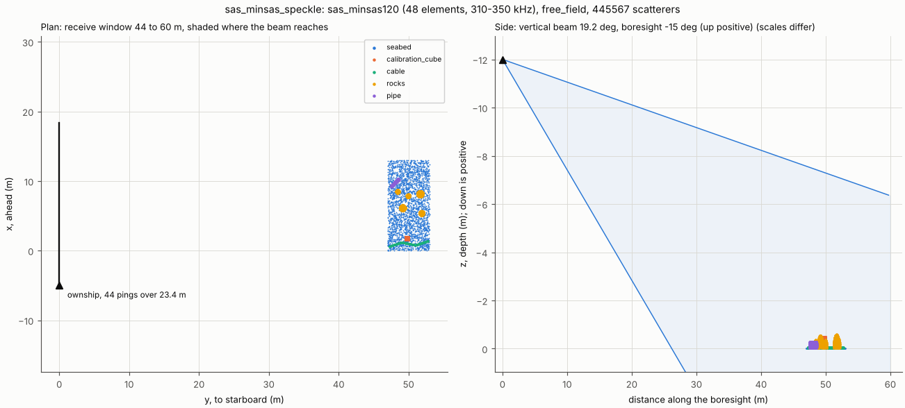

The other survey scenes have 8 to 18 seabed scatterers per square metre against about
2000 resolution cells: separate points on black. Here a 13 m × 6 m strip has 5000 per
square metre, 2.6 in every cell, and every one of the 390,000 is synthesised. Objects have
the same density on their surfaces.

| Quantity | Result |
| --- | --- |
| Speckle contrast of bare seabed (standard deviation of intensity over its mean; 1.0 is fully developed) | 1.21 |
| Calibration cube / cable over bare seabed | 26.9 dB / 18.7 dB |
| Level where the cube's along-track copy falls (10.3 m along), over bare seabed | +2.1 dB |
| Level where the cable's copy falls, over bare seabed | +0.3 dB |
| CPU time (four cores) | 14 min |

- This is what the sonar's picture should look like: continuous texture, objects with a
  bright face and a clean shadow.
- **The ambiguity copies are covered.** The question left open by the sparse scenes was
  whether the −47 dB along-track copy of each object would show on a real seabed. Where
  the cube's copy falls, the image is 2 dB above the surrounding seabed on average (the
  copy is about as strong as the seabed itself, 29 dB below the cube); the cable's is
  lost. Neither is visible in the picture. A much brighter object than these would still
  show.
- `tools/calibrate_sim.py sas` run on this figure's full-resolution picture reads back
  6100 scatterers per square metre (5000 were put in) and a 9 cm² speckle cell.
- The strip is small because of the cost. The same density over the 40 m × 28 m survey
  scene is 5.6 million scatterers: a GPU job.

### Rocks: `sas_minsas_boulder_field` and `sas_minsas_rocky_ripples`

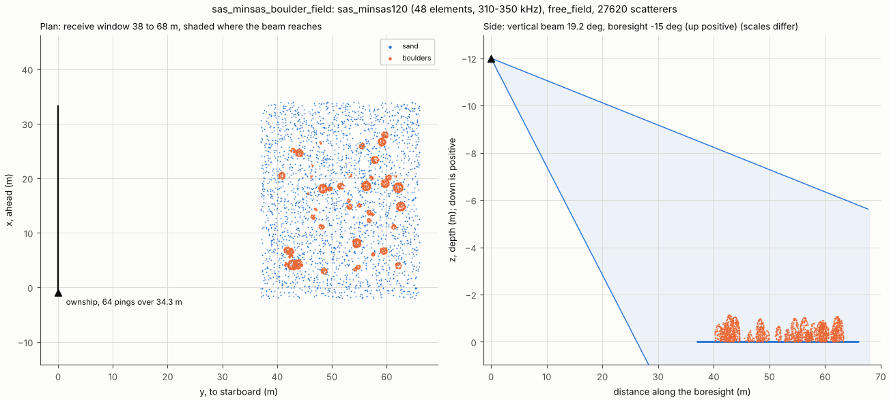

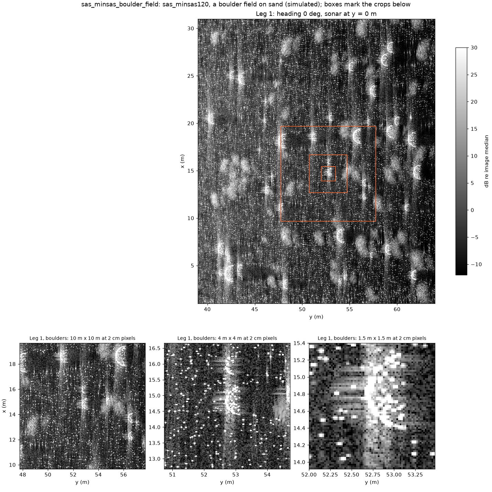

| Scenario | Object, dB over the image median |
| --- | --- |
| `sas_minsas_boulder_field` | sand 42.0, boulders 46.0 |
| `sas_minsas_rocky_ripples` | rippled sand 42.7, outcrop 42.8, stones 44.3, cable 47.2 |

- Each rock shows a bright face towards the sonar (at low y) and a shadow behind it whose
  length grows with the rock's height and its range. The three crops under each image are
  at the image's own 2 cm pixels.
- The ripples show as stripes because their slopes change the Lambert return; the cable is
  a thin bright line.
- Rocks are rough spheres half sunk in the sand. Real rocks have facets and glints these do
  not.
- **Ghosts, and the element count.** Receive phase centres half a pitch apart put a grating
  lobe at asin(λ / pitch) off broadside, so every scatterer has a defocused copy up and
  down the track. With the first array (32 elements at 3.4 cm) the copy was 6.9 m away and
  −42 dB on a point target; the cable and the wreck's outline showed twice. The sonar now
  has 48 elements at 2.27 cm over the same 1.09 m: the copy is 10.3 m away and −47 to
  −54 dB, depending on the geometry (`test_minsas_resolution.py`), for half as many
  channels again. It still shows beside the brightest objects in these figures, because
  they are 50 dB and more above the floor: the simulated seabed is empty between its
  scatterers, and the figures show 42 dB of range anchored on that empty floor. On a
  seabed with developed speckle the copies are covered (`sas_minsas_speckle`, above). More elements do not
  help much further: the receive element narrows with the pitch, and the projector's
  sidelobes fall slowly.

### Surface and bottom multipath: `sas_auv_multipath` and `sas_auv_multipath_free` (`sonar-0nsi`)

Not in the gallery; no figure. CPU, host backend, full scene, 90 pings, known navigation, image on the bed plane
at 2.5 cm, 2026-11-26 (simulation 70 s with multipath, 17 s without). The `sas_auv` sonar 10 m deep and 15 m
above a flat bed of medium sand in 25 m of water, under a flat surface; `image_source` with the energy rule (3
bounces). **What got worse with multipath: the image's contrast.** The seabed median rises 2.9 dB (its
scatterers' surface-reflected paths), and the gallery's sharpness measure falls from 178,767 to 63,747.

| Point target | Copy | Ground range: geometry, image | dB over the median: multipath (free field) |
| --- | --- | --- | --- |
| 1 m above the bed | direct (laid over) | 37.62, 37.625 m | 80.2 (83.2) |
| | via the bed, mixed | 38.01, 38.000 m | 82.9 (none: 45.3) |
| | via the bed, both legs | 38.41, 38.400 m | 79.1 (none) |
| | via the surface, mixed | 43.21, 43.225 m | 56.2 (none) |
| 3 m above | direct | 43.07, 43.075 m | 77.5 (80.5) |
| | bed, mixed | 44.09, 44.100 m | 82.4 (none) |
| | bed, both | 45.11, 45.100 m | 75.2 (none) |
| | surface, mixed | 47.70, 47.700 m | 57.6 (none) |
| 8 m above (moored) | direct | 37.74, 37.725 m | 62.0 (65.0) |
| | bed, mixed | 40.70, 40.700 m | 68.6 (none) |
| | bed, both | 43.63, 43.625 m | 60.0 (none) |
| | surface, mixed | 41.83, 41.825 m | 50.0 (42.6, the direct echo's defocused smear) |

All at the target's own along-track position. "None": the free-field value is the background or a sidelobe there.

- The bed's copies land further out in ground range, one at half and one at the whole of the extra bed path.
  The mixed copy (two pairs, out and back exchanged, adding in phase) is the BRIGHTEST echo of every target
  above the bed: 2.7 to 6.6 dB over the direct echo. Its range history is the mean of the target's and its
  image's, about that of the target's foot on the bed, so it focuses on the bed plane, where the direct echo of
  a target above the bed is laid over towards the sonar and defocused. A SAS image of objects above a reflecting
  bed shows the object where its foot is, with a fainter copy closer in and another further out.
- The surface copies are 12 to 24 dB below the direct echo: the path arrives far above the elevation beam.
- Seabed scatterers carry the bed's normal (`slope: [0, 0]`), so their coincident bed image adds nothing; the
  sphere on the bed is a Lambert surface for the same reason.

### Rail SAS: `rail_objects`

Ball 29.7 dB, pipe 31.7 dB, brick 30.1 dB, pebbles 27.7 dB over median, each with a shadow
on the floor behind it. Rail positions are exact here (`rail_position_errors` has the
perturbed case, not yet imaged with correction).

## 3D imaging of buried objects: `buried_objects`

| Quantity | True | Refraction on | Refraction off |
| --- | --- | --- | --- |
| Depth of the cylinder's brightest return | top at 0.25 m, axis at 0.30 m | 0.26 m | 0.23 m |
| Depth of the sphere's brightest return | top at 0.14 m | 0.14 m | 0.13 m |
| Cylinder over sediment clutter | — | 21.1 dB | — |

**Stale since 2026-11-26 (D-212):** the figure and the table above are from the gallery of D-179, when the
sediment model was one refracted path with unit transmission. The scene now uses `penetration: fluid` with
medium sand's density ratio and loss at its own 1700 m/s (class values, not a survey): on the CPU the cylinder
falls 5.2 dB and the sphere 3.6 dB in the full raster, cylinder over clutter 21.12 -> 20.32 dB, depths
unchanged (the agent's run; a GPU gallery job will regenerate the figure). The clutter level relative to the
objects is still an assumption (the scenario's `rms_amplitude`), not a prediction.

## Flank array: `flank_patrol`

| Target | Result over six pings |
| --- | --- |
| Submarine-like target, 56 m, +16 dB in all, 3.0 m/s along x | tracked; velocity 2.98, 0.02 m/s; 1.0 m from its outline (2.6 m from its centre); classified mover (3.02 ± 0.02 m/s) |
| Wreck on the seabed, +12 dB, not moving | tracked; speed 0.04 m/s; 3.5 m from truth; classified static |
| Small vehicle, −3 dB, 2 m/s | **not detected**: a hard target left so on purpose (below) |

- **The small vehicle is a hard target on purpose (D-198; the owner, 2026-11-26: "I'd leave it
  and say so in the scenario's description; a -3 dB target at 2.2 km over that seabed should be
  hard").** It is below the scene's reverberation, not lost to a defect: bottom reverberation
  (Lambert −27 dB) is 21.9 dB above the noise at 2.2 km, and the vehicle's 4 m cell stands 3.8 to
  5.1 dB above its local background (median 4.4 dB; 28 full-size pings, seeds 17 to 26) against the
  gallery detector's 12 dB cut. Against noise alone it would be 23.8 dB up and detected. The live
  chain's defaults miss it by 0.8 dB (cell mean 5.0 dB against its 5.8 dB threshold); its opt-in
  range integration `cfar.integrate_cells: [1, 4, 16]` (D-97) detects it on both pings tried (10.6
  and 10.3 dB) at the cost of one extra detection a ping near 4150 m. **The link budget
  (`SonarEquation`, the coverage model) predicts about 30 dB for it, because it has no
  reverberation term** (issue `sonar-w2w3`). `test_realistic_scenes.py::test_flank_patrol_detects_and_tracks`
  asserts that it is not tracked, so a change that starts detecting it is noticed. The other
  options D-198 measured (a stronger vehicle, a lower gallery cut) were not applied.
- Range is the leading edge of each detection (D-178). Before D-178 it was the
  power-weighted centroid of a detection made of several surface and bottom arrivals, the
  later ones stronger: the submarine read 25.8 m from its outline (26.1 m from its
  centre), velocity 2.94, −0.23 m/s, and the wreck 5.8 m.
- 3 to 6 detections per ping gave 5 confirmed tracks for two objects: 1 mover (the
  submarine), 2 static (one the wreck), 2 uncertain; no mover is off a moving object.
  The scene is classified since D-178. Multipath splits the wreck's echo into several
  clusters, each of which starts a track; clustering that merges them is not written
  (`STATUS.md`).
- Detection runs on power summed into 4 m range cells, with CFAR windows sized in metres,
  because multipath spreads each echo over tens of metres.
- The outcome depends on the assumed seabed (−27 dB Lambert), wind (5 m/s) and noise
  (45 dB); none is measured. Highlights have no aspect dependence, reverberation has no
  Doppler spread, and the platform stands still.

## Flank array over 3-D relief (`sonar-d7sw`)

**Where 3-D matters and where it does not.** The `eigenray3d` tier is kept, opt-in, and used by these five scenes
and `flank_seamount_3d` only. One-way level at the target, 3-D minus Bellhop3D's own N × 2-D mode (the bed's
horizontal refraction alone; negative means quieter in 3-D):

| Case | 3-D minus N × 2-D | Matters? |
| --- | --- | --- |
| Level bed (`flank_level_3d`) | +0.002 dB (the programs agree to 0.001 to 0.003 dB, D-197) | no |
| 1° across the look (`flank_bank_3d`) | within 0.02 dB; arrivals 0.4 to 0.5° up-slope; peak moves 0.015° of a 3.6° beam | no |
| Sill crossing at 45° (`flank_ridge_3d`) | −0.20 dB | no |
| Within a few water depths, even over a seamount | within 0.07 dB to 1.8 km (D-149) | no |
| Behind a seamount's flank (`flank_seamount_3d_opening`) | −3.98, −2.33 dB at 4.5, 6 km | **yes** |
| Down a canyon along the look (`flank_canyon_3d`) | +6.16 dB; arrivals to 13.9° off; peak 2.8 dB lower, the detector misses it | **yes** |

It is the default nowhere. A 3-D scenario takes 3 to 7 minutes on the CPU, against seconds for the 2-D tier's
eigenrays. It has no reverberation over relief. Its levels rest on a per-receiver scaling to Bellhop3D's loss run
(up to 10.4 dB, in the canyon). It runs an external GPL-3 program. Every other long-range scenario has a level bed
or one profile on every bearing, where N × 2-D is exact.

Rule of thumb (ours, from these six scenes): use `eigenray3d` when the target is beyond a few water depths AND the
bed beside or under the path slopes by several degrees across the bearing (a seamount flank, a canyon or fjord
wall, a steep bank); otherwise `eigenray`. The cross-slope warning does not yet tell these apart: it flags the
sill and misses the canyon (an issue is filed). All of this relief is illustrative. More in
`docs/tasks/PROPAGATION_3D.md` section 0.

Five scenarios at the opt-in `eigenray3d` tier (Bellhop3D, `GPUSONAR_BELLHOP3D`), each paired with an `eigenray`
twin (Bellhop 2-D, `GPUSONAR_BELLHOP`) that differs only in the tier and in how the bed is spelt: the twin's bed is
the 3-D bed's profile along the target's bearing (`bathymetry.profile_along`), i.e. what an N × 2-D run sees there.
All are ILLUSTRATIVE: no relief was measured, the sonar is `flank_32` (itself unconfirmed), every target is +10 dB
in 45 dB of noise, and **none has reverberation**: over relief the 3-D tier would need a receiver per scattering
cell, which its disk cap refuses (as `flank_seamount_3d`). No diagram: `tools/scenario_diagrams.py` draws neither a
3-D bed nor this tier.

**What limits the numbers.** Three references are measured at each target (one-way, the array's leg; tests in
`tests/python/test_3d_scenarios.py`):

- **3-D**: the `eigenray3d` provider, whose eigenrays are scaled per receiver to Bellhop3D's own incoherent TL.
- **N × 2-D**: Bellhop3D's N × 2-D mode, same program, same hat-beam fan and bed grid. "3-D minus N × 2-D" is the
  bed's horizontal refraction alone.
- **Twin**: our 2-D tier on the twin's profile. It also carries the 2-D tier's own excess over relief (Bellhop's
  arrivals over a piecewise-linear bed are louder than its TL run, `docs/tasks/PROPAGATION_3D.md` section 2), so
  "3-D minus twin" is not all 3-D.

Levels read from the simulated records (the beamformed echo peak) differ between the tiers by up to
0.6 dB over a LEVEL bed, where the eigenray energies agree to 0.003 dB. That is coherent interference between
arrivals 0.4 ms apart, whose delays differ by up to 8 µs between the programs. Record peaks are therefore quoted,
not tested. Run times are on the shared 4-core CPU, 2026-11-26. The scenario time is the provider's (its
Bellhop3D runs, two a source position: arrivals and TL) plus the synthesis.

| Scenario (twin) | Shows | 3-D minus N × 2-D, one-way | 3-D minus twin, one-way / two-way | Arrivals off the bearing, mean / largest strong | Beamformed peak, 3-D and twin, against truth | Above the sonar's resolution? |
| --- | --- | --- | --- | --- | --- | --- |
| `flank_level_3d` (`flank_level_nx2d`) | control: a level 100 m bed | +0.002 dB (three targets) | +0.002 / +0.01 dB | 0.0006° | within 0.03°; peaks +0.6 dB (interference, above) | no effect, as it must be |
| `flank_bank_3d` (`flank_level_nx2d`) | a bed sloping 1° across the look | +0.02, +0.01, −0.00 dB (north, broadside, south) | broadside +0.01 / +0.03 dB; north −0.20, south +0.21 dB (the slope along those bearings, not in the level twin) | 0.41 to 0.48° up-slope / 3.0 to 3.3° | broadside −0.018° and −0.003°; the 3-D shift 0.015° | no: 0.015° against a 3.6° beam, no level change |
| `flank_seamount_3d_opening` (`_nx2d`) | target opening 1.5 → 6 km behind a seamount's flank | −0.00, −0.18, −3.98, −2.33 dB at 1.5, 3, 4.5, 6 km | +0.07, +0.71, −2.65, −2.06 / +0.18, +1.13, −6.21, −6.75 dB | 0.00, −0.45, −0.36, −1.21° / 0.03, 2.0, 7.3, 7.3° | 3 km: 3-D −3.33°, twin −3.98° (truth −4.00); others within 0.2° | level: yes (4 dB one-way, 6 dB two-way behind the flank); bearing: 0.67° at 3 km, a fifth of the beam |
| `flank_ridge_3d` (`flank_ridge_nx2d`) | a sill crossing the bearing at 45° | −0.20 dB | −1.86 / −3.36 dB (mostly the twin's own excess) | 0.20° / 0.65° | +0.03° and +0.02° | no: 3-D adds 0.2 dB although the cross-slope warning flags the bearing |
| `flank_canyon_3d` (`flank_canyon_nx2d`) | a canyon along the look direction | **+6.16 dB** | +6.17 / +12.33 dB | −0.10° / 13.9° | +0.14° and +0.01°; peak −2.8 dB (the energy arrives spread in delay) | level: yes; the warning does not flag it |

Run time and disk (Bellhop3D runs per source position: receivers, seconds for the arrivals run and the TL run,
binary arrivals file; the scenario's two source positions are the array and the projector 0.5 m below it):

| Scenario | Bellhop3D runs | Provider | Synthesis (4 pings or 1) | Twin, whole run | Energy rescaled to TL (largest) |
| --- | --- | --- | --- | --- | --- |
| `flank_level_3d` | 3 receivers: 17.6 s + 17.5 s, 25 kB | 70 s | 119 s | 131 s | 0.0004 dB |
| `flank_bank_3d` | 3 receivers: 66 + 68 s, 26 kB | 270 s | 138 s | 134 s | 0.00 dB |
| `flank_seamount_3d_opening` | 4 receivers (one a ping): 90 + 91 s, 5.4 kB | 363 s | 22 s | 38 s | 1.36 dB |
| `flank_ridge_3d` | 1 receiver: 68 + 80 s, 6.9 kB | 308 s | 9 s | 62 s | 3.28 dB |
| `flank_canyon_3d` | 1 receiver: 60 + 69 s, 32 kB | 270 s | 4 s | 23 s | **10.4 dB** |

(With the provider's nodes for every ping asked for at once, as the measurement did; `run_scenario` asks ping by
ping, which can add runs for the mover: not measured.) Every arrivals file was under 33 kB, far below the
provider's 300 MB cap.

### Control: `flank_level_3d`

Three targets at 5 km (bearings 12° north of broadside, broadside, 12° south) over a level 100 m bed, sonar 30 m,
targets 50 m deep. Over a level bed the tier must equal the 2-D tier (D-197: within 0.2 dB). Measured: one-way
energies agree within 0.003 dB, eigenray by eigenray within 0.01 dB in amplitude and 8 µs in delay. Arrivals
stay in their bearing's plane (0.0006°). Both tiers detect all three targets. The gallery detector (CFAR on
4 m cells, `tools/gallery.py` `run_flank`) puts them within 0.25° of truth at both tiers. The beamformed peaks are
within 0.04°.

### Bank: `flank_bank_3d`

The same scene over a bed deepening 1° to the north, across the look direction (`plane`, slope `tan 1°`). Broadside
runs along a depth contour, so its N × 2-D bed is level and the twin is exact there. Every bottom bounce is turned
out of its plane towards the deeper side. The document's estimate is 0.17° a bounce at 5° grazing (formula of
`PROPAGATION_3D.md` section 3); with this scene's numbers, 100 m of water, 5 km and a 20 m source-to-target depth
offset, the steeper paths bounce more often and at larger angles. Measured: the energy-weighted arrival direction at
the array is 0.41 to 0.48° on the up-slope (south) side of the true bearing; the strong steep paths are up to 3.3°
off. **The level does not change** (3-D minus N × 2-D within 0.02 dB). The beamformed peak moves 0.015°. The
gallery detector's bearings at the 3-D tier are 12.50, 0.25 and −11.84° (truth 12, 0, −12); at the twin 12.00,
0.15 and −12.15°. The 0.5° is the detector's cluster scatter, which reaches 0.25° over the level bed too, not the
bed.
**3-D does not matter here** at this sonar's 3.6° beam, and the cross-slope warning rightly does not fire (0.35° at
its 10° grazing, under its 1.8°). The ±0.2 dB between the bank's off-broadside targets and the level twin is the
slope along those bearings; Bellhop3D's N × 2-D mode, which follows it, agrees with the 3-D field.

### Seamount, target opening: `flank_seamount_3d_opening`

The bed of `flank_seamount_3d`. A target 50 m deep opens at 10 m/s along the flank bearing (94°, 4° south of
broadside) over four pings 150 s apart: 1.5, 3, 4.5 and 6 km. The pings are a time-lapse. The track runs along one
bearing because the 2-D twin takes one profile on every bearing, so it is exact only on one. Before the seamount
3-D and N × 2-D agree (0.00 dB). Over the crest (3 km) they still agree (−0.18 dB); arrivals turn up to 2°, and the
beamformed peak is 0.67° off truth (0.2 of a beam). The twin there is 0.7 dB quieter for its own reasons. Behind
the flank the 3-D field is 3.98 dB (4.5 km) and 2.33 dB (6 km) below N × 2-D, and 2.65 and 2.06 dB below the
twin; two-way, 6.2 and 6.8 dB. The record's echo peak at 4.5 km is 4.0 dB lower, its SNR 17.6 against 21.6 dB.
At 6 km neither tier detects (SNR 11 dB, under the gallery detector's 12 dB).

### Oblique sill: `flank_ridge_3d`

A straight Gaussian ridge (`bathymetry.ridge`) 60 m high in 120 m of water (sigma 250 m), crossing broadside at
2.5 km at 45°. Sonar and target are 30 m deep, the target 5 km out, 30 m above the crest. The cross-slope warning
flags the bearing (5.9° across it, 2.1° at its 10° grazing). Measured: **3-D adds only −0.20 dB**; arrivals
0.20° off on average, at most 0.65°. The twin is 1.86 dB louder, which is our 2-D tier's arrivals over a
piecewise-linear profile (the `sonar-6c8` mechanism), not horizontal refraction. A warning that fires is not a
measured effect: here the paths that matter cross the sill near grazing, where the turn is small.

### Canyon along the look: `flank_canyon_3d`

A trough (`bathymetry.ridge` with height −150 m) cut into a 100 m shelf, axis 250 m deep (sigma 400 m), running
east from under the sonar. Sonar and target are 50 m deep, the target 5 km down the axis. On the axis the bed is
level, so N × 2-D sees 250 m of water everywhere. The twin equals Bellhop3D's N × 2-D within 0.01 dB. **3-D is
6.16 dB louder** (one-way; 12.3 dB two-way): the walls (to 12.8°) turn paths back towards the axis, which act as
a horizontal duct, with arrivals up to 13.9° off the bearing. Uncertain:

- **The cross-slope warning does not see this case.** It reads the slope across the bearing on the bearing, which
  is zero on the axis.
- **The split between arrivals is uncertain.** The provider rescaled this receiver's merged hat-beam arrivals by
  10.4 dB to Bellhop3D's TL run, the largest correction seen (the seamount's 1.4, the ridge's 3.3). The level is
  Bellhop3D's.
- **The record's echo peak is 2.8 dB LOWER than the twin's**, and the gallery detector misses the target at the
  3-D tier (SNR 18.3 dB at the peak; the twin's 21.2 dB is detected). The extra energy arrives spread over many
  wall paths, not in the peak.

## Popoto array at long range

### The owner's design: `popoto_far_mover`

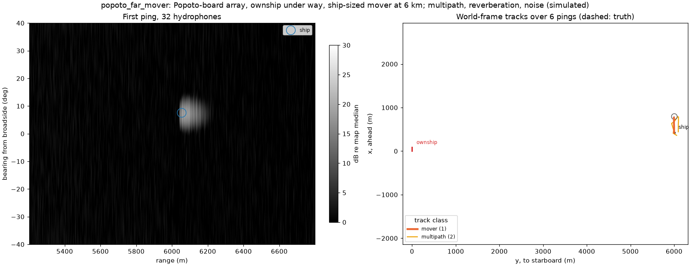

Ownship makes 1.5 m/s along its own 32-hydrophone array (four boards, 6–10 kHz, 185 dB,
1 s sweep). A ship-sized target (+25 dB over five highlights) crosses at 6 m/s, 6 km off
the beam, in 100 m of isovelocity water.

| Quantity | Result |
| --- | --- |
| Ship | tracked, 0.9 m from its hull (8.2 m from its centre), velocity −5.58, −0.02 m/s (true −6, 0); classified mover (5.94 ± 0.05 m/s) |
| Peak over map median with 8 / 16 / 32 hydrophones | 22.9 / 25.6 / 28.6 dB |
| Detections per ping / confirmed tracks | 1 to 4 / 3 |
| Track classes | 1 mover, 2 multipath |

Each doubling of the array adds about 3 dB, as it should. The two tracks that are not the
ship's are attached to it as later arrivals; no mover is off a moving object. **Before
D-178 the ship's track was 34.2 m from its hull** (36.3 m from its centre), almost all in
range: the cluster's power-weighted centroid of the direct and the later, stronger surface
and bottom arrivals. With the leading edge it is 0.9 m, and one multipath track fewer is
made (4 tracks before). Over ten seeds the distance to the hull is 36.9 -> 0.4 m (D-178).

### 12 km: `popoto_12km`

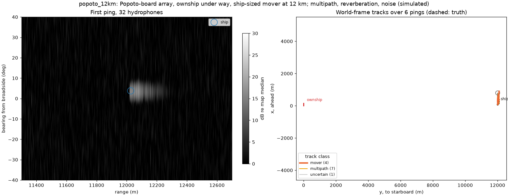

**What frequency and power reach 12 km.** `tools/popoto_range_study.py` and `DESIGN.md`
section 5: with spherical spreading, a +25 dB target, a 1 s pulse and 15.8 dB in one row at the
beamformer output (what the chain's own detector needs of one row for a detection probability of
0.5 on one ping, `buildspec.detection`; 17.4 dB for 0.9; the figure was a typed 13 dB before),

- the present 27.5 kHz band cannot do it (about 322 dB would be needed; absorption alone
  is about 136 dB over the round trip), and on the same budget reaches about 2.7 km;
- the best frequency is **4 to 6 kHz**;
- there, 32 hydrophones at half-wavelength spacing need **198 dB re 1 µPa at 1 m**, about
  515 W of acoustic power from an omnidirectional projector; 16 need 201 dB (1030 W),
  64 need 195 dB (257 W).

`popoto_long_range` was sized on the typed 13 dB with 2 dB in hand: 32 hydrophones at 15 cm (4.8 m),
4–6 kHz, 1 s, 197 dB (about 420 W acoustic if omnidirectional; electrical power depends on
a projector not yet chosen). Against the detector's own figure one row has -1.1 dB of margin at 12 km
in free field (detection probability 0.22 on one ping), two rows +1.4 dB (0.87), three
+2.9 dB (0.99). In this scenario, 100 m of isovelocity water over sand:

| Quantity | Result |
| --- | --- |
| Ship at 12 km | tracked, 2.1 m from its hull (9.8 m from its centre), velocity −5.67, 0.11 m/s (true −6, 0); classified mover (5.66 ± 0.50 m/s) |
| Track classes | 1 mover, 11 multipath |
| Peak over map median with 8 / 16 / 32 hydrophones | 20.1 / 23.1 / 25.6 dB |
| Detections per ping / confirmed tracks | 7 to 15 / 12 |
| One-way loss to the target, Bellhop (no absorption) | 67.2 dB, against 81.6 dB for spherical spreading |

- The shallow channel carries 14 dB more each way than spherical spreading, so this case
  has margin the link budget does not count. (The two losses are from
  `docs/scenarios/transmission_loss.json`, regenerated at `e10b17f`: 67.17 dB, 0.08 dB
  below the earlier file.) Since D-155 the twelve tracks are one object: the ship, a mover,
  and its arrivals by longer paths (from the true range to about 130 m beyond), grouped as
  its multipath. The strongest of them lies about 80 m beyond the true range, which is why
  the earlier rule (strongest first, echoes only farther out) left four movers and four
  uncertain tracks unattached, and why the nearest-track scoring called the ship
  `uncertain` (3.3 m/s) or `multipath` in the runs before (issue sonar-ygc). Over ten seeds
  the ship is one mover on every seed.
- **With the leading-edge range (D-178) the ship is 9.8 m from its centre, where it was 4.7 m
  before D-178** (2.1 m from its hull in both; 5.68 -> 5.66 m/s). Over ten seeds the median
  distance to the hull went 2.3 -> 3.4 m, and seed 60 3.0 -> 65.4 m (track hopping,
  `DECISIONS.md` D-178). The gallery's 6.05 m/s, 68 m from truth, was the D-155 gallery's,
  before the measured-position fit (D-157) and the echo placement (D-172).

### Other oceans: `popoto_env_*`

Same sonar, same ship, four environments. Geometry diagrams with the profile and the
transmission loss are in `docs/scenarios/popoto_env_*.png`.

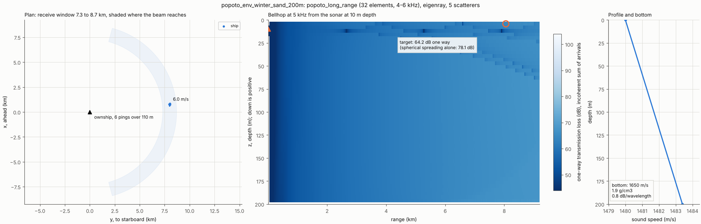

| Scenario | Water | Bottom (speed, density, loss) | Range | One-way loss: Bellhop / spherical | Ship | Peak over median, 32 hydrophones |
| --- | --- | --- | --- | --- | --- | --- |
| `popoto_env_winter_sand_200m` | 200 m, speed rising with depth (1480 to 1483.4 m/s): a surface duct | sand: 1650 m/s, 1.9, 0.8 dB/λ | 8 km | 64.2 / 78.1 dB | tracked, 2.8 m from its hull, −5.64 m/s | 30.1 dB |
| `popoto_env_summer_mud_60m` | 60 m, warm layer over a thermocline (1522 to 1490 m/s) | mud: 1500 m/s, 1.5, 0.2 dB/λ | 4 km | 88.8 / 72.2 dB | **not detected** in six pings | 12.4 dB |
| `popoto_env_gravel_30m` | 30 m, isovelocity | gravel: 1800 m/s, 2.0, 0.6 dB/λ | 3 km | 52.9 / 69.8 dB | tracked, **10.0 m short of its hull**, −5.57 m/s | **31.4 dB** |
| `popoto_env_deep_silt_1000m` | 1000 m, thermocline over cold deep water; ownship at 50 m | silt: 1575 m/s, 1.7, 1.0 dB/λ | 10 km | 72.6 / 80.0 dB | detected 300 m long in range; not tracked at its true position | 11.8 dB |

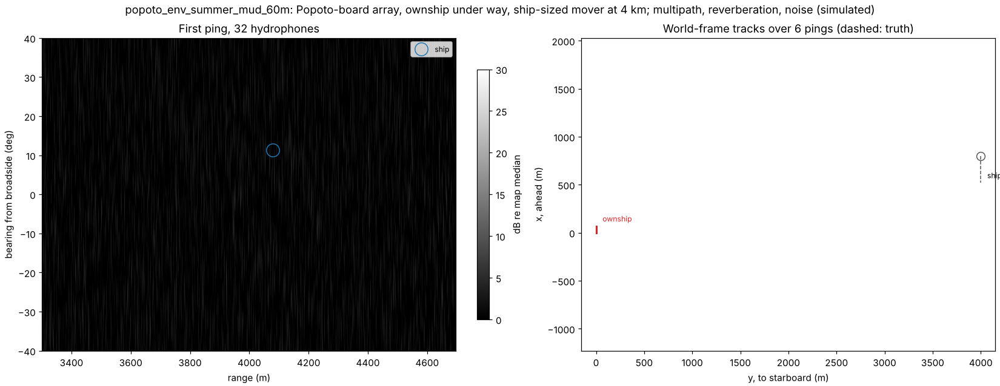

- **The ocean matters more than the 2 dB of margin.** In summer over mud the profile bends
  sound down into a bottom that absorbs it: 17 dB more loss each way than spherical
  spreading at only 4 km, and the ship is not seen. In winter over sand the same sonar
  holds it at 8 km with 30 dB.
- In deep water the ship's echo arrives about 300 m late in range with the right bearing.
  That is consistent with a path by way of the bottom, the direct path being refracted
  away from a target near the surface; this was not confirmed by tracing the arrivals.
  Range from such a path needs the propagation model to correct it, which is not written.
  The nearest track reads −3.10, −0.35 m/s against a true −6, 0, 301 m from the hull. The
  three tracks there are 1 mover, 2 multipath; the mover, not on the ship's true position,
  counts as one not on a moving object, the only one in the Popoto scenes. Which track it
  is was not examined.
- In winter over sand the ship is a mover at 6.06 ± 0.07 m/s (true 6.0), 2.8 m from its
  hull and 17.7 m from its centre; its track reads −5.64, 0.06 m/s. The five tracks are
  1 mover, 3 multipath and 1 uncertain, with no mover off a moving object. Before D-178 it
  read 5.24 ± 0.38 m/s (a stray detection taken at the track's birth, `STATUS.md` item
  45), 2.7 m from its hull and 29.1 m from its centre.
- **Over gravel the ship's track is 10.0 m short of its hull with the leading-edge range,
  where it was 33.7 m beyond it before D-178** (11.8 m from its centre, was 33.7): the
  near end of a hull at about 15° aspect read at the cluster's mean bearing, plus the
  closing up-chirp's range-Doppler coupling (D-178). It is a mover at 5.79 ± 0.07 m/s
  (5.92 before); the 3 tracks are 1 mover, 1 multipath and 1 static, and 1 to 3 detections
  are made per ping. The peak is 31.4 dB with 32 hydrophones (24.9 and 28.3 dB with 8 and
  16), 3.3 dB under the 34.7 dB of the gallery at `4530dc4`: keeping arrivals by energy
  (D-137) did it (`STATUS.md`, item 44).
- In summer over mud nothing is detected; every number in `gallery.json` is as before
  D-178. The peaks over the median and the detections per ping are the same as before
  D-178 in all four scenes.
- The one-way losses in the table are from `docs/scenarios/transmission_loss.json`,
  regenerated at `e10b17f` (0.04 to 0.11 dB lower with the water's own sound speed); the
  table's rounded values did not change.
- Bottom parameters are textbook values for each sediment, not measurements, and the
  Lambert strengths for bottom reverberation are placeholders. Bellhop's loss here excludes
  volume absorption (about 0.3 dB/km at 5 kHz), which the simulation adds separately.
- All four are range-independent: one profile and a flat bottom everywhere.

## Popoto array: `popoto_trial_1000m`

Peak at 1000.1 m on the target's bearing, 30 dB over the map median, in multipath, bottom
reverberation and ambient noise. `RESULTS.md` has the 100 m and 2000 m cases and the
comparison with the spherical-spreading estimate.

## Scenarios for the SST-equivalence work

Nine scenarios were added with the simulator work that closes the gap to SST (APL-UW
TR 0702; `DECISIONS.md` D-62 to D-78). A tenth, `asiaex_dahl_2004`, holds the forward-scatter geometry
Dahl (2004) prints (`docs/references/CONFORMANCE.md` A7). They are test and validation set-ups, not gallery
scenes: `tools/gallery.py` does not run them, so there is no result figure, animation or
CPU time for them here, except the two validation figures below. They have no geometry
diagram yet either: `tools/scenario_diagrams.py` has not been run since they were added
(it draws every file in `configs/scenarios`; whether it handles the new item types,
`type: target` and the `sources:` block that replaced the `sst_asiaex` relay geometry (D-123),
has not been tried).

| Scenario | Sonar | Scene | Physics in the run | Checked by |
| --- | --- | --- | --- | --- |
| `rail_cylinder_glint` | `sas_rail` (2.72 MHz), 151 pings | a smooth rigid rod, 10 cm long and 2 cm across (ka = 115), parallel to the rail | specular glint by the Kirchhoff approximation, `resolved: true` because the rod is in its own near field (L²/λ = 18 m); each ping sees one glint, and the image shows the line | `test_scene_targets.py`: line at y = 1.8704 m (expected 1.8706), off-rod / on-rod 0.002; the rod turned 20° is −67 dB |
| `fls_glints_on_sediment` | `fls_300k`, 1 ping, sonar 1 m above the bed | a seabed of point scatterers that follows the bottom scattering model at each ping's grazing angles; a smooth sphere (TS = 10 log10(a²/4) = −16.5 dB at any aspect) and a cylinder across the line of sight | glints from the two shapes; sediment numbers are `bottom.PLACEHOLDER_SAND`, illustrative | `test_scene_targets.py`: sphere image level within 0.5 dB of a²/4; `test_scene_sediment.py` for the seabed |
| `fls_highlight_target_aspect` | `fls_120k`, 8 pings 2 s apart | a target in the SST manner: five highlights along a 20 m body that crosses ahead while turning, a table of strength against aspect, one highlight that answers late, a small position jitter | the strength follows the table ping by ping as the aspect changes. The table is illustrative, not a measured target | `test_scene_targets.py` |
| `flank_sst_shallow` | `flank_32`, 4 pings 15 s apart | one target at 1 km in 100 m of isovelocity water | bounce paths time-spread by a wind-roughened surface; bottom reverberation from a rough fluid sediment; surface reverberation (Chapman–Harris, at 6-10 kHz just above its 0.4-6.4 kHz fitted band); a volume-scattering layer. Sediment, volume strength and bubble loss are placeholders. The surface's slope for time spreading is the long-wave slope of Dahl 1996 eq. (A7) from the wind (0.0199 at 6 m/s), the default since `docs/references/CONFORMANCE.md` A4; before it, the Cox-Munk total (0.0337, `slope_law: cox_munk_total`): the facet decay time is now 0.59 times (5.32 -> 3.14 ms mean on the sonar-target surface bounce), the angular spread 0.77 times what the file gave | `test_timespread.py`; added in the earlier part of the round (D-62, D-63) |
| `flank_sst_spread` | `flank_32`, 4 pings 15 s apart | the same channel | every option beyond SST's time spreading: `angle_spread`, `doppler`, `decay_time: facet`, `multi_bounce: convolve` (the last is the default since D-82). Few taps and lines, because every bounce ray becomes 1 + taps × `doppler_lines` rays each way. Same placeholders, and the same slope change as `flank_sst_shallow` (A4: tails x0.59, angles x0.77) | `test_timespread.py`, on both engines |
| `sst_pursuit` | five `flank_32` hydrophones as a forward-looking sonar on a vehicle at 20 m/s; a 0.1 s tone at 9.9 kHz, 1 ping | TR 0702's "Pursuit" example (Sec. 3, Fig. 2) as far as the report describes it: a three-highlight target fleeing at 2.5 m/s, 2124 m ahead; vehicle at 350 m in 1275 m of water | surface reverberation (Chapman–Harris) with `geometry: bistatic` and `band_taper`, over image-source paths that include bottom-reflected legs (bottom coefficient 0.5); wind noise; the target echo. Chapman–Harris at 9.9 kHz is above its fitted 0.4-6.4 kHz, and for a pair of grazing angles it is the geometric mean of the two strengths, TR 0702 Sec. 6.4.2's rule, since A3 (`docs/references/CONFORMANCE.md` Sec. 1.1; before, the law at the mean grazing angle, up to about 6 dB higher on pairs with a bottom-bounced leg; `bistatic_rule: mean_angle` keeps it). Moved by A3 (one run each, seed 2, `tools/sst_validation.py`; mean_angle -> geometric_mean): bottom-bounce streak on its track 16.7 -> 15.6 dB over the run without a bottom, excess after onset 13.8 -> 12.3 dB, median ridge over noise 30.1 -> 29.8 dB, band reverberation over noise 15.6 -> 15.6 dB; the committed `docs/figures/sst_validation.{md,json}` and `sst_pursuit.png` hold the numbers before A3 until regenerated. Speeds, depths, beams, pulse, wind and levels are **ours** (`unconfirmed`); the 230 dB source level only sets reverberation about 10 dB over noise. No target-radiated noise: one-way sources exist (D-123) but TR 0702 gives no level for it, so the file has none. 15 s for one ping in the run behind the committed matrix (4 shared cores, CPU) | `test_sst_validation.py`, `tools/sst_validation.py`; figure below |
| `sst_asiaex` | one `flank_32` hydrophone as the receiver; projector 500 m away; a 3 ms pulse at 8 kHz, 20 pings 5 s apart | TR 0702's forward-scatter example (Sec. 12.2–12.6, Figs. 3–5): direct, surface, bottom, surface-bottom and bottom-surface arrivals inside 35 ms | time spreading with wind 3 m/s and the bottom rms height 0.012 and mean-square slope 0.045 that TR 0702 prints; the one-way path is a radiating source (`sources:`, D-123; until then a −20 dB relay 0.1 m from the projector) and the receiver does not transmit. Water depth (100 m), source and receiver depths (30 m, 50 m), sound speed, ping interval, the sediment and the wind laws are **ours** (`unconfirmed`); the surface slope is the long-wave slope of Dahl 1996 eq. (A7), 0.0135 at 3 m/s (the Cox-Munk total 0.0184 before `docs/references/CONFORMANCE.md` A4: the rule-of-thumb surface tail 2.91 -> 2.14 ms). Dahl (2004) prints a 2001 ASIAEX layout (source 25 m, arrays at 26 and 52 m, 467-500 m, 105 m of water, sets 6-8 at 7 m/s); whether TR 0702's Run/Set 22 used it is not stated, and with it the five arrivals do not fit TR 0702's description (at 26 m the surface arrival overlaps the direct one and the two two-bounce arrivals overlap each other; at 52 m the bottom-surface arrival is at 37 ms, past the 35 ms of the figures), so the file keeps its own depths | the same; figure below |
| `asiaex_dahl_2004` | one `flank_32` hydrophone at 52 m as the receiver; a one-way source at 25 m, 467 m away; 3 ms CW at 8 kHz (20 kHz by overriding the waveform), 20 pings 5 s apart | the forward-scatter geometry and sea Dahl (2004, Sec. IV.A) prints for the 2001 ASIAEX sets 6-8 (CONFORMANCE.md A7): 105 m of water, the lower array, the range of his Fig. 4 (it gives his printed 9.4-degree iso-speed grazing angle: 9.36 computed), wind 7 m/s and the measured rms wave height 0.3 m in place of the wind law's 0.262 | time spreading of the surface bounce with that height and the long-wave slope of Dahl 1996 eq. (A7) (0.0213); fully rough at 8 kHz (coherent share 3e-5). Arrivals 3.62 ms (surface) and 11.67 ms (bottom) after the direct one in constant 1525 m/s; Dahl's Fig. 3c shows the bottom arrival at about 13.7 ms in refracting water (read from figure): recorded, not fitted. **Ours** (`unconfirmed`): the constant sound speed (his profile is about 1521-1528 m/s), the sediment (medium sand; none printed), the ping interval, the source level and taper. Vertical coherence at 52 m, 20 kHz, 0.30 m: ours 0.12 against 0.69 measured (read from his Fig. 5), an expected failure | `test_asiaex_dahl_2004.py` |
| `sst_echo_level` | `flank_32` hydrophones, omnidirectional, 1 ping, 2 kHz of band | one highlight of known target strength; a flat surface (coefficient −1) and a flat bottom (0.5), one bounce at most per leg, so six groups of eigenray pairs arrive as six separate pulses | a geometry for a calculation, not a sonar: the compressed echo against the sonar equation and TR 0702 eqs. 36–38, 66, 68. The tool also runs it free-field, and with a sampled m-sequence pulse and a moving target | `test_sst_validation.py`: 0.004 dB free field; 0.005 dB and 0.13 µs in the image medium |
| `sst_sediment_reverb` | `popoto_8` hydrophones, omnidirectional, 20 m above a flat bed; a 2 ms tone at 20 kHz, 6 pings | a bed of `medium_sand` (`configs/sediments.yaml`) | scattering-function reverberation, direct path only, no absorption, against σ(grazing)·πcT/R³. The tool also runs the same sediment as point scatterers, and LFM pulses of three bandwidths with a point target | `test_sst_validation.py`: mean +0.27 dB, −0.17 to +0.59 dB |

The two worked examples are **not numerical reproductions of TR 0702's figures**: the
report does not print the parameters, and the figures below are compared only with
closed forms for our own geometry (`RESULTS.md`, "Validation against TR 0702").

Pursuit: the target echo arrives at 2.7900 s at 10133.73 Hz, 30 Hz below the
reverberation ridge (`figures/sst_validation.md`). The first validation run showed a
defect in the bistatic reverberation's Doppler (with the bottom in, the spectrogram
changed before any bottom path could arrive), which has since been fixed
(`DECISIONS.md` D-80); this figure was regenerated after the fix, with the matrix, on
2026-11-19 (`26586a3`) and 2026-11-20 (`1debe6d`). After the fix the ridge follows the
closed form within 0.75 Hz in the median and the bottom-bounce streak starts at 1.750 s
(2D/c = 1.700 s); with the first run's code the figures were 1.2 Hz and 1.725 s
(`RESULTS.md`).

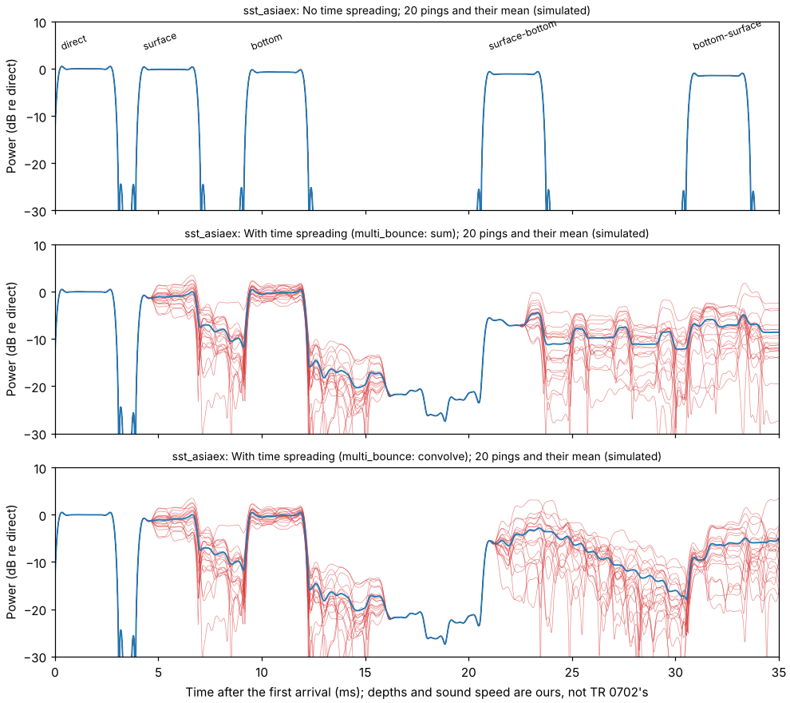

ASIAEX: arrivals at 0, 3.97, 9.20, 20.68 and 30.57 ms within 0.20 µs of the image
equations; with time spreading the bounce arrivals grow tails (surface −8 dB, bottom
−19 dB re peak 0.3-0.7 ms after the pulse) and vary from ping to ping (surface 2.86 dB, bottom
1.08 dB standard deviation over 20 pings, with SST's Lorentzian Doppler spectrum, D-144).
Before `docs/references/CONFORMANCE.md` A4 (the Cox-Munk total slope) these were −6 / −15 dB and
1.88 / 0.97 dB: the shorter surface tail leaves less of itself under the bottom arrival's window,
which is why the bottom's numbers move although its own slope (0.045, TR 0702) did not. The
surface tail fits the rule of thumb at 2.18 ms against 2.14 (2.94 against 2.91 before).

Made by: `PYTHONPATH=python python3 tools/sst_validation.py --out docs/figures/sst_validation.md --json docs/figures/sst_validation.json --figures docs/figures`
(about 2 minutes on the CPU).

## Every scenario file

All 91 files in `configs/scenarios`, one line each. "Gallery" means `tools/gallery.py` runs
it and the sections above show its figure and numbers. A scenario marked "needs Bellhop"
runs at the `eigenray` tier and is skipped, with its tests, when `GPUSONAR_BELLHOP` is not
set. Thirty-six files have no geometry diagram in `docs/scenarios/` yet: `asiaex_dahl_2004`, `flank_seamount_3d` and the nine 3-D
scenes and twins of `sonar-d7sw` (the tool draws neither a 3-D bed nor the `eigenray3d` tier), the nine of the
SST-equivalence work, `popoto_12km_2row`, `popoto_12km_3row`, `popoto_12km_two_ships`, the three
`popoto_testauv_direct_overload*`, the three `fjord_*`, the three `ssp_*` and the four multipath
scenes of `sonar-0nsi` (`fls_120k_quay_multipath`, `pool_fls_p4_2v_walls`, `sas_auv_multipath`,
`sas_auv_multipath_free`; `tools/scenario_diagrams.py` has not been run since they were added, and it
does not draw walls or a tilted bed).

Since `DECISIONS.md` D-100 a scenario states its water once, in an `environment` block
that may name a site in `configs/environments/`; a typed value that contradicts the site
is an error unless named under `environment_overrides`. Two kinds of inconsistency are
kept as they were and are named in the files (D-101): 9 Bellhop scenarios reflect eigenrays
from a flat surface in a windy sea, and 21 simulate a bottom the record does not mention.
The third is resolved: of the 47 scenarios that typed a sound speed disagreeing with their
temperature, 44 now take the speed the water gives (1496.8 m/s at 12 deg C and 35 PSU,
1489.8 at 10 deg C, 1482.4 in the fresh-water tank at 20 deg C) and three keep theirs on
purpose, each saying why in its file (`popoto_elevation_rehearsal`, `sst_pursuit`,
`sst_asiaex`). The numbers that come from `docs/figures/gallery.json`
(the gallery sections above) are from a run made after that change, so for the gallery
scenes among the 44 they are measured at the water's speed. **Every other number quoted
in this file for those 44 scenarios, in the gallery sections or outside them, was
measured at the nominal speed and has not been measured again.** The trial, 12 km and `popoto_env_*`
scenarios no longer state a bounce order or an arrival count (the energy rule of D-105
decides); the other shallow scenarios still state one far below what that rule would keep
(`STATUS.md`, open item 22).

### Point targets, for measuring resolution

| Scenario | What it is |
| --- | --- |
| `point_grid_l12_5d` | Point grid for the L12-5 probe (5 MHz), pool water; two pings, one per multiplexer half. |
| `point_grid_p4_2v` | Point grid for the P4-2v phased array (2.7 MHz), pool water. |
| `point_grid_fls_300k` | Point grid for the 300 kHz, 128-element forward-looking sonar. |
| `point_grid_fls_750k` | Point grid for the 750 kHz sonar (the plan's Phase 3; every value a placeholder), 5 to 45 m. |
| `point_grid_sas_auv` | Point grid for the 200 kHz SAS array. |
| `point_grid_sas_rail` | Point grid for the P4-2v on the rail, pool water. |
| `point_grid_flank_32` | Point grid for the 32-hydrophone flank array. |
| `point_grid_popoto_8` | Point grid for eight Popoto hydrophones at 27.5 kHz. |
| `point_grid_popoto_8_low` | The same in the board's low band. |
| `point_grid_popoto_4x8` | Point grid for four Popoto boards of eight (32 hydrophones). |
| `pool_wires_l12_5d` | Thin wires on a frame at 0.5, 1 and 2 m: beam width and range resolution of the L12-5 probe. |
| `stripmap_points` | Stripmap SAS with known navigation past three point targets, 90 pings. |
| `rail_points` | Rail SAS past point targets with the P4-2v stepped along a motorised rail. |
| `rail_position_errors` | `rail_points` with the carriage a fraction of a millimetre off its commanded position. |

### Forward-looking sonar

| Scenario | What it is |
| --- | --- |
| `pool_fls_l12_5d` | Gallery. Phase 1 pool: far wall, side wall, cinder block, pipe, rope, wires. |
| `pool_fls_p4_2v` | Gallery. Phase 2 pool or dock, 5 to 10 m: wall, steps, ladder, lane floats. |
| `harbour_fls_750k` | Gallery. Phase 3 harbour: sandy floor, quay wall, six pilings, mooring block, rocks. |
| `seafloor_objects_fls` | Gallery. A sphere, a box and rocks on a flat seafloor, with shadows. |
| `fls_120k_transit` | Gallery. The 120 kHz design under way at 2 m/s: boat under way, boat at anchor, buoy, pinnacle; reverberation with ownship Doppler; 10 pings. Its surface reverberation is Chapman-Harris at 120 kHz: fitted at 0.4-6.4 kHz, so an extrapolation that no read source covers (`docs/references/CONFORMANCE.md`). |
| `fls_170k_transit` | Gallery. The same objects with the 170 kHz design out to 450 m. Its surface reverberation is Chapman-Harris at 170 kHz: fitted at 0.4-6.4 kHz, so an extrapolation that no read source covers (`docs/references/CONFORMANCE.md`). |
| `fls_330k_transit` | Gallery. The same with the 330 kHz design out to 300 m. Its surface reverberation is Chapman-Harris at 330 kHz: fitted at 0.4-6.4 kHz, so an extrapolation that no read source covers (`docs/references/CONFORMANCE.md`). |
| `fls_120k_cluttered_seabed` | Gallery. Boat with keel, propeller and wake over sand, boulders, debris and a pipeline. Its surface reverberation is Chapman-Harris at 120 kHz: fitted at 0.4-6.4 kHz, so an extrapolation that no read source covers (`docs/references/CONFORMANCE.md`). |
| `fls_120k_rough_surface` | Gallery. A wind sea of wave facets at 10 m/s, boat with wake, kayak, buoy. |
| `fls_170k_traffic` | Gallery. Three boats: closing, crossing, at anchor. Its thinned test form carries the loosened anchored-boat limit (D-121). Its surface reverberation is Chapman-Harris at 170 kHz: fitted at 0.4-6.4 kHz, so an extrapolation that no read source covers (`docs/references/CONFORMANCE.md`). |
| `fls_glints_on_sediment` | A smooth sphere and cylinder that glint, on a seabed whose scatterers follow the bottom scattering model. |
| `fls_highlight_target_aspect` | A five-highlight target crossing ahead while turning, strength against aspect from an illustrative table. |
| `fls_120k_quay_multipath` | The 120 kHz design along a quay wall over a bed sloping 5 degrees across the look direction (image sources off the wall and the tilted bed, `sonar-0nsi`): a moored sphere and its ghosts, a block on the bed; truth entries for the ghosts. |
| `pool_fls_p4_2v_walls` | The P4-2v in a 4 m pool lane whose side and far walls are mirrors (`sonar-0nsi`): ghost floats in the side walls; truth entries for them. |

### Synthetic aperture sonar and buried objects

| Scenario | What it is |
| --- | --- |
| `wreck_sas` | Gallery. Stripmap past a 3 m box with sway and heave that navigation does not report; motion estimation. |
| `minefield_sas` | Gallery. Rippled sand, two 2 m cylinders, a sphere, rocks; unknown motion. |
| `sas_minsas_survey` | Gallery. The MINSAS-class design, two opposite legs over a wreck, a cable, rocks and a calibration cube. |
| `sas_minsas_boulder_field` | Gallery. 45 boulders of 15 to 90 cm radius on sand. |
| `sas_minsas_rocky_ripples` | Gallery. Rippled sand, a rock outcrop, stones, a cable. |
| `sas_minsas_speckle` | Gallery. A seabed of 5000 scatterers per square metre (2.6 per resolution cell). |
| `rail_objects` | Gallery. Rail SAS in the pool: ball, pipe, brick, pebbles on the floor. |
| `rail_cylinder_glint` | A smooth rigid rod parallel to the rail, a specular target seen as one glint per ping. |
| `buried_cylinder` | 3D near-field imaging of one cylinder 0.3 m below a flat sediment interface, with refraction. |
| `buried_objects` | Gallery. A buried cylinder and sphere under a rough interface with sediment clutter. |
| `sas_auv_multipath` | Stripmap SAS 15 m above a flat bed of medium sand under a flat surface (image sources, energy rule; `sonar-0nsi`): point targets 1, 3 and 8 m above the bed, a sphere on it, a Lambert seabed; truth entries for the multipath copies. |
| `sas_auv_multipath_free` | The same in free field (`base: sas_auv_multipath`), for the difference. |

### Flank array (32 hydrophones, 6 to 10 kHz)

| Scenario | What it is |
| --- | --- |
| `flank_target_1km`, `flank_target_5km`, `flank_target_10km` | One target in noise in shallow water at each range; the link-budget cases. Needs Bellhop. |
| `flank_seamount_3d` | ILLUSTRATIVE (unconfirmed relief). The flank array over a 180 m seamount in 200 m of water, a target 4 km out over its flank, at the opt-in `eigenray3d` tier (Bellhop3D: needs `GPUSONAR_BELLHOP3D`; about 4 minutes on the CPU: four Bellhop3D runs of about a minute, arrival files under 1 kB). One `bathymetry` for the whole scenario. No reverberation (the 3-D provider would need a receiver per cell). Not in the gallery. |
| `flank_seamount_3d_opening`, `flank_seamount_3d_opening_nx2d` | ILLUSTRATIVE (`sonar-d7sw`). The same seamount, a target opening along the flank bearing from 1.5 to 6 km over four pings, at `eigenray3d` and its N × 2-D twin at `eigenray` (the bearing's profile). Behind the flank the 3-D field is 4.0 and 2.3 dB below N × 2-D. About 6.5 min (3-D) and 40 s (twin) on the CPU. Section "Flank array over 3-D relief". |
| `flank_level_3d`, `flank_bank_3d`, `flank_level_nx2d` | ILLUSTRATIVE (`sonar-d7sw`). Three targets at 5 km over a level 100 m bed (control: the tiers agree within 0.003 dB) and over a bed sloping 1° across the look (arrivals 0.4° up-slope, no level change), and their level-bed `eigenray` twin. About 3 and 7 min (3-D), 2 min (twin). |
| `flank_ridge_3d`, `flank_ridge_nx2d` | ILLUSTRATIVE (`sonar-d7sw`). A sill crossing the bearing at 45° (`bathymetry.ridge`), a target 5 km behind it: 3-D adds −0.2 dB; the twin is 1.9 dB louder for its own reasons. About 5 min (3-D), 1 min (twin). |
| `flank_canyon_3d`, `flank_canyon_nx2d` | ILLUSTRATIVE (`sonar-d7sw`). A canyon along the look direction (a trough, `bathymetry.ridge` with negative height), a target 5 km down its axis: 3-D is 6.2 dB louder one-way than N × 2-D; the cross-slope warning does not flag it. About 4.5 min (3-D), 25 s (twin). |
| `flank_patrol` | Gallery. Six pings 12 s apart in 100 m of water: a 56 m target crossing near 3 km, a small vehicle near 2.2 km (−3 dB: below the scene's reverberation, never detected, left as a hard target on purpose, D-198), a wreck. Needs Bellhop. |
| `flank_sst_shallow` | A target at 1 km in 100 m of water with time-spread bounce paths, sediment and surface reverberation and a volume layer; placeholders throughout. |
| `flank_sst_spread` | The same channel with angle spreading, Doppler spreading within the pulse and convolved multi-bounce tails. |

### Validation against TR 0702

| Scenario | What it is |
| --- | --- |
| `sst_pursuit` | The report's "Pursuit" example as far as it is described: a vehicle at 20 m/s chasing a three-highlight target; our own parameters. |
| `sst_asiaex` | The report's forward-scatter example: a 3 ms pulse at 8 kHz over about 500 m, now by a one-way source (`sources:`), no longer a relay point. |
| `asiaex_dahl_2004` | Dahl (2004)'s 2001 ASIAEX layout as printed: source 25 m, a hydrophone at 52 m, 467 m, 105 m of water, 3 ms CW at 8 kHz (20 kHz by override), wind 7 m/s, rms wave height 0.3 m. Sound speed, sediment, ping interval are ours. Not a reproduction of the paper's coherence curves (vertical coherence an expected failure). |
| `sst_echo_level` | One highlight of known strength with one bounce per leg: the compressed echo against the sonar equation. States `bottom_coefficient: 0.5`. |
| `sst_sediment_reverb` | Bottom reverberation from `medium_sand` against the integral of its scattering strength. |

### Popoto boards at 27.5 kHz, and the first long-range design

| Scenario | What it is |
| --- | --- |
| `popoto_trial_100m`, `popoto_trial_1000m`, `popoto_trial_2000m` | Eight hydrophones, 190 dB, a +10 dB target at each range in shallow water. Needs Bellhop. `popoto_trial_1000m` is in the gallery. |
| `popoto_far_mover` | Gallery. 32 hydrophones in the 6 to 10 kHz band against a ship-sized mover at 6 km, ownship at 1.5 m/s. Needs Bellhop. |

### The 12 km design (`popoto_long_range`: 4 to 6 kHz, 197 dB, 32 hydrophones a row)

| Scenario | What it is |
| --- | --- |
| `popoto_12km` | Gallery. A ship-sized mover (+25 dB, a placeholder) at 12 km in 100 m of isovelocity water over sand; one row. Needs Bellhop. Keeps arrivals by energy: 64, the cap (1.4 % of arrival energy left out, as a one-ping run at the tree of D-181 warns; this row said 1.5 % before; D-137). |
| `popoto_12km_2row` | The same with two stacked rows on the face (outer rows 1.5 m apart); the ship 4 m deep. Needs Bellhop. |
| `popoto_12km_3row` | The same with three rows. Needs Bellhop. |
| `popoto_12km_two_ships` | `popoto_12km` with a second ship beyond the first, at one bearing and one velocity, 850 m apart in range: the test scene of echo grouping's reach (a group reaches no farther than one gate from its object, D-172). Needs Bellhop. |
| `popoto_env_winter_sand_200m` | Gallery. The same ship at 8 km in winter water over sand (a surface duct). Needs Bellhop. |
| `popoto_env_summer_mud_60m` | Gallery. At 4 km under a summer thermocline over mud: not detected. Needs Bellhop. |
| `popoto_env_gravel_30m` | Gallery. At 3 km in 30 m over gravel. Needs Bellhop. Keeps arrivals by energy: 64, the cap (14 % left out; D-137). |
| `popoto_env_deep_silt_1000m` | Gallery. At 10 km in 1000 m over silt. Needs Bellhop. |

### Stacked rows: elevation and depth

| Scenario | What it is |
| --- | --- |
| `popoto_elevation_free` | Three rows on the face, rolled 3 degrees, three targets near 1 km above, level with and below the vehicle, free field: the reported depths must be the targets'. |
| `popoto_elevation_shallow` | Three rows at 30 m in 100 m of water over sand, a target at 50 m depth 1 km away; image-source multipath to second order. |
| `popoto_elevation_rehearsal` | The full stacked-row system as it would run: raw 102.4 kHz samples on twelve boards with their own clocks, the vehicle rolled and rolling, a deep and a shallow target near 1 km. Chain: `configs/deploy/popoto_elevation_rehearsal.yaml`. |
| `popoto_face_2row_shallow` | Two rows on the face, 100 m over sand, a target at 60 m depth 3 km away. This is the geometry in which two rows cannot separate direct, surface and bottom echoes, and the depth sigma now says so (`STATUS.md`, open item 6). |

### The staged builds: trials in open water

Each is the rehearsal of one build's trial and is run through that build's deployment
file: `tools/sonar_live.py configs/deploy/<file>.yaml --scenario <name> --out DIR`. Raw
samples at 102.4 kHz with every board on its own clock. Image-source multipath with one
bounce stated.

| Scenario | What it is |
| --- | --- |
| `popoto_testauv_trial_1row` | Stage 1: the one-row prototype on the test AUV at 10 m in 30 m of water, a +10 dB target at 500 m, 15 m deep. |
| `popoto_static_trial_2row` | Stage 2: the two-row static frame against a target 2.6 km away, 30 m below it. |
| `popoto_static_trial_3row` | Stage 3: the three-row static frame against a target at 150 m, 8 m below it. |
| `popoto_static_free` | The three-row static frame in free field, three targets about 400 m off at known depths. |
| `popoto_static_passing` | A target passing the three-row frame 400 m off at 3 m/s, eight pings, 30 m of water over sand. |

### The projector's direct sound and receiver overload (D-125)

| Scenario | What it is |
| --- | --- |
| `popoto_testauv_direct_overload` | The one-row prototype with a 0.1 s pulse, targets at 150 m and 350 m, and a front end that overloads on the projector's direct sound and recovers slowly. No hardware value in it is measured. |
| `popoto_testauv_direct_overload_fast` | The same with a front end that is dead for 5 ms after it last clipped and recovers with a 2 ms time constant. |
| `popoto_testauv_direct_overload_gain_switch` | The same with the gain held 40 dB down while the projector transmits; nothing clips. Headroom 2.8 dB since source levels are RMS. |

### Trials in fjord-type water (D-106; `tools/fjord_rehearsal.py`)

The profile (a sound-speed maximum of 1495 m/s at 19 m), the section of basins and sills
and the seabed are **illustrative**, modelled on one site; the late tail's numbers are one
fjord, one night, 4 to 8 kHz; K-distributed noise (shape 3.5) at a 1.9 m/s wind level. All
need Bellhop and keep twelve arrivals.

| Scenario | What it is |
| --- | --- |
| `fjord_testauv_trial_1row` | `popoto_testauv_trial_1row` in the fjord's water: target at 500 m. |
| `fjord_static_trial_2row` | The two-row static frame against a target 2.6 km away; a 53 m sill blocks the direct path. |
| `fjord_static_trial_3row` | The three-row static frame against a target at 150 m. |

### Water that changes with range (D-110; `tools/ssp_range_study.py`)

The profiles are **illustrative**; nobody measured them. Range is horizontal distance from
the sonar, the same on every bearing. All need Bellhop, keep twelve arrivals and reflect
eigenrays from a flat surface.

| Scenario | What it is |
| --- | --- |
| `ssp_front_static_trial_2row` | The two-row static frame against a target at 2.6 km, 60 m deep, with a front 1.2 to 1.4 km out. |
| `ssp_thermocline_static_trial_3row` | The three-row static frame against the same target under a mixed layer that deepens from 15 m at the array to 45 m at 3 km. The case behind `elevation.sector_from_rays` (D-116). |
| `ssp_front_testauv_trial_1row` | The one-row prototype against a target at 500 m, 15 m deep, in 30 m of water, with a front 200 to 300 m out. |

Results for the last five groups are tables, not figures: `RESULTS.md` ("Deployment
defaults: before and after", "Water that changes with range", "A trial in fjord-type water
against the open-water rehearsal", and the regenerated fjord and 12 km tables in "Six fixes
after the first whole-suite run"), `docs/figures/fjord_rehearsal.md`,
`docs/figures/ssp_range_study.md`, and `docs/design/direct_sound_study.json`.

## What no scenario has yet

- Multipath in the gallery pool scenes. Surface and floor bounces arrive well outside the probes'
  narrow elevation beams; bounces off the side walls lie in the fan and show as ghost targets,
  which `pool_fls_p4_2v_walls` now has (`sonar-0nsi`); the gallery scenes `pool_fls_l12_5d` and
  `pool_fls_p4_2v` are unchanged and free field.
- Surface or bottom bounce paths to the objects in the free-field forward-looking sea scenes
  (`fls_120k_cluttered_seabed`, `fls_120k_rough_surface`, `seafloor_objects_fls`,
  `harbour_fls_750k`, `fls_glints_on_sediment`, `fls_highlight_target_aspect`). The four FLS
  scenes at `image_source` (`fls_120k_transit`, `_170k_transit`, `_330k_transit`,
  `fls_170k_traffic`) DO give their objects first-order surface and bottom bounce paths (three
  eigenrays a leg, nine pairs a scatterer); this list said otherwise until `sonar-0nsi`.
  Reverberation is statistical in all of them.
- Multipath in a gallery SAS scene: all are free field; `sas_auv_multipath` (not in the gallery)
  has surface and bottom multipath.
- Reverberation (the scattering-function model) over a tilted bed: refused; a sloping bed is
  given as scene scatterers (`fls_120k_quay_multipath`).
- 3-D propagation in a gallery scene: every gallery scene is N × 2-D at most. The six scenarios at
  the opt-in `eigenray3d` tier (`flank_seamount_3d` and the five of `sonar-d7sw`) are illustrative, not in the
  gallery, and targets in noise: no reverberation over relief at that tier (a receiver per scattering cell would be
  needed; `docs/tasks/PROPAGATION_3D.md` P5).
- Waves that move as waves do, breaking, or a bubble layer; a wake that grows.
- A 3-D scene for the Popoto long-range array (4 to 6 kHz, 12 km),
  where the exposure is largest (`PROPAGATION_3D.md` section 3), or a moving platform over relief (a Bellhop3D run
  per source position). A short-range FLS or SAS scene beyond the three image-plane scenes: a narrow channel with
  two non-parallel banks was not added; the existing quay, pool lane and sloping-bed scenes already exercise a wall,
  several walls and a tilted bed.
- A range-dependent ocean in a gallery scene. Three trial scenarios have a sound speed
  that changes with range (`ssp_*`) and three a seabed section with sills (`fjord_*`),
  all illustrative and all as rings about the sonar; none has a front lying across a map.
- Fully developed speckle on large surfaces (scatterer counts are kept affordable).
- Specular echoes in a realistic scene. Smooth spheres, cylinders, plates and discs can
  now glint (`rail_cylinder_glint`, `fls_glints_on_sediment`), but no gallery scene uses
  them, and hulls, pipelines and pool walls are still Lambert point clouds.
- A seabed with relief under the scattering-function reverberation, moving scatterers,
  K-distributed reverberation, or a sampled transmit pulse: the options exist and are
  tested, and no shipped scenario turns them on (a sampled pulse appears only in the
  validation tool's variant of `sst_echo_level`).
- Classification: telling a boat from a boulder, or the ship from its multipath.
