# Realistic scenarios, mode by mode

Every mode of the suite has scenarios with extended scenes, run end to end: simulate,
condition, (estimate motion,) image, (detect and track). For each scenario there are three
pictures, all made from its YAML file:

| What | Where | Made by |
| --- | --- | --- |
| Geometry diagram: plan and side view; for Bellhop scenarios the sound-speed profile and transmission loss | `docs/scenarios/<name>.png` (all 45 scenarios) | `tools/scenario_diagrams.py` |
| Result figure: the image, detections, tracks | `docs/figures/<name>.png` | `tools/gallery.py` |
| Animation | `docs/figures/<name>.gif` | `tools/gallery.py` |

- On a CPU: `tools/gallery.py --backend host` (full size) or `--quick` (thinned: fewer
  scatterers and pings, same geometry and processing). `--only a,b` picks scenarios.
  `tests/python/test_realistic_scenes.py` runs the thinned versions and checks each object
  shows where it should.
- On a GPU: `GPUSONAR_JOB=gallery GPUSONAR_ORACLES=1 GPUSONAR_CERES=1 tools/gpu_job.sh`, or
  `tools/gallery.py --backend cuda`.
- Numbers below are from the full-size CPU run in `docs/figures/gallery.json`. Where a
  scenario also ran earlier on an NVIDIA A10G, the numbers agreed to the digits shown.
- **CPU times** are for one core: the host backend ran single-threaded here, in a shared
  4-core x86_64 container with two or three other jobs running. Treat them as upper bounds.

All of it is simulation. Scenes are clouds of point scatterers on object surfaces
(`DECISIONS.md` D-41): they give highlights, shadows, layover and speckle, not specular
glints, diffraction or resonances.

| Mode | Scenario | Sonar | Scene | Physics in the run | CPU time |
| --- | --- | --- | --- | --- | --- |
| FLS, pool, Phase 1 | `pool_fls_l12_5d` | L12-5, 5 MHz, both mux halves | far wall, side wall, cinder block, pipe, rope, two wires | free field, shadows, 12-bit ADC, noise | 29 s |
| FLS, pool, Phase 2 | `pool_fls_p4_2v` | P4-2v, 2.7 MHz | far wall, three steps, ladder, three lane floats | same | 28 s |
| FLS, sea, Phase 3 | `harbour_fls_750k` | 64 elements, 750 kHz | sandy floor, quay wall, six pilings, mooring block, rocks | free field, shadows, absorption | 54 s |
| FLS, sea, Phase 4 | `seafloor_objects_fls` | 128 elements, 300 kHz | seafloor, sphere, box, rocks | free field, shadows | 10 s |
| FLS, owner's design | `fls_120k_transit` | `fls_120k`, 300 m, 20° vertical | boat hull under way, boat at anchor, buoy, seabed pinnacle | AUV at 20 m making 2 m/s; seabed and surface reverberation fixed in the world, ownship Doppler, noise; 10 pings, detection, tracking | 9 min |
| FLS, owner's design | `fls_170k_transit` | `fls_170k`, 450 m, 5° tilted up 2° | same objects | same | 18 min |
| FLS, owner's design | `fls_330k_transit` | `fls_330k`, 300 m, 5° tilted up 3.5° | same objects | same | 15 min |
| FLS, cluttered seabed | `fls_120k_cluttered_seabed` | `fls_120k` | boat with keel, propeller and wake; anchored boat; sand, 22 boulders, 12 pieces of debris, a pipeline | same, 8 pings | 5 min |
| FLS, rough sea | `fls_120k_rough_surface` | `fls_120k` | swell and wind sea on the surface (wave facets), boat with wake, kayak, buoy | same; the surface is the facets, bottom reverberation, noise at 10 m/s wind | 18 min |
| FLS, traffic | `fls_170k_traffic` | `fls_170k` | three boats: closing, crossing, at anchor, two with wakes | as the transits, 8 pings | 16 min |
| SAS, AUV | `wreck_sas` | 16 elements, 200 kHz | seafloor, 3 m box | free field, shadows, unknown sway and heave, motion estimation | 4 min |
| SAS, AUV | `minefield_sas` | same | rippled sand, two 2 m cylinders, sphere, rocks | same | 6 min |
| SAS, owner's design | `sas_minsas_survey` | `sas_minsas120`, 330 kHz | wreck (hull, deckhouse, mast), cable, rocks, calibration cube | two opposite legs, shadows, exact navigation; 2 cm pixels | 15 min |
| SAS, rocks | `sas_minsas_boulder_field` | same | 45 boulders, 15 to 90 cm radius, on sand | one leg, shadows; 2 cm pixels | 12 min |
| SAS, rocks | `sas_minsas_rocky_ripples` | same | rippled sand, a 12-rock outcrop, 35 stones, a cable | same | 7 min |
| SAS, rail | `rail_objects` | P4-2v on the rail | pool floor, ball, pipe, brick, pebbles | free field, shadows, stop-and-go | 24 min |
| 3D, buried | `buried_objects` | sub-bottom, 20 kHz, raster | buried cylinder and sphere, rough interface, sediment clutter | refraction at the interface | 5 min |
| Flank array | `flank_patrol` | 32 hydrophones, 6–10 kHz | moving 56 m target, small vehicle, wreck | Bellhop multipath, bottom and surface reverberation, ambient noise, six pings, detection and tracking | 72 min |
| Popoto array | `popoto_trial_1000m` (also 100 m, 2000 m) | 8 hydrophones, 27.5 kHz | one +10 dB target | Bellhop multipath, bottom reverberation, ambient noise | 29 s |
| Popoto, owner's design | `popoto_far_mover` | 32 hydrophones, 6–10 kHz, 185 dB | ship-sized mover at 6 km | ownship at 1.5 m/s, Bellhop, reverberation with ownship Doppler, noise; six pings, tracking | 14 min |
| Popoto, 12 km | `popoto_12km` | `popoto_long_range`: 32 hydrophones, 4–6 kHz, 197 dB | ship-sized mover at 12 km | same; 100 m isovelocity over sand | 13 min |
| Popoto, other oceans | `popoto_env_winter_sand_200m`, `popoto_env_summer_mud_60m`, `popoto_env_gravel_30m`, `popoto_env_deep_silt_1000m` | same | the same ship at 8, 4, 3 and 10 km | same, each with its own profile, bottom and depth | 12 min, 2 min, 10 min, 103 s |

Point-target scenarios for measuring resolution (`point_grid_*`, `stripmap_points`,
`rail_points`, `pool_wires_l12_5d`) and the long-range link-budget cases
(`flank_target_*km`) are separate; see `RESULTS.md`. They have geometry diagrams too.

## Forward-looking sonar

FLS figures use Hann aperture weighting, a 30 log r range gain and the paper's dynamic
range compression for display. "Over median" is the mean image power over an object's
scatterers against the image median, after the range gain.

### Phase 1 pool: `pool_fls_l12_5d`

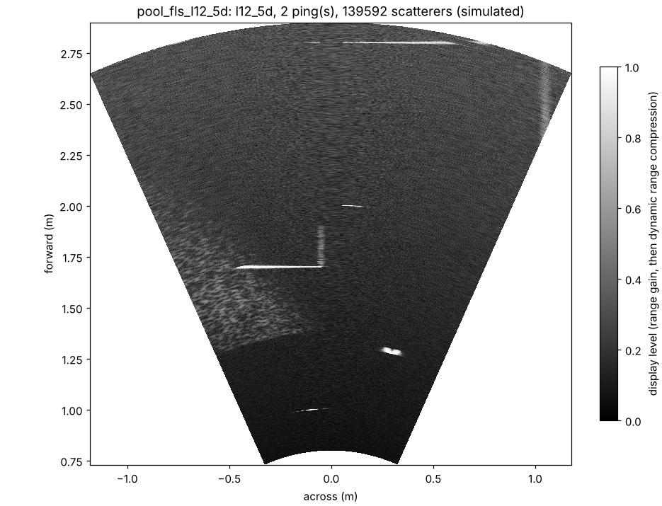

| Object | Over median |
| --- | --- |
| Wire at 1 m / 2 m | 77.5 / 66.8 dB |
| Pipe (5 cm, vertical) | 48.0 dB |
| Cinder block | 42.6 dB |
| Far wall at 2.8 m | 31.0 dB |
| Side wall (grazing) | 13.1 dB |
| Rope | 3.8 dB |

- The far wall shows only from about −0.1 to +0.65 m across. Left of that it is in the
  cinder block's shadow (−0.74 to −0.08 m by geometry); towards both edges of the fan its
  return falls away.
- The mottled patch at left between 1.3 and 1.75 m has no object in it: it is the side
  wall seen through a grating lobe (the probe's pitch is one wavelength at 5 MHz).
- Only a 16 cm slab around the probe's depth is modelled (its elevation beam is about 4
  degrees), so there is no floor or surface multipath, which the plan expects to be
  strong in a real pool. Wall speckle is under-developed (150,000 scatterers per square
  metre against about 250,000 for one per resolution cell).

### Phase 2 pool: `pool_fls_p4_2v`

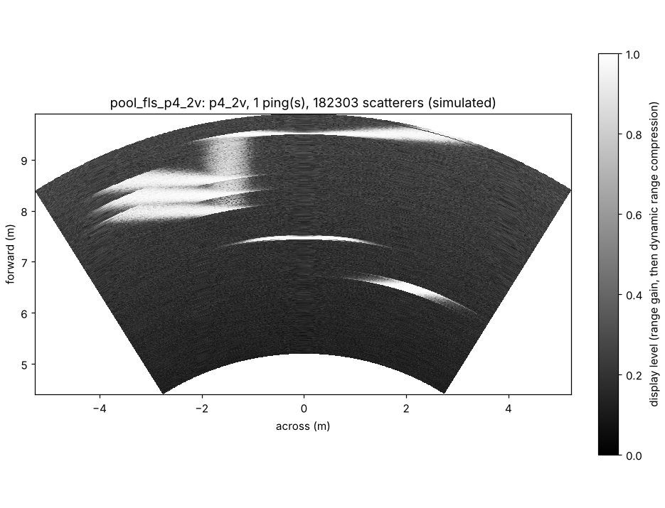

Steps 34 to 41 dB, ladder 52 to 56 dB, floats 46 to 49 dB, far wall 48 dB over median.
The three floats, 0.6 m apart at 7.5 m, merge into one arc: the 19 mm aperture resolves
about 0.3 m there and the display is saturated by objects 50 dB above the background.
The steps stand against the wall and hide it on the left.

### Phase 3 harbour: `harbour_fls_750k`

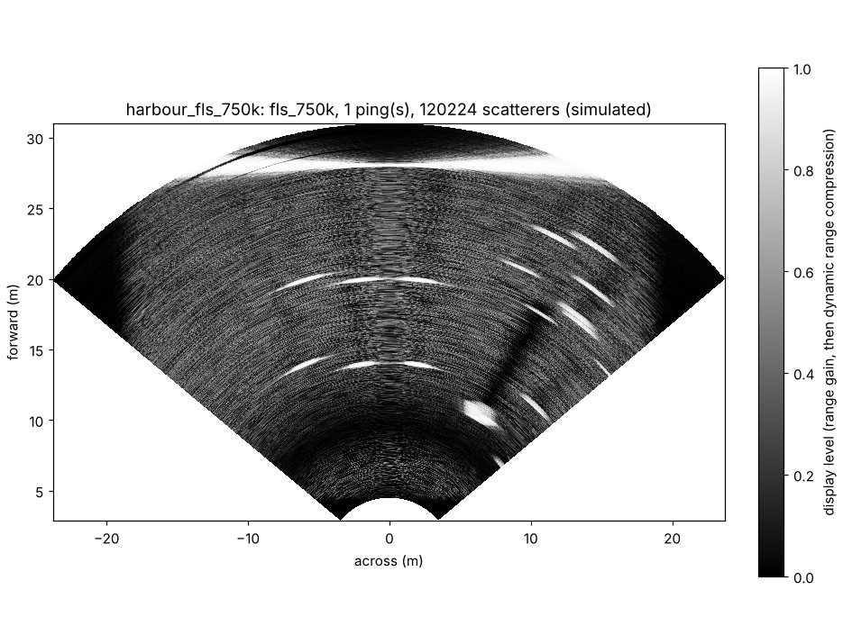

Quay wall 55.8 dB, pilings 56 to 58 dB, mooring block 38 dB, seafloor 35.7 dB over
median. The mooring block and the rocks cast long shadows at this 2 m altitude. The floor
is 60 scatterers per square metre, far below one per resolution cell, so it is a field of
separate points. The sonar config itself is a placeholder (`fls_750k`).

### Phase 4 seafloor: `seafloor_objects_fls`

Sphere 43.4 dB, box 44.2 dB, rocks 35.3 dB, seafloor 28.2 dB over median; the floor behind
the sphere is more than 10 dB darker than beside it (`test_scene_objects.py`). One ping,
300 kHz, receive chain taken as already at baseband.

### The owner's designs under way: `fls_120k_transit`, `fls_170k_transit`, `fls_330k_transit`

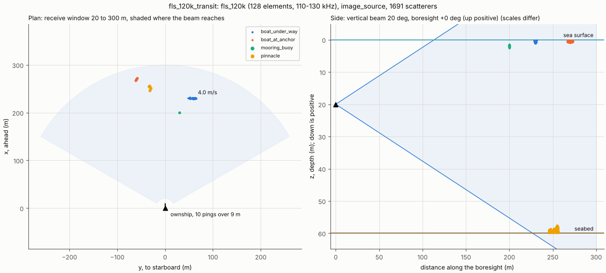

An AUV at 20 m makes 2 m/s. A boat hull crosses at 4 m/s; a second boat lies at anchor;
a buoy is moored near the surface; a pinnacle stands on the seabed. Seabed and surface
reverberation are fixed in the world, so the moving sonar sees them Doppler shifted by
bearing. Ten pings; detections go to a tracker working in world coordinates. In the
animations the picture is fixed to the world: the ownship triangle moves up it and static
objects stay put.

| Target | `fls_120k_transit` (300 m) | `fls_170k_transit` (450 m) | `fls_330k_transit` (300 m) |
| --- | --- | --- | --- |
| Boat under way, 4.0 m/s to port | tracked, 0.9 m, 3.77 m/s | tracked, 1.8 m, 4.18 m/s | tracked, 1.1 m, 3.93 m/s |
| Boat at anchor | tracked, 1.0 m, 0.04 m/s | tracked, 1.8 m, 0.03 m/s | **not tracked** |
| Mooring buoy | tracked, 0.7 m, 0.13 m/s | tracked, 0.2 m, 0.04 m/s | tracked, 0.5 m, 0.09 m/s |
| Seabed pinnacle | tracked, 3.9 m, 0.62 m/s | not in the beam | not in the beam |
| Detections per ping / confirmed tracks | 5 to 10 / 7 | 3 to 5 / 4 | 2 to 3 / 2 |

- Position is the track's distance from the object's centre at the last ping; speed is the
  track's.
- The 5 degree beams of the two higher-frequency sonars are tilted up and never reach the
  seabed, so the pinnacle is absent, as designed.
- At 330 kHz the anchored boat was not tracked in this run. Not investigated; in the
  thinned test run of the same scenario it is not required either.
- The 170 kHz sonar is specified to 450 m (was 600 m): the link budget in `DESIGN.md` gives
  35 dB on a boat hull there.

### A cluttered seabed: `fls_120k_cluttered_seabed`

40 m of water, so the seabed lies inside the 20 degree beam from about 115 m. On it: sand
texture, 22 boulders of 0.5 to 1.6 m radius, 12 pieces of debris (boxes of 0.6 to 2 m),
and a 0.3 m pipeline 180 m long. On the surface: an 11 m boat crossing at 5 m/s, built
from a hull, a fin keel, a propeller and rudder cluster and a 70 m bubble wake, and an 8 m
boat at anchor.

| Quantity | Result |
| --- | --- |
| Boat under way (true velocity 1.71, −4.70 m/s) | tracked, 0.4 m, velocity 1.54, -5.31 m/s |
| Boat at anchor | tracked, 0.9 m, 0.02 m/s |
| Detections per ping | 56 to 66 |
| Confirmed tracks | 65 |

- Both boats are tracked, but so is everything on the bed: boulders, debris and the
  pipeline are real echoes and each makes a track. Nothing here tells a boat from a
  boulder except that one of them moves; classification is not written.
- The pipeline shows as a line across the picture, and the wake as a streak astern of the
  moving boat. The wake is a fixed cloud laid down at the start; it does not grow.
- Direct paths only: no surface or bottom bounce to the objects.

### A rough sea: `fls_120k_rough_surface`

10 m/s of wind: a 1.2 m swell 40 m long with a 6 m wind sea on top. The 20 degree beam's half-power edge meets the
underside of the surface at about 115 m; the surface closer in is seen further down the beam. Wave faces turned towards the sonar return
sound and their backs do not, so the surface shows as bands.

| Quantity | Result |
| --- | --- |
| Boat under way with wake | tracked, 0.3 m, velocity 0.75, 4.84 m/s (true 0.87, 4.92) |
| Kayak (three −22 dB points) | **not tracked**: the nearest track is 8 m away and moves another way |
| Mooring buoy | **not tracked** |
| Detections per ping / confirmed tracks | 118 to 135 / 150 |

- The boat stands out and is tracked to a fraction of a metre. Everything else the tracker
  reports is waves: about 125 detections a ping from wave faces, which hold together long
  enough to confirm 150 tracks. A kayak-sized target is lost among them.
- The surface is modelled once, by the wave facets; there is no statistical surface
  boundary in this scenario, which would count it twice. The patch of facets is finite
  (45 to 297 m ahead, 150 m either side), which is why the clutter has straight edges at the
  sides and at 45 m. Close in, the surface is steep to the sonar and returns strongly even far
  down the beam: most of the clutter tracks are between 50 and 110 m.
- The facets' strength is set so the mean backscatter near 7 degrees grazing is about the
  Chapman–Harris value for this wind (−23 dB). That formula was fitted below 6.4 kHz, so
  at 120 kHz the level is a placeholder. The facets are frozen and drift; there is no
  orbital motion, breaking or bubble layer.
- **The same scene at 330 kHz showed no surface at all.** One resolution cell of surface is
  about −31 dB there, below that sonar's noise floor at 250 m, and with the statistical
  surface boundary also switched on at 10 m/s nothing was detected in eight pings, the boat
  included. That version is not shipped; a 330 kHz sonar would need a shorter range or more
  source level to work under a rough surface.

### Traffic: `fls_170k_traffic`

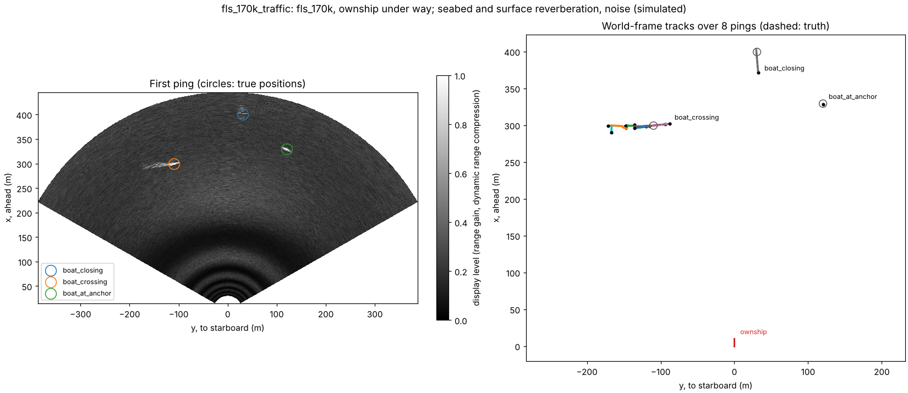

| Boat | True velocity (m/s) | Track velocity (m/s) | Position |
| --- | --- | --- | --- |
| Closing from 400 m | −5.98, 0.52 | −5.94, 0.51 | 3.1 m |
| Crossing at 300 m | 0.35, 3.98 | 0.38, 4.26 | 1.0 m |
| At anchor at 350 m | 0, 0 | −0.12, 0.11 | 1.7 m |

7 to 11 detections per ping gave 11 confirmed tracks for three boats: the crossing boat's
wake breaks into several tracks of its own.

## Synthetic aperture sonar

### `wreck_sas` and `minefield_sas`

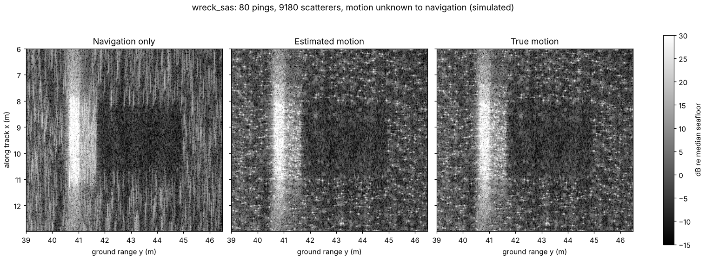

| Quantity | `wreck_sas` | `minefield_sas` |
| --- | --- | --- |
| Sway error after motion estimation, RMS | 0.089 λ | 0.080 λ |
| Heave error, RMS | 0.098 λ | 0.087 λ |
| Sharpness: navigation only / estimated / true motion | 69 / 272 / 279 | 220 / 321 / 319 |

- Navigation is not told about 10 mm RMS of sway (more than a wavelength) and 4 mm of
  heave; displaced-phase-centre estimation recovers both and the image matches the
  true-motion one.
- In `minefield_sas` the cylinder lying across track, the one along track, the sphere and
  the rocks each show a highlight towards the sonar and a shadow away from it; the sand
  ripples show as stripes because their slopes change the Lambert return.
- Tall objects are laid over towards the sonar and smeared along track (they are above
  the image plane). The seafloor is 25 to 30 scatterers per square metre: separate points,
  not developed speckle.

### The owner's design: `sas_minsas_survey`

Two parallel legs in opposite directions, 100 m apart, each looking to starboard at the
same seabed from 50 m at 12 m altitude. The animation shows leg 1's image building up as
pings are added. The whole of leg 1 at one image pixel per file pixel is
`figures/sas_minsas_survey_leg1_full.png`.

| Object, dB over the image median | Leg 1 (sonar at y = 0) | Leg 2 (sonar at y = 100 m) |
| --- | --- | --- |
| `seabed` | 46.7 | 46.8 |
| `wreck_hull` | 39.6 | 38.1 |
| `wreck_deckhouse` | 30.6 | 28.8 |
| `wreck_mast` | 1.3 | 3.3 |
| `cable` | 54.3 | 48.4 |
| `rocks` | 44.6 | 49.5 |
| `calibration_cube` | 52.6 | 49.8 |

- The wreck's shadow falls away from the sonar on each leg: the strip of seabed beyond the
  wreck is 38 dB (leg 1) and 41 dB (leg 2) below the strip in front of it.
- The 0.5 m calibration cube images as a square of the right size (first crop).
- The seabed's number is high because it is measured at its scatterers, which are isolated
  bright points on an otherwise empty floor; the median is the empty floor. The mast, 4 to
  7 m above the seabed, is laid over and smeared and barely shows.
- **Ghosts.** Fainter copies of the hull and the cable appear about 10 m up and down the
  track. See "Ghosts, and the element count" below.
- Navigation is exact here; `wreck_sas` and `minefield_sas` show unknown motion.

### Resolution of the MINSAS-class sonar

The first survey images were made at 5 cm pixels with the sonar set to 3.3 cm along track
and advancing 0.4 m per ping. These things changed:

| Change | Why | Measured on a point target at 45 to 50 m (`test_minsas_resolution.py`) |
| --- | --- | --- |
| Projector 4.2 cm long (was 6.6 cm) | along-track resolution is half the projector length | 2.0 cm along track |
| 0.544 m per ping at 2.18 m/s (was 0.4 m at 1.6 m/s) | exactly half the 1.088 m array: phase centres of successive pings are evenly spaced | along-track ambiguities −36 dB (were −15 dB at 0.27 m) |
| Image pixel 2 cm (was 5 cm) | one pixel per resolution cell | — |
| 48 receive elements at 2.27 cm (were 32 at 3.4 cm) | moves the along-track grating lobe from 7.6 to 11 degrees | ghost of a point: −47 to −54 dB at 10.3 m (was −42 dB at 6.9 m) |
| Aperture 1.6 beamwidths, weighted by the beam patterns | lower sidelobes at the same width | nearest along-track sidelobes −36 dB (were −23 dB) |
| Hamming-weighted pulse compression, for the figures | bright points stop smearing in range | range sidelobes beyond 10 cm −41 dB (were −26 dB); ground-range width 2.6 cm (1.8 cm unweighted) |

So the figures resolve 2.0 cm × 2.6 cm; without the range weighting the same data gives
2.0 cm × 1.9 cm, Kraken's published post-processed figure for the MINSAS 120, with −15 dB
range sidelobes. The seabed in these scenes has far fewer scatterers than resolution
cells (8 to 18 per square metre against 2,000 cells), so it images as separate points, not
as developed speckle.

### Rocks: `sas_minsas_boulder_field` and `sas_minsas_rocky_ripples`

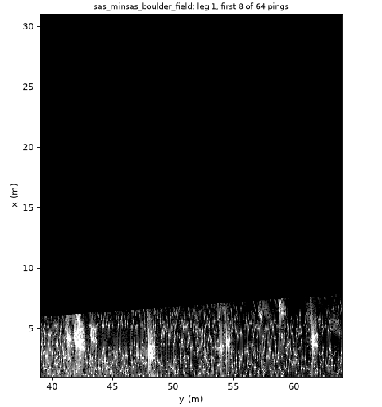

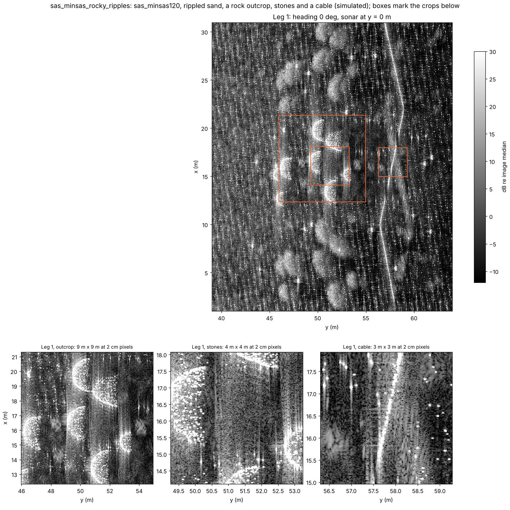

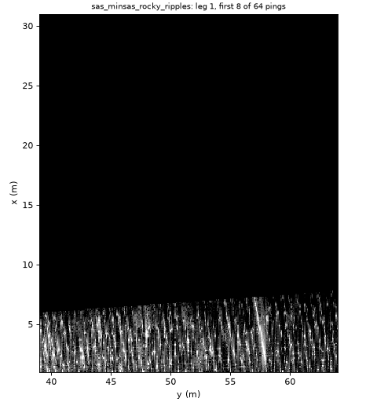

| Scenario | Object, dB over the image median |
| --- | --- |
| `sas_minsas_boulder_field` | sand 42.1, boulders 46.1 |
| `sas_minsas_rocky_ripples` | rippled sand 42.8, outcrop 42.8, stones 44.3, cable 47.2 |

- Each rock shows a bright face towards the sonar (at low y) and a shadow behind it whose
  length grows with the rock's height and its range. The three crops under each image are
  at the image's own 2 cm pixels.
- The ripples show as stripes because their slopes change the Lambert return; the cable is
  a thin bright line.
- Rocks are rough spheres half sunk in the sand. Real rocks have facets and glints these do
  not.
- **Ghosts, and the element count.** Receive phase centres half a pitch apart put a grating
  lobe at asin(λ / pitch) off broadside, so every scatterer has a defocused copy up and
  down the track. With the first array (32 elements at 3.4 cm) the copy was 6.9 m away and
  −42 dB on a point target; the cable and the wreck's outline showed twice. The sonar now
  has 48 elements at 2.27 cm over the same 1.09 m: the copy is 10.3 m away and −47 to
  −54 dB, depending on the geometry (`test_minsas_resolution.py`), for half as many
  channels again. It still shows beside the brightest objects in these figures, because
  they are 50 dB and more above the floor: the simulated seabed is empty between its
  scatterers, and the figures show 42 dB of range anchored on that empty floor. Whether a
  real seabed's speckle would cover a −47 dB copy is not shown here. More elements do not
  help much further: the receive element narrows with the pitch, and the projector's
  sidelobes fall slowly.

### Rail SAS: `rail_objects`

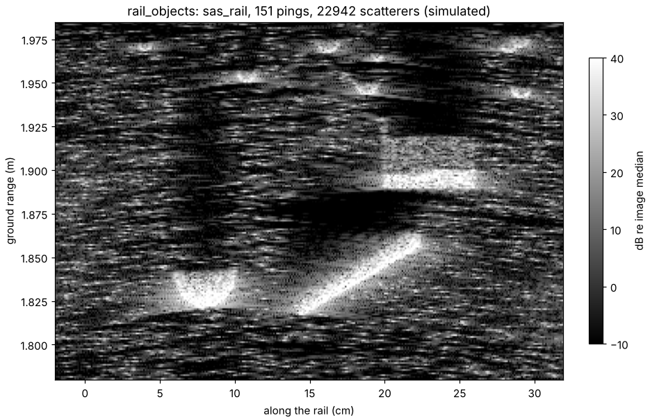

Ball 29.7 dB, pipe 31.7 dB, brick 30.1 dB, pebbles 27.7 dB over median, each with a shadow
on the floor behind it. Rail positions are exact here (`rail_position_errors` has the
perturbed case, not yet imaged with correction).

## 3D imaging of buried objects: `buried_objects`

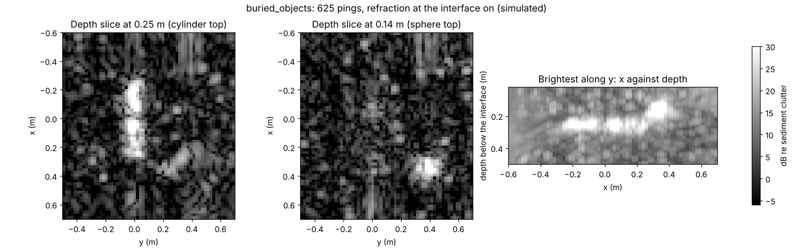

| Quantity | True | Refraction on | Refraction off |
| --- | --- | --- | --- |
| Depth of the cylinder's brightest return | top at 0.25 m, axis at 0.30 m | 0.26 m | 0.23 m |
| Depth of the sphere's brightest return | top at 0.14 m | 0.14 m | 0.13 m |
| Cylinder over sediment clutter | — | 21.1 dB | — |

The sediment model is one refracted path with unit transmission: no sediment attenuation,
no angle-dependent transmission loss, so the clutter level relative to the objects is an
assumption (the scenario's `rms_amplitude`), not a prediction.

## Flank array: `flank_patrol`

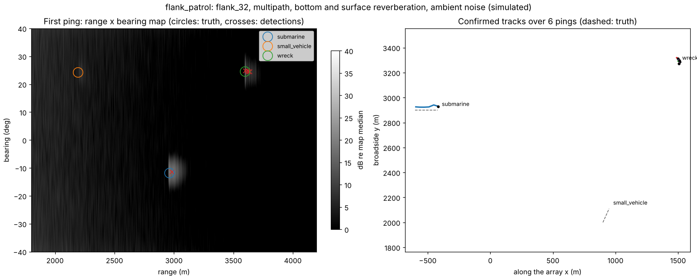

| Target | Result over six pings |
| --- | --- |
| Submarine-like target, 56 m, +16 dB in all, 3.0 m/s along x | tracked; velocity 3.05, −0.47 m/s; 30 m from its centre at the last ping |
| Wreck on the seabed, +12 dB, not moving | tracked; speed 0.03 m/s; 6 m from truth |
| Small vehicle, −3 dB, 2 m/s | **not detected** |

- 5 to 7 detections per ping gave 5 confirmed tracks for two objects: multipath splits
  the wreck's echo into several clusters, each of which starts a track. Clustering that
  merges them is not written (`STATUS.md`).
- Detection runs on power summed into 4 m range cells, with CFAR windows sized in metres,
  because multipath spreads each echo over tens of metres.
- The outcome depends on the assumed seabed (−27 dB Lambert), wind (5 m/s) and noise
  (45 dB); none is measured. Highlights have no aspect dependence, reverberation has no
  Doppler spread, and the platform stands still.

## Popoto array at long range

### The owner's design: `popoto_far_mover`

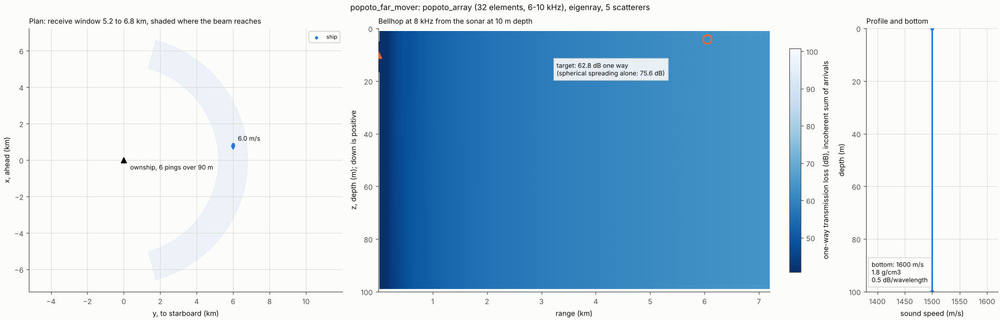

Ownship makes 1.5 m/s along its own 32-hydrophone array (four boards, 6–10 kHz, 185 dB,
1 s sweep). A ship-sized target (+25 dB over five highlights) crosses at 6 m/s, 6 km off
the beam, in 100 m of isovelocity water.

| Quantity | Result |
| --- | --- |
| Ship | tracked, 41 m from truth, velocity −5.69, 0.10 m/s (true −6, 0) |
| Peak over map median with 8 / 16 / 32 hydrophones | 20.6 / 23.7 / 26.3 dB |
| Detections per ping / confirmed tracks | 3 to 7 / 6 |

Each doubling of the array adds about 3 dB, as it should. Multipath and reverberation give
five tracks that are not the ship.

### 12 km: `popoto_12km`

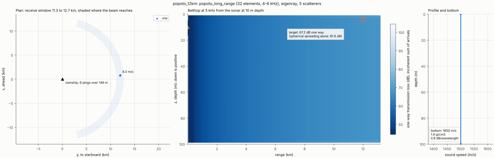

**What frequency and power reach 12 km.** `tools/popoto_range_study.py` and `DESIGN.md`
section 5: with spherical spreading, a +25 dB target, a 1 s pulse and 13 dB at the
beamformer output,

- the present 27.5 kHz band cannot do it (about 320 dB would be needed; absorption alone
  is about 136 dB over the round trip), and on the same budget reaches about 2.8 km;
- the best frequency is **4 to 6 kHz**;
- there, 32 hydrophones at half-wavelength spacing need **195 dB re 1 µPa at 1 m**, about
  270 W of acoustic power from an omnidirectional projector; 16 need 198 dB (540 W),
  64 need 192 dB (140 W).

`popoto_long_range` is that design with 2 dB in hand: 32 hydrophones at 15 cm (4.8 m),
4–6 kHz, 1 s, 197 dB (about 420 W acoustic if omnidirectional; electrical power depends on
a projector not yet chosen). In this scenario, 100 m of isovelocity water over sand:

| Quantity | Result |
| --- | --- |
| Ship at 12 km | tracked, 16 m from truth, velocity −4.03, −0.64 m/s (true −6, 0) |
| Peak over map median with 8 / 16 / 32 hydrophones | 17.2 / 20.3 / 23.6 dB |
| Detections per ping / confirmed tracks | 6 to 14 / 11 |
| One-way loss to the target, Bellhop (no absorption) | 67.2 dB, against 81.6 dB for spherical spreading |

- The shallow channel carries 14 dB more each way than spherical spreading, so this case
  has margin the link budget does not count. Ten of the eleven tracks are not the ship:
  with that much energy the limit is reverberation and multipath, not noise.
- The track's speed is low by a third over six pings 20 s apart.

### Other oceans: `popoto_env_*`

Same sonar, same ship, four environments. Geometry diagrams with the profile and the
transmission loss are in `docs/scenarios/popoto_env_*.png`.

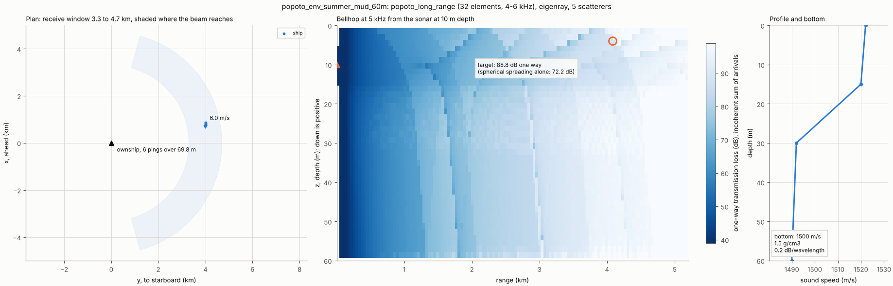

| Scenario | Water | Bottom (speed, density, loss) | Range | One-way loss: Bellhop / spherical | Ship | Peak over median, 32 hydrophones |
| --- | --- | --- | --- | --- | --- | --- |
| `popoto_env_winter_sand_200m` | 200 m, speed rising with depth (1480 to 1483.4 m/s): a surface duct | sand: 1650 m/s, 1.9, 0.8 dB/λ | 8 km | 64.2 / 78.1 dB | tracked, 33 m, −5.65 m/s | 28.8 dB |
| `popoto_env_summer_mud_60m` | 60 m, warm layer over a thermocline (1522 to 1490 m/s) | mud: 1500 m/s, 1.5, 0.2 dB/λ | 4 km | 88.8 / 72.2 dB | **not detected** in six pings | 12.3 dB |
| `popoto_env_gravel_30m` | 30 m, isovelocity | gravel: 1800 m/s, 2.0, 0.6 dB/λ | 3 km | 52.9 / 69.8 dB | tracked, 24 m, −5.69 m/s | 34.7 dB |
| `popoto_env_deep_silt_1000m` | 1000 m, thermocline over cold deep water; ownship at 50 m | silt: 1575 m/s, 1.7, 1.0 dB/λ | 10 km | 72.6 / 80.0 dB | detected 300 m long in range; not tracked at its true position | 12.7 dB |

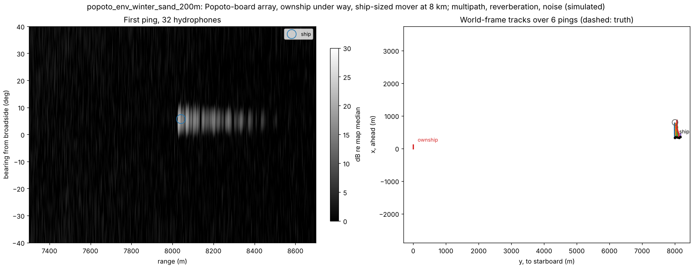

- **The ocean matters more than the 2 dB of margin.** In summer over mud the profile bends
  sound down into a bottom that absorbs it: 17 dB more loss each way than spherical
  spreading at only 4 km, and the ship is not seen. In winter over sand the same sonar
  holds it at 8 km with 29 dB.
- In deep water the ship's echo arrives about 300 m late in range with the right bearing
  and the right speed (−5.63 m/s). That is consistent with a path by way of the bottom,
  the direct path being refracted away from a target near the surface; this was not
  confirmed by tracing the arrivals. Range from such a path needs the propagation model
  to correct it, which is not written.
- Bottom parameters are textbook values for each sediment, not measurements, and the
  Lambert strengths for bottom reverberation are placeholders. Bellhop's loss here excludes
  volume absorption (about 0.3 dB/km at 5 kHz), which the simulation adds separately.
- All four are range-independent: one profile and a flat bottom everywhere.

## Popoto array: `popoto_trial_1000m`

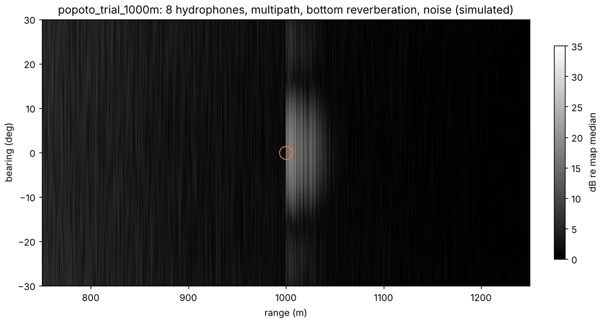

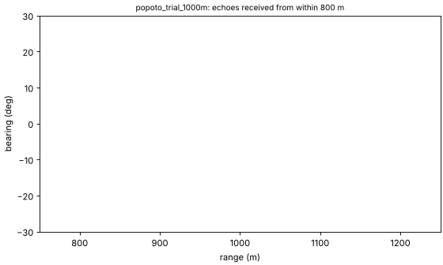

Peak at 1000.1 m on the target's bearing, 30 dB over the map median, in multipath, bottom
reverberation and ambient noise. `RESULTS.md` has the 100 m and 2000 m cases and the
comparison with the spherical-spreading estimate.

## What no scenario has yet

- Multipath in the pool scenes. Surface and floor bounces arrive well outside the probes'
  narrow elevation beams, but bounces off the side walls lie in the fan and would show as
  ghost targets; the image-source tier can model walls and is not used here yet.
- Surface or bottom bounce paths to the objects in the forward-looking sea scenes (direct
  paths only; reverberation is statistical).
- Waves that move as waves do, breaking, or a bubble layer; a wake that grows.
- A range-dependent ocean (fronts, slopes) in the Popoto and flank scenes; the simulator
  can take bathymetry but no shipped scenario uses it with a moving target.
- Fully developed speckle on large surfaces (scatterer counts are kept affordable).
- Specular echoes, which dominate real returns from smooth pipes, plates and hulls.
- Classification: telling a boat from a boulder, or the ship from its multipath.
