# Realistic scenarios, mode by mode

Every mode of the suite has scenarios with extended scenes, run end to end: simulate,
condition, (estimate motion,) image, (detect and track). For each scenario there are three
pictures, all made from its YAML file:

| What | Where | Made by |
| --- | --- | --- |
| Geometry diagram: plan and side view; for Bellhop scenarios the sound-speed profile and transmission loss | `docs/scenarios/<name>.png` (55 of the 75 scenario files; the twenty named under "Every scenario file" have none yet) | `tools/scenario_diagrams.py` |
| Result figure: the image, detections, tracks | `docs/figures/<name>.png` | `tools/gallery.py` |
| Animation | `docs/figures/<name>.gif` | `tools/gallery.py` |

- On a CPU: `tools/gallery.py --backend host` (full size) or `--quick` (thinned: fewer
  scatterers and pings, same geometry and processing). `--only a,b` picks scenarios.
  `tests/python/test_realistic_scenes.py` runs the thinned versions and checks each object
  shows where it should.
- On a GPU: `GPUSONAR_JOB=gallery GPUSONAR_ORACLES=1 GPUSONAR_CERES=1 tools/gpu_job.sh`, or
  `tools/gallery.py --backend cuda`.
- Numbers below are from the full-size CUDA run on an NVIDIA L4 in
  `docs/figures/gallery.json`. That run is on the tree after the detector rework
  (`DECISIONS.md` D-93), source levels as RMS (echoes 3 dB up against the same noise,
  D-102), baseband noise with its spectrum and coherence (D-103), the six fixes (D-133 to
  D-136) and four changes of default (D-137 to D-140): the 12 km and `popoto_env_*`
  scenarios keep arrivals by energy, and a scenario's sound speed follows its water
  (1496.8 m/s where it was 1500, for example).
- The file before it was the L4 run at commit `4530dc4`, before those four changes; "the
  run before this one" below means that file. Against it the two pool scenes, the
  buried-object scene, `popoto_env_summer_mud_60m` and `popoto_env_deep_silt_1000m` are
  the same in every number quoted here. The harbour, seafloor, wreck, minefield, MINSAS
  and rail numbers moved by 0.7 dB at most, and by about 3 in sharpness. The six FLS
  scenes with noise and a source level, `flank_patrol` and the other `popoto_*` scenes
  changed. Where a result is worse than in that run, or different in kind, the text says
  so; those are open (`STATUS.md`, open item 16). "The older CPU run" is the full-size
  CPU run from a much older tree that preceded both.
- The scenes above are the gallery. Every file in `configs/scenarios`, including the
  trial, fjord and range-dependent scenarios that are not in the gallery, is listed in
  "Every scenario file" near the end.
- **CPU times** are from the older CPU run and were not measured again on this tree;
  `gallery.json` now holds the L4 run's times instead (0.3 to 93 s a scenario, 493 s for
  all 26). They are wall-clock on a 4-core x86_64 container with nothing else running. The
  host backend uses all four cores (OpenMP). An earlier version of this table was measured
  with several jobs sharing the machine and before the synthesis kernel was reworked
  (`DECISIONS.md` D-51); those times were 4 to 8 times longer and its note that the host
  backend was single-threaded was wrong.
- Tracks are classified from the track alone (`classify.py`): mover, static, line (sliding
  along a row of other tracks), multipath (an echo of a stronger track), uncertain.

All of it is simulation. The scenes in the table below are clouds of point scatterers on
object surfaces (`DECISIONS.md` D-41): they give highlights, shadows, layover and speckle,
not specular glints, diffraction or resonances. Specular shapes exist now (D-65) and are
used only in the three target scenarios listed under "Scenarios for the SST-equivalence
work".

| Mode | Scenario | Sonar | Scene | Physics in the run | CPU time |
| --- | --- | --- | --- | --- | --- |
| FLS, pool, Phase 1 | `pool_fls_l12_5d` | L12-5, 5 MHz, both mux halves | far wall, side wall, cinder block, pipe, rope, two wires | free field, shadows, 12-bit ADC, noise | 15 s |
| FLS, pool, Phase 2 | `pool_fls_p4_2v` | P4-2v, 2.7 MHz | far wall, three steps, ladder, three lane floats | same | 11 s |
| FLS, sea, Phase 3 | `harbour_fls_750k` | 64 elements, 750 kHz | sandy floor, quay wall, six pilings, mooring block, rocks | free field, shadows, absorption | 14 s |
| FLS, sea, Phase 4 | `seafloor_objects_fls` | 128 elements, 300 kHz | seafloor, sphere, box, rocks | free field, shadows | 5 s |
| FLS, owner's design | `fls_120k_transit` | `fls_120k`, 300 m, 20° vertical | boat hull under way, boat at anchor, buoy, seabed pinnacle | AUV at 20 m making 2 m/s; seabed and surface reverberation fixed in the world, ownship Doppler, noise; 10 pings, detection, tracking | 77 s |
| FLS, owner's design | `fls_170k_transit` | `fls_170k`, 450 m, 5° tilted up 2° | same objects | same | 3 min |
| FLS, owner's design | `fls_330k_transit` | `fls_330k`, 300 m, 5° tilted up 3.5° | same objects | same | 3 min |
| FLS, cluttered seabed | `fls_120k_cluttered_seabed` | `fls_120k` | boat with keel, propeller and wake; anchored boat; sand, 22 boulders, 12 pieces of debris, a pipeline | same, 8 pings | 54 s |
| FLS, rough sea | `fls_120k_rough_surface` | `fls_120k` | swell and wind sea on the surface (wave facets), boat with wake, kayak, buoy | same; the surface is the facets, bottom reverberation, noise at 10 m/s wind | 2 min |
| FLS, traffic | `fls_170k_traffic` | `fls_170k` | three boats: closing, crossing, at anchor, two with wakes | as the transits, 8 pings | 2 min |
| SAS, AUV | `wreck_sas` | 16 elements, 200 kHz | seafloor, 3 m box | free field, shadows, unknown sway and heave, motion estimation | 42 s |
| SAS, AUV | `minefield_sas` | same | rippled sand, two 2 m cylinders, sphere, rocks | same | 56 s |
| SAS, owner's design | `sas_minsas_survey` | `sas_minsas120`, 330 kHz | wreck (hull, deckhouse, mast), cable, rocks, calibration cube | two opposite legs, shadows, exact navigation; 2 cm pixels | 3 min |
| SAS, rocks | `sas_minsas_boulder_field` | same | 45 boulders, 15 to 90 cm radius, on sand | one leg, shadows; 2 cm pixels | 98 s |
| SAS, developed speckle | `sas_minsas_speckle` | same | a seabed of 5000 scatterers per square metre (2.6 per resolution cell), cube, cable, rocks, pipe | one leg, shadows; 390,000 seabed scatterers | 14 min |
| SAS, rocks | `sas_minsas_rocky_ripples` | same | rippled sand, a 12-rock outcrop, 35 stones, a cable | same | 105 s |
| SAS, rail | `rail_objects` | P4-2v on the rail | pool floor, ball, pipe, brick, pebbles | free field, shadows, stop-and-go | 3 min |
| 3D, buried | `buried_objects` | sub-bottom, 20 kHz, raster | buried cylinder and sphere, rough interface, sediment clutter | refraction at the interface | 109 s |
| Flank array | `flank_patrol` | 32 hydrophones, 6–10 kHz | moving 56 m target, small vehicle, wreck | Bellhop multipath, bottom and surface reverberation, ambient noise, six pings, detection and tracking | 11 min |
| Popoto array | `popoto_trial_1000m` (also 100 m, 2000 m) | 8 hydrophones, 27.5 kHz | one +10 dB target | Bellhop multipath, bottom reverberation, ambient noise | 11 s |
| Popoto, owner's design | `popoto_far_mover` | 32 hydrophones, 6–10 kHz, 185 dB | ship-sized mover at 6 km | ownship at 1.5 m/s, Bellhop, reverberation with ownship Doppler, noise; six pings, tracking | 4 min |
| Popoto, 12 km | `popoto_12km` | `popoto_long_range`: 32 hydrophones, 4–6 kHz, 197 dB | ship-sized mover at 12 km | same; 100 m isovelocity over sand | 2 min |
| Popoto, other oceans | `popoto_env_winter_sand_200m`, `popoto_env_summer_mud_60m`, `popoto_env_gravel_30m`, `popoto_env_deep_silt_1000m` | same | the same ship at 8, 4, 3 and 10 km | same, each with its own profile, bottom and depth | 2 min, 52 s, 2 min, 59 s |

Point-target scenarios for measuring resolution (`point_grid_*`, `stripmap_points`,
`rail_points`, `pool_wires_l12_5d`) and the long-range link-budget cases
(`flank_target_*km`) are separate; see `RESULTS.md`. They have geometry diagrams too.

## Forward-looking sonar

FLS figures use Hann aperture weighting, a 30 log r range gain and the paper's dynamic
range compression for display. "Over median" is the mean image power over an object's
scatterers against the image median, after the range gain.

### Phase 1 pool: `pool_fls_l12_5d`

| Object | Over median |
| --- | --- |
| Wire at 1 m / 2 m | 77.5 / 66.8 dB |
| Pipe (5 cm, vertical) | 48.0 dB |
| Cinder block | 42.6 dB |
| Far wall at 2.8 m | 31.0 dB |
| Side wall (grazing) | 13.1 dB |
| Rope | 3.8 dB |

- The far wall shows only from about −0.1 to +0.65 m across. Left of that it is in the
  cinder block's shadow (−0.74 to −0.08 m by geometry); towards both edges of the fan its
  return falls away.
- The mottled patch at left between 1.3 and 1.75 m has no object in it: it is the side
  wall seen through a grating lobe (the probe's pitch is one wavelength at 5 MHz).
- Only a 16 cm slab around the probe's depth is modelled (its elevation beam is about 4
  degrees), so there is no floor or surface multipath, which the plan expects to be
  strong in a real pool. Wall speckle is under-developed (150,000 scatterers per square
  metre against about 250,000 for one per resolution cell).

### Phase 2 pool: `pool_fls_p4_2v`

Steps 34 to 41 dB, ladder 52 to 56 dB, floats 46 to 49 dB, far wall 48 dB over median.
The three floats, 0.6 m apart at 7.5 m, merge into one arc: the 19 mm aperture resolves
about 0.3 m there and the display is saturated by objects 50 dB above the background.
The steps stand against the wall and hide it on the left.

### Phase 3 harbour: `harbour_fls_750k`

Quay wall 55.8 dB, pilings 56 to 59 dB, mooring block 38 dB, seafloor 35.7 dB over
median. The mooring block and the rocks cast long shadows at this 2 m altitude. The floor
is 60 scatterers per square metre, far below one per resolution cell, so it is a field of
separate points. The sonar config itself is a placeholder (`fls_750k`).

### Phase 4 seafloor: `seafloor_objects_fls`

Sphere 43.5 dB, box 44.2 dB, rocks 35.4 dB, seafloor 28.2 dB over median; the floor behind
the sphere is more than 10 dB darker than beside it (`test_scene_objects.py`). One ping,
300 kHz, receive chain taken as already at baseband.

### The owner's designs under way: `fls_120k_transit`, `fls_170k_transit`, `fls_330k_transit`

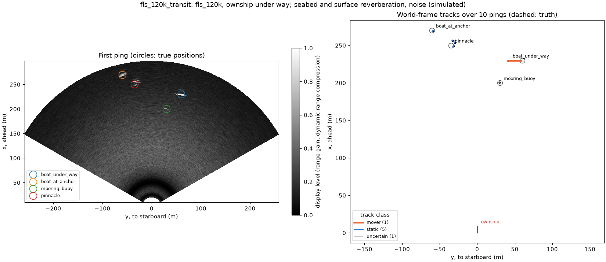

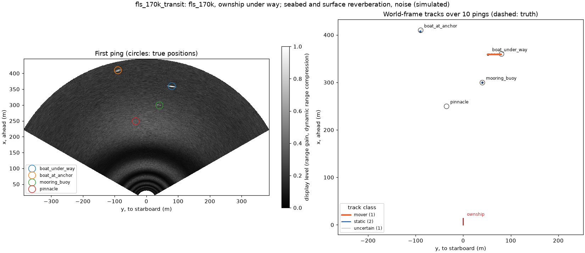

An AUV at 20 m makes 2 m/s. A boat hull crosses at 4 m/s; a second boat lies at anchor;
a buoy is moored near the surface; a pinnacle stands on the seabed. Seabed and surface
reverberation are fixed in the world, so the moving sonar sees them Doppler shifted by
bearing. Ten pings; detections go to a tracker working in world coordinates. In the
animations the picture is fixed to the world: the ownship triangle moves up it and static
objects stay put.

| Target | `fls_120k_transit` (300 m) | `fls_170k_transit` (450 m) | `fls_330k_transit` (300 m) |
| --- | --- | --- | --- |
| Boat under way, 4.0 m/s to port | tracked, 0.9 m, 3.78 m/s | tracked, 1.9 m, 4.20 m/s | tracked, 1.2 m, 4.00 m/s |
| Boat at anchor | tracked, 1.0 m, 0.04 m/s | tracked, 2.4 m, 0.04 m/s | tracked, 1.4 m, 0.20 m/s |
| Mooring buoy | tracked, 0.7 m, 0.12 m/s | tracked, 0.2 m, 0.04 m/s | tracked, 0.5 m, 0.07 m/s |
| Seabed pinnacle | tracked, 3.5 m, 1.04 m/s; **classified uncertain** | not in the beam | not in the beam |
| Detections per ping / confirmed tracks | 6 to 9 / 8 | 3 to 5 / 4 | 3 to 4 / 4 |
| Track classes | 1 mover (the boat under way), 6 static, 1 uncertain (the pinnacle) | 1 mover, 2 static, 1 uncertain | 1 mover, 2 static, 1 uncertain |
| Tracks called movers that are not on a moving object | 0 | 0 | 0 |

- Position is the track's distance from the object's centre at the last ping; speed is the
  track's.
- The 5 degree beams of the two higher-frequency sonars are tilted up and never reach the
  seabed, so the pinnacle is absent, as designed.
- **At 120 kHz the pinnacle is now classified uncertain, not static.** Its speed reads
  0.82 ± 0.29 m/s (0.90 ± 0.28 in the run before this one, where it was static), and its
  track's speed is 1.04 m/s where it was 0.53. This is worse; the cause was not examined.
  The other three named objects keep their classes. The scene has 8 tracks where it had
  7, and 6 static where it had 5; the one uncertain track of the run before was not a
  named object.
- At 170 kHz the anchored boat is classified static again: its speed reads
  0.02 ± 0.05 m/s. In the run before this one it was uncertain at 0.18 ± 0.17 m/s. **Its
  track is now 2.4 m from the boat's centre, where it was 1.8 m.** The one uncertain track
  is not on a named object.
- At 330 kHz the anchored boat is tracked, 1.4 m from its centre, and classified static,
  as in the run before this one; the scene has 4 tracks. **Its track's speed is 0.20 m/s,
  where it was 0.06 m/s**, and the classifier's reads 0.39 ± 0.13 m/s (0.18 ± 0.12). In
  the older CPU run the boat was not tracked: its strongest cell reached 11.8 to 12.4 dB
  over the local background, under the 13 dB a detection must have, against 21.5 to
  23.7 dB for the boat under way, 39 m closer. Echoes are now 3 dB up against the same
  noise (D-102). Absorption at 330 kHz is about 100 dB/km, so those 39 m cost 8 dB both
  ways, plus spreading. The smaller boat's margin over the 13 dB was not measured again.
- The 170 kHz sonar is specified to 450 m (was 600 m): the link budget in `DESIGN.md` gives
  35 dB on a boat hull there.

### A cluttered seabed: `fls_120k_cluttered_seabed`

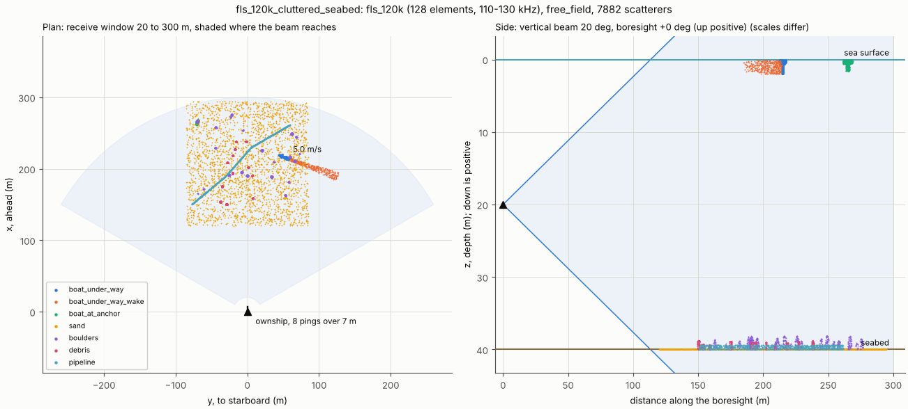

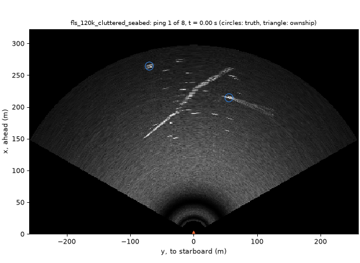

40 m of water, so the seabed lies inside the 20 degree beam from about 115 m. On it: sand
texture, 22 boulders of 0.5 to 1.6 m radius, 12 pieces of debris (boxes of 0.6 to 2 m),
and a 0.3 m pipeline 180 m long. On the surface: an 11 m boat crossing at 5 m/s, built
from a hull, a fin keel, a propeller and rudder cluster and a 70 m bubble wake, and an 8 m
boat at anchor.

| Quantity | Result |
| --- | --- |
| Boat under way (true velocity 1.71, −4.70 m/s) | tracked, 0.3 m, velocity 1.69, −4.72 m/s; classified mover |
| Boat at anchor | tracked, 0.8 m, 0.04 m/s; classified static |
| Detections per ping | 54 to 63 |
| Confirmed tracks | 64 |
| Track classes | 9 mover, 21 static, 19 line, 15 uncertain |
| Tracks called movers that are not the boat | **8** |

- Everything on the bed makes tracks. From the tracks alone, 21 are static (boulders,
  debris), 19 are detections sliding along the pipeline as the aspect changes ("line":
  motion along a linear feature cannot be told from the feature standing still), and 15
  jump about too much to say. Before the line rule and the requirement that a mover be
  seen on most pings, 24 tracks were called movers.
- **Eight movers are not the boat, where the run before this one had four.** The number of
  tracks is the same, 64; 21 are static where 31 were. This is worse; the cause was not
  examined, and the eight were not examined one by one. A track at an end of the pipeline
  has neighbours on one side only and escapes the line rule.
- The moving boat's own track is closer to the truth than in the run before: velocity
  1.69, −4.72 m/s where it was 1.54, −5.31.
- The pipeline shows as a line across the picture, and the wake as a streak astern of the
  moving boat. The wake is a fixed cloud laid down at the start; it does not grow.
- Direct paths only: no surface or bottom bounce to the objects.

### A rough sea: `fls_120k_rough_surface`

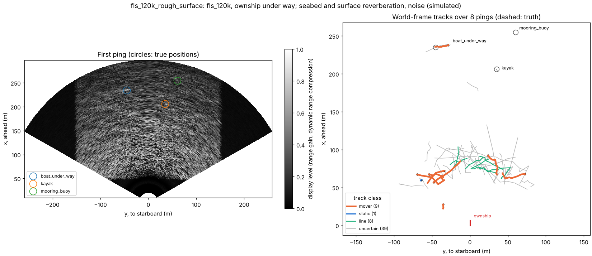

10 m/s of wind over an irregular wind sea 1.2 m in significant height: a Pierson–Moskowitz
spectrum sampled at 30 wave trains with random phases, spread 25 degrees about the wind.
Each train travels at its own deep-water speed, so crests move through the world (the
longest, 83 m, at 11 m/s) and the pattern changes shape as it goes. The 20 degree beam's
half-power edge meets the underside of the surface at about 115 m; the surface closer in
is seen further down the beam.

| Quantity | Result |
| --- | --- |
| Boat under way with wake | tracked, 0.7 m, velocity 0.76, 4.68 m/s (true 0.87, 4.92); classified mover |
| Kayak (three −22 dB points) | **not tracked** |
| Mooring buoy | **not tracked** |
| Detections per ping / confirmed tracks | 42 to 55 / 54 |
| Track classes | 9 mover, 1 static, 6 line, 38 uncertain |
| Tracks called movers that are not the boat | 8 |

- The boat is tracked to under a metre and called a mover. Of the other 53 tracks, 38 are
  uncertain (seen on too few pings, or jumping), which is what wave glints should be; 8
  are still called movers, **one more than the 7 of the run before this one**. Bright wave
  faces do move, at metres per second, so speed alone does not reject them. A kayak-sized
  target is lost.

**What the bands are, and which frame they are in** (`tools/rough_surface_bands.py`):

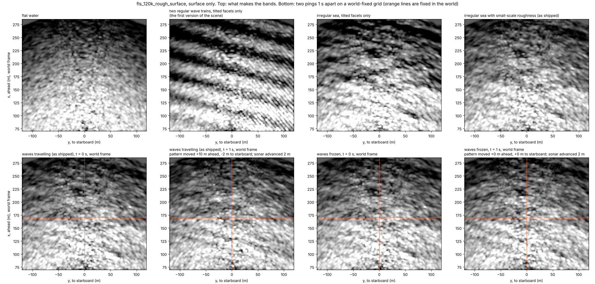

- Top row, the surface alone on a world-fixed grid. Flat water has no bands. Two regular
  wave trains, the first version of this scene, give evenly spaced slanted stripes that go
  black: with only tilted Lambert facets, a wave's back face returns nothing once its slope
  exceeds the grazing angle (5.4 degrees for that swell, reached beyond 215 m). The
  irregular sea gives patches instead of stripes, and tilt-independent small-scale
  roughness (−30 dB per square metre, a placeholder) makes the dark parts darker instead
  of black. Depth of the banding against flat water, 90th minus 10th percentile of 4 m
  averages: 12.1 dB for the regular trains, 10.7 dB for the irregular sea, 8.6 dB as shipped.
- Bottom row, two pings a second apart, the sonar having advanced 2 m. **With the waves
  frozen, the pattern does not move in the world frame (0 m) and so moves back 2 m in the
  sonar's frame: it is fixed to the world, not to the view.** With the waves travelling,
  it moves 10 m ahead and 2 m to port in that second, the speed of the long waves.
  (Measured by cross-correlation after dividing out the fall-off with range, which is
  fixed to the sonar and otherwise dominates the measurement.)
- In the earlier version the crests only drifted at 0.36 m/s and the speckle was the same
  on every ping, so over the 3.5 s of the animation nothing visibly moved in either frame.
  The speckle is now drawn afresh each ping, as the small scatterers on a real surface
  lose their phase in milliseconds.
- Still not there: breaking, bubble plumes, one crest shadowing another, Doppler from the
  water's orbital motion. The patch of facets is finite (45 to 297 m ahead, 150 m either
  side) and its edges show. Strengths are placeholders (see the scenario file).
- **The same scene at 330 kHz showed no surface at all.** One resolution cell of surface is
  about −31 dB there, below that sonar's noise floor at 250 m. A 330 kHz sonar would need a
  shorter range or more source level to work under a rough surface.

### Traffic: `fls_170k_traffic`

| Boat | True velocity (m/s) | Track velocity (m/s) | Position |
| --- | --- | --- | --- |
| Closing from 400 m | −5.98, 0.52 | −5.94, 0.47 | 3.1 m |
| Crossing at 300 m | 0.35, 3.98 | **0.79, 14.97** | **3.7 m** |
| At anchor at 350 m | 0, 0 | −0.10, 0.10 | 1.5 m |

6 to 15 detections per ping gave 14 confirmed tracks for three boats (13 in the run
before this one). Classes: 5 mover, 1 static, 3 line, 5 uncertain (5, 4, 1 and 3 before).
The closing boat is a mover and the anchored one is static.

- **The crossing boat is now classified line, not mover, and its track's velocity is
  wrong.** The track reads 0.79, 14.97 m/s against a true 0.35, 3.98, and the classifier's
  speed is 15.4 ± 0.3 m/s against a true 4.0; the track is 3.7 m from the boat's centre.
  In the run before this one it was a mover at 0.36, 4.22 m/s, 0.7 m from the centre.
  This is worse; the cause was not examined.
- Four more tracks are called movers, **three of them not on a moving object (two in the
  run before this one)**. They were not examined (the crossing boat's hull and wake give
  several tracks close together).

## Synthetic aperture sonar

### `wreck_sas` and `minefield_sas`

| Quantity | `wreck_sas` | `minefield_sas` |
| --- | --- | --- |
| Sway error after motion estimation, RMS | 0.089 λ | 0.081 λ |
| Heave error, RMS | 0.098 λ | 0.087 λ |
| Sharpness: navigation only / estimated / true motion | 70 / 274 / 281 | 223 / 320 / 318 |

- Navigation is not told about 10 mm RMS of sway (more than a wavelength) and 4 mm of
  heave; displaced-phase-centre estimation recovers both and the image matches the
  true-motion one.
- In `minefield_sas` the cylinder lying across track, the one along track, the sphere and
  the rocks each show a highlight towards the sonar and a shadow away from it; the sand
  ripples show as stripes because their slopes change the Lambert return.
- Tall objects are laid over towards the sonar and smeared along track (they are above
  the image plane). The seafloor is 25 to 30 scatterers per square metre: separate points,
  not developed speckle.

### The owner's design: `sas_minsas_survey`

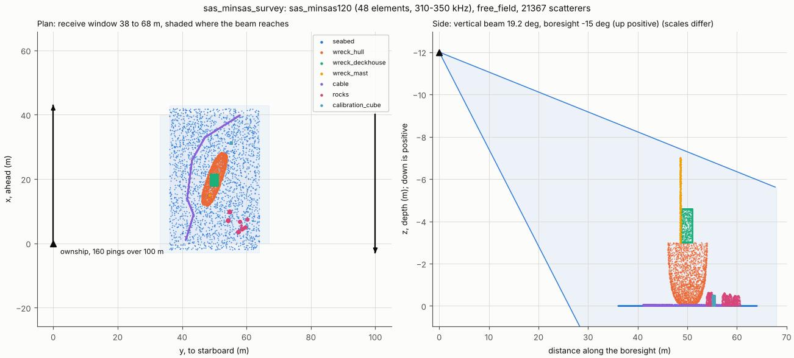

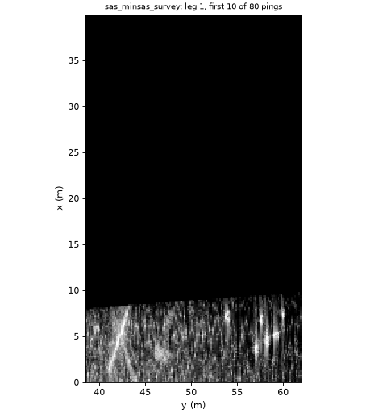

Two parallel legs in opposite directions, 100 m apart, each looking to starboard at the
same seabed from 50 m at 12 m altitude. The animation shows leg 1's image building up as
pings are added. The whole of leg 1 at one image pixel per file pixel is
`figures/sas_minsas_survey_leg1_full.png`.

| Object, dB over the image median | Leg 1 (sonar at y = 0) | Leg 2 (sonar at y = 100 m) |
| --- | --- | --- |
| `seabed` | 46.6 | 46.6 |
| `wreck_hull` | 39.5 | 37.9 |
| `wreck_deckhouse` | 30.5 | 28.6 |
| `wreck_mast` | 1.2 | 4.0 |
| `cable` | 54.2 | 48.2 |
| `rocks` | 44.7 | 49.4 |
| `calibration_cube` | 52.0 | 49.7 |

- The wreck's shadow falls away from the sonar on each leg: the strip of seabed beyond the
  wreck is 38 dB (leg 1) and 41 dB (leg 2) below the strip in front of it.
- The 0.5 m calibration cube images as a square of the right size (first crop).
- The seabed's number is high because it is measured at its scatterers, which are isolated
  bright points on an otherwise empty floor; the median is the empty floor. The mast, 4 to
  7 m above the seabed, is laid over and smeared and barely shows.
- **Ghosts.** Fainter copies of the hull and the cable appear about 10 m up and down the
  track. See "Ghosts, and the element count" below.
- Navigation is exact here; `wreck_sas` and `minefield_sas` show unknown motion.

### Resolution of the MINSAS-class sonar

The first survey images were made at 5 cm pixels with the sonar set to 3.3 cm along track
and advancing 0.4 m per ping. These things changed:

| Change | Why | Measured on a point target at 45 to 50 m (`test_minsas_resolution.py`) |
| --- | --- | --- |
| Projector 4.2 cm long (was 6.6 cm) | along-track resolution is half the projector length | 2.0 cm along track |
| 0.544 m per ping at 2.18 m/s (was 0.4 m at 1.6 m/s) | exactly half the 1.088 m array: phase centres of successive pings are evenly spaced | along-track ambiguities −36 dB (were −15 dB at 0.27 m) |
| Image pixel 2 cm (was 5 cm) | one pixel per resolution cell | — |
| 48 receive elements at 2.27 cm (were 32 at 3.4 cm) | moves the along-track grating lobe from 7.6 to 11 degrees | ghost of a point: −47 to −54 dB at 10.3 m (was −42 dB at 6.9 m) |
| Aperture 1.6 beamwidths, weighted by the beam patterns | lower sidelobes at the same width | nearest along-track sidelobes −36 dB (were −23 dB) |
| Hamming-weighted pulse compression, for the figures | bright points stop smearing in range | range sidelobes beyond 10 cm −41 dB (were −26 dB); ground-range width 2.6 cm (1.8 cm unweighted) |

So the figures resolve 2.0 cm × 2.6 cm; without the range weighting the same data gives
2.0 cm × 1.9 cm, Kraken's published post-processed figure for the MINSAS 120, with −15 dB
range sidelobes. The seabed in these scenes has far fewer scatterers than resolution
cells (8 to 18 per square metre against 2,000 cells), so it images as separate points, not
as developed speckle.

### A seabed with developed speckle: `sas_minsas_speckle`

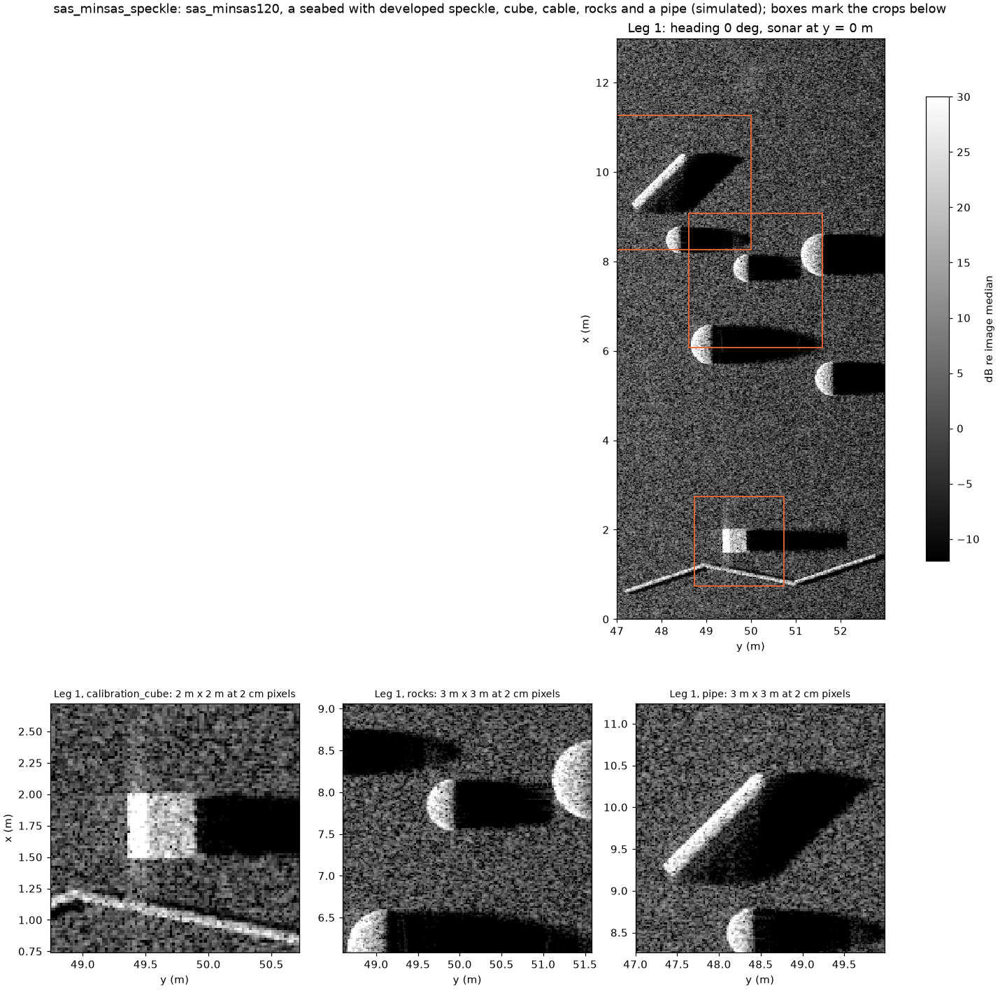

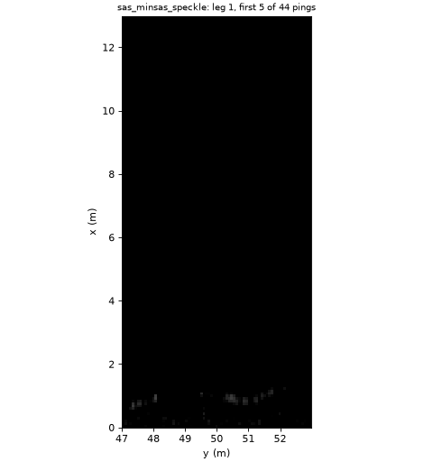

The other survey scenes have 8 to 18 seabed scatterers per square metre against about
2000 resolution cells: separate points on black. Here a 13 m × 6 m strip has 5000 per
square metre, 2.6 in every cell, and every one of the 390,000 is synthesised. Objects have
the same density on their surfaces.

| Quantity | Result |
| --- | --- |
| Speckle contrast of bare seabed (standard deviation of intensity over its mean; 1.0 is fully developed) | 1.21 |
| Calibration cube / cable over bare seabed | 26.9 dB / 18.7 dB |
| Level where the cube's along-track copy falls (10.3 m along), over bare seabed | +2.1 dB |
| Level where the cable's copy falls, over bare seabed | +0.3 dB |
| CPU time (four cores) | 14 min |

- This is what the sonar's picture should look like: continuous texture, objects with a
  bright face and a clean shadow.
- **The ambiguity copies are covered.** The question left open by the sparse scenes was
  whether the −47 dB along-track copy of each object would show on a real seabed. Where
  the cube's copy falls, the image is 2 dB above the surrounding seabed on average (the
  copy is about as strong as the seabed itself, 29 dB below the cube); the cable's is
  lost. Neither is visible in the picture. A much brighter object than these would still
  show.
- `tools/calibrate_sim.py sas` run on this figure's full-resolution picture reads back
  6100 scatterers per square metre (5000 were put in) and a 9 cm² speckle cell.
- The strip is small because of the cost. The same density over the 40 m × 28 m survey
  scene is 5.6 million scatterers: a GPU job.

### Rocks: `sas_minsas_boulder_field` and `sas_minsas_rocky_ripples`

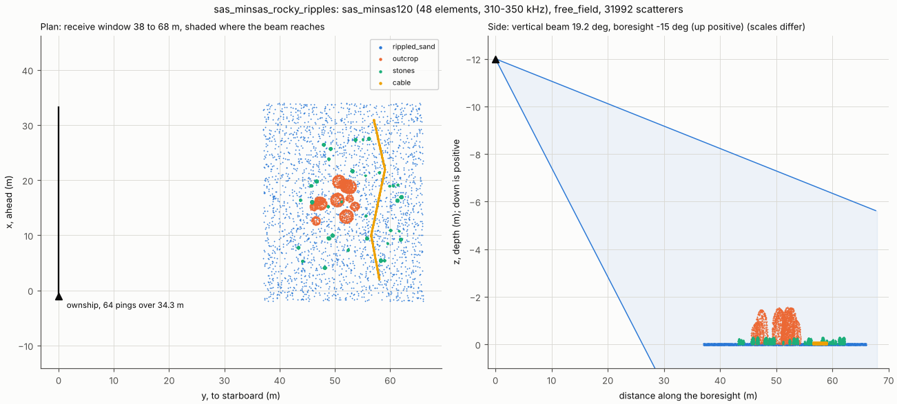

| Scenario | Object, dB over the image median |
| --- | --- |
| `sas_minsas_boulder_field` | sand 42.0, boulders 46.0 |
| `sas_minsas_rocky_ripples` | rippled sand 42.7, outcrop 42.8, stones 44.3, cable 47.2 |

- Each rock shows a bright face towards the sonar (at low y) and a shadow behind it whose
  length grows with the rock's height and its range. The three crops under each image are
  at the image's own 2 cm pixels.
- The ripples show as stripes because their slopes change the Lambert return; the cable is
  a thin bright line.
- Rocks are rough spheres half sunk in the sand. Real rocks have facets and glints these do
  not.
- **Ghosts, and the element count.** Receive phase centres half a pitch apart put a grating
  lobe at asin(λ / pitch) off broadside, so every scatterer has a defocused copy up and
  down the track. With the first array (32 elements at 3.4 cm) the copy was 6.9 m away and
  −42 dB on a point target; the cable and the wreck's outline showed twice. The sonar now
  has 48 elements at 2.27 cm over the same 1.09 m: the copy is 10.3 m away and −47 to
  −54 dB, depending on the geometry (`test_minsas_resolution.py`), for half as many
  channels again. It still shows beside the brightest objects in these figures, because
  they are 50 dB and more above the floor: the simulated seabed is empty between its
  scatterers, and the figures show 42 dB of range anchored on that empty floor. On a
  seabed with developed speckle the copies are covered (`sas_minsas_speckle`, above). More elements do not
  help much further: the receive element narrows with the pitch, and the projector's
  sidelobes fall slowly.

### Rail SAS: `rail_objects`

Ball 29.7 dB, pipe 31.7 dB, brick 30.1 dB, pebbles 27.7 dB over median, each with a shadow
on the floor behind it. Rail positions are exact here (`rail_position_errors` has the
perturbed case, not yet imaged with correction).

## 3D imaging of buried objects: `buried_objects`

| Quantity | True | Refraction on | Refraction off |
| --- | --- | --- | --- |
| Depth of the cylinder's brightest return | top at 0.25 m, axis at 0.30 m | 0.26 m | 0.23 m |
| Depth of the sphere's brightest return | top at 0.14 m | 0.14 m | 0.13 m |
| Cylinder over sediment clutter | — | 21.1 dB | — |

The sediment model is one refracted path with unit transmission: no sediment attenuation,
no angle-dependent transmission loss, so the clutter level relative to the objects is an
assumption (the scenario's `rms_amplitude`), not a prediction.

## Flank array: `flank_patrol`

| Target | Result over six pings |
| --- | --- |
| Submarine-like target, 56 m, +16 dB in all, 3.0 m/s along x | tracked; velocity 2.99, −0.14 m/s; 25 m from its centre at the last ping |
| Wreck on the seabed, +12 dB, not moving | tracked; speed 0.04 m/s; 6 m from truth |
| Small vehicle, −3 dB, 2 m/s | **not detected** |

- 3 to 6 detections per ping (5 to 7 in the run before this one) gave 5 confirmed tracks
  for two objects: multipath splits the wreck's echo into several clusters, each of which
  starts a track. Clustering that merges them is not written (`STATUS.md`).
- Detection runs on power summed into 4 m range cells, with CFAR windows sized in metres,
  because multipath spreads each echo over tens of metres.
- The outcome depends on the assumed seabed (−27 dB Lambert), wind (5 m/s) and noise
  (45 dB); none is measured. Highlights have no aspect dependence, reverberation has no
  Doppler spread, and the platform stands still.

## Popoto array at long range

### The owner's design: `popoto_far_mover`

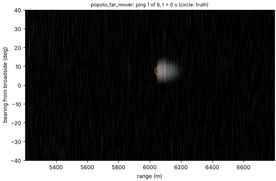

Ownship makes 1.5 m/s along its own 32-hydrophone array (four boards, 6–10 kHz, 185 dB,
1 s sweep). A ship-sized target (+25 dB over five highlights) crosses at 6 m/s, 6 km off
the beam, in 100 m of isovelocity water.

| Quantity | Result |
| --- | --- |
| Ship | tracked, 42 m from truth, velocity −5.57, −0.24 m/s (true −6, 0); classified mover |
| Peak over map median with 8 / 16 / 32 hydrophones | 22.9 / 25.6 / 28.6 dB |
| Detections per ping / confirmed tracks | 1 to 4 / 4 |
| Track classes | 1 mover, 2 multipath, 1 uncertain |

Each doubling of the array adds about 3 dB, as it should. Of the three tracks that are
not the ship's, two are attached to a stronger track as later arrivals and **one is
uncertain, a class this scene did not have in the run before this one**. That run had 2
tracks (1 mover, 1 multipath) and the older CPU run 6, 4 of them multipath; this one has
4, and the last three pings give 2, 1 and 3 detections (1, 1 and 2 before). The peak is
0.1 to 0.9 dB higher than in the run before. No mover is off a moving object. The
uncertain track was not examined.

### 12 km: `popoto_12km`

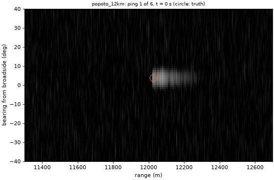

**What frequency and power reach 12 km.** `tools/popoto_range_study.py` and `DESIGN.md`
section 5: with spherical spreading, a +25 dB target, a 1 s pulse and 15.8 dB in one row at the
beamformer output (what the chain's own detector needs of one row for a detection probability of
0.5 on one ping, `buildspec.detection`; 17.4 dB for 0.9; the figure was a typed 13 dB before),

- the present 27.5 kHz band cannot do it (about 322 dB would be needed; absorption alone
  is about 136 dB over the round trip), and on the same budget reaches about 2.7 km;
- the best frequency is **4 to 6 kHz**;
- there, 32 hydrophones at half-wavelength spacing need **198 dB re 1 µPa at 1 m**, about
  515 W of acoustic power from an omnidirectional projector; 16 need 201 dB (1030 W),
  64 need 195 dB (257 W).

`popoto_long_range` was sized on the typed 13 dB with 2 dB in hand: 32 hydrophones at 15 cm (4.8 m),
4–6 kHz, 1 s, 197 dB (about 420 W acoustic if omnidirectional; electrical power depends on
a projector not yet chosen). Against the detector's own figure one row has -1.1 dB of margin at 12 km
in free field (detection probability 0.22 on one ping), two rows +1.4 dB (0.87), three
+2.9 dB (0.99). In this scenario, 100 m of isovelocity water over sand:

| Quantity | Result |
| --- | --- |
| Ship at 12 km | tracked, 26 m from truth, velocity −5.03, 0.21 m/s (true −6, 0); **classified multipath** (speed 5.1 ± 0.2 m/s) |
| Track classes | 4 mover, 7 multipath, 1 uncertain |
| Peak over map median with 8 / 16 / 32 hydrophones | 20.1 / 23.1 / 25.6 dB |
| Detections per ping / confirmed tracks | 7 to 15 / 12 |
| One-way loss to the target, Bellhop (no absorption) | 67.2 dB, against 81.6 dB for spherical spreading |

- The shallow channel carries 14 dB more each way than spherical spreading, so this case
  has margin the link budget does not count. (The two losses are not in `gallery.json`
  and were not measured again with this run.) Eleven of the twelve tracks are not the
  ship's own: six are attached to a stronger track as later arrivals, four are called
  movers and count as on the ship (no mover is off a moving object), and one is
  uncertain. Why the four movers were not attached was not examined.
- **The ship's own track is now classified multipath, an echo of a stronger track, and
  not a mover; the scene has 12 tracks where it had 8.** The classifier's speed is
  5.1 ± 0.2 m/s against a true 6.0, and the track is 26 m from truth where it was 20 m.
  In the run before this one the ship's track was uncertain at 4.3 ± 1.0 m/s, with
  velocity −3.48 m/s where it is now −5.03, and the classes were 2 mover, 3 multipath and
  3 uncertain; in the older CPU run the ship was a mover, with 11 tracks of which 8 were
  multipath. The peak over the median is 0.0 to 0.5 dB lower than in the run before. The
  ship is still not called a mover, and its class is different in kind; the cause was
  not examined.

### Other oceans: `popoto_env_*`

Same sonar, same ship, four environments. Geometry diagrams with the profile and the
transmission loss are in `docs/scenarios/popoto_env_*.png`.

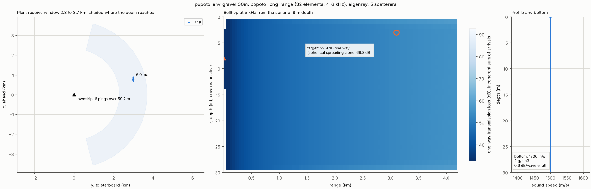

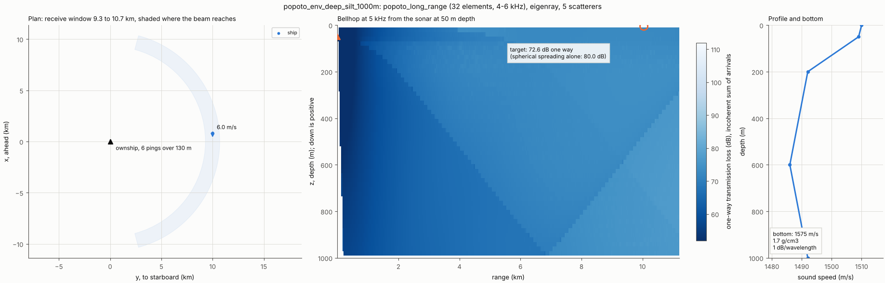

| Scenario | Water | Bottom (speed, density, loss) | Range | One-way loss: Bellhop / spherical | Ship | Peak over median, 32 hydrophones |
| --- | --- | --- | --- | --- | --- | --- |
| `popoto_env_winter_sand_200m` | 200 m, speed rising with depth (1480 to 1483.4 m/s): a surface duct | sand: 1650 m/s, 1.9, 0.8 dB/λ | 8 km | 64.2 / 78.1 dB | tracked, 31 m, −5.64 m/s | 30.1 dB |
| `popoto_env_summer_mud_60m` | 60 m, warm layer over a thermocline (1522 to 1490 m/s) | mud: 1500 m/s, 1.5, 0.2 dB/λ | 4 km | 88.8 / 72.2 dB | **not detected** in six pings | 12.4 dB |
| `popoto_env_gravel_30m` | 30 m, isovelocity | gravel: 1800 m/s, 2.0, 0.6 dB/λ | 3 km | 52.9 / 69.8 dB | tracked, **38 m**, −5.70 m/s | **31.4 dB** |
| `popoto_env_deep_silt_1000m` | 1000 m, thermocline over cold deep water; ownship at 50 m | silt: 1575 m/s, 1.7, 1.0 dB/λ | 10 km | 72.6 / 80.0 dB | detected 310 m long in range; not tracked at its true position | 11.8 dB |

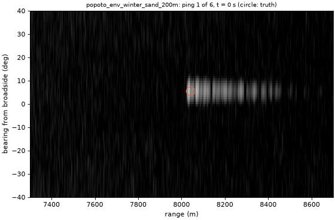

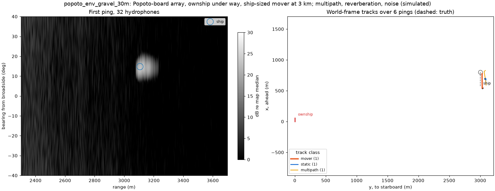

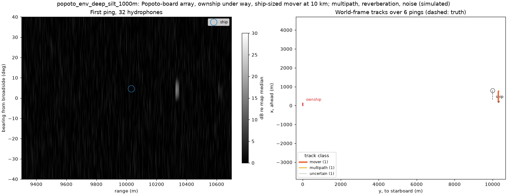

- **The ocean matters more than the 2 dB of margin.** In summer over mud the profile bends
  sound down into a bottom that absorbs it: 17 dB more loss each way than spherical
  spreading at only 4 km, and the ship is not seen. In winter over sand the same sonar
  holds it at 8 km with 30 dB.
- In deep water the ship's echo arrives about 310 m late in range with the right bearing
  and the right speed (−6.10 m/s). That is consistent with a path by way of the bottom,
  the direct path being refracted away from a target near the surface; this was not
  confirmed by tracing the arrivals. Range from such a path needs the propagation model
  to correct it, which is not written. The three tracks there are 1 mover, 1 multipath
  and 1 uncertain, as in the run before this one (2 multipath and 1 uncertain in the
  older CPU run). The ship not being tracked at its true position, the mover counts as
  one not on a moving object, one of two in the Popoto scenes. Which track it is was not
  examined.
- **In winter over sand one track is now called a mover that is not on a moving object.**
  The five tracks are 2 mover, 2 multipath and 1 uncertain; in the run before this one
  they were 1 mover, 3 multipath and 1 uncertain, with no such mover. The ship itself is
  still a mover (5.6 m/s against 6, 31 m from truth). This is worse; the cause was not
  examined.
- **Over gravel the peak fell and the track moved away.** The peak over the median is
  31.4 dB with 32 hydrophones where it was 34.7 dB (24.9 and 28.3 dB with 8 and 16, where
  they were 28.9 and 31.9), and the ship's track is 38 m from truth where it was 24 m.
  There are 1 to 3 detections per ping and 2 tracks, the ship's (a mover) and one
  multipath; the run before had 1 or 2 detections and the ship's track alone. This is
  worse; the cause was not examined.
- Against the run before this one the peak over the median with 32 hydrophones fell
  0.3 dB in winter over sand and 3.3 dB over gravel; in summer over mud and in deep water
  over silt every number in `gallery.json` is the same.
- The one-way losses in the table are not in `gallery.json` and were not measured again
  with this run.
- Bottom parameters are textbook values for each sediment, not measurements, and the
  Lambert strengths for bottom reverberation are placeholders. Bellhop's loss here excludes
  volume absorption (about 0.3 dB/km at 5 kHz), which the simulation adds separately.
- All four are range-independent: one profile and a flat bottom everywhere.

## Popoto array: `popoto_trial_1000m`

Peak at 1000.1 m on the target's bearing, 30 dB over the map median, in multipath, bottom
reverberation and ambient noise. `RESULTS.md` has the 100 m and 2000 m cases and the
comparison with the spherical-spreading estimate.

## Scenarios for the SST-equivalence work

Nine scenarios were added with the simulator work that closes the gap to SST (APL-UW
TR 0702; `DECISIONS.md` D-62 to D-78). They are test and validation set-ups, not gallery
scenes: `tools/gallery.py` does not run them, so there is no result figure, animation or
CPU time for them here, except the two validation figures below. They have no geometry
diagram yet either: `tools/scenario_diagrams.py` has not been run since they were added
(it draws every file in `configs/scenarios`; whether it handles the new item types,
`type: target` and the `sst_asiaex` relay geometry, has not been tried).

| Scenario | Sonar | Scene | Physics in the run | Checked by |
| --- | --- | --- | --- | --- |
| `rail_cylinder_glint` | `sas_rail` (2.72 MHz), 151 pings | a smooth rigid rod, 10 cm long and 2 cm across (ka = 115), parallel to the rail | specular glint by the Kirchhoff approximation, `resolved: true` because the rod is in its own near field (L²/λ = 18 m); each ping sees one glint, and the image shows the line | `test_scene_targets.py`: line at y = 1.8704 m (expected 1.8706), off-rod / on-rod 0.002; the rod turned 20° is −67 dB |
| `fls_glints_on_sediment` | `fls_300k`, 1 ping, sonar 1 m above the bed | a seabed of point scatterers that follows the bottom scattering model at each ping's grazing angles; a smooth sphere (TS = 10 log10(a²/4) = −16.5 dB at any aspect) and a cylinder across the line of sight | glints from the two shapes; sediment numbers are `bottom.PLACEHOLDER_SAND`, illustrative | `test_scene_targets.py`: sphere image level within 0.5 dB of a²/4; `test_scene_sediment.py` for the seabed |
| `fls_highlight_target_aspect` | `fls_120k`, 8 pings 2 s apart | a target in the SST manner: five highlights along a 20 m body that crosses ahead while turning, a table of strength against aspect, one highlight that answers late, a small position jitter | the strength follows the table ping by ping as the aspect changes. The table is illustrative, not a measured target | `test_scene_targets.py` |
| `flank_sst_shallow` | `flank_32`, 4 pings 15 s apart | one target at 1 km in 100 m of isovelocity water | bounce paths time-spread by a wind-roughened surface; bottom reverberation from a rough fluid sediment; surface reverberation (Chapman–Harris); a volume-scattering layer. Sediment, volume strength and bubble loss are placeholders | `test_timespread.py`; added in the earlier part of the round (D-62, D-63) |
| `flank_sst_spread` | `flank_32`, 4 pings 15 s apart | the same channel | every option beyond SST's time spreading: `angle_spread`, `doppler`, `decay_time: facet`, `multi_bounce: convolve` (the last is the default since D-82). Few taps and lines, because every bounce ray becomes 1 + taps × `doppler_lines` rays each way. Same placeholders | `test_timespread.py`, on both engines |
| `sst_pursuit` | five `flank_32` hydrophones as a forward-looking sonar on a vehicle at 20 m/s; a 0.1 s tone at 9.9 kHz, 1 ping | TR 0702's "Pursuit" example (Sec. 3, Fig. 2) as far as the report describes it: a three-highlight target fleeing at 2.5 m/s, 2124 m ahead; vehicle at 350 m in 1275 m of water | surface reverberation (Chapman–Harris) with `geometry: bistatic` and `band_taper`, over image-source paths that include bottom-reflected legs (bottom coefficient 0.5); wind noise; the target echo. Speeds, depths, beams, pulse, wind and levels are **ours** (`unconfirmed`); the 230 dB source level only sets reverberation about 10 dB over noise. No target-radiated noise (no one-way source). 7 s to run | `test_sst_validation.py`, `tools/sst_validation.py`; figure below |
| `sst_asiaex` | `flank_32` hydrophones as the receiver; projector 500 m away; a 3 ms pulse at 8 kHz, 20 pings 5 s apart | TR 0702's forward-scatter example (Sec. 12.2–12.6, Figs. 3–5): direct, surface, bottom, surface-bottom and bottom-surface arrivals inside 35 ms | time spreading with wind 3 m/s and the bottom rms height 0.012 and mean-square slope 0.045 that TR 0702 prints; the one-way path is made with a −20 dB relay 0.1 m from the projector. Water depth (100 m), source and receiver depths (30 m, 50 m), sound speed, ping interval, the sediment and the wind laws are **ours** (`unconfirmed`) | the same; figure below |
| `sst_echo_level` | `flank_32` hydrophones, omnidirectional, 1 ping, 2 kHz of band | one highlight of known target strength; a flat surface (coefficient −1) and a flat bottom (0.5), one bounce at most per leg, so six groups of eigenray pairs arrive as six separate pulses | a geometry for a calculation, not a sonar: the compressed echo against the sonar equation and TR 0702 eqs. 36–38, 66, 68. The tool also runs it free-field, and with a sampled m-sequence pulse and a moving target | `test_sst_validation.py`: 0.004 dB free field; 0.005 dB and 0.13 µs in the image medium |
| `sst_sediment_reverb` | `popoto_8` hydrophones, omnidirectional, 20 m above a flat bed; a 2 ms tone at 20 kHz, 6 pings | a bed of `medium_sand` (`configs/sediments.yaml`) | scattering-function reverberation, direct path only, no absorption, against σ(grazing)·πcT/R³. The tool also runs the same sediment as point scatterers, and LFM pulses of three bandwidths with a point target | `test_sst_validation.py`: mean +0.27 dB, −0.17 to +0.59 dB |

The two worked examples are **not numerical reproductions of TR 0702's figures**: the
report does not print the parameters, and the figures below are compared only with
closed forms for our own geometry (`RESULTS.md`, "Validation against TR 0702").

Pursuit: the target echo arrives at 2.7900 s at 10133.73 Hz, 25 Hz below the
reverberation ridge. This figure is from the first validation run. That run showed a
defect in the bistatic reverberation's Doppler (with the bottom in, the spectrogram
changed before any bottom path could arrive), which has since been fixed
(`DECISIONS.md` D-80); the figure had not been regenerated when this was written. After
the fix the ridge follows the closed form within 0.75 Hz in the median and the
bottom-bounce streak starts at 1.750 s (2D/c = 1.700 s); with the first run's code the
figures were 1.2 Hz and 1.725 s (`RESULTS.md`).

ASIAEX: arrivals at 0, 3.97, 9.20, 20.68 and 30.57 ms within 0.20 µs of the image
equations; with time spreading the bounce arrivals grow tails (surface −6 dB, bottom
−15 dB re peak after the pulse) and vary from ping to ping (surface 1.88 dB, bottom
0.97 dB standard deviation over 20 pings).

Made by: `PYTHONPATH=python python3 tools/sst_validation.py --out docs/figures/sst_validation.md --json docs/figures/sst_validation.json --figures docs/figures`
(about 2 minutes on the CPU).

## Every scenario file

All 75 files in `configs/scenarios`, one line each. "Gallery" means `tools/gallery.py` runs
it and the sections above show its figure and numbers. A scenario marked "needs Bellhop"
runs at the `eigenray` tier and is skipped, with its tests, when `GPUSONAR_BELLHOP` is not
set. Twenty files have no geometry diagram in `docs/scenarios/` yet: the nine of the
SST-equivalence work, `popoto_12km_2row`, `popoto_12km_3row`, the three
`popoto_testauv_direct_overload*`, the three `fjord_*` and the three `ssp_*`
(`tools/scenario_diagrams.py` has not been run since they were added).

Since `DECISIONS.md` D-100 a scenario states its water once, in an `environment` block
that may name a site in `configs/environments/`; a typed value that contradicts the site
is an error unless named under `environment_overrides`. Two kinds of inconsistency are
kept as they were and are named in the files (D-101): 9 Bellhop scenarios reflect eigenrays
from a flat surface in a windy sea, and 21 simulate a bottom the record does not mention.
The third is resolved: of the 47 scenarios that typed a sound speed disagreeing with their
temperature, 44 now take the speed the water gives (1496.8 m/s at 12 deg C and 35 PSU,
1489.8 at 10 deg C, 1482.4 in the fresh-water tank at 20 deg C) and three keep theirs on
purpose, each saying why in its file (`popoto_elevation_rehearsal`, `sst_pursuit`,
`sst_asiaex`). The numbers that come from `docs/figures/gallery.json`
(the gallery sections above) are from a run made after that change, so for the gallery
scenes among the 44 they are measured at the water's speed. **Every other number quoted
in this file for those 44 scenarios, in the gallery sections or outside them, was
measured at the nominal speed and has not been measured again.** The trial, 12 km and `popoto_env_*`
scenarios no longer state a bounce order or an arrival count (the energy rule of D-105
decides); the other shallow scenarios still state one far below what that rule would keep
(`STATUS.md`, open item 22).

### Point targets, for measuring resolution

| Scenario | What it is |
| --- | --- |
| `point_grid_l12_5d` | Point grid for the L12-5 probe (5 MHz), pool water; two pings, one per multiplexer half. |
| `point_grid_p4_2v` | Point grid for the P4-2v phased array (2.7 MHz), pool water. |
| `point_grid_fls_300k` | Point grid for the 300 kHz, 128-element forward-looking sonar. |
| `point_grid_fls_750k` | Point grid for the 750 kHz sonar (the plan's Phase 3; every value a placeholder), 5 to 45 m. |
| `point_grid_sas_auv` | Point grid for the 200 kHz SAS array. |
| `point_grid_sas_rail` | Point grid for the P4-2v on the rail, pool water. |
| `point_grid_flank_32` | Point grid for the 32-hydrophone flank array. |
| `point_grid_popoto_8` | Point grid for eight Popoto hydrophones at 27.5 kHz. |
| `point_grid_popoto_8_low` | The same in the board's low band. |
| `point_grid_popoto_4x8` | Point grid for four Popoto boards of eight (32 hydrophones). |
| `pool_wires_l12_5d` | Thin wires on a frame at 0.5, 1 and 2 m: beam width and range resolution of the L12-5 probe. |
| `stripmap_points` | Stripmap SAS with known navigation past three point targets, 90 pings. |
| `rail_points` | Rail SAS past point targets with the P4-2v stepped along a motorised rail. |
| `rail_position_errors` | `rail_points` with the carriage a fraction of a millimetre off its commanded position. |

### Forward-looking sonar

| Scenario | What it is |
| --- | --- |
| `pool_fls_l12_5d` | Gallery. Phase 1 pool: far wall, side wall, cinder block, pipe, rope, wires. |
| `pool_fls_p4_2v` | Gallery. Phase 2 pool or dock, 5 to 10 m: wall, steps, ladder, lane floats. |
| `harbour_fls_750k` | Gallery. Phase 3 harbour: sandy floor, quay wall, six pilings, mooring block, rocks. |
| `seafloor_objects_fls` | Gallery. A sphere, a box and rocks on a flat seafloor, with shadows. |
| `fls_120k_transit` | Gallery. The 120 kHz design under way at 2 m/s: boat under way, boat at anchor, buoy, pinnacle; reverberation with ownship Doppler; 10 pings. |
| `fls_170k_transit` | Gallery. The same objects with the 170 kHz design out to 450 m. |
| `fls_330k_transit` | Gallery. The same with the 330 kHz design out to 300 m. |
| `fls_120k_cluttered_seabed` | Gallery. Boat with keel, propeller and wake over sand, boulders, debris and a pipeline. |
| `fls_120k_rough_surface` | Gallery. A wind sea of wave facets at 10 m/s, boat with wake, kayak, buoy. |
| `fls_170k_traffic` | Gallery. Three boats: closing, crossing, at anchor. Its thinned test form carries the loosened anchored-boat limit (D-121). |
| `fls_glints_on_sediment` | A smooth sphere and cylinder that glint, on a seabed whose scatterers follow the bottom scattering model. |
| `fls_highlight_target_aspect` | A five-highlight target crossing ahead while turning, strength against aspect from an illustrative table. |

### Synthetic aperture sonar and buried objects

| Scenario | What it is |
| --- | --- |
| `wreck_sas` | Gallery. Stripmap past a 3 m box with sway and heave that navigation does not report; motion estimation. |
| `minefield_sas` | Gallery. Rippled sand, two 2 m cylinders, a sphere, rocks; unknown motion. |
| `sas_minsas_survey` | Gallery. The MINSAS-class design, two opposite legs over a wreck, a cable, rocks and a calibration cube. |
| `sas_minsas_boulder_field` | Gallery. 45 boulders of 15 to 90 cm radius on sand. |
| `sas_minsas_rocky_ripples` | Gallery. Rippled sand, a rock outcrop, stones, a cable. |
| `sas_minsas_speckle` | Gallery. A seabed of 5000 scatterers per square metre (2.6 per resolution cell). |
| `rail_objects` | Gallery. Rail SAS in the pool: ball, pipe, brick, pebbles on the floor. |
| `rail_cylinder_glint` | A smooth rigid rod parallel to the rail, a specular target seen as one glint per ping. |
| `buried_cylinder` | 3D near-field imaging of one cylinder 0.3 m below a flat sediment interface, with refraction. |
| `buried_objects` | Gallery. A buried cylinder and sphere under a rough interface with sediment clutter. |

### Flank array (32 hydrophones, 6 to 10 kHz)

| Scenario | What it is |
| --- | --- |
| `flank_target_1km`, `flank_target_5km`, `flank_target_10km` | One target in noise in shallow water at each range; the link-budget cases. Needs Bellhop. |
| `flank_patrol` | Gallery. Six pings 12 s apart in 100 m of water: a 56 m target crossing near 3 km, a small vehicle near 2.2 km, a wreck. Needs Bellhop. |
| `flank_sst_shallow` | A target at 1 km in 100 m of water with time-spread bounce paths, sediment and surface reverberation and a volume layer; placeholders throughout. |
| `flank_sst_spread` | The same channel with angle spreading, Doppler spreading within the pulse and convolved multi-bounce tails. |

### Validation against TR 0702

| Scenario | What it is |
| --- | --- |
| `sst_pursuit` | The report's "Pursuit" example as far as it is described: a vehicle at 20 m/s chasing a three-highlight target; our own parameters. |
| `sst_asiaex` | The report's forward-scatter example: a 3 ms pulse at 8 kHz over about 500 m, now by a one-way source (`sources:`), no longer a relay point. |
| `sst_echo_level` | One highlight of known strength with one bounce per leg: the compressed echo against the sonar equation. States `bottom_coefficient: 0.5`. |
| `sst_sediment_reverb` | Bottom reverberation from `medium_sand` against the integral of its scattering strength. |

### Popoto boards at 27.5 kHz, and the first long-range design

| Scenario | What it is |
| --- | --- |
| `popoto_trial_100m`, `popoto_trial_1000m`, `popoto_trial_2000m` | Eight hydrophones, 190 dB, a +10 dB target at each range in shallow water. Needs Bellhop. `popoto_trial_1000m` is in the gallery. |
| `popoto_far_mover` | Gallery. 32 hydrophones in the 6 to 10 kHz band against a ship-sized mover at 6 km, ownship at 1.5 m/s. Needs Bellhop. |

### The 12 km design (`popoto_long_range`: 4 to 6 kHz, 197 dB, 32 hydrophones a row)

| Scenario | What it is |
| --- | --- |
| `popoto_12km` | Gallery. A ship-sized mover (+25 dB, a placeholder) at 12 km in 100 m of isovelocity water over sand; one row. Needs Bellhop. Keeps arrivals by energy: 64, the cap (1.5 % of arrival energy left out; D-137). |
| `popoto_12km_2row` | The same with two stacked rows on the face (outer rows 1.5 m apart); the ship 4 m deep. Needs Bellhop. |
| `popoto_12km_3row` | The same with three rows. Needs Bellhop. |
| `popoto_env_winter_sand_200m` | Gallery. The same ship at 8 km in winter water over sand (a surface duct). Needs Bellhop. |
| `popoto_env_summer_mud_60m` | Gallery. At 4 km under a summer thermocline over mud: not detected. Needs Bellhop. |
| `popoto_env_gravel_30m` | Gallery. At 3 km in 30 m over gravel. Needs Bellhop. Keeps arrivals by energy: 64, the cap (14 % left out; D-137). |
| `popoto_env_deep_silt_1000m` | Gallery. At 10 km in 1000 m over silt. Needs Bellhop. |

### Stacked rows: elevation and depth

| Scenario | What it is |
| --- | --- |
| `popoto_elevation_free` | Three rows on the face, rolled 3 degrees, three targets near 1 km above, level with and below the vehicle, free field: the reported depths must be the targets'. |
| `popoto_elevation_shallow` | Three rows at 30 m in 100 m of water over sand, a target at 50 m depth 1 km away; image-source multipath to second order. |
| `popoto_elevation_rehearsal` | The full stacked-row system as it would run: raw 102.4 kHz samples on twelve boards with their own clocks, the vehicle rolled and rolling, a deep and a shallow target near 1 km. Chain: `configs/deploy/popoto_elevation_rehearsal.yaml`. |
| `popoto_face_2row_shallow` | Two rows on the face, 100 m over sand, a target at 60 m depth 3 km away. This is the geometry in which two rows cannot separate direct, surface and bottom echoes, and the depth sigma now says so (`STATUS.md`, open item 6). |

### The staged builds: trials in open water

Each is the rehearsal of one build's trial and is run through that build's deployment
file: `tools/sonar_live.py configs/deploy/<file>.yaml --scenario <name> --out DIR`. Raw
samples at 102.4 kHz with every board on its own clock. Image-source multipath with one
bounce stated.

| Scenario | What it is |
| --- | --- |
| `popoto_testauv_trial_1row` | Stage 1: the one-row prototype on the test AUV at 10 m in 30 m of water, a +10 dB target at 500 m, 15 m deep. |
| `popoto_static_trial_2row` | Stage 2: the two-row static frame against a target 2.6 km away, 30 m below it. |
| `popoto_static_trial_3row` | Stage 3: the three-row static frame against a target at 150 m, 8 m below it. |
| `popoto_static_free` | The three-row static frame in free field, three targets about 400 m off at known depths. |
| `popoto_static_passing` | A target passing the three-row frame 400 m off at 3 m/s, eight pings, 30 m of water over sand. |

### The projector's direct sound and receiver overload (D-125)

| Scenario | What it is |
| --- | --- |
| `popoto_testauv_direct_overload` | The one-row prototype with a 0.1 s pulse, targets at 150 m and 350 m, and a front end that overloads on the projector's direct sound and recovers slowly. No hardware value in it is measured. |
| `popoto_testauv_direct_overload_fast` | The same with a front end that is dead for 5 ms after it last clipped and recovers with a 2 ms time constant. |
| `popoto_testauv_direct_overload_gain_switch` | The same with the gain held 40 dB down while the projector transmits; nothing clips. Headroom 2.8 dB since source levels are RMS. |

### Trials in fjord-type water (D-106; `tools/fjord_rehearsal.py`)

The profile (a sound-speed maximum of 1495 m/s at 19 m), the section of basins and sills
and the seabed are **illustrative**, modelled on one site; the late tail's numbers are one
fjord, one night, 4 to 8 kHz; K-distributed noise (shape 3.5) at a 1.9 m/s wind level. All
need Bellhop and keep twelve arrivals.

| Scenario | What it is |
| --- | --- |
| `fjord_testauv_trial_1row` | `popoto_testauv_trial_1row` in the fjord's water: target at 500 m. |
| `fjord_static_trial_2row` | The two-row static frame against a target 2.6 km away; a 53 m sill blocks the direct path. |
| `fjord_static_trial_3row` | The three-row static frame against a target at 150 m. |

### Water that changes with range (D-110; `tools/ssp_range_study.py`)

The profiles are **illustrative**; nobody measured them. Range is horizontal distance from
the sonar, the same on every bearing. All need Bellhop, keep twelve arrivals and reflect
eigenrays from a flat surface.

| Scenario | What it is |
| --- | --- |
| `ssp_front_static_trial_2row` | The two-row static frame against a target at 2.6 km, 60 m deep, with a front 1.2 to 1.4 km out. |
| `ssp_thermocline_static_trial_3row` | The three-row static frame against the same target under a mixed layer that deepens from 15 m at the array to 45 m at 3 km. The case behind `elevation.sector_from_rays` (D-116). |
| `ssp_front_testauv_trial_1row` | The one-row prototype against a target at 500 m, 15 m deep, in 30 m of water, with a front 200 to 300 m out. |

Results for the last five groups are tables, not figures: `RESULTS.md` ("Deployment
defaults: before and after", "Water that changes with range", "A trial in fjord-type water
against the open-water rehearsal", and the regenerated fjord and 12 km tables in "Six fixes
after the first whole-suite run"), `docs/figures/fjord_rehearsal.md`,
`docs/figures/ssp_range_study.md`, and `docs/design/direct_sound_study.json`.

## What no scenario has yet

- Multipath in the pool scenes. Surface and floor bounces arrive well outside the probes'
  narrow elevation beams, but bounces off the side walls lie in the fan and would show as
  ghost targets; the image-source tier can model walls and is not used here yet.
- Surface or bottom bounce paths to the objects in the forward-looking sea scenes (direct
  paths only; reverberation is statistical).
- Waves that move as waves do, breaking, or a bubble layer; a wake that grows.
- A range-dependent ocean in a gallery scene. Three trial scenarios have a sound speed
  that changes with range (`ssp_*`) and three a seabed section with sills (`fjord_*`),
  all illustrative and all as rings about the sonar; none has a front lying across a map.
- Fully developed speckle on large surfaces (scatterer counts are kept affordable).
- Specular echoes in a realistic scene. Smooth spheres, cylinders, plates and discs can
  now glint (`rail_cylinder_glint`, `fls_glints_on_sediment`), but no gallery scene uses
  them, and hulls, pipelines and pool walls are still Lambert point clouds.
- A seabed with relief under the scattering-function reverberation, moving scatterers,
  K-distributed reverberation, or a sampled transmit pulse: the options exist and are
  tested, and no shipped scenario turns them on (a sampled pulse appears only in the
  validation tool's variant of `sst_echo_level`).
- Classification: telling a boat from a boulder, or the ship from its multipath.
