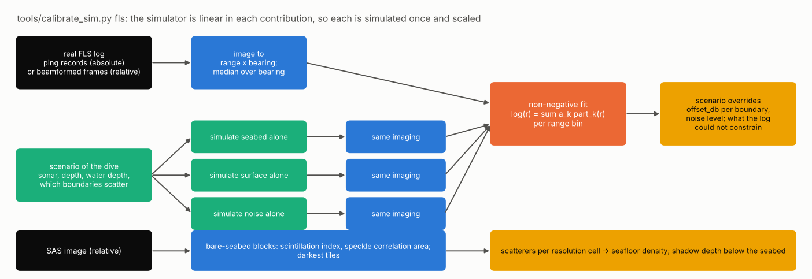

# Calibrating the simulator to real data

So that a simulated scene has the background of a real one: the right seabed and surface
strengths, the right noise, the right speckle. This is separate from calibrating a real
array's channels (`calibrate.py`).



Code: `python/gpusonar/simcal.py`. Tool: `tools/calibrate_sim.py`. Tests:
`tests/python/test_simcal.py`, where a log is simulated with hidden settings and the
calibration has to find them.

## A forward-looking sonar log

```bash
# raw element data as ping records, true gains: absolute levels
tools/calibrate_sim.py fls --log dive12.h5 --scenario my_dive --levels absolute --out my_dive_cal.yaml --plot fit.png

# frames beamformed by the sonar's own software (an .npz with intensity [frame, range, bearing], ranges, bearings_deg)
tools/calibrate_sim.py fls --frames dive12.npz --scenario my_dive --anchor boundary:0 --out my_dive_cal.yaml
```

`--scenario` is a scenario file describing the dive: which sonar, at what depth and
attitude, in how much water, and which boundaries scatter (its `reverberation` list).
Copy the nearest shipped one and set those first; the calibration fits strengths, not
geometry.

**How.** The simulator is linear in each contribution: twice the bottom strength gives
twice the bottom's power at every range. Each boundary and the noise are simulated alone,
imaged exactly as the log is, and reduced to a range profile (median over bearings, which
ignores targets). The log's profile is then fitted as a non-negative sum of them. The
factors, in dB, are how far each term must move.

**Absolute or relative.**

| The log has | What comes out |
| --- | --- |
| Absolute levels: raw samples in volts with the true front-end gains, and the sonar config's source level and sensitivity are the real ones | `offset_db` for each boundary and the ambient noise level, each absolute |
| Relative levels: an unknown overall gain (exported frames, images, a log with unknown gains) | Only the differences between terms. One term is held where the scenario has it (`--anchor noise` or `--anchor boundary:0`) and the rest are placed relative to it |

Frames from another system's beamformer are always treated as relative: its processing
gain is not known.

**What it does not guess.** A term that never reaches a tenth of the profile at any range
is reported as not constrained and left as the scenario has it. A log taken where noise
never shows cannot set the noise.

**Check (simulated log; `test_simcal.py`).** A log made with the bottom 6 dB stronger, the
surface 4 dB weaker and noise at 38 dB, with targets in it, six pings:

| Quantity | Hidden | Found |
| --- | --- | --- |
| Bottom strength offset | +6.0 dB | +5.9 dB |
| Surface strength offset | −4.0 dB | −4.0 dB |
| Ambient noise level | 38.0 dB re 1 µPa²/Hz | 38.6 dB |
| Misfit of the fitted profile | — | 0.16 dB RMS |

(As the test prints at the tree of D-181, CPU, 2026-11-24: `pytest tests/python/test_simcal.py -s`. This table
read +6.1 dB, 38.0 dB and 0.17 dB RMS when first written; which change moved it was not traced.)

With the same log multiplied by an unknown 37 dB, the difference between bottom and
surface offsets is still found to within 1.5 dB. This is the method checking itself: the
"real" log came from the same simulator, so model error (a seabed that is not Lambert, a
beam pattern that is not the config's) is not in these numbers. On a real log the misfit
curve (`--plot`) is where that shows.

**Using the result.**

```python
cfg = load_scenario_config("my_dive", yaml.safe_load(open("my_dive_cal.yaml")))
```

## A SAS image

```bash
tools/calibrate_sim.py sas --image mosaic.npy --pixel 0.03                       # linear power
tools/calibrate_sim.py sas --image mosaic.png --pixel 0.03 --display-db -15 25   # a picture linear in dB over that range
```

Exported SAS images are relative and usually flattened in range, so there is no range
profile to fit. The texture is still there:

| Measured on bare seabed | Gives |
| --- | --- |
| Scintillation index (variance of intensity over mean squared) | scatterers per resolution cell, 2 / (SI − 1): 1.0 is fully developed speckle |
| Width of the speckle's autocorrelation | the resolution cell's area, so a density per square metre |
| Mean of the darkest small tiles against the seabed | how far shadows lie below the seabed: the noise and sidelobe floor |

Bare seabed is found automatically: blocks at the median level with ordinary statistics.

**Check (simulated images).** Seabeds of 400 and 6000 scatterers per square metre imaged
with the MINSAS-class sonar: densities found 620 and 8000, cell area 5.6 to 6.6 cm²
(design 5.2 cm²). Within a factor of 1.6. Developed speckle only says "a few per cell or
more"; the tool caps the density it asks of the simulator at 5000 per square metre.

**Limits.**
- A picture that was clipped or compressed for display has lost part of its statistics;
  the tool says when the darkest pixels sit at the floor.
- Speckle statistics need the image at close to full resolution. A mosaic resampled to
  coarse pixels averages speckle away and reads as developed whatever the seabed.
- Nothing here sets absolute levels from a SAS image, by design.
