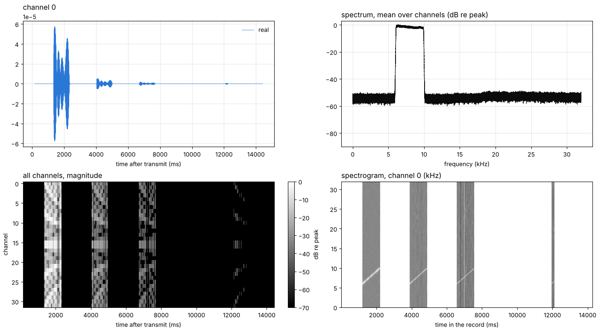
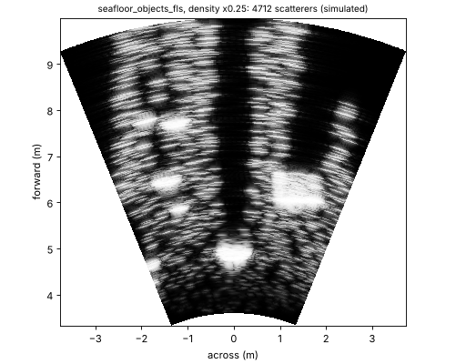
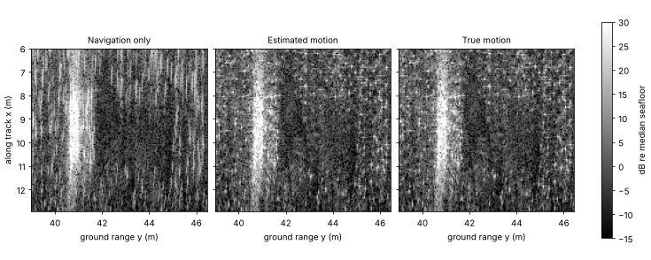
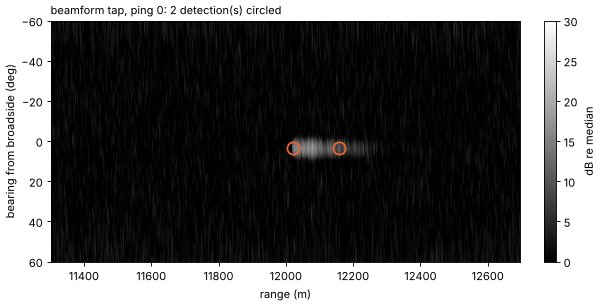
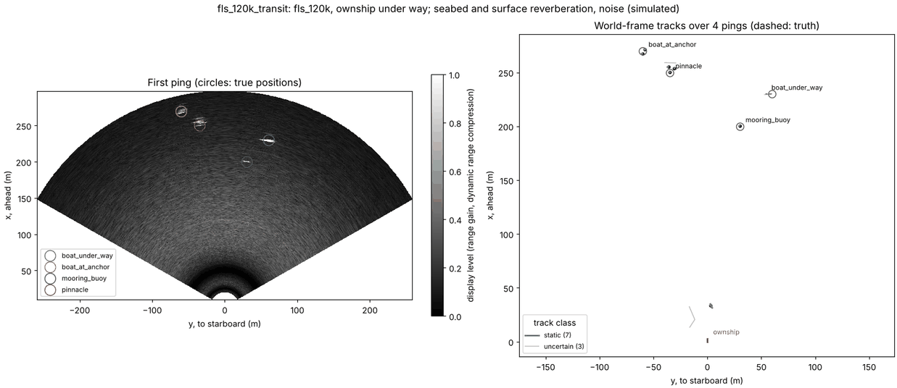
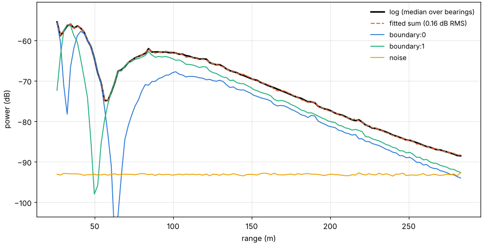
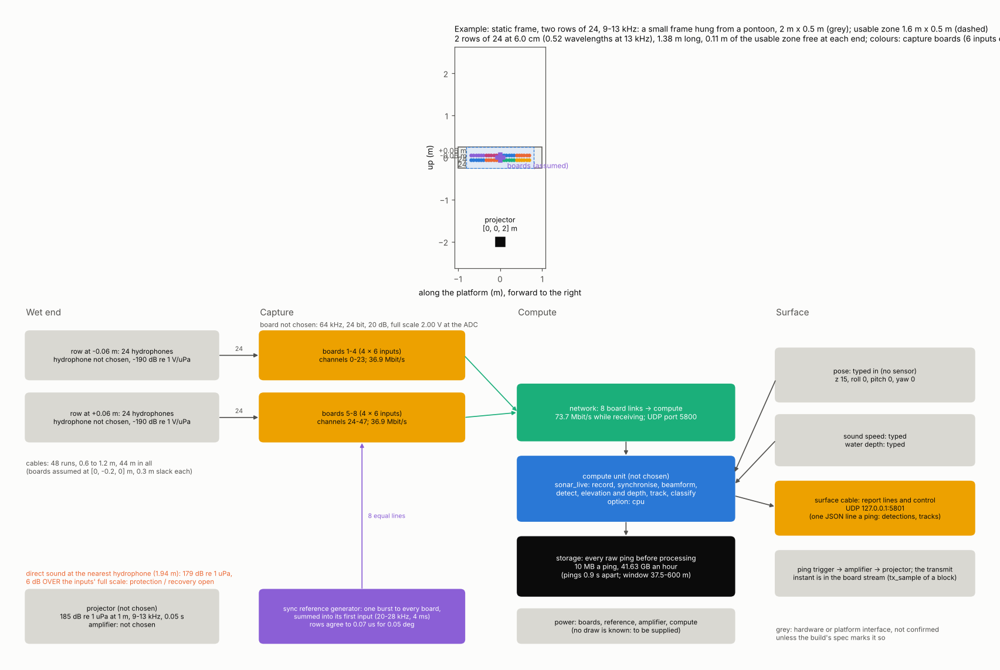
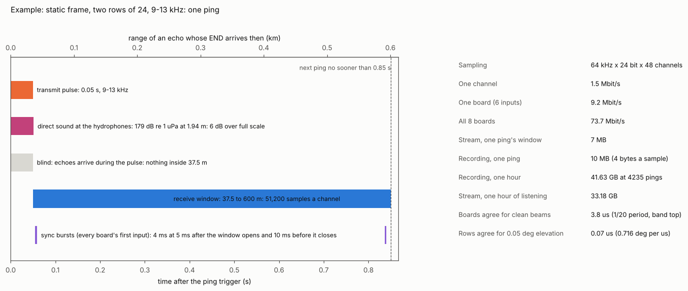
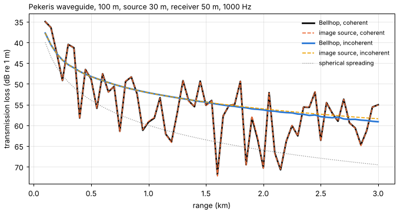

# Worked examples

Twelve things a newcomer can run, in rising order of complexity. Every command below was run for
this file on the tree of decision D-181, on a CPU; every output shown is what came back, trimmed
where marked. They were not rerun for D-182 to D-201; what those decisions changed in them is said
where it applies (the first two items below are fixed). Part of the handoff set: `README.md` (entry point), `SIMULATION.md` (what the
simulator models), `OUTPUTS.md` (the full-size gallery and results), `SOFTWARE.md`, `TESTS.md`.

## What failed or surprised, first

1. **`tools/sonar_live.py --emulate` fails on the shipped multi-board trial scenarios.**
   `tools/sonar_live.py configs/deploy/popoto_testauv_1row.yaml --emulate popoto_testauv_trial_1row --port 0`
   ends with `RuntimeError: sync: reference burst not found on a board; widen search_time or check
   the wiring` on the first ping. Cause, found and confirmed (example 7): the receiving `flank_udp`
   source lays out the receive window at the sonar's nominal 1500 m/s, while the scenario's records
   were made at the speed its water gives, 1496.8 m/s (D-140). The window is stated in metres, so
   the two disagree by 0.42 ms at its start and 2.5 ms at its end, and the reference burst at the
   end of the window lies outside the 2 ms search (`sync.SEARCH_TIME`). No block was lost. The same
   path works for a generated build, whose scenarios type 1500 m/s (example 10), and for a
   single-board scenario, where it leaves a +0.2 % range bias instead (1002.3 m for a target at
   1000 m). No test runs `--emulate` with board synchronisation. Not fixed here (code was not to
   be changed); it needs an issue. **Fixed since (D-183, issue `sonar-8zj` closed):** `flank_udp`
   lays the window out at `source.sound_speed`, which `--emulate` sets to the scenario's speed; the
   same command now synchronises four pings (worst residual 0.43 to 0.47 µs) and the single board
   reads 999.5 m, and `tests/python/test_emulate.py` holds it.
2. **The documented self-check numbers of simulator calibration are stale.** `docs/SIM_CALIBRATION.md`
   and `docs/RESULTS.md` say +6.1 dB, 38.0 dB, 0.17 dB RMS; the test and the tool give +5.9 dB,
   38.6 dB, 0.16 dB RMS on this tree (example 9). The test passes; its tolerances are 1 dB.
   **Corrected since:** both documents give the new numbers (D-182).
3. **In quick mode the boat under way is `uncertain`, not `mover`** (example 8): four pings are too
   few for the classifier. Quick runs show that the path works, not what the full-size scene gives.
4. **A plain CFAR on a 20-target grid gives 12 detections for 12 of the targets** (example 12):
   two neighbours at 1 km merge into one detection, three targets at 5 km and all five at 9 km are
   below the threshold chosen, and one detection is false. That is what `detect.cfar` and `detect.cluster` do; the live chain's
   detector is a different one (`docs/DEPLOYMENT.md`, "The detector").

## Setting up

All timings are wall-clock on a shared 4-core x86_64 container (Intel Xeon at 2.1 GHz, no GPU,
Python 3.13, gcc 13.3) with `OMP_NUM_THREADS=2`. On four free cores expect about half.

```bash
W=$PWD                                   # the repository root
B=/tmp/gpusonar-build                    # a build directory outside the tree
OUT=/tmp/gpusonar-examples               # run outputs: recordings are 3 to 80 MB each, never commit them
export PYTHONPATH=$W/python OMP_NUM_THREADS=2
export GPUSONAR_BELLHOP=/path/to/bellhop.exe     # only for examples 5 (12 km) and 11; tools/build_oracles.sh builds it
```

Packages: `README.md` lists them (CMake, Ninja, a C++17 compiler, HDF5, Eigen, OpenMP, pybind11,
NumPy, SciPy, h5py, PyYAML, pytest; matplotlib for pictures; Ceres for motion estimation).
The scripts under `docs/handoff/examples/` are small and are the exact code behind the pictures.

## 1. Build, and run a few test files

```bash
cmake -S $W -B $B -G Ninja -DCMAKE_BUILD_TYPE=Release -DSONAR_BUILD_TESTS=OFF -DSONAR_BUILD_PYTHON=ON \
      -DSONAR_ENABLE_CUDA=OFF -DSONAR_BUILD_HOLOSCAN=OFF \
      -DSONAR_CERES_DIR=/opt/ceres-nosuitesparse -DSONAR_ALLOW_SUITESPARSE=OFF   # this machine's Ceres; leave both out elsewhere
cmake --build $B -j3
python3 -m pytest tests/python/test_record.py tests/python/test_sim.py tests/python/test_live.py -q -p no:cacheprovider
```

Build: 60 steps, **84 s** with three jobs (ninja's log); it puts `_gpusonar.*.so` into
`python/gpusonar/` (an untracked file: do not commit it) and `sonar_live` into `$B/bin/`.
Tests: **53 s**.

```
60 passed, 2 skipped, 2 warnings in 52.12s
```

The two skips are the CUDA tests. `-DSONAR_BUILD_TESTS=ON` adds the GoogleTest programs
(`ctest --test-dir $B -E pytest`). The whole suite is `tools/test.sh` (CPU; many minutes at full
width) or, on a GPU, `tools/gpu_job.sh` (about 45 minutes on an L4 with the oracles): see `TESTS.md`.
Tests that need `build/bin/sonar_live` look for it under `$W/build`.

## 2. Simulate a scenario to a record file and look inside

```bash
python3 -c "
from gpusonar.sim import run_scenario
r = run_scenario('point_grid_flank_32', output='$OUT/point_grid_flank_32.h5')
print(len(r.records), 'record(s),', len(r.scene), 'scatterers, samples', r.records[0].samples.array.shape, r.records[0].samples.array.dtype)"
python3 tools/inspect_tap.py $OUT/point_grid_flank_32.h5 --plot $OUT/ping.png
```

**1.5 s** to simulate (20 point targets, one ping, 32 hydrophones, a 1 s LFM), **12 s** to inspect
and plot. The file is 3.2 MB.

```
1 record(s), 20 scatterers, samples (32, 914583) float32
1 pings; ping 0: 32 channels x 914583 samples at 64000 Hz, RealPassband, starts 134.246 ms after transmit; pulse 6-10 kHz, 1000 ms; array flank_32
channel      rms         peak        clipped   strongest line (kHz)
    0    5.583e-06   5.752e-05    0.000%       6.279
    1    5.334e-06   5.692e-05    0.000%       6.702
    ...                                                  (32 rows)
```



Look at the top left panel: four groups of echoes, from the targets at 1, 3, 5 and 9 km, each
weaker than the last by spreading and absorption; the spectrogram (bottom right) shows each as a
1 s chirp from 6 to 10 kHz. (The tool's title line, the file's path, is cropped from the committed
picture.)

What a record contains, read back through the package (`docs/RECORD_FORMAT.md` has every field):

```python
from gpusonar.sources import make_source
with make_source({"type": "container", "path": f"{OUT}/point_grid_flank_32.h5"}) as src:
    rec = next(iter(src))
```

```
samples    (32, 914583) float32 SampleKind.RealPassband fs 64000.0 start 0.134246 s
transmit   WaveformType.Lfm 6000.0 10000.0 1.0 time_ns 1700000000000000000
geometry   32 rx elements; rx pose (0.0, 0.0, 30.0) (0.0, 0.0, 0.0) (0.0, 0.0, 0.0)
environment sound_speed 1489.8034
metadata   flank_32 Mode.Flank sequence 0 adc_full_scale 2.5 boards 1
navigation 0 INS samples, 0 DVL samples
```

In the HDF5 file each ping is a group (`pings/00000000/{samples, transmit, geometry, environment,
metadata, navigation, calibration}`; samples stored as `int32` ADC counts, 32 × 914583). A
simulated file also has a `truth` group (`platform_position`, `scatterer_position`,
`scatterer_velocity`, `scatterer_amplitude`) and the scenario as typed in the `config_yaml`
attribute. A recording from hardware has the same `pings` and no `truth`. The sound speed is
1489.8 m/s because the scenario states 10 °C and 35 PSU and the speed follows the water (D-140).

## 3. A forward-looking sonar image

```bash
python3 docs/handoff/examples/fls_image.py --out $OUT/fls                 # scene thinned to a quarter
python3 docs/handoff/examples/fls_image.py --out $OUT/fls --density 1.0   # the scenario as shipped
```

**3.3 s** thinned, **5.2 s** at full density: this scene does not need a GPU.

```
scatterers 4712  samples (128, 1654)  simulate 0.7 s  image (2560, 220) in 1.8 s
dynamic range 65.7 dB (peak over median)
```



Look for the sphere at 5 m ahead with its shadow running away from the sonar, the box at 6 m to
the right, and the rocks on the left, each with a shadow. The script is `run_scenario`, then
`recon.fan_image(records, ranges, bearings, interp="sinc", window="hann")`, then the display
mapping `core.drc`. The gallery's version of this scene, with its numbers, is in `OUTPUTS.md`.
The larger FLS scenes with tracking are example 8.

## 4. A SAS image with and without motion estimation

```bash
python3 docs/handoff/examples/sas_motion.py --out $OUT/sas           # thinned as gallery --quick does: 40 pings
python3 docs/handoff/examples/sas_motion.py --out $OUT/sas --full    # wreck_sas as shipped: 80 pings
```

**11 s** thinned, **70 s** full size. Needs a build with Ceres (`core.HAVE_MOTION`).

```
pings 40  scatterers 4066  wavelength 7.48 mm
simulate 9.7 s  one image 0.2 s  motion estimate 0.2 s
true motion unknown to navigation: sway 10.16 mm rms (1.36 wavelengths), heave 8.11 mm rms (1.08 wavelengths)
error of the estimate:             sway 0.26 mm rms (0.035 wavelengths), heave 0.55 mm rms (0.073 wavelengths)
sharpness, navigation only      86.93
sharpness, estimated motion    308.55
sharpness, true motion         306.79
```



Left: imaged along the straight track navigation reports, the box is smeared in azimuth. Middle:
after `motion.estimate_motion` and `motion.apply_motion`. Right: with the true track, which only
a simulation has. The "true motion" line is the rms departure of the true track from its first
position. The thinned seabed is sparse, so the picture is grainy.

Full size (`--full`):

```
pings 80  scatterers 13555  wavelength 7.48 mm
simulate 64.1 s  one image 1.6 s  motion estimate 0.7 s
error of the estimate:             sway 0.39 mm rms (0.053 wavelengths), heave 0.33 mm rms (0.044 wavelengths)
sharpness, navigation only      59.62 / estimated motion 219.62 / true motion 224.55
```

These are the numbers of `docs/figures/gallery.json` (`wreck_sas`: 0.0527 and 0.0443 wavelengths,
59.62, 219.62, 224.55), which came from an NVIDIA L4: host and GPU agree to the digits printed.
**`wreck_sas`, like every shipped SAS scene except `sas_auv_multipath`, is free field: no surface
or bed multipath.** With bed multipath (D-201, `sas_auv_multipath` against its free-field twin) the
bed-bounce copy of every target above the bed is its brightest echo, 2.7 to 6.6 dB over the direct
one, and the sharpness measure falls from 178,767 to 63,747 (issue `sonar-ya2c`), so these images
are the easy case.
The SAS scene that does want a GPU is `sas_minsas_speckle` (445,567 scatterers: 14 minutes on four
cores in the older CPU run, 92 s on an L4): `tools/gallery.py --backend cuda --only sas_minsas_speckle`,
or `GPUSONAR_JOB=gallery GPUSONAR_CERES=1 GPUSONAR_GALLERY_ARGS="--only sas_minsas_speckle" tools/gpu_job.sh`.

## 5. The long-range live chain on a simulated scenario

One deployment file says where pings come from, how they are processed and where results go;
`--scenario` replaces the source with the simulator (`docs/DEPLOYMENT.md`).

### 5a. A small one, both engines (no Bellhop)

```bash
python3 tools/sonar_live.py configs/deploy/popoto_testauv_1row.yaml --scenario popoto_testauv_trial_1row --out $OUT/t_python
python3 tools/sonar_live.py configs/deploy/popoto_testauv_1row.yaml --scenario popoto_testauv_trial_1row --engine cpp --out $OUT/t_cpp
```

**8.5 s** and **7.4 s**, simulation included (four pings of raw 102.4 kHz samples on four boards,
each on its own clock; a +10 dB target at 500 m in 30 m of water).

```
chain settings {"range_cell_m": 2, "cfar_guard_m": 100, "cfar_train_m": 300, "tracker_range_sigma": 15, ... "warnings": ["the receive window covers 750.042 m of whole echoes, less than the detector's guard and training on both sides (800 m): its background comes from fewer cells (cfar.guard_m, cfar.train_m)"], "sonar": {"sound_speed": 1496.824467, "f_low": 4000, "f_high": 6000, ... "sample_rate": 6023.529412, "window_m": 824.8833}}
ping    0  detections   1  tracks {}  1076 ms          (python engine; the cpp engine: 501, 517, 484, 493 ms)
ping    1  detections   1  tracks {}  627 ms
ping    2  detections   1  tracks {"uncertain": 1}  591 ms
ping    3  detections   1  tracks {"static": 1}  577 ms
```

The `chain settings` line (stderr, once) is what the chain derived from the sonar for every size
the file leaves out, and its warnings. The last line of `$OUT/t_python/report.jsonl`, arrivals trimmed:

```json
{"ping": 3, "sequence": 3, "time_ns": 1700000009000000000, "ownship_xyz": [9.0, 0.0, 10.0], "pings_without_nav": 0,
 "sync": {"ok": true, "worst_residual_us": 0.433502, "offsets_us": [0.0, 266.025, 286.075, 64.014], "drift_ppm": [0.0, 0.671, -20.949, -6.213]},
 "detections": [{"range_m": 496.0, "bearing_deg": 12.656, "snr_db": 58.007, "extent_m": 66.0, "first_range_m": 496.875, "arrivals": [[498.0, 54.61], "..."]}],
 "tracks": [{"id": 1, "kind": "static", "parent": null, "x": 117.63, "y": 484.57, "vx": 0.0046, "vy": 0.0273, "speed_m_s": 0.0277, "range_m": 496.60, "mean_snr_db": 57.96, "seen": 1.0}],
 "processing_seconds": 0.577}
```

Every field, with unit, frame and sign, is in the tables of `docs/DEPLOYMENT.md`, "The report
line". Against the truth, which only the simulation knows: the target is at (120, 485) m and at
rest, the track says (117.6, 484.6) and `static`; the boards' true clocks in
`configs/sonars/popoto_testauv_1row_clocks.yaml` are 266, 286 and 64 µs and 0.6, −21.0 and
−6.2 ppm from the first board, and `sync` found them. The two engines' reports differ by at most
3.1e-6 relative in any number, and in nothing else. `$OUT/t_python/taps/ping0000/` holds every
stage of the first ping (`tools/inspect_tap.py` lists it: `raw`, `sync`, `prepare`, `beamform`,
`report`).

### 5b. The 12 km design point (needs Bellhop)

```bash
python3 tools/sonar_live.py configs/deploy/popoto_vehicle.yaml --scenario popoto_12km --out $OUT/live12
python3 docs/handoff/examples/plot_beam_tap.py $OUT/live12/taps/ping0000 --out $OUT/live12_beam.png
```

**5 min 42 s**, nearly all of it the simulation (six pings, Bellhop arrivals, reverberation,
noise); the chain takes about 1 s a ping. On an L4 the gallery's run of this scene takes 52 s.

```
RuntimeWarning: eigenray: arrivals were cut at the cap of 64 per point while more lie within 20 dB of the strongest: 1.4 % of a point's arrival energy is left out. Raise `max_arrivals_cap`, or state `max_arrivals`
ping    0  detections   2  tracks {}  1442 ms
ping    1  detections   1  tracks {}  1026 ms
ping    2  detections   2  tracks {"uncertain": 1}  961 ms
ping    3  detections   1  tracks {"mover": 1}  952 ms
ping    4  detections   1  tracks {"mover": 1}  977 ms
ping    5  detections   1  tracks {"mover": 1}  965 ms
```

The whole report is committed as `examples/live_popoto_12km_report.jsonl`. Its last line, the
`arrivals` list and the `coverage` object trimmed:

```json
{"ping": 5, "sequence": 5, "time_ns": 1700000099500000000, "ownship_xyz": [149.25, 0.0, 10.0], "pings_without_nav": 0, "sync": null,
 "detections": [{"range_m": 12000.75, "bearing_deg": -0.1697, "snr_db": 20.92, "extent_m": 126.0, "first_range_m": 12000.875, "arrivals": [[12016.0, 18.28], "..."]}],
 "tracks": [{"id": 1, "kind": "mover", "parent": null, "x": 184.71, "y": 12000.58, "vx": -6.323, "vy": 0.0325, "speed_m_s": 6.323, "range_m": 12000.63, "mean_snr_db": 22.17, "seen": 1.0}],
 "processing_seconds": 0.965, "coverage": {"...": "..."}}
```

- These are the **current defaults**: `range_m` is the detection's leading edge
  (`chain.cfar.range_estimate: first`, the default since D-158). The echo of the ship is spread
  over 126 m of multipath (`extent_m`), and the range reported is where it starts, 12000.75 m; the
  ship is at 12 km.
- The true ship is 120 m long, at y = 12000 m, moving at −6.0 m/s in x; at this ping's transmit
  time its hull spans x = 143 to 263 m. The track says x = 184.7 m, y = 12000.6 m, vx −6.32 m/s
  (−6.03, −6.05, −6.02 on the three pings before: the last ping's fit is the worst of the four).
- `sync` is `null`: this sonar config has one board. `coverage` is there because the deployment
  file switches it on (`docs/DEPLOYMENT.md`, "The coverage picture"). The committed report predates
  the site's reverberation: its ranges are noise-only and its member says `"reverberation": "not included: ..."`.
  The deployment file now gives the shelf's boundary scattering (`coverage.reverberation`, from the site by
  `gpusonar.environment.boundary_scattering`), so a run today prints `"reverberation": "included"` with
  `max_range_noise_only_m` and `limited_by` per class, and the +5 dB class's reach falls to about 1.2 km from 10 m
  (6.9 km on noise alone). The file is regenerated by the GPU gallery job, not here (issue `sonar-tmvu`; stale since D-227, D-229; still stale at D-240).
- **End-of-run summary.** `tools/sonar_live.py` prints one only when a counter is not zero
  (`sonar_live: {"dropped_blocks": ..., "overrun_pings": ..., "bad_blocks": ..., "reports_split": ...}`
  on stderr); nothing was printed here. The C++ program's summary line is in example 7.



The map the detector saw on the first ping, 241 bearings by 699 range cells: the ship's echo is
the smear from 12.02 to 12.15 km near broadside, and the two circles are the two detections, the
first at the smear's leading edge.

### 5c. Changing one option, in YAML and as key=value

An opt-in from D-181: the LFM range-Doppler correction, `range_doppler: off | ownship | full`,
default `off`. In the deployment file it is a key of `chain`:

```yaml
chain:
  bearings_deg: [-60.0, 60.0, 0.5]
  look: starboard
  range_doppler: full            # opt-in (D-181); default off
```

```bash
python3 tools/sonar_live.py $OUT/popoto_vehicle_rd.yaml --replay $OUT/live12/recording.h5 --out $OUT/rd_py --quiet
```

For the standalone C++ program the same settings are `key=value` arguments, or lines of a file
given with `--options` (the list is at the top of `apps/sonar_live.cpp`).
`tools/sonar_live.py CONFIG --export-template template.h5` prints the complete command for a
deployment file; for a replay only its `key=value` part is needed:

```bash
python3 tools/sonar_live.py configs/deploy/popoto_vehicle.yaml --export-template $OUT/template.h5 --program sonar_live \
    | tr ' ' '\n' | grep '=' | tr -d "'" > $OUT/options.txt          # 69 settings, one per line
$B/bin/sonar_live --replay $OUT/live12/recording.h5 --report $OUT/prog.jsonl --options $OUT/options.txt
$B/bin/sonar_live --replay $OUT/live12/recording.h5 --report $OUT/rd_prog.jsonl --options $OUT/options.txt range_doppler=full
```

**5.4 s** for the program on the six pings. What moved (first detection of each ping, and the track):

```
            default (off)                          range_doppler: full
ping 0  range_m 12021.5                        range_m 12021.733
ping 2  range_m 12008.0   track y 11998.6      range_m 12008.140   track y 11999.3
ping 3  range_m 12004.0   track y 11999.6      range_m 12004.095   track y 12000.1
ping 5  range_m 12000.75  track y 12000.6      range_m 12000.739   track y 12000.6
```

The Python chain with the YAML key and the C++ program with `range_doppler=full` give the same
report to 1.0e-7 relative. A misspelt key is refused by name in both (D-166):

```
sonar_live: unknown option range_dopler; did you mean range_doppler?
```

Another opt-in of the same kind is `tracker.ping_interval_s` (`tracker_ping_interval_s=` for the
program), for a source whose pings carry no transmit time: without it such pings are counted in
`pings_without_time` and a mover is reported static (D-165, D-175;
`tests/python/test_live_cpp.py::test_program_counts_pings_without_time_and_takes_the_ping_interval`).
Every chain key is in `docs/CONFIGURATION.md`.

## 6. A recording and its replay

`--out` (or `output.recording`) writes every raw ping before any processing. Replaying that file
through the same deployment file gives the same reports:

```bash
python3 tools/sonar_live.py configs/deploy/popoto_vehicle.yaml --replay $OUT/live12/recording.h5 --out $OUT/replay_py
python3 tools/sonar_live.py configs/deploy/popoto_vehicle.yaml --replay $OUT/live12/recording.h5 --engine cpp --out $OUT/replay_cpp
```

**7.6 s** and **6.7 s** (the recording of six pings is 35 MB).

```
ping    0  detections   2  tracks {}  1556 ms
...
ping    5  detections   1  tracks {"mover": 1}  937 ms
```

Compared line by line with the report of example 5b, leaving out `processing_seconds`:

| Replay | Against the live run |
| --- | --- |
| Python engine | identical: every field of all six lines |
| C++ engine behind the Python tool | 95 numbers differ, the largest by 1.0e-7 relative; no count, class or text differs |
| `$B/bin/sonar_live --replay` | the same 95, the same 1.0e-7 |

The recording files of the two runs are not byte-identical (HDF5 metadata); the samples are. This
is `tests/python/test_live.py::test_replaying_the_recording_gives_the_same_reports` on a larger
case, and it is how a dive is re-run ashore with other settings.

## 7. The UDP path on one host, and a lost block

The method of `tests/python/test_live.py::test_blocks_over_udp_through_the_chain` and
`test_live_cpp.py::test_program_takes_blocks_over_udp_with_navigation`: six simulated pings of the
32-hydrophone flank array are cut into board blocks by `FlankBoardEmulator` and sent to a UDP
port on this host.

```bash
python3 docs/handoff/examples/udp_loopback.py --out $OUT/udp --program $B/bin/sonar_live
python3 docs/handoff/examples/udp_loopback.py --out $OUT/udp --program $B/bin/sonar_live --drop 1200
```

**12 s** and **17 s**.

```
stream: 6 pings, 6000 blocks of 128 samples x 32 channels, dropping none
RuntimeWarning: flank_udp: asked for a 8388608-byte socket buffer, the system granted 4194304 (0.68 s of the stream): raise net.core.rmem_max, or blocks may be lost while a ping is processed
python source flank_udp -> LiveChain:
  ping 0 sequence 0 detections 2 tracks []
  ping 1 sequence 1 detections 2 tracks []
  ping 2 sequence 2 detections 2 tracks ['uncertain', 'uncertain']
  ping 3 sequence 3 detections 2 tracks ['mover', 'mover']
  ping 4 sequence 4 detections 2 tracks ['mover', 'mover']
  ping 5 sequence 5 detections 2 tracks ['mover', 'mover']
  assembler: dropped_pings 0, lost_samples 0, late_blocks 0; source: bad_blocks 0, dropped_blocks 0, overrun_pings 0
C++ program (exit status 0): $B/bin/sonar_live --udp PORT --template template.h5 --nav-port PORT+1 --report report.jsonl --pings 6 idle_seconds=5 bearing_first_deg=-40 ...
  ping 0 sequence 0 detections 2 tracks []
  ...
  ping 5 sequence 5 detections 2 tracks ['mover', 'static']
  end-of-run summary (stderr): sonar_live: 6 pings, 0 dropped, 0 samples lost, 0 bad blocks, 0 blocks late (0 too late), 0 blocks repeated, 0 restarts, 0 pings discarded at stop, 0 pings without navigation, 0 pings without velocity, 0 blocks dropped at the full queue, 0 reports split, 0 report datagrams refused
```

Two things to read here. First, the socket-buffer warning is real on a default Linux host and is
the first thing to fix on a vehicle computer. Second, the Python half says `mover, mover` and the
program says `mover, static`, and the program is right: one target crosses at 3 m/s and one is at
rest, while ownship makes 1.5 m/s. The block stream carries samples and timing, not navigation;
the Python half was given none, so ownship's own motion went onto the resting target. The program
was sent navigation datagrams on its `--nav-port`. Without navigation a moving platform cannot
tell `static` from `mover`.

With block 1200 left out (inside the second ping's receive window):

```
stream: 6 pings, 6000 blocks of 128 samples x 32 channels, dropping [1200]
python source flank_udp -> LiveChain:
  ping 0 sequence 0 detections 2 tracks []
  ping 1 sequence 2 detections 2 tracks []
  ...
  ping 4 sequence 5 detections 2 tracks ['mover', 'mover']
  assembler: dropped_pings 1, lost_samples 128, late_blocks 0; source: bad_blocks 0, dropped_blocks 0, overrun_pings 0
C++ program (exit status 0): ...
  end-of-run summary (stderr): sonar_live: 5 pings, 1 dropped, 128 samples lost, 0 bad blocks, 0 blocks late (0 too late), 0 blocks repeated, 0 restarts, 0 pings discarded at stop, 0 pings without navigation, 0 pings without velocity, 0 blocks dropped at the full queue, 0 reports split, 0 report datagrams refused
```

A lost block costs the one ping whose window it falls in: `sequence` jumps from 0 to 2 while
`ping` (the chain's own count) does not, `dropped` is 1 and `samples lost` is the block's 128.
A block lost between windows costs nothing but is still counted in `lost_samples`
(`tests/python/test_flank_stream.py::test_a_lost_block_costs_one_ping_only`). The counters and
their rules (placement by sample counter, a reorder grace of two blocks, pings lost whole, repeats
against restarts) are decision D-161, amended by D-177; `late`, `repeated` and `restarts` are its
other counters.

**The tool's own rehearsal switch** does the same from a scenario file:

```bash
python3 tools/sonar_live.py configs/deploy/popoto_vehicle.yaml --emulate flank_target_1km --port 0 --out $OUT/emu    # needs Bellhop; 16 s
```

```
ping    0  detections   1  tracks {}  1911 ms
{"ping": 0, "sequence": 0, "time_ns": 0, "ownship_xyz": [-3.5e-17, 0.0, 0.0], ... "detections": [{"range_m": 1002.27, "bearing_deg": -0.0406, "snr_db": 26.56, ...}], ... "coverage": {"error": "the sonar is not below the surface", "age_pings": 0}}
```

The target is at 1000 m; 1002.3 m is 1000 × 1500 / 1496.8: the received record carries the sonar's
nominal sound speed, not the scenario's. `time_ns` is 0 and ownship is at the origin because the
stream carries neither a start time nor navigation, hence the coverage error.

**It fails with a shipped multi-board trial scenario** (finding 1 at the top):

```bash
python3 tools/sonar_live.py configs/deploy/popoto_testauv_1row.yaml --emulate popoto_testauv_trial_1row --port 0 --out $OUT/emu
```

```
  File ".../python/gpusonar/live.py", line 1327, in process
    core.live_decimate_record(record, dict(self._decimate, **blank), self._reference)
RuntimeError: sync: reference burst not found on a board; widen search_time or check the wiring
```

What was checked: the first received ping is in `$OUT/emu/recording.h5` (written before
processing, as designed). Against the simulated ping it starts at 0.200000 s instead of 0.200424 s,
has 112641 samples instead of 112858, and every channel's samples sit 43 samples later in the
record, with equal amplitudes: nothing was lost, the window was laid out for 1500 m/s. Building
the receiving assembler at the scenario's 1496.8 m/s (an experiment in Python, not a code change)
gives four pings with `sync ok` and the target at 496 to 498 m. `tools/sonar_live.py --emulate`
passes the scenario's sonar and overrides to the source and not its sound speed, and `flank_udp`
has no key for one. The generated builds are not affected (example 10).

**One stream per board** (D-184; run 2026-11-25 on the `fix-streams` branch, after D-183 fixed the failure above):
the same trial with each of its four boards sending its own stream (`BoardStreamEmulator`; board k's capture starts
k × 1031 samples before board 0's), merged by the source (`--per-board` sets `source.boards: {}`):

```bash
python3 tools/sonar_live.py configs/deploy/popoto_testauv_1row.yaml --emulate popoto_testauv_trial_1row --per-board --port 0 --out $OUT/boards
```

**15 s.**

```
ping    0  detections   1  tracks {}  1668 ms
ping    1  detections   1  tracks {}  952 ms
ping    2  detections   1  tracks {"uncertain": 1}  1218 ms
ping    3  detections   1  tracks {"static": 1}  930 ms
sonar_live: boards {"boards": {"0": {"blocks": 2400, "used_blocks": 2400, "late_blocks": 0, "repeated_blocks": 0, "restarts": 0, "missing_samples": 0, "bad_blocks": 0, "start_ns": 1700000000000000000}, "1": {"blocks": 2405, "used_blocks": 2401, ..., "start_ns": 1699999999979863281}, "2": {...}, "3": {...}}, "merged_blocks": 2400, "dropped_blocks": 0, ...}
```

Every ping synchronised (worst residual 0.43 to 0.47 µs) and the target at 498, 498, 496, 496 m: what the whole-array
stream gives (above). Boards 1 to 3 sent a few blocks more than they used: the ones before board 0's capture started.

## 8. The gallery in quick mode, and the classification-rules evaluation

```bash
python3 tools/gallery.py --backend host --quick --only fls_120k_transit --no-animation --out $OUT/galq
python3 tools/classify_rules_eval.py --backend host --quick --scenes fls_120k_transit --seeds 1 \
        --captures $OUT/cre/captures --json $OUT/cre/out.json --table $OUT/cre/table.md
```

**26 s** each. Without `--out`, `--quick` writes to `build/gallery_quick/`, never to
`docs/figures`.

```
[fls_120k_transit] {"pings": 4, "scatterers": 785, "detections_per_ping": [10, 11, 10, 13], "confirmed_tracks": 7,
  "classification": {"counts": {"mover": 0, "static": 6, "line": 0, "multipath": 0, "uncertain": 1},
    "targets": {"boat_under_way": {"kind": "uncertain", "speed_m_s": 3.64, "speed_sigma_m_s": 0.69, "truly_moving": true},
                "boat_at_anchor": {"kind": "static", "speed_m_s": 0.37, ...}, "mooring_buoy": {"kind": "static", ...}, "pinnacle": {"kind": "static", ...}},
    "movers_not_on_a_moving_object": 0},
  "targets": {"boat_under_way": {"tracked": true, "position_error_m": 0.0, "centroid_error_m": 0.68, "true_velocity_xy": [0.0, -4.0], "track_velocity_xy": [-0.044, -3.43], ...}, ...},
  "seconds": 25.0, "backend": "host", "quick": true}
```



Left: the first ping's fan with the true positions circled. Right: the tracks in the world frame
over four pings. The committed picture is the tool's figure reduced to 75 % and 128 colours to
stay small (PIL: `im.convert('RGB').resize(..., Image.LANCZOS).quantize(colors=128)`); the numbers are in `examples/gallery_quick_fls_120k_transit.json`. All four objects
are tracked within their outlines; the boat under way has the right velocity (−3.43 against −4.0
m/s after four pings) and is `uncertain`: the full-size run has ten pings (`OUTPUTS.md`).

The evaluation's table (`examples/classify_rules_eval_quick.md`), one scene and one seed:

```
| rule | targets lost (captures) | targets gained | false movers | false movers removed (total) |
| cells=off,row=off | 0 (0) | 0 | 0.0 +- 0.0 [0, 0] | 0.0 +- 0.0 (0) |
| cells=off,row=3 | 0 (0) | 0 | 0.0 +- 0.0 [0, 0] | 0.0 +- 0.0 (0) |
...                                                                          (18 rules)
fls_120k_transit (seeds 2120..2120, 1): baseline targets boat_at_anchor static tracked 1 correct 1; boat_under_way moving tracked 1 correct 0; mooring_buoy static tracked 1 correct 1; pinnacle static tracked 1 correct 1
```

With one thinned seed every rule reads zero: this shows the tool runs, not what the rules do. The
evaluation that decisions were taken on is ten seeds at full size on a GPU:
`GPUSONAR_JOB=clseval GPUSONAR_ORACLES=1 GPUSONAR_CLSEVAL_ARGS="--seeds 10" tools/gpu_job.sh`
(`docs/RESULTS.md`, "Classification: the opt-in detection rules over ten seeds"). The full gallery:
`GPUSONAR_JOB=gallery GPUSONAR_ORACLES=1 GPUSONAR_CERES=1 tools/gpu_job.sh`, 489 s for the 26
scenes on an L4 (`docs/SCENARIOS.md`); on a CPU `tools/gallery.py --backend host` takes the times
in `SIMULATION.md` section 4.

## 9. The simulator-calibration self-check

```bash
python3 docs/handoff/examples/simcal_selfcheck.py --out $OUT/simcal
```

**37 s**. The script writes a five-line scenario (`base: fls_120k_transit`, 45 m of water, direct
paths), simulates a "real" log with three hidden settings into a record file, and runs
`tools/calibrate_sim.py fls --log ... --scenario ... --levels absolute` on it: the pattern of
`tests/python/test_simcal.py`.

```
hidden log: 6 pings in 20 s -> $OUT/simcal/log.h5
hidden: bottom +6.0 dB, surface -4.0 dB, noise 38.0 dB re 1 uPa^2/Hz
$ tools/calibrate_sim.py fls --log $OUT/simcal/log.h5 --scenario $OUT/simcal/dive_start.yaml --levels absolute --ranges 25.0 284.2 0.06 --out $OUT/simcal/dive_cal.yaml --plot $OUT/simcal/simcal_fit.png
levels: absolute
fit: 0.16 dB RMS over 120 range bins from 26 to 283 m
boundary at z = 45 m (lambert): move by +5.9 dB (up to 100% of the profile)
boundary at z = 0 m (chapman_harris): move by -4.0 dB (up to 100% of the profile)
ambient noise: 38.6 dB re 1 uPa^2/Hz at the centre frequency
overrides written to $OUT/simcal/dive_cal.yaml
```



The black curve is the log's range profile (median over bearings, so the boats do not count); the
dashed curve is the fitted sum; `boundary:0` is the bottom, `boundary:1` the surface, and the flat
line the noise, each simulated alone and scaled. The noise never rises above the reverberation in
this log (5 dB below it at 283 m), which is why it is the least well found of the three. (The
tool's title line, the scenario file's path, is cropped from the committed picture.) The overrides file (`examples/simcal_dive_cal.yaml`) is a
scenario fragment: `load_scenario_config("dive_start", yaml.safe_load(open("dive_cal.yaml")))`.

The log came from the same simulator, so this checks the method and nothing about the models; no
real log has been through it (`docs/tasks/REAL_DATA.md`). The numbers differ slightly from the
documented ones (finding 2 at the top).

## 10. From a build spec to configs and diagrams

```bash
python3 tools/build_from_spec.py docs/examples/reference_design/example_static_2x24.yaml --out $OUT/build
python3 tools/build_from_spec.py docs/examples/reference_design/example_static_2x24.yaml --out $OUT/build --self-test --only free
```

**2.9 s** to generate, **8.7 s** with the one self-test.

```
warning: projector.position_m: [0.0, 0.0, 2.0] is outside the platform's face (2 m x 0.5 m about the array's centre): hung apart?
warning: projector.position_m: the projector's direct sound is 179 dB re 1 uPa at the nearest hydrophone (1.94 m away): 4.1 V at the ADC, 6 dB over full scale (2.00 V) for the whole pulse; 48 of 48 hydrophones are overloaded (+5 dB at the farthest, 2.17 m). Needed: 6 dB less gain during the transmit
warning: sync.reference: the first synchronisation burst starts 3.6 ms after the projector's direct sound ends at the farthest hydrophone, and that sound overloads the inputs: how long they take to recover is not given (projector.blanking_after_s). Open the window later (operation.range_m) or length...
example_static_2x24: 16 files under $OUT/build
  example_static_2x24      free       pass  (5.9 s)
example_static_2x24: self-tests PASS ($OUT/build/self_test.json)
```

The warnings are the generator doing its job on the example spec: it works out the projector's
direct sound at the hydrophones and says the inputs would clip. The 16 files:

```
BUILD.md  COMMANDS.txt  chain.options  listen.options  parts.md  performance.json
configs/sonars/example_static_2x24.yaml, example_static_2x24_clocks.yaml
configs/deploy/example_static_2x24.yaml
configs/scenarios/example_static_2x24_{free,shallow,rehearsal,passing,passive}.yaml
diagrams/build_example_static_2x24_{hardware,timing}.png
```



Top: the face with its two rows of 24 hydrophones coloured by capture board, and the projector
2 m below. Bottom: wet end, capture, compute and surface, with the data rates (36.9 Mbit/s a row,
73.7 Mbit/s in all) and, in grey, everything the spec has not chosen. The red note is the
overload warning above. The title runs off the right edge and the row labels on the face overlap:
a cosmetic fault of `tools/build_diagrams.py` on a build this small.



One ping on a time axis: the 0.05 s pulse, its direct sound at the hydrophones, the blind range
(37.5 m), the receive window to 600 m and the two synchronisation bursts; on the right the data
rates and recording sizes that follow (10 MB a ping, 41.63 GB an hour).

`COMMANDS.txt` lists how to use the files without copying them into `configs/`. Its rehearsal
over UDP works for a generated build (**6.6 s**, 48 channels on eight boards of six inputs at 64 kHz, three pings, `sync ok`
with 0.06 µs worst residual, the target at 400.2 m):

```bash
export GPUSONAR_CONFIG_PATH=$OUT/build/configs
python3 tools/sonar_live.py $OUT/build/configs/deploy/example_static_2x24.yaml --emulate example_static_2x24_rehearsal --port 0 --out $OUT/emu3
```

Every field of a spec: `tools/build_from_spec.py --fields`, and `docs/REFERENCE_DESIGN.md`. The
other self-tests (`shallow`, `rehearsal`, `passing`, `passive`, `stream`) run with `--self-test`
alone; `HARDWARE.md` covers what the spec's values mean and which are unconfirmed.

## 11. A comparison against Bellhop

```bash
python3 docs/handoff/examples/bellhop_pekeris.py --out $OUT/bellhop       # needs GPUSONAR_BELLHOP
python3 -m pytest tests/python/test_propagation.py -q -p no:cacheprovider
```

**0.8 s** for the script, **11 s** for the test file.

```
Bellhop 0.1 s, image source 0.00 s; 59 ranges at 1000 Hz
first four arrivals at 0.1, 1, 2.1 and 3 km: delays differ by at most 1.92 microseconds
incoherent transmission loss: median difference 0.099 dB, worst 0.717 dB
coherent transmission loss:   median difference 0.062 dB, worst 0.392 dB
at 3 km: 59.1 dB against 69.5 dB for spherical spreading
12 passed in 10.60s
```



The dashed curves (ours) lie on the solid ones (Bellhop) through every interference null out to
3 km; the dotted line is spherical spreading, 10 dB more loss at 3 km than the waveguide gives.
These are the numbers of `docs/RESULTS.md`, "Propagation, reverberation and noise" (0.06 dB median,
0.4 dB worst). Without `GPUSONAR_BELLHOP` the script stops with a message and the test file gives
`3 passed, 9 skipped`: an oracle test that skips is a test that did not run, and on the GPU suite
`GPUSONAR_REQUIRE_ORACLES=1` turns such a skip into a failure. Bellhop is GPL-3: it runs as a
separate program and is never linked. The KRAKEN, PyRAM and Bellhop3D comparisons
(`SIMULATION.md` section 5) need those programs too (`GPUSONAR_ORACLES=1 tools/gpu_job.sh` builds
them all).

## 12. The Python API in ten lines

```bash
python3 docs/handoff/examples/api_ten_lines.py
```

```python
cfg = load_scenario_config("point_grid_flank_32", {"receiver": {"ambient_noise": {"level_db": 45.0}}})   # a scenario plus one override
record = run_scenario(cfg).records[0]                         # simulate: one ping record, 32 channels
bearings = np.radians(np.arange(-60.0, 60.5, 1.0))            # from broadside
bm = flank.farfield_beamform(record, bearings, window="hann").valid()   # pulse compression and beams: [bearing, range]
power = np.abs(bm.data) ** 2
hits = detect.cfar(power, pfa=1e-9)                           # cell-averaging CFAR along range; the map has 1.9e7 cells
found = detect.cluster(hits, power, bm.ranges, bearings)      # one detection per group of cells
for d in sorted(found, key=lambda d: (round(d.range, -1), d.bearing)):
    print(f"range {d.range:8.1f} m   bearing {np.degrees(d.bearing):6.1f} deg   snr {d.snr_db:5.1f} dB")
```

**11 s**. The method of `tests/python/test_detect.py::test_detection_chain_finds_a_target_in_noise`.

```
range    620.6 m   bearing   25.6 deg   snr  14.2 dB
range   1000.0 m   bearing  -40.2 deg   snr  25.2 dB
range   1000.0 m   bearing  -20.0 deg   snr  25.2 dB
range   1000.0 m   bearing   10.5 deg   snr  25.2 dB
range   1000.0 m   bearing   40.2 deg   snr  25.0 dB
range   3000.0 m   bearing  -40.3 deg   snr  22.5 dB
range   3000.0 m   bearing  -20.1 deg   snr  21.8 dB
range   3000.0 m   bearing    0.1 deg   snr  21.6 dB
range   3000.0 m   bearing   20.5 deg   snr  21.7 dB
range   3000.0 m   bearing   40.1 deg   snr  22.5 dB
range   5000.0 m   bearing  -40.5 deg   snr  14.6 dB
range   5000.0 m   bearing   40.0 deg   snr  14.0 dB
12 detections in a map of 1.9e+07 cells; the scenario has 20 targets, at 1, 3, 5 and 9 km on bearings -40, -20, 0, 20, 40 deg
```

Read it as it is (finding 4): the five targets at 3 km are all there within half a degree; at 1 km
the targets at 0° and 20° are one detection at 10.5° (`detect.cluster` joins touching cells and
reports the group's centroid; why the two touch was not looked into); at 5 km two of five pass
this threshold and at 9 km none; the detection at 620 m is false. With `pfa=1e-6` there are 46 detections;
1e-6 × 1.9e7 cells alone predicts 19 false ones. This is why the live chain does not use this
detector as it stands: its multiscale detector budgets false alarms per ping and has a sidelobe
rule (`chain.cfar.false_alarms_per_ping`, `cfar.sidelobe_margin_db`; `docs/DEPLOYMENT.md`, "The
detector"). For a chain with tracking, use `LiveChain` (example 5); for a chain written as a YAML
file, `tools/sonar_run.py configs/chains/stripmap_points.yaml`.

## Which example needs what

| Example | CPU only | GPU | Bellhop | Holoscan | Sensor Bridge | Measured here |
| --- | --- | --- | --- | --- | --- | --- |
| 1 Build and test files | yes | the two skipped tests | no | no | no | 84 s + 53 s |
| 2 Record file | yes | no | no | no | no | 1.5 s + 12 s |
| 3 FLS image | yes | no | no | no | no | 3 to 5 s |
| 4 SAS and motion | yes (with Ceres) | only `sas_minsas_speckle` | no | no | no | 11 s; full 70 s |
| 5a Live chain, test AUV | yes | no | no | no | no | 8 s per engine |
| 5b Live chain, 12 km | yes | optional (52 s on an L4 in the gallery) | **yes** | no | no | 5 min 42 s |
| 5c Options | yes | no | uses 5b's recording | no | no | 5 s |
| 6 Replay | yes | no | uses 5b's recording | no | no | 7 s |
| 7 UDP, lost block | yes | no | only `--emulate flank_target_1km` | no | no | 12 to 17 s |
| 8 Gallery quick, rules evaluation | yes (quick) | full size: `gpu_job.sh` modes `gallery`, `clseval` | the Popoto and flank scenes | no | no | 26 s each |
| 9 Calibration self-check | yes | no | no | no | no | 37 s |
| 10 Build spec | yes | no | no | no | no | 3 to 9 s |
| 11 Bellhop comparison | yes | no | **yes** | no | no | 1 s; tests 11 s |
| 12 API | yes | no | no | no | no | 11 s |

Nothing here needs Holoscan or Holoscan Sensor Bridge. Those paths (the chain as a Holoscan
application, `tools/sonar_live_hsb.py serve` and `receive` through Sensor Bridge's receiver) are
built and tested only in the GPU job (`GPUSONAR_HOLOSCAN_CPP=1 GPUSONAR_HSB=1 tools/gpu_job.sh`;
`tests/python/test_holoscan_cpp.py`, `test_hsb.py`, `test_hsb_receive.py`); their commands are in
`docs/DEPLOYMENT.md`, "As a Holoscan application" and "Through Holoscan Sensor Bridge's receiver",
and their measured results are in `OUTPUTS.md` and `docs/RESULTS.md`, "Sensor Bridge loopback".
The outputs of everything that wants a GPU (the full-size gallery of 26 scenes, the ten-seed
evaluations, the L4 benchmarks) can be seen without one in `OUTPUTS.md`, `docs/figures/` and
`docs/figures/gallery.json`.
