# Hardware handoff: arrays, capture path, navigation, compute

For a hardware engineer, and for a coding model with no history of this project, who has to continue the
hardware side: the long-range flank array on "Popoto" capture boards, the forward-looking sonar (FLS) and
synthetic aperture sonar (SAS) configurations, the capture path (boards, host, Holoscan / Sensor Bridge, GPU),
navigation and the compute platform.

**Nothing described here is built, and nothing has run on hardware.** No Popoto board, hydrophone, projector,
navigation unit, Jetson, DGX Spark or Sensor Bridge device has been connected to this software
(`docs/STATUS.md`, top). Every value below is a design value, a figure quoted from the owner's plan
(`docs/plan/GPU-FLS-Phased-Plan.pdf`), a statement by the owner, or arithmetic on those. The repository holds
no FPGA or firmware source (section 3, rows L2 and L3).

How to read this file:

- Status words are those of `docs/REFERENCES.md`: **confirmed** (read in the source itself, or stated by the
  owner), **via secondary** (read in an opened document that attributes it; here mostly the owner's plan quoting
  the board maker's interface document, which nobody on this project has opened), **ours** (our derivation or
  choice), **unconfirmed** (a value is in a file and nobody vouches for it).
- A build spec's `confirmed: [...]` list means "measured, from a datasheet in hand, or stated by the owner"
  (`docs/REFERENCE_DESIGN.md`, step 1). Where a spec lists a board figure as `confirmed` because the plan quotes
  it, this file says **via secondary**.
- Per-build numbers come from `docs/handoff/hardware_builds.json`, written by `tools/handoff_hardware.py` from
  the build specs, the generated sonar and deployment files and `python/gpusonar/buildspec.py`. Run the tool
  again after any change to a spec. The same numbers appear in `docs/DESIGN.md` (generated, held by
  `tests/python/test_design.py`).
- Owner questions are cited as **S-n** (`docs/STATUS.md`, "Open questions for the project owner"), **VA-n**
  (`docs/tasks/VEHICLE_ADAPTERS.md`, section 3), **RD-n** (`docs/tasks/REAL_DATA.md`, section 3) and **HN-n**
  (`docs/HOLOSCAN_NOTES.md`, section 10).
- Companion files of this set: `docs/handoff/README.md` (entry point), `docs/handoff/SOFTWARE.md`,
  `docs/handoff/TESTS.md`, `docs/handoff/OUTPUTS.md`, and the refreshed `docs/HANDOFF.md`.

## 1. What is unknown or at risk

Each row is a hardware fact the software rests on that is **not confirmed**. The register in section 3 gives the
value, the file and key, the code that reads it, and how to confirm it.

| # | Unknown or at risk | What rests on it | Owner question |
| --- | --- | --- | --- |
| 1 | The converter: 102.4 kHz, 24 bits, all eight inputs of a board sampled on one instant. None is in the plan; all three are typed assumptions | every sample count, window, data rate, recording size, the decimation plan, the place of the synchronisation reference in the spectrum | S-3, VA-2 |
| 2 | The band: the inputs are used at 4 to 6 kHz; the plan says the board is specified for 10 to 100 kHz and asks its maker only about 6 to 10 kHz. No key flags this on the receive side | the whole long-range design | S-2 |
| 3 | Whether the boards can stream raw samples over Ethernet at all. The plan documents recording to `.wav` files. The UDP block format (`GSFB`) is ours; since D-184 one stream per board is enough (the receivers merge them), but the board forwarder that would turn a board's output into its stream is not written | the live path (`flank_udp`), Sensor Bridge, real time | VA-1, VA-8, VA-9, S-13 |
| 4 | Batching 4, 8 or 12 boards, each on its own clock, and aligning them to 8.3 µs within a row and 0.87 µs between rows. Reached in simulation only (0.40 to 0.49 µs). The plan advises the custom 32-channel board beyond two boards | beams (within a row), elevation and depth (between rows) | S-3, VA-6 |
| 5 | The synchronisation hardware: a reference generator, equal-delay lines and a circuit that sums the burst into the first hydrophone input of every board. Not designed. The plan's own scheme gives the reference an input to itself (7 hydrophones a board) | item 4; the 32-per-row harness on 4 boards | VA-6 |
| 6 | The projector: none chosen. 197 dB re 1 µPa at 1 m rms over 4 to 6 kHz for 1 s is a requirement from the link budget, not a part's figure. Its position on every platform is a placeholder | reach, the 12 km design point, the direct sound, the blind range | S-4 |
| 7 | The projector's direct sound: 21 to 38 dB over the inputs' full scale at every placeholder position, on every hydrophone. Damage threshold, clamp, gain switching and recovery time of the inputs are unknown | survival of the inputs; the first usable range; the first synchronisation burst (0.8 ms after the direct sound ends on the face) | S-4, VA-7 |
| 8 | The hydrophones: none chosen. −208 dB re 1 V/µPa is the plan's figure for its calibration hydrophone, used here for every array hydrophone. Self-noise, band, depth rating and vertical pattern are unknown | full-scale pressure, overload, noise floor, link budget | no numbered question (parts list, "Array hydrophones"); issue `sonar-mu3` |
| 9 | The transmit trigger: who fires the projector, and how the transmit instant reaches the sample stream to the sample | cutting pings (`PingAssembler` needs `tx_sample`), range zero, every time stamp | VA-5, RD-5 |
| 10 | One clock: board capture time and navigation time are assumed to be the same time base. The transmit time is capture start plus sample index over the nominal rate, so a 25 ppm board clock moves it 90 ms an hour against true time (section 6.4; tested since D-185: 0.18 m of pose at 2 m/s). A configured rate takes it out (`clock_ppm`, default 0); the rates are not measured. Boards on free-running clocks also drift apart: 50 ppm apart leaves the synchronisation search (2 ms) 40 s after capture start unless their rates are configured or captures restart | the pose and attitude taken for each ping; tracks that drift with ownship | VA-4, VA-11 |
| 11 | The navigation unit: named by the owner (SPRINT-Nav); no datasheet or interface document seen. Message, rate, time base, latency and accuracy are unknown. The mapping is a template (`configs/nav/sprintnav_template.yaml`). The test AUV's unit is not named | pose, roll in every elevation, water depth, local sound speed | S-6, VA-10 to VA-13, VA-15 |
| 12 | The lever arm and mounting rotation from the navigation unit to the array are zero until surveyed (D-167). The array's velocity is not corrected for the lever arm | array position; a constant bias in every bearing and elevation | VA-14 |
| 13 | Rows on the face: one row is 1.1 dB short at 12 km (detection probability 0.22 on one ping); two rows cannot tell elevations 11.5° apart | how many boards and hydrophones are bought | S-1 |
| 14 | Row pitch 0.15 m is 0.60 wavelengths at 6 kHz: no grating lobe only within ±42° of broadside, while every deployment file steers to ±60° (a validator warning on five of six builds) | false bearings beyond ±42° at the top of the band | S-31; issue `sonar-68e` |
| 15 | The static frame: size, hanging depth, tilt sensor or not, projector on the frame or apart, cabling, where the compute sits | builds 2 and 3 | S-5 |
| 16 | Sound speed and water depth sensing: which sensors, where they sit, their accuracy. The sound-speed sensor is taken to sit at the navigation unit | beamforming, depth, the elevation search sector | S-6, S-9 |
| 17 | The computer and the recording volume: not chosen. Timings exist for an NVIDIA L4 and a shared 4-thread CPU only. Nothing is measured on a Jetson or DGX Spark; `docs/JETSON.md` is untested | real time for two and three rows; 45 to 138 GB an hour raw | S-10 |
| 18 | Receive windows (2, 3 and 12.7 km) and where the boards sit (cable lengths assume the array's centre) are choices made here | ping interval, storage, cable harness | S-11 |
| 19 | Target strengths, waters and the coverage site are placeholders | every margin and reach in section 5 | S-7, S-8, S-12 |
| 20 | Sensor Bridge: run only as software loopback with Sensor Bridge's own emulator, version 2.7.0. At the 32-channel 64 kHz test stream it loses nothing; **at the Popoto builds' 32, 64 and 96 channels and 102.4 kHz it lost frames in 12 of 20, 20 of 20 and 20 of 20 real-time runs** in the containers used (a10g-large, socket buffer capped at 212,992 B or 425,984 B; D-186, `docs/DEPLOYMENT.md`), every loss refused by the receiver's full socket buffer. **Located since (D-187, D-188): the loss is at the start of a run**, the first 12 to 20 ms of stream on an L4 while Sensor Bridge's receiver starts (likely the allocation of its queue: read in its source, not traced), nothing later; so **a board must start streaming at least 0.25 s before the first transmit that matters**, and nothing enforces it. A deployed host needs Sensor Bridge's own socket setup (`rmem_max` 31,326,208, an isolated receiver core), untested at these rates: `tools/hsb_host_check.py` checks a host and prints the measurement (D-189); the containers used refuse every such setting. Per-board streams through Sensor Bridge share one data channel (equal channel counts, twelve times the frames at 96 channels) and ran only at `flank_32`'s rate (D-200). A capture board that speaks the Sensor Bridge protocol does not exist and is not designed | the Holoscan capture path | HN-12, S-25 |
| 21 | FLS and SAS front ends: no array, projector or converter is chosen for any of them. Whether the ultrasound reference's front end works at sonar frequencies is not determinable from its source | every `fls_*` and `sas_*` file | HN-5, HN-2 |
| 22 | Power, depth rating (500 m stated by the owner), connectors, mounting and fairing: no figure exists | the mechanical and electrical design | no numbered question (parts list, "Power", "Mounting") |

## 2. System block diagram

What to look at: the colour of each box. Green is software that exists and is tested on simulated input. Blue
is emulation: software standing in for hardware. Grey is hardware that is specified but not chosen, or chosen
but never connected. Red dashed is something that does not exist at all, neither as hardware nor as software.

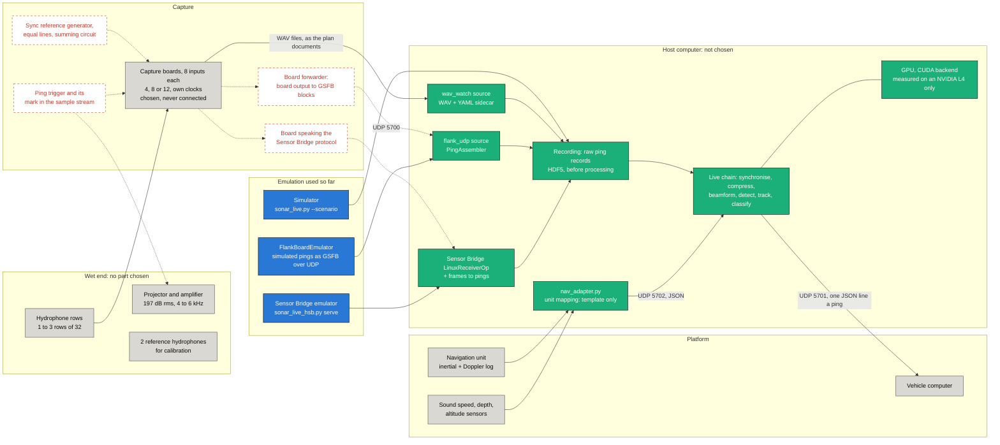

| Part | Exists as | Where |
| --- | --- | --- |
| Hydrophones, projector, amplifier, reference hydrophones | requirement only; no part chosen | `docs/design/popoto_parts.md`, `docs/design/projector_selection.md` |
| Capture boards (Popoto PMM6081) | chosen in the plan; none in hand; behaviour assumed in config | `configs/sonars/popoto_8.yaml`, `configs/builds/*.yaml` `boards:` |
| Synchronisation reference | simulated signal and tested estimator; no generator, lines or summing circuit | `python/gpusonar/sim/receiver.py` `add_reference_signal`, `python/gpusonar/sync.py`, `libs/live/include/sonar/live/sync.hpp` |
| Ping trigger | a field of the block header (`tx_sample`) and of the WAV sidecar (`pings.times`); no hardware | `python/gpusonar/sources/flank_stream.py`, `docs/RECORD_FORMAT.md` "WAV sidecar" |
| Board to host, files | software, tested on synthetic WAV | `python/gpusonar/sources/wav.py`, `wav_watch.py`; `tests/python/test_sources.py`, `test_wav_watch.py` |
| Board to host, UDP | receiver in both engines, tested against the emulator; **the sender on the boards does not exist** | `flank_stream.py` (`FlankUdpSource`, `PingAssembler`, `FlankBoardEmulator`), `libs/live/src/udp_source.cpp`; `tests/python/test_flank_stream.py`, `test_hsb_receive.py`, `test_live_cpp.py` |
| Board to host, Sensor Bridge | receive side as a Holoscan application of Sensor Bridge's `LinuxReceiverOp`; the board side is Sensor Bridge's emulator | `python/gpusonar/sources/hsb.py`, `tools/sonar_live_hsb.py`, `tools/build_hsb.sh`; `tests/python/test_hsb.py` |
| Navigation | the chain's datagram and a generic adapter, tested; the unit's mapping is a template | `python/gpusonar/live.py` `NavListener`, `libs/live/include/sonar/live/udp_source.hpp` `Navigation`, `python/gpusonar/navadapter.py`, `configs/nav/` |
| Recording, chain, report | software, both engines, tested on simulated pings | `python/gpusonar/live.py`, `libs/live`, `apps/sonar_live.cpp` |
| GPU | CUDA backend, run on rented x86_64 machines (T4, L4, A10G, A100); no embedded GPU | `docs/STATUS.md` "Where the code has run" |
| FLS and SAS capture (ultrasound reference rig) | a source driving the reference's native runtime with its simulated hardware; no rig run | `python/gpusonar/sources/nvus_scanner.py`, `nvus.py`; `tests/python/test_nvus_scanner.py`, `test_nvus_adapter.py`; `docs/HOLOSCAN_NOTES.md` section 9.1 |

The repository's two existing pictures of the same path:

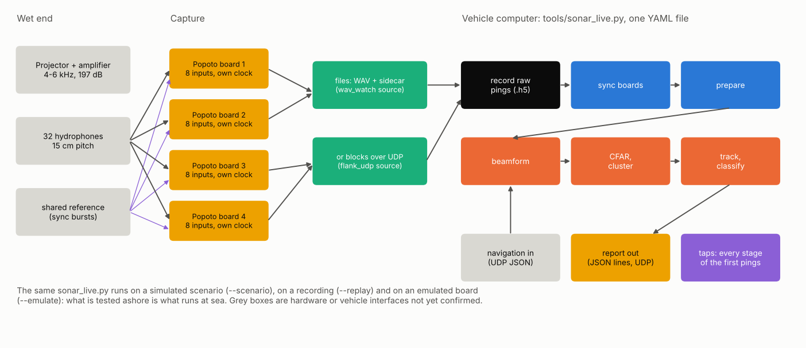

What to look at: the two routes from the boards to the host (files, or blocks over UDP) and the grey boxes,
which are the interfaces not confirmed. It shows the four-board, one-row case.

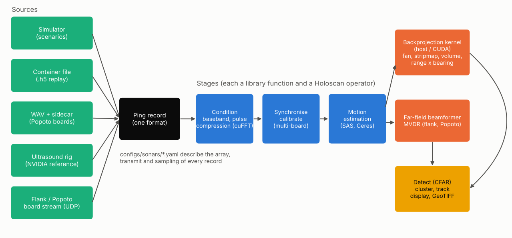

What to look at: one record format between every source and every stage, for all three sonar modes
(`tools/design_report.py` draws it).

## 3. The assumptions register

Every hardware assumption the software makes. "If wrong" says what changes; "confirm by" is a measurement or a
document. Keys are given as `file: key`; the six builds inherit the Popoto values from
`configs/sonars/popoto_8.yaml` through `base:` unless their spec says otherwise, and `unconfirmed` flags add up
through `base:` (D-127). Build spec fields are in `configs/builds/<build>.yaml`; the generated sonar file is
`configs/sonars/<name>.yaml` (names in section 4).

### A. Array geometry

| # | Assumption, value | Status, source | File and key | Consumed by | If wrong | Confirm by |
| --- | --- | --- | --- | --- | --- | --- |
| A1 | 32 hydrophones a row | confirmed (the owner: "Keep at 32") | `configs/builds/modules/long_4p8m.yaml`, `testauv_short.yaml`: `array.count` (in `confirmed`) | `sonar.SonarModel` element positions; `make_record` `geometry/rx_lever_arm`; `buildspec.board_table` | every steering vector, the channel count of the stream | the array drawing |
| A2 | Long row: pitch 0.15 m, 31 gaps = 4.65 m between end hydrophones; half a wavelength at 5 kHz, 0.60 at 6 kHz | ours (`tools/popoto_range_study.py`); flagged `unconfirmed: array.pitch` | `modules/long_4p8m.yaml: array.pitch_m`; `configs/sonars/popoto_long_range.yaml: array.pitch` | beamforming (`libs/live` backprojection map), `buildspec.describe` (beam 3.2°, grating-lobe-free steering ±42°) | bearing scales with the pitch error; beyond ±42° at 6 kHz a grating lobe is in view (section 1, item 14) | survey of the built row; in-water calibration `calibrate.estimate_channel_errors` (writes `calibration/position_offset`) |
| A3 | Short row (test AUV): pitch 0.09 m, 2.79 m | ours; exists only because of that vehicle's span (the owner: "probably like 2-3 span"; 3 m taken); `platform.span_m`, `platform.height_m` unconfirmed | `modules/testauv_short.yaml: array.pitch_m`; `configs/builds/popoto_testauv_1x32.yaml: platform` | as A2; beam 5.3°; row gain against sea noise 12.9 dB, not 15.1 | reach and beam of build 1 | the vehicle's drawing |
| A4 | Row heights: two rows at −0.75, +0.75 m; three at −0.75, −0.20, +0.75 m (outer rows 1.5 m apart), all in one plane (`out: 0`) | ours, from the owner's working value ("the vertical spacing is maybe a 1.5"); flagged `unconfirmed` (`array.layouts.*.rows`, `platform.row_baseline_m`) | build spec `array.heights_m`, `array.out_m`; sonar file `array.layouts.<two_rows or three_rows>.rows` | `python/gpusonar/elevation.py`, `libs/live/include/sonar/live/elevation.hpp` | elevation scales with 1/baseline; repeats move; 1 mm of one row out of plane is 0.038° (`buildspec.describe` `deg_per_mm_out`) | survey; row-offset calibration with sources at known depths, `estimate_channel_errors(..., planar=False)` (`tests/python/test_elevation.py::test_calibration_finds_a_row_mounted_out_of_place_and_removes_the_elevation_bias`) |
| A5 | The face is 9 m × 2 m, flat and vertical; rows stay inside 7 m of it | 9 × 2 m confirmed (the owner); 7 m a working value, unconfirmed (`platform.usable_span_m`) | `configs/builds/popoto_face_*.yaml: platform` | the validator and the diagrams only; no processing reads it | margins, projector room | the owner; the general arrangement drawing |
| A6 | Static frame 5.4 m × 1.6 m, hung at 10 m | ours, placeholders ("NOT given by the owner") | `configs/builds/popoto_static_*.yaml: platform`, `navigation.static_pose` | the typed-in pose (`nav.static`) | the pose of every record of builds 2 and 3 | S-5 |
| A7 | Channel order: channel 0 is the aft-most hydrophone of the lowest row; channels run forward along a row, rows lowest first; the array looks to starboard | ours | sonar file `array.axis`, `array.boresight`; build spec `array.look`, `array.wiring: row_by_row`; deployment `chain.look` | `SonarModel` positions; `metadata/channel_element`; the bearing sign in the report | bearings mirrored about broadside (`chain.look`), or beams that do not form (order) | a tone into one input at a time; a known target (section 7, steps 4 and 14) |
| A8 | Hydrophones are omnidirectional, no element pattern | ours | no `element_width` or `fov` in the Popoto files | simulator, link budget | vertical and horizontal response, row gain | the hydrophone's datasheet pattern |
| A9 | FLS and SAS arrays (section 4.7): element counts, pitches and element sizes | ours, design values; every file lists `array` under `unconfirmed` | `configs/sonars/fls_*.yaml`, `sas_*.yaml`: `array` | the same code paths; `docs/design/derived.json` | resolution, field of view, grating lobes | an array design that does not exist yet |

### B. Band and waveform

| # | Assumption, value | Status, source | File and key | Consumed by | If wrong | Confirm by |
| --- | --- | --- | --- | --- | --- | --- |
| B1 | Band 4 to 6 kHz, centre 5 kHz | ours (D-49; `docs/DESIGN.md` Sec. 5: absorption above, noise and array length below). The board is specified for 10 to 100 kHz per the plan (via secondary): **unconfirmed that the inputs work here** (audit G-5) | `configs/sonars/popoto_long_range.yaml: transmit.waveform.f_start, f_stop`; build spec `projector.band_hz` | simulator, pulse compression, the decimation plan (`libs/live/include/sonar/live/decimate.hpp`: factor 17, 6023.5 Hz), `sync.alignment_tolerance`, the noise level of the budget | another band changes the pitch, the projector, the reference's place in the spectrum; the software follows the file | the board maker's statement on gain and noise at 4 to 6 kHz; a tone sweep into an input |
| B2 | Linear FM sweep, Tukey taper `window_alpha: 0.1`; 1 s on the face, 0.1 s on the test AUV and the static frame | ours; `transmit.waveform.duration` is flagged unconfirmed | sonar file `transmit.waveform.type, duration, window_alpha`; build spec `projector.waveform` | the replica of pulse compression; blind range c T / 2 = 750 m or 75 m; processing gain 10 log BT | 3 dB of budget per factor of two in length; the blind range | what the amplifier and projector can sustain (longest pulse at full drive) |
| B3 | Earlier stage files: `popoto_8` 20 to 35 kHz, 0.5 s, 190 dB; `popoto_8_low` 6 to 10 kHz, 175 dB; `flank_32` 6 to 10 kHz, 1 s, 200 dB | the 20 to 35 kHz, 190 dB transmit: via secondary (the plan quoting the board's specification with its PMT-28 transducer); the rest ours, flagged | those files' `transmit.waveform` | tests and older scenarios use them as fixtures | nothing in the six builds | not needed unless those stages are built |

### C. Converter and front end

| # | Assumption, value | Status, source | File and key | Consumed by | If wrong | Confirm by |
| --- | --- | --- | --- | --- | --- | --- |
| C1 | Sample rate 102.4 kHz per channel | **unconfirmed** ("ADC sample rate" is one of the plan's questions for the maker) | `configs/sonars/popoto_8.yaml: receive.sample_rate`; build spec `boards.sample_rate_hz` | record `sample_rate`; `PingAssembler` window length; `transmit.time_ns` (section 6.4); the decimation plan; data rates and storage (`buildspec.describe`) | every count and rate. Below about 100 kHz the 38 to 48 kHz reference no longer fits under Nyquist and must move | a tone of known frequency into every input; the recording's header (`docs/REFERENCE_DESIGN.md` step 7) |
| C2 | 24-bit signed samples; 3 bytes a sample on the wire, little-endian | **unconfirmed** | `popoto_8.yaml: receive.adc_bits`; deployment `source.sample_bytes` (default 3; `stream_sample_bytes` for `build/bin/sonar_live`). The word length is not in the block header (S-13) | `flank_stream.decode_block`, `full_scale_counts`; `sim/receiver.py` `quantise`; recordings store int32 | the stream decodes to garbage if the two ends disagree; dynamic range | the interface document; a capture of a known tone |
| C3 | All eight inputs of a board are sampled on the same instant | **unconfirmed**; a flag only (`receive.simultaneous_sampling` in the `unconfirmed` list): no code reads a per-channel skew | `popoto_8.yaml: unconfirmed`; build spec `boards.simultaneous` | the simulator and the chain assume zero skew inside a board | a multiplexed converter adds a fixed delay per input: a phase ramp across each board's eight hydrophones | one tone into all eight inputs; the phase between channels. A fixed skew can go into `calibration/delay` |
| C4 | Full scale: 37 mV peak to peak at the input, read as 18.5 mV peak at the connector, × 43 dB = 2.61 V at the ADC | 37 mVpp via secondary (the plan quoting the PMM6081 interface document); that it is referred to the connector is ours | `popoto_8.yaml: receive.adc_full_scale`; build spec `boards.input_full_scale_vpp`, `adc_full_scale_v` | `sim/receiver.py` `apply_adc`; record `metadata/adc_full_scale`; the validator's clipping warning; `sync` clip level; every overload figure. Full-scale pressure 173.3 dB re 1 µPa with C7 | all overload figures and the clipping checks move dB for dB | a calibrated voltage at an input |
| C5 | Input gain 43 dB, fixed | via secondary (the plan quoting the interface document) | `popoto_8.yaml: receive.gain_db`; build spec `boards.gain_db` | simulated levels; record `metadata/hardware_gain_db` | absolute levels; the noise budget | as C4 |
| C6 | AC coupling corner 100 Hz (10 Hz has also been quoted) | via secondary; unconfirmed which | build spec `boards.highpass_hz`; sonar file `hardware.boards.highpass_hz` (description only, not simulated) | only the overload model when asked (`receive.overload.highpass_corner_hz`) | how long a clipped burst holds an input off (D-125) | the interface document; step response of an input |
| C7 | Hydrophone sensitivity −208 dB re 1 V/µPa | **unconfirmed** (the plan's figure for its calibration hydrophone, used for all) | `popoto_8.yaml: receive.sensitivity_db`; `modules/*.yaml: hydrophone.sensitivity_db` | simulated volts; `sonar_equation.noise_rms_volts`; full-scale pressure; overload | a hydrophone 10 dB less sensitive overloads 10 dB less and needs 10 dB quieter inputs | the chosen hydrophone's calibration; a comparison against the reference hydrophone in water |
| C8 | The hydrophone's and the input's own noise is below the sea's: 51 dB re 1 µPa²/Hz at 5 kHz in 5 m/s of wind, which is 15 nV/√Hz at the board input with C7 (4.0 nV/√Hz in a calm sea) | ours (`docs/design/popoto_parts.md`, "Array hydrophones"); no value in any file (`hydrophone.noise_db` is null) | none | the link budget is noise-limited by the sea (`buildspec.budget`, `sim/noise.py`) | every margin falls by the excess | a quiet recording's spectrum (`tools/fit_noise.py`), inputs terminated and then wet |
| C9 | No gain switching or time-varying gain on the Popoto inputs | unknown (`boards.gain_switchable` unset; the plan lists gain options among its questions) | build spec `boards.gain_switchable`; record `metadata/tvg_time`, `tvg_gain_db` carry a ramp if one exists | conditioning divides out a reported ramp | with a switch, 22 dB less gain during the transmit removes the face's overload | the interface document |
| C10 | The inputs survive the direct sound and recover in a known time | **unknown** (`projector.blanking_after_s: null`, `boards.overload_damage_vpp` unset) | build spec; deployment `chain.blanking: {recovery_s, taper_s, mode}` | `python/gpusonar/live.py` (`blanking_options`; `core.live_blank_interval` in `libs/live`); minimum range c (pulse + recovery + taper) / 2 | 0.75 m of blind range per millisecond; a clipped first reference burst flags the board (`sync.flagged`) | bench: recovery against overload level (0, +10, +20, +30 dB, a burst as long as the pulse); the maker's absolute maximum ratings |
| C11 | FLS and SAS converters: 0.5 to 3 MHz, 12 or 16 bits, 1.0 V full scale, −190 dB re 1 V/µPa, 20 dB gain, analogue gain ramps of 80 to 90 dB on `fls_300k` and `fls_750k` | ours, placeholders; `receive` under `unconfirmed` in every file | `configs/sonars/fls_*.yaml`, `sas_*.yaml`: `receive` | simulator; `docs/design/derived.json` (1.0 to 3.1 Gbit/s raw) | everything about those front ends | a front-end design |
| C12 | Ultrasound reference rig: 64 receive channels, 12-bit, 50 MSPS, 128 elements taken as two halves of 64 | confirmed in the reference's source (`docs/HOLOSCAN_NOTES.md` section 1, "Confirmed as briefed") | `configs/sonars/l12_5d.yaml`, `p4_2v.yaml` (`adc_full_scale: 1.0` is a unit, not a voltage) | `sources/nvus.py`, `nvus_scanner.py` | the frame decoder | a rig run; none has been made |

### D. Projector and transmit

| # | Assumption, value | Status, source | File and key | Consumed by | If wrong | Confirm by |
| --- | --- | --- | --- | --- | --- | --- |
| D1 | One projector, separate from the array, a point source with no beam pattern | ours; **no projector is chosen** (`projector.model: null`) | sonar file `transmit.kind: point`; build spec `projector` | simulator; direct sound (an omnidirectional source is the pessimistic case, D-125) | a directional source lowers the electrical power and may lower the direct sound | `docs/design/projector_selection.md`; the chosen part's beam pattern |
| D2 | Source level 197 dB re 1 µPa at 1 m, rms | ours: a requirement from the 12 km budget (D-49), stated as rms (D-102) | `popoto_long_range.yaml: transmit.waveform.source_level_db_rms`; build spec `projector.source_level_db_rms`; a typed copy in each face deployment file, `chain.coverage.budget.source_level_db` | `sonar.peak_pressure_at_1m` (the only place the √2 is applied); `buildspec.budget`; the coverage picture. A record stores the peak level, 200.01 (`docs/RECORD_FORMAT.md`) | margin moves dB for dB; 417 W acoustic if omnidirectional | the reference hydrophone at a measured distance |
| D3 | Projector position, body frame [along, starboard, down] from the array's centre: face [4.0, 0, 0] m; static frame [0, 0, 1.0]; test AUV [0, 0, 0.3]; the base file [0, 0, 1.5] | ours, placeholders | sonar file `transmit.lever_arm`; build spec `projector.position_m` | record `geometry/tx_lever_arm`; the backprojection and the elevation search hold the true path projector to target to hydrophone | range and elevation biased by the position error; the direct-sound level; the multipath bias on depth (`docs/DESIGN.md`, "Position and the multipath depth bias") | a tape; the direct arrival's delay per hydrophone (section 7, step 9) |
| D4 | Amplifier, matching, energy storage, duty (1 s every 17.9 s, 5.6 %) | not chosen; duty is arithmetic on the files | build spec `projector.amplifier: null` | nothing in software | power design | the projector's efficiency and impedance |
| D5 | FLS and SAS source levels 210 and 215 dB | ours, design values | `fls_120k/170k/330k.yaml`, `sas_minsas120.yaml`: `transmit.waveform.source_level_db_rms` | `docs/DESIGN.md` Sec. 5 | the range at which the SNR holds | a projector design |

### E. Ping timing and receive windows

| # | Assumption, value | Status, source | File and key | Consumed by | If wrong | Confirm by |
| --- | --- | --- | --- | --- | --- | --- |
| E1 | Receive window: 75 to 2000 m (test AUV), 75 to 3000 m (static), 750 to 12700 m (face); it opens at the pulse's blind range | ours ("a choice made here, not the owner's"); flagged `unconfirmed: receive.window` | sonar file `receive.window.range`; build spec `operation.range_m` | `PingAssembler` (window start and length in samples), the detector's false-alarm budget, storage | ping interval, samples a ping, recording size | S-11 |
| E2 | Shortest ping interval 2 R / c + T: 2.77 s, 4.10 s, 17.93 s. Nothing in the software schedules pings | arithmetic (`buildspec.describe` `ping_interval_s`) | derived; deployment `source.timeout` follows from it | idle timeout; the tracker takes time from the records | overlapping pings give the earlier one up (`PingAssembler`) | the trigger's design (VA-5) |
| E3 | Nominal sound speed 1500 m/s | ours | sonar file `nominal_sound_speed`; build spec `sound_speed.nominal_m_s` | window in samples, range scale when no measured value arrives | ranges scale with the error | the platform's sensor |
| E4 | Blanking after the pulse: none configured in the shipped deployment files | open: follows C10 | `chain.blanking` (absent) | the same code as C10; the report's `blanking.min_range_m` | the first usable range | C10 |

### F. Boards, synchronisation, clocks

| # | Assumption, value | Status, source | File and key | Consumed by | If wrong | Confirm by |
| --- | --- | --- | --- | --- | --- | --- |
| F1 | Board: Popoto PMM6081, 8 single-ended inputs | via secondary (the plan quoting the interface document); `model`, `inputs` listed `confirmed` in the specs | build spec `boards.model, inputs`; `configs/sonars/popoto_array.yaml: receive.board_size` | `buildspec.board_table`; record `metadata/boards`, `channel_board` | board count and harness | the board in hand |
| F2 | Board count 4, 8, 12 (one, two, three rows), wired row by row: board b carries channels 8b to 8b+7; boards 0 to 3 the lowest row | ours (the owner: "Probably row by row"). The plan advises against more than two batched boards | build spec `array.wiring`; `_clocks` sonar file `receive.boards[].first, count` | `sync.py` works per board; a dead board takes 8 of one row's 32 | with interleaved wiring (`array.interleave`) rows share a board's clock and the between-row clock term goes | the wiring list; how the host tells boards apart (VA-3) |
| F3 | Every board runs on its own free-running sample clock: within ±25 ppm, started within 0.3 ms of the others, 20 ns rms jitter. Per-board streams (D-184) are aligned by their capture starts, so those must agree with true time to about 0.8 ms; their rates go in `source.boards.clock_ppm` (D-185, default 0, unconfirmed) | "own sample clock" via secondary (the plan); the three numbers are ours, placeholders for the simulated boards | build spec `boards.clock_tolerance_ppm`, `clock_offset_max_s`, `jitter_rms_s`, `clocks`; `configs/sonars/*_clocks.yaml: receive.boards[]` (the simulator's truth) | the simulator; the estimator's search (`sync.SEARCH_TIME` 2 ms either side of the expected burst) | a start offset beyond the search loses the burst; a larger drift is still estimated from the two bursts | the report's `sync.offsets_us`, `drift_ppm` over an hour; the run's `clock` estimate (`source.clock`) |
| F4 | Synchronisation as built in the six builds (`popoto_4x8` scheme): one electrical chirp burst, 38 to 48 kHz, 4 ms, 2 mV peak at the ADC (14 µV at the input), wired to every board and **summed into its first hydrophone input**, sent 5 ms after the window opens and 10 ms before it closes | ours (D-32); flagged `unconfirmed` (`receive.reference`, `chain.sync`). The hardware is not designed | `configs/sonars/popoto_4x8.yaml`, `*_clocks.yaml: receive.reference`; deployment `chain.sync.reference` | `sync.estimate_clocks_reference`, `resample_boards`; C++ `libs/live` sync; with decimation the bursts are kept raw (D-129) | no summing circuit means the plan's scheme (F5) and 5 boards a row; unequal line delays read as clock offsets | section 7, step 8 |
| F5 | The plan's wiring (`popoto_4x7`): the reference on a dedicated input of every board (channels 7, 15, 23, 31), 22 to 32 kHz, 0.5 V, leaving 28 hydrophones on four boards | the scheme via secondary (the plan); the burst's parameters ours | `configs/sonars/popoto_4x7.yaml: receive.reference` (`dedicated: true`), `receive.boards[].reference_channel` | `sync.drop_reference_channels`; `tests/python/test_calibration_sync.py::test_dedicated_reference_inputs_leave_28_hydrophones` | not used by the six builds; kept as the fallback | VA-6 |
| F6 | Agreement needed: 8.33 µs within a row (a twentieth of a period at 6 kHz); 0.87 µs between rows for 0.05° of elevation (0.057° per µs at 1.5 m) | ours (`sync.alignment_tolerance`; `buildspec.describe` `clock_us_for_error = baseline × sin(0.05°) / c`) | `sync.reference.tolerance_us` overrides the first; build spec `sync.elevation_error_deg` sets the second | the report's `sync.ok`; the self-test's 1 µs limit | 8.3 µs between rows would be 0.48° (100 m of depth at 12 km) | section 7, step 8 |
| F7 | Other timing sources exist as code: a 1PPS edge per board, and the projector's direct arrival | 1PPS input via secondary (the plan: "1PPS input, battery-backed clock"); both estimators ours, tested | `sync.estimate_clocks_pps`, `estimate_clocks_direct_path`; record `metadata/boards` column 3 (sample index of the 1PPS edge) | `sync.synchronise(method=...)` | fallbacks if the reference cannot be wired | whether the boards record the 1PPS edge to the sample |
| F8 | The transmit instant is in the sample stream: each block names the sample index of the latest transmit and its ping index | ours (the block format); **no hardware provides it** | `flank_stream.py` header fields `tx_sample`, `ping index`; sidecar `pings.times` | `PingAssembler` opens a window at each transmit | without it the stream cannot be cut into pings | VA-5; a trigger line recorded on an input is the simplest check |
| F9 | Capture start is a UTC time in nanoseconds ("PTP time when the board has it"), on the clock navigation uses | ours, assumed (`docs/DEPLOYMENT.md`, "Clock") | block header offset 36; sidecar `recording_start_ns` | `transmit.time_ns` = capture start + `tx_sample` / (sample rate × (1 + `clock_ppm` × 1e-6)), in both engines (`flank_stream.PingAssembler._record`, `libs/live/src/udp_source.cpp`); `clock_ppm` 0 by default (D-185) | section 6.4 | VA-4, VA-11 |

### G. Navigation

| # | Assumption, value | Status, source | File and key | Consumed by | If wrong | Confirm by |
| --- | --- | --- | --- | --- | --- | --- |
| G1 | The vehicle's unit is a SPRINT-Nav (inertial navigation with a Doppler velocity log); the test AUV's unit is not named; the static frame has none | the unit: confirmed (stated by the owner); its figures: none seen | build spec `navigation.unit` (in `confirmed` on the face builds) | names only | nothing until its format is known | S-6 |
| G2 | The chain receives one JSON datagram per fix on UDP 5702 (section 6.5); the unit's own message is converted by `tools/nav_adapter.py` | the datagram ours; the unit's format **unknown** (`configs/nav/sprintnav_template.yaml`: every entry `FILL_IN`, all `unconfirmed`) | deployment `nav.port`; `configs/nav/<unit>.yaml` | `live.NavListener`, C++ `Navigation` | no pose: pings are processed where the record says and counted in `pings_without_nav` | the interface document; a short real log (VA-10) |
| G3 | Attitude at 5 to 10 Hz is enough; fixes are kept 120 s | ours: linear interpolation of a roll of amplitude A, frequency f, sampled every dt is wrong by at most A (2π f dt)² / 8 (`docs/design/popoto_stage2.json`, `navigation.attitude_interpolation_error_deg`: ±5°, 8 s period: 0.39° at 1 Hz, 0.015° at 5 Hz) | mapping `output.rate_hz`; `nav.keep_s` | `attitude_time: arrival` uses the samples around each echo's arrival (up to 17 s after the ping) | elevation error of the size above | the unit's output rate |
| G4 | Frames: position north, east, down in metres; attitude roll, pitch, yaw in radians, rotation z-y-x from NED to the body's forward, starboard, down axes (ASASIN Eq. 2); velocity over ground, NED | ours (`docs/RECORD_FORMAT.md`, "Conventions") | the adapter mapping: `position.frame`, `attitude.order, signs, world, body`, `velocity.frame` | `navadapter.Mapping.convert` | a sign or axis error shows as tracks that move with ownship, or mirrored bearings | `tests/python/test_nav_adapter.py` on a fixture in the unit's exact format; a turn and a roll on the bench |
| G5 | Roll accuracy 0.2° (vehicle), 1.0° (frame without a tilt sensor) | ours, placeholders; flagged `unconfirmed` | deployment `chain.elevation.roll_sigma_deg`; build spec `navigation.roll_sigma_deg` | every elevation and depth sigma | roll is elevation error one for one: 0.2° is 3.5 m of depth at 1 km, 42 m at 12 km (`docs/DESIGN.md`) | the unit's datasheet; a source at known depth, level and rolled |
| G6 | Attitude drifts 0.5°/s when no sample covers an echo's arrival | ours, placeholder | `chain.elevation.attitude_rate_sigma_deg_s` | the sigma added per second beyond the attitude samples | the stated sigma | logged attitude rates |
| G7 | The navigation unit sits at the array's reference point, in the array's axes: lever arm [0, 0, 0] m, mounting rotation [0, 0, 0]° | **unconfirmed, zero until surveyed** (D-167) | `configs/deploy/popoto_vehicle.yaml: nav.lever_arm_m, nav.mount_rpy_deg` (commented out); `nav_lever_arm_m`, `nav_mount_rpy_deg` for `build/bin/sonar_live`. The generated deployment files do not carry the keys yet (`sonar-vjq`) | `live.nav_to_array`, C++ `Navigation::push`: position + R · lever arm, attitude composed with the mounting rotation. The velocity is not corrected (`sonar-0ca`) | the whole lever arm in the array's position; the whole misalignment in every bearing and elevation. In the test without the offset, ownship is about 2.5 m off and a depth reads 28.5 m for 48.0 m | the survey (VA-14); `tests/python/test_nav_lever_arm.py` |
| G8 | Time stamps of the fixes are accurate against the boards' time | **unknown** (`navigation.timestamp_sigma_s` unset in every spec) | build spec; mapping `time.offset_s` (epoch and known latency) | the pose interpolated to `transmit.time_ns` | at a roll rate of 2°/s a 0.1 s error is 0.2° (arithmetic) | the unit's interface document; section 7, step 10 |

### H. Sound speed and water depth

| # | Assumption, value | Status, source | File and key | Consumed by | If wrong | Confirm by |
| --- | --- | --- | --- | --- | --- | --- |
| H1 | The platform measures the local sound speed and sends it in the navigation datagram; the sensor sits at the navigation unit | the owner states the vehicle measures it; the sensor, its place and accuracy unknown (`sonar-vjq`). No default accuracy exists (D-129) | datagram `sound_speed`; else `chain.sound_speed`; record `environment/sound_speed` (the local value, D-111) | beamforming and the angle at the array; the profile ladder | bearing and range scale; the `built` rung refuses to work without an accuracy | the sensor's datasheet; a cast |
| H2 | No sound-speed profile along the path: a mean gradient 0.017 /s (isothermal) known to ±0.05 /s | ours, placeholders, flagged; the owner: no long-range profile | deployment `chain.elevation.gradient_per_s`, `gradient_sigma_per_s`; build spec `sound_speed.rung: gradient_prior` | the depth sigma: range² × sigma / 2c (2400 m at 12 km) | depth in metres beyond a few hundred metres | S-9; an optional dive or cast |
| H3 | Water depth: from the Doppler log's altitude plus depth on the vehicle, typed on the frame; known to 5 m | ours (the owner: "some idea of water depth"); flagged | datagram `altitude`, `bottom_lock`, `water_depth`; `nav.water_depth: {source: altitude}`; `chain.elevation.water_depth`, `water_depth_sigma_m` | the elevation search sector, folding of bottom bounces; two rows need it to choose among their candidates | two rows stay ambiguous; bottom-bounce depths | the echo sounder or chart |

### I. Data link

| # | Assumption, value | Status, source | File and key | Consumed by | If wrong | Confirm by |
| --- | --- | --- | --- | --- | --- | --- |
| I1 | Samples reach the host as `GSFB` version 1 blocks over UDP (layout in section 6.2), one whole-array stream or one stream per board (D-184) | **ours and provisional**; designed for a flank capture board that does not exist; a contract once boards use it | `python/gpusonar/sources/flank_stream.py` (top of file); `libs/live/src/udp_source.cpp` | `FlankUdpSource`, `PingAssembler` in both engines | path A (files) or C (a native decoder) of `docs/tasks/VEHICLE_ADAPTERS.md` instead | VA-1, VA-9 |
| I2 | The assembler takes one block of **every channel of the array** on one sample counter (a block of another channel count is refused). Boards send one stream each: a per-board block names its board (flag bit 1, id at offset 44) and carries that board's channels on its own counter and capture start; `source.boards` (`stream_boards=1`; every receiver, sonar-bwu) merges them into the whole-array stream by the board → channel map, the capture starts and the configured rates (D-184, D-185) | ours, provisional; the header field waits on the owner | block header `flags` bit 1, offset 44; `source.boards` | `BoardMerger` (both engines) in front of the unchanged `PingAssembler` | the board map is wrong: beams do not form (A7); capture starts off by more than about 0.8 ms: boards not synchronised (`sync: reference burst not found`) | VA-3, VA-4, VA-8 |
| I3 | Block size and rates per build | arithmetic (`flank_stream.block_samples_for`; `docs/handoff/hardware_builds.json` `stream`) | see the table under this one | socket buffer sizing | datagrams over 65,507 bytes are refused by the emulator's sender | a packet capture |
| I4 | Receive socket buffer: the larger of 8 MiB and 0.5 s of the stream; the kernel must allow it | ours | deployment `source.buffer_bytes`; `net.core.rmem_max` on the host | `flank_stream.stream_buffer_bytes`; `libs/live/src/derive.cpp`. The granted size is printed, with a warning when it is less | lost blocks while the chain is busy; a lost block discards its ping | `sysctl net.core.rmem_max`; the run's `dropped_blocks` |
| I5 | No loss is tolerated inside a ping; blocks may arrive out of order by up to 2. With per-board streams a board may lag the others by `source.boards.wait_s` (0.05 s); a span a board did not deliver is dropped (default) or zero-filled (`missing`), counted per board | ours (D-161) | `REORDER_BLOCKS`, `MAX_OPEN_PINGS`, `MAX_HELD_BYTES` in `flank_stream.py`; `kReorderBlocks` in `udp_source.hpp` (not exposed as options: `sonar-thu`) | `PingAssembler` | pings dropped and counted (`dropped_pings`, `lost_samples`) | the counters after a bench run |
| I6 | Ports: samples UDP 5700, navigation UDP 5702, report UDP 5701 to 127.0.0.1 | ours, placeholders | deployment `source.port`, `nav.port`, `output.report_udp`; build spec `network` | the three sockets | nothing but configuration | the vehicle's network plan |
| I7 | The file route: one `.wav` per recording (or per channel) with a YAML sidecar carrying the array, the pings and the board map (section 6.3) | the plan documents "recordstart writes .wav files" (via secondary); the sidecar is ours | `docs/RECORD_FORMAT.md`, "WAV sidecar"; deployment `source: {type: wav_watch, directory}` | `sources/wav.py`, `wav_watch.py` | whether all eight inputs land sample-aligned in one file is a plan question for the maker | a first bench recording (RD-1, RD-2) |
| I8 | Through Sensor Bridge a frame is one `GSFB` block of fixed size, a multiple of 128 bytes; 400 samples by default (38,528 bytes for 32 channels) | ours (`sources/hsb.py` `FRAME_SAMPLES`, `frame_bytes`) | `tools/sonar_live_hsb.py --frame-samples` (the same on both sides) | `hsb.FrameReceiver` | a frame size the data plane cannot carry is refused | run at each build's channel count and rate (D-186): 400-sample frames are 38,528, 76,928 and 115,328 B at 256 a second; frames lost at all three in the container (section 1, item 20); 200-sample frames lost more |

Stream rates per build (bytes per second; `docs/handoff/hardware_builds.json`, `stream`; 3 bytes a sample at 102.4 kHz):

| Build | Channels | Samples only | Block: samples, bytes | Blocks a second | With 128-byte headers | Socket buffer asked |
| --- | --- | --- | --- | --- | --- | --- |
| `popoto_testauv_1x32` | 32 | 9,830,400 | 128, 12,416 | 800 | 9,932,800 | 8,388,608 |
| `popoto_static_2x32` | 64 | 19,660,800 | 64, 12,416 | 1600 | 19,865,600 | 9,830,400 |
| `popoto_static_3x32` | 96 | 29,491,200 | 42, 12,224 | 2438.1 | 29,803,276 | 14,745,600 |
| `popoto_face_1x32` | 32 | 9,830,400 | 128, 12,416 | 800 | 9,932,800 | 8,388,608 |
| `popoto_face_2x32` | 64 | 19,660,800 | 64, 12,416 | 1600 | 19,865,600 | 9,830,400 |
| `popoto_face_3x32` | 96 | 29,491,200 | 42, 12,224 | 2438.1 | 29,803,276 | 14,745,600 |

### J. Recording

| # | Assumption, value | Status, source | File and key | Consumed by | If wrong | Confirm by |
| --- | --- | --- | --- | --- | --- | --- |
| J1 | Every raw ping is written before processing, 4 bytes a sample (int32 counts in HDF5): 35 to 666 MB a ping, 45 to 138 GB an hour (section 4) | recording raw is the owner's decision (D-126); sizes are arithmetic (`buildspec.describe`) | build spec `storage.record: raw`; deployment `output.recording` | `libs/io` `RecordWriter`; step 2 of the chain | `decimated` (factor 17) is 5 to 16 GB an hour, and the reference and everything outside the band are gone for good | S-10 |
| J2 | A volume of that size and write rate exists at `/data/sonar` | **unknown** (`storage.capacity_gb` unset); the path is a placeholder | build spec `storage`; deployment `output` | the recorder | the run stops or drops when the volume fills | the computer's specification; a timed write of one ping |

### K. Compute

| # | Assumption, value | Status, source | File and key | Consumed by | If wrong | Confirm by |
| --- | --- | --- | --- | --- | --- | --- |
| K1 | One row may run on a CPU with the decimate-first stage; two or three rows need a GPU | the owner's decision on measured timings (below) | build spec `compute.option` (`decimate_first_cpu` for one row, `gpu` for stacked rows); the validator warns when a CPU option is slower than the ping interval | deployment `chain.decimate`, `chain.backend` | pings fall behind real time | the table below, repeated on the chosen computer |
| K2 | The computer is "any Linux computer with Python 3 and the built library; a GPU is optional" | ours; **no unit chosen** (`compute.unit: null`) | build spec `compute.unit` | — | — | S-10 |

What is measured, and where (seconds per ping for one, two, three rows of 32):

| Case | Machine | 1 / 2 / 3 rows | File |
| --- | --- | --- | --- |
| Scenario-size pings (15,483 complex samples a channel at baseband, 241 bearings), C++ chain, CUDA, **ideal clocks: no board synchronisation** | NVIDIA L4 on an AMD EPYC 7R13 host, 8 threads, 2026-11-19 | 0.0155 / 0.0282 / 0.0395 | `docs/benchmarks/gpu_benchmark_all_l4.json`, group `live`, "engine cpp, doa map, backprojection" (the benchmark leaves `sync` out; D-190 to D-195 changed only that stage and the receive path, so the file was not re-measured) |
| The Popoto trials' pings with board synchronisation (boards on their own clocks; one row decimates first, as its deployment file does), C++ chain / Python chain, after the first ping, median | NVIDIA L4, 4 OpenMP threads, 2026-11-25 | C++ 0.048 / 0.054 / 0.065; Python 0.084 / 0.18 / 0.25 | D-195 (one row, job 6b076cffb6a90bbe997ea8e8), D-192 (two and three rows, job 6b076087b6a90bbe997e9449); `tools/live_chain_timing.py`. Before D-191 the C++ chain took 1.05 to 1.83 s at two and three rows |
| The same on that host's CPU | 8 threads | 0.151 / 0.306 / 0.455 | the same file, `host_s` |
| One full-length raw ping, 0.5 to 13 km at 102.4 kHz, C++ chain, CUDA (ideal clocks: no board synchronisation) | NVIDIA L4, machine loaded (load average 13 to 16) | 0.48 / 1.03 / 1.49 | `docs/design/popoto_stage2.json`, `decimation.timing.cuda.*.chain_full_rate.seconds` |
| The same with the decimate-first stage, CUDA | the same | 0.78 / 1.31 / 1.78 | the same, `chain_decimate_first.seconds` |
| One full-length raw ping, C++ chain, CPU | 4 shared threads, loaded | 13.3 / 25.2 / 53.8 | the same, `decimation.timing.host.*.chain_full_rate.seconds` |
| The same with the decimate-first stage, CPU | the same | 13.1 / 22.9 / 44.2 | the same, `chain_decimate_first.seconds` |
| Jetson (Orin, Thor), DGX Spark, any aarch64 machine | — | **not measured; never built there** | `docs/JETSON.md` ("Untested") |

The ping interval on the face is 17.9 s, so one L4 has a margin of more than ten on a full-length ping. That
figure is one run on a loaded rented machine and says nothing about an embedded GPU: Jetson GPUs run float64
much more slowly than float32 and the kernel does part of its work in float64 (`docs/JETSON.md`, "What to
expect").

### L. Sensor Bridge, Holoscan, FPGA

| # | Assumption, value | Status, source | File and key | Consumed by | If wrong | Confirm by |
| --- | --- | --- | --- | --- | --- | --- |
| L1 | Versions: Holoscan SDK 4.6.0; Sensor Bridge 2.7.0 built against it (emulator, socket receiver, Python bindings). The ultrasound reference pins Sensor Bridge 2.7.0 with Holoscan 4.4.0 and six local patches to the SDK; that build has not been made. Sensor Bridge 3.0.0 needs Holoscan SDK 5 and is not used | versions run: `docs/STATUS.md` "Where the code has run"; the pins: confirmed in the reference's source (`docs/HOLOSCAN_NOTES.md` sections 0, 1) | `tools/build_hsb.sh`; `tools/gpu_job.sh` (`GPUSONAR_HSB=1`, `GPUSONAR_HOLOSCAN_CPP=1`) | `libs/holoscan_ops`, `apps/sonar_live_holoscan.cpp`, `sources/hsb.py` | operator construction and parameters differ between 2.7.0 and 3.0 (`docs/HOLOSCAN_NOTES.md` section 7.2) | which SDK line the target computer supports (HN-1) |
| L2 | **No FPGA code is changed, and none is in this repository.** Any FPGA or board-firmware change needs the owner's approval first | the owner's rule (`docs/HANDOFF.md` section 2); checked: no FPGA source file is tracked; the ultrasound reference's FPGA image is used unchanged (`docs/HOLOSCAN_NOTES.md` section 9) | — | — | — | ask the owner before any such change |
| L3 | The two patches to third-party code are host software only | confirmed (the patch files) | `third_party/patches/holoscan-ultrasound-imaging-24d405e-long-window.patch` (receive window limit in the reference's host C++, D-45); `third_party/patches/hsb-2.7.0-emulator-udp-socket.patch` (the emulator sends through an ordinary UDP socket where raw sockets are refused, opt-in twice, D-79) | `tools/build_nvus_reference.sh`, `tools/build_hsb.sh` | — | — |
| L4 | Receivers by platform: RoCE on ConnectX hosts (DGX Spark, IGX) only; Jetson AGX Orin receives over Linux sockets only; AGX Thor is built without RoCE | confirmed in Sensor Bridge's source and setup guide (`docs/HOLOSCAN_NOTES.md` section 7.3) | — | the flank stream (9.8 to 29.5 MB/s) fits the socket receiver; the 38.4 Gbit/s ultrasound-style capture does not | the choice of computer for FLS and SAS capture | S-25; a run on the hardware |
| L5 | A real board on the Sensor Bridge path must speak its protocol: BOOTP enumeration, the control plane's register reads and writes, RoCE v2 framed data packets, 128-byte end-of-frame metadata, PTP time | confirmed in Sensor Bridge's source (`docs/HOLOSCAN_NOTES.md` section 8, "What a custom capture board would have to supply") | — | `LinuxReceiverOp` | no such board exists; an FPGA with the Sensor Bridge IP or a microcontroller on the emulator's HAL are the two routes named there (HN-12) | a board design; the owner's approval (L2) |
| L6 | Host settings for the socket receiver: `net.core.rmem_max = 31326208`, an isolated receiver core, and the chain's OpenMP threads below the core count | the first two: Sensor Bridge 2.7.0's setup guide (confirmed there); the third ours, measured on L4 and A10G containers (D-162, D-173) | `tools/sonar_live_hsb.py receive --socket-buffer, --receiver-core, --chain-omp-threads` | `hsb.run_receiver` | frames refused by a full socket buffer while the chain runs on a ping; at the Popoto builds' rates, with only the third setting possible in the containers, frames were lost in nearly every run (D-186), at the start of the run (D-187) | the receive statistics (`frames_lost` 0) on the deployed host, at the build's channel count and rate |

## 4. The builds

Six build specs under `configs/builds/`, one software path. Each spec generates its sonar file, a `_clocks`
variant (every board on its own clock, for rehearsals), a deployment file and simulated trials
(`tools/build_from_spec.py`; a test fails if a committed file is not what its spec generates:
`tests/python/test_buildspec.py::test_shipped_specs_are_valid_and_the_committed_files_are_what_they_generate`).
`docs/REFERENCE_DESIGN.md` is the guide to the spec's fields.

**Not committed, generate when needed:** a build's `BUILD.md` (its bring-up checklist with its own tolerances),
`COMMANDS.txt`, `chain.options`, `listen.options`, `parts.md` and `performance.json`:
`tools/build_from_spec.py configs/builds/<build>.yaml --out DIR`, and `--self-test` to run its simulated trials
through both engines. The self-tests are not part of the test suite; all six builds passed them, 42 of 42 on
both engines, at D-142 and D-143 (`docs/STATUS.md`, milestone 14).

Common to all six (section 3 has the status of each): Popoto PMM6081 boards of 8 inputs at 102.4 kHz and
24 bits, 43 dB gain, 2.61 V full scale at the ADC; hydrophones at −208 dB re 1 V/µPa; one projector at 197 dB
rms over 4 to 6 kHz; the shared synchronisation reference summed into the first input of every board;
recording raw; ports 5700, 5702, 5701. **No hydrophone, projector, amplifier, computer or storage volume is
chosen for any build.**

| Build | Stage | Row module | Sonar file | Deployment file | Platform | Navigation | Compute option |
| --- | --- | --- | --- | --- | --- | --- | --- |
| `popoto_testauv_1x32` | 1 | `testauv_short` | `popoto_testauv_1row` | `popoto_testauv_1row` | test AUV hull, 3 m × 0.4 m (placeholders) | unit not named | `decimate_first_cpu` |
| `popoto_static_2x32` | 2 | `long_4p8m` | `popoto_static_2row` | `popoto_static_2row` | frame 5.4 m × 1.6 m at 10 m (placeholders) | typed pose, plumb to 1° assumed | `gpu` |
| `popoto_static_3x32` | 3 | `long_4p8m` | `popoto_static_3row` | `popoto_static_3row` | the same frame | the same | `gpu` |
| `popoto_face_1x32` | 4 | `long_4p8m` | `popoto_face_1row` | `popoto_face_1row` | face 9 m × 2 m (the owner), rows inside 7 m | SPRINT-Nav (the owner) | `decimate_first_cpu` |
| `popoto_face_2x32` | 5 | `long_4p8m` | `popoto_long_range_2row` | `popoto_face_2row` | the same face | the same | `gpu` |
| `popoto_face_3x32` | 6, recommended | `long_4p8m` | `popoto_long_range_3row` | `popoto_vehicle_elevation` | the same face | the same | `gpu` |

Two hand-written deployment files also exist: `configs/deploy/popoto_vehicle.yaml` (one row on
`popoto_long_range`, the example the documents use; it carries the commented-out lever-arm keys) and
`popoto_elevation_rehearsal.yaml`.

In every table below: "detector needs" is one row's SNR after the matched filter and an unweighted row
beamformer that the build's own detector needs, its rows added (`buildspec.detection`, D-117); margins and
detection probabilities are for a steady point echo in sea noise at 5 m/s of wind with spherical spreading and
absorption, no reverberation, no surface image. The "design range" is the far end of the build's receive
window. Ship means the +25 dB reference target and small the +5 dB one: both are placeholders
(`configs/builds/targets/reference_classes.yaml`). All numbers: `docs/handoff/hardware_builds.json`.

The parts lines are from `docs/design/popoto_parts.md` (generated by `tools/parts_list.py`), which also quotes
the plan's own words for each part and lists where the plan and the files disagree.

### 4.1 `popoto_testauv_1x32` (stage 1: test AUV, 1 x 32)

**At risk:** The short row is the one exception to the row design. Its span (3 m) and height (0.4 m) are placeholders; the vehicle's navigation unit is not named; the projector sits 0.30 m from the nearest hydrophone: +37 dB over the inputs' full scale.

**For:** The chain on real boards and under way: capture, synchronisation of four boards, the stream, recording, bearing, range, tracks with ownship's motion taken out. No elevation: there is no room for a second row.

Files: `configs/builds/popoto_testauv_1x32.yaml` (spec), `configs/sonars/popoto_testauv_1row.yaml`, `configs/sonars/popoto_testauv_1row_clocks.yaml`, `configs/deploy/popoto_testauv_1row.yaml`; row module `configs/builds/modules/testauv_short.yaml`.

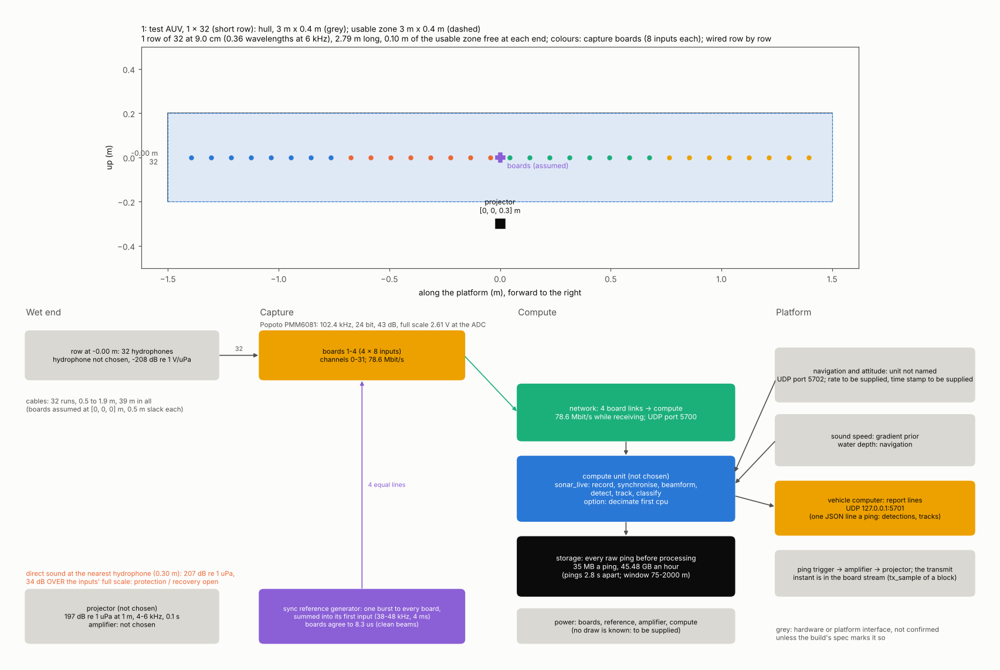

What to look at: the face or frame to scale with the rows coloured by capture board and the projector's
placeholder position; below it, the grey boxes, which are parts or interfaces not confirmed; the orange text,
the direct sound against the inputs' full scale.

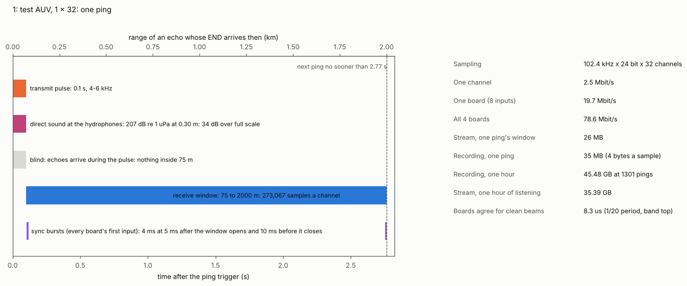

What to look at: the blind stretch during the pulse, the two synchronisation bursts at the ends of the
receive window (the first one sits right after the direct sound ends), and the data rates on the right.

Both are drawn by `tools/build_diagrams.py` from the sonar and deployment files.

**Parts** (none chosen except the board model): 32 array hydrophones, 2 reference hydrophones, 4 boards, 1 projector and amplifier, 1 reference generator with 4 lines, 32 hydrophone cables (0.5 to 1.9 m, 39 m in all, boards assumed at the array's centre), a network of 4 board ports + 1, 1 computer, 1 storage volume, 1 navigation unit.

**Derived numbers** (`docs/handoff/hardware_builds.json`):

| Quantity | Value |
| --- | --- |
| Hydrophones | 1 x 32 = 32, pitch 0.09 m (0.36 wavelengths at the top of the band), row 2.79 m |
| Boards | 4 of 8 inputs; reference summed into inputs [0, 8, 16, 24] |
| Transmit | 4-6 kHz, 0.1 s, 197 dB re 1 uPa at 1 m rms; projector at [0.0, 0.0, 0.3] m |
| Receive window, ping interval | 75-2000 m; 2.77 s at the shortest; 273,067 samples a channel |
| Beam, range cell | 5.3 deg at broadside; 0.375 m before windowing |
| Ambiguity | no grating lobe within +/-90 deg (the deployment file steers [-60.0, 60.0, 0.5]) |
| Elevation | none (one row) |
| Clock agreement | 8.33 us within a row |
| Data rate | 19.7 Mbit/s a board, 78.6 Mbit/s in all = 9,830,400 bytes/s of samples |
| UDP stream | blocks of 128 samples, 12,416 bytes, 800 a second: 9,932,800 bytes/s with headers; socket buffer asked 8,388,608 bytes |
| Recording | 35 MB a ping; 45.5 GB an hour raw, 5.4 decimated (shipped: raw) |
| Direct sound | 207 dB re 1 uPa at the nearest hydrophone (0.30 m): +37 dB against full scale, +24 dB at the farthest; ends 0.101 s; first usable range 76 m |
| Detector needs (one row's SNR) | 15.3 dB for a detection probability of 0.5 on one ping, 17.0 dB for 0.9 |
| Noise-limited reach | 6.9 km (ship, +25 dB) / 2.6 km (small, +5 dB) |
| At its design range, 2 km | ship: margin +24.8 dB, Pd 1.00; small: margin +4.8 dB, Pd 1.00 |

**Simulated trials:** `popoto_testauv_trial_1row` (raw 102.4 kHz, four boards on their own clocks, the vehicle rolling 2°/s, 30 m of water): boards synchronised to 0.47 µs, the target at 500 m found within 10.2 m and 0.28° (`docs/DESIGN.md`, stage 1).

**Tests that exercise it** (under `tests/python/` unless a path is given): `test_buildspec.py` (spec, generated files, row modules, derived numbers, diagrams), `test_deployment_defaults.py`, `test_decimate.py`, `test_direct_overload.py` and `test_blanking.py` (the `popoto_testauv_direct_overload*` scenarios), `test_elevation.py` (stage layouts), `test_sim.py`, `test_source_level.py`, `test_multipath_depth.py`, `test_basin.py`, `test_baseband_noise.py`, `test_hardcoded.py`. Its self-tests: `tools/build_from_spec.py configs/builds/popoto_testauv_1x32.yaml --out DIR --self-test`.

### 4.2 `popoto_static_2x32` (stage 2: static array, 2 x 32)

**At risk:** Two rows 1.5 m apart cannot tell elevations 11.5° apart; in 100 m of water at 2.6 to 3 km they read the surface or the bed, not the target, and say so with a wide sigma (`docs/STATUS.md`, open item 6). Frame size, hanging depth and tilt are placeholders; with no tilt sensor the frame is assumed plumb to 1°.

**For:** The long row and stacked rows in the water for the first time, off the vehicle: the row module the face will carry, eight boards synchronised between rows, elevation as a list of possible angles and one angle where water depth rules the others out.

Files: `configs/builds/popoto_static_2x32.yaml` (spec), `configs/sonars/popoto_static_2row.yaml`, `configs/sonars/popoto_static_2row_clocks.yaml`, `configs/deploy/popoto_static_2row.yaml`; row module `configs/builds/modules/long_4p8m.yaml`.

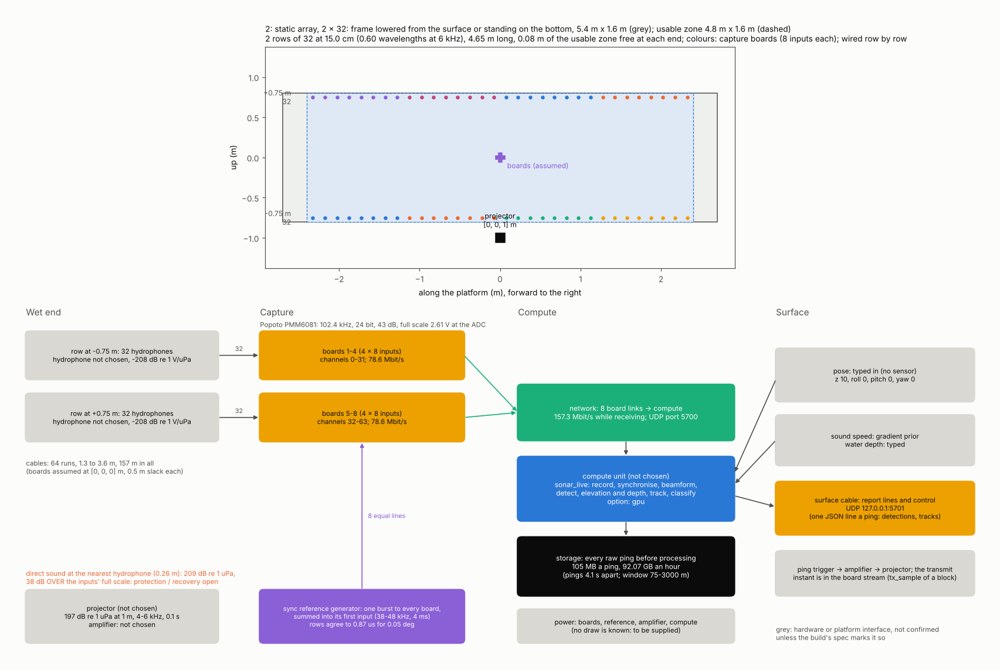

What to look at: the face or frame to scale with the rows coloured by capture board and the projector's
placeholder position; below it, the grey boxes, which are parts or interfaces not confirmed; the orange text,
the direct sound against the inputs' full scale.

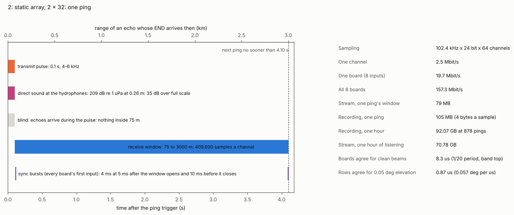

What to look at: the blind stretch during the pulse, the two synchronisation bursts at the ends of the
receive window (the first one sits right after the direct sound ends), and the data rates on the right.

Both are drawn by `tools/build_diagrams.py` from the sonar and deployment files.

**Parts** (none chosen except the board model): 64 array hydrophones, 2 reference hydrophones, 8 boards, 1 projector and amplifier, 1 reference generator with 8 lines, 64 cables (1.3 to 3.6 m, 157 m in all), 8 board ports + 1, 1 computer, 1 storage volume, a tilt and compass sensor or none.

**Derived numbers** (`docs/handoff/hardware_builds.json`):

| Quantity | Value |
| --- | --- |
| Hydrophones | 2 x 32 = 64, pitch 0.15 m (0.60 wavelengths at the top of the band), row 4.65 m, rows at -0.75, +0.75 m |
| Boards | 8 of 8 inputs; reference summed into inputs [0, 8, 16, 24, 32, 40, 48, 56] |
| Transmit | 4-6 kHz, 0.1 s, 197 dB re 1 uPa at 1 m rms; projector at [0.0, 0.0, 1.0] m |
| Receive window, ping interval | 75-3000 m; 4.10 s at the shortest; 409,600 samples a channel |
| Beam, range cell | 3.2 deg at broadside; 0.375 m before windowing |
| Ambiguity | no grating lobe within +/-42 deg (the deployment file steers [-60.0, 60.0, 0.5]); elevation repeats every 11.5 deg, highest -0.6 dB |
| Elevation | 0.18 deg at 20 dB a row; 0.057 deg per us between rows; 0.038 deg per mm a row stands out |
| Clock agreement | 8.33 us within a row; 0.87 us between rows |
| Data rate | 19.7 Mbit/s a board, 157.3 Mbit/s in all = 19,660,800 bytes/s of samples |
| UDP stream | blocks of 64 samples, 12,416 bytes, 1600 a second: 19,865,600 bytes/s with headers; socket buffer asked 9,830,400 bytes |
| Recording | 105 MB a ping; 92.1 GB an hour raw, 10.8 decimated (shipped: raw) |
| Direct sound | 209 dB re 1 uPa at the nearest hydrophone (0.26 m): +38 dB against full scale, +17 dB at the farthest; ends 0.102 s; first usable range 76 m |
| Detector needs (one row's SNR) | 13.0 dB for a detection probability of 0.5 on one ping, 14.6 dB for 0.9 |
| Noise-limited reach | 8.5 km (ship, +25 dB) / 3.3 km (small, +5 dB) |
| At its design range, 3 km | ship: margin +21.6 dB, Pd 1.00; small: margin +1.6 dB, Pd 0.89 |

**Simulated trials:** `popoto_static_trial_2row` (8 boards on their own clocks, tilted 2°, 100 m of water, target 2.6 km off at 60 m): boards synchronised to 0.49 µs; depth read 14, 13, 17, 17 m, one answer with the water-depth bound: the bias of a shallow channel on two rows (`docs/DESIGN.md`, stages 2 and 3).

**Tests that exercise it** (under `tests/python/` unless a path is given): `test_elevation.py` (the static trials, two rows offering candidates), `test_decimate.py`, `test_deployment_defaults.py`, `test_sim.py`, `test_hardcoded.py`; `test_buildspec.py` for the spec and its generated files. Its self-tests: `tools/build_from_spec.py configs/builds/popoto_static_2x32.yaml --out DIR --self-test`.

### 4.3 `popoto_static_3x32` (stage 3: static array, 3 x 32)

**At risk:** Twelve boards on their own clocks must agree to 0.87 µs between rows; frame and tilt as for build 2. The middle row's height (−0.20 m) is chosen for the lowest repeat (−4.2 dB) at this baseline only.

**For:** The recommended row arrangement, still off the vehicle: one elevation and a depth, a passing target tracked with its depth, listening with elevations.

Files: `configs/builds/popoto_static_3x32.yaml` (spec), `configs/sonars/popoto_static_3row.yaml`, `configs/sonars/popoto_static_3row_clocks.yaml`, `configs/deploy/popoto_static_3row.yaml`; row module `configs/builds/modules/long_4p8m.yaml`.

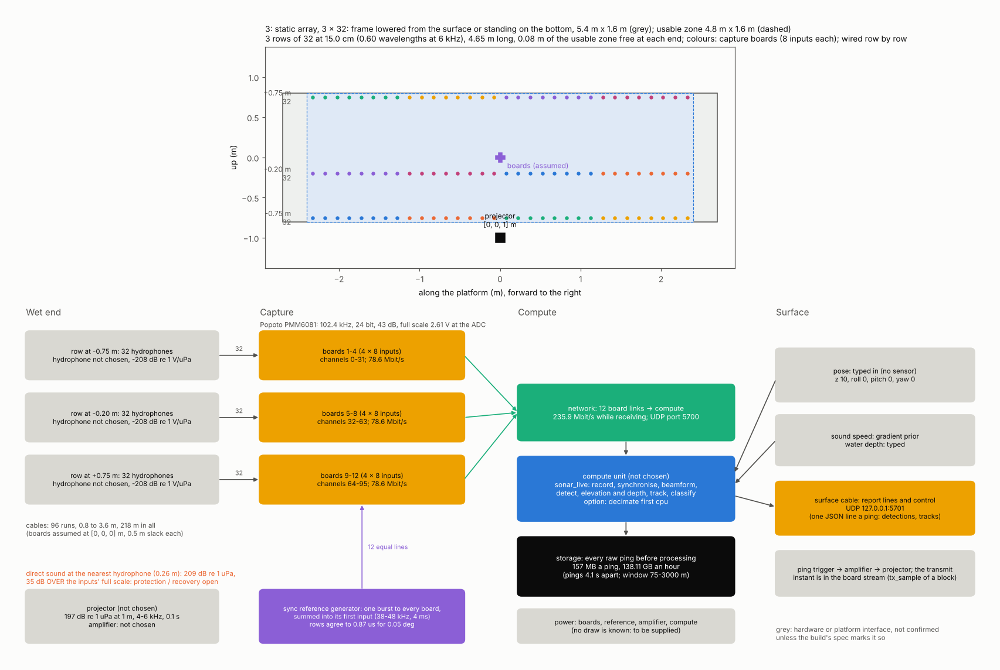

What to look at: the face or frame to scale with the rows coloured by capture board and the projector's
placeholder position; below it, the grey boxes, which are parts or interfaces not confirmed; the orange text,
the direct sound against the inputs' full scale.

What to look at: the blind stretch during the pulse, the two synchronisation bursts at the ends of the
receive window (the first one sits right after the direct sound ends), and the data rates on the right.

Both are drawn by `tools/build_diagrams.py` from the sonar and deployment files.

**Parts** (none chosen except the board model): 96 array hydrophones, 2 reference hydrophones, 12 boards, 1 projector and amplifier, 1 reference generator with 12 lines, 96 cables (0.8 to 3.6 m, 218 m in all), 12 board ports + 1, 1 computer, 1 storage volume, a tilt and compass sensor or none.

**Derived numbers** (`docs/handoff/hardware_builds.json`):

| Quantity | Value |
| --- | --- |
| Hydrophones | 3 x 32 = 96, pitch 0.15 m (0.60 wavelengths at the top of the band), row 4.65 m, rows at -0.75, -0.20, +0.75 m |
| Boards | 12 of 8 inputs; reference summed into inputs [0, 8, 16, 24, 32, 40, 48, 56, 64, 72, 80, 88] |
| Transmit | 4-6 kHz, 0.1 s, 197 dB re 1 uPa at 1 m rms; projector at [0.0, 0.0, 1.0] m |
| Receive window, ping interval | 75-3000 m; 4.10 s at the shortest; 409,600 samples a channel |
| Beam, range cell | 3.2 deg at broadside; 0.375 m before windowing |
| Ambiguity | no grating lobe within +/-42 deg (the deployment file steers [-60.0, 60.0, 0.5]); elevation repeats every 11.5 deg, highest -4.2 dB |
| Elevation | 0.18 deg at 20 dB a row; 0.057 deg per us between rows; 0.038 deg per mm a row stands out |
| Clock agreement | 8.33 us within a row; 0.87 us between rows |
| Data rate | 19.7 Mbit/s a board, 235.9 Mbit/s in all = 29,491,200 bytes/s of samples |
| UDP stream | blocks of 42 samples, 12,224 bytes, 2438.1 a second: 29,803,276 bytes/s with headers; socket buffer asked 14,745,600 bytes |
| Recording | 157 MB a ping; 138.1 GB an hour raw, 16.2 decimated (shipped: raw) |
| Direct sound | 209 dB re 1 uPa at the nearest hydrophone (0.26 m): +38 dB against full scale, +17 dB at the farthest; ends 0.102 s; first usable range 76 m |
| Detector needs (one row's SNR) | 11.5 dB for a detection probability of 0.5 on one ping, 13.1 dB for 0.9 |
| Noise-limited reach | 9.0 km (ship, +25 dB) / 3.5 km (small, +5 dB) |
| At its design range, 3 km | ship: margin +23.0 dB, Pd 1.00; small: margin +3.0 dB, Pd 0.99 |

**Simulated trials:** `popoto_static_trial_3row` (12 boards, tilted 2°, 30 m of water, target 150 m off at 18 m): 0.40 µs; depth 17.1 m on four pings. `popoto_static_free`: track depth errors of 0.0 m at 10, 40 and 90 m. `popoto_static_passing`: one mover at 3.0 m/s (`docs/DESIGN.md`).

**Tests that exercise it** (under `tests/python/` unless a path is given): `test_elevation.py` (`test_static_array_reports_depths_in_free_field_and_tracks_a_passing_target`, `test_static_array_hears_the_elevation_of_noise_sources`), `test_decimate.py`, `test_deployment_defaults.py`, `test_refraction_rays.py`, `test_basin.py`, `test_dict_keys.py`, `test_sim.py`, `test_hardcoded.py`, `test_buildspec.py`. Its self-tests: `tools/build_from_spec.py configs/builds/popoto_static_3x32.yaml --out DIR --self-test`.

### 4.4 `popoto_face_1x32` (stage 4: full face, 1 x 32)

**At risk:** At 12 km one row has −1.1 dB of margin: a detection probability of 0.22 on one ping. At the far end of its own 12.7 km window, −2.6 dB (0.05). No elevation.

**For:** The face to start with: one long row on the vehicle with the vehicle's navigation and the projector in its place (what the direct sound does); the 12 km detection.

Files: `configs/builds/popoto_face_1x32.yaml` (spec), `configs/sonars/popoto_face_1row.yaml`, `configs/sonars/popoto_face_1row_clocks.yaml`, `configs/deploy/popoto_face_1row.yaml`; row module `configs/builds/modules/long_4p8m.yaml`.

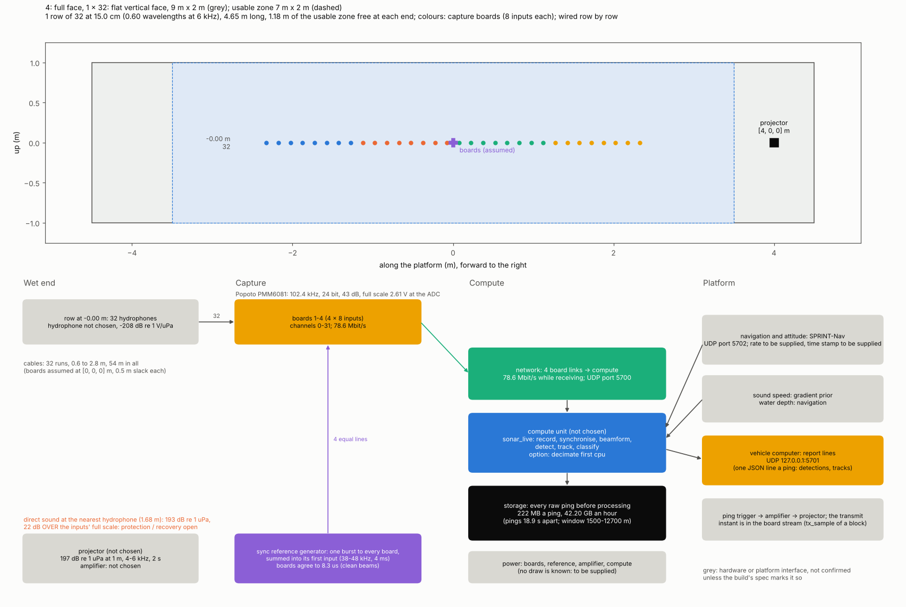

What to look at: the face or frame to scale with the rows coloured by capture board and the projector's
placeholder position; below it, the grey boxes, which are parts or interfaces not confirmed; the orange text,
the direct sound against the inputs' full scale.

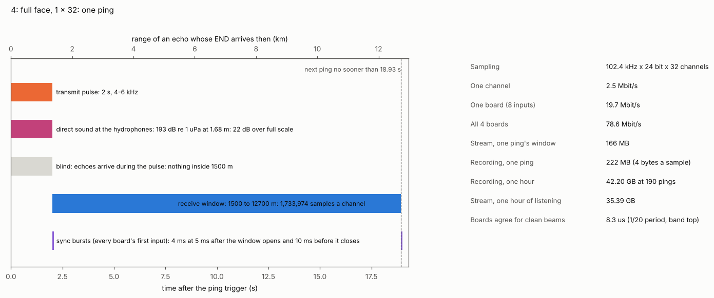

What to look at: the blind stretch during the pulse, the two synchronisation bursts at the ends of the
receive window (the first one sits right after the direct sound ends), and the data rates on the right.

Both are drawn by `tools/build_diagrams.py` from the sonar and deployment files.

**Parts** (none chosen except the board model): 32 array hydrophones, 2 reference hydrophones, 4 boards, 1 projector and amplifier, 1 reference generator with 4 lines, 32 cables (0.6 to 2.8 m, 54 m in all), 4 board ports + 1, 1 computer, 1 storage volume, the vehicle's navigation unit.

**Derived numbers** (`docs/handoff/hardware_builds.json`):

| Quantity | Value |
| --- | --- |
| Hydrophones | 1 x 32 = 32, pitch 0.15 m (0.60 wavelengths at the top of the band), row 4.65 m |
| Boards | 4 of 8 inputs; reference summed into inputs [0, 8, 16, 24] |
| Transmit | 4-6 kHz, 1 s, 197 dB re 1 uPa at 1 m rms; projector at [4.0, 0.0, 0.0] m |
| Receive window, ping interval | 750-12700 m; 17.93 s at the shortest; 1,733,974 samples a channel |
| Beam, range cell | 3.2 deg at broadside; 0.375 m before windowing |
| Ambiguity | no grating lobe within +/-42 deg (the deployment file steers [-60.0, 60.0, 0.5]) |
| Elevation | none (one row) |
| Clock agreement | 8.33 us within a row |
| Data rate | 19.7 Mbit/s a board, 78.6 Mbit/s in all = 9,830,400 bytes/s of samples |
| UDP stream | blocks of 128 samples, 12,416 bytes, 800 a second: 9,932,800 bytes/s with headers; socket buffer asked 8,388,608 bytes |
| Recording | 222 MB a ping; 44.6 GB an hour raw, 5.2 decimated (shipped: raw) |
| Direct sound | 193 dB re 1 uPa at the nearest hydrophone (1.68 m): +22 dB against full scale, +11 dB at the farthest; ends 1.004 s; first usable range 753 m |
| Detector needs (one row's SNR) | 15.8 dB for a detection probability of 0.5 on one ping, 17.4 dB for 0.9 |
| Noise-limited reach | 11.5 km (ship, +25 dB) / 4.7 km (small, +5 dB) |
| At its design range, 12.7 km | ship: margin -2.6 dB, Pd 0.05; small: margin -22.6 dB, Pd 0.00 |
| At 12 km | ship: one row's SNR 14.6 dB, margin -1.1 dB, Pd 0.22; small: margin -21.1 dB, Pd 0.00 |

**Simulated trials:** `popoto_12km` (the same row as `popoto_long_range`): the ship at 12 km detected on 6 of 6 pings and tracked from ping 3 in 100 m over sand, as a mover at 6.2 m/s (image-source paths) (`docs/design/popoto_12km.json`).

**Tests that exercise it** (under `tests/python/` unless a path is given): `test_buildspec.py`, `test_deployment_defaults.py` (the coverage picture and its site), `test_source_level.py`, `test_sim.py`, `test_hardcoded.py`; the `popoto_12km` scenario in `test_live_cpp.py`, `test_detect.py`, `test_detector.py`, `test_classify.py`, `test_realistic_scenes.py`, `tests/cpp/test_live.cpp`. Its self-tests: `tools/build_from_spec.py configs/builds/popoto_face_1x32.yaml --out DIR --self-test`.

### 4.5 `popoto_face_2x32` (stage 5: full face, 2 x 32)

**At risk:** Two rows are ambiguous in deep water at short range (a list of angles, not a depth). At 12 km the margin is +1.4 dB; at the far end of the window it is zero.

**For:** Elevation on the vehicle where water is shallow against the range: attitude at each echo's arrival, the list of possible elevation angles and the water-depth bound that reduces it to one, under way.

Files: `configs/builds/popoto_face_2x32.yaml` (spec), `configs/sonars/popoto_long_range_2row.yaml`, `configs/sonars/popoto_long_range_2row_clocks.yaml`, `configs/deploy/popoto_face_2row.yaml`; row module `configs/builds/modules/long_4p8m.yaml`.

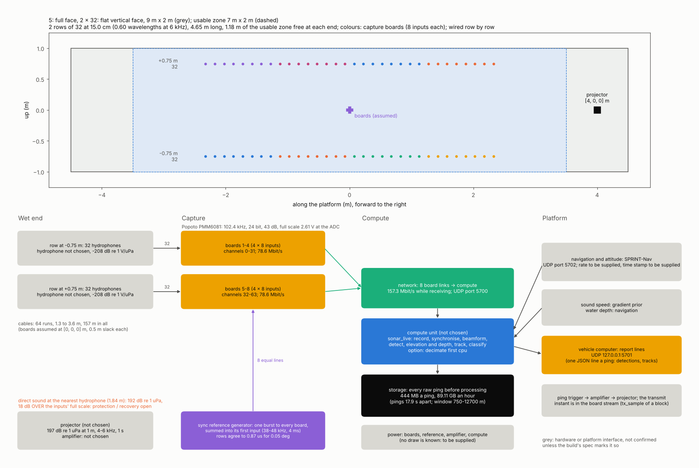

What to look at: the face or frame to scale with the rows coloured by capture board and the projector's
placeholder position; below it, the grey boxes, which are parts or interfaces not confirmed; the orange text,
the direct sound against the inputs' full scale.

What to look at: the blind stretch during the pulse, the two synchronisation bursts at the ends of the
receive window (the first one sits right after the direct sound ends), and the data rates on the right.

Both are drawn by `tools/build_diagrams.py` from the sonar and deployment files.

**Parts** (none chosen except the board model): 64 array hydrophones, 2 reference hydrophones, 8 boards, 1 projector and amplifier, 1 reference generator with 8 lines, 64 cables (1.3 to 3.6 m, 157 m in all), 8 board ports + 1, 1 computer (GPU), 1 storage volume, the vehicle's navigation unit.

**Derived numbers** (`docs/handoff/hardware_builds.json`):

| Quantity | Value |
| --- | --- |
| Hydrophones | 2 x 32 = 64, pitch 0.15 m (0.60 wavelengths at the top of the band), row 4.65 m, rows at -0.75, +0.75 m |
| Boards | 8 of 8 inputs; reference summed into inputs [0, 8, 16, 24, 32, 40, 48, 56] |
| Transmit | 4-6 kHz, 1 s, 197 dB re 1 uPa at 1 m rms; projector at [4.0, 0.0, 0.0] m |
| Receive window, ping interval | 750-12700 m; 17.93 s at the shortest; 1,733,974 samples a channel |
| Beam, range cell | 3.2 deg at broadside; 0.375 m before windowing |
| Ambiguity | no grating lobe within +/-42 deg (the deployment file steers [-60.0, 60.0, 0.5]); elevation repeats every 11.5 deg, highest -0.6 dB |
| Elevation | 0.18 deg at 20 dB a row; 0.057 deg per us between rows; 0.038 deg per mm a row stands out |
| Clock agreement | 8.33 us within a row; 0.87 us between rows |
| Data rate | 19.7 Mbit/s a board, 157.3 Mbit/s in all = 19,660,800 bytes/s of samples |
| UDP stream | blocks of 64 samples, 12,416 bytes, 1600 a second: 19,865,600 bytes/s with headers; socket buffer asked 9,830,400 bytes |
| Recording | 444 MB a ping; 89.1 GB an hour raw, 10.5 decimated (shipped: raw) |
| Direct sound | 192 dB re 1 uPa at the nearest hydrophone (1.84 m): +21 dB against full scale, +11 dB at the farthest; ends 1.004 s; first usable range 753 m |
| Detector needs (one row's SNR) | 13.2 dB for a detection probability of 0.5 on one ping, 14.8 dB for 0.9 |
| Noise-limited reach | 12.7 km (ship, +25 dB) / 5.3 km (small, +5 dB) |
| At its design range, 12.7 km | ship: margin -0.0 dB, Pd 0.49; small: margin -20.0 dB, Pd 0.00 |
| At 12 km | ship: one row's SNR 14.6 dB, margin +1.4 dB, Pd 0.87; small: margin -18.6 dB, Pd 0.00 |

**Simulated trials:** `popoto_face_2row_shallow` (target at 60 m, 3 km): read 33, 33, 33, 33 m with the water-depth bound, two candidates without it. `popoto_12km_2row`: the ship detected on 6 of 6 pings (`docs/DESIGN.md`).

**Tests that exercise it** (under `tests/python/` unless a path is given): `test_elevation.py` (`test_two_rows_on_the_face_offer_candidates_and_three_rows_or_a_bounded_sector_decide`), `test_buildspec.py::test_twelve_km_point_with_stacked_rows_detects_and_tracks_the_ship_on_both_engines`, `test_deployment_defaults.py`, `test_detector_device.py`, `test_oneway_sources.py`, `test_tonal.py`, `test_sim.py`, `test_hardcoded.py`. Its self-tests: `tools/build_from_spec.py configs/builds/popoto_face_2x32.yaml --out DIR --self-test`.

### 4.6 `popoto_face_3x32` (stage 6: full face, 3 x 32)

**At risk:** Depth at 12 km is not knowable in metres without a sound-speed profile along the path (±2400 m from the gradient prior alone); roll accuracy (0.2° assumed) is 42 m of depth there. The 12-board synchronisation, the projector and the direct sound are as in section 1.

**For:** The recommended end state: everything, at range. One elevation angle instead of a list, and 1.5 dB of detection over two rows.

Files: `configs/builds/popoto_face_3x32.yaml` (spec), `configs/sonars/popoto_long_range_3row.yaml`, `configs/sonars/popoto_long_range_3row_clocks.yaml`, `configs/deploy/popoto_vehicle_elevation.yaml`; row module `configs/builds/modules/long_4p8m.yaml`.

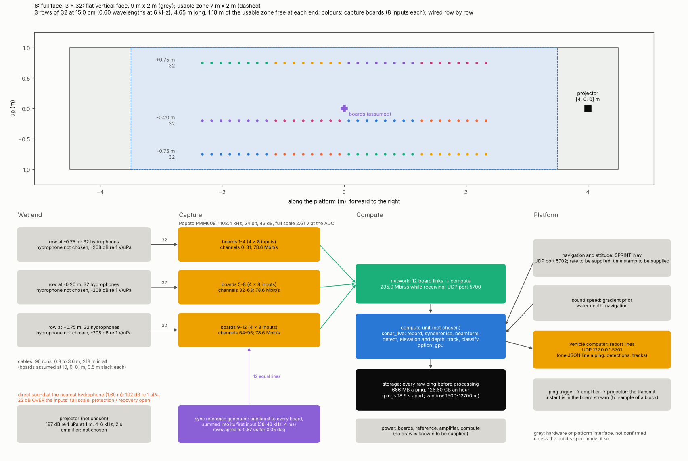

What to look at: the face or frame to scale with the rows coloured by capture board and the projector's
placeholder position; below it, the grey boxes, which are parts or interfaces not confirmed; the orange text,
the direct sound against the inputs' full scale.

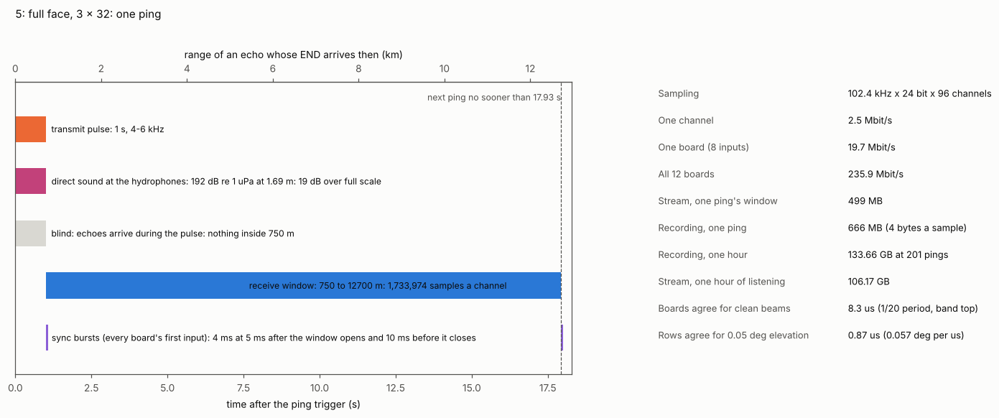

What to look at: the blind stretch during the pulse, the two synchronisation bursts at the ends of the
receive window (the first one sits right after the direct sound ends), and the data rates on the right.

Both are drawn by `tools/build_diagrams.py` from the sonar and deployment files.

**Parts** (none chosen except the board model): 96 array hydrophones, 2 reference hydrophones, 12 boards, 1 projector and amplifier, 1 reference generator with 12 lines, 96 cables (0.8 to 3.6 m, 218 m in all), 12 board ports + 1, 1 computer (GPU), 1 storage volume, the vehicle's navigation unit.

**Derived numbers** (`docs/handoff/hardware_builds.json`):

| Quantity | Value |
| --- | --- |
| Hydrophones | 3 x 32 = 96, pitch 0.15 m (0.60 wavelengths at the top of the band), row 4.65 m, rows at -0.75, -0.20, +0.75 m |
| Boards | 12 of 8 inputs; reference summed into inputs [0, 8, 16, 24, 32, 40, 48, 56, 64, 72, 80, 88] |
| Transmit | 4-6 kHz, 1 s, 197 dB re 1 uPa at 1 m rms; projector at [4.0, 0.0, 0.0] m |
| Receive window, ping interval | 750-12700 m; 17.93 s at the shortest; 1,733,974 samples a channel |
| Beam, range cell | 3.2 deg at broadside; 0.375 m before windowing |
| Ambiguity | no grating lobe within +/-42 deg (the deployment file steers [-60.0, 60.0, 0.5]); elevation repeats every 11.5 deg, highest -4.2 dB |
| Elevation | 0.18 deg at 20 dB a row; 0.057 deg per us between rows; 0.038 deg per mm a row stands out |
| Clock agreement | 8.33 us within a row; 0.87 us between rows |
| Data rate | 19.7 Mbit/s a board, 235.9 Mbit/s in all = 29,491,200 bytes/s of samples |
| UDP stream | blocks of 42 samples, 12,224 bytes, 2438.1 a second: 29,803,276 bytes/s with headers; socket buffer asked 14,745,600 bytes |
| Recording | 666 MB a ping; 133.7 GB an hour raw, 15.7 decimated (shipped: raw) |
| Direct sound | 192 dB re 1 uPa at the nearest hydrophone (1.69 m): +22 dB against full scale, +11 dB at the farthest; ends 1.004 s; first usable range 753 m |
| Detector needs (one row's SNR) | 11.8 dB for a detection probability of 0.5 on one ping, 13.4 dB for 0.9 |
| Noise-limited reach | 13.4 km (ship, +25 dB) / 5.7 km (small, +5 dB) |
| At its design range, 12.7 km | ship: margin +1.4 dB, Pd 0.87; small: margin -18.6 dB, Pd 0.00 |
| At 12 km | ship: one row's SNR 14.6 dB, margin +2.9 dB, Pd 0.99; small: margin -17.1 dB, Pd 0.00 |

**Simulated trials:** `popoto_elevation_free` (rolled 3°, three targets near 1 km at 10, 60, 160 m): track depth errors 0.0, −0.0, −0.1 m. `popoto_elevation_rehearsal` (raw 102.4 kHz, 12 boards on their own clocks, rolling 1.5°/s): boards synchronised to 0.49 µs, depth 60, 60, 61 m for 60 m. `popoto_12km_3row`: the ship detected on 6 of 6 pings (`docs/DESIGN.md`).

**Tests that exercise it** (under `tests/python/` unless a path is given): `test_elevation.py`, `test_buildspec.py` (the 12 km point on both engines; the budget's threshold is the deployed detector's), `test_deployment_defaults.py`, `test_detector.py`, `test_detector_device.py`, `test_direct_overload.py::test_overload_figures_of_the_three_row_face_match_the_sonar_equation`, `test_nav_adapter.py`, `test_nav_lever_arm.py`, `test_profile_ladder.py`, `test_tonal.py`, `test_sim.py`, `test_hardcoded.py`. Its self-tests: `tools/build_from_spec.py configs/builds/popoto_face_3x32.yaml --out DIR --self-test`.

### 4.7 Sonar files that are not builds: FLS, SAS, the earlier flank stages, the ultrasound rig

**None of these has a part chosen. Every file lists its array, transmit and receive sections under
`unconfirmed`.** They exist so the simulator, the imaging chain and the design report have a complete sonar to
work on. Numbers: the files themselves and `docs/design/derived.json` (written by `tools/design_report.py`,
held by `tests/python/test_design.py`).

| File | What it stands for | Array | Band, pulse | Converter in the file | Window | Raw rate while receiving | Status of the figures |
| --- | --- | --- | --- | --- | --- | --- | --- |
| `fls_120k` | the owner's 120 kHz FLS, 300 m, 120° × 20° | 128 at 6.0 mm, 0.77 m | 110 to 130 kHz, 10 ms, 210 dB | 500 kHz, 16 bit | 5 to 300 m | 1024 Mbit/s | centre frequency, range and field of view: the owner's requirement; the rest ours |
| `fls_170k` | the owner's 170 kHz FLS, 450 m, 120° × 5° | 128 at 4.2 mm, 0.54 m | 160 to 180 kHz, 20 ms, 210 dB | 750 kHz, 16 bit | 5 to 450 m | 1536 Mbit/s | as above |
| `fls_330k` | the owner's 330 kHz FLS, 300 m, 120° × 5° | 128 at 2.2 mm, 0.28 m | 315 to 345 kHz, 10 ms, 210 dB | 1.5 MHz, 16 bit | 5 to 300 m | 3072 Mbit/s | as above |
| `sas_minsas120` | SAS modelled on a published 1.09 m, 40 kHz bandwidth system at the owner's 330 kHz | 48 at 22.67 mm, 1.09 m | 310 to 350 kHz, 5 ms, 215 dB | 1.5 MHz, 16 bit | 10 to 200 m | 1152 Mbit/s | the array length and bandwidth from the maker's published sheets (via secondary, the file's header); element count, pitch, pulse, level, sampling ours (D-50) |
| `fls_300k` | the plan's custom 128-element FLS | 128 at 2.5 mm | 270 to 330 kHz, 1 ms, uncalibrated | 1.25 MHz, 16 bit, analogue gain ramp 0 to 90 dB | 1 to 300 m | not in `derived.json` | ours, placeholders |
| `fls_750k` | the plan's mid-range step, 0.5 to 1 MHz, 64 elements, 20 to 50 m | 64 at 1.0 mm | 650 to 850 kHz, 0.5 ms | 3 MHz, 12 bit, gain ramp 0 to 80 dB | 1 to 50 m | not in `derived.json` | band, count and range from the plan (via secondary); the rest ours |
| `sas_auv` | the plan's SAS on an AUV | 16 at 40 mm | 180 to 220 kHz, 2 ms | 1 MHz, 16 bit | 10 to 150 m | not in `derived.json` | ours |
| `sas_rail` | a probe looking sideways from a motorised rail, 0.5 mm steps | the `p4_2v` probe | as `p4_2v` | as `p4_2v` | 1 to 5 m | — | mounting and step ours |
| `l12_5d`, `p4_2v` | ultrasound probes on the ultrasound reference's front end, in a pool | 128 at 0.3 mm; 64 at 0.3 mm | 5 MHz; 2.72 MHz | 50 MSPS, 12 bit, 64 channels at a time | 0.75 to 2.95 m; 5 to 10 m | 38.4 Gbit/s on the wire (`docs/HOLOSCAN_NOTES.md`) | converter confirmed in the reference's source; probe bandwidths and element sizes unconfirmed |
| `flank_32` | the plan's later flank array with its own capture board | 32 at 0.094 m, 3.0 m | 6 to 10 kHz, 1 s, 200 dB | 64 kHz, 24 bit, 2.5 V, 28 dB gain | 100 m to 10 km | 49.2 Mbit/s | ours; "a flank array nobody has designed" (audit G-10). Many tests use it as a fixture |
| `popoto_8`, `popoto_8_low`, `popoto_4x7`, `popoto_4x8`, `popoto_array` | the first Popoto stages: one board of 8, the low band, four boards batched two ways, any count | 8 at 27 mm or sparse over 3 m; 28 or 32 over 3 m | 20 to 35 kHz or 6 to 10 kHz | section 3, group C | 50 to 2000 m | 19.7 Mbit/s a board | section 3 |
| `subbottom` | a downward-looking near-field example | 4 at 50 mm | 10 to 30 kHz | 100 kHz | 1 to 3 m | — | ours; not one of the plan's stages |

What the FLS and SAS front ends would need that the Popoto path does not: a transmit chain at sonar
frequencies (the ultrasound reference transmits 5, 6.25 or 8.33 MHz only: `docs/STATUS.md`, "Discrepancies
between the brief and the references"), a capture rate of 1 to 3 Gbit/s that only the RoCE receivers on
ConnectX hosts carry (section 3, L4), and per-ping time stamps that the reference drops (HN-8). The ultrasound
rig's first hardware-run checklist is `docs/HOLOSCAN_NOTES.md` section 11.

## 5. Link budget and the 12 km design point

**What is at risk first.** One long row at 197 dB is 1.1 dB short at 12 km: a detection probability of 0.22
on one ping. Two rows have +1.4 dB (0.87), three +2.9 dB (0.99). The budget is still about 0.45 dB kind
against the chain (three small terms stated and not added, D-117). These are figures for a steady point echo
in noise with a placeholder target strength; a fluctuating or extended echo and reverberation are not in them
(`docs/STATUS.md`, "The 12 km design point"). **The budget and the coverage model have no reverberation term at
all** (`SonarEquation`; D-198, issue `sonar-w2w3`, P1): where reverberation dominates, every margin and reach
below is noise-limited and optimistic. Example: `flank_patrol`'s −3 dB small vehicle at 2.2 km gets about 30 dB
from the budget; in the simulated data it is 3.8 to 5.1 dB over a background that bottom reverberation
(Lambert −27 dB) holds 21.9 dB above the noise, and it is not detected. **Water decides more than the design does**: in simulation the
ship is detected at 12 km on 6 of 6 pings in 100 m over sand and in the gravel and winter-sand waters, and on
0 of 6 in the deep-silt and summer-mud waters, with three rows as with one (`docs/design/popoto_12km.json`,
`tools/popoto_12km_study.py`).

The budget, as `python/gpusonar/buildspec.py` (`budget`, `performance`, `detection`) computes it for the face:

| Term | Value | Where it is set | Status |
| --- | --- | --- | --- |
| Source level | 197 dB re 1 µPa at 1 m, rms | `configs/sonars/popoto_long_range.yaml: transmit.waveform.source_level_db_rms` | ours; no projector chosen (D-49, D-102) |
| Target strength | +25 dB (ship), +5 dB (small) | `configs/builds/targets/reference_classes.yaml` | placeholders ("assumed") |
| Spreading | spherical, 20 log₁₀ R each way | `buildspec.performance` | ours: the cautious case |
| Absorption | 0.32 dB/km (Ainslie-McColm, 12 °C, 50 m) | `buildspec.budget`; typed copy in `chain.coverage.budget.absorption_db_per_km` | ours |
| Noise spectrum level | 51.5 dB re 1 µPa²/Hz at 5 kHz, 5 m/s of wind | `gpusonar.sim.noise` ambient-noise fit; `chain.coverage.budget.noise_spectrum_db` | ours; the platform's own noise is not in it |
| One row's gain against sea noise | 15.05 dB (long row); 12.9 dB (short row) | `sonar_equation.isotropic_noise_gain_db` | ours, a closed form (`tests/python/test_buildspec.py::test_array_gain_against_isotropic_noise_closed_forms`) |
| Pulse | 1 s (the matched filter's gain; 0.1 s on builds 1 to 3 is 10 dB less) | `transmit.waveform.duration` | ours |
| **One row's SNR at 12 km, ship** | **14.6 dB** (−5.4 dB for the small target) | `hardware_builds.json`, `at_range.12000` | arithmetic on the above |
| Detector needs, 1 / 2 / 3 rows | 15.8 / 13.2 / 11.8 dB for a detection probability of 0.5 on one ping; 17.4 / 14.8 / 13.4 dB for 0.9 | `buildspec.detection`, from the chain's own detector with the deployment file's settings, 0.001 false alarms a ping (D-117, recounted at D-134) | ours, computed, not typed |
| **Margin at 12 km, ship, 1 / 2 / 3 rows** | **−1.1 / +1.4 / +2.9 dB; detection probability 0.22 / 0.87 / 0.99** | `hardware_builds.json`; `docs/DESIGN.md`, "The 12 km design point" | arithmetic |
| Noise-limited reach, ship / small | 11.5 / 4.7 km, 12.7 / 5.3 km, 13.4 / 5.7 km | the same | arithmetic |

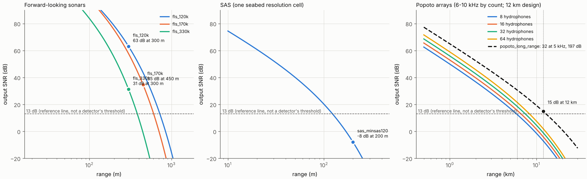

What to look at: where each curve crosses the 13 dB reference line; that line is not a detector's threshold
(`docs/DESIGN.md` Sec. 5).

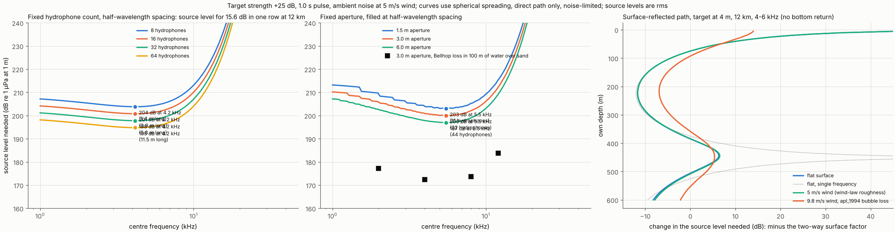

What to look at: the minimum between 4 and 6 kHz, which is why the band came down from the board's 20 to
35 kHz (`tools/popoto_range_study.py`, `docs/design/popoto_range_study.json`).

Decisions behind the numbers: D-49 (the sizing: 197 dB was 13 dB plus 2 dB against a typed threshold), D-102
(source levels are rms), D-117 (the threshold is the chain's detector's), D-126 (the surface image and own
depth), D-134 (the detector's recount; thresholds moved 0.11 to 0.15 dB), D-127 (builds and row modules).

What would change them:

| Change | Effect | Source |
| --- | --- | --- |
| Projector delivers less or more than 197 dB rms | dB for dB on every margin; 32 hydrophones in one row need 198 dB for a margin of zero (about 515 W acoustic, omnidirectional) | `docs/DESIGN.md` Sec. 3, "Row modules" table |
| Pulse length | 3 dB per doubling; the blind range doubles with it (750 m at 1 s) | the same |
| Rows | +2.5 dB (two), +4.0 dB (three) at the detector over one row | `buildspec.performance` `rows_detection_gain_db` |
| Hydrophone or input noise above the sea's (C8) | margin falls by the excess | `docs/design/popoto_parts.md` |
| Hydrophone sensitivity other than −208 dB | no change to SNR while sea noise dominates; the overload figures and C8's limit move | `docs/DESIGN.md`, "The projector's direct sound" |
| Sea state | the noise term; sea state 5 ends 12 km detection in non-ducting water in the budget | `docs/STATUS.md`, "The 12 km design point", item 4 |
| The surface-reflected path, which the table above leaves out | against a ship 4 m deep at 12 km in non-ducting water the two-way factor is −34 dB with the array at 10 m and +12 dB at 225 m | `python/gpusonar/lloyd.py`, `tools/popoto_depth_planner.py`, `docs/design/surface_image_validation.json` (D-126) |
| Ducting water | Bellhop for 100 m of isovelocity water over sand: 14 dB less loss each way at 4 kHz; reverberation then decides | `docs/design/popoto_range_study.json` |
| Target strength | dB for dB; every figure in the repository is a placeholder (S-7) | `reference_classes.yaml` |
| A grating lobe beyond ±42° at 6 kHz (section 1, item 14) | not in the budget: a false bearing, not a loss | `buildspec.validate` warning |

The projector document (`docs/design/projector_selection.md`: requirements from the build files, candidates
from manufacturers' data sheets, a decision table) recommends on margins that have since moved; its Sec. 0,
Sec. 1.1 and item 3 of "How to choose" need re-reading by the owner (`docs/STATUS.md`, "The 12 km design
point", item 3). No projector is chosen.

## 6. Interfaces the hardware must meet

**Unconfirmed first:** the two formats hardware would have to produce (the UDP block and the navigation
datagram) are ours. Neither has met a real device. The record schema is frozen at 1.0.0 and the block layout
is treated as a contract: changing either needs the owner (`docs/RECORD_FORMAT.md`; `docs/tasks/VEHICLE_ADAPTERS.md`
section 5).

### 6.1 What one ping record holds, and who supplies it

Exact definition: `docs/RECORD_FORMAT.md` (HDF5 layout) and `libs/core/include/sonar/core/record.hpp`
(`sonar::PingRecord`). Most of a record comes from the sonar file through a template record
(`tools/sonar_live.py CONFIG --export-template template.h5`); the hardware supplies the rest every ping.

| Part of the record | Supplied by | Per ping from hardware? |
| --- | --- | --- |
| `samples` [channels, samples]: real passband, int32 counts × `storage_scale`; `sample_rate`; `start_time` of sample 0 after the transmit | the boards, through the source | **yes**: the samples of the receive window, every channel, no gap |
| `transmit/time_ns`: the transmit instant, ns since the Unix epoch, UTC | capture start + transmit sample index / sample rate | **yes**: the capture start time and the transmit's sample index |
| `transmit/` waveform (`f_start`, `f_stop`, `duration`, `window_alpha`), `source_level_db` (peak: the configured rms level + 3.01 dB) | the sonar file | no, unless the pulse changes; a sampled pulse can be carried (`replica`, D-74) |
| `geometry/tx_pose`, `rx_pose`: position, attitude, velocity, attitude rates at the transmit | navigation, moved to the array (G7) | **yes**: a fix either side of the transmit time |
| `geometry/tx_lever_arm`, `rx_lever_arm` [channels, 3], boresights, beamwidths | the sonar file (A2 to A4, D3) | no; surveyed once |
| `navigation/ins`, `depth`, `dvl`: samples through the ping's interval | navigation | **yes**, for `attitude_time: arrival` and for water depth from altitude |
| `calibration/gain`, `phase`, `delay`, `position_offset` per channel | the in-water calibration (`calibrate.store_calibration`) | no; identity until calibrated |
| `environment/sound_speed` (the local value), `temperature`, `salinity`, `water_depth` | navigation datagram or typed | sound speed and water depth when the platform sends them; temperature and salinity may be NaN (then no absorption in the gain step, with a warning) |
| `metadata/sequence` | the ping index from the block header | **yes** |
| `metadata/channel_element`, `channel_board`, `boards` [boards, 5] (clock offset, drift, 1PPS sample index, reference channel, synchronised flag) | the sonar file; the sync stage fills offset, drift and the flag | the 1PPS index only if that method is used |
| `metadata/hardware_gain_db`, `tvg_time`, `tvg_gain_db`, `adc_bits`, `adc_full_scale` | the sonar file; a gain code travels in the block header into `extra_json` | a gain switch or ramp, if the boards have one (C9) |

### 6.2 The UDP block (`GSFB` version 1)

Exact definition: the docstring at the top of `python/gpusonar/sources/flank_stream.py` (`_HEADER =
struct.Struct("<4sHHIQqIHHQ")`); the C++ reader is `libs/live/src/udp_source.cpp`. Little-endian, a 128-byte
header, then samples.

| Offset | Type | Field |
| --- | --- | --- |
| 0 | 4 bytes | magic `GSFB` |
| 4 | u16 | version (1) |
| 6 | u16 | channels in the block (must equal the sonar file's channel count) |
| 8 | u32 | samples in this block |
| 12 | u64 | index of the block's first sample since capture start |
| 20 | i64 | sample index at which the most recent transmit started (−1: none yet) |
| 28 | u32 | ping index of that transmit |
| 32 | u16 | gain code (carried into the record's metadata) |
| 34 | u16 | flags (bit 0: ADC overflow in this block; bit 1: a per-board block, D-184) |
| 36 | u64 | capture start, ns since the Unix epoch |
| 44 | u16 | board id, with flag bit 1 only (else reserved, zero) |
| 46 | — | reserved, zero, to byte 128 |
| 128 | samples × channels × `sample_bytes` | signed samples, sample by sample (all channels of sample 0, then sample 1, ...) |

- `sample_bytes` (3 by default; 2 or 4 allowed) is **not in the header**: it is `source.sample_bytes` on the
  receiver and must match the sender (S-13). Full scale is 2^(8 × sample_bytes − 1) counts.
- A block must fit one UDP datagram (65,507 bytes); the tools size blocks at 12,288 bytes of samples (section
  3, I3). Through Sensor Bridge a frame is one block of fixed size, a multiple of 128 bytes.
- Blocks are placed by their sample counter. A block that never arrives discards the ping it falls in; the
  rules for reordering, restarts and counting are in `PingAssembler`'s docstring and `docs/DEPLOYMENT.md`,
  "Through Holoscan Sensor Bridge's receiver" (D-161).
- The emulator of this format is `FlankBoardEmulator` (same file); `tools/sonar_live.py CONFIG --emulate
  SCENARIO` uses it. `BoardStreamEmulator` (`sources/board_merge.py`) sends one stream per board, each with its own
  capture start, blocks, restarts and clock rate (`--emulate SCENARIO --per-board`).
- **Per-board blocks (D-184).** A board's block sets flag bit 1 and its id at offset 44 and carries only that board's
  channels (its count from the board map in `source.boards.channels`, refused by name otherwise) on its own counter
  and capture start. A whole-array block leaves both zero, so existing streams are the same bytes. This is a compatible
  change of the format, ours; the owner has not ruled on it. Alternatives not taken: telling boards apart by source
  address (fragile behind one forwarder host), a new version (every peer would have to change).

### 6.3 WAV with a YAML sidecar

Exact definition: `docs/RECORD_FORMAT.md`, "WAV sidecar"; reader `python/gpusonar/sources/wav.py`
(`WavSource`), directory watcher `wav_watch.py`. What a recording must come with:

- one multichannel `.wav`, or one file per channel of equal rate and length; 24-bit PCM is supported;
- `elements` (every channel's position in the body frame, or a uniform line) and `boresight`: the sidecar
  carries the array itself, the reader does not open `configs/sonars/`;
- `transmit` (lever arm and waveform) and `pings.times` (transmit times in seconds from the start of the file,
  or a regular train) with `pings.window`;
- `recording_start_ns` (UTC of the first sample): without it transmit times count from zero and cannot be
  matched to navigation;
- `boards` with `channels` and `reference_channel` for recordings of several boards;
- `scale`, `adc_bits`, `hardware_gain_db`; `pose` (one static pose) and `environment`.

A moving vehicle's recording with a separate navigation log has no offline path yet
(`docs/tasks/REAL_DATA.md` section 2.2, RD-11).

### 6.4 Timing accuracy needed, and where each figure is derived

| Quantity | Needed | Derivation |
| --- | --- | --- |
| Boards of one row against each other | 8.33 µs at 6 kHz | a twentieth of a period at the top of the band: `python/gpusonar/sync.py` `alignment_tolerance`; `buildspec.describe` `alignment_tolerance_us` |
| Boards of different rows | 0.87 µs for 0.05° of elevation; 0.057° per µs at a 1.5 m baseline | `buildspec.describe`: `clock_us_for_error = baseline × sin(error) / c`; `docs/DESIGN.md` Sec. 3, "What the vehicle and the mounting must provide"; `sensitivity.clock_us_for_deg` of `docs/design/popoto_elevation_study.json` |
| What the reference scheme reaches | 0.40 to 0.49 µs, **in simulation only** (25 ppm, 0.3 ms offsets, 20 ns jitter) | `docs/DESIGN.md` simulated trials; `tests/python/test_calibration_sync.py` |
| Reference line delays | equal to a fraction of the tolerance above | `docs/design/popoto_parts.md`, "Synchronisation reference generator and distribution"; no number is derived |
| Transmit instant against the samples | to the sample (9.8 µs at 102.4 kHz): it is an integer sample index | the block header, section 6.2; no tolerance study exists. One sample is 7 mm of range |
| First reference burst after the direct sound | after pulse end + the inputs' recovery; on the face it is 0.8 ms after the direct sound ends at the farthest hydrophone | `buildspec.validate` warning `sync.reference`; `reference_times_s` in `hardware_builds.json` |
| Attitude sampling | 5 to 10 Hz: linear interpolation error at most A (2π f dt)² / 8 | `docs/DEPLOYMENT.md`, "Navigation from an inertial unit with a Doppler log"; `docs/design/popoto_stage2.json` `navigation.attitude_interpolation_error_deg` |
| Navigation time against board time | not derived anywhere; `navigation.timestamp_sigma_s` is unset. Arithmetic: the attitude error is roll rate × time error, so at the rehearsal's 2°/s, 0.1 s is 0.2°, the whole assumed roll accuracy | ours, here; not tested |
| Drift of `transmit.time_ns` | the stamp is capture start + sample index / nominal rate unless `clock_ppm` is set: a board clock off by 25 ppm moves it 90 ms in an hour against true time (0.18 m of pose at 2 m/s) | tested in both engines and the program (`tests/python/test_board_clock.py`, D-185); `clock_ppm` takes a configured rate out to half a sample; the arrival-time estimate is a diagnostic, its use opt-in (`clock.discipline`) |
| Capture starts of per-board streams | to about 0.8 ms of true time: the synchronisation search (2 ms) less 0.3 ms of board offsets and 0.9 ms of drift between two boards 50 ppm apart over a 17.9 s window | ours, arithmetic on `sync.SEARCH_TIME` and F3 (D-184) |
| Relative rates of free-running boards | the merge holds boards within the 2 ms search only while (ppm_b − ppm_ref) × time since capture start stays inside it: 40 s at 50 ppm apart uncorrected, 5.6 h with rates known to 0.1 ppm | ours, arithmetic (D-185) |
| Range from a wrong sample rate | ranges read e × R long: 25 ppm is 5 cm at 2 km, 0.32 m at 12.7 km; not corrected | ours, arithmetic (D-185) |
| Position of a row out of the face's plane | 1 mm is 0.038° | `buildspec.describe` `deg_per_mm_out`; `sensitivity.out_offset_error_deg` of the elevation study |
| Projector position | "a few centimetres" | `docs/design/popoto_parts.md`, "Projector"; no number is derived |

### 6.5 The navigation datagram

Exact definition: `NavListener`'s docstring in `python/gpusonar/live.py`; C++ `Navigation` in
`libs/live/include/sonar/live/udp_source.hpp`; `docs/DEPLOYMENT.md`, "What the vehicle has to provide"; the
field list with what each is used for: `docs/design/popoto_stage2.json`, `navigation`.

One JSON object per fix, one UDP datagram, any rate:

    {"time_ns": ..., "x": north m, "y": east m, "z": down m, "roll": rad, "pitch": rad, "yaw": rad,
     "vx": ..., "vy": ..., "vz": ...}

- Required: `time_ns` (time of validity, ns since the Unix epoch, on the boards' time base), position,
  attitude (rotation z-y-x from north-east-down to the body's forward, starboard, down axes).
- Not optional for a moving vehicle: `vx`, `vy`, `vz` over ground. A fix without them is taken at rest and
  its pings are counted in `pings_without_velocity` (D-158): the backprojection then does not follow the
  array's own motion over the round trip (24 m at 12 km in the case that led to the counter,
  `docs/DEPLOYMENT.md`, "The report line").
- Optional: `sound_speed`, `altitude`, `bottom_lock`, `water_depth`, and one-sigma fields (`roll_sigma`,
  `depth_sigma`, `altitude_sigma` and others).
- The pose is the **unit's**; the chain moves it to the array by `nav.lever_arm_m` and `nav.mount_rpy_deg`.
- `tools/nav_adapter.py MAPPING --in-udp PORT --out-udp 127.0.0.1:5702` converts a vendor stream by a YAML
  mapping (`configs/nav/generic_csv.yaml` is a worked example; `configs/nav/sprintnav_template.yaml` the
  template to fill).

The report the chain sends back (one JSON line a ping, fields, units and frames) is defined in
`docs/DEPLOYMENT.md`, "The report line".

## 7. Bring-up and verification plan for real hardware

**Before anything: the owner's answers.** Steps 3 onward cannot be planned in detail until the questions of
`docs/tasks/VEHICLE_ADAPTERS.md` section 3 are answered (what the boards output, the transmit trigger, the
clock, the navigation message). The agent tasks are written up in
[`docs/tasks/VEHICLE_ADAPTERS.md`](../tasks/VEHICLE_ADAPTERS.md) (adapters for board samples and navigation,
issue `sonar-o7m`) and [`docs/tasks/REAL_DATA.md`](../tasks/REAL_DATA.md) (first real data through the live
chain and the simulator calibration, issue `sonar-sul`).

Where "pass" has no number, none is defined in the repository: record what is measured and put it in the
build spec. A build's own tolerances are in its generated `BUILD.md` (section 4). Every step ends the same
way: the measured value replaces its assumption in the spec and moves to `confirmed`
(`docs/REFERENCE_DESIGN.md`, step 7).

| # | Step | Tool or command | Existing test of the software side | Pass means |
| --- | --- | --- | --- | --- |
| 0 | Ashore: the build's simulated trials | `tools/build_from_spec.py configs/builds/<build>.yaml --out DIR --self-test` | `tests/python/test_buildspec.py` (the generator; the self-tests themselves are not in the suite) | every self-test passes on both engines; read `DIR/self_test.json` for the errors, not only pass or fail |
| 1 | Ashore: the rehearsal sent as board blocks over UDP | command 2 of `DIR/COMMANDS.txt`: `tools/sonar_live.py DEPLOY --emulate <build>_rehearsal --port 0 --out run/` | `test_flank_stream.py::test_emulated_board_over_udp`; `test_live_cpp.py::test_program_takes_blocks_over_udp_with_navigation` | the report equals the `--scenario` run's (command 1) |
| 2 | Host network: socket buffer and port | `sysctl net.core.rmem_max`; deployment `source.buffer_bytes` | `test_flank_stream.py`; `test_hsb.py::test_the_data_socket_watch_finds_the_receivers_socket_and_counts_its_drops` | the granted buffer is at least what was asked (no warning printed): 8.4 to 14.7 MB by build |
| 3 | Bench, one board, no water: capture a known tone on every input | record to WAV; write a sidecar by hand; `tools/inspect_tap.py recording.h5 --plot ping.png` or on the sidecar through `source: {type: wav}` | `test_sources.py` (multichannel and 24-bit WAV, sidecar contradictions); `test_taps.py::test_wav_export_and_stats` | the tone reads at its frequency (confirms the sample rate), word length and full scale as configured, no clipping, every channel alive. Confirms C1, C2, C4, C5 |
| 4 | Channel order and polarity | a tone or pulse into one input at a time; `tools/inspect_tap.py recording.h5 --channel N --plot channel.png` | none for polarity; the calibration reports a per-channel phase (`test_calibration_sync.py::test_calibration_recovers_injected_gain_phase_and_position`) | the signal appears on the expected channel only (the channel-to-board map of `buildspec.board_table`); the same sign on every channel |
| 5 | Simultaneous sampling | one tone into all eight inputs of a board; the phase between channels (`inspect_tap.py --npy`, then the phase at the tone) | none | no delay between inputs, or a fixed one small against 8.3 µs that is then written to `calibration/delay`. Confirms C3 |
| 6 | Noise floor against the model | inputs terminated, then hydrophones in quiet water, no transmit: `tools/fit_noise.py RECORDING --out model.h5 --check` | `tests/python/test_noise_fit.py` | input-referred noise below the sea's: 15 nV/√Hz at the board input for 5 m/s of wind (C8); the wet spectrum near 51 dB re 1 µPa²/Hz at 5 kHz in that wind. Confirms C7 with the reference hydrophone |
| 7 | Several boards: the synchronisation reference, the merge, the clocks | first ashore: `tools/sonar_live.py DEPLOY --emulate <build>_rehearsal --per-board --port 0` (`test_board_streams.py`). Then the reference wired to every board, each board sending its own stream (`source.boards` with the wiring's map); `tools/sonar_live.py` on the streams or on a `wav_watch` directory with `nav: {static: ...}`; read `sync` in the report, the boards' statistics at the end, and with `source.clock: {}` each board's rate estimate | `test_calibration_sync.py::test_sync_recovers_injected_clock_offsets_and_drifts`, `test_synchronised_boards_are_within_tolerance`, `test_reference_bursts_are_present_only_on_the_reference_inputs`; the `rehearsal` self-test | `sync.ok` true; `worst_residual_us` under 8.3 µs for one row and under 0.87 µs between rows; swapping two reference lines does not change the residual; offsets and drifts over an hour inside the assumed 25 ppm; every board's `missing_samples` 0; the capture starts within 0.8 ms of each other's true time (offsets in the first ping); each board's rate (from `sync.drift_ppm` relative to the first, and the reference's from the estimate or a 1PPS) written to `source.boards.clock_ppm`. Confirms F3, F4, F6, I2 |
| 8 | The trigger: transmit instant in the stream | fire the projector's trigger with the amplifier off; check each block's transmit sample index against a trigger line recorded on a spare input | `test_flank_stream.py::test_assembler_recovers_the_pings`; `test_hsb_receive.py::test_a_transmit_beyond_the_block_is_refused` | the index is the trigger's sample, every ping; the ping index counts up by one. Confirms F8 |
| 9 | Projector on, in water, lowest level first: direct-blast timing, clipping, recovery | one ping; `tools/inspect_tap.py recording.h5 --channel NEAREST --plot nearest.png`; then full level. Simulate what was measured: scenarios `popoto_testauv_direct_overload*`, `tools/direct_sound_study.py` | `tests/python/test_direct_overload.py`, `test_blanking.py`; `test_calibration_sync.py::test_direct_path_method_gives_offsets` | the direct arrival sits at distance / c after the transmit sample on each hydrophone (1.1 ms at the face's nearest, 1.69 m): confirms D3 and the trigger. The time each input stays disturbed after the pulse goes into `projector.blanking_after_s` and `chain.blanking.recovery_s`; the first reference burst is moved after it (`sync.reference.lead_s`). Nothing is damaged. Confirms C10 |
| 10 | Navigation: mapping, time base, latency | fill a mapping from the unit's interface document; `tools/nav_adapter.py MAPPING --replay LOG --out-file fixes.jsonl`; then live with `--in-udp` | `tests/python/test_nav_adapter.py` (conventions, time offset and rate, both receivers, chain through the adapter equals chain fed directly) | a turn and a roll on the bench come out with our signs; `pings_without_nav` stays 0 and `pings_without_velocity` never appears in the report; the unit's latency is in `time.offset_s`. In water: a source at known depth with the platform level and rolled; an elevation error that follows the roll is the attitude source or its time stamp (`BUILD.md` step 9). Confirms G2 to G5, G8 |
| 11 | Lever arm and mounting rotation | survey; `nav.lever_arm_m`, `nav.mount_rpy_deg` in the deployment file | `tests/python/test_nav_lever_arm.py`; `test_live_cpp.py::test_program_moves_navigation_to_the_array_by_the_lever_arm` | the values are surveyed ones, with their accuracy noted. Confirms G7 |
| 12 | If the Sensor Bridge path is chosen: loopback on the target computer | `tools/build_hsb.sh /opt/hsb`; `tools/sonar_live_hsb.py serve --scenario flank_target_1km --ip 127.0.0.1` (that scenario needs Bellhop); `tools/sonar_live_hsb.py receive DEPLOY --hololink 127.0.0.1 --report out.jsonl` with `--chain-omp-threads`, `--socket-buffer` | `test_hsb.py::test_loopback_through_sensor_bridge_gives_the_direct_chains_reports`, `test_loopback_of_a_scenario_the_board_simulates_gives_the_direct_chains_reports` (need `GPUSONAR_HSB=1`) | `receive` exits 0; `frames_lost` 0; reports equal the direct chain's (largest difference 0.0); then the same at the build's channel count and rate: `test_hsb.py::test_loopback_at_a_popoto_builds_channel_count_and_rate_gives_the_direct_chains_reports` (each build's shortest trial and deployment file, `--queue` 4 s of stream). In the containers it lost frames at every Popoto row count (D-186), at the start of the run only (D-187, D-188), so on the target computer first run `tools/hsb_host_check.py` and set what it reports (Sensor Bridge's `rmem_max`, `--socket-buffer`, an isolated receiver core; `docs/DEPLOYMENT.md`, "Checking a host and making the measurement"), make the opt-in study it prints, and expect the test to pass with no loss after the first 0.25 s of stream. A real board must start streaming at least 0.25 s before the first transmit that matters |
| 13 | Compute on the chosen computer | `SONAR_CMAKE_ARGS="-DSONAR_ENABLE_CUDA=ON" tools/test.sh`; `python3 tools/benchmark.py --backend cuda --scale 1 --out FILE.json`; `PYTHONPATH=python python3 tools/popoto_elevation_bench.py --full-rate --backend cuda` | the whole suite; `docs/JETSON.md` | the suite passes on the machine; a full-length ping takes less than the ping interval (17.9 s on the face, 2.8 s on the test AUV) with margin; `processing_seconds` in the report stays under it in a rehearsal. Confirms K1 |
| 14 | In water, static: a known target at a surveyed range and bearing | `tools/sonar_live.py DEPLOY` with `nav: {static: ...}`; keep the recording | `test_live.py`, `test_live_cpp.py` (the chain on simulated pings) | range and bearing as surveyed; a bearing mirrored about broadside means `chain.look` is wrong; SNR against the build's budget at that range (`hardware_builds.json`): a shortfall of more than a few dB is sensitivity, source level or noise |
| 15 | Channel calibration | the target or a source at three bearings; `calibrate.estimate_channel_errors`, `calibrate.store_calibration` (`python/gpusonar/calibrate.py`) | `test_calibration_sync.py::test_calibration_recovers_injected_gain_phase_and_position`, `test_applying_the_calibration_restores_the_beam` | per-channel gain, phase and position stored with the sonar; the beam after calibration is the designed one |
| 16 | Stacked rows: each row alone, row offsets, elevation | `chain.dead_channels` naming the other rows; a source at three known depths: `estimate_channel_errors(..., planar=False)`; then `depth_m` against truth, level and rolled 5° | `tests/python/test_elevation.py` (rows found from positions, a row out of place, dead hydrophone, board and row) | the same detections from every row; row offsets recovered; depth within the stated sigma |
| 17 | First calibration against the simulator | a passive recording into `tools/fit_noise.py`, its model into a scenario (`receiver: {ambient_noise: {model: fitted, file: model.h5}}`); a scenario set to the trial's geometry through `tools/sonar_live.py DEPLOY --scenario NAME --out DIR`; for FLS logs and SAS images `tools/calibrate_sim.py` | `tests/python/test_noise_fit.py`, `test_simcal.py`; `docs/SIM_CALIBRATION.md` | the simulated run's range, bearing and SNR of the known target against the real run's, with the differences recorded (`docs/tasks/REAL_DATA.md` sections 5 and 6 say what to do when they disagree) |
| 18 | Feed back | edit the spec's values and `confirmed` lists; `tools/build_from_spec.py --write-shipped`, then `--check-shipped`; step 0 again; `tools/handoff_hardware.py`, `tools/build_diagrams.py`, `tools/parts_list.py` | `test_buildspec.py::test_shipped_specs_are_valid_and_the_committed_files_are_what_they_generate`, `test_status_of_a_field_flows_into_unconfirmed` | the generated files, diagrams and this file's tables show measured values and shorter `unconfirmed` lists |

Under way, after these: keep every recording; each replays through the same chain with other settings
(`tools/sonar_live.py DEPLOY --replay FILE.h5`). An optional dive through the water column before a search
improves only the depth in metres at range (`BUILD.md` step 11).

## 8. Open hardware work and decisions

Issue ids are from `.beads/issues.jsonl` as exported on 2026-11-26 (the tree of D-201); "none" means no issue exists for the
item. Decisions wait on the owner; work items wait on a decision or on hardware.

**Decisions for the owner**

| Decision | Blocks | Question | Issue |
| --- | --- | --- | --- |
| What the boards output and which of the three sample paths to build (files, a forwarder to `GSFB`, a native decoder) | the live path on real boards | VA-1, VA-9 | `sonar-o7m` (open, P1) |
| Converter facts from the maker: sample rate, word length, simultaneous sampling, behaviour at 4 to 6 kHz, gain options, absolute maximum input | items 1, 2 and 7 of section 1 | S-2, S-3, VA-2, VA-7 | `sonar-o7m` covers recording the answers; no issue for asking the maker |
| Batched Popoto boards (4, 8, 12) or the plan's custom 32-channel board with one clock | the synchronisation hardware, the harness | S-3 | none |
| Reference wiring: summed into a hydrophone input (the builds) or a dedicated input (the plan, `popoto_4x7`) | 32 or 28 hydrophones on four boards; the summing circuit | VA-6 | none |
| Two rows or three on the face; one row first | boards and hydrophones bought | S-1 | `sonar-k29` (in progress: the stacked-rows work) |
| The projector, its level convention, its position; protection of the inputs | reach; blind range; survival of the inputs | S-4 | none |
| The hydrophone | C7, C8, depth rating | none numbered | `sonar-mu3` (open, P2) |
| The transmit trigger and the clock that stamps samples and navigation | every time stamp | VA-4, VA-5, VA-11 | `sonar-o7m` |
| The navigation unit's documents; the test AUV's unit; a tilt sensor on the frame | pose and attitude | S-5, S-6, VA-10 to VA-15 | `sonar-o7m` |
| The computer and the storage volume; raw or decimated recording | real time, 45 to 138 GB an hour | S-10 | `sonar-3s7` (in progress: performance model and Jetson) |
| A header field for the sample word length (a format change) | the block format before boards use it | S-13 | none |
| Answered 2026-11-25 (D-184): the per-board block's board id (flag bit 1, u16 at offset 44) is kept, and a board's missing part drops the ping by default (`zero` on request) | the forwarders; how a dead board costs pings | VA-3, VA-8 | none |
| How the boards' capture starts are stamped (PTP, 1PPS, NTP) and whether their sample clocks are disciplined | per-board streams need starts within about 0.8 ms; free-running clocks drift apart (D-185) | VA-4, VA-11, S-30 | `sonar-9a2` (open, P2) |
| The grating lobe beyond ±42° at 6 kHz: limit the steering sector, change the pitch, or accept | false bearings at the top of the band on five of six builds | S-31 | `sonar-68e` (open, P2) |
| Receive windows, where the boards sit, the 7 m zone | harness lengths, ping interval | S-11 | none |
| May confirmed hardware facts and real captures' derived numbers be committed | where confirmed values live | VA-16, VA-17, RD-8, RD-9 | `sonar-o7m`, `sonar-sul` |

**Work, once decided or once hardware exists**

| Work | State | Issue |
| --- | --- | --- |
| Board adapter (sidecar writer, forwarder or native source) and the navigation mapping for the vehicle's unit | not started; blocked on the answers above | `sonar-o7m` (open, P1) |
| First real data: a Popoto recording through the live chain; an FLS log or SAS image through the simulator calibration | not started; no data in hand | `sonar-sul` (open, P1) |
| Lever-arm correction of the array's velocity (ω × lever arm); needs attitude rates in the datagram or an estimate from successive fixes | open | `sonar-0ca` (open, P3) |
| The generated deployment files do not carry `nav.lever_arm_m` and `nav.mount_rpy_deg`; the sound-speed sensor is assumed at the navigation unit | open | `sonar-vjq` (open, P4) |
| Should deployments whose source has no time stamps set `tracker.ping_interval_s` | open | `sonar-y7k` (open, P4) |
| Receive: `reorder_blocks` and `max_held_bytes` are not options; the passive assembler does not reorder; the frame-number width of Sensor Bridge's receiver is an assumption | open | `sonar-thu` (open, P3) |
| Sensor Bridge: the idle stop is exercised only by contrived runs on a GPU; a clean shutdown when the board has gone | open | `sonar-3wd` (open, P3) |
| Sensor Bridge: repeat the pace table on an L4 | open | `sonar-e2u` (open, P4) |
| Sensor Bridge: the OpenMP thread cap assumes Holoscan's single-thread scheduler | open | `sonar-vmm` (open, P4) |
| Sensor Bridge: `serve --backend cuda` (the emulated board simulates on the host; `flank_patrol` takes more than 25 minutes) | open | `sonar-l6j` (open, P3) |
| Holoscan integration: the reference's SDK build (Sensor Bridge 2.7.0, Holoscan 4.4.0, six patches), a rig run, the RoCE receiver | not done | `sonar-l59` (in progress) |
| Performance on a DGX Spark or a Jetson; `docs/JETSON.md` is untested | not done | `sonar-3s7` (in progress) |
| Keep the live chain's fine map on the device from beamformer to detector (2.8 to 3.6 ms a ping on an L4) | open | `sonar-1m4` (open, P3) |
| Design of the synchronisation reference generator, its lines and the summing circuit | not started | `sonar-mu3` (open, P2) |
| Input protection and the bench measurement of recovery against overload level | not started | `sonar-mu3` (open, P2) |
| Mechanical design: face or frame, fairing, mounting tolerance (1 mm out of plane is 0.038°), connectors, penetrators, 500 m rating | not started | `sonar-mu3` (open, P2) |
| Power budget: boards, reference generator, amplifier, computer, network | no figure exists | `sonar-mu3` (open, P2) |
| A Sensor Bridge loopback at a Popoto build's channel count and rate (32 to 96 channels at 102.4 kHz) without loss: run (D-186); the loss is at the start of the run (D-187, D-188) and the test passes on that; the run on a host with Sensor Bridge's socket setup, and the RoCE receiver, wait on a real host (`tools/hsb_host_check.py`, D-189); nothing enforces the 0.25 s lead | start-up loss located and accepted; the host measurement not made | `sonar-02c` (open, P2), `sonar-a75` (open, P3); `sonar-x8v` closed |
| Per-board frames through Sensor Bridge at a Popoto build's rate; the Holoscan listen path against the program's `--listen`; the clock-rate keys ignored for a whole-array stream | not measured; the keys are ignored, not refused | `sonar-pnyv` (open, P2) |
| A board that speaks the Sensor Bridge protocol (FPGA with its IP, or a microcontroller on the emulator's HAL): needs the owner's approval before any FPGA or firmware work | not designed | `sonar-57w` (open, P3) |
| Disciplining or correcting `transmit.time_ns` against a board clock's drift (section 6.4) | done in software for a configured rate (`clock_ppm`, D-185); the arrival-time estimate is opt-in and untested on a real network; the boards' rates are not measured | none |
| Aligning per-board streams by each board's own transmit mark instead of capture starts and rates (needs the trigger on every board); correcting ranges for a board clock's rate | not done; proposed by D-184, D-185 | `sonar-9a2` (open, P2) |
| The Holoscan source operator (`libs/holoscan_ops` `UdpSourceOp`), `sonar_live_hsb.py receive` and `build/bin/sonar_live --listen` took a whole-array stream only | done (sonar-bwu): each merges `stream_boards` / `source.boards` in-process; through Sensor Bridge every frame is one board's block on one data channel (`DEPLOYMENT.md`, "Several boards: one stream each"). Open: how per-board streams reach a Sensor Bridge host (one data channel for all boards or one per board); one per board needs a setting that does not exist | none |
| The FLS and SAS front ends: arrays, projectors, converters, a transmit chain at sonar frequencies | not started | `sonar-mu3` (open, P2; the reading notes' questions HN-1 to HN-13) |

Follow-ups proposed by this file when it was written were filed on 2026-11-24 and 25: `sonar-mu3` (the
synchronisation reference generator, input protection, power, mechanical and depth rating, FLS and SAS front
ends, the hydrophone), `sonar-68e` (the grating lobe; owner question S-31), `sonar-9a2` (board timing; S-30),
`sonar-57w` (a board on the Sensor Bridge path). The rows still marked "none" have no issue of their own.
