# What the system produces today

Part of the handoff set ([README](README.md)). This page shows the outputs as they stand at
decision D-181: the gallery pictures, the headline numbers with their sources, what a
live-chain report looks like, and how to make each of them again.

**Everything on this page is simulated.** No picture, track or timing here comes from a
sonar, a vehicle or recorded data. Target strengths, source levels, bottom and surface
strengths are placeholders or textbook values, flagged in the config files that hold them
(`docs/STATUS.md`, first paragraph).

**Not regenerated for this page.** Every number is copied from a committed file, which is
named beside it. The gallery tables were filled by reading `docs/figures/gallery.json`
directly; the keys are named in each section so a reader can check them.

## 1. The gallery

`tools/gallery.py` runs 26 scenes end to end (simulate, condition, image, and where the
scene has movers detect, track and classify) and writes one picture, one animation and one
entry of `docs/figures/gallery.json` per scene.

- The committed gallery is the full-size CUDA run on an NVIDIA L4 of D-179 (Hugging Face
  job 6b054768c97b8ed4fcd78015, tree `4a80876`): every entry has `backend: "cuda"`,
  `quick: false`; the `seconds` entries sum to 489 s.
- One run, **one seed per scene**. Where a number depends on the seed, section 2.2 has the
  ten-seed figures.
- The gallery's detect-track-classify pipeline is `tools/gallery.py`'s own (it calls
  `detect.cfar`, `detect.cluster` and the tracker directly). It is **not** the live chain
  of `python/gpusonar/live.py` and `libs/live`, though it shares their detector, tracker
  and classifier code. A number from the gallery is not a number from the deployed chain.
- Scenes are clouds of point scatterers on object surfaces (D-41): highlights, shadows,
  layover and speckle, not specular glints, diffraction or resonances.
- Scene descriptions, geometry and the longer reading of each picture are in
  [`docs/SCENARIOS.md`](../SCENARIOS.md), which quotes the same run.

Keys used below, per scene entry of `gallery.json`:

| Key | Meaning |
| --- | --- |
| `targets.<object>.tracked` | a confirmed track lies within the truth gate of the object |
| `targets.<object>.position_error_m` | distance from the track to the nearest point of the object's outline (D-157); for an untracked object, the distance to the nearest track |
| `targets.<object>.centroid_error_m` | distance from the track to the object's centre |
| `targets.<object>.true_velocity_xy`, `track_velocity_xy` | m/s (`true_velocity`, `track_velocity` in `flank_patrol`) |
| `classification.targets.<object>.kind`, `speed_m_s`, `speed_sigma_m_s` | the class of the object's track and its fitted speed |
| `classification.counts` | tracks by class: mover, static, line, multipath, uncertain |
| `classification.movers_not_on_a_moving_object` | false movers |
| `detections_per_ping`, `confirmed_tracks` | counts |
| `object_over_median_db.<object>` | mean image power at the object's scatterers over the image median |
| `peak_over_median_db_by_hydrophone_count` | Popoto scenes: map peak over map median with 8, 16, 32 hydrophones |
| `range_estimate` | `first` in the flank and Popoto scenes: range is the detection's leading edge (D-178) |

### 1.1 FLS, pool to seafloor (pictures only)

**Wrong or missing:** no detection or tracking is run on these four scenes. They are free
field: no floor or surface multipath, which a real pool will have strongly. In
`pool_fls_l12_5d` the rope is barely visible (3.8 dB over the median) and a patch at left
is the side wall seen through a grating lobe, not an object. The `fls_750k` sonar file
behind the harbour scene is a placeholder.

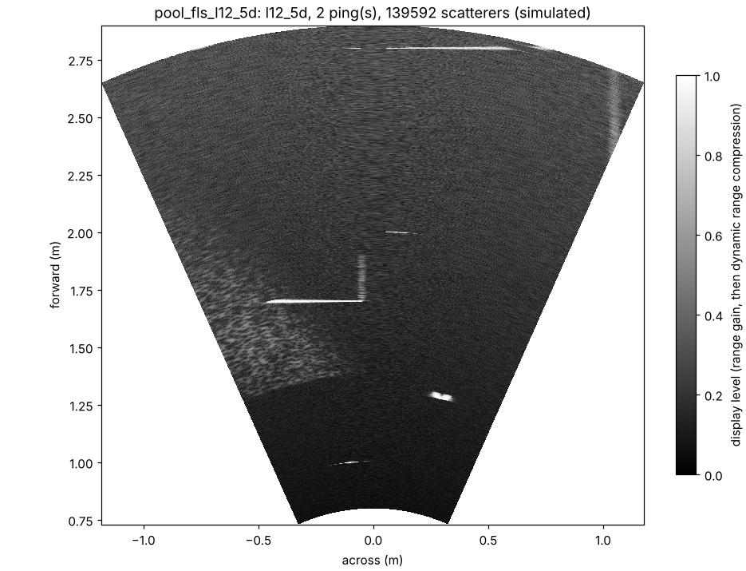

Look at the two wires (bright points at 1 and 2 m), the pipe and the cinder block with the far wall shadowed behind it. Geometry: [`scenarios/pool_fls_l12_5d.png`](../scenarios/pool_fls_l12_5d.png); animation: [`figures/pool_fls_l12_5d.gif`](../figures/pool_fls_l12_5d.gif).


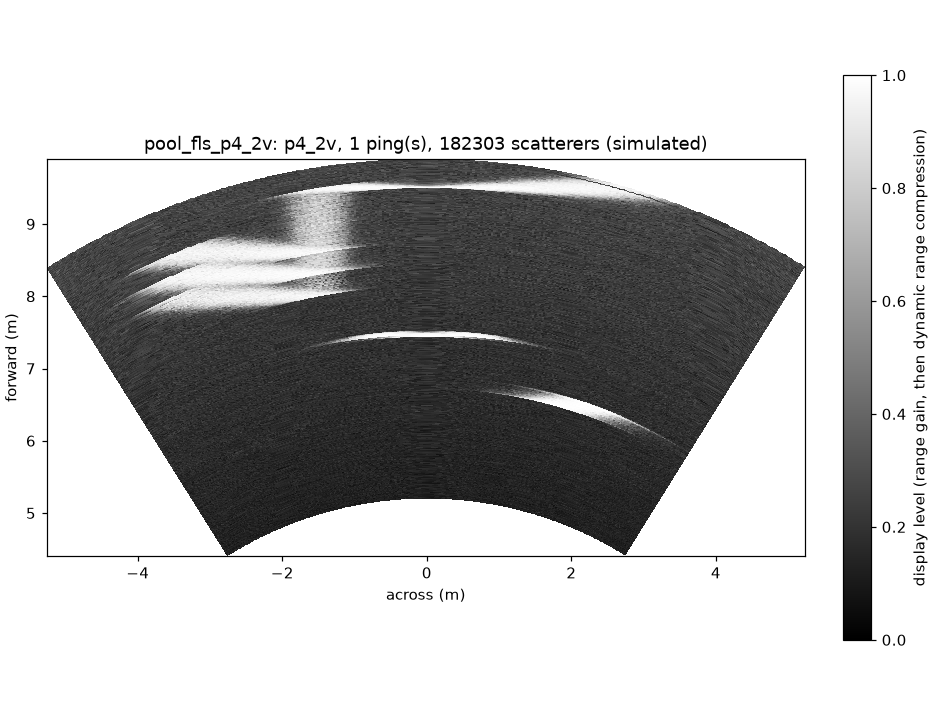

Look at the ladder and the three steps against the far wall; the three floats merge into one arc. Geometry: [`scenarios/pool_fls_p4_2v.png`](../scenarios/pool_fls_p4_2v.png); animation: [`figures/pool_fls_p4_2v.gif`](../figures/pool_fls_p4_2v.gif).


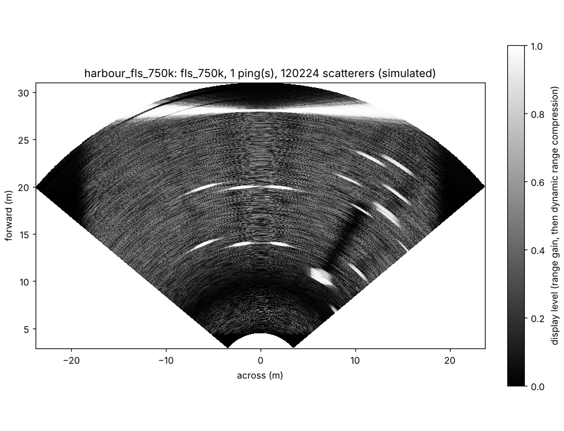

Look at the quay wall, the six pilings and the long shadows of the mooring block and rocks. Geometry: [`scenarios/harbour_fls_750k.png`](../scenarios/harbour_fls_750k.png); animation: [`figures/harbour_fls_750k.gif`](../figures/harbour_fls_750k.gif).


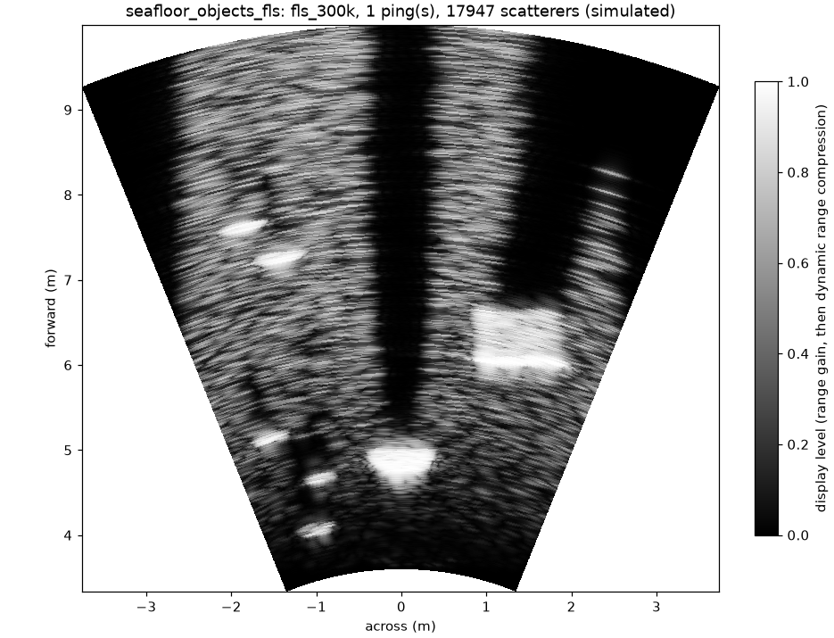

Look at the sphere and the box, each with a shadow on the seafloor behind it. Geometry: [`scenarios/seafloor_objects_fls.png`](../scenarios/seafloor_objects_fls.png); animation: [`figures/seafloor_objects_fls.gif`](../figures/seafloor_objects_fls.gif).


| Scene | `object_over_median_db`, dB | `dynamic_range_db` |
| --- | --- | --- |
| `pool_fls_l12_5d` | `far_wall` 31.0, `side_wall` 13.1, `cinder_block` 42.6, `pipe` 48.0, `rope` 3.8, `wire_1m` 77.5, `wire_2m` 66.8 | 78.2 |
| `pool_fls_p4_2v` | `far_wall` 48.4, `step_1` 34.3, `step_2` 41.2, `step_3` 39.5, `ladder_rail_a` 55.4, `ladder_rail_b` 55.8, `ladder_rung_1` 52.3, `ladder_rung_2` 52.5, `ladder_rung_3` 52.2, `float_1` 45.7, `float_2` 47.7, `float_3` 48.7 | 63.2 |
| `harbour_fls_750k` | `seafloor` 35.7, `quay_wall` 55.8, `piling_1` 56.5, `piling_2` 58.5, `piling_3` 57.8, `piling_4` 55.7, `piling_5` 56.8, `piling_6` 57.0, `mooring_block` 38.1, `rocks` 34.4 | 69.6 |
| `seafloor_objects_fls` | `seafloor` 28.2, `sphere` 43.5, `box` 44.2, `rocks` 35.4 | 59.3 |

### 1.2 FLS, the owner's three designs under way

**Wrong or missing:** the seabed pinnacle is tracked only at 120 kHz; the 5 degree beams
of the 170 and 330 kHz sonars are tilted up and never reach the seabed (as designed, but
it means those two sonars see nothing on the bottom). Each scene has one `uncertain` track
that is on no named object. Objects are reached by direct paths only. At 330 kHz the
anchored boat's margin over the detection threshold was small in an older run and has not
been measured again (`SCENARIOS.md`).

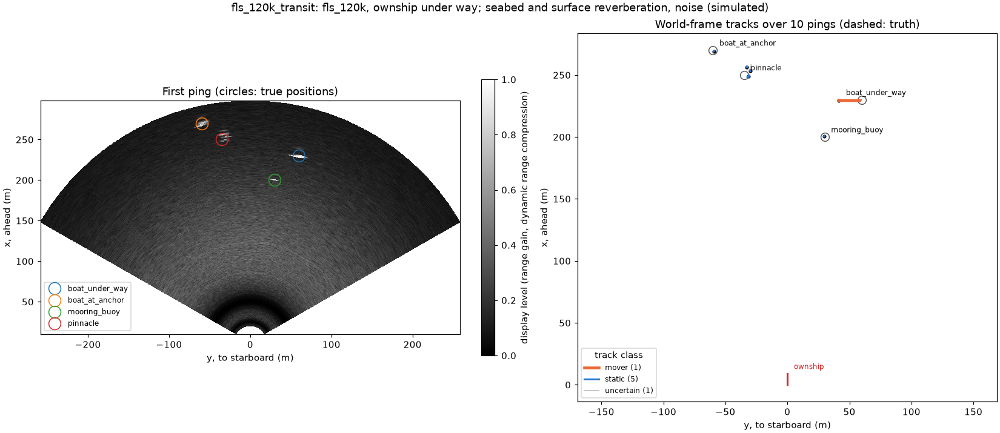

Look at the four tracks with labels: the boat under way (mover), the anchored boat, the buoy and the pinnacle (static). Geometry: [`scenarios/fls_120k_transit.png`](../scenarios/fls_120k_transit.png); animation: [`figures/fls_120k_transit.gif`](../figures/fls_120k_transit.gif).


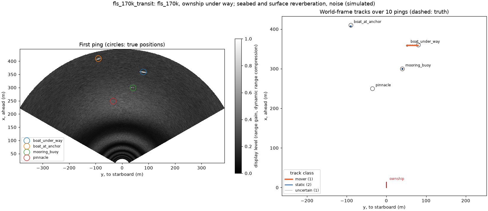

Same objects at 450 m range; the pinnacle is absent. Geometry: [`scenarios/fls_170k_transit.png`](../scenarios/fls_170k_transit.png); animation: [`figures/fls_170k_transit.gif`](../figures/fls_170k_transit.gif).


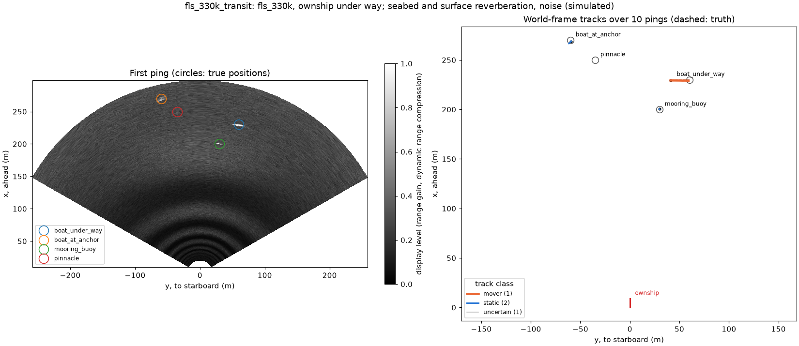

Same objects at 330 kHz; the pinnacle is absent. Geometry: [`scenarios/fls_330k_transit.png`](../scenarios/fls_330k_transit.png); animation: [`figures/fls_330k_transit.gif`](../figures/fls_330k_transit.gif).


| Scene | Object | Tracked | From outline, m | From centre, m | Velocity true -> track, m/s | Class, speed m/s |
| --- | --- | --- | --- | --- | --- | --- |
| `fls_120k_transit` | `boat_under_way` | yes | 0.0 | 0.6 | 0.00, -4.00 -> 0.02, -3.79 | mover, 3.80 ± 0.04 |
| `fls_120k_transit` | `boat_at_anchor` | yes | 0.0 | 1.0 | 0.00, 0.00 -> -0.03, -0.02 | static, 0.03 ± 0.03 |
| `fls_120k_transit` | `mooring_buoy` | yes | 0.7 | 0.7 | 0.00, 0.00 -> 0.01, -0.12 | static, 0.10 ± 0.03 |
| `fls_120k_transit` | `pinnacle` | yes | 0.0 | 4.0 | 0.00, 0.00 -> -0.21, 0.09 | static, 0.23 ± 0.16 |
| `fls_170k_transit` | `boat_under_way` | yes | 0.0 | 1.3 | 0.00, -4.00 -> 0.00, -4.21 | mover, 4.22 ± 0.03 |
| `fls_170k_transit` | `boat_at_anchor` | yes | 0.0 | 2.6 | 0.00, 0.00 -> -0.09, -0.08 | static, 0.13 ± 0.07 |
| `fls_170k_transit` | `mooring_buoy` | yes | 0.2 | 0.2 | 0.00, 0.00 -> -0.01, 0.04 | static, 0.05 ± 0.01 |
| `fls_170k_transit` | `pinnacle` | **no** | nearest track 83.1 m away | | | |
| `fls_330k_transit` | `boat_under_way` | yes | 0.0 | 0.8 | 0.00, -4.00 -> 0.03, -4.00 | mover, 4.01 ± 0.05 |
| `fls_330k_transit` | `boat_at_anchor` | yes | 0.0 | 1.4 | 0.00, 0.00 -> 0.13, 0.15 | static, 0.23 ± 0.15 |
| `fls_330k_transit` | `mooring_buoy` | yes | 0.5 | 0.5 | 0.00, 0.00 -> 0.01, -0.07 | static, 0.05 ± 0.03 |
| `fls_330k_transit` | `pinnacle` | **no** | nearest track 23.8 m away | | | |

| Scene | Pings | Detections per ping | Confirmed tracks | mover / static / line / multipath / uncertain | Movers not on a moving object |
| --- | --- | --- | --- | --- | --- |
| `fls_120k_transit` | 10 | 6 to 9 | 8 | 1 / 6 / 0 / 0 / 1 | 0 |
| `fls_170k_transit` | 10 | 3 to 5 | 4 | 1 / 2 / 0 / 0 / 1 | 0 |
| `fls_330k_transit` | 10 | 3 to 4 | 4 | 1 / 2 / 0 / 0 / 1 | 0 |

### 1.3 FLS with clutter: cluttered seabed, rough surface, traffic

**Wrong or missing:**

- **`fls_120k_rough_surface` reports false movers: 6 in this run, 78 over ten seeds**
  (D-170). They are specular points on moving wave faces where the beam meets the surface.
  No threshold on fit, extent, SNR, hits or speed separates more than 57 of the 78 without
  losing a boat track. Kept as a known limit; no classifier change.
- In the same scene the **kayak and the mooring buoy are not tracked**, and the boat's
  velocity is off (table).
- `fls_120k_cluttered_seabed` makes 65 tracks for two boats; 13 are `uncertain` and 3 are
  `line`. Everything on the bed makes a track.
- `fls_170k_traffic`: the closing boat's track is 4.5 m from the boat's centre because its
  detections are on the propeller, 5.3 m astern of amidships (D-169). 13 tracks for three
  boats.
- Merging close FLS detections before tracking cures one scene and harms two; it is off
  (D-135, issue `sonar-mib`).

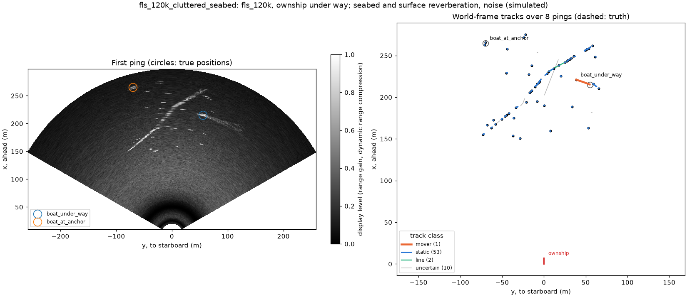

Look at the pipeline (a line across the picture), the wake astern of the moving boat, and how many seabed objects carry a track. Geometry: [`scenarios/fls_120k_cluttered_seabed.png`](../scenarios/fls_120k_cluttered_seabed.png); animation: [`figures/fls_120k_cluttered_seabed.gif`](../figures/fls_120k_cluttered_seabed.gif).


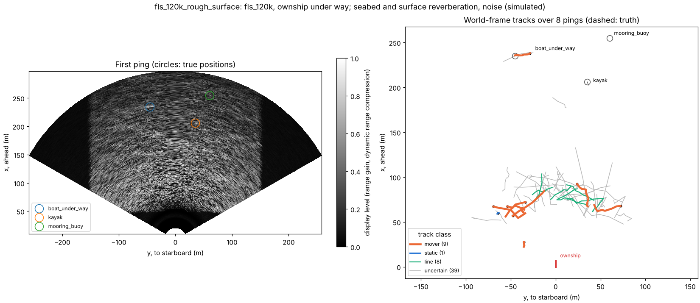

Left: the first ping, true positions circled. Right: the tracks; look at the mover tracks 50 to 110 m ahead that are on no object (the wave glints), and at the kayak and the buoy, which have no track. Geometry: [`scenarios/fls_120k_rough_surface.png`](../scenarios/fls_120k_rough_surface.png); animation: [`figures/fls_120k_rough_surface.gif`](../figures/fls_120k_rough_surface.gif).


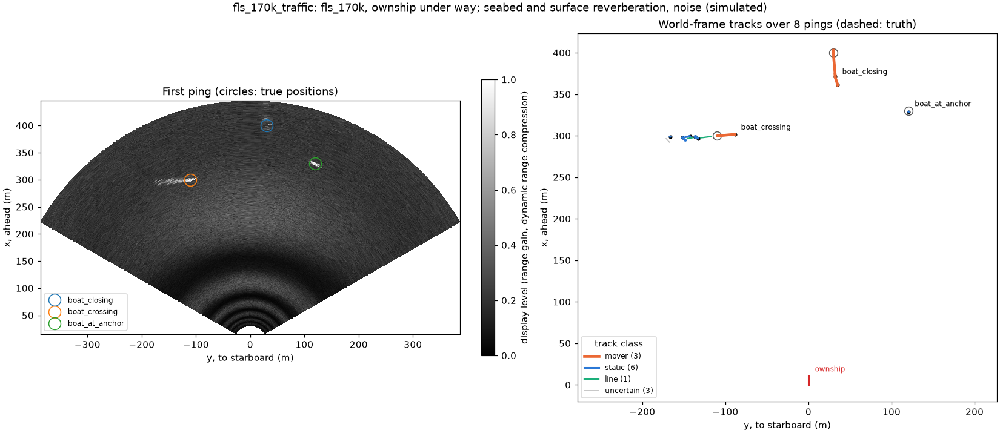

Look at the three boats: closing, crossing and at anchor. Geometry: [`scenarios/fls_170k_traffic.png`](../scenarios/fls_170k_traffic.png); animation: [`figures/fls_170k_traffic.gif`](../figures/fls_170k_traffic.gif).


| Scene | Object | Tracked | From outline, m | From centre, m | Velocity true -> track, m/s | Class, speed m/s |
| --- | --- | --- | --- | --- | --- | --- |
| `fls_120k_cluttered_seabed` | `boat_under_way` | yes | 0.0 | 0.9 | 1.71, -4.70 -> 1.69, -4.73 | mover, 5.04 ± 0.09 |
| `fls_120k_cluttered_seabed` | `boat_at_anchor` | yes | 0.0 | 0.8 | 0.00, 0.00 -> 0.04, -0.01 | static, 0.04 ± 0.03 |
| `fls_120k_rough_surface` | `boat_under_way` | yes | 0.0 | 1.0 | 0.87, 4.92 -> 0.46, 5.55 | mover, 5.60 ± 0.33 |
| `fls_120k_rough_surface` | `kayak` | **no** | nearest track 41.3 m away | | | |
| `fls_120k_rough_surface` | `mooring_buoy` | **no** | nearest track 88.5 m away | | | |
| `fls_170k_traffic` | `boat_closing` | yes | 0.0 | 4.5 | -5.98, 0.52 -> -5.97, 0.48 | mover, 6.01 ± 0.02 |
| `fls_170k_traffic` | `boat_crossing` | yes | 0.0 | 0.2 | 0.35, 3.98 -> 0.37, 4.24 | mover, 4.30 ± 0.18 |
| `fls_170k_traffic` | `boat_at_anchor` | yes | 0.0 | 1.5 | 0.00, 0.00 -> -0.10, 0.10 | static, 0.12 ± 0.04 |

| Scene | Pings | Detections per ping | Confirmed tracks | mover / static / line / multipath / uncertain | Movers not on a moving object |
| --- | --- | --- | --- | --- | --- |
| `fls_120k_cluttered_seabed` | 8 | 54 to 63 | 65 | 1 / 48 / 3 / 0 / 13 | 0 |
| `fls_120k_rough_surface` | 8 | 42 to 55 | 56 | 8 / 1 / 5 / 0 / 42 | 6 |
| `fls_170k_traffic` | 8 | 6 to 15 | 13 | 3 / 6 / 1 / 0 / 3 | 0 |

### 1.4 SAS with unknown motion: `wreck_sas`, `minefield_sas`

**Wrong or missing:** both scenes were re-drawn in D-171 (their seabed widened), so their
sharpness and object levels cannot be compared with any gallery before D-174. `wreck_sas`
sway error went 0.045 -> 0.053 wavelengths with the new draw. The `minefield_sas`
echo-synthesis benchmark row in `RESULTS.md` is still of the old scene (section 2.6). The
seafloor is 25 to 30 scatterers per square metre: separate points, not developed speckle.
Motion estimation has no GPU code. The accuracy bounds are ours; the paper states none
(D-164).

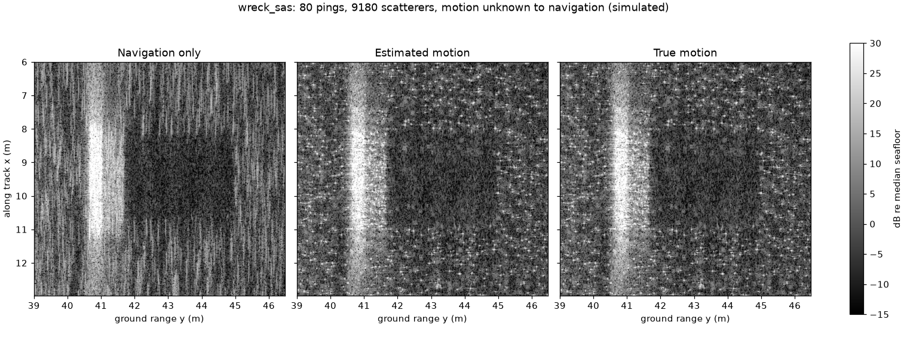

Compare the three panels: navigation only (smeared), estimated motion, true motion. Geometry: [`scenarios/wreck_sas.png`](../scenarios/wreck_sas.png); animation: [`figures/wreck_sas.gif`](../figures/wreck_sas.gif).


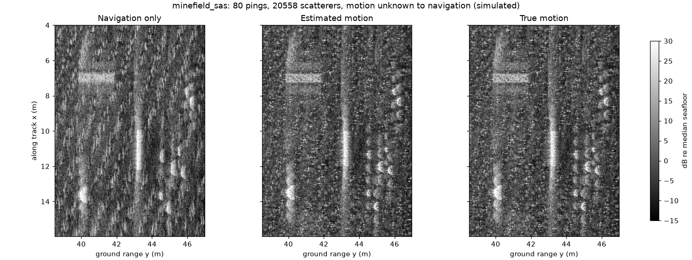

Look at the two cylinders, the sphere and the rocks, each with a highlight towards the sonar and a shadow behind, and the ripple stripes. Geometry: [`scenarios/minefield_sas.png`](../scenarios/minefield_sas.png); animation: [`figures/minefield_sas.gif`](../figures/minefield_sas.gif).


| Scene | `pings` | `scatterers` | `sway_error_rms_wavelengths` | `heave_error_rms_wavelengths` | `sharpness`: navigation only / estimated / true | estimated over true |
| --- | --- | --- | --- | --- | --- | --- |
| `wreck_sas` | 80 | 13,555 | 0.053 | 0.044 | 59.6 / 219.6 / 224.6 | 0.978 |
| `minefield_sas` | 80 | 20,558 | 0.022 | 0.044 | 140.4 / 275.4 / 277.9 | 0.991 |

### 1.5 SAS, the owner's MINSAS-class design, and rail SAS

**Wrong or missing:** navigation is exact in these five scenes; no motion is estimated.
Fainter copies ("ghosts") of bright objects appear about 10 m up and down the track in the
sparse scenes (a grating lobe of the receive array; -47 to -54 dB on a point target,
`tests/python/test_minsas_resolution.py`); they are covered only in the scene with
developed speckle. The wreck's mast barely shows (1.2 and 4.0 dB over the median).
The survey, boulder and ripple seabeds have 8 to 18 scatterers per square metre against
about 2000 resolution cells, so they image as separate points. Rocks are rough spheres
with no facets. `rail_objects` uses exact rail positions; the perturbed case
(`rail_position_errors`) is not imaged with correction.

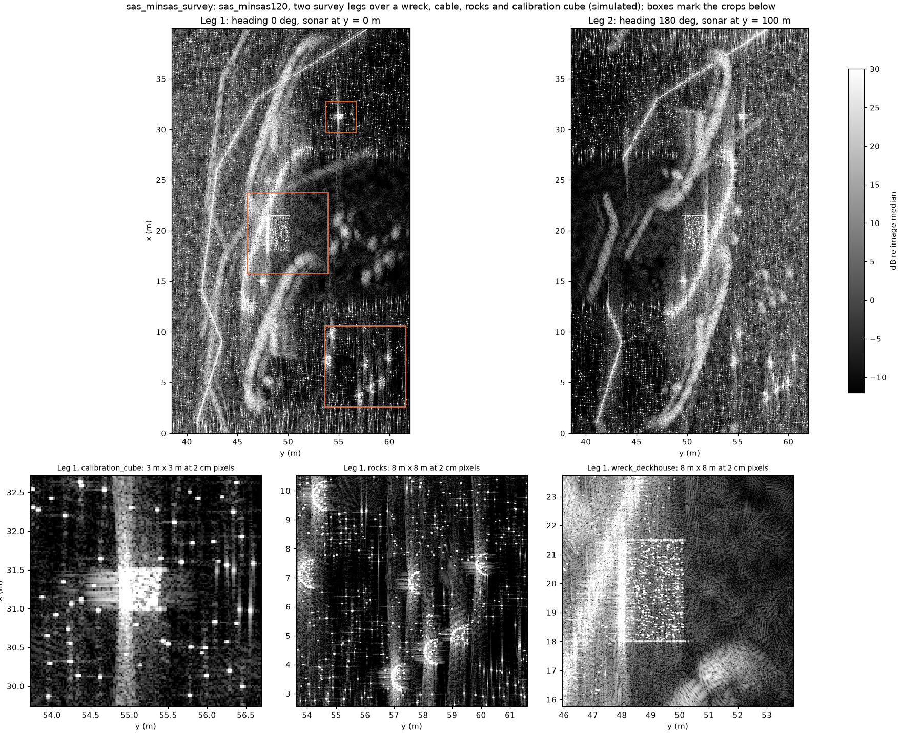

Look at the wreck (hull, deckhouse) and its shadow away from the sonar, the cable and the calibration cube; the ghosts of hull and cable are visible along track. Geometry: [`scenarios/sas_minsas_survey.png`](../scenarios/sas_minsas_survey.png); animation: [`figures/sas_minsas_survey.gif`](../figures/sas_minsas_survey.gif).


Leg 1 at one image pixel per file pixel: [`figures/sas_minsas_survey_leg1_full.png`](../figures/sas_minsas_survey_leg1_full.png).

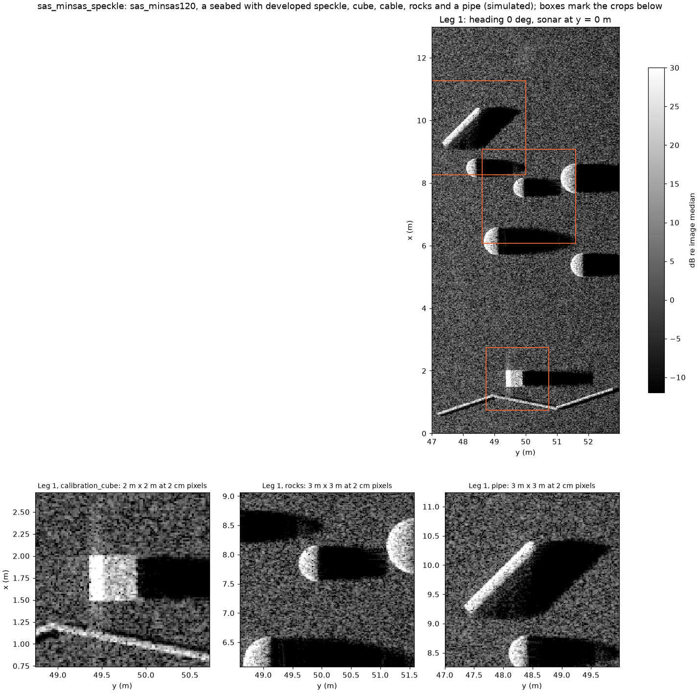

This is the texture a real sonar picture should have: continuous speckle, bright faces, clean shadows. Geometry: [`scenarios/sas_minsas_speckle.png`](../scenarios/sas_minsas_speckle.png); animation: [`figures/sas_minsas_speckle.gif`](../figures/sas_minsas_speckle.gif).


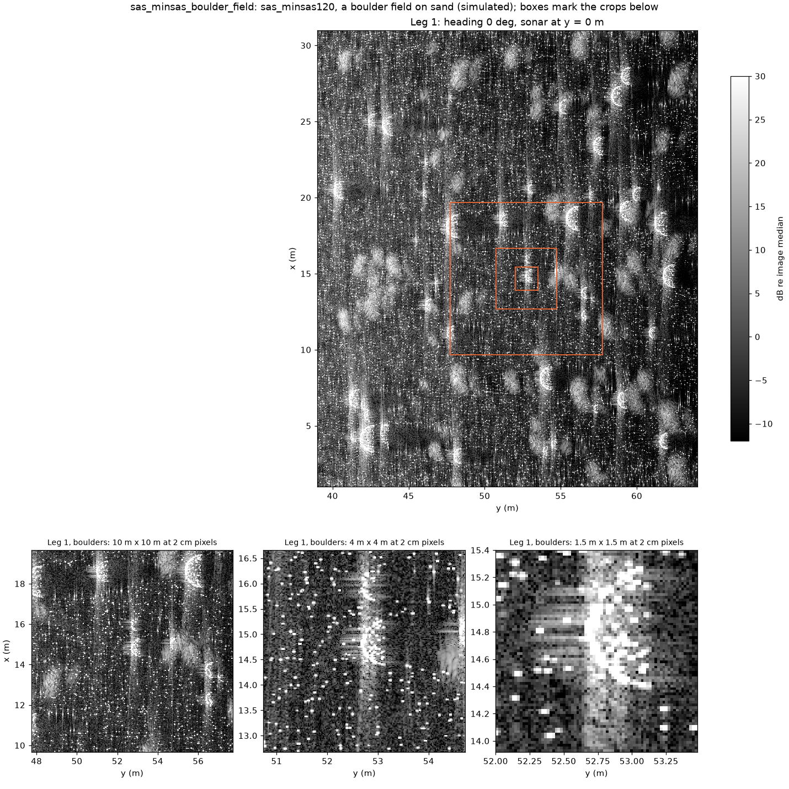

Look at the bright face of each boulder towards the sonar and the shadow behind it. Geometry: [`scenarios/sas_minsas_boulder_field.png`](../scenarios/sas_minsas_boulder_field.png); animation: [`figures/sas_minsas_boulder_field.gif`](../figures/sas_minsas_boulder_field.gif).


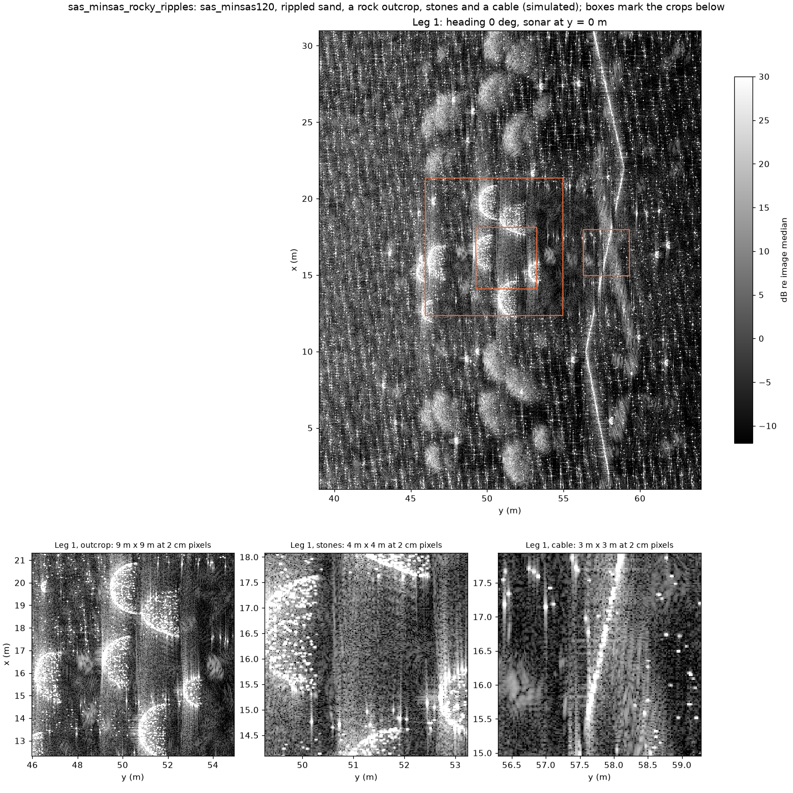

Look at the ripple stripes, the outcrop and the cable (a thin bright line). Geometry: [`scenarios/sas_minsas_rocky_ripples.png`](../scenarios/sas_minsas_rocky_ripples.png); animation: [`figures/sas_minsas_rocky_ripples.gif`](../figures/sas_minsas_rocky_ripples.gif).


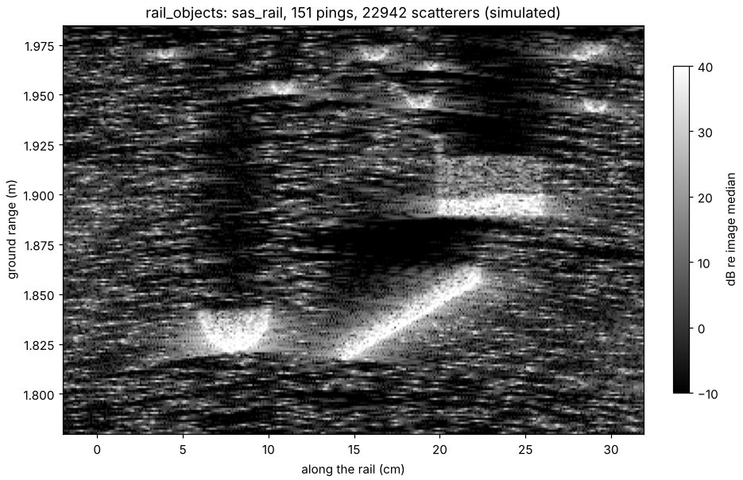

Look at the ball, pipe, brick and pebbles on the pool floor, each with a shadow. Geometry: [`scenarios/rail_objects.png`](../scenarios/rail_objects.png); animation: [`figures/rail_objects.gif`](../figures/rail_objects.gif).


| Scene | `pings` | `scatterers` | `object_over_median_db` (for MINSAS scenes under `legs.leg_1`), dB |
| --- | --- | --- | --- |
| `sas_minsas_survey` | 160 | 21,367 | `seabed` 46.6, `wreck_hull` 39.5, `wreck_deckhouse` 30.5, `wreck_mast` 1.2, `cable` 54.2, `rocks` 44.7, `calibration_cube` 52.0 |
| `sas_minsas_speckle` | 44 | 445,567 | `seabed` 14.2, `calibration_cube` 29.7, `cable` 21.5, `rocks` 24.4, `pipe` 27.1 |
| `sas_minsas_boulder_field` | 64 | 27,620 | `sand` 42.0, `boulders` 46.0 |
| `sas_minsas_rocky_ripples` | 64 | 31,992 | `rippled_sand` 42.7, `outcrop` 42.8, `stones` 44.3, `cable` 47.2 |
| `rail_objects` | 151 | 22,942 | `floor` 28.0, `ball` 29.7, `pipe` 31.7, `brick` 30.1, `pebbles` 27.7 |

Other keys: `sas_minsas_survey.legs.leg_1.far_strip_over_near_strip_db` is
-38.1 dB (the
shadow beyond the wreck); `sas_minsas_speckle.legs.leg_1.speckle_contrast` is
1.21 (1.0 is fully
developed); where the calibration cube's along-track copy falls the image is
2.1 dB
over bare seabed (`ghost.calibration_cube.at_copy_over_bare_seabed_db`).

### 1.6 Buried objects: `buried_objects`

**Wrong or missing:** the sediment model is one refracted path with unit transmission: no
sediment attenuation and no angle-dependent transmission loss. The clutter level against
the objects is therefore an assumption of the scenario file, not a prediction.

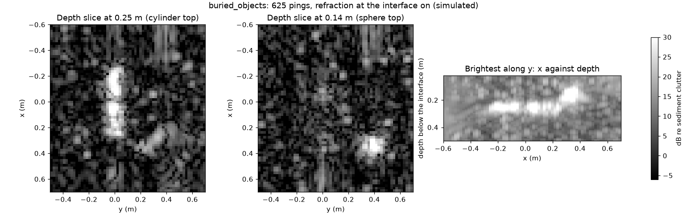

Two depth slices (at the cylinder's top, 0.25 m, and the sphere's top, 0.14 m) and a section of x against depth, all with refraction on; the refraction-off depths are in the table only. Geometry: [`scenarios/buried_objects.png`](../scenarios/buried_objects.png); animation: [`figures/buried_objects.gif`](../figures/buried_objects.gif).


| Key | True | Refraction on | Refraction off |
| --- | --- | --- | --- |
| `cylinder_top_depth_m` | 0.25 | 0.26 | 0.23 |
| `sphere_top_depth_m` | 0.14 | 0.14 | 0.13 |

`cylinder_over_clutter_db`: 21.1 dB.

### 1.7 Flank array: `flank_patrol`

**Wrong or missing:**

- **The small vehicle (-3 dB, 2 m/s) is never detected**: no detection above the cut near
  it on any ping of ten seeds (D-178, issue `sonar-80b`). In `gallery.json` its
  `position_error_m` of 1283 m is the distance to the nearest
  unrelated track.
- 5 tracks for two objects: multipath splits the wreck's echo into several clusters and
  each starts a track; 2 tracks are `uncertain`.
- The outcome rests on an assumed seabed (-27 dB Lambert), wind (5 m/s) and noise (45 dB);
  none is measured. The platform stands still.

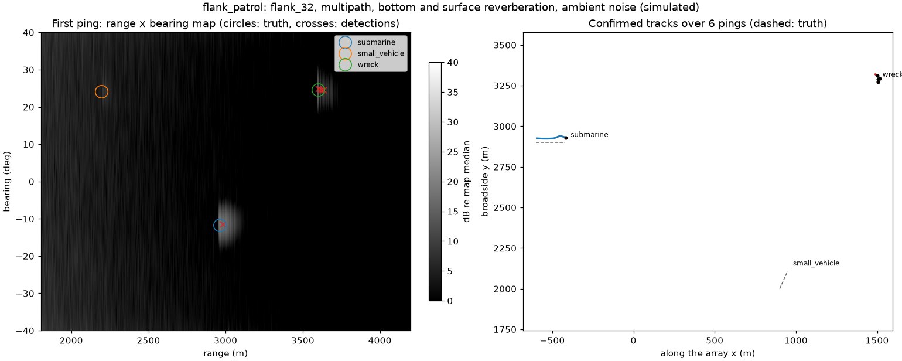

Left: the first ping's range-bearing map with truth circled and detections crossed; there is no cross at the small vehicle. Right: the submarine's track and the cluster of tracks at the wreck. Geometry: [`scenarios/flank_patrol.png`](../scenarios/flank_patrol.png); animation: [`figures/flank_patrol.gif`](../figures/flank_patrol.gif).


| Scene | Object | Tracked | From outline, m | From centre, m | Velocity true -> track, m/s | Class, speed m/s |
| --- | --- | --- | --- | --- | --- | --- |
| `flank_patrol` | `submarine` | yes | 1.0 | 2.6 | 3.00, 0.00 -> 2.98, 0.02 | mover, 3.02 ± 0.02 |
| `flank_patrol` | `small_vehicle` | **no** | nearest track 1283.5 m away | | | |
| `flank_patrol` | `wreck` | yes | 3.5 | 3.5 | 0.00, 0.00 -> -0.03, 0.02 | static, 0.04 ± 0.01 |

| Scene | Pings | Detections per ping | Confirmed tracks | mover / static / line / multipath / uncertain | Movers not on a moving object |
| --- | --- | --- | --- | --- | --- |
| `flank_patrol` | 6 | 3 to 6 | 5 | 1 / 2 / 0 / 0 / 2 | 0 |

### 1.8 Popoto at long range: `popoto_far_mover` (6 km), `popoto_12km`

**Wrong or missing:**

- **Track association at 12 km is fragile.** About a dozen arrivals of the one ship lie
  inside one tracker gate (the gallery tracker's 1 degree bearing sigma is 210 m across at
  12 km), so which arrival a track takes is decided by small differences. Over ten seeds
  the median distance to the hull is 3.4 m but seed 60 reads 65.4 m (D-178, D-181; issue
  `sonar-tlc`). The gallery seed shown here is a good one.
- `popoto_12km` makes 12 tracks for one ship: 1 mover and 11 `multipath`. Its speed has a
  wide sigma (5.66 ± 0.50 m/s, true 6.0).
- The ship is 9.8 m from its centre with the leading edge, where it was 4.7 m before D-178.
- 100 m of isovelocity water over sand carries about 14 dB more each way than spherical
  spreading: this scene has margin the link budget does not count, and other waters do
  not (1.9).
- The depth of the ship cannot be read at 12 km (section 2.1).

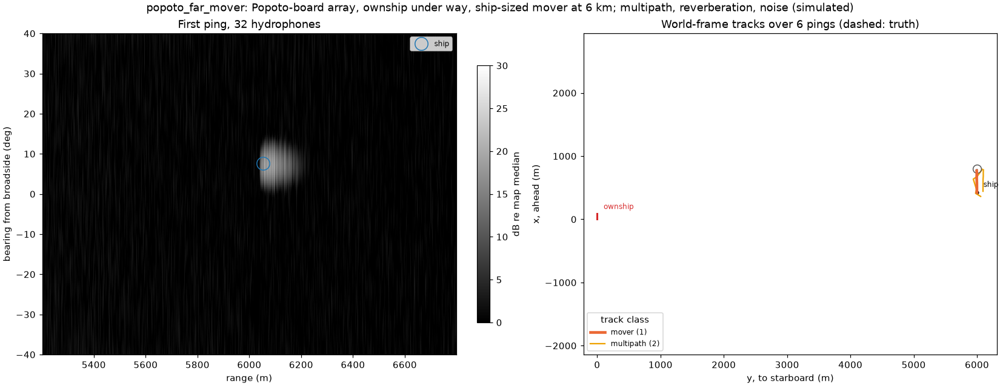

Look at the one mover track on the ship and the two multipath tracks attached to it. Geometry: [`scenarios/popoto_far_mover.png`](../scenarios/popoto_far_mover.png); animation: [`figures/popoto_far_mover.gif`](../figures/popoto_far_mover.gif).


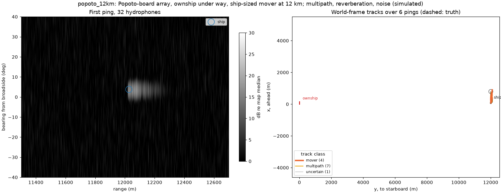

Left: the first ping; the ship's echo is spread over some 250 m of range behind its true position (circle). Right: one mover and eleven multipath tracks, all on the ship. Geometry: [`scenarios/popoto_12km.png`](../scenarios/popoto_12km.png); animation: [`figures/popoto_12km.gif`](../figures/popoto_12km.gif).


| Scene | Object | Tracked | From outline, m | From centre, m | Velocity true -> track, m/s | Class, speed m/s |
| --- | --- | --- | --- | --- | --- | --- |
| `popoto_far_mover` | `ship` | yes | 0.9 | 8.2 | -6.00, 0.00 -> -5.58, -0.02 | mover, 5.94 ± 0.05 |
| `popoto_12km` | `ship` | yes | 2.1 | 9.8 | -6.00, 0.00 -> -5.67, 0.11 | mover, 5.66 ± 0.50 |

| Scene | Pings | Detections per ping | Confirmed tracks | mover / static / line / multipath / uncertain | Movers not on a moving object |
| --- | --- | --- | --- | --- | --- |
| `popoto_far_mover` | 6 | 1 to 4 | 3 | 1 / 0 / 0 / 2 / 0 | 0 |
| `popoto_12km` | 6 | 7 to 15 | 12 | 1 / 0 / 0 / 11 / 0 | 0 |

| Scene | Peak over map median, 8 / 16 / 32 hydrophones, dB |
| --- | --- |
| `popoto_far_mover` | 22.9 / 25.6 / 28.6 |
| `popoto_12km` | 20.1 / 23.1 / 25.6 |

### 1.9 Popoto in other waters: `popoto_env_*`

**Wrong or missing:**

- **Summer over mud (60 m, 4 km): the ship is not detected at all.** No detection on any
  of six pings.
- **Deep water over silt (1000 m, 10 km): the ship is not tracked at its true position.**
  Its echo arrives about 300 m late in range (consistent with a bottom path; not confirmed
  by tracing the arrivals). The mover reported there counts as a false mover, the only one
  in the Popoto scenes. Correcting range with the propagation model is not written.
- **Over gravel (30 m, 3 km): the track is 10.0 m short of the hull** with the leading
  edge (it was 33.7 m beyond it before D-178). Explained in D-181 as hull geometry 7.8 m +
  LFM range-Doppler coupling 3.0 m + leading edge 0.4 m; not cured. On seed 52 the ship is
  `uncertain`, not a mover. The peak is 3.3 dB under the gallery of before D-137
  (issue `sonar-9b8`).
- Winter over sand (200 m, 8 km): tracked, 2.8 m from the hull; a stray detection 18 to
  22 m beyond the hull at ping 1 on every seed (D-170, issue `sonar-2o5`).
- Bottom parameters are textbook values per sediment, and all four waters are
  range-independent.

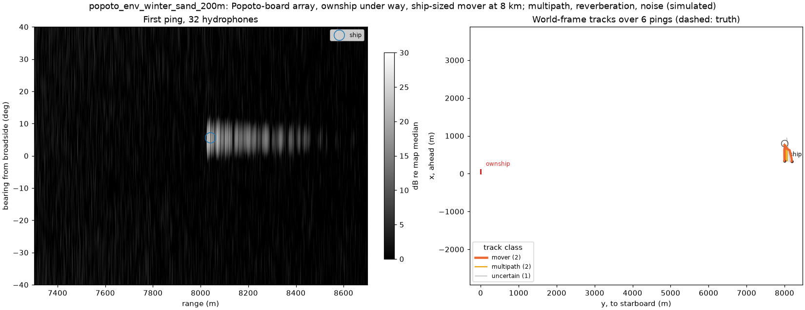

A surface duct: the ship is held at 8 km with 30 dB. Geometry: [`scenarios/popoto_env_winter_sand_200m.png`](../scenarios/popoto_env_winter_sand_200m.png); animation: [`figures/popoto_env_winter_sand_200m.gif`](../figures/popoto_env_winter_sand_200m.gif).


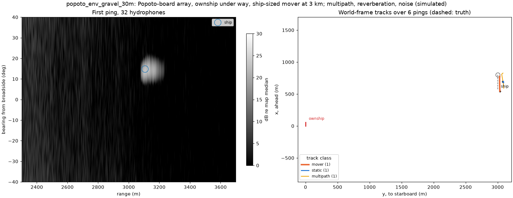

Strong echo in 30 m of water; the track sits short of the hull. Geometry: [`scenarios/popoto_env_gravel_30m.png`](../scenarios/popoto_env_gravel_30m.png); animation: [`figures/popoto_env_gravel_30m.gif`](../figures/popoto_env_gravel_30m.gif).


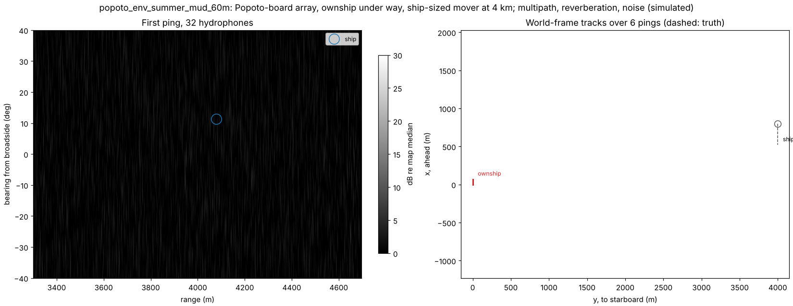

Nothing to see: no detection. That is the result. Geometry: [`scenarios/popoto_env_summer_mud_60m.png`](../scenarios/popoto_env_summer_mud_60m.png); animation: [`figures/popoto_env_summer_mud_60m.gif`](../figures/popoto_env_summer_mud_60m.gif).


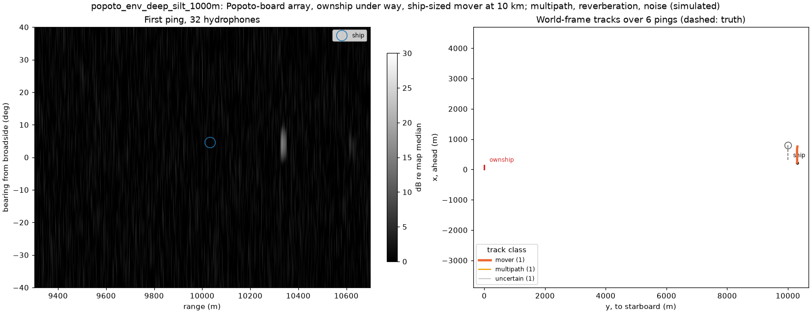

Left: the bright streak is about 300 m beyond the ship's true range (circle). Right: the mover track lies beside the truth, not on it. Geometry: [`scenarios/popoto_env_deep_silt_1000m.png`](../scenarios/popoto_env_deep_silt_1000m.png); animation: [`figures/popoto_env_deep_silt_1000m.gif`](../figures/popoto_env_deep_silt_1000m.gif).


| Scene | Object | Tracked | From outline, m | From centre, m | Velocity true -> track, m/s | Class, speed m/s |
| --- | --- | --- | --- | --- | --- | --- |
| `popoto_env_winter_sand_200m` | `ship` | yes | 2.8 | 17.7 | -6.00, 0.00 -> -5.64, 0.06 | mover, 6.06 ± 0.07 |
| `popoto_env_gravel_30m` | `ship` | yes | 10.0 | 11.8 | -6.00, 0.00 -> -5.57, 0.11 | mover, 5.79 ± 0.07 |
| `popoto_env_summer_mud_60m` | `ship` | **no** | no detection | | | |
| `popoto_env_deep_silt_1000m` | `ship` | **no** | nearest track 301.2 m away | | | |

| Scene | Pings | Detections per ping | Confirmed tracks | mover / static / line / multipath / uncertain | Movers not on a moving object |
| --- | --- | --- | --- | --- | --- |
| `popoto_env_winter_sand_200m` | 6 | 3 to 8 | 5 | 1 / 0 / 0 / 3 / 1 | 0 |
| `popoto_env_gravel_30m` | 6 | 1 to 3 | 3 | 1 / 1 / 0 / 1 / 0 | 0 |
| `popoto_env_summer_mud_60m` | 6 | 0 to 0 | 0 | 0 / 0 / 0 / 0 / 0 | 0 |
| `popoto_env_deep_silt_1000m` | 6 | 2 to 3 | 3 | 1 / 0 / 0 / 2 / 0 | 1 |

| Scene | Peak over map median, 8 / 16 / 32 hydrophones, dB |
| --- | --- |
| `popoto_env_winter_sand_200m` | 23.7 / 26.9 / 30.1 |
| `popoto_env_gravel_30m` | 24.9 / 28.3 / 31.4 |
| `popoto_env_summer_mud_60m` | 11.0 / 12.0 / 12.4 |
| `popoto_env_deep_silt_1000m` | 10.6 / 11.1 / 11.8 |

### 1.10 The present Popoto boards: `popoto_trial_1000m`

**Wrong or missing:** one +10 dB point target and one ping; a picture, not a detection
study. The 27.5 kHz band of the present boards cannot reach 12 km (section 2.1).

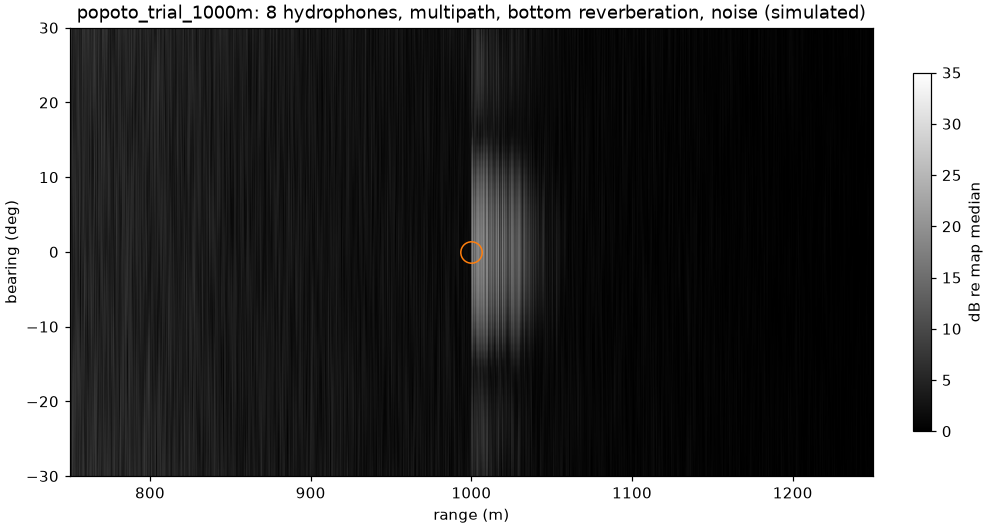

Look at the peak at 1000 m on the target's bearing. Geometry: [`scenarios/popoto_trial_1000m.png`](../scenarios/popoto_trial_1000m.png); animation: [`figures/popoto_trial_1000m.gif`](../figures/popoto_trial_1000m.gif).


| `peak_range_m` | `true_range_m` | `peak_bearing_deg` | `peak_over_median_db` |
| --- | --- | --- | --- |
| 1000.1 | 1000.0 | 0.0 | 29.8 |

## 2. Headline results

Each table names its source. Where the source is a `DECISIONS.md` entry, the measurement
is recorded only there (not in `RESULTS.md`, and with no committed JSON); that is said.

### 2.1 Detection at the 12 km design point

**What is wrong first:** one row of 32 hydrophones is 1.1 dB short at 12 km (detection
probability 0.22 on one ping). The target strength (+25 dB) is a placeholder, the source
level (197 dB) is of a projector not yet chosen, and the boards are used an octave below
their specified band (`STATUS.md`, owner questions 2 to 4). The ship's depth at 12 km is
not measured: with three rows it reads 8 to 35 m for a true 4 m (D-160), and the depth
sigma there is 2960 to 3010 m (`RESULTS.md`, "The 12 km study, rerun").

Link budget, free field, spherical spreading, steady point echo in noise. Source:
`docs/design/derived.json`, `requirements` entry `POP-3` (written by
`tools/design_report.py`; also `RESULTS.md`, "The 12 km margins with the detector's
threshold"). One row has 14.6 dB at 12 km at 5 kHz and 197 dB.

| Rows | Needs, dB in one row | Margin at 12 km | Detection probability, one ping |
| --- | --- | --- | --- |
| 1 | 15.8 | -1.1 dB | 0.22 |
| 2 | 13.2 | +1.4 dB | 0.87 |
| 3 | 11.8 | +2.9 dB | 0.99 |

One row would need 198 dB at 4.2 kHz for 15.8 dB (`docs/design/popoto_range_study.json`;
`RESULTS.md`, "Popoto array: frequency and source level for 12 km"). The present 8
hydrophones at 27.5 kHz would need 322 dB (not possible); 190 dB reaches 2.7 km.

Through the chain on simulated pings. Source: `docs/design/popoto_12km.json`
(`tools/popoto_12km_study.py`; keys `cases.<case>.<rows>.pings_detected`, `median_snr_db`,
`track_confirmed_at_ping`). **This file was last written 2026-11-20 (commit `fa57b04`),
before detections moved to their reflection time (D-156), the leading-edge default (D-160)
and everything after. It has not been regenerated; detection counts are unlikely to move,
positions would.**

| Case (key under `cases`) | Pings detected of 6, 1 / 2 / 3 rows | Median SNR, dB | Track confirmed at ping |
| --- | --- | --- | --- |
| popoto_12km: 100 m isovelocity over sand, image-source paths | 6 / 6 / 6 | 17.7 / 14.5 / 14.9 | 3 / 3 / 3 |
| the same without reverberation (noise only) | 6 / 6 / 6 | 17.2 / 15.0 / 15.2 | 3 / 3 / 3 |
| popoto_12km: 100 m isovelocity over sand, Bellhop | 6 / 6 / 6 | 22.4 / 20.1 / 20.9 | 3 / 3 / 3 |
| popoto_env_deep_silt_1000m at 12 km, Bellhop | 0 / 0 / 0 | – / – / – | none / none / none |
| popoto_env_gravel_30m at 12 km, Bellhop | 6 / 6 / 6 | 33.8 / 34.3 / 34.4 | 3 / 3 / 3 |
| popoto_env_summer_mud_60m at 12 km, Bellhop | 0 / 0 / 0 | – / – / – | none / none / none |
| popoto_env_winter_sand_200m at 12 km, Bellhop | 6 / 6 / 6 | 23.6 / 31.4 / 32.6 | 3 / 3 / 3 |

### 2.2 Position and speed errors per scene over ten seeds

**What is wrong first:** these are from the gallery pipeline re-scored on saved captures
(`tools/classify_rules_eval.py`), **not from the live chain**; D-181 says in so many words
that the live chain's range-Doppler option is held by its tests only and was not measured
on these scenes. The ten-seed numbers of D-172 to D-181 are recorded in the `DECISIONS.md`
entries only; the latest committed evaluation file,
`docs/benchmarks/classify_rules_eval_e0d9665.json`, is from D-159.

Median distance from the track to the hull, metres, ten seeds (L4 jobs named in the
entries):

| Scene | Before D-172 | D-172: echoes placed from the array at reception | D-178: leading edge (**the default now**) | D-181: plus `range_doppler: full` (opt-in) |
| --- | --- | --- | --- | --- |
| `popoto_12km` | 8.2 | 2.3 | 3.4 (seed 60: 3.0 -> 65.4; seeds 56, 57: 34.8 -> 5.4, 18.6 -> 7.0) | 2.7 |
| `popoto_far_mover` | | 36.9 | 0.4 | 0.9 (worse) |
| `popoto_env_gravel_30m` | | 34.3 beyond | 10.1 short; mover -> uncertain on seed 52 | 7.5 |
| `popoto_env_winter_sand_200m` | | 0.8 | 2.5 (worse) | 2.1 |
| `flank_patrol`, submarine | | 30.0 | 1.1 | 0.3 |
| `flank_patrol`, wreck | | 6.9 | 5.2 | not given |
| `fls_170k_traffic`, `boat_closing` (from its centre; 0.00 m from its hull throughout) | | | 4.6 | 5.9 (worse) |

Cross-range and speed at 12 km (source: D-159, D-172, D-176):

| Quantity, `popoto_12km`, ten seeds | Value |
| --- | --- |
| Mean cross-range from the ship's centre, before -> after D-172 | -55.9 -> -31.8 m; worst -118.8 -> -94.7 m |
| The same with the opt-in sub-grid bearing (D-176) | worst -94.7 -> -50.2 m; speed error 0.77 -> 0.41 m/s; but median distance to the hull 2.3 -> 3.3 m, so it stays off |
| Mean speed error, gallery defaults (D-159) | 0.773 m/s; all movers of the 12 scenes 0.209 m/s |
| Per-hit RMS bearing error at 9-11.5 dB SNR, grid -> parabola (D-176) | 0.447 -> 0.297 degrees |

The live chain itself, centroid -> leading edge (source: D-160, "Owner's evidence"; chain
`popoto_vehicle`, both engines):

| Scene | Range error of the object, centroid -> leading edge |
| --- | --- |
| `popoto_12km`, ship | +49.5 -> +0.9 m |
| `popoto_12km`, three stacked rows, seeds 51-60 | track +37.3 -> +2.7 m; last detection +43.5 -> +0.6 m |
| `flank_patrol`, submarine | +36.8 -> -4.2 m |
| `flank_patrol`, wreck | +33.4 -> +0.6 m |
| FLS boats | 1.5 to 1.8 m nearer, to their near face; FLS false movers 461 -> 411 |
| A strong point echo no elevation places (one row) | reads 1.0 to 3.6 m short (worse; the centroid was within 0.05 m) |

Classification over ten seeds (source: `RESULTS.md`, "Classification: the opt-in detection
rules over ten seeds"; `docs/benchmarks/classify_rules_eval_190f8ce.json`, and
`classify_rules_eval_afe0806.json` for the later count): with the rules off, 16.0 ± 4.5
false movers per seed index summed over 12 scenes at D-152; 194 targets in their class and
94 false movers in all at D-159. `fls_120k_rough_surface` supplies most of them.

### 2.3 Detector false alarms at the default budget (D-168)

**What is wrong first:** the one-row intervals lie just under the budget; the two-row cell
mean runs 1.26 times its share (issue `sonar-031`); the three-row static count stopped at
40 000 pings (job timeout, `sonar-4xn`); the chain's 9 dB `min_snr_db` floor drops 33 %
and 54 % of two- and three-row noise detections, so the shipped report runs well under
budget for stacked rows (`sonar-xl7`).

Source: `RESULTS.md`, "False alarms at the default budget, counted";
`tools/detector_search_factor.py --at-default` on an L4. Budget: one false detection per
thousand pings. Intervals are exact Poisson 95 %.

| Map, rows | Noise-only pings | Detector: found, fraction of budget | Reported above 9 dB, fraction of budget |
| --- | --- | --- | --- |
| long-range, 1 | 100 000 | 79, 0.79 (0.63-0.98) | 0.79 |
| long-range, 2 | 100 000 | 90, 0.90 (0.72-1.11) | 0.60 (0.46-0.77) |
| long-range, 3 | 89 594 | 72, 0.80 (0.63-1.01) | 0.37 (0.25-0.52) |
| `flank_32`, 1 | 100 000 | 76, 0.76 (0.60-0.95) | 0.74 (0.58-0.93) |
| static, 2 | 41 553 | 42, 1.01 (0.73-1.37) | 0.75 (0.51-1.06) |
| static, 3 | 40 000 | 29, 0.73 (0.49-1.04) | not split |

Pooled: 0.82 of the budget (0.74-0.91). The constants are kept (owner's choice).

### 2.4 Motion estimation (D-164, D-171)

**What is wrong first:** heave is the weaker estimate (grazing angles span only 17 to 27
degrees). The bounds are ours. Not measured: image contrast loss, attitude errors,
anything on real data. Delays read 0.2 to 0.9 % below the model in every window (issue
`sonar-oii`).

Source: `RESULTS.md`, "Motion estimation" (`tests/python/test_motion.py`, CPU; `sas_auv`
at 200 kHz, wavelength 7.5 mm, 40 pings, 10 mm RMS sway and 4 mm heave unknown to
navigation):

| Quantity | Result | Bound (ours) |
| --- | --- | --- |
| Sway error, RMS | 0.099 mm = wavelength/76 (0.109 before D-164) | wavelength/20 |
| Heave error, RMS | 0.324 mm = wavelength/23 | wavelength/4 |
| Worst sway over seeds 1 to 10 | 0.24 mm (0.87 before D-164, outside the bound) | 0.375 mm |
| Point-response peak after motion estimation against true motion | +0.03 dB (navigation only: -10.01 dB); measured before D-164 | within 1 dB |

Gallery scenes (source: `gallery.json`, section 1.4; D-171 for before -> after):
`minefield_sas` sway 0.140 -> 0.022 wavelengths and heave 0.101 -> 0.044; `wreck_sas`
sway 0.045 -> 0.053 (worse), heave 0.083 -> 0.044.

### 2.5 Sensor Bridge loopback and pace (D-153, D-162, D-163, D-173)

**What is wrong first:** this is the board emulator with the opt-in UDP-socket patch, in
a container, never hardware, never the RoCE receiver. The margin is thin: the receiver's
socket buffer (212,992 bytes, which the container cannot raise) is about 20 ms of stream,
and a halved buffer still loses frames in some configurations. An idle stop after the
board has gone ends in a Sensor Bridge shutdown error (`shutdown_error`, `os._exit`). The
pace table is from an `a10g-small`, not the L4 reference (issue `sonar-e2u`).
**`RESULTS.md`'s "Sensor Bridge loopback" section is stale**: it still says the loopback
test has not passed in a job and lists pace 0.5 as the setting. The numbers below are in
the `DECISIONS.md` entries only.

| Measurement | Result | Source |
| --- | --- | --- |
| Reports through Sensor Bridge against the direct chain, same engine, same pings | largest difference 0.0, for `serve --scenario` and for `engine: cpp` | D-173 |
| Loopback at real time (pace 1.0), L4, after the fixes | 9 of 9 runs passed; worst receive delay 0.82 to 2.08 ms (test bound 5 ms) | D-163 |
| Chain OpenMP threads at half the CPUs, L4: frame loss with a halved buffer | 9 of 15 runs -> 0 of 10; worst delay 10-13 -> 1-2 ms; about +10 % chain time | D-162 |
| `receive` when the stream ends early | always stops: quarter buffer 12 of 12 runs ended in 16 s; idle stops 4 of 4 at 53 s with statistics | D-163 |
| Pace 1.0 and 0.5, default and halved buffer, `a10g-small`, thread cap from the CPU quota | 0 of 80 runs lost frames, worst delay at most 2.4 ms; without the cap 2 to 20 of 20 per configuration lost frames, worst 169 ms; cost +40-57 % chain time with one thread there | D-173 |
| Chain time per ping in the loopback, L4, host backend | about 450 ms for the first ping, 85 to 95 ms after | `RESULTS.md`, "Sensor Bridge loopback" (older run) |

### 2.6 Throughput per GPU

**What is wrong or stale first:**

- **None of these is a DGX Spark or a Jetson.** Nothing has run on either.
- The **`minefield_sas` echo-synthesis row** (14.30 s host, 0.337 s CUDA, 42.4 times) is
  of the old scene with 14,870 scatterers; the scene now has 20,558 (D-171, D-174; issue
  `sonar-egj`).
- In the same table the **live-chain row (0.0095 s a ping)** is the first run's, with the
  earlier detector; the current figure is the first table below.
- The power-law fit against GFLOPS is poor (R² 0.34 to 0.44) and the GFLOPS values are
  recalled, not verified: do not use it to predict a new GPU.
- CPU times in `SCENARIOS.md`'s scene table are from a much older tree.
- Motion estimation has no GPU code; CUDA delay estimation is slower than the host
  (issue `sonar-b6r`).

The live chain on the device, C++ engine, per ping, as deployed. Source: `RESULTS.md`,
"Performance", first paragraph; `docs/benchmarks/live_chain_ablation_l4_b2a918e.json`
(L4, D-150):

| Rows | ms a ping | With `cell_statistic: mean` |
| --- | --- | --- |
| 1 | 12.73 | 9.92 |
| 2 | 25.92 | 22.88 |
| 3 | 37.52 | 33.94 |

A full-rate ping (0.5 to 13 km at 102.4 kHz, no decimation) takes 0.48 / 1.03 / 1.49 s for
one, two and three rows on an L4 against a 17.9 s ping interval, timed on a loaded machine
(`docs/design/popoto_stage2.json`, `decimation.timing.cuda`).

Backprojection, one-shot calls, current kernel. Source: `RESULTS.md`, "Performance";
`docs/benchmarks/bench_{t4,l4,a10g,a100}.json` (`tools/benchmark.py`, scale 2):

| GPU | SAS 2560 x 1200 at 5 cm, no culling | Culled | SAS real-time factor (culled) | FLS fan, 6.4 Mpixel | Flank map, 7.7 Mpixel | Flank real-time factor |
| --- | --- | --- | --- | --- | --- | --- |
| Tesla T4 | 1.48 s | 1.26 s | 64x | 0.20 s | 0.27 s | 54x |
| L4 | 0.81 s | 0.68 s | 118x | 0.09 s | 0.16 s | 90x |
| A10G | 0.80 s | 0.69 s | 116x | 0.10 s | 0.17 s | 82x |
| A100 (80 GB) | 0.86 s | 0.68 s | 118x | 0.13 s | 0.15 s | 96x |

With samples kept on the device (sessions, culled; `docs/benchmarks/session_*.json`): SAS
at 5 cm 0.80 s (T4), 0.36 s (L4), 0.33 s (A10G), 0.19 s (A100); two A10G 0.19 s (1.71
times one). Conditioning on the device: 6.2 ms a ping on a T4 and 3.4 ms on an A10G
against 217 and 165 ms on the host (`conditioning_{t4,a10g}.json`).

Every stage with a CUDA backend, L4, host against CUDA. Source: `RESULTS.md`, "Every stage
with a CUDA backend on an L4"; `docs/benchmarks/gpu_benchmark_all_l4_15f1121.md` and
`gpu_benchmark_all_l4_batched.md`:

| Stage, case | Host, s | CUDA, s | Speed-up | Current? |
| --- | --- | --- | --- | --- |
| Echo synthesis, `fls_120k_transit` | 5.62 | 0.559 | 10.0x | yes |
| Echo synthesis, `minefield_sas` | 14.30 | 0.337 | 42.4x | **stale: old scene** |
| Backprojection, SAS, 200 pings, 1.5 Mpixel (one call / session) | 11.91 / 11.75 | 0.346 / 0.184 | 34.5x / 64.0x | yes |
| Backprojection, FLS, 1.6 Mpixel | 1.19 | 0.0434 | 27.4x | yes |
| Baseband conversion, `sas_auv` raw | 0.954 | 0.0155 | 61.5x | yes |
| CFAR, 241 bearings x 8,000 cells | 0.0620 | 0.0083 | 7.5x | yes |
| Far-field beamformer, 1 / 2 / 3 rows, per ping | 0.192 / 0.402 / 0.586 | 0.0127 / 0.0281 / 0.0415 | 15.1x / 14.3x / 14.1x | yes |
| MVDR beamformer, 1 / 2 / 3 rows, per ping | 1.67 / 3.48 / 5.17 | 0.200 / 0.406 / 0.608 | 8.4x / 8.6x / 8.5x | yes |
| Whole scenario `popoto_12km` (Bellhop) | 117 | 29.3 | 4.0x | not rerun since |
| Live chain, one row, backprojection map, per ping | 0.149 | 0.0095 | 15.6x | **stale: first run; now 12.7 ms** |

"Yes" means no later change to that stage is recorded in `DECISIONS.md`; none of these
rows was rerun at HEAD.

### 2.7 Simulator validation

**What is wrong first:** there is no comparison with our own measured data. Neither worked
example of TR 0702 is a numerical reproduction of its figures (the report does not print
the parameters; ours are marked `unconfirmed`). TR 9407 is distribution-limited and
unread. The measured-channel data sets state no sea state, so every sea parameter is
fitted or assumed. Our Bellhop 2-D runs and Bellhop3D differ by up to 1 to 2.5 dB (issue
`sonar-6c8`). `RESULTS.md` says the committed `sst_validation` matrix and figures were made
before the reverberation Doppler fix (D-80) and not regenerated; that sentence is stale:
`git log -1 -- docs/figures/sst_validation.md` gives 2026-11-20 (commit `1debe6d`), after
the fix.

Against Bellhop and KRAKEN (run as separate programs). Source: `RESULTS.md`, "Propagation,
reverberation and noise" and "Rays against normal modes at 8 kHz"
(`tests/python/test_propagation.py`, `test_kraken_crosscheck.py`):

| Check | Result |
| --- | --- |
| Image-source provider against Bellhop, Pekeris waveguide, 1 kHz, coherent loss 0.1 to 3 km | 0.06 dB median, 0.4 dB worst |
| Same, incoherent loss at 1 and 8 kHz | 0.1 dB median, 0.7 dB worst |
| Same, delays of the first four arrivals | within 2 microseconds |
| Bellhop rays minus KRAKEN modes, 8 kHz, 1 to 10 km | at most 0.21 dB |
| Eigenray provider with 80 arrivals against modes | within 0.5 dB at every range (with 8 arrivals: 4.9 dB too much loss at 10 km, a fault this check found) |
| Bottom and surface reverberation level against the analytic prediction | within 2 dB in every range bin |
| Generated ambient noise against the requested spectrum, 0.5 to 30 kHz | within 1 dB |

Against TR 0702: 61 rows, section by section, in
[`figures/sst_validation.md`](../figures/sst_validation.md) (`tools/sst_validation.py`).

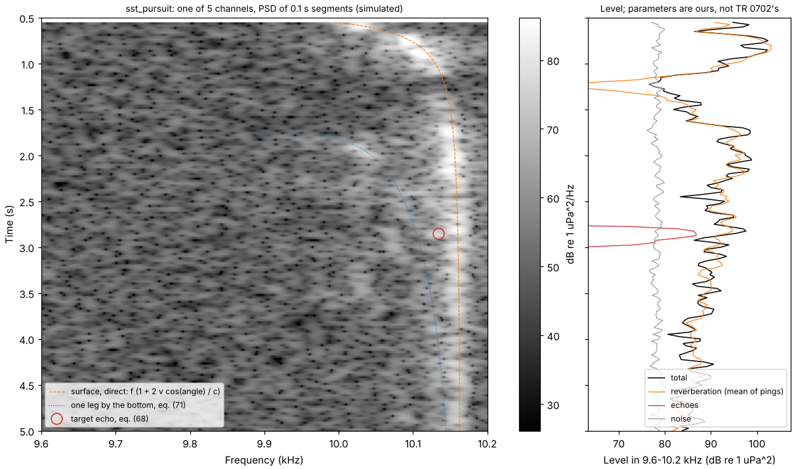

The Pursuit example of TR 0702 Sec. 3 with our parameters. Left: the reverberation's
spectrum against time with the closed-form Doppler curves (surface direct; one leg by the
bottom) and the circle where the target echo should fall. Right: level against time for
the total, the reverberation, the echoes and the noise. Every comparison is with a closed
form for our geometry, not with the report's figure.

Against measured channel soundings (data fetched at test time, never committed). Source:
`RESULTS.md`, "Time spreading against measured channels";
`docs/figures/channel_validation_{purple,sites,watermark,smartocean}.md`:

| Data | Quantity | Result |
| --- | --- | --- |
| UACR "Purple", 12.5 kHz | Cross-arrival Doppler width, measured over closed form | median 0.96, scatter x1.18, 45 arrivals |
| same | Doppler spectrum shape: Gaussian option inside the measured spread | 13 of 18 arrivals in width, 15 of 18 in shape (Lorentzian: 4 and 7) |
| same | Measured over model decay time, grazing above 12 degrees | facet rule 1.26, rule of thumb 0.76 |
| same | Scintillation at 200 m in the rough recording | **fails**: measured 0.8 to 0.9 against 2.2 to 5.7 |
| Watermark NOF1 / NCS1 / BCH1 | Doppler shape w90/w50 (a Gaussian has 2.44) | 2.50 / 2.48 / 2.94 |

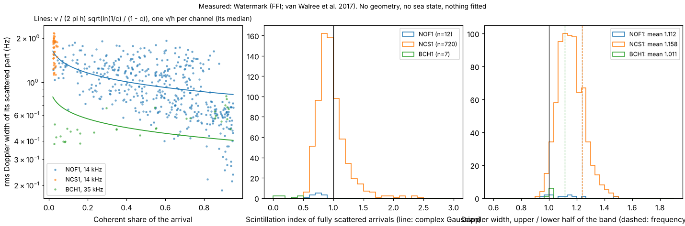

Measured Watermark channels, nothing fitted. Left: Doppler width against the coherent
share of each arrival, with the model's curve per channel. Middle: scintillation index of
fully scattered arrivals (the line at 1 is complex Gaussian). Right: Doppler width of the
upper over the lower half of the band (dashed: the frequency ratio). Look at how far BCH1
(the harbour channel) sits from the other two.

## 3. What a live-chain report looks like

**No report could be produced at HEAD for this page.** The worktree has no built module,
and the main checkout's built module (dated 2026-11-22) is older than its Python sources:
`tools/sonar_live.py configs/deploy/popoto_testauv_1row.yaml --scenario
popoto_testauv_trial_1row` simulated its pings and then failed at the first one with
`KeyError: 'classify_max_fit_rms_bearing'`. The example below is therefore a committed
test fixture, not a fresh run.

**The example is not what the chain reports today.** It is an old line made with
`cfar.range_estimate: centroid`; the default is now the leading edge (`first`, D-160), so
`range_m` and the track positions differ in a current report. Use it to learn the fields,
not the values. **Current examples: [EXAMPLES.md](EXAMPLES.md)** (worked examples run on
the CPU at the present tree, with real report lines; written with this set, after this
page).

One real report line, the last of six pings from the C++ engine. Source:
`tests/python/data/centroid_d158.json`, key `flank.cpp[5]`, written by
`tests/python/data/make_centroid_d158.py` from the tree `42d4539`:
`flank_32`, ownship making 1.5 m/s, one target crossing at 3 m/s and one standing still,
host backend. **It was made with the range as the centroid**, which was the default then;
`tests/python/test_detector.py::test_range_estimate_centroid_given_is_the_output_from_before_d158`
holds today's code to this line byte for byte when `cfar.range_estimate: centroid` is
given. With today's default (`first`, D-160) `range_m` would be the leading edge
(`first_range_m` here) and the track positions would move with it. The fixture stores
each line with its keys sorted and without `processing_seconds` (it differs run to run);
a line from the programs has the same fields in the chain's own order.

```json
{"detections": [{"arrivals": [[328.25, 57.94938079], [328.625, 60.91392294], [329.5, 81.9349447], [330.25, 64.22129862], [330.625, 59.9791797]], "bearing_deg": -13.23500405, "extent_m": 3, "first_range_m": 328.4375, "range_m": 329.5247285, "snr_db": 81.9349447}, {"arrivals": [[249.25, 63.7531439], [249.625, 68.03845553], [250.125, 87.69856953], [250.625, 69.74648575], [251, 63.88503434], [251.375, 60.17828776], [251.625, 58.01773766]], "bearing_deg": -1.155278494, "extent_m": 3, "first_range_m": 249.4375, "range_m": 250.1423119, "snr_db": 87.69856953}], "ownship_xyz": [15, 0, 0], "ping": 5, "pings_without_nav": 0, "sequence": 5, "sync": null, "time_ns": 10000000000, "tracks": [{"id": 1, "kind": "static", "mean_snr_db": 82.74179079, "parent": null, "range_m": 329.518222, "seen": 1, "speed_m_s": 0.04951029824, "vx": 0.04422617907, "vy": 0.02225566707, "x": -60.72558087, "y": 320.6990724}, {"id": 2, "kind": "mover", "mean_snr_db": 87.56557704, "parent": null, "range_m": 250.1205352, "seen": 1, "speed_m_s": 2.955803617, "vx": -2.955264713, "vy": 0.05644019557, "x": 10.19775347, "y": 250.07443}]}
```

Reading it, with the tables of [`docs/DEPLOYMENT.md`](../DEPLOYMENT.md), section "The
report line":

| Field in the example | Value | See DEPLOYMENT.md |
| --- | --- | --- |
| `ping`, `sequence` | 5, 5 | base fields: pings processed before this one; the source's counter |
| `time_ns` | 10000000000 | base fields: the transmit instant |
| `ownship_xyz` | [15, 0, 0] | base fields: the array's reference point, world north-east-down, metres |
| `pings_without_nav` | 0 | base fields; `pings_without_velocity` and `pings_without_time` appear only once above 0 (D-158, D-175) |
| `sync` | null | base fields: one board, nothing to synchronise |
| `detections[].range_m`, `bearing_deg`, `snr_db` | 329.5 m, -13.2 degrees, 81.9 dB | detection table; `snr_db` is explained in "What `snr_db` is, and how it relates to the link budget" |
| `detections[].first_range_m`, `extent_m` | 328.4 m, 3 m | detection table: where the cluster starts and its extent (multiscale detector) |
| `detections[].arrivals` | five [range, SNR] pairs | detection table: arrivals along range |
| `tracks[].id`, `kind`, `parent` | 1 `static`, 2 `mover`; `parent` null | track table: `parent` is set for `multipath` |
| `tracks[].x`, `y`, `vx`, `vy`, `speed_m_s` | the mover: 10.2, 250.1 m; -2.96, 0.06 m/s; 2.96 m/s (true 3 m/s) | track table: the fitted line at `time_ns`, world north and east |
| `tracks[].range_m`, `mean_snr_db`, `seen` | 250.1 m, 87.6 dB, 1 | track table |

Not in this example, present only when switched on or when something happened:
`blanking`, `rows` and
the elevation and depth fields (stacked rows), `profile`, `sbl_fallback`, `part`,
`multipath_depth`, `coverage` (DEPLOYMENT.md, end of "The report line", and "The staged
build").

What the programs print besides the report file (read from the code at HEAD; not run):

- `tools/sonar_live.py` prints one line per ping to the terminal (`ping_line`):
  `ping <n>  detections <count>  tracks {"mover": 1, ...}  <ms> ms`, and once, on stderr,
  `chain settings {...}`: what the first ping resolved of the sizes the configuration
  leaves to the sonar. At the end it prints `sonar_live: {...}` on stderr only if a counter
  is non-zero (`dropped_blocks`, `overrun_pings`, `bad_blocks`, `reports_split`,
  `sbl_fallbacks`).
- `build/bin/sonar_live` ends with one summary line on stderr (`apps/sonar_live.cpp`):
  `sonar_live: N pings, N dropped, N samples lost, N bad blocks, N blocks late (N too
  late), N blocks repeated, N restarts, N pings discarded at stop, N pings without
  navigation, N pings without velocity, N blocks dropped at the full queue, N reports
  split, N report datagrams refused`. The counters are those of D-158 and D-161.
- `tools/sonar_live_hsb.py receive` prints its transport statistics, including `reports`,
  `stopped` ("pings" or "idle") and `chain_omp_threads`, and exits with status 3 after a
  `receive: stopped short (...)` line when fewer pings were reported than asked (D-163).

## 4. How to regenerate each output

`PYTHONPATH=python` and a built module are assumed (`docs/HANDOFF.md`, section 3). GPU
means a Hugging Face job through `tools/gpu_job.sh` (`docs/HANDOFF.md`, section 4).
Runtimes are given only where a document records one.

| Output | Committed? | Command | Where | Runtime |
| --- | --- | --- | --- | --- |
| Gallery: `docs/figures/<scene>.png`, `.gif`, `gallery.json`, `*_leg1_full.png` | yes (57 files) | `tools/gallery.py --backend cuda`, as job mode `gallery` with `GPUSONAR_ORACLES=1 GPUSONAR_CERES=1`; then copy the uploaded folder into `docs/figures/` | GPU | 489 s for the 26 scenes on an L4, about 40 min for the job with its builds |
| The same on a CPU, full size | would overwrite the committed gallery: pass `--out` | `tools/gallery.py --backend host [--only a,b] --out <dir>` | CPU; Popoto and flank scenes need `GPUSONAR_BELLHOP` | seconds to 14 min a scene on four cores (older run, `SCENARIOS.md`) |
| Thinned gallery for a quick look | no (`build/gallery_quick/`) | `tools/gallery.py --quick` | CPU | not recorded; `tests/python/test_realistic_scenes.py` runs the same thinned scenes |
| Geometry diagrams `docs/scenarios/<name>.png` | yes | `tools/scenario_diagrams.py [--only a,b]` | CPU; Bellhop scenes need the oracle | not recorded |
| Architecture diagrams `docs/architecture/*.png` | yes | `tools/architecture_diagrams.py` | CPU | not recorded |
| Build diagrams `docs/design/build_*.png` | yes | `tools/build_diagrams.py` | CPU | not recorded |
| `docs/DESIGN.md`, `docs/design/derived.json`, design figures | yes | `tools/design_report.py` (`--check` fails if a requirement is not met) | CPU | not recorded |
| `docs/design/popoto_12km.json` | yes (stale, see 2.1) | `tools/popoto_12km_study.py` with `GPUSONAR_BELLHOP` set (`--quick` for a short run) | CPU | long: the Bellhop cases take 220 to 770 s each to simulate (`simulate_seconds` in the file) |
| `docs/design/popoto_range_study.json`, `.png` | yes | `tools/popoto_range_study.py` | CPU | not recorded |
| Ten-seed evaluation: `classify_rules_eval.json`, `.md`, `captures/` | only the JSON of some runs, as `docs/benchmarks/classify_rules_eval_<commit>.json`; captures stay in the dataset | job mode `clseval` with `GPUSONAR_ORACLES=1`, `GPUSONAR_CLSEVAL_ARGS="--seeds 10 --commit <hash>"` | GPU | about 50 min for 12 scenes x 10 seeds on an L4 |
| False-alarm count `at_default.json` | no; the table is in `RESULTS.md` | job mode `falsealarm` (`GPUSONAR_FA_ARGS`, e.g. `--maps long_range --pings 100000`) | GPU | long: the three-row static map timed out at about 43 000 pings |
| `docs/benchmarks/bench_*`, `session_*`, `conditioning_*` | yes | job mode `benchmark` (`docs/benchmarks/README.md` has each file's exact settings); the job prints one `BENCHMARK_JSON {...}` line to save | GPU | not recorded; a rerun is a new measurement, not a regeneration |
| `docs/benchmarks/gpu_benchmark_all_l4*.json`, `.md` | yes | job mode `benchall` with `GPUSONAR_ORACLES=1 GPUSONAR_CERES=1` | GPU | timeout 150 min used |
| `docs/benchmarks/live_chain_ablation_l4_*.json` | yes | job mode `liveablate` | GPU | not recorded |
| `docs/design/popoto_stage2.json` (`decimation.timing.cuda`) | yes | job mode `elevbench` | GPU | timeout 60 min used |
| `docs/figures/sst_validation.md`, `.json`, `sst_*.png` | yes | `tools/sst_validation.py --out docs/figures/sst_validation.md --json docs/figures/sst_validation.json --figures docs/figures` | CPU | about 2 minutes |
| `docs/figures/channel_validation_*.md`, `.png` | yes (tables and figures only) | `tools/channel_validation.py --data <dir> --sites all --seeds 2 --receivers 4 --figures docs/figures --out docs/figures/channel_validation_purple.md`, `tools/channel_watermark.py`, `tools/channel_smartocean.py`; data from `tools/fetch_channels.py` | CPU; the data are licensed and never committed | not recorded |
| Motion-estimation timing and lambda sweep | no (log only) | `tools/motion_study.py timing` / `sweep`; job mode `motion` with `GPUSONAR_CERES=1` | CPU or GPU | not recorded |
| A live-chain run: `recording.h5`, `report.jsonl`, `taps/` | no (`*.h5` is ignored by git) | `tools/sonar_live.py <deploy file> --scenario <name> --out <dir> [--engine cpp]`; replay with `--replay <dir>/recording.h5` | CPU, or GPU with a CUDA build | 0.55 s of processing a ping on four cores for `popoto_far_mover` (`DEPLOYMENT.md`); simulation with Bellhop takes minutes |
| A build's files and self-tests | sonar and deploy files yes (`--check-shipped` verifies them); self-test output no | `tools/build_from_spec.py <spec> --out <dir> --self-test` | CPU | not recorded |

After regenerating the gallery, run
`tests/python/test_realistic_scenes.py::test_documented_full_size_classes` (it reads
`docs/figures/gallery.json`) and update `docs/SCENARIOS.md`'s tables, which quote it.
