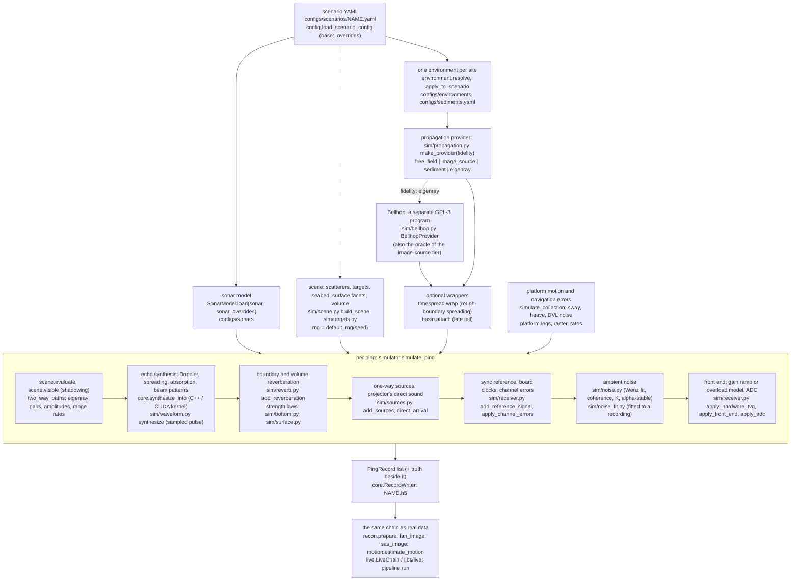

# The simulator: how it works and how far to trust it

Part of the handoff set (`README.md` in this directory is the entry point; `OUTPUTS.md` has the
gallery and the results tables; `SOFTWARE.md` the processing chain; `TESTS.md` the test suite;
`EXAMPLES.md` commands that run on a CPU). Written at decision D-181 (`docs/DECISIONS.md`); brought to
D-201 and the opt-in 3-D tier on 2026-11-26, and to D-225 (the merge `b88c458`: conformance alignments,
sediment penetration, elastic rock, engine selection and record) the same day, and to D-229 (the merge
`61cfb66`: the Williams-Jackson and Jackson-Briggs opt-ins, the sites' boundary scattering and
`reverberation: site`, the Doppler limits the Doppler scoping found) the same day, and to D-234 (the merge
`4057d65`: pulse trains and `source_energy_db`, the four Doppler scenes and what they found) the same day, and to
D-240 (the merge `8581533`: the `penetration: rough` cost cap, the scene `flank_patrol_doppler_tone`, the
`buried_objects` gallery entry regenerated) on 2026-11-27, and to D-245 (the merge `f40d4c3`: the two 12 km
large-submerged scenes, the simulator on the device in the Doppler GPU job, the tone scene simulated there)
the same day, and to D-250 (the merge `bda7c7d` of the sixth batch: the boundary reverberation's Doppler at
one frequency found, D-249; the correction of the tone scene's false detections, D-246; the
hyperbolic sweep through both simulator engines, D-247; the visualization's read-only scene trace and opt-in
taps, D-248) the same day, and to D-254 (the merge `e06fac8` of the seventh batch: the reverberation's Doppler
per frequency as the default, D-251; the tone scene recounted with it, D-252; the gallery regenerated, D-253)
the same day, and to D-261 on 2026-11-28 (the merge `08ddfab` of the eighth batch: the two deep-site scenes and what
they measured, D-260; the site's bubble law reaching the simulator only through the scene; the D-251-stale outputs
regenerated). **What the deep site found first (D-260):** with the planner's site, noise, absorption and surface in
the simulator, the class's hulls, whose five highlights resolve in range, come 3.8 to 6.0 dB under an unresolved
point of the same strength through the chain, so the planner's margins hold for a point only; the 1 s linear
baseline failed there at sea state 3 for the resolved hull (`docs/STATUS.md` open item 90). Brought to D-263 the
same day (the merge `e16e214` of the ninth batch): **since D-262 the 12 km baseline (`popoto_long_range` and the
face builds) transmits a sampled hyperbolic sweep of 2 s at 197 dB** (`{type: sampled, source: hfm}`): the
simulator is 5 to 17 times slower on a CPU with it than with the analytic 1 s sweep; the scenes that exist for the
linear sweep state the 1 s sweep by override (the three elevation scenes, `popoto_12km_large_submerged`); the
trains and the 0.1 s builds are unchanged; FLS, SAS and flank records hash identical (D-262, `docs/STATUS.md` items
96 to 100). Brought to D-267 the same day (the merge `cd620b4` of the tenth batch): **the depth study (D-266) put
the stacked rows' depth through the simulator from 1 to 12 km and found it dishonest in 100 m of water at 1 to 2 km**
(a ship 4 m deep at 1.7 km read 95.7 +- 27.4 m, called submerged); its cases are image source with a flat surface
that reflects -1 (the worst case for the surface pair), a point target, no profile and no sea state, so what it
measured is the chain's response to the simulator's cleanest multipath. The short-range mode (D-265) runs two kinds
of ping in one record set; **the simulator makes each ping on its own, so the short ping's echoes from beyond its
window that arrive in the next long ping's window are not simulated** (the same holds today for the long ping's
echoes from beyond 12.7 km). Two scenes (102 files): `popoto_short_range_mode`, `popoto_elevation_short_range`.

Everything in this project that looks like a result is a result on simulated data. This file says
what makes that data, which parts were checked against what, and which parts are known to be wrong
or unchecked. Code: `python/gpusonar/sim/` (NumPy reference and orchestration) and `libs/sim` (the
C++ and CUDA kernels behind it). Deeper documents: `docs/PHYSICS_NOTES.md` (equations and
derivations), `docs/SCENARIOS.md` (the gallery scenes with their numbers), `docs/REFERENCES.md`
(every source with its status), `docs/SIM_CALIBRATION.md`, `docs/RESULTS.md`.

Status words are those of `docs/REFERENCES.md`: **confirmed** (read in the source itself), **via
secondary** (read in an opened document that attributes it), **ours** (our derivation, tested as
stated), **unconfirmed** (in the code, not checked against any opened document).

## 1. What the simulator does not model, or gets wrong

Read this before trusting a number. Item numbers are those of `docs/STATUS.md`, "Open and known
wrong"; bd ids are issues in `.beads/issues.jsonl`.

**No real data has been through it.** The simulator has never been fitted to, or compared with, a
recording from any of the sonars it simulates (issue `sonar-sul`, open, P1; `docs/tasks/REAL_DATA.md`).
The only measured data it has met are other people's channel soundings (section 5). Every sonar
config value marked `unconfirmed`, every sediment, every target strength and every noise level is a
placeholder or a class default until then.

| What | Consequence | Where recorded |
| --- | --- | --- |
| Objects are clouds of point scatterers on their surfaces (`sim/scene.py`, D-41) | Highlights, shadows, layover and speckle are there; specular glints, diffraction and resonances are not. Smooth spheres, cylinders, plates and discs that glint exist (`sim/targets.py`, D-65) and no gallery scene uses them | `STATUS.md` "Simulator limits so far"; `SCENARIOS.md` "What no scenario has yet" |
| Target strengths are assumed | The ship's +25 dB, every class in `configs/builds/targets/reference_classes.yaml`: placeholders. Detection ranges scale with them directly | `STATUS.md` open question 7 |
| Five propagation tiers; four in every scenario but six, and only the opt-in fifth with 3-D refraction | `free_field`, `image_source` (isovelocity; flat boundaries, and opt-in since `sonar-0nsi` a tilted bed and walls as any plane, exact for straight rays, no roughness or diffraction on those paths; both engines since `sonar-k9v7`), `sediment` (one refracted ray; `penetration: constant \| fluid \| rough` since D-212 and D-213: transmission and attenuation through the interface, the evanescent field below the critical angle, and opt-in roughness-scattered sub-critical penetration; the two buried scenes use `fluid`), `eigenray` (Bellhop, 2-D). Over a seamount the 2-D tier is 3.8 dB too loud on the flanks at 8 kHz against Bellhop3D (`tests/python/test_seamount_3d.py`, D-149). A fifth, opt-in tier `eigenray3d` (Bellhop3D run as a separate process, `sim/bellhop3d.py`, approved by the owner 2026-11-26) traces 3-D; only six illustrative scenarios use it (`flank_seamount_3d` and the five of `sonar-d7sw`, section 4), and it has no reverberation over relief (a receiver per scattering cell would be needed; all six are targets in noise). Its acceptance test against Bellhop3D's converged 3-D field takes about 8 minutes and runs only with `GPUSONAR_SLOW_ORACLES=1`. The 2-D tier's relief reverberation now warns on bearings where the bed slopes across the bearing enough to turn a ray 1.8° (`reverb_relief.cross_slope_report`; a warning only). Why 3-D is the default nowhere: it changes the level only behind steep relief (−4.0 dB behind a seamount's flank) or down a canyon along the look (+6.2 dB), and adds nothing over a level bed (+0.002 dB), a 1° cross-slope (0.02 dB) or an oblique sill (−0.2 dB); measured, `sonar-d7sw`, table in `docs/tasks/PROPAGATION_3D.md` section 0 | `sonar-6c8` explained (D-197, corrected by D-199); `sonar-rcq` (done, D-202) packages P1 to P6 in `docs/tasks/PROPAGATION_3D.md` |
| Range-dependent water is rings about the sonar (D-110) | A front lying across a map, and horizontal refraction, are not modelled. Only the `eigenray` tier has it; the other tiers use the local speed and warn | item 26 |
| Arrivals are cut by energy with a cap (D-105, D-137) | `popoto_12km` leaves out 1.4 % of a point's arrival energy at the cap of 64 (measured in `EXAMPLES.md` example 5; `SCENARIOS.md` says 1.5 %), `popoto_env_gravel_30m` 14 % | item 22; `sonar-9b8` (open): the rule lowers the gravel-water peak 3.3 dB |
| 9 Bellhop scenarios reflect eigenrays from a flat surface in a windy sea; 21 simulate a bottom the record does not mention (D-101's counts; at D-245, 23 files name `propagation.wind_speed` under `environment_overrides` and 40 state `water_depth_known: false`) | Kept on purpose so records did not change; each is named under `environment_overrides` in its file (D-101) | item 21 |
| Reverberation Doppler was one shift at the centre frequency (found 2026-11-27, `sonar-l8yp`; fixed the same day, the owner: "FIx it") | Until 2026-11-27 each sector (or bistatic component) was shifted as a whole by `2 (v . u) fc / c`, exact at the record's centre frequency only; a line at f should move by `2 (v . u) f / c` (TR 0702 eqs. (63)-(64)). On a wide band the edges were off by (f - fc) / fc of the shift (4-6 kHz: 20 %); a 6.5 kHz tone on the 4.0-6.6 kHz train saw the still water at 0.815 of its physical ridge, which made the tone path's false detections of `popoto_12km_large_submerged_tone`. Now the default is `doppler: per_frequency` (each sector's pulse time-scaled; both engines and the CUDA sum, which built and passed in the GPU suite of D-254); `doppler: centre` reproduces every earlier record bit for bit. **What moved, worst first (D-251):** on the regenerated gallery `fls_170k_traffic` gains one mover not on a moving object (`sonar-4pon`) and `popoto_env_gravel_30m` loses one confirmed track (3 -> 2); the 12 km tone-and-sweep scene's compressed beam reverberation is 1 to 7.8 dB lower 6 to 18 degrees off broadside; whole-record levels on the 21 moving-platform scenes within 0.1 dB; the generator 1.0 to 1.14 times slower in C++, 1.1 to 1.4 in NumPy. The gallery is regenerated (D-253); still stale (issue `sonar-rar0`): `docs/tasks/doppler_{baseline,bank_eval,d3_eval,large_submerged_eval}.json`, `docs/design/popoto_12km.json`, `docs/handoff/examples/gallery_quick_fls_120k_transit.json` and the `RESULTS.md` tables built from them | `docs/PHYSICS_NOTES.md` 14.7; `test_reverb_doppler.py` |
| Scattering-function reverberation: flat boundary, horizontally stratified medium, incoherent eigenray pairs, one Doppler shift per echo, new noise every ping | No ping-to-ping coherence: wrong for a still sonar over a still bottom. By default monostatic, uniform boundary, Gaussian statistics; `geometry: bistatic`, `strength_map`, `statistics: {model: k}` lift those; on a bistatic item `bathymetry` (relief, D-73) and `scatterer_motion` (D-72) lift the flat boundary and the still scatterers. The K `shape` (or the density `scatterers_per_m2` / `patches_per_m2` that sets a shape per cell from its area, Abraham and Lyons 2002) has no default: no confirmed value exists for any seabed; the texture is independent from cell to cell (no correlation model exists to adopt) | `STATUS.md` "Simulator limits so far" |
| Surface reverberation has no Doppler spread at long range (D-228) | `scatterer_motion.wind_speed` moves the scatterers vertically only, so every surface-limited gain of a Doppler-resolving waveform measured on simulated data is an upper bound; no source read in the repository gives a model | `STATUS.md` item 59; `docs/tasks/DOPPLER.md` package D1 |
| `source_level_db_rms` scales the pulse before its window (D-228) | A tapered pulse's true RMS level is below the key's: a Hann CW at the same key carries 0.39 of the energy (free field, ours). It matters when tones and sweeps are compared at one key. Since D-231 the key keeps that meaning and the opt-in `source_energy_db` states the energy at 1 m instead (the level derived; measured on a free-field echo within 1e-3 dB); the four Doppler scenes use it | `STATUS.md` "Simulator limits so far"; `docs/tasks/DOPPLER.md` section 2.3 |
| Reverberation over relief | Legs with a bottom bounce before the scattering cell are left out by default: 5 to 6 dB low beyond five water depths over a reflective level bed. Shadowing uses straight rays. At the `eigenray` tier each bearing is N x 2-D (a `RuntimeWarning` names the bearings where that is suspect); at `eigenray3d` there is none. The scattering-function reverberation over a tilted image-source bed is refused | same; `sonar-7iy`; `docs/tasks/PROPAGATION_3D.md` P1, P5 |
| Bellhop's arrivals over a piecewise-linear bed (D-197, D-199) | Over relief Bellhop's arrivals output depends on how the bed file is written. On the three `fjord_*` beds as shipped the summed arrivals agree with Bellhop's own loss run within 0.2, 0.3 and 1.1 dB at the target; the 2-row scenario's 2.7 dB from the loss run is its limit of 12 arrivals, not the bed. Kept; whether the 2-row scenario keeps that limit is the owner's | `sonar-2e9e`; `docs/tasks/PROPAGATION_3D.md` question 9 |
| `fls_170k_transit` reverberation | 1 to 1.5 dB off its expected power over the second half of the record; cause not investigated | item 32 |
| Time spreading of bounce paths | The decay-time rule is not settled by any data set (worth 0.1 to 0.4 dB in detection at long range, less than the spread between seeds). Since D-217 the slope is Dahl 1996's large-scale law (`slope_law: cox_munk_total` the old one): against SPACE'08 measured over model is 1.89 above 12° grazing (1.28 before), 1.68 overall, 0.96 below; the opt-in exact Kirchhoff tail (`decay_time: kirchhoff_go`, D-218) makes it 2.10, so the tail's shape is not the cause; the cause is open. Small-angle geometry, isotropic slopes, no shadowing. The coherent-phase wander is linear within a ping | items 27, 28, 47 |
| Boundary models | **Against Gallaudet's (2001) printed values at 68 kHz and 3 m/s wind (D-193), `bubble_layer_surface` lay above the data, by 3.4 dB at 44-66° grazing and 13.0 dB at 27-38° with `apl_1994`, so "a lower bound" is no longer said of it against data** (it is still true of the positive term it omits); since D-216 its default extinction is `dahl_1997` (−44.4 / −43.7 dB against the printed −41.5 / −51.3: −2.2 and +6.9 dB), its facet term is attenuated by the bubble layer, and every backscattering law is made bistatic by the geometric mean, which lowered surface reverberation by about 1 dB in the multipath scenes (item 46); the bottom (`fluid_sediment` with the site's fitted inputs) is within 0.2 and 3.9 dB of the printed means and the site's data cannot tell the roughness models apart; the site is a silt-sand mixture (not silty clay). `tests/python/test_gallaudet_boundaries.py`, characterisations. The bubble-loss law `hall_novarini` is an upper estimate above about 10 kHz; `apl_1994` has no stated range of validity; Chapman-Harris is via secondary (McDaniel 1993 eq. (27), D-206); layered bottoms are not modelled; rock is elastic since D-214 with unconfirmed shear values (item 49); the composite split is ours; since D-223 the opt-in `composite` and `combined` carry Wagner's shadowing and the Mourad-Jackson (1989) model is an opt-in. The published bistatic join (Williams and Jackson 1998) lies up to 6-7 dB below our small-slope default at 20-45° (D-222); small-slope kept (the owner; repeated D-229); the join is an opt-in since D-226 | `REFERENCES.md` sections 3, 4; `docs/references/CONFORMANCE.md`; `sonar-64sm`, `sonar-9le`, `sonar-3k1` |
| Sediments | 20 named sediments with per-parameter provenance are class defaults, not site values; five named site rows (Gallaudet 2001; Jackson and Briggs 1992 ×3; Williams and Jackson 1998, its sigma2 ours) are one site each (D-209, D-224); the seven soft rows carry `sigma2_range` [0.0008, 0.005] for information; grain-size input defaults to the printed relations (D-209: up to 0.68 dB from the table interpolation; Gallaudet's printed density missed by 7.5e-5, D-223); `rock` and `pebbles` carry a Lambert parameter (pebbles' is flagged unconfirmed) | `configs/sediments.yaml`, D-88, D-132, D-209, D-224 |
| The sediment fit tool fits with small-slope since A10 (D-210) and the `--sediment` row's grain-size prior (D-211) | Without prior bounds a small-slope fit can over-claim on one-frequency, volume-dominated data (5 of 10 silt draws flagged nothing); with the default prior, w2 or gamma2 ends on a bound in 8 of 10 draws and the tool says so. A fit takes 7.5 s against 0.2 s | items 30, 51 |
| The sediment tier below the critical angle | With `fluid` the evanescent field is 80 to 95 dB too quiet against measured sub-critical penetration; the default `constant` 20 to 30 dB too loud; the opt-in `rough` lies inside the book's measured range but is one frozen realisation (too coherent for SAS over a long aperture) and adds 100 to 200 rays a leg a sub-critical point; since D-236 `roughness.max_pairs` (default 1 000 000, ours) raises before any pairing, never truncates, on an estimated pair count (the square of one leg's rays). The shipped buried scenes (1700 m/s) have no sub-critical point | D-212, D-213, D-236; items 48, 57 |
| A placeholder sound speed in the reverberation bindings | `kSoundSpeedNotUsed`, 1500 m/s, in `python/bindings/bind_simcpp.cpp`; several study tools keep their own `1500` | item 31 |
| The basin's late reverberation tail (D-106) | No Doppler; none behind the direct sound or the boundary reverberation; its numbers are one fjord, one night, 4 to 8 kHz | `STATUS.md` "Simulator limits so far" |
| Direct sound and receiver overload (D-125) | The model exists; no hardware value in it is measured | `SCENARIOS.md`, direct-overload group |
| `fls_300k` analogue gain ramp | A placeholder so that a 300 m echo registers in 16 bits; flagged unconfirmed in its config | `STATUS.md` |
| Each ping is simulated on its own (D-265) | One ping's echoes arriving in the next ping's window are not made. With the short-range mode the short ping's echoes from 3 km out to the long range would fall in the next long window: uncounted; by the model it matters where the bottom reverberates. Also the long ping's echoes from beyond 12.7 km today | `docs/design/short_range_mode.md`, item 1; `STATUS.md` item 104; `sonar-qsna` |
| Navigation errors | Sway and heave unknown to navigation, DVL altitude noise, rail position errors and attitude rates are simulated. An along-track (surge) error is not simulated (estimating one is issue `sonar-7k2`), nor a drifting INS, nor a navigation-to-sonar clock offset | `sim/simulator.py` `simulate_collection` |
| What no scenario has | Wall multipath in the gallery pool scenes (`pool_fls_p4_2v_walls`, not in the gallery, has it); bounce paths to objects in the free-field FLS sea scenes (the four at `image_source` have first-order ones); multipath in a gallery SAS scene (`sas_auv_multipath` has it); waves that move as waves; a long-range clutter scene (`sonar-kal`); a sampled transmit pulse in a shipped scenario | `SCENARIOS.md` "What no scenario has yet" |
| Parts still in NumPy | Ambient noise (2.0 s of a 15 to 31 s ping), the reverberation's random draws, time spreading's taps, scene modifiers, ADC, board clocks. Path pairing has no CUDA backend | `RESULTS.md` "What in the simulator still runs in NumPy" |

Milestone 12 (`sonar-dzu`, realistic propagation and reverberation) and `sonar-k7m` (closer to SST)
were closed on 2026-11-25 after an audit against the code, tests and decisions: every listed item is
done in open-literature form, as far as open literature allows (the APL-UW boundary models as published
cannot be: TR 9407 is distribution-limited and unread). The remaining work was split into issues.
Open issues that carry simulator work: `sonar-sul` (real data, P1), `sonar-ya2c` (P2, SAS with bed
multipath), `sonar-rcq` (3-D propagation, in progress), `sonar-7iy` (relief reverberation's bounce legs),
`sonar-pup` (water per bearing), `sonar-9le` (high-frequency surface), `sonar-3k1` (bottom as published,
layered seafloor), `sonar-64sm` (surface model at low wind), `sonar-yus6` (rough-surface loss in
range-dependent water), `sonar-6t5` (ping-to-ping coherence), `sonar-6fc` (K texture correlation),
`sonar-ugc`, `sonar-f3mi`, `sonar-5bf2`, `sonar-2e9e` (fjord beds), `sonar-ttr1` (diagrams for walls),
`sonar-9b8`, `sonar-kal`, `sonar-i28` (two-ship scene), `sonar-egj` (rerun the `minefield_sas` benchmark
row on the re-drawn scene), `sonar-l6j` (CUDA for `serve --scenario` and `--emulate`). `sonar-80b` (the
small vehicle of `flank_patrol`) was closed by D-198: it is a hard target on purpose.

## 2. The pipeline

One function runs a scenario: `run_scenario` in `python/gpusonar/sim/simulator.py`. It returns
ping records in the one record format (`docs/RECORD_FORMAT.md`), and the processing chain that
reads them is the chain that reads a recording: the simulator hands over nothing a real sonar
would not (true clock errors, true element positions and the true trajectory are used for
synthesis and then removed or kept beside the records as `truth`).



Notes on the diagram, each checked in `simulator.py`:

- **Bellhop is never linked.** It is an external program run as a separate process
  (`GPUSONAR_BELLHOP` names it; `tools/build_oracles.sh` builds it). It has two roles: the ray
  tracer of the `eigenray` tier (33 of the 102 shipped scenarios, counted at D-267 as files stating `fidelity: eigenray`, as at D-261 of 100 and D-245 of 98; without it they and their tests skip; Bellhop3D runs the opt-in `eigenray3d` tier of six more: `flank_seamount_3d` and the five 3-D scenes of `sonar-d7sw`), and
  the oracle the `image_source` tier is tested against. KRAKEN, Bellhop3D and PyRAM are oracles
  only (`tests/python/kraken_oracle.py`, `bellhop3d_oracle.py`, `test_ram_crosscheck.py`).
- **Two engines.** Path pairing, reverberation and sampled-pulse synthesis exist in NumPy and in
  C++ (`sim/engine.py`): `engine="numpy"` or `GPUSONAR_SIM_ENGINE=numpy` selects the reference.
  Analytic-pulse synthesis is C++ only, on the host or on CUDA (`backend=`). Since D-219 an explicit
  `cpp` without the C++ simulator raises `EngineUnavailable`; the default falls back to NumPy with
  one warning a process; a module older than the sources raises `StaleModuleError` naming the binding.
  Since D-220 the run's engine reaches every provider the simulator builds itself, and every record
  says which engine ran each stage: `metadata.extra_json` `{"gpusonar": {"engine": {"eigenrays",
  "pairing", "synthesis", "reverberation"}}}` (`sim/engine.py` docstring; schema unchanged).
- **Order inside a ping** is the order of the boxes; `taps.sim_capture(dir)` saves the samples
  after each stage (`echoes`, `reverberation`, `reference_and_clocks`, `noise`, `hardware_gain`,
  `adc`) for inspection (`docs/ARCHITECTURE.md`).
- **Truth is removed.** Board clock errors drive synthesis and are then cleared from the record
  (`_set_board_clocks(truth=False)`); with `platform.motion` the record's pose is the nominal track
  unless `nav_knows_disturbance`; overload truth is returned beside the records
  (`ScenarioResult.front_end`), never in them.
- **A written file** (`run_scenario(..., output=path)`) holds the records, the scenario as typed
  (`config_yaml` attribute) and a `truth` group (platform and scatterer positions, velocities,
  amplitudes, the fidelity tier, labels). `EXAMPLES.md` example 2 shows one.

## 3. The models

"PN" is `docs/PHYSICS_NOTES.md`; "RES" is `docs/RESULTS.md`. Agreement numbers are quoted from RES
unless marked "measured here" (run for `EXAMPLES.md` on this tree, CPU).

| Model | Code | Equation or description | Source and status | Scenario keys and defaults | Validated by | Agreement |
| --- | --- | --- | --- | --- | --- | --- |
| Echo synthesis: delay, Doppler, spreading, both directivities | `libs/sim` kernel via `core.synthesize_into`; sampled pulses `sim/waveform.py` (since D-231 also pulse trains: `source: train`, tone, sweep and gap segments built as one sampled envelope, `build_train`) | PN 3 (one-way chain, variable delay), 15, 19 | TR 0702 Sec. 8-9: confirmed; the analytic-pulse kernel and the four-pass arrival-time solve: ours (D-83); the train's construction and energy accounting: ours (D-231); the comb's Schroeder phases: unconfirmed (not read in this repository, as the code says) | `sonar` config `transmit.waveform`; `segments`, `energy_share`, `source_energy_db` (opt-in); `synthesis.beam_floor_db` (off) | `test_sim.py`, `test_sampled_waveform.py`, `test_sampled_engine.py`, `test_pulse_train.py` (a one-segment train is today's sweep bit for bit; C++ against NumPy 6.0e-8 rms on a train with beams, absorption and motion) | delay within 0.01 carrier period; amplitude 0.5 %; arrival time with a 30 m/s receiver within 0.2 µs; Doppler within 0.2 % (RES "Simulator") |
| Free field | `propagation.FreeFieldProvider` | direct path, 1/r | standard | `fidelity: free_field` (the default when `fidelity` is left out) | `test_sim.py` | flank echo level at 1 km against SL − 2TL + TS within 0.7 dB |
| Isovelocity images | `propagation.ImageSourceProvider` | PN 2.2 (straight-line model) | TR 0702 Sec. 5.4: confirmed; Rayleigh fluid-bottom coefficient: standard (an elastic bottom when it has a shear speed: J&R (9.34)-(9.40), confirmed, D-214); the energy rule for bounce order: ours (D-105); the general construction runs in C++ too since D-205; an `{axis, position}` wall takes only axis 0 or 1 (D-219) | `fidelity: image_source`; `propagation: {surface_z: 0, bottom_z, bottom \| bottom_coefficient (no default, D-104), max_order \| arrival_floor_db: 20, max_order_cap: 8, walls}`; opt-in (`sonar-0nsi`, ours): `bottom_slope`, walls as `{point, normal, coefficient[, bounds]}`, `wall_order` (`PHYSICS_NOTES.md` section 30) | `test_propagation.py` against Bellhop, Pekeris waveguide; `test_propagation_defaults.py` | coherent TL 0.06 dB median, 0.4 dB worst; first four delays within 2 µs (RES); measured here: 0.062 / 0.392 dB, 1.92 µs (`EXAMPLES.md` example 11) |
| Refraction into sediment | `propagation.SedimentProvider`, `snell_crossing`; `sim/penetration.py`, `libs/sim/src/penetration.cpp` | one refracted ray through a flat fluid interface; with `penetration: fluid` V_wp(θ)/√a_rho per leg, attenuation along the sediment leg and the evanescent field below the critical angle; with `rough` also a seeded patch sum of the roughness-scattered field | Snell: standard; J&R (2007) (8.18), (8.26), (8.47), (8.55), (8.68), (15.1)-(15.16): confirmed through the notes; the split of 1/a_rho, the frozen-patch realisation and its defaults: ours | `fidelity: sediment`; `propagation: {sediment_speed, interface_z, penetration: constant \| fluid \| rough, bottom, subcritical, roughness: {w2, gamma2, K0 \| sediment, K0, max_pairs}}` (`max_pairs` since D-236); `buried_cylinder` and `buried_objects` use `fluid` with medium sand at 1700 m/s (D-212) | `test_sediment_penetration.py`, `test_sediment_roughness.py`, `test_sim_cpp.py`, `test_scene_objects.py`; RES "3D near-field imaging of a buried object" | engines equal to 1e-13 (`fluid`) and to rounding (`rough`, 2.6e-12 of an amplitude) |
| Eigenrays in a profile | `sim/bellhop.py` `BellhopProvider`, `OceanEnvironment` | PN 2.3-2.5, 27 (range-dependent speed) | Bellhop (Acoustics Toolbox, GPL-3, external): the community reference code, "not independently re-validated" (`OPEN_SOURCE.md`); our lookup grid and delay correction: ours | `fidelity: eigenray`; `propagation: {max_range, range_step (max_range / 200), depth_step, max_arrivals \| arrival_floor_db: 20, max_arrivals_cap: 64, wind_speed: 0, angles: (-80, 80), environment: {...}}` | `test_kraken_crosscheck.py` (normal modes), `test_ram_crosscheck.py` (parabolic equation), `test_seamount_3d.py`, `test_ssp_range.py`, `test_long_range.py` | Bellhop's own rays (not the provider) minus modes at 8 kHz: at most 0.21 dB over 1 to 10 km (RES; asserted: under 0.5 dB, under 0.1 dB from 2 km); the provider with 80 arrivals within 0.5 dB of the modes (asserted); against PyRAM in 500 m windows: largest 1.42 dB, depth mean at most 0.44 dB (test docstring; also in RES "Rays against normal modes at 8 kHz"); lookup between grid nodes: delays within 20 µs |
| Eigenrays over a 3-D bed (opt-in, since 2026-11-26) | `sim/bellhop3d.py` `Bellhop3DProvider` | Bellhop3D's 3-D run (hat beams, 241 elevation x 361 azimuth by default); its beam contributions merged into eigenrays and scaled per receiver to its own TL run (`docs/tasks/PROPAGATION_3D.md` P2, P3) | Bellhop3D (Acoustics Toolbox, GPL-3, separate process, the owner's approval 2026-11-26): file formats read in the Toolbox (format only); the merge and TL scaling: ours | `fidelity: eigenray3d`; `propagation: {bathymetry, n_alpha: 241, n_beta: 361, azimuth_span: 120, grid_step: 12.5, max_file_mb: 300, ...}` (`CONFIGURATION.md`); the top-level `bathymetry` key gives one bed to the provider, the reverberation and the scene seafloor | `test_bellhop3d_reader.py`, `test_bellhop3d_provider.py`, `test_eigenray3d_scenario.py`, `test_seamount_3d.py::test_eigenray3d_tier_over_the_seamount` (`GPUSONAR_SLOW_ORACLES=1`) | level bed within 0.16 dB of image sources; over the seamount within 1.17 dB of Bellhop3D's converged 3-D field at four bearings (P4). **When it matters:** beyond a few water depths with relief sloping several degrees across the bearing (behind a seamount's flank −4.0 dB, down a canyon +6.2 dB against N × 2-D). **When not:** a level bed (+0.002 dB), a 1° cross-slope, an oblique sill (−0.2 dB), near ranges (0.07 dB to 1.8 km, D-149). Cost: 3 to 7 min a scenario on the CPU; no reverberation over relief (`sonar-d7sw`, `test_3d_scenarios.py`) |
| Absorption | `acoustics.absorption` | PN 6.1 | Francois-Garrison, Ainslie-McColm: via secondary (within 0.6 % and 3 % of 21 published values); Thorp: confirmed (TR 0702 eq. 42) | `environment.absorption: francois_garrison` (default) \| `ainslie_mccolm` \| `thorp` \| `none`; water from `temperature_c: 10`, `salinity_psu: 35`, `ph: 8` | `test_medium_models.py`, `test_literature_models.py` | as in the status column |
| Sound speed from the water | `acoustics.sound_speed` | Mackenzie nine-term equation | **unconfirmed in print** (Mackenzie's paper not opened); held to arlpy 1.9.3 to 1e-13 (`test_medium_models.py`); below 5 PSU a mix of ours | `environment: {temperature_c, salinity_psu}` or a typed `sound_speed_m_s` (an error if it contradicts the water, unless named under `environment_overrides`; D-140) | `test_medium_models.py`, `test_environment.py` | 1496.8 m/s at 12 °C and 35 PSU |
| Bottom reflection | `propagation.rayleigh_reflection`; `sim/bottom.py` `halfspace`, `fluid_halfspace`; `libs/core` `sonar::elastic_reflection` | fluid half-space; an elastic half-space when the bottom has a shear speed (`rock` since D-214: image-source tier, Bellhop, Bellhop3D, and the live chain's models, D-215) | standard; J&R (9.34)-(9.40): confirmed; sediment table: via secondary (section 3.1 of `REFERENCES.md`); rock's shear values: unconfirmed (another rock's, arXiv:1601.06078) | `environment.bottom: {speed, density, attenuation[, shear_speed, shear_attenuation]}` or `{sediment: name}`; fluid rock `{sediment: rock, shear_speed: 0}` | `test_propagation.py::test_rayleigh_reflection_limits`, `test_sediment_table.py`, `test_elastic_bottom.py`, `test_elastic_live.py` | closed-form limits; elastic to 1e-12 against an independent solve; Bellhop within 0.22 dB except 1.2 dB at 30° |
| Bottom scattering, Lambert | `sim/reverb.py` | S = µ sin θᵢ sin θₛ | the law and −29 dB as a thesis quotes them: confirmed there, the original paper not opened; a deep-water value at about 1 kHz, not a high-frequency one; rock by measured values: confirmed | `reverberation: [{mu_db}]`; default −29 dB (D-89; warns at 10 kHz and above); `{sediment: rock \| pebbles}` | `test_reverberation.py` | level against the analytic prediction within 2 dB in every range bin, mean within 1 dB |
| Bottom scattering, rough fluid sediment | `sim/bottom.py` | PN 13; perturbation, Kirchhoff, small-slope, composite | perturbation and volume terms: ours, equal to published forms to 1e-10 (and to Mourad and Jackson 1989, Williams and Jackson 1998 and Jackson and Briggs 1992 to 1e-13 dB, D-222); small-slope validity limits: confirmed; composite recipe: ours, with Wagner's shadowing (confirmed) since D-223; the Mourad-Jackson (1989) model opt-in (`roughness_model` / `volume_model: mourad_jackson_1989`, monostatic); the Williams-Jackson (1998) bistatic join and spectral volume term opt-in (`roughness_model` / `volume_model: williams_jackson_1998`, any geometry, Python only; the default lies 6 to 7 dB above the join at 20 to 45° for sands, D-226) | `reverberation: [{model: fluid_sediment, sediment: name \| rho, nu, delta, w2, gamma2, sigma2, roughness_model: small_slope}]` (default since D-86) | `test_bottom.py`, `test_bottom_models.py`, `test_sediment_literature.py`, `test_williams_jackson_1998.py`, `test_jackson_briggs_1992.py`; `sst_sediment_reverb` | reverberation against σ(g)·πcT/R³: mean +0.27 dB, −0.17 to +0.59 dB |
| Surface scattering | `sim/surface.py`, `acoustics.chapman_harris_db` | PN 13, 23.3; bistatic: the geometric mean of the two strengths (TR 0702 Sec. 6.4.2, confirmed; `bistatic_rule`, D-216) | Chapman-Harris: via secondary (McDaniel 1993 eq. (27)); `bubble_layer_surface` extinction `dahl_1997` by default (Dahl et al. 1997 Table II, confirmed; D-216) and `facet_attenuation`; `kraus_surface`: via secondary; `bubble_layer_surface`: via secondary (a dissertation that prints the published model's terms) | `reverberation: [{model: chapman_harris \| kraus_surface \| bubble_layer_surface, wind_speed}]`; wind from `environment.wind_speed_m_s` (5) or `sea_state` | `test_surface.py`, `test_surface_models.py`, `test_bubble_layer.py`, `test_gallaudet_boundaries.py` | Chapman-Harris level at 8 m/s against S(θ)·area/r⁴ within 2 dB in every bin; the two printed forms agree within 0.3 dB. Against Gallaudet's printed band means at 68 kHz and 3 m/s (D-193): `bubble_layer_surface` 3.4 and 13.0 dB above, the other models 10.7 to 22.2 dB above |
| Rough-surface coherent loss | `acoustics.surface_coherent_reflection` | Rayleigh-parameter factor exp(−Γ²/2) | ours (standard result, not checked against an opened print) | `propagation.wind_speed` (0: flat) on the eigenray tier | `test_timespread.py` | to 1e-12 against the factor; overstates the loss when used alone (D-38) |
| Bubble loss per surface bounce | `sim/surface.py` | PN 20.4 | `apl_1994`: via secondary; `hall_novarini`: via secondary, an upper estimate above 10 kHz | opt-in through the surface models' `extinction` and `time_spread.surface` | `test_bubble_layer.py` | no measurement could be opened (`REFERENCES.md` section 1, "Not settled") |
| Time, angle and Doppler spreading of bounce paths | `sim/timespread.py` | PN 3.6, 16 | TR 0702 eqs. 89-103 (rule of thumb, coherence relations): confirmed; the facet model, tap directions, Doppler width: ours; the large-scale slope 0.0046 ln(2.1 U²) (Dahl 1996 eq. (A7), confirmed; the default since D-217); the opt-in exact Kirchhoff tail (Dahl 1996 eqs. (4), (7)-(10), (13), confirmed; D-218) | `time_spread: {surface: {wind_speed \| rms_height, slope_law: large_scale \| cox_munk_total ...}, bottom, taps: 6, coherence_length: 10, decay_time: facet \| kirchhoff_go \| rule_of_thumb, doppler: false, doppler_spectrum: gaussian, multi_bounce: convolve, angle_spread: false, tail_quantile, coherent_phase}` | `test_timespread.py`, `test_coherent_phase.py`; measured channels (section 5) | mean excess delay within 8 % of the rule over 300 realisations; Gaussian Doppler shape inside the measured spread for 15 of 18 arrivals |
| Scattering-function reverberation | `sim/reverb.py`, `reverb_bistatic.py`, `reverb_relief.py`, `reverb_specular.py` | PN 5.4, 14, 17 | the scattering-function idea of TR 0702 Sec. 10-11: confirmed; the generator itself is not Sec. 11.3's algorithm (no Cholesky factor or overlap-add): it convolves the pulse with a Gaussian sequence per direction, ours, with levels held to the same integral (`figures/sst_validation.md`, rows Sec. 11.2 and 11.3); K shape from a density per cell: Abraham and Lyons 2002 eqs. (15), (19), confirmed, cell area ours; Doppler keying, relief, statistics options: ours (D-72, D-73, D-80) | `reverberation: [{boundary_z, n_azimuth, max_range, geometry: monostatic, statistics, strength_map, band_taper, guard, bathymetry, scatterer_motion, exclude_specular, doppler: per_frequency, offset_db: 0}]` | `test_reverberation.py`, `test_reverb_bistatic.py`, `test_reverb_motion.py`, `test_reverb_relief.py`, `test_reverb_statistics.py`, `test_reverb_specular.py` | against point scatterers on the same seabed within 2 dB in every range block; coherence J0(kd) within 0.1; Rayleigh statistics: scintillation index 1 ± 0.25 |
| Volume scattering | `sim/reverb.py` `volume_layer_strength`; scene item `volume` | PN 6.3 | TR 0702 Sec. 6.5: confirmed (a layer as a sheet) | `reverberation: [{model: volume, layer: [top, bottom], sv_db}]` | `test_volume.py`, `test_reverberation.py` | within 2 dB in every range bin, mean within 1 dB |
| Targets | `sim/targets.py`, `sim/scene.py` | PN 4, 12 | highlight model TR 0702 Sec. 9.2: confirmed; geometric-acoustics shapes: ours | scene items `points`, `target` (highlights, aspect table), `sphere`, `cylinder`, `plate`, `box`, `hull`, `boat`, ... with `target_strength_db` or `mu_db`, `density` | `test_scene_targets.py`, `test_scene_objects.py`, `test_scene_sediment.py` | RES "Targets, specular shapes and sediment scatterers" |
| Ambient noise | `sim/noise.py` | PN 7, 20.3 | four-term fit to the Wenz curves: via secondary (three prints; the attribution to the originals is unconfirmed); Cron-Sherman surface coherence: function only | `receiver.ambient_noise: {model: wenz \| level_db \| {model: fitted, file}, coherence: isotropic, spectrum: shaped, statistics}`; wind 5 m/s, shipping 0.5 from the environment | `test_noise.py`, `test_baseband_noise.py`, `test_noise_statistics.py`, `test_noise_fit.py` | against the requested spectrum within 1 dB, 0.5 to 30 kHz; coherence against sin(kd)/(kd) within 0.12 |
| One-way sources, direct sound, overload | `sim/sources.py`, `sim/receiver.py` | PN 20.1, 22 | ours | `sources: [...]`, `pings.transmit: false`; sonar keys `transmit.direct_path`, `receive.overload` (absent by default) | `test_oneway_sources.py`, `test_direct_overload.py` (20 tests against closed forms) | closed forms |
| Receiver: gain ramp, ADC, board clocks, sync reference, channel errors | `sim/receiver.py`, `simulator._set_board_clocks` | quantisation to the sonar's `adc_bits` and `adc_full_scale`; per-board offset, drift, jitter | ours; every hardware value from the sonar config, many `unconfirmed` there | `receiver: {adc: true, noise_rms: 0}`; sonar `receive.boards[*].clock_offset, clock_drift_ppm, jitter_rms` | `test_calibration_sync.py`, `test_decimate.py` | sync tested with 300 µs offsets and 25 ppm drifts (`DEPLOYMENT.md`); measured here: 0.43 µs worst residual on `popoto_testauv_trial_1row` |
| Platform motion and navigation errors | `simulator.simulate_collection`, `run_scenario` | piecewise-linear true track; navigation reports the nominal one | ours (the paper's first-order kinematic model) | `platform: {position, rpy, velocity, rates, motion: {sway_rms, heave_rms, correlation_pings: 8, nav_knows_disturbance: false, dvl_altitude_noise}, legs, raster, stop_and_go}` | `test_motion.py`, `test_realistic_scenes.py` | measured here, `wreck_sas` full size on a CPU: sway error 0.053 λ, heave 0.044 λ, equal to `docs/figures/gallery.json` (L4) |
| A basin's late tail | `sim/basin.py` | PN 26 | ours, fitted to one data set | `basin_reverberation: {...}` (opt-in) | `test_basin.py` | RES "A basin's late reverberation: the fit" |

The absolute echo level through the whole path (`run_scenario`, then pulse compression) is
checked in closed form: compressed peak minus (SL − 2TL + TS) is 0.004 dB in free field
(`sst_echo_level`, RES "Closed forms through `run_scenario` and the processing chain").

## 4. The scenario catalogue

`configs/scenarios/` holds **102 files**: the 76 described before `sonar-0nsi`, its four multipath scenes
(`fls_120k_quay_multipath`, `pool_fls_p4_2v_walls`, `sas_auv_multipath`, `sas_auv_multipath_free`), `flank_seamount_3d` (added 2026-11-26 with the `eigenray3d` tier)
the nine 3-D scenes and twins of `sonar-d7sw` (2026-11-26; flank table below), `asiaex_dahl_2004` (D-217) and the four Doppler
scenes of D-231 (`flank_patrol_doppler`, `flank_patrol_doppler_underway`, `popoto_far_mover_doppler`, `popoto_12km_doppler`)
and `flank_patrol_doppler_tone` (D-237), and the two 12 km large-submerged scenes of D-243
(`popoto_12km_large_submerged`, `popoto_12km_large_submerged_tone`), and the two deep-site scenes of issue `sonar-rctz`
(`popoto_12km_deep`, `popoto_12km_deep_sea_state_5`), and the two scenes of the short-range mode (`popoto_short_range_mode`,
`popoto_elevation_short_range`; `docs/design/short_range_mode.md`). `docs/SCENARIOS.md` lists all 102.
`tools/scenario_view.py` makes a scene page for any scenario (rays, bounces, beams, the models in force, the
signal's parts) and a 3-D page with sound (D-248; `docs/tasks/VISUALIZATION.md` sections 12 to 14); it reads
the simulator and changes nothing in it (the opt-in taps leave records bit-identical). Four scenes have no rays
or sound and six no sound on a CPU; one page a family is committed (`docs/figures/scenes/index.html`,
`OUTPUTS.md`).

Columns: **tier** is `fidelity`; **used by** names the tests under `tests/python/` (without the
`test_` prefix and `.py`) and tools that load the file by name; **gallery** means
`tools/gallery.py` runs it and `OUTPUTS.md` shows its figure. **Cost**: "CPU" is the older
full-size 4-core run quoted in `docs/SCENARIOS.md` (not re-measured on this tree), "L4" is
`seconds` in `docs/figures/gallery.json` (simulate and process, CUDA). Where neither exists the
cost was never recorded as a scenario; the tests that use the file run inside the suite. A scenario
at the `eigenray` tier needs Bellhop.

### Point targets, for measuring resolution (14)

| Scenario | Sonar | Tier | What it exercises | Used by | Cost |
| --- | --- | --- | --- | --- | --- |
| `point_grid_l12_5d` | `l12_5d` | free | grid for the 5 MHz probe, two pings (one per multiplexer half) | `sim` (by pattern `point_grid_<sonar>`) | seconds |
| `point_grid_p4_2v` | `p4_2v` | free | grid for the 2.7 MHz phased array | `sim`, `pipeline` | seconds |
| `point_grid_fls_300k` | `fls_300k` | free | grid for the 300 kHz FLS | `backproject`, `literature_models`, `medium_models`, `sediment_table`; `gpu_benchmark_all.py` | seconds |
| `point_grid_fls_750k` | `fls_750k` | free | grid for the 750 kHz placeholder sonar | `sim` | seconds |
| `point_grid_sas_auv` | `sas_auv` | free | grid for the 200 kHz SAS array | `sim` | seconds |
| `point_grid_sas_rail` | `sas_rail` | free | grid for the rail SAS | `sim` | seconds |
| `point_grid_flank_32` | `flank_32` | free | 20 targets, 1 to 9 km | `sim`; `EXAMPLES.md` examples 2, 12 | 1.5 s (measured here) |
| `point_grid_popoto_8`, `_8_low`, `_4x8` | `popoto_8`, `popoto_8_low`, `popoto_4x8` | free | grids for the Popoto boards | `sim` | seconds |
| `pool_wires_l12_5d` | `l12_5d` | free | thin wires: beam width and range resolution | `scene_objects` | seconds |
| `stripmap_points` | `sas_auv` | free | stripmap with exact navigation, 90 pings | `sas`, `pipeline`, `taps`, `holoscan`, `multigpu`, `hardcoded_defaults`; `configs/chains/stripmap_points.yaml` | not recorded |
| `rail_points` | `sas_rail` | free | rail SAS past points, 151 stop-and-go pings | `sas` | not recorded |
| `rail_position_errors` | (base `rail_points`) | free | the carriage a fraction of a millimetre off; shows `base:` | `scene_objects` | not recorded |

### Forward-looking sonar (14)

| Scenario | Sonar | Tier | What it exercises | Used by | Cost |
| --- | --- | --- | --- | --- | --- |
| `pool_fls_l12_5d` | `l12_5d` | free | pool walls, block, pipe, rope, wires; shadows, 12-bit ADC | gallery; `realistic_scenes` | CPU 15 s; L4 3.0 s |
| `pool_fls_p4_2v` | `p4_2v` | free | wall, steps, ladder, floats | gallery; `realistic_scenes` | CPU 11 s; L4 1.7 s |
| `harbour_fls_750k` | `fls_750k` | free | quay wall, pilings, rocks; absorption | gallery; `realistic_scenes` | CPU 14 s; L4 1.6 s |
| `seafloor_objects_fls` | `fls_300k` | free | sphere, box, rocks with shadows | gallery; `realistic_scenes`, `scene_objects`; `EXAMPLES.md` example 3 | CPU 5 s (measured here: 5 s on 2 threads); L4 0.3 s |
| `fls_120k_transit` | `fls_120k` | image | boats, buoy, pinnacle; reverberation with ownship Doppler; 10 pings, tracking | gallery; `realistic_scenes`, `simcal`, `taps`, `classify_rules_eval`; `calibrate_sim.py` | CPU 77 s; L4 10.4 s |
| `fls_170k_transit` | `fls_170k` | image | the same out to 450 m | gallery; `realistic_scenes` | CPU 3 min; L4 17.6 s |
| `fls_330k_transit` | `fls_330k` | image | the same at 330 kHz | gallery; `realistic_scenes` | CPU 3 min; L4 14.7 s |
| `fls_120k_cluttered_seabed` | `fls_120k` | free | boat with wake over boulders, debris, a pipeline | gallery; `realistic_scenes` | CPU 54 s; L4 9.3 s |
| `fls_120k_rough_surface` | `fls_120k` | free | wave facets at 10 m/s wind, kayak, buoy | gallery; `rough_surface_bands.py` | CPU 2 min; L4 18.7 s |
| `fls_170k_traffic` | `fls_170k` | image | three boats: closing, crossing, at anchor | gallery; `realistic_scenes` | CPU 2 min; L4 14.5 s |
| `fls_glints_on_sediment` | `fls_300k` | free | specular sphere and cylinder on a model-driven seabed | `scene_targets`; `gpu_benchmark_all.py` | not recorded |
| `fls_highlight_target_aspect` | `fls_120k` | free | a five-highlight target, strength against aspect | `scene_targets` | not recorded |
| `fls_120k_quay_multipath` | `fls_120k` | image (tilted bed, a `{point, normal}` wall) | a quay wall and a bed sloping 5 degrees across the look; a moored sphere's ghosts via the wall and the bed; 6 pings | `multipath_scenes` | sphere alone, one ping: 10 s on the CPU (measured here) |
| `pool_fls_p4_2v_walls` | `p4_2v` | image (three `{point, normal}` walls, no surface or floor) | a 4 m lane: ghost floats in the side walls | `multipath_scenes` | 0.1 of the densities: 35 s on the CPU (measured here) |

### Synthetic aperture sonar and buried objects (12)

| Scenario | Sonar | Tier | What it exercises | Used by | Cost |
| --- | --- | --- | --- | --- | --- |
| `wreck_sas` | `sas_auv` | free | unknown sway and heave, motion estimation, 80 pings | gallery; `realistic_scenes`, `scene_objects`; `EXAMPLES.md` example 4 | CPU 42 s (older scene); measured here 70 s on 2 threads; L4 2.6 s |
| `minefield_sas` | `sas_auv` | free | rippled sand, cylinders, sphere, rocks; unknown motion | gallery; `realistic_scenes`; `gpu_benchmark_all.py` | CPU 56 s (older scene); L4 5.8 s |
| `sas_minsas_survey` | `sas_minsas120` | free | two opposite legs over a wreck, a cable, a cube | gallery; `realistic_scenes`, `minsas_resolution`, `moving_ownship` | CPU 3 min; L4 16.3 s |
| `sas_minsas_boulder_field` | `sas_minsas120` | free | 45 boulders on sand | gallery; `realistic_scenes`, `minsas_resolution` | CPU 98 s; L4 17.1 s |
| `sas_minsas_rocky_ripples` | `sas_minsas120` | free | rippled sand, outcrop, stones, cable | gallery; `realistic_scenes`, `minsas_resolution` | CPU 105 s; L4 20.2 s |
| `sas_minsas_speckle` | `sas_minsas120` | free | 5000 scatterers per m² (445,567 in all): developed speckle | gallery; `realistic_scenes`, `simcal` | CPU 14 min; L4 92.3 s. The one scene that wants a GPU |
| `rail_objects` | `sas_rail` | free | ball, pipe, brick, pebbles; stop-and-go | gallery; `realistic_scenes` | CPU 3 min; L4 15.8 s |
| `rail_cylinder_glint` | `sas_rail` | free | a smooth rod: one glint per ping | `scene_targets`; `gpu_benchmark_all.py` | not recorded |
| `buried_cylinder` | `subbottom` | sediment (`penetration: fluid`, medium sand at 1700 m/s, D-212) | refraction into the sediment, one cylinder | `scene_objects` | not recorded |
| `buried_objects` | `subbottom` | sediment (`penetration: fluid`, D-212; its gallery figure regenerated after D-240, cylinder over clutter 21.12 -> 20.32 dB) | cylinder and sphere under a rough interface; raster of 625 positions | gallery; `realistic_scenes`, `sediment_penetration` | CPU 109 s; L4 20.1 s (`gallery.json`, job 6b08c12b54072e8b71683be9; 19.5 s before) |
| `sas_auv_multipath` | `sas_auv` | image (flat, medium sand, energy rule: 3 bounces) | surface and bottom multipath of targets 1, 3 and 8 m above the bed; 90 pings | `multipath_scenes` | CPU 48 s to simulate with half the seabed (measured here) |
| `sas_auv_multipath_free` | `sas_auv` | free | its free-field twin | `multipath_scenes` | CPU 10 s with half the seabed (measured here) |

### Flank array, 32 hydrophones, 6 to 10 kHz (18)

| Scenario | Sonar | Tier | What it exercises | Used by | Cost |
| --- | --- | --- | --- | --- | --- |
| `flank_target_1km`, `_5km`, `_10km` | `flank_32` | eigenray | one target in noise and reverberation: the link-budget cases | `long_range`; `sonar_live.py --emulate` example | not recorded |
| `flank_seamount_3d` | `flank_32` | eigenray3d (Bellhop3D) | ILLUSTRATIVE relief: a 180 m seamount in 200 m of water, a target 4 km out over its flank, one top-level `bathymetry`; no reverberation (a target in noise) | `eigenray3d_scenario` (the bed's distribution; both engines on a stand-in) | CPU 231 s with Bellhop3D (`docs/tasks/PROPAGATION_3D.md` P5) |
| `flank_patrol` | `flank_32` | eigenray | six pings, a 56 m mover, a small vehicle, a wreck; detection and tracking. The −3 dB small vehicle is below the scene's bottom reverberation (3.8 to 5.1 dB over its background against the gallery's 12 dB cut) and never detected: a hard target left so on purpose (D-198) | gallery; `realistic_scenes`, `hsb`; `sonar_live_hsb.py` | CPU 11 min; L4 50.3 s |
| `flank_patrol_doppler`, `_underway` | `flank_32` | eigenray | `flank_patrol` with a pulse train: a 1 s Hann tone at 8 kHz, then the 6-10 kHz sweep, half the energy each (`source_energy_db`); the second with the platform at 1.5 m/s. The tone in the sweep's band is masked by the sweep's reverberation: small vehicle 10.9 dB (under way 7.8) where the tone alone reached 39.8 (D-231) | `doppler_scenes` (the margin tests with `GPUSONAR_DOPPLER_STUDY=1`); `doppler_study.py` | the margin study 5 to 11 min a scene on one core (`test_doppler_scenes.py`) |
| `flank_patrol_doppler_tone` | `flank_32` | eigenray | `flank_patrol_doppler` with the tone at 10.5 kHz, above the 6-10 kHz sweep (D-237; D2's control as a scene: the tone there reached 37.7 dB over its background); for the live chain's tone path. Simulating its 6 pings did not finish in 4 h 40 min on this CPU (`docs/tasks/DOPPLER.md` D3.1); on an L4 in the `doppler` GPU job, 189 s (D-241): with the tone path on the three targets 6 of 6, **with it off the default chain is blind there** (0 of 6 for all three, 26 false detections on 4 target-free pings) | `doppler_scenes` (the acceptance with `GPUSONAR_DOPPLER_CHAIN=1`, not run as a test); `doppler_tone_eval.py`; the `doppler` job's `tone` sub-run | over 4 h 40 min on a CPU for 6 pings; L4 189 s (D-241) |
| `flank_sst_shallow` | `flank_32` | image | time-spread bounce paths, sediment and surface reverberation, a volume layer | `timespread`; `decay_time_sensitivity.py` | not recorded |
| `flank_sst_spread` | `flank_32` | image | the same with angle and Doppler spreading, multi-bounce tails | `timespread` | not recorded |
| `flank_seamount_3d_opening`, `_nx2d` | `flank_32` | eigenray3d; eigenray | the same seamount, a target opening 1.5 to 6 km along the flank bearing over four pings, and its N × 2-D twin: 3-D is 4.0 and 2.3 dB below N × 2-D behind the flank | `3d_scenarios`, `eigenray3d_scenario` | CPU 3-D 6.5 min (provider 363 s, synthesis 22 s), twin 38 s (measured here, `sonar-d7sw`) |
| `flank_level_3d`, `flank_bank_3d`, `flank_level_nx2d` | `flank_32` | eigenray3d; eigenray | three targets at 5 km over a level bed (control) and a bed sloping 1° across the look, and their level twin | `3d_scenarios`, `eigenray3d_scenario` | CPU 3.2 and 6.8 min, twin 2.2 min (measured here) |
| `flank_ridge_3d`, `_nx2d` | `flank_32` | eigenray3d; eigenray | a sill crossing the bearing at 45°; target behind it | `3d_scenarios`, `eigenray3d_scenario` | CPU 5.3 min, twin 62 s (measured here) |
| `flank_canyon_3d`, `_nx2d` | `flank_32` | eigenray3d; eigenray | a canyon along the look direction; target down its axis: 3-D 6.2 dB louder than N × 2-D | `3d_scenarios`, `eigenray3d_scenario` | CPU 4.6 min, twin 23 s (measured here) |

### Validation against TR 0702 (4), and Dahl 2004's ASIAEX geometry (1)

| Scenario | Sonar | Tier | What it exercises | Used by | Cost |
| --- | --- | --- | --- | --- | --- |
| `sst_pursuit` | `flank_32` | image | a vehicle at 20 m/s chasing a three-highlight target; `band_taper` | `sst_validation`, `batched`; `tools/sst_validation.py` | whole validation tool: about 2 min on a CPU (RES) |
| `sst_asiaex` | `flank_32` | image | forward scatter over about 500 m by a one-way source, 20 pings | `sst_validation` | same |
| `sst_echo_level` | `flank_32` | image | one highlight against the sonar equation | `tools/sst_validation.py` | same |
| `sst_sediment_reverb` | `popoto_8` | free | `medium_sand` reverberation against the integral of its strength | `tools/sst_validation.py`, `gpu_benchmark_all.py` | same |
| `asiaex_dahl_2004` | `flank_32` | image | Dahl 2004's printed ASIAEX geometry and sea (source 25 m, receiver 52 m, 467 m, 105 m water, 7 m/s, rms height 0.3 m); its vertical coherence is a strict xfail (0.12 against 0.69 measured) (D-217) | `asiaex_dahl_2004`, `kirchhoff_go` | not recorded |

The first four's parameters are ours and marked `unconfirmed` in the files: TR 0702 does not print them. `asiaex_dahl_2004` takes Dahl 2004's printed geometry and sea; its sound speed, bottom, source level and window are ours.

### Popoto boards at 27.5 kHz, and the first long-range design (5)

| Scenario | Sonar | Tier | What it exercises | Used by | Cost |
| --- | --- | --- | --- | --- | --- |
| `popoto_trial_100m`, `_1000m`, `_2000m` | `popoto_8` | eigenray | eight hydrophones, a +10 dB target; reverberation- or noise-limited by range | `long_range`; `_1000m` is in the gallery | CPU 11 s; L4 2.4 s (`_1000m`) |
| `popoto_far_mover` | `popoto_array` | eigenray | a ship-sized mover at 6 km, ownship at 1.5 m/s, six pings | gallery; `realistic_scenes` | CPU 4 min; L4 25.5 s |
| `popoto_far_mover_doppler` | `popoto_array` | eigenray | `popoto_far_mover` with the train of `flank_patrol_doppler`; noise-limited, so the tone keeps its margin (47.9 dB with the bank; D-231) | `doppler_scenes`; `doppler_study.py` | as above |

### The 12 km design (14)

| Scenario | Sonar | Tier | What it exercises | Used by | Cost |
| --- | --- | --- | --- | --- | --- |
| `popoto_12km` | `popoto_long_range` | eigenray | the design point: a mover at 12 km in 100 m over sand, six pings | gallery; `realistic_scenes`, `detector`, `classify`, `deployment_defaults` and five more; `EXAMPLES.md` example 5 | CPU 2 min (older run); measured here 5 min 42 s on 2 threads with the live chain; L4 102.4 s with the 2 s pulse (D-262's gallery; 52.3 s before) |
| `popoto_12km_2row`, `_3row` | `popoto_long_range_2row`, `_3row` | eigenray | the same with stacked rows; the ship 4 m deep | `multipath_depth`, `buildspec`; `popoto_12km_study.py` | not recorded |
| `popoto_12km_doppler` | `popoto_long_range` | eigenray | `popoto_12km` with a 1 s Hann tone at 5 kHz, then the 4-6 kHz sweep (a 2 s ping); the ship's radial speed is small, so the Doppler path is not expected to help (tone with the bank 33.2 dB; D-231) | `doppler_scenes`; `doppler_study.py` | as above |
| `popoto_12km_large_submerged` | `popoto_long_range` | eigenray | `popoto_12km`'s water, array, platform and seed with three `large_submerged` targets (assumed class values) 50 m deep: closing at 6 m/s bow-on, oblique and crossing at 2 m/s; the 1 s linear sweep, stated in its file since D-262 (the bank's scene; with the 2 s hyperbolic baseline set, 9.84 / 10.0 / 12.61 dB, all tracked as movers, D-262). The 1 s sweep alone holds all three on 6 of 6 pings, 7.98 to 11.41 dB, 2.5 to 5.9 dB under the planner's point target (the hull's highlights resolve in range) | `large_submerged_scenes`; `doppler_tone_eval.py --alternate`, `doppler_bank_eval.py`; the `doppler` job's opt-in `ls12` sub-run | CPU 27 min for 6 pings (`docs/tasks/DOPPLER.md` LS.1) |
| `popoto_12km_large_submerged_tone` | `popoto_long_range` | eigenray | the same with a 1 s Hann tone at 6.5 kHz above the 4-6 kHz sweep in one 2 s ping (D-243). With the tone path on, 22 false detections on 4 target-free pings at the default budget, all the tone's (device run); **D-246: mostly an artefact of this simulator's reverberation Doppler at the train's 5.3 kHz centre (section 1, D-249; fixed by D-251), not a property of the tone path**; with the grating-lobe notch 25, at the notch's edge, under the old law. **With the corrected simulator (D-252, job 6b0947c354072e8b71697a5a): 0 false detections on 4 target-free pings at the default budget with the notch, 17 without it, 1 with the tone path off** | `large_submerged_scenes`; `doppler_tone_eval.py`; the `ls12` sub-run | CPU 58 min a ping (LS.1); the device run in job 6b08f68754072e8b7168e9c6 |
| `popoto_12km_deep` | `popoto_long_range_3row` | image_source | the trade study's noise-limited planning site `deep_no_bottom_return` by name (no bottom, isovelocity, 5 m/s, no bubble law; the planner's water: Ainslie-McColm at 12 C and 50 m), direct path and rough surface image only, the three-row face at the planner's 225 m; `popoto_12km_large_submerged`'s three hulls, a ship at +29 degrees (-3.65 m/s) and a +25 dB point moving with the platform (range rate 0) | `deep12_scenes`; `doppler_bank_eval.py --chain-set elevation={}` | CPU 17 s a ping (1 s LFM, 96 channels) |
| `popoto_12km_deep_sea_state_5` | `popoto_long_range_3row` | image_source | the same at `deep_no_bottom_return_sea_state_5` (12.6 m/s, the apl_1994 bubble law through `time_spread.surface.bubble_loss_db`); sea states 3 and 4 by `--set environment.sea_state=N`: the check of the transmit table's noise-limited claims, the baseline (1 s, 197 dB, sea state 3) and the sea-state-5 alternate (4 s, 200 dB; D-255). Measured (D-260, L4, one seed, 6 pings): the baseline holds neither the closing nor the oblique hull nor the ship at sea state 3; the alternate neither hull at sea state 5. The site's `bubble_model` reaches the simulator only through the scene's `time_spread.surface.bubble_loss_db` (a test holds the two equal); the scene's noise is the planner's at the band centre, +1.62 / -1.37 dB at 4 / 6 kHz (band mean +0.13 dB) | `deep12_scenes`; the `doppler` job's opt-in `deep12` sub-run | CPU 17 s a ping (1 s LFM), 567 s a ping (4 s HFM, sampled) |
| `popoto_12km_two_ships` | `popoto_long_range` | eigenray | two ships 852 m apart at one bearing and velocity: echo grouping's chain-merge case (D-172, issue `sonar-a5x`) | `classify_rules_eval.py --scenes` (a study scene; no test loads it by name) | not recorded |
| `popoto_env_winter_sand_200m` | `popoto_long_range` | eigenray | 8 km in a surface duct | gallery; `realistic_scenes` | CPU 2 min; L4 55.5 s with the 2 s pulse (26.3 s before) |
| `popoto_env_summer_mud_60m` | `popoto_long_range` | eigenray | 4 km under a thermocline over mud: not detected | gallery; `realistic_scenes` | CPU 52 s; L4 12.5 s with the 2 s pulse (7.3 s before) |
| `popoto_env_gravel_30m` | `popoto_long_range` | eigenray | 3 km in 30 m over gravel; 14 % of arrival energy cut at the cap | gallery; `study_resume` | CPU 2 min; L4 78.1 s with the 2 s pulse (31.8 s before) |
| `popoto_env_deep_silt_1000m` | `popoto_long_range` | eigenray | 10 km in 1000 m over silt | gallery | CPU 59 s; L4 18.9 s with the 2 s pulse (11.7 s before) |
| `popoto_short_range_mode` | `popoto_long_range` with `short_range` | free | the short-range mode (opt-in; `docs/design/short_range_mode.md`): the 2 s hyperbolic sweep alternating with the same sweep cut to 0.25 s; a ship at 12 km, a still object at 800 m (inside the long pulse's 1.5 km blind range) and a mover opening through 1.5 km; ten pings | `short_range_mode` | simulation 10 s for ten pings, each chain 70 s (measured here, one thread) |

### Stacked rows: elevation and depth (5)

| Scenario | Sonar | Tier | What it exercises | Used by | Cost |
| --- | --- | --- | --- | --- | --- |
| `popoto_elevation_free` | `popoto_long_range_3row` | free | three rows, rolled 3°, three targets above, level, below; the 1 s linear sweep by stated override since D-262 (targets near 1 km, inside the 2 s baseline's blind range) | `elevation`; `popoto_elevation_bench.py` | not recorded |
| `popoto_elevation_shallow` | `popoto_long_range_3row` | image | 100 m over sand, a target at 50 m depth; the 1 s linear sweep by override since D-262 | `elevation` | not recorded |
| `popoto_elevation_rehearsal` | `popoto_long_range_3row_clocks` | image | raw 102.4 kHz samples on twelve boards with their own clocks, rolling; the 1 s linear sweep by override since D-262 | `elevation`, `deployment_defaults` | not recorded |
| `popoto_face_2row_shallow` | `popoto_long_range_2row` | image | the geometry in which two rows cannot separate direct, surface and bottom echoes | `elevation` | not recorded |
| `popoto_elevation_short_range` | `popoto_long_range_3row` with `short_range` | free | `popoto_elevation_free`'s targets near 1 km with the shipped 2 s sweep and the short-range mode: the depths from the short pings | `short_range_mode` | not recorded |

These scenes show the stacked rows' depth at about 1 km with the short pulse (`popoto_elevation_short_range`:
within 2 m from the short pings, D-265). They are not a measurement against range: `tools/depth_range_sweep.py`
(D-266, `docs/tasks/DEPTH_RANGE.md`) builds its own cases from 1 to 12 km and found the deployed depth dishonest in
100 m of water at 1 to 2 km and, with the deployed gradient prior, uninformative beyond about 2 km
(`docs/STATUS.md` item 101).

### Staged builds: trials in open water (5)

Each is the rehearsal of one build, run through that build's deployment file
(`tools/sonar_live.py configs/deploy/<file>.yaml --scenario <name> --out DIR`).

| Scenario | Sonar | Tier | What it exercises | Used by | Cost |
| --- | --- | --- | --- | --- | --- |
| `popoto_testauv_trial_1row` | `popoto_testauv_1row_clocks` | image | stage 1: one row on the test AUV, a target at 500 m; board sync, decimation | `elevation`, `decimate`; `EXAMPLES.md` example 5 | measured here: 8 s on 2 threads, four pings, simulate and chain |
| `popoto_static_trial_2row` | `popoto_static_2row_clocks` | image | stage 2: two rows, a target 2.6 km away | `elevation`, `decimate` | not recorded |
| `popoto_static_trial_3row` | `popoto_static_3row_clocks` | image | stage 3: three rows, a target at 150 m | `elevation`, `decimate` | not recorded |
| `popoto_static_free` | `popoto_static_3row` | free | three targets at known depths | `elevation` | not recorded |
| `popoto_static_passing` | `popoto_static_3row` | image | a target passing at 3 m/s, eight pings | `elevation` | not recorded |

### Direct sound and receiver overload, D-125 (3)

| Scenario | Sonar | Tier | What it exercises | Used by | Cost |
| --- | --- | --- | --- | --- | --- |
| `popoto_testauv_direct_overload` | `popoto_testauv_1row` | image | a front end that overloads on the projector's direct sound and recovers slowly | `direct_overload` | not recorded |
| `popoto_testauv_direct_overload_fast`, `_gain_switch` | (base: the first) | image | a fast-recovering front end; a gain held 40 dB down during transmit | `direct_overload` (by pattern) | not recorded |

### Fjord-type water, D-106 (3), and water that changes with range, D-110 (3)

All six are **illustrative**: nobody measured the profiles or the section of sills.

| Scenario | Sonar | Tier | What it exercises | Used by | Cost |
| --- | --- | --- | --- | --- | --- |
| `fjord_testauv_trial_1row`, `fjord_static_trial_2row`, `fjord_static_trial_3row` | the staged builds' `_clocks` sonars | eigenray | the three trials in a fjord's water, with sills, a late basin tail and K-distributed noise | `basin`; `fjord_rehearsal.py` | `docs/figures/fjord_rehearsal.md` |
| `ssp_front_static_trial_2row`, `ssp_front_testauv_trial_1row` | the same | eigenray | a front between the sonar and the target | `ssp_range`; `ssp_range_study.py` | `docs/figures/ssp_range_study.md` |
| `ssp_thermocline_static_trial_3row` | `popoto_static_3row_clocks` | eigenray | a mixed layer that deepens with range (the case behind `elevation.sector_from_rays`, D-116) | `ssp_range`, `refraction_rays` | same |

### How a scenario file is written

A real, short one: `configs/scenarios/wreck_sas.yaml` (comments shortened here).

```yaml
name: wreck_sas                 # a label; the file name is what tools use
sonar: sas_auv                  # configs/sonars/sas_auv.yaml: array, waveform, receive window, ADC
fidelity: free_field            # propagation tier: free_field | image_source | sediment | eigenray | eigenray3d
sonar_overrides:                # merged into the sonar config for this scenario only
  receive: {kind: baseband, sample_rate: 100.0e+3, window: {range: [38.0, 52.0]}}
environment: {base: coastal_12c, absorption: none}   # one site: configs/environments/coastal_12c.yaml, changed here
platform:
  position: [0, 0, -15.0]       # m, north-east-down; the seafloor is z = 0 in this scene, so 15 m altitude
  rpy: [0, 0, 0]                # roll, pitch, yaw, rad
  velocity: [1.2, 0, 0]         # m/s; 0.24 m per ping
  motion: {sway_rms: 0.01, heave_rms: 0.004, correlation_pings: 8.0,   # the TRUE track wanders by this much
           nav_knows_disturbance: false, dvl_altitude_noise: 0.001}    # navigation reports the straight line
pings: {count: 80, interval: 0.2}                    # s between transmits
scene:                          # a list of items; each draws scatterers from the scenario's one generator
  - {type: seafloor, label: seafloor, x_range: [-3.0, 22.0], y_range: [34.0, 53.0], density: 25.0, lambert_mu_db: -27.0}
  - {type: box, label: wreck, min: [8.0, 41.0, -1.0], max: [11.0, 42.0, 0.0], density: 120.0, mu_db: -15.0}
receiver: {noise_rms: 0.0, adc: false}               # no added noise, no quantisation
seed: 5                         # numpy default_rng(seed): scene, motion, noise, reverberation
```

Keys a larger scenario adds (all read in `run_scenario`; an unknown scene item type raises):

| Key | What it sets |
| --- | --- |
| `base: other_scenario` | start from another file and change only what is written here (`rail_position_errors.yaml` is five lines). `unconfirmed:` lists accumulate through `base` (`config.merge_flags`) |
| `propagation: {...}` | the tier's options (the models table above); for `eigenray` the Bellhop grid and `environment`; for `eigenray3d` the Bellhop3D fan and grid |
| `bathymetry` (top level) | one 3-D bed for the whole scenario: the `eigenray3d` provider's, every bottom reverberation item's and every scene `seafloor`'s; the other tiers do not see it. Only the six `eigenray3d` scenarios have it (`flank_seamount_3d` and the five of `sonar-d7sw`; `CONFIGURATION.md`) |
| `environment` | inline values, a name under `configs/environments/`, or `{base: name, ...}`. Propagation, time spreading, reverberation, noise and absorption take the site's values from it (D-100). Since D-227 a site may state `bottom_scattering` and `surface_scattering`, and a scenario's `reverberation: site` (opt-in, in place of a list) takes the items the one rule `environment.boundary_scattering` gives; no shipped scenario takes its reverberation from the site (`test_site_scattering.py`) |
| `environment_overrides: {dotted.key: "reason"}` | the only way to keep a typed value that contradicts the site; without it the contradiction is an error |
| `reverberation: [...]` | boundary and volume reverberation items (models table) |
| `time_spread`, `basin_reverberation`, `sources` | opt-in models; absent, the record is bit-identical to what it was before they existed |
| `receiver.ambient_noise` | `{model: wenz}`, `{level_db: 45}` or `{model: fitted, file: ...}` |
| `pings: {count, interval, start_ns, transmit}` | `transmit: false` is a passive capture |
| `platform: {legs \| raster \| motion \| rates, stop_and_go}` | survey legs, a stop-and-go raster, unknown motion, attitude rates during the ping |
| `synthesis: {beam_floor_db}` | skip paths far down both beam patterns |
| `truth`, `unconfirmed`, `description` | carried, not simulated |

**Overrides.** There are three levels, and they compose:

1. `sonar_overrides` in the file changes the sonar for that scenario (usually the receive window
   and sampling, so that only the range of interest is synthesised).
2. `load_scenario_config(name, overrides)` deep-merges a dict over the file: mappings merge,
   everything else (lists included, so the whole `scene`) is replaced. This is what tests and
   `tools/gallery.py --quick` use.
3. `base:` in a new file, found through `GPUSONAR_CONFIG_PATH` or given as a path.

**Numbers.** Write exponents with a sign: `38.0e+3`, not `38.0e3`. Our loader reads both, plain
PyYAML reads the second as a string (D-180; `tests/python/test_yaml_numbers.py`).

**Quick mode.** A scenario file has no quick switch. `tools/gallery.py --quick` and
`tools/classify_rules_eval.py --quick` apply the per-scene thinning in `gallery.py`'s `QUICK` table
(scatterer densities × 0.1 to 0.5, 4 or 40 pings, coarser pixels, 12 to 16 Bellhop arrivals) and
write to `build/gallery_quick/`, never to `docs/figures`. A thinned scene is a different random
draw, so its numbers are not the full-size numbers (section 6).

## 5. Validation and calibration

**What is missing first:** no comparison with data from the project's own sonars; no measured
target strength; no site. The comparisons below are against other models, closed forms and three
public channel data sets.

| Compared | Against | Result | Source |
| --- | --- | --- | --- |
| Image-source tier | Bellhop, Pekeris waveguide (100 m, 1600 m/s bottom), 1 kHz, 0.1 to 3 km | coherent TL 0.06 dB median, 0.4 dB worst; incoherent (1 and 8 kHz) 0.1 dB median, 0.7 dB worst; first four delays within 2 µs | `test_propagation.py`; RES "Propagation, reverberation and noise". Reproduced here: `EXAMPLES.md` example 11 |
| Bellhop's own rays; the eigenray tier | KRAKEN normal modes, 8 kHz, 1 to 10 km, incoherent | Bellhop's rays (not our provider): at most 0.21 dB (RES; no test asserts it: the bound is 0.5 dB), below 0.1 dB from 2 km (asserted); the eigenray tier with 80 arrivals within 0.5 dB at every range (asserted); with only 8 arrivals kept, 4.9 dB too much loss at 10 km (the fault that led to D-39) | `test_kraken_crosscheck.py`; RES "Rays against normal modes at 8 kHz" |
| Eigenray tier | PyRAM 1.3.0 parabolic equation, Pekeris and an upslope wedge, 6, 8, 10 kHz, 500 m window averages | largest window difference 1.42 dB, depth mean at most 0.44 dB; bounds 3 dB and 1 dB | `test_ram_crosscheck.py` docstring (D-149); RES "Rays against normal modes at 8 kHz" records it |
| Eigenray tier, N × 2-D | Bellhop3D over a 180 m seamount, 8 kHz | −3.8 dB on the flanks (ours too loud), −2.2 dB over the summit: quantified (D-149). At converged oracle beams (481 × 361 Gaussian, D-197) ours minus 3-D is −3.99 and −4.01 dB on the flanks, −2.17 over the summit, +0.01 and −0.62 beside; Bellhop 2-D and Bellhop3D's N × 2-D mode agree to 0.001 dB on a level bed, and the 1.0 dB recorded at 7 km with D-149 was the oracle's 121 Gaussian elevation beams | `test_seamount_3d.py`, `test_bellhop_nx2d_agreement.py`; D-149, D-197 |
| `eigenray3d` tier | Bellhop3D's converged 3-D field over the same seamount, bearings −24, −4, 16, 36°, 0.5 to 6.5 km | ours minus 3-D −0.01, −0.10, −1.17, +0.01 dB (bound 1.5 dB); ours minus N × 2-D −0.45, +3.37, +2.24, −0.71 dB | `test_seamount_3d.py::test_eigenray3d_tier_over_the_seamount` (8 minutes, `GPUSONAR_SLOW_ORACLES=1`); `docs/tasks/PROPAGATION_3D.md` P4 |
| Boundary models at 68 kHz | Gallaudet (2001), printed band means, one site, 3 m/s wind | bottom (`fluid_sediment`, the site's fitted inputs) −0.2 and +3.9 dB from the means; surface `bubble_layer_surface` +3.4 and +13.0 dB (above the data); printed values are raw sonar-equation numbers with up to −9 dB of transmit-pattern bias, averaging unstated | `test_gallaudet_boundaries.py` (characterisations); D-193 |
| Range-dependent sound speed | closed forms and Bellhop | 37 tests | `test_ssp_range.py`; RES "Water that changes with range" |
| Echo level end to end | SL − 2TL + TS | 0.004 dB free field; 0.005 dB and 0.13 µs through images | `tools/sst_validation.py`; RES "Closed forms through `run_scenario`" |
| Reverberation level | analytic prediction, Lambert seabed | within 2 dB in every range bin, mean within 1 dB; `medium_sand`: mean +0.27 dB | `test_reverberation.py`, `sst_sediment_reverb` |
| TR 0702 (SST), section by section | what the report states | a 61-row matrix, `docs/figures/sst_validation.md`. **Neither worked example is a numerical reproduction**: the report prints no parameters | `test_sst_validation.py`; RES "Validation against TR 0702" |
| Francois-Garrison absorption | 21 published values | within 0.6 % | `REFERENCES.md` section 7 |
| Time spreading | measured channels, three sets (below) | Gaussian Doppler shape confirmed at three sites; decay-time rule not settled; one fitted rms height per recording closes the coherent-share gap; one K shape per sea does not predict scintillation | `tools/channel_validation.py`, `channel_watermark.py`, `channel_smartocean.py`; RES "Time spreading against measured channels"; PN 21 |
| Ambient noise | requested spectrum; sin(kd)/(kd) | within 1 dB, 0.5 to 30 kHz; coherence within 0.12 | `test_noise.py` |
| GPU kernels | host kernels | sampled-pulse synthesis host against CUDA 3.9e-7 | RES "Sampled pulses and per-ray Doppler in the C++ engine" |

**The measured channel data sets** are fetched at test time and **never committed**
(`tools/fetch_channels.py`; `docs/OPEN_SOURCE.md` section 3.13; the tests
skip when the data directory variable, `GPUSONAR_UACR_DIR` or `GPUSONAR_WATERMARK_DIR`, is not set):

| Set | Licence as `OPEN_SOURCE.md` records it | Band | Used for |
| --- | --- | --- | --- |
| Underwater Acoustic Channel Repository (UACR) on Zenodo, the "Purple" recordings among them | CC BY 4.0 | 12.5 kHz | Doppler shape and width, decay time, coherent share; the basis of D-84 |
| Watermark benchmark channels (three of five) | **not recorded: to check**; the archive carries no licence text | 14 and 35 kHz | Doppler shape, scintillation, band ratio; no geometry or sea state is stated |
| SFI Smart Ocean | CC BY 4.0; behind a login, supplied to a session by the owner | 4 to 8 kHz | one clean surface bounce, noise statistics (K shape 3.5), the fjord tail |

No data set states a sea state: every sea parameter in those comparisons is fitted or assumed, and
each table in RES says which.

**Calibrating the simulator to a log** (`python/gpusonar/simcal.py`, `tools/calibrate_sim.py`,
`docs/SIM_CALIBRATION.md`). The simulator is linear in each contribution, so each boundary and the
noise are simulated alone, imaged exactly as the log is, reduced to a range profile (median over
bearings, which ignores targets), and the log's profile is fitted as a non-negative sum of them.
The factors are written as scenario overrides (`offset_db` per boundary, the noise level). A log
with unknown gains gives only differences between terms. A SAS image gives scatterer density and
shadow depth from its speckle, never absolute levels.

The self-check (`tests/python/test_simcal.py`) hides three settings in a simulated log. Run on
this tree (`EXAMPLES.md` example 9, and the test itself with `-s`):

| Quantity | Hidden | Found here | `SIM_CALIBRATION.md` and RES said when first written |
| --- | --- | --- | --- |
| Bottom strength offset | +6.0 dB | +5.9 dB | +6.1 dB |
| Surface strength offset | −4.0 dB | −4.0 dB | −4.0 dB |
| Ambient noise level | 38.0 dB re 1 µPa²/Hz | 38.6 dB | 38.0 dB |
| Misfit | — | 0.16 dB RMS | 0.17 dB RMS |

The test passes (its tolerances are 1.0, 1.5 and 1.0 dB). `SIM_CALIBRATION.md` and RES were
corrected to the "found here" column on 2026-11-24 (D-182); which change moved the numbers was not
traced. The log comes from the same simulator, so this checks the method, not
the models: model error (a seabed that is not Lambert, a beam pattern that is not the config's) is
not in these numbers. **No real log has been through `calibrate_sim.py`** (`docs/tasks/REAL_DATA.md`,
`sonar-sul`): the owner has to supply the data and the facts listed in that file's section 3.

## 6. Determinism and reproducibility

- **One seed per scenario.** `seed` makes `numpy.random.default_rng(seed)` in `run_scenario`; the
  scene is drawn from it first, then, in order, motion disturbances, board clock jitter,
  reverberation and noise for each ping. `time_spread` and `basin_reverberation` take the same
  seed unless they state their own; one-way sources have their own generator
  (`default_rng([seed, 0x50])`), so adding a source does not change the rest.
  `simulate_ping` called directly with no `rng` draws fresh noise each call: pass one.
- **Same machine, same seed: identical samples.** Measured here with
  `docs/handoff/examples/determinism.py` on `fls_120k_transit` (two pings, reverberation, noise,
  ADC): two runs hash the same; seed 1 differs.
- **C++ against NumPy engine: rounding only.** The same run with `engine="numpy"` differs by
  6.2e-9 against a largest sample of 0.018 (relative 3.4e-7, single precision), so sample hashes
  differ while every result agrees. `STATUS.md` item 32 notes that `fls_120k_rough_surface` gives
  different hashes on the two engines and that nobody checked whether beyond single precision.
- **Host against GPU: rounding only.** The gallery regenerated on an NVIDIA L4 at D-179 equals
  the D-174 gallery, a different job on the same GPU type, "to GPU rounding (relative 4e-4 at
  most; detection, track and class counts equal)" for every scene the code change did not touch
  (D-179). Host against CUDA, RES reports agreement "to the digits printed" on whole scenarios.
  Measured here: `wreck_sas` at full size on this CPU gives sway 0.053 λ, heave 0.044 λ and
  sharpness 59.62 / 219.62 / 224.55, the values in `docs/figures/gallery.json` from the L4.
  Detection counts can differ where a cell sits within rounding of its threshold
  (`detect.cfar` docstring).
- **A scene re-draw.** Changing anything that changes how many random numbers the scene consumes
  (an item's extent or density, an added item, a different ping count before a draw) gives a new
  realisation of everything drawn after it. D-171 widened the SAS scenes' seabed from 48 m to 53 m
  ground range: `wreck_sas` went from 9,180 to 13,555 scatterers and `minefield_sas` from 14,870 to
  20,558, and "before and after are not paired": the motion disturbance, the speckle and the object
  levels are all new draws. Compare such changes over several seeds
  (`tools/classify_rules_eval.py --seeds N` does this for the tracking scenes), not on one.
  `--quick` is a re-draw too.
- **Replay.** A recording replayed through the same chain gives the same reports
  (`tests/python/test_live.py::test_replaying_the_recording_gives_the_same_reports`; `EXAMPLES.md`
  example 6: identical apart from `processing_seconds`). The two live-chain engines agree to about
  1e-7 relative on every number of the report, not bit for bit (`EXAMPLES.md` example 5).
- **Not reproducible from the repository alone:** anything at the `eigenray` tier without Bellhop;
  the measured-channel comparisons without the fetched data; GPU timings without an L4.
