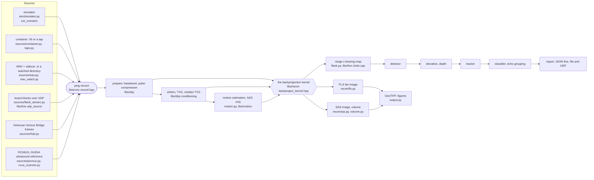
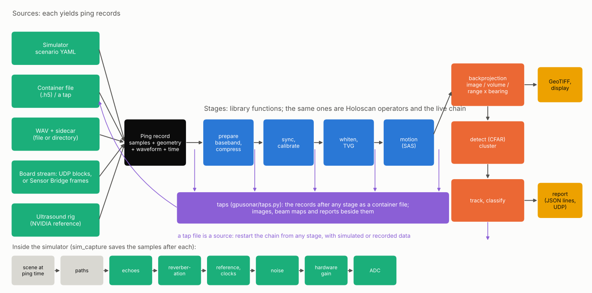
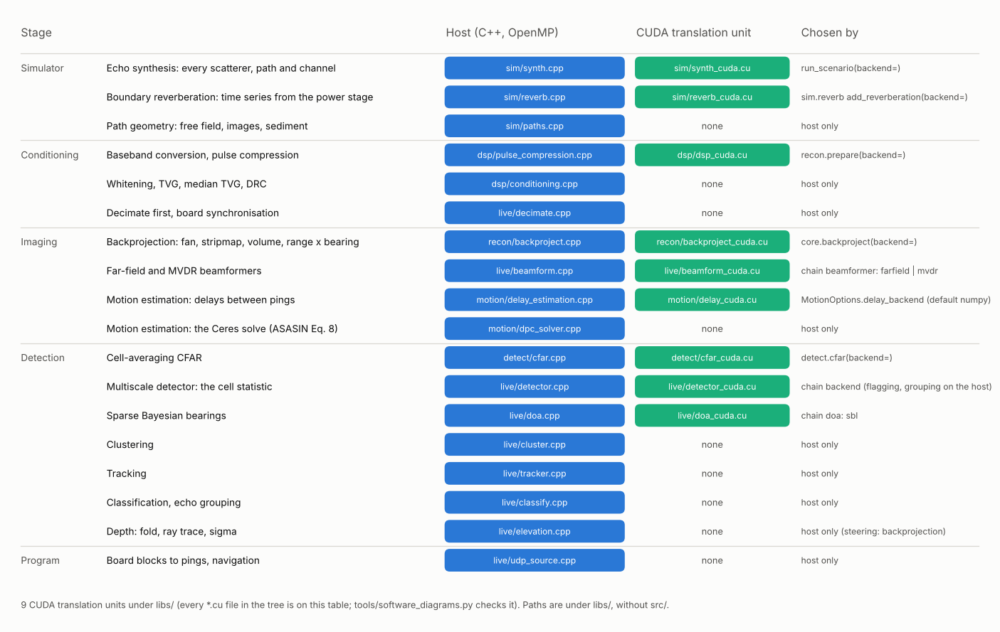
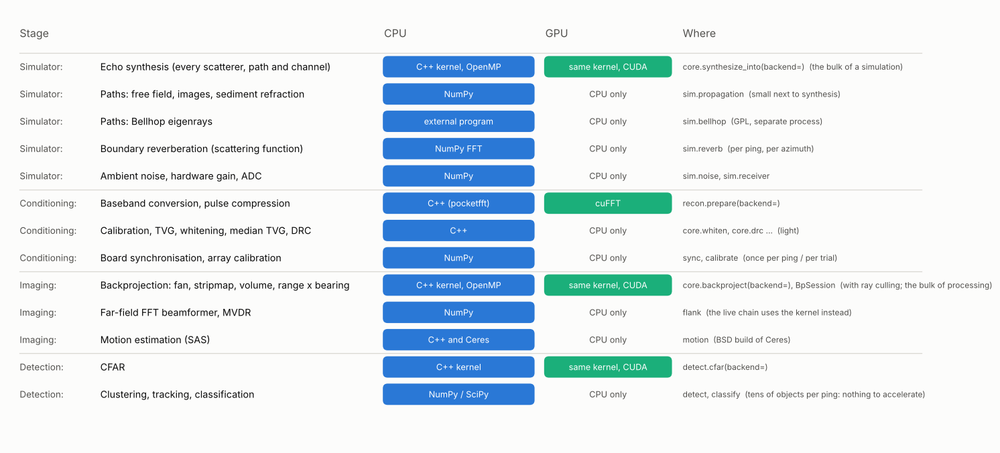
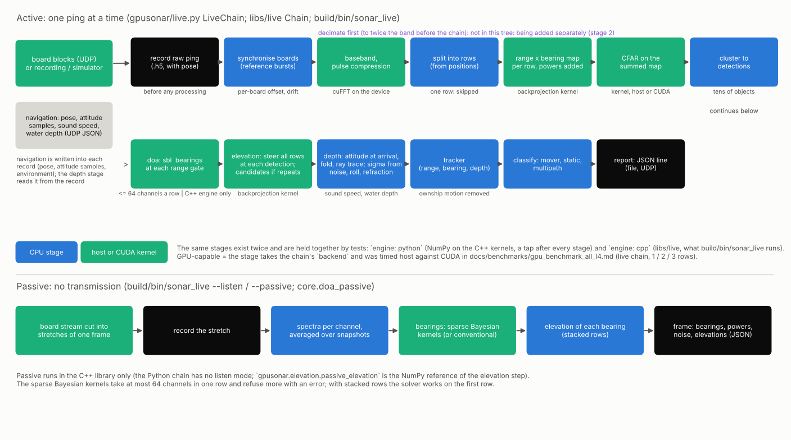
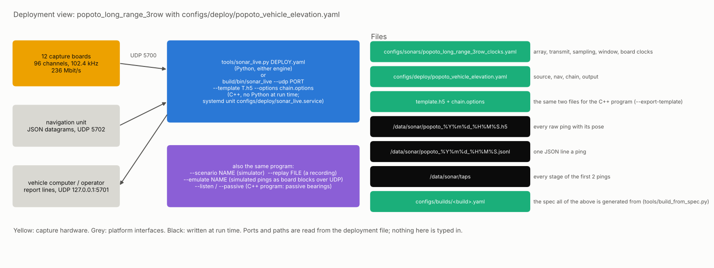
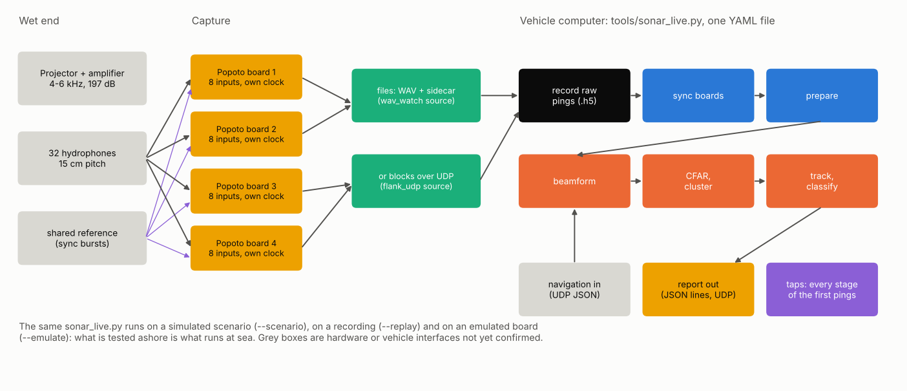
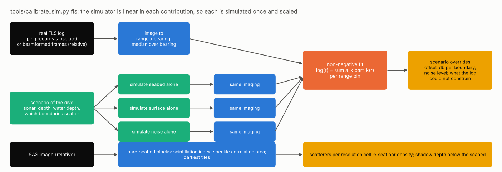

# Software handoff

For a software engineer or a coding model continuing the code with no conversation history.
Written at the tree of `933972b` on branch `claude/gpu-sonar-suite-u289p5`, decisions to D-181.
Every statement was checked against the code at that tree; where a document and the code
disagree, the code is what is written here and the document is listed in section 10.

Companions: [README.md](README.md) (the set), [TESTS.md](TESTS.md) (how to test and what each
test protects), [HARDWARE.md](HARDWARE.md) (the arrays, boards and what is unconfirmed),
[OUTPUTS.md](OUTPUTS.md) (figures and numbers). Deeper documents are linked where they are used;
this file does not copy them.

Contents: 1 what is fragile or wrong, 2 architecture, 3 repository map, 4 the two live-chain
engines, 5 the live chain stage by stage, 6 SAS, FLS and the simulator, 7 configuration,
8 tools and programs, 9 how to add things, 10 stale statements found.

## 1. What is fragile or wrong

Read this first. Each item names its issue in `.beads/issues.jsonl` (prefix `sonar-`) or its
item in `docs/STATUS.md`.

**Nothing has run on hardware or on real data.** No vehicle, no Popoto board, no DGX Spark, no
Jetson, no Sensor Bridge hardware (`docs/STATUS.md`, first paragraph). The board forwarder is
not written and the navigation mapping for the vehicle's unit is a template (STATUS item 36;
`sonar-o7m`, `sonar-sul`; `docs/tasks/VEHICLE_ADAPTERS.md`, `docs/tasks/REAL_DATA.md`).

### Things that break the build or the tests without being a bug

| Trap | What happens | Where recorded |
| --- | --- | --- |
| The live chain exists twice (Python and C++). A behaviour change in one engine only | the parity tests in `tests/python/test_live_cpp.py` fail, or worse, pass because the case is not covered | section 4 |
| `build/bin/sonar_live` missing | every program test skips (`skipif(not EXE.exists())`), so a run can pass without having run them | [TESTS.md](TESTS.md) section 4 |
| The built Python module `python/gpusonar/_gpusonar*.so` older than the C++ sources | local test failures that are not real; rebuild before trusting them | [TESTS.md](TESTS.md) section 4 |
| A misspelt or stale key in any options dictionary | the chain stops at construction with the key's name (D-166, D-177). Before D-166 it ran on the default in silence, so old out-of-repo configs may now stop | section 7 |
| A YAML number written `38.0e3` | our loader reads a float; plain `yaml.safe_load` reads a string and the C++ readers then refuse it. Write `38.0e+3` (D-180). Five readers still use plain `yaml.safe_load` on user files | `sonar-1yq` |
| The function defaults are not the chain's defaults | `detect.Tracker()` has `max_misses=3`, `initial_speed_sigma=10`; `classify.classify_tracks()` has `min_speed=0.5`. `live.DEFAULTS` gives 2, 8 and 1.0. The gallery tools call the functions directly with their own settings | `python/gpusonar/detect.py`, `classify.py`, `live.py` |
| The gallery is not the live chain | `tools/gallery.py` runs `detect.cfar` + `detect.cluster` and its own tracker settings (1 degree bearing sigma), not `LiveChain`; a gallery number does not prove a live-chain number | D-160, D-178; `sonar-bu3` |
| Small machine | 4 cores, 15 GB, a few GB of disk free. A wide build or two test processes exhaust it; the whole suite takes about two hours on the CPU (`docs/HANDOFF.md` section 3) | [TESTS.md](TESTS.md) |

### Known limits in the live chain

| Limit | Detail | Issue |
| --- | --- | --- |
| Track hopping at long range | at 12 km about a dozen multipath arrivals lie inside one 4 sigma gate; association is decided by small likelihood differences, and a change such as the leading edge reshuffles which arrival a track takes (D-181, `sonar-oqa` explained) | `sonar-tlc` |
| The leading edge reads short on strong point echoes | a detection no elevation places reads 1 to 3.6 m short (D-160). Blanking and the burst filter judging by the centroid is untested | `sonar-9hy` |
| A source without timestamps | tracks get speed 0 and are never movers (D-165); the tracker has no clock unless `tracker.ping_interval_s` is set (D-175). No deployment file sets it | `sonar-y7k` |
| Lever arm | `nav.lever_arm_m` and `nav.mount_rpy_deg` default to zero, unconfirmed until surveyed (D-167). The array's velocity is not corrected for the lever arm. `tools/build_from_spec.py` does not write the keys | `sonar-0ca`, `sonar-vjq` |
| Detector constants | measured on a few maps; at the default budget the detector runs 0.73 to 1.01 of its budget (D-168). The two-row cell mean runs 1.26 times its share; the 9 dB `min_snr_db` floor drops 33 % and 54 % of two- and three-row noise detections. The -40 dB sidelobe floor is an assumption | `sonar-031`, `sonar-xl7`, `sonar-gg6`, `sonar-4xn` |
| Echo grouping | the velocity gate is sensitive to one point; bounce grouping (D-175) is not measured on captures with `multipath` on; in the two-ship scene ship B's object is a later arrival on 2 seeds | `sonar-36z`, `sonar-ome`, `sonar-i28` |
| LFM range-Doppler correction | opt-in and held by tests only; not measured through the live chain on the gallery scenes (D-181) | D-181 |
| Sparse Bayesian bearings | the kernels take at most 64 channels (`kSblMaxChannels`, `libs/live/include/sonar/live/sbl_kernel.hpp`). Passive listening on stacked rows without `elevation=1` takes all channels as one line: wrong bearings | `docs/ARCHITECTURE.md` |
| Passive | exists in the C++ library and program only; the Python chain has no listen mode | `docs/ARCHITECTURE.md` |
| Depth | two rows in shallow water give a depth sigma too wide to use at 1 km; the ship's depth at 12 km with three rows reads 8 to 35 m for a true 4 m (ambiguous elevation, D-160) | `sonar-d91` |
| Device round trip | the multiscale detector takes the fine map back to the host each ping (2.8 to 3.6 ms of the chain's time on an L4) | `sonar-1m4` |
| Stage key=value readers | the `tonal_`, `multipath_depth_` and `coverage_` key=value readers do not refuse an unknown key (D-177, "not covered") | D-177 |

### Known limits around the chain

| Limit | Detail | Issue |
| --- | --- | --- |
| Sensor Bridge loopback | the margin at real time is the receiver's socket buffer; the chain's OpenMP count must be below the CPU quota (D-162, D-173). `--chain-omp-threads` assumes the receive application's single-thread scheduler. The idle stop ran on a GPU only in runs set up for it. `serve` has no `--backend` | `sonar-vmm`, `sonar-3wd`, `sonar-thu`, `sonar-l6j`, `sonar-e2u` |
| Flank stream receive | a ping-index skip that also lost samples in the gap, and a real loss with jitter beyond half an interval, are still miscounted (D-177) | `sonar-thu` |
| Wire format | the sample word length is configuration on both ends (the block header has no field); the Holoscan report sink cannot split an over-long report and refuses it | STATUS item 35 |
| Motion estimation | lambda 2 is tuned on few scenes; `MotionOptions.bathymetry` also moves the DVL seabed; delays read 0.2 to 0.9 % below the model in every window; no along-track surge estimation; the CUDA delay path is slower than the host | `sonar-0bc`, `sonar-dix`, `sonar-oii`, `sonar-7k2`, `sonar-b6r` |
| Classes in the gallery scenes | glint movers in `fls_120k_rough_surface` and the FLS detection merge (off) remain (D-135, D-170); FLS slant range is read as horizontal (+h²/2R); a stray ping-1 detection near the winter-sand ship moves its speed | `sonar-mib`, `sonar-m1r`, `sonar-2o5` |
| Propagation | N x 2-D only; Bellhop 2-D against Bellhop3D differ by 1 to 2.5 dB; the energy rule lowers the gravel-water peak by 3.3 dB | `sonar-6c8`, `sonar-9b8` |

The record schema is frozen at 1.0.0 (`docs/RECORD_FORMAT.md`): changing it is on the
stop-and-ask list (section 9).

## 2. Architecture

### Layers

| Layer | Language | Where | What it holds |
| --- | --- | --- | --- |
| Record and file | C++20 | `libs/core`, `libs/io` | the ping record (`record.hpp`), the HDF5 container (`record_file.hpp`), the validator |
| Kernels | C++20, each compiled for the host (OpenMP) and for CUDA | `libs/sim`, `libs/dsp`, `libs/recon`, `libs/detect`, parts of `libs/live`, `libs/motion` | echo synthesis, reverberation, baseband and pulse compression, backprojection, CFAR, beamformers, the detector's statistic, sparse Bayesian bearings, delay estimation |
| Live library | C++20 | `libs/live` | the long-range chain end to end with no Python: stream assembly, navigation, decimation, synchronisation, map, detector, elevation and depth, tracker, classifier, report |
| Programs | C++ | `apps/sonar_live.cpp`, `apps/sonar_live_holoscan.cpp` | `build/bin/sonar_live` (what goes on a vehicle), `build/bin/sonar_live_holoscan` |
| Bindings | pybind11 | `python/bindings/` | one module `gpusonar._gpusonar` (imported as `core`) |
| Python package | Python, NumPy | `python/gpusonar/` | the simulator's scene and physics models, sources, batch pipeline, the Python engine of the live chain, SAS motion glue, configuration, build specs |
| Tools | Python, bash | `tools/` | command-line programs, studies, generators, the GPU job script |

C++ against Python is decision A-02 and D-34 (`docs/DECISIONS.md`); one kernel source for two
backends is A-03 and D-122. Stages ported to C++ keep their NumPy versions as references, and
NumPy keeps the random numbers (D-61).

### Data flow

Everything between stages is a ping record: the samples of one transmit with the array
geometry, pose, waveform and time (`docs/RECORD_FORMAT.md`). Simulated and real data are the
same thing from the first stage on.



Three callers hold the stages together, and nothing else holds processing logic
(`docs/ARCHITECTURE.md`):

| Caller | For | File |
| --- | --- | --- |
| `pipeline.run(config)` | a batch chain from a YAML file: imaging | `python/gpusonar/pipeline.py`, `tools/sonar_run.py`, `configs/chains/` |
| `live.LiveChain` and `live::LiveChain` | one ping at a time: the long-range arrays | `python/gpusonar/live.py`, `libs/live/src/chain.cpp` |
| Holoscan operators | the same functions as operators | `python/gpusonar/holoscan_ops.py`, `libs/holoscan_ops/` |

The existing data-flow drawing. Look at the violet band: a tap after any stage is a container
file and therefore a source. It does not show the Sensor Bridge source, which was added later.



### The one backprojection kernel

`libs/recon/include/sonar/recon/backproject_kernel.hpp` is the only delay-and-sum code. It is
compiled for the host in `libs/recon/src/backproject.cpp` and for CUDA in
`backproject_cuda.cu`, and reached from Python as `core.backproject(backend=)`.

| Product | Caller of the kernel |
| --- | --- |
| FLS fan image | `recon.fan_image` (`python/gpusonar/recon/fls.py`) |
| SAS stripmap and rail image | `recon.sas_image` (`recon/sas.py`), with ray culling (D-09) and the tabulated trajectory (D-07) |
| 3-D near-field volume | `recon/volume.py` |
| The live chain's range x bearing map | `flank.backprojection_map` (Python engine), `live::range_bearing_power` (C++ engine); D-55 |
| Elevation at each detection (stacked rows) | `elevation.py`, `libs/live/src/elevation.cpp`: the whole array steered over elevation with the same kernel |

The far-field and MVDR beamformers (`libs/live/src/beamform.cpp`) are alternatives the chain
can select (`beamformer: farfield | mvdr`); the default is the kernel.

### What has a CUDA build

Drawn from the tree by `tools/software_diagrams.py` (it fails if a `.cu` file under `libs/` is
not on the table). Look at the right-hand column: nine CUDA translation units; everything
else is host code.



- `backend: auto` is the default everywhere and uses the GPU when the build has it and a device
  is present. `backend: cuda` without a usable device is an error, never a fallback (D-147).
- The CPU path is complete: everything runs without a GPU.
- The older drawing `docs/architecture/backends.png` (from the typed table `STAGES` in
  `tools/architecture_diagrams.py`) is embedded below for its "Where" column, which says how
  each stage is reached from Python. **Three of its rows are stale**: it shows "Far-field
  beamformer, MVDR" and "Motion estimation" as CPU only, and says the reverberation's FFTs stay
  on the CPU. At this tree `libs/live/src/beamform_cuda.cu` (D-122),
  `libs/motion/src/delay_cuda.cu` (D-148) and `libs/sim/include/sonar/sim/reverb_batched.hpp`
  (D-122) do those on the device, and the multiscale detector's statistic
  (`libs/live/src/detector_cuda.cu`, D-150) is not on it at all. It was not corrected here:
  `tests/python/test_architecture.py` pins the count of its CUDA rows at 7, and this document
  set changes no code or test.



### Where Holoscan wraps the same code

| Operators | File | What they wrap |
| --- | --- | --- |
| `PingSourceOp`, `ConditionOp`, `FanImageOp`, `DetectOp`, `DisplayPrepOp`, `CollectOp`, `FanPipeline` | `python/gpusonar/holoscan_ops.py` | the Python stages (`recon.prepare`, `recon.fan_image`, `detect`) |
| `ReplaySourceOp`, `UdpSourceOp`, `RecordSinkOp`, `LiveChainOp`, `PassiveBearingsOp`, `ReportSinkOp` | `libs/holoscan_ops/include/sonar/holoscan_ops/operators.hpp` | shells around `libs/live` (D-59); built with `-DSONAR_BUILD_HOLOSCAN=ON` against Holoscan SDK 4.6 |
| Sensor Bridge receive application, `HsbStopOp`, `ReceiveStop`, `FrameReceiver` | `python/gpusonar/sources/hsb.py`, `tools/sonar_live_hsb.py` | Sensor Bridge's Linux receiver operator feeding `flank_stream.PingAssembler` and `LiveChain` (D-79, D-153, D-162, D-163, D-173) |

Notes on the SDK and what was and was not run: `docs/HOLOSCAN_NOTES.md`.

### The live chain and the deployment view

The existing drawing of the live chain. Look at the green boxes: the stages that take the
chain's `backend`. It is still correct for what it shows, with two omissions: its "CFAR" box
is the multiscale detector by default (D-93), and echo grouping (D-155) is inside "classify".



The deployment view of one build, drawn from its files. Look at the middle box: one program,
Python or C++, with the same two inputs (boards, navigation) and one output (report lines).



The older, typed deployment sketch (`../architecture/deployment.png`) carries numbers typed in
the generator (4 to 6 kHz, 197 dB, 32 hydrophones at 15 cm, four boards of eight inputs). They
agree with `configs/sonars/popoto_long_range.yaml` (`array.pitch: 0.15`,
`transmit.source_level_db_rms: 197.0`) but are not read from it; use `deployment_build.png` and
[HARDWARE.md](HARDWARE.md) for hardware facts.



The simulator-calibration method (section 6). Look at the three "simulate ... alone" boxes:
each contribution is simulated once and scaled.



The architecture pictures were corrected and redrawn when this set was merged (2026-11-24):
`backends.png` now shows the device builds of the beamformers, the motion delays, the reverberation
FFTs and the multiscale statistic (`tests/python/test_architecture.py` pins 10 CUDA rows);
`live_chain.png` shows the multiscale detector and echo grouping; `dataflow.png` includes Sensor
Bridge frames. Known left: `dataflow.png` still labels detection "detect (CFAR)", and
`deployment.png` draws a shared sync reference that `popoto_long_range` does not have.

## 3. Repository map

| Directory | Key files | What they hold |
| --- | --- | --- |
| `libs/core` | `record.hpp`, `vec.hpp`, `waveform.hpp`, `allocator.hpp`, `platform.hpp`, `parallel.hpp`, `parallel_cuda.hpp`, `directivity.hpp` | the ping record, ASASIN Eq. 2 rotations, waveforms, the slab allocator (D-08), `Backend`, `cuda_compiled()` / `cuda_available()` |
| `libs/io` | `record_file.hpp`, `validate.hpp` | the HDF5 container (A-01), the record validator |
| `libs/dsp` | `baseband.hpp`, `pulse_compression.hpp`, `conditioning.hpp`, `fft.hpp`, `dsp_cuda.cu` | conditioning: baseband, pulse compression (cuFFT on the device, D-42), whitening, TVG, DRC |
| `libs/recon` | `backproject_kernel.hpp`, `backproject.hpp`, `sinc_table.hpp`, `backproject_cuda.cu` | the backprojection kernel, culling, the position lookup |
| `libs/sim` | `synth_kernel.hpp`, `paths.hpp`, `reverb.hpp`, `reverb_batched.hpp`, `reverb_kernel.hpp` | echo synthesis (D-51, D-81, D-83), eigenray providers, the reverberation generator |
| `libs/detect` | `cfar.hpp`, `cfar_kernel.hpp`, `statistic.hpp` | cell-averaging CFAR, `cfar_window` (D-98), the statistics the multiscale detector is built on |
| `libs/live` | `chain.hpp` (`ChainOptions`, `Report`, `LiveChain`, `PassiveChain`), `options.cpp` (key=value), `derive.hpp`, `detector.hpp`, `detections.hpp` (tracker, classifier), `elevation.hpp`, `environment.hpp` (sound-speed ladder), `decimate.hpp`, `sync.hpp`, `udp_source.hpp` (assembler, navigation), `doa.hpp`, `sbl_kernel.hpp`, `beamform.hpp`, `raytrace.hpp`, `multipath_depth.hpp`, `coverage.hpp`, `tonal.hpp`, `calibrate.hpp` | the long-range live chain in C++ |
| `libs/motion` | `dpc_solver.hpp`, `delay_estimation.hpp`, `delay_kernel.hpp`, `delay_cuda.cu` | the Ceres solve of ASASIN Eq. 8 (D-30) and delay estimation (D-148). Built only with a Ceres without SuiteSparse |
| `libs/holoscan_ops` | `operators.hpp`, `operators.cpp` | C++ Holoscan operators around `libs/live` |
| `apps` | `sonar_live.cpp`, `sonar_live_holoscan.cpp` | the standalone program and the Holoscan application |
| `python/bindings` | `module.cpp`, `bind_live.cpp`, `bind_detect.cpp`, `bind_beamform.cpp`, `bind_recon.cpp`, `bind_sim.cpp`, `bind_simcpp.cpp`, `bind_motion.cpp`, `bind_refraction.cpp`, `bind_tonal.cpp`, `vec_caster.hpp` | pybind11; `bind_live.cpp` holds `LiveChainCpp`, `PingAssemblerCpp`, `NavigationCpp`, `live_derive`, `live_detector_plan`, `live_options_from_text` |
| `python/gpusonar` | `live.py`, `detect.py`, `classify.py`, `elevation.py`, `flank.py`, `sync.py`, `multipath_depth.py`, `coverage.py`, `tonal.py`, `raytrace.py` | the Python engine of the live chain and its stages |
| | `pipeline.py`, `taps.py`, `output.py`, `processing.py`, `metrics.py`, `motion.py`, `calibrate.py` | the batch chain, taps, GeoTIFF output, SAS motion estimation, array calibration |
| | `config.py`, `sonar.py`, `environment.py`, `buildspec.py`, `hardware.py`, `navadapter.py`, `target_classes.py` | configuration loading, the sonar model, the one environment per site (D-100), build specs (D-127), the navigation adapter |
| | `sonar_equation.py`, `lloyd.py`, `depthplan.py`, `acoustics.py`, `simcal.py`, `benchmarks.py` | link budget, surface image, depth plan, medium properties, simulator calibration, PICMUS evaluation |
| `python/gpusonar/recon` | `fls.py`, `sas.py`, `volume.py`, `gain.py`, `multigpu.py` | imaging on the kernel; the gain law derived from the record (D-91) |
| `python/gpusonar/sim` | `simulator.py`, `scene.py`, `targets.py`, `propagation.py`, `bellhop.py`, `reverb.py`, `reverb_bistatic.py`, `reverb_relief.py`, `reverb_specular.py`, `bottom.py`, `surface.py`, `timespread.py`, `noise.py`, `noise_fit.py`, `receiver.py`, `sources.py`, `waveform.py`, `basin.py`, `bathymetry.py`, `passive.py`, `channel_replay.py`, `channel_sounding.py`, `sediment_fit.py`, `engine.py`, `parallel_normal.py` | the simulator (section 6) |
| `python/gpusonar/sources` | `base.py`, `container.py`, `wav.py`, `wav_watch.py`, `flank_stream.py`, `hsb.py`, `picmus.py`, `nvus.py`, `nvus_scanner.py` | sources; each yields ping records |
| `configs` | `sonars/`, `scenarios/`, `environments/`, `deploy/`, `builds/` (with `modules/`, `environments/`, `targets/`), `chains/`, `nav/`, `sediments.yaml` | all configuration (section 7) |
| `tools` | section 8 | programs, studies, generators |
| `tests/cpp`, `tests/python` | [TESTS.md](TESTS.md) | GoogleTest and pytest |
| `third_party` | `patches/hsb-2.7.0-emulator-udp-socket.patch`, `patches/holoscan-ultrasound-imaging-24d405e-long-window.patch`, `pocketfft/` | opt-in patches to outside code (D-45, D-79); the host FFT |
| `docs` | `STATUS.md`, `DECISIONS.md`, `RESULTS.md`, `CONFIGURATION.md`, `DEPLOYMENT.md`, `RECORD_FORMAT.md`, `ARCHITECTURE.md`, `PHYSICS_NOTES.md`, `PAPER_NOTES.md`, `REFERENCES.md`, `OPEN_SOURCE.md` | the authority order is code and configs, then DECISIONS (later entries amend earlier), then STATUS, then RESULTS |
| `trajectory_classifier` | | an unrelated package in the same repository; the root `CLAUDE.md` describes it, not this suite |

### Build

```bash
# CPU build with tests and the Python module (the root README.md, "Build and test")
cmake -S . -B build -G Ninja -DCMAKE_BUILD_TYPE=Release -DSONAR_ENABLE_CUDA=OFF
cmake --build build -j2
PYTHONPATH=python python3 -c "import gpusonar"
```

| CMake option | Default | Meaning (`CMakeLists.txt`) |
| --- | --- | --- |
| `SONAR_ENABLE_CUDA` | `AUTO` | `AUTO`, `ON` or `OFF`: build the CUDA backend |
| `SONAR_BUILD_TESTS` | `ON` | the GoogleTest suites and the `pytest` ctest entry |
| `SONAR_BUILD_PYTHON` | `ON` | the pybind11 module, written into `python/gpusonar/` |
| `SONAR_BUILD_HOLOSCAN` | `OFF` | the C++ Holoscan operators and `sonar_live_holoscan`; needs the SDK's C++ package |
| `SONAR_CERES_DIR` | `/opt/ceres-nosuitesparse` | a Ceres built without SuiteSparse; without one motion estimation is not built and CMake prints `motion estimation OFF` |
| `SONAR_ALLOW_SUITESPARSE` | `OFF` | a Ceres that links SuiteSparse (GPL) is refused unless this is on: the owner's sign-off is required |

Requirements and the Ceres build command: the repository's root `README.md`, "Build and test". Programs land in
`build/bin/`.

## 4. The two live-chain engines

| | Python engine | C++ engine |
| --- | --- | --- |
| What | `gpusonar.live.LiveChain` with `chain.engine: python` (the default of `live.DEFAULTS`) | `libs/live` `LiveChain`; from Python `core.LiveChainCpp`, or `chain.engine: cpp`; the program `build/bin/sonar_live` |
| Stages | NumPy on top of the C++ kernels: `detect.py`, `classify.py`, `elevation.py`, `sync.py`, `flank.py` | `chain.cpp`, `detector.cpp`, `cluster.cpp`, `tracker.cpp`, `classify.cpp`, `elevation.cpp`, `sync.cpp`, `decimate.cpp`, `doa.cpp` |
| Why it exists | every stage callable on its own in NumPy; the reference each C++ stage is tested against; the simulator as a source | no Python at run time: what goes on a vehicle (D-58) |
| Only here | a tap after `sync` (taps `raw`, `prepare`, `beamform` and `report` are written with either engine) | sparse Bayesian bearings (`doa: sbl` puts the C++ chain behind the Python class), passive listening, the Holoscan C++ operators |

With `engine: cpp` or `doa: sbl`, `live.LiveChain` keeps navigation, recording, taps and the
report file and hands every other stage to one `core.LiveChainCpp` object
(`cpp_chain_options` builds its options).

**How parity is enforced.**

| Test file | What it compares |
| --- | --- |
| `tests/python/test_live_cpp.py` (57 tests) | clustering, tracker state, classes, echo grouping, synchronisation offsets, the assembler, whole reports of both engines and of the program; every option through the binding and through key=value text (`test_every_chain_option_round_trips_through_binding_and_text`) |
| `tests/python/test_detector.py` | the multiscale detector's thresholds, detections and range estimate on both engines |
| `tests/python/test_elevation.py`, `test_multipath_sigma.py`, `test_multipath_depth.py`, `test_refraction_rays.py`, `test_coverage.py`, `test_profile_ladder.py` | elevation, depth, rays, coverage and the sound-speed ladder on both engines |
| `tests/python/test_decimate.py`, `test_blanking.py`, `test_calibration_sync.py`, `test_beamform_cpp.py`, `test_nav_adapter.py`, `test_nav_lever_arm.py`, `test_hsb_receive.py`, `test_dict_keys.py`, `test_tonal.py` | the stages around the chain, each against its counterpart |
| `tests/cpp/test_live.cpp`, `test_detector.cpp`, `test_elevation.cpp`, `test_stage2.cpp`, `test_derive.cpp` | the library alone, on records built in the test |
| `tests/python/data/*.json` | frozen outputs both engines must reproduce ([TESTS.md](TESTS.md), goldens) |

**The rule.** A behaviour change is made in both engines, with a parity test that fails before
and passes after. The decisions from D-141 on record each chain change as made in both engines
("both engines" in D-141, D-155 to D-160, D-165, D-166, D-172, D-175, D-177, D-181). A change
that moves a default result goes to the owner with before and after numbers first (the working
method in [README.md](README.md)).

## 5. The live chain stage by stage

Defaults are those of `python/gpusonar/live.py` `DEFAULTS` and `libs/live` `ChainOptions`
(`chain.hpp`); the two are the same and `tests/python/test_live_cpp.py` holds them together.
A deployment file's `chain:` section is merged over `DEFAULTS`; anything left out keeps its
default. "Derived" means the value is left `None` (Python) or NaN (C++) and resolved from the
first ping by `libs/live/include/sonar/live/derive.hpp`: the larger of a standing value
(`Standing`) and a floor that follows from the sonar. `LiveChain.resolved` and the programs'
first lines say what was used. "—" in the Decision column means no decision entry records
the value: the comment at the symbol is the record.

Every key, its `sonar_live` option name and its unit: `docs/CONFIGURATION.md`, "Every
`sonar_live` key of the chain".

```mermaid
flowchart LR
  A["source<br/>blocks, replay, simulator"] --> N["navigation intake<br/>pose into the record"] --> R["record raw ping<br/>.h5"]
  R --> D["decimate first<br/>(opt-in)"] --> S["synchronise boards<br/>(with several)"] --> B["blank<br/>(opt-in)"] --> P["prepare<br/>baseband, compress"]
  P --> M["map per row,<br/>powers added"] --> X["multiscale detector"] --> E["elevation, depth<br/>(stacked rows)"] --> T["tracker"] --> C["classify,<br/>group echoes"] --> O["report"]
```



Order as in `LiveChain.process` (`live.py`) and `LiveChain::process` (`chain.cpp`).

### 5.1 Source

Selected by the deployment file's `source:` section (`type`), or by `--replay`, `--scenario`,
`--emulate` of `tools/sonar_live.py`. Output: ping records in transmit order.

| Key | Default | Unit | Decision | Notes, alternatives |
| --- | --- | --- | --- | --- |
| `source.type` | none; `flank_udp` in every file of `configs/deploy/` | | — | registered types: `container`, `wav`, `wav_watch`, `flank_udp`, `picmus`, `nvus_scanner` (`sources/base.py` `make_source`); `scenario` and `tap` are handled by `pipeline.py` and the tools |
| `source.sonar` | none | | — | the sonar file that gives array, band, sampling and window |
| `source.port`, `source.host` | none (5700 in `popoto_vehicle.yaml`), `0.0.0.0` | | — | `bind` for `sonar_live` |
| `source.timeout` | 30.0 (`StreamOptions::idle_seconds`) | s | — | the program ends after this long without a block; 0: never |
| `source.sample_bytes` | 3 (`StreamOptions::sample_bytes`; `flank_stream.SAMPLE_BYTES`) | bytes | D-131 | 2, 3 or 4. The block header does not carry it: both ends are configured alike. An unconfirmed hardware fact ([HARDWARE.md](HARDWARE.md)) |
| `source.buffer_bytes` | 0: the larger of 8 MB and half a second of the stream | bytes | — | `derive.hpp` `kStreamBufferSeconds` |
| `source.queue_mb` | 1024 | MB | — | blocks waiting for the chain; beyond it arriving blocks are dropped and counted |
| reorder grace | `REORDER_BLOCKS = 2` (`flank_stream.py`; C++ `PingAssembler`) | blocks | D-161 | blocks are placed by their sample counter; a hole is given up 2 blocks after it. Constructor argument `reorder_blocks`, not a deployment key |
| held bytes | `MAX_HELD_BYTES = 64 MiB` | bytes | D-161 | rows held behind holes on the decimating path |
| lost-ping count | a ping-index jump counts lost pings only with missing samples between the transmits | | D-161, D-177 | counters `frames_lost`, `frames_late`, `frames_repeated`, `dropped_pings`, `pings_discarded_at_stop` |

Through Sensor Bridge (`tools/sonar_live_hsb.py`, `sources/hsb.py`):

| Option | Default | Unit | Decision | Notes |
| --- | --- | --- | --- | --- |
| `receive --chain-omp-threads N` | not set: OpenMP's own count | threads | D-162, D-173 | sets OpenMP's count on the thread that runs the chain. The loopback tests pass half of min(affinity, cgroup CPU quota) (`hsb.usable_cpus`) |
| `receive --idle` | 15.0 | s | D-163 | stop after this long without a frame, whatever was lost; exit status 3 when fewer pings were reported than asked |
| `receive --find-timeout` | 30.0 | s | D-173 | how long to wait for the board; `serve --scenario` simulates every ping before announcing it |
| `receive --queue` | 256 | frames | — | |
| `--frame-samples` | 400 (`hsb.FRAME_SAMPLES`) | samples | — | the same on both sides |
| `serve --pace` | 1.0 | x real time | D-153 | |
| `serve --catch-up` | `spread` | | D-151 | `burst`: the behaviour before |
| `serve --hold` | 0.0 | s | D-163 | keeps the emulated board up after its linger |

### 5.2 Navigation intake

`live.NavListener` (Python) and `live::Navigation` (`udp_source.hpp`, C++): JSON datagrams,
one fix each, interpolated to each ping's transmit time and written into the record (pose,
attitude history, depth and Doppler-log samples, sound speed, water depth). Replay applies no
navigation: the recording already carries it. Vendor streams are turned into these datagrams
by `tools/nav_adapter.py` (`navadapter.py`, `configs/nav/`).

| Key | Default | Unit | Decision | Notes |
| --- | --- | --- | --- | --- |
| `nav.port`, `nav.host` | none, `0.0.0.0` | | — | 5702 in `popoto_vehicle.yaml` |
| `nav.static` | none | | — | a fixed pose for a bench or a moored array; at rest unless it says otherwise |
| `nav.lever_arm_m` | `[0, 0, 0]` | m, the unit's body axes (forward, starboard, down) | D-167 | the array's reference point from the navigation unit's. **Unconfirmed until surveyed.** `nav_lever_arm_m` for `sonar_live` |
| `nav.mount_rpy_deg` | `[0, 0, 0]` | degrees, ASASIN Eq. 2 order | D-167 | the array's axes against the unit's. Unconfirmed until surveyed |
| `nav.keep_s` | 120.0 | s | — | fixes kept: a ping is processed after its window closes |
| `nav.history_margin_s` | 2.0 | s | — | attitude history either side of the receive window |
| `nav.surface_z` | 0.0 | m | — | z of the sea surface in the navigation's frame |
| `nav.profile_step_m` | 0.5 | m | D-129 | depth step between (depth, sound speed) samples kept for the ladder |
| `nav.water_depth` | `{source: datagram}` (`live.WATER_DEPTH_DEFAULTS`) | | D-129 | `source: altitude`: depth + Doppler-log altitude, held `hold_s` 60 s without bottom lock, sigma growing by `hold_sigma_m_per_m` 0.05 per metre travelled (an assumption); `altitude_sigma_m`, `depth_sigma_m` 0.0 are datasheet values, unconfirmed |

Counters on the report line: `pings_without_nav` (always), `pings_without_velocity` (D-158;
only once above 0), `pings_without_time` (D-175; only once above 0).

### 5.3 Recording

Always first, before anything touches the samples: `output.recording` (a container file,
`core.RecordWriter`; `--recording` for `sonar_live`). The recording holds the raw ping with
its pose and replays through the same chain to the same reports
(`tests/python/test_live.py`). With `source.decimate` the receiver decimates as blocks arrive
and the recording holds decimated pings (`decimate_streaming=1`). Taps
(`output.taps: {dir, pings}`) write every stage of the first pings (`taps.py`; D-54). No
settings beyond the paths.

### 5.4 Decimate, synchronise, blank

Output: one record of complex baseband (after `prepare`), boards aligned, reference inputs
dropped when dedicated.

| Key | Default | Unit | Decision | Notes |
| --- | --- | --- | --- | --- |
| `chain.decimate` | `None`: off | | D-129 | `{}`: every default. On in `configs/deploy/popoto_face_1row.yaml` and `popoto_testauv_1row.yaml` |
| `decimate.f_low`, `f_high` | 0, 0: the record's transmit band | Hz | D-129 | `libs/live/include/sonar/live/decimate.hpp` `DecimateOptions` |
| `decimate.band_margin` | 1.5 | x band | — | the band kept flat |
| `decimate.output_rate` / `oversample` | 0 / 2.0 | Hz / x | D-129 | 0: `oversample` times the kept band; realised as input rate over an integer |
| `decimate.ripple_db`, `stopband_db`, `taps` | 0.1, 80.0, 0 | dB, dB, taps | — | 0 taps: from Kaiser's estimate |
| `chain.sync` | `None`: off | | D-32 | `{sonar: NAME}` or `{reference: {...}}`; on in every shipped file with a `_clocks` sonar |
| `sync.min_quality` | 0.0 (`sync.hpp` `Reference`) | 0..1 | D-129 | a burst below it, or clipped, is not used and its board is flagged |
| `sync.search_time` | 2e-3 | s | — | either side of where a burst is expected |
| `sync.tolerance_us` | 0: a twentieth of a period at the top of the band | µs | — | what boards must agree within |
| reference burst | 38 to 48 kHz, 4 ms, lead 5 ms, tail 10 ms (`Reference`) | | D-32 | normally read from the sonar file's `receive.reference` |
| `chain.blanking` | `None`: off | | D-129 (the overload it answers: D-125) | `{recovery_s: 0.0, taper_s: 0.0, mode: zero}`; `mode: ignore` leaves the samples and only does not detect there. `recovery_s` is hardware, unconfirmed until measured |
| `chain.dead_channels` | `[]` | channel rows | — | left out of every stage, after synchronisation |
| `chain.sound_speed` | `None` | m/s | D-111 | replaces the record's when navigation does not send one |

Report: `sync: {ok, worst_residual_us, offsets_us, drift_ppm, flagged}`; `blanking:
{min_range_m, mode}`.

### 5.5 Beamform

Output: power over bearing x fine range for each row of hydrophones; with stacked rows the
rows' power maps are added (D-128). The fine map has samples no more than 0.75 of a range
resolution apart (`_fine_map` in `live.py`).

| Key | Default | Unit | Decision | Notes, alternatives |
| --- | --- | --- | --- | --- |
| `chain.beamformer` | `backprojection` | | D-55 | `farfield`, `mvdr` (`libs/live` beamformers; D-33 for MVDR's training) |
| `chain.bearings_deg` | `[-40.0, 40.0, 0.5]` | degrees from broadside: first, last, step | — | every shipped deployment file sets `[-60.0, 60.0, 0.5]` |
| `chain.window` | `hann` | | D-99 | `rect`. Hann costs 1.76 dB against uncorrelated noise |
| `chain.look` | `starboard` | | — | `port` |
| `chain.backend` | `auto` | | D-147 | `host`, `cuda` (an error without a device). The C++ struct's own field default is `Backend::Host`; `sonar_live` and `LiveChain` resolve `auto` when the key is absent |
| `chain.range_cell_m` | derived: 2.0 m standing, at least one range resolution | m | D-131 | the cell the fine map is averaged into |

### 5.6 Detector

Output: detections `{range_m, bearing_deg, snr_db, extent_m, first_range_m, arrivals}`. What
`snr_db` means against a link budget: the comment block above `_map_geometry` in `live.py` and
`docs/DEPLOYMENT.md`, "What `snr_db` is".

| Key | Default | Unit | Decision | Notes, alternatives |
| --- | --- | --- | --- | --- |
| `chain.cell_statistic` | `multiscale` | | D-93 | `mean` (the detector before D-93), `peak`. `libs/live/include/sonar/live/detector.hpp` |
| `cfar.false_alarms_per_ping` | 1e-3 | per ping, whole map | D-94; counted in D-134, D-168 | multiscale only |
| `cfar.integrate_cells` | `None`: the sample and the cell | cells | D-97 | `[1, 4, 16]` adds longer means |
| `cfar.sidelobe_margin_db`, `sidelobe_floor_db` | 10.0, -40.0 | dB | D-95 | the floor is an assumption, not a measurement |
| `cfar.search_factor` | `None`: tests counted as measured | | D-134 | 2.5: the detector as it was |
| `cfar.merge_m` | `None`: `tracker.range_sigma` | m | D-95 | flagged cells of one bearing this close are one detection |
| `cfar.range_estimate` | `None`: `first` with `multiscale`, else `centroid` | | D-157 (opt-in), D-160 (default) | `first`: the leading edge; `centroid`. `first` with `mean` or `peak` is refused. The elevation search, SBL's gates, `multipath_depth`, blanking and the burst filter go by the centroid either way (`Detection.centroid_range`) |
| `cfar.pfa` | 1e-5 | per cell | — | `mean` and `peak` only |
| `cfar.guard_m`, `cfar.train_m` | derived: 100 m and 300 m standing | m | D-98, D-131 | converted to cells by `detect::cfar_window` in both engines |
| `chain.min_snr_db` | 9.0 | dB | — (D-138: a build spec with `site_kind: enclosed` writes 15) | a detection below it is dropped |
| `chain.range_doppler` | `off` | | D-181 | `ownship`: each detection's range gets factor x the ownship's closing speed; `full`: also each track's position by its own closing speed. Factor f0 T / (f_stop - f_start), 0 for a non-LFM pulse (`detect.lfm_range_doppler_factor`) |
| `chain.doa` | `map` | | D-57 | `sbl`: sparse Bayesian bearings at each detected range (C++ engine) |
| `chain.sbl` | `grid_step_deg` 0.25, `max_sources` 6, `min_snr_db` 6.0, `dynamic_range_db` 20.0, `max_gates` 24, `min_contrast_db` 8.0, `max_iterations` 20, `tolerance` 0.01 | | D-57 | |

Each detection is timed at its reflection time, transmit + R/c (D-156).

### 5.7 Elevation and depth

Off unless `chain.elevation` is given and the array has two or more rows (found from the
hydrophone positions, `elevation.find_rows`). Defaults: `python/gpusonar/elevation.py`
`DEFAULTS` and `PROFILE_DEFAULTS`; C++ `ElevationOptions` (`elevation.hpp`). Output per
detection: `elevation_deg`, `elevation_sigma_deg`, `elevation_quality`, `elevation_ambiguous`
(with candidates), the corrected bearing, `depth_m`, `depth_sigma_m`, `path`; tracks carry
depth.

| Key | Default | Unit | Decision | Notes |
| --- | --- | --- | --- | --- |
| `elevation.sector_deg` | `[-30.0, 30.0, 0.25]` | degrees | D-128 | |
| `elevation.sector_from_rays` | `None` | | D-116; on in the stacked-row deployment files, D-118 | `{bounces: 2, margin_deg: 1.0, max_depth_m: 500}` |
| `elevation.sector_from_depth` | `None` | | — | `{bounces: 1, margin_deg: 1.0}`; needs the water depth |
| `elevation.multipath_sigma` | `None` | | D-133; on in the stacked-row deployment files | `{bounces: 2, max_depth_m: 500}` |
| `elevation.arrival` | `first` (`first_arrival_db` 8.0, `first_arrival_snr_db` 13.0) | dB | D-128 | `strongest` |
| `elevation.min_quality` | 0.6 | | D-128 | below it no elevation is reported |
| `elevation.ambiguity_db`, `ambiguity_sigma`, `alternatives_db` | 1.0, 3.0, 6.0 | dB, sigma, dB | D-128 | a repeat within `ambiguity_db` is never trusted |
| `elevation.max_detections` | 32 | per ping | — | strongest first |
| `elevation.range_window_m` | `None`: 1.5 range cells | m | — | |
| `elevation.correct_bearing`, `depth`, `fold`, `classify` | all `True`; `classify_sigma` 2.0 | | D-128 | |
| `elevation.water_depth`, `water_depth_sigma_m` | `None` (the record's), 0.0 | m | D-128 | |
| `elevation.attitude_time` | `transmit` | | D-28, D-128 | `arrival`: attitude as it was when the echo arrived |
| `elevation.gradient_per_s`, `gradient_sigma_per_s` | `None`, 0.05 | 1/s | D-128 | |
| `elevation.ssp` | `None` | | — | a supplied profile: a mapping, a table, or `{file: profile.csv}` |
| `elevation.ray_method` | `arcs` | | D-139 | `steps`, the default before |
| `elevation.profile` | `None` | | D-129 | the sound-speed ladder: `supplied`, `built`, `family`, `local`, `prior`. `built.sample_sigma_m_s` has no default (a datasheet number); the age and distance sigmas are placeholders, unconfirmed |
| `elevation.roll_sigma_deg`, `depth_process_noise` | 0.0, 0.5 | degrees, m/sqrt(s) | — | |
| `elevation.row_tolerance_m`, `min_row_elements` | derived (2 cm, or a quarter wavelength when less), 3 | m | D-131 | |

Two opt-in hooks read with `.get`, each with its own options function:
`chain.multipath_depth` (depth from multipath timing with one row; `multipath_depth.py`
`DEFAULTS`; D-109, D-119) and `chain.coverage` (the coverage picture; `coverage.py`
`DEFAULTS`; D-114, D-120: water depth and bottom are required, with no default).

### 5.8 Tracker

`detect.Tracker` and `live::Tracker` (`tracker.cpp`): nearest-neighbour Kalman tracker,
constant velocity in the horizontal plane, in a world-fixed frame with the ownship's motion
removed. Output: confirmed tracks with a history of filtered and measured positions.

| Key | Default | Unit | Decision | Notes |
| --- | --- | --- | --- | --- |
| `tracker.range_sigma` | derived: 15 m standing, at least one range resolution | m | D-131; kept in D-99 | also the default merge distance of the detector |
| `tracker.bearing_sigma_deg` | derived: max(1 degree, beamwidth / 16) | degrees | D-99, kept in D-159 | sets the gate; the report no longer depends on it (D-157) |
| `tracker.confirm_hits` | 3 | detections | — | |
| `tracker.max_misses` | 2 | pings | — | |
| `tracker.initial_speed_sigma` | 8.0 | m/s | — | |
| `tracker.process_noise` | 0.05 | m/s² | — | |
| gate | 4.0 (`TrackerOptions::gate`) | sigma | — | not a chain key |
| `tracker.association` | `likelihood` | | D-141 | `in_order`: the rule before |
| `tracker.ping_interval_s` | `None`: off | s | D-175 | on a ping whose transmit time does not increase, the tracker's clock advances by this; such pings are counted in `pings_without_time` either way. `tracker_ping_interval_s` for `sonar_live` |

Rules that are behaviour, not keys: each track is predicted to each detection's own time
(D-156); a missed track never moves back in time (D-156); a detection timed before the time a
track holds is taken at the track's time (D-175).

### 5.9 Classifier and echo grouping

`classify.classify_tracks` then `classify.group_echoes` (Python); `classify.cpp` (C++).
Output per track: `kind` (`mover`, `static`, `multipath`, `uncertain`; `line` comes only from
the corridor test, which the live chain never runs), `parent`, position and velocity of the
fitted line at the report's time, `speed_m_s`, `mean_snr_db`, `seen`.

| Key | Default | Unit | Decision | Notes |
| --- | --- | --- | --- | --- |
| `classify.min_speed`, `static_speed` | 1.0, 1.0 | m/s | — (the method: D-53) | the functions' own defaults are 0.5 |
| significance, `min_points`, `min_seen` | 5.0, 4, 0.7 (`ClassifyOptions`) | | — | not chain keys |
| `classify.max_fit_rms` | derived: 60 m standing | m | D-131 | |
| `classify.max_fit_rms_bearing_deg` | derived: four bearing floors over sqrt 2 (0.63 degrees for the Popoto array) | degrees | D-159 | the fit limit is at least this times the track's range; 0: off |
| `classify.outlier_alpha` | 0.0: off | probability | D-159 | at most one measured point left out of the line; 0.01 is what was measured |
| `classify.multipath.max_excess_range` | 800.0 | m | D-155, D-172 | a group member farther than this from the group's object in range is left out (D-172) |
| `classify.multipath.bearing_deg` | derived: 3 degrees standing | degrees | D-131 | |
| `classify.multipath.velocity` | 2.5 | m/s | D-155 | |
| `classify.detections` | `None`: off | | D-152 | `{min_mover_cells: N}`; `row_snr_db` is refused in the live chain (the gallery's FLS classification uses 6, D-154) |

Rules that are behaviour, not keys: the line is fitted through the measured positions
(D-157); no velocity is fitted when the points' transmit times span no more than their echo
delays (D-165); a group's object is its earliest established arrival (D-155); a track the
elevation step finds outside the water is multipath before grouping and never a group's
object (D-175).

### 5.10 Report

One JSON object per ping (`Report::json` in `chain.cpp`; the dictionary built at the end of
`_after_map` in `live.py`), to `output.report` and, when set, `output.report_udp`. Fields and
an example: `docs/DEPLOYMENT.md`, "The report line".

| Key | Default | Unit | Decision | Notes |
| --- | --- | --- | --- | --- |
| `output.report_udp_max_bytes` | 65000 (`REPORT_UDP_MAX_BYTES`, `StreamOptions::report_max_bytes`) | bytes | D-131 | a longer line goes out as several complete lines with `"part": [k, n]` (`split_report`, `Report::datagrams`); `join_report_parts` rejoins them |

Non-finite numbers are written as `null` (`finite_or_null`).

### 5.11 Unknown keys, wrong words, wrong numbers

| What is refused | Where | Decision |
| --- | --- | --- |
| A key the chain does not read, at the top or in `cfar`, `sbl`, `tracker`, `classify`, `classify.multipath`, `sync`, `elevation` and its sub-sections; named with the nearest known key | `live.check_keys`, `_refuse_unknown`; C++ `LiveChainCpp` constructor (`bind_live.cpp`) | D-166 |
| A key in `decimate`, `nav`, `nav.water_depth`, `elevation.profile`, and in every other options dictionary of the live library | `decimate_options`, `check_nav_keys`, `profile_options`; `PingAssemblerCpp`, `NavigationCpp`, `SoundSpeedLadder`, `live_derive`, `live_detector_plan` and the rest | D-177 |
| An unknown `key=value` option of `sonar_live` ("unknown option K; did you mean J?") | `libs/live/src/options.cpp`, `nearest_key` | D-145, D-177 |
| A word that is not one of a setting's words (`beamformer`, `look`, `window`, `backend`, `range_doppler`, `cfar.range_estimate`, `engine`, `doa`, `cell_statistic`, `tracker.association`) | `live.check_choices` and `CHOICES`, the `LiveChain` constructor, `detect.Tracker`; `options.cpp`, `option_value.hpp` | D-145 |
| `tracker.ping_interval_s` not above 0; `classify.outlier_alpha` outside 0 to below 1; a negative or non-finite `max_fit_rms_bearing_deg` | `check_ping_interval`, `check_classify_fit` | D-175, D-159 |

## 6. SAS and FLS processing, and the simulator

### The ASASIN reimplementation, paper section to code

The paper is arXiv:2101.05888. The full table with a test for every row is
`docs/PAPER_NOTES.md`, Part 3; where the paper is silent, Part 2 names the decision (D-01 to
D-31).

| Paper | What | Code | Decision |
| --- | --- | --- | --- |
| Sec. II, Fig. 1 | config-driven chain, readers from a base class, GeoTIFF, debug products, processing log | `pipeline.py`, `tools/sonar_run.py`, `configs/chains/`, `sources/base.py`, `output.py` | A-01, A-04 |
| Sec. II-A, Eq. 1 | forward model | `libs/sim/include/sonar/sim/synth_kernel.hpp` | A-05, D-51 |
| Sec. II-A | time-domain backprojection | `libs/recon/include/sonar/recon/backproject_kernel.hpp` | D-01 to D-06 |
| Sec. II-B, Eq. 2 | NED frame, rotations, lever arms | `libs/core/include/sonar/core/vec.hpp`, `record.cpp` | D-10, D-28 |
| Sec. II-C | slab allocator, texture position lookup, ray culling | `libs/core` `allocator.hpp`; `trajectory_residual` and `CullKernel` in `backproject_kernel.hpp` | D-07, D-08, D-09, D-92 |
| Sec. II-D, Eq. 3 to 8 | motion estimation | `python/gpusonar/motion.py` (`estimate_motion`, `measure_delays`, `correlate_window`), `libs/motion/src/dpc_solver.cpp` (Ceres), `delay_estimation.cpp` | D-12 to D-19, D-30, D-31, D-148, D-164, D-171 |
| Sec. II-E, Eq. 9 to 12 | whitening, TVG, DRC | `libs/dsp/src/conditioning.cpp`, `recon/gain.py` | D-20, D-21, D-22, D-91 |
| Sec. III-A, III-B | imaging, 3-D near-field imaging with refraction | `recon/sas.py`, `recon/volume.py` | D-23, D-46, D-47 |
| Sec. III-C | benchmark, multi-GPU | `tools/benchmark.py`, `recon/multigpu.py` | D-24 |

Not implemented: along-track surge estimation (the paper's reference [9]; `sonar-7k2`).

FLS: `recon.fan_image` (`recon/fls.py`); what "resolution within 10 % of theory" is measured
against is D-26. SAS with known navigation: `recon.sas_image`, D-29. Batch chain stages
(`pipeline._stage`): `prepare`, `calibrate`, `tvg`, `whiten`, `median_tvg`, `motion`,
`sas_image`, `fan_image`, `volume`, `drc`. A step passes on only the keys it is given; the
default of every other parameter is the default of the function it calls.

### Motion estimation defaults

`python/gpusonar/motion.py` `MotionOptions`; C++ `SolveOptions` in `dpc_solver.hpp`.

| Field | Default | Decision | Notes |
| --- | --- | --- | --- |
| `n_windows`, `window_samples`, `max_lag_samples` | 8, 256, 12 | D-17 | or `window_m`, `max_lag_m` in metres |
| `min_coherence` | 0.5 | D-17 | measurements below it are dropped |
| `min_window_energy_db` | -20.0 | D-171 | a range window this far below its ping pair's median energy holds no seabed at the footprint and is dropped; `None`: no energy test |
| `lambda_smooth`, `lambda_dvl` | 1.0, 1.0 | D-16, D-31 | the paper gives neither |
| `huber` | `True` | D-12 | `False`: the squared loss |
| `fix_first_height` | `False` | D-164 | ping 0's height is an unknown tied to its DVL sample; `True` keeps the old anchor. Ping 0's sway is held either way |
| `seafloor_z`, `bathymetry` | 0.0, `None` | D-148 | `"auto"`: from the records |
| `delay_backend` | `numpy` | D-148 | `host` (C++), `cuda` |

The acceptance bounds (a fraction of a wavelength) are ours: the paper reports no sway or
heave accuracy (D-164).

### The simulator

`sim.run_scenario(name_or_cfg, backend=)` (`python/gpusonar/sim/simulator.py`) turns a
scenario into ping records plus ground truth. Stages in order, each tappable
(`taps.sim_capture`): `echoes`, `reverberation`, `reference_and_clocks`, `noise`,
`hardware_gain`, `adc`. The last equals the record returned.

| Model | File | Decision | What calibrates or checks it |
| --- | --- | --- | --- |
| Echo synthesis in the time domain, analytic and sampled pulses | `libs/sim` `synth_kernel.hpp`; `sim/waveform.py` | A-05, D-51, D-74, D-75, D-81, D-83 | `test_sim.py`: delay and amplitude against analytic values, an independent frequency-domain oracle |
| Scenes: point scatterers, extended objects as clouds of surface points, highlight targets | `sim/scene.py`, `sim/targets.py` | D-41, D-64, D-65 | closed forms of arXiv:1805.06945 (`test_scene_targets.py`) |
| Propagation: free field, image sources, sediment refraction; Bellhop eigenrays as an external program | `sim/propagation.py`, `libs/sim` `paths.hpp`, `sim/bellhop.py` | D-36, D-39, D-104, D-105, D-110, D-137, D-142 | Bellhop, KRAKEN, PyRAM, Bellhop3D as oracles (`test_propagation.py`, `test_kraken_crosscheck.py`, `test_ram_crosscheck.py`, `test_seamount_3d.py`) |
| Reverberation: point scatterers and the scattering-function method; bistatic; relief | `sim/reverb.py`, `reverb_bistatic.py`, `reverb_relief.py`, `libs/sim` `reverb.hpp` | D-37, D-43, D-69, D-70, D-72, D-73, D-80 | sonar-equation level within 2 dB (`test_reverberation.py`); `tools/calibrate_sim.py fls` on a real log |
| Bottom scattering, named sediments | `sim/bottom.py`, `configs/sediments.yaml` | D-63, D-66, D-67, D-86, D-88, D-89, D-90, D-132 | open literature values (`test_sediment_literature.py`); `tools/fit_sediment.py` on measured backscatter. APL-UW TR 9407 is unread and must stay so |
| Sea surface: bubble loss, backscatter, a travelling surface | `sim/surface.py` | D-38, D-52, D-68, D-84, D-87 | `test_surface_models.py`, `test_bubble_layer.py` |
| Time, angle and frequency spreading of bounce paths | `sim/timespread.py` | D-62, D-76, D-77, D-82, D-85, D-107, D-108 | APL-UW TR 0702 section by section (`tools/sst_validation.py`); measured channels (`tools/channel_validation.py`, `channel_sites.py`, `channel_watermark.py`, `channel_smartocean.py`) |
| Noise: spectra, array coherence, K statistics; fitted to a recording | `sim/noise.py`, `sim/noise_fit.py` | D-103, D-123, D-124 | `tools/fit_noise.py` on a passive recording |
| Receiver: hardware gain, ADC, overload and recovery, the projector's direct sound | `sim/receiver.py`, `sim/sources.py`, `hardware.py` | D-102, D-125 | `tools/direct_sound_study.py` |
| A basin's late reverberation | `sim/basin.py` | D-106 | `tools/basin_reverberation_fit.py` |
| One-way sources, passive records | `sim/sources.py`, `sim/passive.py` | D-78, D-123 | `test_oneway_sources.py` |

Which implementation the ported parts run on: `sim/engine.py`, `GPUSONAR_SIM_ENGINE=numpy` or
`cpp`. Calibrating the simulator to real data (`simcal.py`, `tools/calibrate_sim.py`) fits
strengths, not geometry, and has only been checked on its own simulated logs
(`docs/SIM_CALIBRATION.md`; `sonar-sul`).

## 7. Configuration

### Kinds of file and how they compose

| Kind | Where | Loaded by | Refers to |
| --- | --- | --- | --- |
| Sonar | `configs/sonars/<name>.yaml` | `config.load_sonar_config`, `SonarModel.load(name, overrides)` | `base:` another sonar |
| Scenario | `configs/scenarios/<name>.yaml` | `config.load_scenario_config(name, overrides, expand=True)` | a sonar (`sonar:`, `sonar_overrides:`), an environment; `base:` another scenario |
| Environment | `configs/environments/<name>.yaml` | `environment.py` (`expand_scenario`) | one description per site, written into the blocks that use it (D-100) |
| Chain | `configs/chains/<name>.yaml` | `pipeline.run` | `source:`, `steps:`, `output:` |
| Deployment | `configs/deploy/<name>.yaml` | `tools/sonar_live.py`, `tools/sonar_live_hsb.py` | `source:` (with `sonar:`), `nav:`, `chain:`, `output:` |
| Build spec | `configs/builds/<build>.yaml`, with `modules/`, `environments/`, `targets/` | `buildspec.py`, `tools/build_from_spec.py` | generates sonar, deployment and scenario files (D-127); `--check-shipped` verifies the committed ones |
| Navigation mapping | `configs/nav/<name>.yaml` | `navadapter.py`, `tools/nav_adapter.py` | a vendor's fields, units, signs and time base; `sprintnav_template.yaml` has every vendor entry to fill in |
| Sediments | `configs/sediments.yaml` | `sim/bottom.py` | named sediments (D-132) |

- **Loader.** `python/gpusonar/config.py`: `load_yaml` (a `SafeLoader` subclass that also
  reads `1e3` as a float), `deep_merge` (nested mappings merge, everything else replaces),
  `base:` inheritance with a loop check, `list_configs(kind)`.
- **Search path.** The shipped `configs/` (override with `GPUSONAR_CONFIG_DIR`), then
  `GPUSONAR_CONFIG_PATH`, then `config.add_config_dir(path)`: how a generated build is used
  without copying it in.
- **Overrides without editing files.** `SonarModel.load("fls_330k", {"array": {"count": 256}})`,
  `load_scenario_config(name, {...})` (`docs/CONFIGURATION.md`, "Changing a design without
  editing files").
- **The C++ program reads no YAML.** `tools/sonar_live.py CONFIG --export-template FILE` writes
  a template record and prints the command; `live.program_options` is the one mapping from a
  deployment file to `key=value` options, also used by `tools/build_from_spec.py` for
  `chain.options`.

### Rules

| Rule | Detail | Decision |
| --- | --- | --- |
| Unknown keys are refused | section 5.11. D-166 and D-177 cover the live library's options dictionaries and a deployment file's `chain`, `nav` and `decimate` sections; whether a sonar or scenario file's unknown key is refused was not checked for this document | D-166, D-177 |
| YAML numbers | write a dot in the mantissa and a signed exponent: `38.0e+3`, not `38.0e3` or `1e3`. Our loader reads both; plain PyYAML reads the second as a string. `tests/python/test_yaml_numbers.py` loads every tracked YAML with plain PyYAML | D-180 |
| Unconfirmed hardware facts live in config, not code | a sonar or scenario file lists dotted keys under `unconfirmed:`; through `base:` the lists accumulate and a child takes one off by naming it under `confirmed:` (`config.merge_flags`) | D-131; `docs/HANDOFF.md` section 2 |
| No physical default | sound speed, boresight, reflection coefficients, sediment and bounce counts are NaN or unset in the C++ structs and refused at entry points | D-131, D-104, D-146 |
| Source levels are RMS | `source_level_db_rms`; the square root of two is applied in one place (`sonar.py`) | D-102 |
| Units | SI; angles in degrees in YAML and radians in code; NED frame; `docs/CONFIGURATION.md`, "Units and conventions" | |

Where the unconfirmed values are: the `unconfirmed:` lists of `configs/sonars/popoto_*.yaml`
and the build specs; `nav.lever_arm_m`, `nav.mount_rpy_deg` (commented out in
`configs/deploy/popoto_vehicle.yaml`); `nav.water_depth.altitude_sigma_m`, `depth_sigma_m`;
`blanking.recovery_s`; `elevation.profile.built` sigmas; `source.sample_bytes`; every target
strength and depth in `configs/builds/targets/reference_classes.yaml`. [HARDWARE.md](HARDWARE.md)
states each with its status and how to confirm it.

## 8. Tools and programs

Every Python tool answers `--help` and does nothing else
(`tests/python/test_tools_help.py`). Run from the repository root with `PYTHONPATH=python`.
Examples are from each tool's docstring or its argument list.

### Programs

| Program | Purpose | Example |
| --- | --- | --- |
| `build/bin/sonar_live` (`apps/sonar_live.cpp`) | the live chain in C++: replay, UDP boards with navigation, passive | `build/bin/sonar_live --replay recording.h5 --report out.jsonl range_doppler=off` |
| `build/bin/sonar_live_holoscan` (`apps/sonar_live_holoscan.cpp`) | the same chain as a Holoscan application | built with `-DSONAR_BUILD_HOLOSCAN=ON`; `docs/DEPLOYMENT.md`, "As a Holoscan application" |
| `configs/deploy/sonar_live.service` | a systemd unit for the program | |

### Running and inspecting

| Tool | Purpose | Example |
| --- | --- | --- |
| `sonar_live.py` | the live chain on boards, a recording, the simulator or an emulated board; exports the C++ program's template | `tools/sonar_live.py configs/deploy/popoto_vehicle.yaml --scenario popoto_12km` |
| `sonar_live_hsb.py` | the chain through Holoscan Sensor Bridge, as two processes | `tools/sonar_live_hsb.py serve --scenario flank_patrol` and `tools/sonar_live_hsb.py receive CONFIG --pings 20 --report r.jsonl` |
| `sonar_run.py` | a batch chain from a YAML file | `tools/sonar_run.py configs/chains/stripmap_points.yaml` |
| `inspect_tap.py` | numbers and plots of records in a container or a tap directory | `tools/inspect_tap.py taps/ --stage prepare --ping 2` |
| `nav_adapter.py` | a vendor's navigation stream to the chain's datagrams | `tools/nav_adapter.py configs/nav/generic_csv.yaml --replay nav.csv --out-udp 127.0.0.1:5702` |
| `gallery.py` | every mode's realistic scenario end to end; writes `docs/figures/` and `gallery.json` | `tools/gallery.py --backend host --only popoto_12km --out DIR` (`--quick` for thinned scenes) |
| `classify_rules_eval.py` | multi-seed scoring of classification against truth; re-scores saved captures | `tools/classify_rules_eval.py --evaluate-only --captures DIR --json OUT` |
| `popoto_truth_check.py` | scores the live chain's classes on a recording against simulated truth | `tools/popoto_truth_check.py recording.h5 --scenario popoto_12km` |

### Builds, design and diagrams

| Tool | Purpose | Example |
| --- | --- | --- |
| `build_from_spec.py` | a build spec to sonar, deployment and scenario files, with self-tests | `tools/build_from_spec.py SPEC --out DIR --self-test` |
| `build_diagrams.py` | hardware and timing diagrams of a build | `tools/build_diagrams.py SONAR [DEPLOY] --out DIR` |
| `parts_list.py` | the parts list of a build | `tools/parts_list.py` |
| `design_report.py` | `docs/DESIGN.md` from the config files, each requirement checked | `tools/design_report.py --check` |
| `reference_plan.py` | generated sections of `docs/DESIGN.md` (called by `design_report.py`) | |
| `scenario_diagrams.py` | a geometry diagram of every scenario | `tools/scenario_diagrams.py --only popoto_12km,fls_170k_traffic` |
| `architecture_diagrams.py` | `docs/architecture/*.png` | `tools/architecture_diagrams.py` |
| `software_diagrams.py` | `docs/handoff/img/backends_head.png`, checked against the tree | `tools/software_diagrams.py --check` |
| `projector_requirements.py`, `projector_candidates.py` | what the projector must do, and listed projectors against it | `tools/projector_requirements.py [build ...] --ranges 6000 12000` |
| `coverage_map.py` | the coverage picture of a build in one water | `tools/coverage_map.py --build popoto_face_1x32 --environment slope_1000m_silt_profile --own-depth 225 --figure out.png` |
| `popoto_depth_planner.py`, `fjord_depth_plan.py` | detection margin against own depth | `tools/popoto_depth_planner.py --build popoto_face_3x32` |

### Calibration and fitting

| Tool | Purpose | Example |
| --- | --- | --- |
| `calibrate_sim.py` | simulator calibration to an FLS log or a SAS image | `tools/calibrate_sim.py fls --log dive12.h5 --scenario fls_120k_transit --levels absolute` |
| `fit_noise.py` | a noise model from a passive multichannel recording | `tools/fit_noise.py RECORDING --out model.h5` |
| `fit_sediment.py` | bottom model parameters from measured backscattering strength | `PYTHONPATH=python python3 tools/fit_sediment.py --data site.csv --sediment fine_sand` |
| `basin_reverberation_fit.py` | a basin's decay law from measured energy-time curves | `tools/basin_reverberation_fit.py --cache <dir>` |

### Benchmarks and GPU jobs

| Tool | Purpose | Example |
| --- | --- | --- |
| `test.sh` | configure, build, run every test | `tools/test.sh` |
| `gpu_job.sh` | CUDA build and the suite or another job mode on a GPU machine | [TESTS.md](TESTS.md) section 1 |
| `build_oracles.sh`, `build_hsb.sh`, `build_nvus_reference.sh` | build Bellhop, Bellhop3D and KRAKEN; Sensor Bridge; the ultrasound reference's native module | `tools/build_oracles.sh <out-dir>` |
| `benchmark.py` | the ASASIN-style imaging benchmark | `tools/benchmark.py --backend host --scale 1.0 --out result.json` |
| `gpu_benchmark_all.py` | every stage with a CUDA backend, host against CUDA | `tools/gpu_benchmark_all.py --quick` |
| `live_benchmark.py`, `live_chain_ablation.py` | the live chain's time per ping, and where it goes | `tools/live_chain_ablation.py --backend host --rows 1` |
| `popoto_elevation_bench.py` | the chain's cost with one, two and three rows at the boards' full rate | `PYTHONPATH=python python3 tools/popoto_elevation_bench.py --full-rate --backend cuda` |
| `detector_search_factor.py` | the detector's false detections on noise-only pings: where its constants come from | `tools/detector_search_factor.py --verify --pings 200 --budgets 3,1` |
| `fetch_picmus.py`, `fetch_channels.py` | download public data sets into a directory (never committed) | `tools/fetch_picmus.py <directory> --reference` |

### Studies (each writes a table, a JSON or a figure named in its docstring)

| Tool | Question it answers |
| --- | --- |
| `popoto_range_study.py`, `popoto_12km_study.py` | which frequency and source level reach a range; the 12 km design point through the chain (`tools/popoto_12km_study.py --quick`) |
| `popoto_elevation_study.py`, `popoto_stage2_study.py`, `multipath_depth_study.py`, `refraction_depth_study.py` | what stacked rows, the sound-speed ladder, decimation and multipath timing buy (`tools/popoto_stage2_study.py --no-write`) |
| `popoto_bearing_study.py` | the gallery's Popoto bearing estimate from `--profiles` captures (D-176) |
| `fjord_rehearsal.py`, `ssp_range_study.py`, `decay_time_sensitivity.py` | trials in fjord water; water that changes with range; the decay-time rule. These three reuse stored results unless `--fresh` |
| `motion_study.py` | motion estimation sweeps and timing (`tools/motion_study.py sweep --seeds 1 2 3`) |
| `direct_sound_study.py` | the projector's direct sound and receiver overload |
| `tonal_range_study.py` | how far the listening array detects a tonal |
| `timespread_study.py`, `coherent_phase_study.py`, `boundary_models_study.py`, `rough_surface_bands.py`, `surface_image_validation.py` | time spreading, the coherent surface arrival, boundary models, the bands in `fls_120k_rough_surface`, the surface-image factor |
| `sst_validation.py`, `channel_validation.py`, `channel_sites.py`, `channel_watermark.py`, `channel_smartocean.py` | the simulator against APL-UW TR 0702 and against measured channels |

## 9. How to add things without breaking the rules

### A new chain option

1. Write the tests first: one for the behaviour in each engine and one that both engines give
   the same answer (in `tests/python/test_live_cpp.py`, or the stage's own file).
2. Python engine: add the key and its comment to `live.DEFAULTS` (`check_keys` then accepts
   it); read it in `LiveChain`; add its word list to `CHOICES` or a check function if it is a
   word or a bounded number.
3. C++ engine: add the field to `ChainOptions` (`chain.hpp`) with the same default; use it in
   `chain.cpp` or the stage.
4. Binding: read the key in the `LiveChainCpp` constructor in `python/bindings/bind_live.cpp`
   through its `Keys` wrapper (a key not read there is refused).
5. Python to C++: emit it from `live.cpp_chain_options`, and from `live.program_options` if its
   text form differs. Emit it only when it is not the default if existing option dumps must
   stay line for line as they were (`range_doppler` does this).
6. Key=value: parse and dump it in `libs/live/src/options.cpp`; add it to the header comment of
   `apps/sonar_live.cpp` and to `docs/CONFIGURATION.md`.
7. Round trip: add it to `_every_option_chain` in `tests/python/test_live_cpp.py`, away from
   its default, so that `test_every_chain_option_round_trips_through_binding_and_text` covers
   it.
8. Make it opt-in unless the owner has chosen it as a default with before and after numbers.
9. Record it: a `DECISIONS.md` entry, the "(now to D-xxx)" line of `STATUS.md`, an issue for
   anything left open.

### A new source

Subclass `sources.base.Source`, set `type_name`, decorate with `@register`, yield valid ping
records (`core.validate`), import it in `sources/__init__.py`. Unconfirmed facts of the device
go in the sonar file under `unconfirmed:`. Test it against a container round trip
(`tests/python/test_sources.py` is the model). For a live stream, reuse
`flank_stream.PingAssembler` (and its C++ twin) rather than writing a second assembler: its
counting rules (D-161, D-177) are tested in both engines.

### A new scenario

Add `configs/scenarios/<name>.yaml` (copy the nearest; use `base:`), name a sonar and an
environment, write numbers with a signed exponent (D-180), list assumptions under
`unconfirmed:`. `tools/scenario_diagrams.py --only <name>` draws it. Tests that sweep every
scenario file (`test_environment.py`, `test_yaml_numbers.py`) will pick it up; a Bellhop scenario needs `GPUSONAR_BELLHOP`. A new gallery scene is a change to
`tools/gallery.py` and to the committed gallery: that is a regeneration on a GPU and goes to
the owner.

### A new decision entry

Append `### D-<next> <title>` to `docs/DECISIONS.md` (D-182 is next). State first what got
worse or is uncertain; give before and after numbers with the tool, seeds, machine and job;
name the tests; say what was not measured and what was not regenerated. Mark each source with
the status words of `docs/REFERENCES.md` (confirmed, via secondary, ours, unconfirmed). Later
entries amend earlier ones: say which. Update the "(now to D-xxx)" line at the top of
`docs/STATUS.md` and file follow-ups as issues.

### Stop and ask the owner before

From the owner's brief (`docs/HANDOFF.md` section 2) and the working rules of this session:

- adding a large or copyleft dependency; linking GPL or LGPL code into the core (Bellhop,
  KRAKEN and Bellhop3D run as separate processes; a Ceres with SuiteSparse is refused by
  CMake);
- changing the record schema (frozen at 1.0.0) or any FPGA code;
- acting when the paper and a cited reference disagree in a way that changes results;
- anything that moves a default result: give before and after numbers first;
- regenerating committed figures or JSON (the gallery, the design files);
- inventing a number a paper or datasheet reports, or presenting an unconfirmed hardware fact
  as known;
- fetching or reading APL-UW TR 9407 (distribution-limited: never), or circumventing a
  paywall or a login;
- sending project content anywhere but the approved Hugging Face dataset and Jobs.

## 10. Stale or contradictory statements found in existing documents

**Fixed since.** Every row below except the last (`CLAUDE.md`, the owner's file) was corrected in
the same merge that added this document; the table is kept as a record of what was wrong.

Not rewritten here; listed for whoever owns each file.

| File | Where | What is wrong at this tree |
| --- | --- | --- |
| `docs/architecture/backends.png`, `tools/architecture_diagrams.py` `STAGES` | rows "Far-field beamformer, MVDR", "Motion estimation (SAS)", "Boundary reverberation" | shown as CPU only, or with the FFTs on the CPU; each has a CUDA translation unit (D-122, D-148). The multiscale detector's statistic (D-150) is missing. `tests/python/test_architecture.py` pins 7 CUDA rows |
| `docs/ARCHITECTURE.md` | "Layout" table, `libs/motion` row | "C++20 (host only)"; `libs/motion/src/delay_cuda.cu` exists and is built with CUDA (D-148) |
| `docs/ARCHITECTURE.md` | source table | no row for the Sensor Bridge path (`sources/hsb.py`); the `scenario` and `tap` types are handled by `pipeline.py`, not registered sources |
| `docs/ARCHITECTURE.md` | "What runs on a GPU", "Not on a GPU, and why" | lists motion estimation as CPU code; its delay estimation has a CUDA path (D-148; `docs/STATUS.md` milestone 13 says so) |
| `docs/architecture/live_chain.png` | box "CFAR on the summed map" | the default detector is `multiscale` (D-93); echo grouping is not drawn |
| `docs/architecture/dataflow.png` | sources column | no Sensor Bridge source |
| `docs/HANDOFF.md` | header, sections 5, 6 and 8 | written at `2160fe8`: "D-1 to D-140", "138 entries", the issue table and the suite time predate D-141 to D-181 (the refreshed file is the handoff agent's) |
| `docs/STATUS.md` | open item 14, "Nothing is measured at the default budget" (about line 460) | superseded by D-168, which counted it; the same file's "What is next" item 5 (about line 757) says so, so the two passages disagree |
| root `CLAUDE.md` | whole file | describes `trajectory_classifier`, not this suite |
