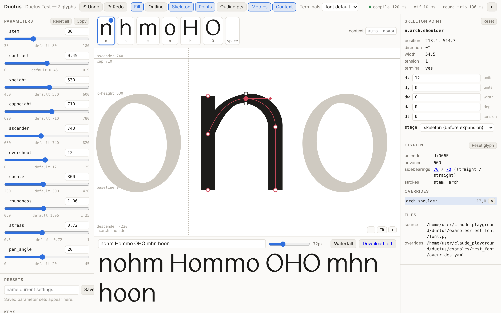
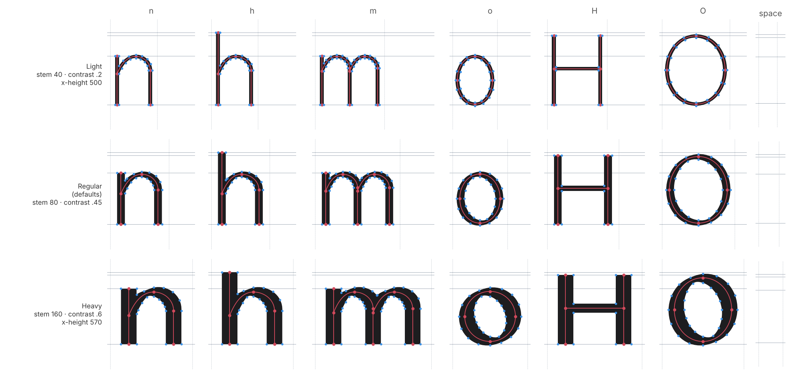
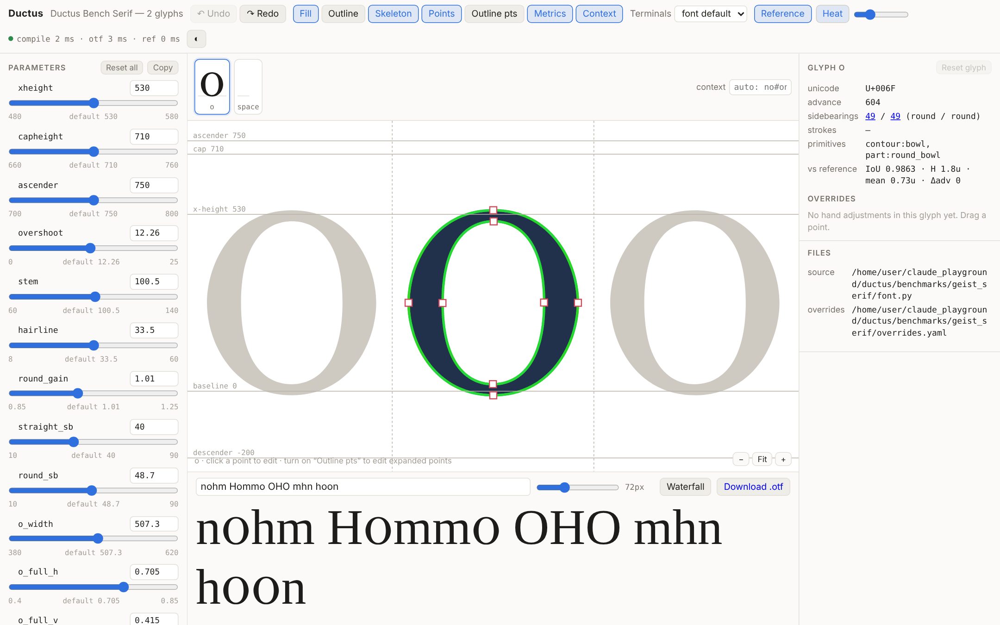

# Ductus

A parametric font design language and compiler: glyphs are described as
named strokes, contour parts and shared parameters (`font.py`), hand
adjustments live as deltas in `overrides.yaml`, and the compiler emits a CFF
`.otf`. The language grows by trying to represent real, high-quality type
and measuring the gap (SPEC rev. 2).

| | |
|---|---|
| `examples/test_font/` | M1 sans test font (`n h m o H O space`) |
| `examples/display_serif/` | **M2 original** high-contrast display serif — `hamburgefonstiv` + `HOAGES` |
| `benchmarks/geist_serif/` | M2 **internal benchmark only**, fitted to Geist Serif for measurement — never built or released |
| `docs/representability.md` | benchmark report, one row per glyph per iteration |
| `docs/display_serif/` | iteration sheets and self-critique for the original design |

## Status

**Milestone 1 — done.** Shared parts (`h`/`m` reuse the arch, `o`/`O` share a
bowl) · `ductus build` → `.otf` validated by fontTools round-trip and OTS ·
`stem`/`contrast`/`xheight` change every glyph · stem 40–160 sweep is
point-compatible · `n.arch.shoulder` override survives stem changes · editor
(sliders, draggable points → `overrides.yaml`, live text, ~110 ms slider
round trip) · `ductus test` passes, 55 unit tests · this README.

**Milestone 2 — all of `hamburgefonstiv` at target in the benchmark.** All §5 primitive families
exist and are tested: width profiles, L/R bias, **joins** (arches) and
**lobes** (stem bowls), contour bowls (rotation, asymmetric walls), cuts,
a terminal library with swappable sets, per-node width params, per-glyph
spacing, and the genre kit (`ductus.kits.serif`). Benchmark — all of
`hamburgefonstiv` + `H`, params by `ductus fit`, **0 overrides**, mean IoU 0.968:
**H 0.995 · i 0.992 · o 0.984 · u 0.977 · r 0.976 · f 0.973 · v 0.973 ·
n 0.973 · h 0.966 · m 0.962 · b 0.959 · t 0.959 · a 0.959 · e 0.951 ·
s 0.947 · g 0.946** IoU (exact, on the outlines), every glyph's Hausdorff
≤ 17 u, mean outline distance at the stroke ends 1.07 u — all meet the
target (IoU ≥ 0.93, Hausdorff ≤ 20 u, ≤ 2 overrides); see `docs/representability.md`. The
original display serif renders `hamburgefonstiv` + `H O A G E S`
(`docs/display_serif/`). Editor M2: reference onion skin, error heat map,
stage inspector, overrides grouped by kind, **primitive handles**. Still to
do: spacing (M5).





## Usage

```bash
pip install -e ".[proof,validate,serve,test]"

ductus serve examples/test_font/font.py                          # live editor at http://127.0.0.1:8765/

# M2 benchmark (reference is downloaded for measurement only, git-ignored)
python benchmarks/geist_serif/fetch_reference.py
ductus bench benchmarks/geist_serif/font.py --glyphs o --note "what changed"   # row + overlays in docs/
ductus fit   benchmarks/geist_serif/font.py --glyph o                          # tune params (not overrides)
ductus serve examples/display_serif/font.py --reference benchmarks/geist_serif/reference/GeistSerif-Regular.woff2
python examples/display_serif/make_sheet.py 03                                 # iteration sheet

ductus build examples/test_font/font.py -o out/                 # static .otf (validated with fontTools + OTS)
ductus build examples/test_font/font.py --set stem=120           # one-off parameter values
ductus build examples/test_font/font.py --sweep stem=40,160      # + point-compatibility check
ductus test  examples/test_font/font.py                          # all lints, default sweep = every ranged param at both ends
ductus proof examples/test_font/font.py --setting "Bold:stem=150" -o proof.png
python docs/make_proofs.py                                       # regenerate docs/ proofs
pytest
```

## The preview editor (`ductus serve`)

- **Sliders** for every ranged parameter (number fields for the rest),
  per-parameter reset, presets saved in the browser, and *Copy* to paste the
  current values back into `font.py` as Python. Parameter values in the
  editor are session state; the editor never rewrites Python.
- **Canvas**: the glyph in context (`context` field, `#` = the glyph being
  edited), metrics, skeleton, fill/outline views. Click a skeleton point
  to get handles:
  - drag the point: `dx`/`dy`
  - drag the ◆ handle: rotate the stroke direction there (`da`, ⇧ snaps to 15°)
  - drag the □ handles: change the stroke width there (`dw`)
  - `,` / `.` change curve tension (`dt`)
  - turn on *Outline pts* to drag expanded outline points (`stage: outline`)
  - drag the dashed advance lines to change sidebearings (`<glyph>.lsb/.rsb`)
- **Inspector**: resolved position/direction/width/tension of the selected
  point, numeric fields for every delta, the glyph's overrides list and
  stale-override warnings with one-click removal.
- **Undo/redo** (⌘Z / ⇧⌘Z); a whole drag is one undo step.
- **Text** typed in the panel is set in the freshly compiled `.otf` via the
  browser's `FontFace` API (with a waterfall view and a download button).
- Edits go to `overrides.yaml`; `font.py` and `overrides.yaml` are watched,
  so editing either in your editor updates the preview. A broken `font.py`
  shows an error banner and keeps the last good result.

Timings on the example font: full compile ≈ 65–90 ms (parameter changes),
single-glyph compile ≈ 10 ms (dragging); .otf emit ≈ 6–10 ms.

### Reference mode (`--reference`)



*Reference* draws the reference glyph (aligned on bbox centres) over ours with
adjustable opacity; *Heat* colours our outline by distance to it (green ≤ 1
unit → red ≥ 12 units); the inspector shows live IoU / Hausdorff / mean
distance / Δadvance. Scores are cached per outline, so a drag only rescores
the glyph being edited. Contour-part points (bowl extrema) are draggable
square handles.

## Benchmark (M2)

`ductus bench` compiles the font, aligns each glyph to the reference on the
horizontal centre of the bounding boxes (spacing is scored separately as
Δadv), and records raster IoU at 400 px/em, Hausdorff and mean outline
distance, override count and magnitude, and the primitives used. Overlays
(ours-only red, reference-only blue, worst point circled) go to
`docs/iterations/NN/`.

`ductus fit` tunes only *parameters* — measuring the language, not
hand-tuning skill. Options: `--param` globs; several `--glyph`s fit jointly;
`--method powell` for polishing; `--objective distance|iou|target`
(`target` adds a penalty for any glyph below the benchmark target — used for
the joint fit of shared params); `--only-improve` saves only if every glyph
improves; `--save fitted.yaml`. It splits parameters by perturbation into shape params and
spacing-only params; fits shape on mean outline distance (smooth, unlike
raster IoU) with a Sobol global sample then Nelder–Mead from the best three
starts; then fits spacing params in 1-D against the advance. Vertical metrics
fixed by the spec are excluded by default (`--exclude`).

**Licensing.** Geist Serif (SIL OFL) is fetched into a git-ignored folder and
used only for measurement and overlays. Its outlines are never copied or
imported; the fitted benchmark font stays in `benchmarks/` and is never built
for release. The original design in `examples/display_serif/` is never
fitted.

## Primitives for a high-contrast serif (M2)

| primitive | API | used by |
|---|---|---|
| width profiles | `p.path(..., profile=Profile((0, .2), (.35, 1), (1, 1)))`, `taper()`, `swell()`, `constant()` | n/h/m/r arch join, s spine, g ear/loop |
| L/R bias | `p.path(..., bias=0.4)` — share of the modulation left of travel | arches (thicker inside) |
| per-stroke pens | `Pen(angle=, width=, contrast=)` on any stroke | arches, hoods, monoline diagonals of v/A |
| contour bowls | `p.bowl(..., fullness=(h, v), stress=, rotate=)` | o O b e, g's loops |
| joins | `join(at, thin, angle, notch)` — how a part meets a stem: crotch height, hairline thickness, angle, notch | n h m r u arches |
| lobes | `p.lobe(edge_x, side, far, bottom, top_join, bottom_join, thick, thin_bottom, ...)` — a bowl closed by a stem at two joins | a (and d q b p) |
| node widths | `.curve_to(..., width=dw)` with params | the s's local weight |
| cuts | `p.cut(...)` subtracted after overlap removal; terminals can cut too | e and G apertures, wedge heads, flat cuts |
| terminal library | `bracketed(length, bracket, tip, curve, cup, slope, left=/right=)`, `wedge`, `beak`, `ball`, `flat(axis)`, all world-axis-aware | every serif, beak, ball, vertex |
| terminal sets | `TerminalSet(default, foot=..., head=..., ...)` keyed by end tags | swap the set → restyle the font |
| per-glyph spacing | `@glyph(..., sb=(dl, dr))` | v, A (negative sidebearings) |
| kits | `ductus.kits.serif`: constructions written once against a param namespace | benchmark *and* original font |

**Junctions** are first-class: one `Join` describes how any curved part meets
a stem, and both arches and lobes are built from it. **Optical rules** are parameters of the kit (overshoot, `round_gain`,
heavier cap stems, hairline horizontals from the pen) rather than a separate
pass. Both are candidates to become first-class if overrides start piling up
there (the *Overrides by kind* panel will show it).

## Bowls (contour parts)

```python
p.bowl(left, right, bottom, top, thick=stem, thin=hairline, stress=6,
       fullness=(0.60, 0.56), inner_fullness=(0.56, 0.62))
```

Outer + counter contours, each 4 named extrema (`o.bowl.outer.top`,
`o.bowl.inner.left`, …) and 4 cubic quadrants: always 4 on-curve + 8
off-curve points per contour. `fullness` is handle length as a fraction of
the quadrant (0.552 ≈ ellipse); an `(h, v)` pair sets the handles at the
top/bottom and at the sides separately (a superellipse with independent
exponents), or give 4 quadrants. `stress` rotates the counter's extrema
(positive = classic oblique). The two contours are oriented as one group so
the counter is always a hole.

### Primitive handles

Turn on **Handles**: orange arrows sit on primitive *parameters* rather than
points — serif length and bracket, wedge length and rise, beak length,
ball radius, join height and thickness, notch depth, taper length along an
arch, lobe joins and walls, bowl walls. Dragging one (or arrow keys, ⇧ ×10)
writes a **per-glyph parameter override** `n.@serif_len: { dv: 6 }`: the
parameter changes for that glyph only, clamped to its declared range. A
primitive registers a handle only when its value is a plain parameter (or
parameter × constant), so every drag maps to one parameter. Recurring
per-glyph overrides of the same parameter mean the shared value — or the
primitive — is wrong; *Overrides by kind* groups them as "glyph parameter".

## Overrides

```yaml
n.arch.shoulder:      { dx: 12, dy: 0 }                     # move a skeleton point
n.arch.join:          { dx: 0, dy: 0, dw: -18, da: -8 }     # thinner, steeper join
o.bowl.top:           { dx: 0, dy: 0, dt: 0.15 }            # flatter curve through the top
m.arch2.shoulder_out: { dx: -6, dy: 4, stage: outline }     # move both expanded points
o.lsb:                { dx: 6, dy: 0 }                      # sidebearing adjustment
n.@serif_len:         { dx: 0, dy: 0, dv: 8 }               # parameter changed for this glyph only
```

`dw` is interpolated linearly along the segments next to the node; `da`
rotates the direction of travel; `dt` changes the Hobby tension on both
sides of the node. None of them change point structure, so they are safe
for interpolation.

## Pipeline

`params → skeletons (parts) → skeleton overrides → broad-nib expansion →
terminals → outline overrides → overlap removal (skia-pathops), direction,
rounding → spacing → .otf`. `compile_font(font, params, overrides)` is a pure
function returning JSON-serialisable `CompiledFont` (outlines, skeletons,
named points, metrics).

**Pen model.** `w(θ) = hair + k·soft|sin(θ − angle)|`, `hair = stem·(1−contrast)`,
with `k` chosen so vertical strokes are exactly `stem` (that's what the stem
lint measures). Each side of a stroke is offset along the normal and refitted
with a **fixed 4 cubics per skeleton curve** (1 line per skeleton line), so
point structure never depends on parameter values. Worst-case fitting error is
~2 units at stem 180 / contrast 0.9 (tested < 3).

**Stress (`Pen(inside=...)`).** For closed strokes, `inside` is the share of
the thick/thin modulation put on the counter side. 0.5 offsets symmetrically
(the outer contour of a bowl becomes egg-shaped with an oblique pen); higher
values keep the outer contour elliptical and put the stress into the counter.
The example font uses `stress = 0.72`.

## Decisions on the open questions (SPEC §13)

- **Bowl construction:** named-extrema construction (4 extrema + quadrant
  handles), not a superellipse formula — every control is a nameable point
  or a handle ratio, and the point structure is fixed. The `(h, v)` fullness
  gives the superellipse's independent-exponent freedom.
- **Hobby vs Spiro:** Hobby. Skeleton curves already use Hobby's handle
  lengths with per-node tension; the full Hobby direction solve (mock
  curvature continuity) arrives with `n`, where arches need it. Spiro would
  make tension less direct to expose.
- **Width profiles:** small knot curves over t in [0, 1] (smoothstep between
  knots), knot values are params so they're fittable; helpers `taper`,
  `swell`, `constant`. Profile × direction model, then split L/R by `bias`.
- **IoU/Hausdorff targets:** set after `n`; working assumption in
  `docs/representability.md`.

- **DSL ergonomics:** decorators (`@part`, `@glyph`) over builder objects.
  Parts are deferred calls, so `g.inherit("n"); g["stem"].top = ascender`
  edits the inherited part's arguments before it runs. Inherited glyphs are
  re-scoped (`h.arch.shoulder`); **overrides are not inherited**.
- **Naming:** `glyph.instance[.stroke].node`; a part drawing a single stroke
  collapses to `glyph.instance.node`. Outline points add `.l` / `.r`.
  Duplicate names are a compile error.
- **Skeleton overrides** move points freely in x/y (not constrained to the
  curve); curve handles are re-derived from node directions afterwards, so
  a moved node stays smooth.
- **Grid rounding:** only at the end (after overlap removal).
- **Points created by overlap removal** are unnamed and not overridable.
  Merged-outline topology can change across a sweep (the stroke/arch junction
  slides between fitted sub-segments); `test` reports this as info. The
  pre-merge stroke outlines are strictly compatible and are what a
  variable-font build (M2) will interpolate.
- **Spacing:** sides are `straight` if a vertical skeleton line sits at the
  extreme, else `round`; sidebearings come from `font.sidebearings`.
